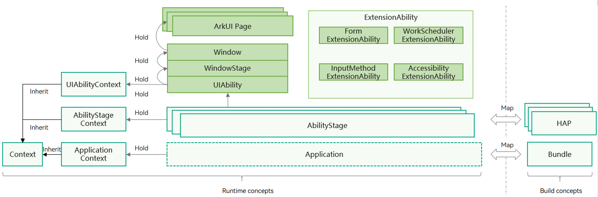
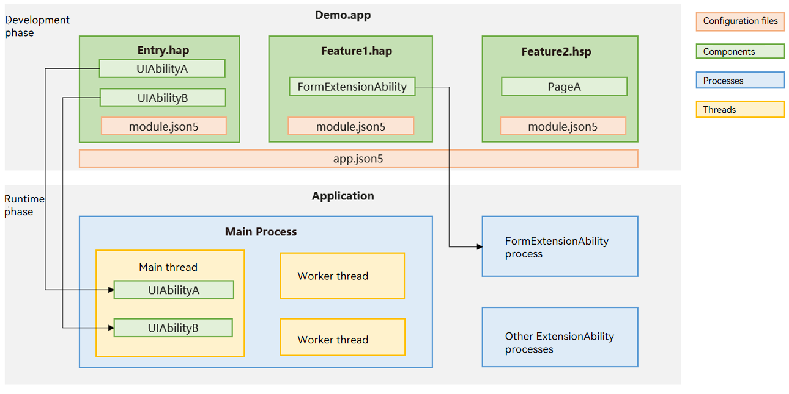

# Application Model Overview

<!--Kit: Ability Kit-->
<!--Subsystem: Ability-->
<!--Owner: @ccllee1; @Luobniz21-->
<!--Designer: @ccllee1-->
<!--Tester: @liangchengguang-->
<!--Adviser: @HelloCrease-->
<!-- md-trans-meta sourceCommit=2f4b89223ea807a0581c60a9a81b8de70ba28fa9 translatedAt=2026-10-15T12:56:03.467Z pushedAt=2026-10-15T13:04:38.814Z -->

## Application Model Overview

An application model is an abstraction of the capabilities required by an application, provided by the system for developers. It provides the essential components and running mechanisms of an application. The application model offers developers a unified development model, making application development simpler and more efficient.

The application model that is currently promoted and will evolve over the long term is the stage model, supported since API 9. This model provides the AbilityStage component manager and the WindowStage window manager, which serve as the "stages" for application components and windows, respectively, hence the name "stage model".

The stage model allows multiple application components to share a single ArkTS engine instance and supports state sharing and object invocation between components. This reduces memory overhead and enhances development efficiency, making it well-suited for complex application development.

> **NOTE**
> 
> - As the application model evolves, the FA model supported since API 7 is no longer promoted. Currently, the FA model is mainly used for Lite Wearable devices. For details, see [Application Model Development Overview](fa-model-development-overview.md).
> - Unless otherwise specified, "application model" mentioned in the documentation refers to the "stage model".

## Basic Concepts

The following figure illustrates the [stage model](ability-terminology.md#stage-model).

**Figure 1** Stage model

- [AbilityStage](abilitystage.md)

  Each [HAP](../quick-start/hap-package.md) of the Entry or Feature type has an instance of the AbilityStage class at runtime. When the code in the [HAP](../quick-start/hap-package.md) is loaded to a process for the first time, the system creates an AbilityStage instance first.

- [UIAbility](uiability-overview.md) and [ExtensionAbility](extensionability-overview.md) components

  The stage model provides two types of application components: UIAbility and ExtensionAbility. Both have specific classes and support object-oriented development.

  - UIAbility is a type of application component that provides the UI for user interaction. For example, with a UIAbility component, the Gallery application can display images in the liquid layout. After a user selects an image, it uses a new UI to display the image details. The user can touch the **Back** button to return to the liquid layout. The lifecycle of the UIAbility component contains the **Create**, **Destroy**, **Foreground**, and **Background** states. Display-related states are exposed through WindowStage events.

  - The ExtensionAbility component is an application component oriented to specific scenarios. Developers do not derive directly from the ExtensionAbility component; instead, they need to use its derived classes. Currently, the ExtensionAbility component has multiple derived classes based on specific scenarios, such as FormExtensionAbility for the widget scenario, InputMethodExtensionAbility for the input method scenario, and WorkSchedulerExtensionAbility for the deferred task scenario. For example, to create a widget for an application on the home screen, developers need to derive from FormExtensionAbility, implement its callback functions, and configure the capability in the configuration file. Instances of the derived classes of the ExtensionAbility component are created when triggered by users, and their lifecycles are managed by the system. In the stage model, third-party application developers cannot develop custom services; instead, they need to implement them through the derived classes of the ExtensionAbility component based on their own business scenarios.

  A HAP can contain one or more UIAbility or ExtensionAbility components, which share the same AbilityStage instance at runtime. When the code (whether it is a UIAbility or an ExtensionAbility component) in the [HAP](../quick-start/hap-package.md) is first loaded into the process, the system creates the corresponding AbilityStage instance.
- [WindowStage](../reference/apis-arkui/arkts-apis-window-WindowStage.md)

  Each UIAbility instance is bound to a WindowStage instance, which functions as the window manager in the application process. The WindowStage class instance contains a main window. In other words, a UIAbility instance holds a main window through WindowStage, which provides a drawing area for ArkUI and can load different ArkUI pages.

- [Context](application-context-stage.md)

  In the stage model, Context and its derived classes provide developers with various resources and capabilities that can be called at runtime. The UIAbility component and the derived classes of various ExtensionAbility components each have their own Context classes, all of which inherit from the base class Context but provide different capabilities according to their respective components.

- ArkUI page

  An ArkUI page is a user interface component built on the ArkUI framework. It can combine different UI components to achieve complex page effects. The UIAbility component can display its functions through an ArkUI page and interact with users via the ArkUI page as well.

- Application

  Application is a running instance of an app on a device, acting as a complete software entity to interact with users. In the stage model, it consists of one or more HAPs as functional modules, and these HAPs can share code and resources in one or more HSPs.

- Bundle

  A bundle is a static file of an application during the installation and deployment phase, containing all HAPs, HSPs, and related resources. When it is installed and launched, it forms a dynamic runtime instance (Application).

## Elements
The elements of the application model mainly include application components, the process model, the thread model, the task management model, and application configuration files.

### Application Components

Application components are the basic building blocks and running entry of an application.

When a user starts, uses, and exits an application, the application components switch between different states, which are called the [application component lifecycle](uiability-lifecycle.md).

Application components provide lifecycle callback functions, through which developers can perceive changes in the application state.

When developing an application, developers first need to write the application components and their lifecycle callback functions, and configure the relevant information in the application configuration file. At runtime, the operating system creates application component instances based on the configuration file and schedules their lifecycle callback functions, thereby executing the developer's code.

### Process Model

The process model defines how application processes are created and destroyed, as well as how processes communicate with each other.

### Application Thread Model

The application thread model defines how threads are created and destroyed within an application process, how the main thread and UI thread are created, and how threads communicate with each other.

### Application Task Management Model (System Applications Only)

The application task management model defines how tasks (missions) are created and destroyed, as well as the relationship between tasks and components.

A task is a record of a user using an application component instance. Each time a user starts a new application component instance, a new task is generated.

For example, when a user starts a video application, the video application task is displayed in the recent tasks screen. When the user taps this task, the system switches the task to the foreground. If the video editing feature in this video application is also implemented through an application component, starting the video editing feature creates a video editing application component instance, and both the video application task and the video editing task are displayed in the recent tasks screen.

### Application Configuration File

The application configuration file contains application configuration information, application component information, permission information, and developer-defined information. This information is provided to the compilation tool, application market, and operating system during the compilation, distribution, and running phases, respectively.

### Sample Application Components

The following uses the Demo.app application as an example to describe the development phase and running phase separately, helping you better understand the components of the stage model.

The Demo.app application mainly implements the following features:
- Implements two independent windows with UIs (UIAbilityA and UIAbilityB) for user interaction.
- Implements widget functionality to allow users to add the application's widgets to the home screen.

**Figure 2** Elements of the stage model

**Development phase**: You need to use the application components provided by the stage model (UIAbility and ExtensionAbility components) to develop application functionalities and register relevant application information in the configuration files (**app.json5** and **module.json5**).

- Application components: In this example, UIAbility components are used to develop modules with UIs for interaction, and FormExtensionAbility components are used to develop the widget module, implementing widget addition, deletion, and updates. To reduce dependencies and coupling between different modules, UIAbility and FormExtensionAbility implementations are placed in separate HAP files, whereas common functionalities shared by both are placed in an HSP file.

- Configuration files: You can configure the application name, version number, and application icon in **app.json5**, and component lists and permissions of the HAP in **module.json5**. These configuration details are registered with the system during application installation, facilitating system and other modules to obtain detailed information about the application and interact with it.

**Runtime phase**: When the application is installed and running on the device, the system uses a set of application process and thread management mechanisms to ensure orderly operation. <!--Del-->Additionally, a mission management mechanism is provided to manage mission creation, destruction, and foreground/background switching.<!--DelEnd-->

- Process model: In this example, the UIAbility component runs in the main process by default, and the FormExtensionAbility component runs in an independent process. The UIAbility and FormExtensionAbility components are isolated from each other at the process level. For details, see [Process Model Overview](process-model-overview.md).

- Thread model: The stage model provides mechanisms such as Worker and TaskPool to support multithreaded development scenarios. If the application has complex, time-consuming logic to handle, it can create Worker threads to offload the processing.

<!--Del-->
- Mission management model: When a UIAbility is running, the system creates a corresponding mission. For example, when UIAbilityA in the figure is running, the mission for the Demo.app application can be seen in the recent task list. When the user taps this mission, the system brings UIAbilityA to the foreground.
<!--DelEnd-->

## Samples

The following sample is provided to help you better understand how to develop an ability on the stage model:

- [Stage Model (ArkTS, Full SDK, API version 10)](https://gitcode.com/openharmony/applications_app_samples/tree/master/code/SystemFeature/ApplicationModels/StageModel)