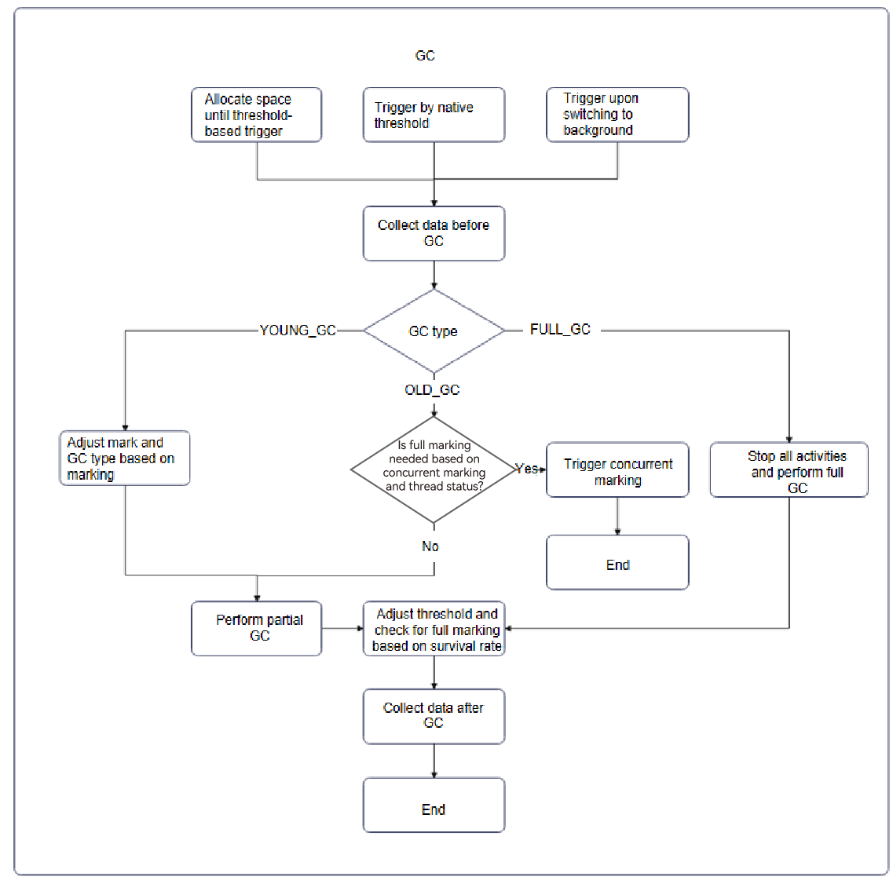
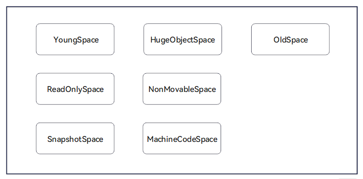

# GC
<!--Kit: ArkTS-->
<!--Subsystem: ArkCompiler-->
<!--Owner: @dwhuawei-->
<!--Designer: @dwhuawei-->
<!--Tester: @kirl75; @zsw_zhushiwei-->
<!--Adviser: @k1ngqaquuu-->
<!-- md-trans-meta sourceCommit=0091dc157d56270a93a4121b4c31a1ab44489d46 translatedAt=2026-10-29T12:47:41.327Z pushedAt=2026-10-29T13:08:49.202Z nl=1 -->

Garbage Collection (GC) is a process that identifies and reclaims memory no longer in use by a program. It aims to free up unused memory space. Modern programming languages implement two primary types of GC algorithms: reference counting and tracing GC.

## GC Algorithm Overview

### Types of GC

**Reference Counting**

When object A is referenced by object B, A's reference count increases by 1. Conversely, when the reference is removed, A's reference count decreases by 1. When A's reference count reaches 0, object A is reclaimed.

- Pros: Reference counting is simple to implement and allows for immediate memory reclamation, avoiding a dedicated Stop The World (STW) phase where the application is paused.
- Cons: The extra counting step during object manipulation increases the overhead of memory allocation and assignment, affecting performance. There is a risk of memory leaks caused by circular references.
<!-- @[reference_counting](https://gitcode.com/openharmony/applications_app_samples/blob/master/code/DocsSample/ArkTS/ArkTSRuntime/ArkTSGC/entry/src/main/ets/ReferenceCounting.ts) -->

``` TypeScript
class Parent {
  constructor() {
    this.child = null;
  }
  child: Child | null = null;
}

class Child {
  constructor() {
    this.parent = null;
  }
  parent: Parent | null = null;
}

function main() {
  let parent: Parent = new Parent();
  let child: Child = new Child();
  parent.child = child;
  child.parent = parent;
}
```
In the code above, the **parent** object holds a reference to the **child** object, incrementing the reference count of **parent**. Simultaneously, the **child** object is also held by the **parent** object, incrementing the reference count of **child**. This forms a circular reference. As a result, the **parent** and **child** objects cannot be released until the main function ends, causing a memory leak.
**Tracking GC**


Root objects include stack objects and global objects that are guaranteed to be alive at a given moment during program execution. All objects (reachable objects) that can be accessed through reference chains starting from root objects are alive. By traversing these references, all live objects can be identified. As illustrated in the diagram, starting from the root objects, objects that are reachable are marked in blue, indicating they are live; the remaining unreachable objects are marked in yellow, indicating they are garbage.

- Pros: Tracing GC solves the circular reference problem and does not incur additional overhead during memory allocation and assignment.
- Cons: Tracing GC is more complex than reference counting and introduces a brief STW phase. Moreover, GC can be delayed, leading to floating garbage.

Both reference counting and object tracing algorithms have their pros and cons. Given the memory leak issues associated with reference counting, ArkTS Runtime opts for a GC design based on object tracing (tracing GC).

### Types of Tracing GC

Tracing GC algorithms identify garbage by traversing objects. Based on the collection method, tracing GC can be categorized into three basic types: mark-sweep, mark-copy, and mark-compact. In the diagrams below, blue indicates live objects, whereas yellow indicates garbage.

**Mark-Sweep Collection**


  
After the object graph traversal is complete, delete the content of unreachable objects and place them in the free queue for the next object allocation.

This collection method does not move objects and is highly efficient. However, the memory addresses of collected objects are not contiguous, which causes memory fragmentation and reduces allocation efficiency. In extreme cases, even if there is a large amount of free memory, a large object may still fail to be placed.  

**Mark-Copy Collection**


When traversing the object graph, copy the reachable objects to a new memory space. After the traversal is complete, reclaim the old memory space.

This method can solve the memory fragmentation issue. It completes the entire GC process in a single traversal and is highly efficient. However, in extreme cases, half of the memory space must be reserved to ensure that all reachable objects can be copied, which results in low space utilization.

**Mark-Compact Collection**


After the traversal, live objects (blue) are copied to the beginning of the current space (or a designated area), and the copied objects are reclaimed and placed in the free list.
- Pros: This method solves the problem of a large number of memory fragments caused by mark-sweep collection and avoids the waste of half of the memory space caused by mark-copy collection.
- Cons: Compared with mark-copy collection, mark-compact collection has higher performance overhead.
### HPP GC

High Performance Partial Garbage Collection (HPP GC) is designed for high performance in partial GC, leveraging generational models, hybrid algorithms, and optimized GC processes. HPP GC uses different collection methods for different object areas.

**Generational Model**

ArkTS Runtime uses a traditional generational model, categorizing objects based on their lifetimes. Most newly allocated objects are reclaimed after one GC cycle, while most objects that survive multiple GC cycles continue to exist. ArkTS Runtime divides objects into young and old generations and allocates them to separate spaces.


The ArkTS runtime directly allocates newly allocated objects to the From space of the young generation (YoungSpace, also known as SemiSpace). Objects that remain alive after one GC are moved to the To space. Objects that remain alive after another GC are moved to the old generation (OldSpace).

**Hybrid Algorithm**

HPP GC is a hybrid algorithm that combines partial copy, partial compact, and partial sweep. It adopts different collection methods based on the characteristics of young generation and old generation objects.

- Mark-copy for young generation

Given the short lifetimes, small size, and frequent collection of young generation objects, ArkTS Runtime uses the mark-copy algorithm to efficiently reclaim memory for these objects.

- Mark-compact + mark-sweep for old generation

Based on the characteristics of old generation objects, a heuristic collection set (CSet) algorithm is used. This algorithm collects the sizes of live objects in each region during the marking phase. During the collection phase, ArkTS Runtime uses mark-compact for regions with fewer live objects and lower collection costs, but mark-sweep for the remaining regions.

The collection policies are as follows:

- Identifies regions with live object sizes below a threshold, places them in the initial CSet, and sorts them by liveness (survival rate = live object size/region size).

- Selects a final CSet based on a predefined number of regions for compaction.

- Sweeps the remaining regions.

This heuristic approach combines the benefits of mark-compact and mark-sweep algorithms, addressing memory fragmentation while maintaining performance.

**Process Optimization**

HPP GC introduces extensive concurrency and parallelism optimizations to minimize the impact on application performance. The GC process includes concurrent and parallel marking, sweeping, evacuation, updating, and clearing tasks.

## GC Process



### Types of HPP GC

**Young GC**

- Trigger mechanism: The young generation GC trigger threshold ranges from 2 MB to 16 MB and varies with the allocation rate and survival rate.
- Function description: Mainly collects young generation objects newly allocated in YoungSpace.
- Scenario: Foreground scenario.
- Log key: `[ HPP YoungGC ]`

**Old GC**

- Trigger mechanism: The old generation GC trigger threshold varies between 20 MB and 300 MB. Typically, the threshold for the first Old GC is about 20 MB, and it is subsequently adjusted based on the object survival rate and memory usage.
- Function description: Performs compact collection on the young generation and part of the old generation space, and performs cleanup on other spaces. It is triggered far less frequently than the young generation GC. Because it performs full marking, the GC time is longer than that of the young generation GC, with a single run taking about 5 ms to 10 ms.
- Scenario: Foreground scenario.
- Log keywords: `[ HPP OldGC ]`

**Full GC**

- Trigger mechanism: It is not triggered by a memory threshold. After the application switches to the background scenario, if the predicted reclaimable object size exceeds 2 MB, a Full GC is triggered. The DumpHeapSnapshot and AllocationTracker tools trigger a Full GC by default. It can also be triggered through native APIs and ArkTS APIs.
- Function description: Performs full compaction on the young generation and old generation. It is mainly used in performance-insensitive scenarios to reclaim memory to the maximum extent.
- Scenario: Background scenario.
- Log keywords: `[ CompressGC ]`

After that, Smart GC or Idle GC selects one of the three GC types described above.

### Trigger Strategies

**Space Threshold Triggering**

- Restriction parameters: corresponding space thresholds
- Strategy description: triggers GC when the space requested by objects reaches the threshold.
- Log keywords: **GCReason::ALLOCATION_LIMIT**

**GC Triggered When the Native Bound Size Reaches the Threshold**

- Restriction parameters: `globalSpaceNativeLimit`
- Policy description: performs full marking and enables concurrent marking based on conditions.

**Background Switch Triggering**

- Strategy description: actively triggers a full GC after the application switches to the background.
- Typical logs: `app is inBackground` and `app is not inBackground`. GCReason::SWITCH_BACKGROUND can be distinguished in GC logs.

**Triggering GC When Idle**

- Trigger conditions:
  - Young GC: the young generation object allocation exceeds expectations, and the space usage reaches the threshold.
  - Old GC: the old generation object growth exceeds expectations, and any of the following conditions is met:
    - The Native bound memory growth exceeds the threshold.
    - The old generation space usage reaches the idle limit threshold.
    - The global allocation limit reaches the idle limit threshold.
  - Full GC: any of the following conditions is met:
    - The heap object size exceeds the expectation.
    - The fragmentation size exceeds the expectation.
- Policy description: when the application is idle, select an appropriate GC type for collection based on memory usage, avoiding triggering GC in performance-sensitive scenarios that would affect user experience.
- Typical logs: `IdleGCTrigger: trigger full gc`, `IdleGCTrigger: trigger young gc`. GCReason::IDLE can be distinguished in GC logs.

### Execution Strategies

**Concurrent Marking**

- Policy description: attempts to trigger concurrent marking, offloading the task of traversing and marking objects to a thread pool for concurrent execution, reducing the UI main thread suspension time.
- Typical logs: `fullMarkRequested`, `trigger full mark`, `Trigger the first full mark`, `Trigger full mark`, `Trigger the first semi mark`, `Trigger semi mark`.

**Threshold Adjustment Before and After YoungSpace GC**

- Policy description: adjusts the YoungSpace trigger threshold after GC to optimize the space structure.
- Typical logs: no direct logs. It can be observed from GC statistics logs that the YoungSpace threshold is dynamically adjusted before GC.

**Threshold Adjustment After the First Old GC**

- Strategy description: adjusts the Old Space threshold based on the minimum growth step and average survival rate.
- Log keyword: `AdjustOldSpaceLimit`

**Adjustment of OldSpace and GlobalSpace thresholds and the growth factor for the second and subsequent Old GCs**

- Policy description: Based on changes in the current GC statistics, recalculate and adjust newOldSpaceLimit, newGlobalSpaceLimit, globalSpaceNativeLimit, and the growth factor.
- Log keyword: `RecomputeLimits`

**CSet Selection Strategies for Partial Old GC**

- Policy description: When a Partial GC is executed, Regions with fewer live objects and lower collection cost are preferentially selected for collection.
- Typical Logs
    - `Select CSet failure: number is too few`
    - `Max evacuation size is 6_MB. The CSet Region number`
    - `Select CSet success: number is`

## Heap

The Heap contains two types: LocalHeap and SharedHeap. LocalHeap is the virtual machine heap exclusively owned by each ArkTS thread in an application process, while SharedHeap is the virtual machine heap shared by all ArkTS threads in an application process.

### LocalHeap Structure



- YoungSpace: the young generation (Young Generation), also known as SemiSpace, stores newly created objects with a low survival rate. It mainly uses the semi-space copy algorithm for memory collection.
- OldSpace: the old generation (Old Generation), stores objects that survive multiple collections in the young generation and are then moved to this space. It uses a mix of algorithms for memory collection based on the scenario.
- HugeObjectSpace: the large object space, uses a separate Region to store a single large object.
- ReadOnlySpace: the read-only space, stores read-only data during runtime.
- NonMovableSpace: the non-movable space, stores non-movable objects.
- SnapshotSpace: the snapshot space, used when dumping heap snapshots.
- MachineCodeSpace: the machine code space, stores program machine code.

> **NOTE**<br/>
> Each space is managed by one or more Regions. A Region is the unit requested by a space from the memory allocator.

### LocalHeap-related Parameters

> **NOTE**
> 
> Unless otherwise indicated as configurable, the following parameters are non-configurable and are set by the system.

Based on the three ranges of the total heap space size allocated by the system (64 MB-128 MB, 128 MB-256 MB, and greater than 256 MB), the system sets different values for the following parameters. If a range in the table contains only one value, the parameter value does not change with the total heap space size. On phone devices, the total heap space size is greater than 256 MB by default.

Developers can refer to [@ohos.hidebug](../reference/apis-performance-analysis-kit/js-apis-hidebug.md) and use the related APIs to query memory information.

**Heap Size-related Parameters**

| Name | Range | Description |
| --- | --- | --- |
| HeapSize | 448 MB | Total heap space size of the main thread by default. On small-memory devices (such as watches), this heap space size is automatically adjusted based on the actual device memory size. |
| SemiSpaceSize | 2 MB-4 MB/2 MB-8 MB/2 MB-16 MB | SemiSpace space size. |
| NonmovableSpaceSize | 2 MB/6 MB/64 MB | NonmovableSpace space size. |
| SnapshotSpaceSize | 512 KB | Snapshot space size. |
| MachineCodeSpaceSize | 2 MB | Machine code space size. |

**Worker Thread Heap Limit**

| Name | Range | Description |
| --- | --- | --- |
| HeapSize  | 768 MB | Heap space size of a Worker-type thread. |

**SemiSpace**

Two SemiSpaces are generated in the Heap for copy collection.

| Name | Range | Function |
| --- | --- | --- |
| semiSpaceSize | 2MB-4MB/2MB-8MB/2MB-16MB | SemiSpace space size, with different range limits depending on the total heap size. |
| semiSpaceTriggerConcurrentMark | 1MB/1.5MB/1.5MB | Threshold value for triggering concurrent mark of SemiSpace independently for the first time. The mark is triggered when this value is exceeded. |
| semiSpaceStepOvershootSize| 2MB | Maximum allowed overshoot size. |

**OldSpace and HugeObjectSpace**

Both are set to the size of the remaining unallocated heap space during initialization. By default, the upper limit of the OldSpace size for the main thread on mobile devices is close to 350MB.

| Name | Range | Function |
| --- | --- | --- |
| oldSpaceOvershootSize | 4MB/8MB | Maximum allowed overshoot size of OldSpace. |

**Other Spaces**

| Name | Range | Function |
| --- | --- | --- |
| defaultReadOnlySpaceSize | 256KB | Default space size of ReadOnlySpace. |
| defaultNonMovableSpaceSize | 2MB/6MB/64MB | Default space size of NonMovableSpace.|
| defaultSnapshotSpaceSize | 512KB/4MB | Default space size of SnapshotSpace.|
| defaultMachineCodeSpaceSize | 2MB/8MB | Default space size of MachineCodeSpace.|

**Interpreter Stack Size**

| Name | Value | Function |
| --- | --- | --- |
| maxStackSize | 128KB | Controls the size of the interpreter stack. |

**Concurrency Parameters**

| Name | Value | Function |
| --- | --- | --- |
| gcThreadNum | 7 | Number of GC threads, which is 7 by default. It can be set through the `gc-thread-num` parameter. |
| MIN_TASKPOOL_THREAD_NUM | 3 | Minimum number of threads in the thread pool. |
| MAX_TASKPOOL_THREAD_NUM | 7 | Maximum number of threads in the thread pool. |

This thread pool is mainly used to execute concurrent tasks in the GC process. When the thread pool is initialized, gcThreadNum and the upper and lower limits of the thread count are considered comprehensively. If gcThreadNum is a negative value, the number of threads in the thread pool is initialized to half of the number of CPU cores.

**Other parameters**

| Name | Value | Description |
| --- | --- | --- |
| minAllocLimitGrowingStep | 2MB/4MB/8MB | When the heap recalculates the overall space size limit, this parameter controls the minimum growth step of OldSpace, heapObject, and globalNative. |
| minGrowingStep | 4MB/8MB/16MB | Adjusts the minimum growth step of OldSpace. |
| longPauseTime | 40ms | Determines the threshold for an excessively long GC. An excessively long GC triggers the printing of complete GC log information, making it easier for developers to locate and analyze issues. It can be configured through `gc-long-paused-time`. |


### Shared Heap Structure


- SharedOldSpace: the old generation space of the shared heap, which stores general shared objects.
- SharedHugeObjectSpace: the shared heap huge object space, which uses a separate Region to store the space of a huge object.
- SharedReadOnlySpace: the shared heap read-only space, which stores read-only data during runtime.
- SharedNonMovableSpace: the shared heap non-movable space, which stores non-movable shared objects.

> **NOTE**
>
> SharedHeap is used to store objects shared between threads, improving efficiency and saving memory. The shared heap does not belong to any single thread; it stores objects that have sharing value, improving the survival rate of objects.
>
> SharedHeap removes the SemiSpace type because shared objects usually have a long lifecycle and do not need the copy algorithm of the young generation.
>
> Each space is managed by one or more Regions for partitioned management. A Region is the unit requested by a space from the memory allocator.

### SharedHeap Related Parameters

The following parameters apply to large-memory devices such as phones. Developers can obtain Shared heap memory information through [getAllVMHeapMemoryInfo](../reference/apis-arkts/js-apis-util.md#getallvmheapmemoryinfo24).

> **NOTE**
>
> The upper threshold limits of SharedOldSpace and SharedHugeObjectSpace are both set to half of the remaining unallocated space of SharedHeap during shared heap initialization. The default allocated space limit on mobile devices is close to 350 MB, and exceeding this value causes memory overflow.

| Name                    | Range                       | Description                                           |
| -------------------- | ------------------------ | -------------------------------------------- |
| SharedHeapSize       | 778MB                    | Total size of the default SharedHeap heap space.             |
| SharedOldSpaceSize   | About 350MB                    | Space capacity of SharedOldSpace.             |
| SharedHugeObjectSpaceSize      | About 350MB                    | Space capacity of SharedHugeObjectSpace.             |
| SharedReadOnlySpaceSize          | 256KB                    | Space capacity of SharedReadOnlySpace.             |
| SharedNonMovableSpaceSize        | 64MB             | Space capacity of SharedNonMovableSpace.           |

## Features

### Smart GC

Smart GC is an intelligent GC suppression mechanism that reduces the GC trigger frequency by temporarily raising the GC trigger threshold in cold start scenarios and performance-sensitive scenarios, thereby avoiding frame drops caused by GC and improving user experience.

**Supported Scenarios**

- Application cold start
- Application scrolling
- Page transitions via clicks
- Jumbo frame

**Precautions**

- Smart GC does not take effect on Worker threads and TaskPool threads; it takes effect only on the main thread.
- If a sensitive scenario lasts too long, object allocation may still reach the raised GC threshold and trigger GC. In this case, because more objects have accumulated, the GC time will be longer.
- This feature is managed by the system, and third-party applications currently have no API to call it directly.

**Log Keywords**

- Sensitive scenario: `SmartGC: set high sensitive status`
- Cold start scenario: `SmartGC: app cold start just finished`

**Interaction Process**


## Log Interpretation

### Enabling Full Logs

By default, detailed GC logs are printed only when GC duration exceeds 40 ms. To enable logs for all GC executions, run commands on the device.

**Example**

```shell
# Enable full GC logs with parameter 0x905d. Disable full GC logs and revert to the default value (0x105c).
hdc shell param set persist.ark.properties 0x905d
# Reboot to apply changes.
hdc shell reboot
```

### Typical Logs

The following logs represent a complete GC execution, with variations based on the type of GC. You can search for the keyword `[gc]` in the exported log file to view GC logs. You can also check for the keyword `ArkCompiler` to view more comprehensive VM logs.

```text
// Pre-GC object size (region size) -> Post-GC object size (region size), total duration (+concurrentMark duration), GC trigger reason.
C03F00/ArkCompiler: [gc]  [ CompressGC ] 26.1164 (35) -> 7.10049 (10.5) MB, 160.626(+0)ms, Switch to background
// Various states during GC execution and application name.
C03F00/ArkCompiler: [gc] IsInBackground: 1; SensitiveStatus: 0; OnStartupEvent: 0; BundleName: com.example.demo;
// Duration statistics for each GC phase.
C03F00/ArkCompiler: [gc] /***************** GC Duration statistic: ****************/
C03F00/ArkCompiler: [gc] TotalGC:                 160.626 ms
C03F00/ArkCompiler: Initialize:              0.179   ms
C03F00/ArkCompiler: Mark:                    159.204 ms
C03F00/ArkCompiler: MarkRoots:               6.925   ms
C03F00/ArkCompiler: ProcessMarkStack:        158.99  ms
C03F00/ArkCompiler: Sweep:                   0.957   ms
C03F00/ArkCompiler: Finish:                  0.277   ms
// Memory usage statistics after GC.
C03F00/ArkCompiler: [gc] /****************** GC Memory statistic: *****************/
C03F00/ArkCompiler: [gc] AllSpaces        used:  7270.9KB     committed:   10752KB
C03F00/ArkCompiler: ActiveSemiSpace  used:       0KB     committed:     256KB
C03F00/ArkCompiler: OldSpace         used:  4966.9KB     committed:    5888KB
C03F00/ArkCompiler: HugeObjectSpace  used:    2304KB     committed:    2304KB
C03F00/ArkCompiler: NonMovableSpace  used:       0KB     committed:    2304KB
C03F00/ArkCompiler: MachineCodeSpace used:       0KB     committed:       0KB
C03F00/ArkCompiler: HugeMachineCodeSpace used:       0KB     committed:       0KB
C03F00/ArkCompiler: SnapshotSpace    used:       0KB     committed:       0KB
C03F00/ArkCompiler: AppSpawnSpace    used: 4736.34KB     committed:    4864KB
C03F00/ArkCompiler: [gc] Anno memory usage size:  45      MB
C03F00/ArkCompiler: Native memory usage size:2.99652 MB
C03F00/ArkCompiler: NativeBindingSize:       0.577148KB
C03F00/ArkCompiler: ArrayBufferNativeSize:   0.0117188KB
C03F00/ArkCompiler: RegExpByteCodeNativeSize:0.280273KB
C03F00/ArkCompiler: ChunkNativeSize:         19096   KB
C03F00/ArkCompiler: [gc] Heap alive rate:         0.202871
// Summary statistics for this type of GC in the VM.
C03F00/ArkCompiler: [gc] /***************** GC summary statistic: *****************/
C03F00/ArkCompiler: [gc] CompressGC occurs count  6
C03F00/ArkCompiler: CompressGC max pause:    2672.33 ms
C03F00/ArkCompiler: CompressGC min pause:    160.626 ms
C03F00/ArkCompiler: CompressGC average pause:1076.06 ms
C03F00/ArkCompiler: Heap average alive rate: 0.635325
```

- GC type, which can be [HPP YoungGC], [HPP OldGC], [CompressGC], and [SharedGC].
- **TotalGC**: total duration. The following lists the duration for each phase, including `Initialize`, `Mark`, `MarkRoots`, `ProcessMarkStack`, `Sweep`, and `Finish`. The actual phases may vary depending on the GC process.
- **IsInBackground**: whether the application is in the background. **0**: foreground; **1**: background.
- **SensitiveStatus**: whether the application is in a [sensitive scenario](#smart-gc). **0**: non-sensitive scenario; **1**: sensitive scenario; **2**: sensitive scenario exited.
- **OnStartupEvent**: whether the application is in the cold start scenario. **0**: non-cold start scenario; **1**: cold start scenario
- **used**: actual memory usage of allocated objects.
- **committed**: actual memory allocated to the heap. Since memory spaces are allocated in regions that are not always fully utilized by objects, **committed** is greater than or equal to **used**. For Huge Space, these values are equal because each object occupies a separate region.
- **Anno memory usage size**: total memory usage of all heaps in the process, including heap and shared heap.
- **Native memory usage size**: total native memory usage of the process.
- **NativeBindingSize**: native memory usage of objects bound to the heap.
- **ArrayBufferNativeSize**: native memory usage of array buffers requested by the process.
- **RegExpByteCodeNativeSize**: native memory usage of regular expression bytecode requested by the process.
- **ChunkNativeSize**: native memory usage of chunks requested by the process.
- **Heap alive rate**: survival rate of objects in the heap.

## GC Developer Debugging Interfaces

> **NOTE**
>
> The following interfaces are for debugging purposes only and are not official SDK interfaces. They should not be used in production applications.

### ArkTools.hintGC()

- Invocation: `ArkTools.hintGC()`
- Type: ArkTS interface
- After the call, the VM assesses whether a full GC should be executed. Full GC is initiated if the expected memory survival rate is below a threshold in the background scenarios. It will not trigger in sensitive scenarios.
- Use case: developers prompting the system to perform GC.
- Log keywords: There is no direct log. Only external trigger (`GCReason::TRIGGER_BY_JS`) can be found.


**Usage example:**

<!-- @[arktools_hintGC](https://gitcode.com/openharmony/applications_app_samples/blob/master/code/DocsSample/ArkTS/ArkTSRuntime/ArkTSGC/entry/src/main/ets/pages/Index.ets) -->

``` TypeScript
// Declare the interface first.
declare class ArkTools {
  static hintGC(): void;
}

@Entry
@Component
struct Index {
  @State message: string = 'Hello World';

  build() {
    Row() {
      Column() {
        Text(this.message)
          .fontSize(50)
          .fontWeight(FontWeight.Bold)
        Button('Trigger HintGC').onClick((event: ClickEvent) => {
          ArkTools.hintGC(); // Call the method directly.
          this.message = 'Success';
        })
      }
      .width('100%')
    }
    .height('100%')
  }
}
```

## GC FAQs

### GC Stability Issues

GC stability issues are caused by two types of exceptions: object exceptions caused by invalid multithreading operations and pointer exceptions caused by memory access errors. These issues typically manifest as address access exceptions in the GC task stack. 

To identify GC tasks, look for thread names and methods within the stack. The `OS_GC_Thread` thread primarily handles GC tasks and PGO-related tasks (collection tasks); keywords like `GCTask` in the stack can be used to identify GC tasks. When GC tasks report crashes with address exceptions, you should first investigate invalid multithreading and memory access issues.

- For details about how to check for invalid multithreading operations, see [ArkCompiler Runtime Detection](https://developer.huawei.com/consumer/en/doc/harmonyos-guides/ide-multi-thread-check).
- For details about how to detect memory corruption, see [HWASan: Detecting Memory Errors](https://developer.huawei.com/consumer/en/doc/harmonyos-guides/ide-hwasan).

The following examples list only some scenarios. The actual reported address exceptions can vary widely and are not detailed here.

Common stack information about object exceptions: 

0xffff000000000048 is an object exception offset error.

```text
Reason:Signal:SIGSEGV(SEGV_MAPERR)@0xffff000000000048 
Fault thread info:
Tid:6490, Name:OS_GC_Thread
#00 pc 0000000000507310 /system/lib64/platformsdk/libark_jsruntime.so(panda::ecmascript::JSHClass::SizeFromJSHClass(panda::ecmascript::TaggedObject*)+0)(a3d1ba664de66d31faed07d711ee1299)
#01 pc 0000000000521f94 /system/lib64/platformsdk/libark_jsruntime.so(panda::ecmascript::CompressGCMarker::EvacuateObject(unsigned int, panda::ecmascript::TaggedObject*, panda::ecmascript::MarkWord const&, panda::ecmascript::ObjectSlot)+80)(a3d1ba664de66d31faed07d711ee1299)
#02 pc 0000000000521ee4 /system/lib64/platformsdk/libark_jsruntime.so(panda::ecmascript::CompressGCMarker::MarkObject(unsigned int, panda::ecmascript::TaggedObject*, panda::ecmascript::ObjectSlot)+372)(a3d1ba664de66d31faed07d711ee1299)
#03 pc 0000000000523e40 /system/lib64/platformsdk/libark_jsruntime.so(a3d1ba664de66d31faed07d711ee1299)
#04 pc 0000000000516d74 /system/lib64/platformsdk/libark_jsruntime.so(a3d1ba664de66d31faed07d711ee1299)
#05 pc 00000000005206d4 /system/lib64/platformsdk/libark_jsruntime.so(panda::ecmascript::CompressGCMarker::ProcessMarkStack(unsigned int)+160)(a3d1ba664de66d31faed07d711ee1299)
#06 pc 000000000050460c /system/lib64/platformsdk/libark_jsruntime.so(panda::ecmascript::Heap::ParallelGCTask::Run(unsigned int)+228)(a3d1ba664de66d31faed07d711ee1299)
#07 pc 000000000064f648 /system/lib64/platformsdk/libark_jsruntime.so(panda::ecmascript::Runner::Run(unsigned int)+188)(a3d1ba664de66d31faed07d711ee1299)
#08 pc 000000000064f718 /system/lib64/platformsdk/libark_jsruntime.so(a3d1ba664de66d31faed07d711ee1299)
#09 pc 00000000001ba6b8 /system/lib/ld-musl-aarch64.so.1(start+236)(8102fa8a64ba5e1e9f2257469d3fb251)
```
Common stack information about pointer exceptions:

0x000056c2fffc0008 indicates that the pointer is abnormal and the pointer mapping is incorrect.

```text
Reason:Signal:SIGSEGV(SEGV_MAPERR)@0x000056c2fffc0008 
Fault thread info:
Tid:2936, Name:OS_GC_Thread
#00 pc 00000000004d2ec0 /system/lib64/platformsdk/libark_jsruntime.so(733f61d2f51e825872484cc344970fe5)
#01 pc 00000000004c6cac /system/lib64/platformsdk/libark_jsruntime.so(733f61d2f51e825872484cc344970fe5)
#02 pc 00000000004cd180 /system/lib64/platformsdk/libark_jsruntime.so(panda::ecmascript::NonMovableMarker::ProcessMarkStack(unsigned int)+256)(733f61d2f51e825872484cc344970fe5)
#03 pc 000000000049d108 /system/lib64/platformsdk/libark_jsruntime.so(panda::ecmascript::ConcurrentMarker::ProcessConcurrentMarkTask(unsigned int)+52)(733f61d2f51e825872484cc344970fe5)
#04 pc 00000000004b6620 /system/lib64/platformsdk/libark_jsruntime.so(panda::ecmascript::Heap::ParallelGCTask::Run(unsigned int)+236)(733f61d2f51e825872484cc344970fe5)
#05 pc 00000000005d6e60 /system/lib64/platformsdk/libark_jsruntime.so(panda::ecmascript::Runner::Run(unsigned int)+168)(733f61d2f51e825872484cc344970fe5)
#06 pc 00000000005d6f30 /system/lib64/platformsdk/libark_jsruntime.so(733f61d2f51e825872484cc344970fe5)
#07 pc 00000000001bdb84 /system/lib/ld-musl-aarch64.so.1(start+236)(e65f5c83306cf9c7dd4643794946ab9f)
```