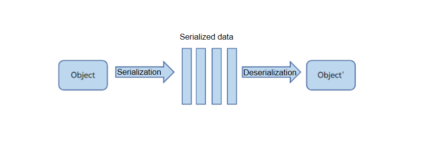

# Overview of ArkTS Inter-Thread Communication
<!--Kit: ArkTS-->
<!--Subsystem: CommonLibrary-->
<!--Owner: @wang_zhaoyong-->
<!--Designer: @weng-changcheng-->
<!--Tester: @kirl75; @zsw_zhushiwei-->
<!--Adviser: @k1ngqaquuu-->
<!-- md-trans-meta sourceCommit=ba0356b6343f34a624b28531ff72c8a5a01ca786 translatedAt=2026-11-04T09:20:09.943Z pushedAt=2026-11-04T09:36:27.507Z nl=1 -->

Inter-thread communication involves the exchange of data between concurrent threads. Given that ArkTS is compatible with TS/JS, its runtime is implemented using the actor model with memory isolation, similar to other JS engines.

The behavior of inter-thread communication in ArkTS varies depending on the type of data object involved. For instance, regular JS objects, ArrayBuffer objects, and SharedArrayBuffer objects each exhibit different behaviors, including serialization and deserialization, data transfer, and data sharing.

Taking JS objects as an example, inter-thread communication uses the standard Structured Clone algorithm for serialization and deserialization. This process involves converting JS objects into engine-independent data (such as strings or memory blocks) and then restoring them into new objects with the same content in another concurrent task. This typically requires deep copying, which can be less efficient. In addition to standard JS serialization and deserialization, ArkTS supports the transfer of native JS object and the sharing of [Sendable objects](arkts-sendable.md).

Figure 1 Serialization and deserialization principles

Currently, ArkTS provides two concurrency capabilities for inter-thread communication: TaskPool and Worker.

- Worker is the standard API for cross-thread communication in the actor model. Its usage patterns are similar to those of Web Worker or Node.js Worker.

- TaskPool provides a more powerful and user-friendly API for concurrent programming. The behavior of object passing across concurrent tasks in TaskPool is consistent with that of Worker, utilizing the standard Structured Clone algorithm. The time required for concurrent communication increases with the size of the objects involved.

Based on the TaskPool and Worker concurrency interfaces provided by ArkTS, multiple inter-thread communication capabilities are supported to meet different inter-thread communication scenarios, such as [using TaskPool to execute independent time-consuming tasks](independent-time-consuming-task.md), [using TaskPool to execute multiple time-consuming tasks](multi-time-consuming-tasks.md), [communication between TaskPool tasks and the host thread](taskpool-communicates-with-mainthread.md), [instant message communication between Worker and the host thread](worker-communicates-with-mainthread.md), and [Worker synchronously invoking host thread interfaces](worker-invoke-mainthread-interface.md). In addition, through the [Node-API](../napi/napi-introduction.md) mechanism, C++ threads can invoke ArkTS interfaces across threads.
