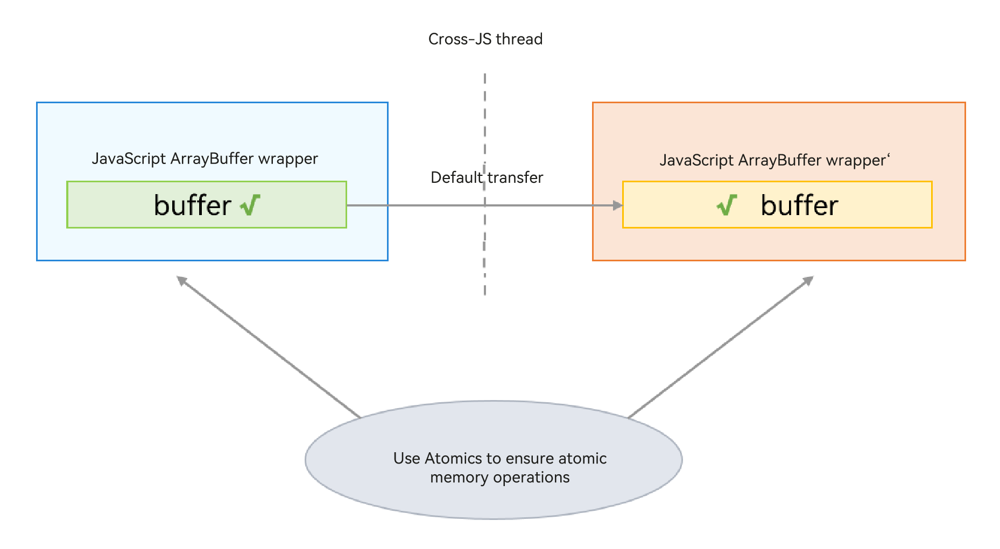

# SharedArrayBuffer Object
<!--Kit: ArkTS-->
<!--Subsystem: CommonLibrary-->
<!--Owner: @wang_zhaoyong-->
<!--Designer: @weng-changcheng-->
<!--Tester: @kirl75; @zsw_zhushiwei-->
<!--Adviser: @k1ngqaquuu-->
<!-- md-trans-meta sourceCommit=f8431cb42cf0d545a37a384860003cd8449b0b43 translatedAt=2026-11-06T10:44:58.532Z pushedAt=2026-11-09T09:09:27.067Z nl=1 -->

A SharedArrayBuffer object contains a block of native memory, and its JS object wrapper is allocated in the local heap of the virtual machine. It allows sharing native memory across concurrent instances but requires the use of the Atomics class to access and modify the shared native memory, thereby preventing data races. It is suitable for sharing state or data among multiple concurrent instances. The following figure shows the communication process.




## Usage Example

The following is an example of using TaskPool to pass an Int32Array object:

<!-- @[example_pass_obj](https://gitcode.com/openharmony/applications_app_samples/blob/master/code/DocsSample/ArkTS/ArkTsConcurrent/ConcurrentThreadCommunication/CommunicationObjects/entry/src/main/ets/managers/SharedArrayBufferObject.ets) -->

``` TypeScript
import { taskpool } from '@kit.ArkTS';
import { BusinessError } from '@kit.BasicServicesKit';

@Concurrent
function transferAtomics(arg1: Int32Array) {
  console.info('wait begin::');
  // Use Atomics for operations.
  let res = Atomics.wait(arg1, 0, 0, 3000);
  return res;
}

@Entry
@Component
struct CSharedArrayBuffer {
  @State message: string = 'Hello World';

  build() {
    RelativeContainer() {
      Text(this.message)
        .id('HelloWorld')
        .fontSize(50)
        .fontWeight(FontWeight.Bold)
        .alignRules({
          center: { anchor: '__container__', align: VerticalAlign.Center },
          middle: { anchor: '__container__', align: HorizontalAlign.Center }
        })
        .onClick(() => {
          // Define a shareable object.
          let sab: SharedArrayBuffer = new SharedArrayBuffer(20);
          let int32 = new Int32Array(sab);
          let task: taskpool.Task = new taskpool.Task(transferAtomics, int32);
          taskpool.execute(task).then((res) => {
            this.message = 'success';
            console.info(`this res is: ${res}`);
          }).catch((e: BusinessError) => {
            this.message = 'fail';
            console.error(`taskpool: execute task: code: ${e.code}, message: ${e.message}`);
          });
          setTimeout(() => {
            Atomics.notify(int32, 0, 1);
          }, 1000);
        })
    }
    .height('100%')
    .width('100%')
  }
}
```
