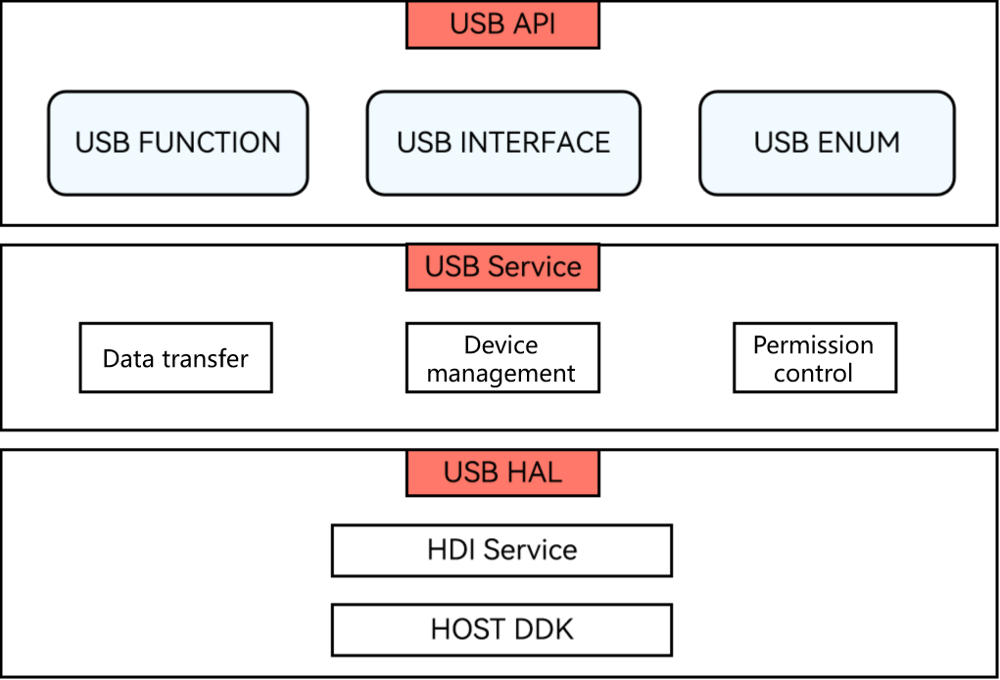

# USB Device Management (C/C++)
<!--Kit: Basic Services Kit-->
<!--Subsystem: USB-->
<!--Owner: @hwymlgitcode-->
<!--Designer: @w00373942-->
<!--Tester: @dong-dongzhen-->
<!--Adviser: @fang-jinxu-->
<!-- md-trans-meta sourceCommit=4783193a2c38a164702de1ebb6fd94773c15aff1 translatedAt=2026-10-21T03:07:37.566Z pushedAt=2026-10-21T07:45:45.067Z -->

## Overview

OH_UsbManager is a USB device management C interface module provided by OpenHarmony, supporting developers to perform operations such as device enumeration, permission management, device connection, and underlying communication on the USB Host side at the C/C++ layer. This interface corresponds to the @ohos.usbManager interface at the ArkTS layer, and is suitable for development scenarios that require native USB device management using C/C++.

**System capability**: SystemCapability.USB.USBManager

### Core Capabilities

The OH_UsbManager C API mainly provides the following capabilities:

- **Device enumeration**: Obtains the list of all USB devices currently connected to the host device, including detailed information such as the device name, vendor information, product ID, and configuration descriptor.
- **Permission management**: Checks and requests the application's access permission to USB devices, ensuring the security of device operations.
- **Device connection**: Establishes a communication pipe (UsbPipe) with a USB device and obtains the file descriptor used for underlying communication.
- **Resource management**: Provides release interfaces for the device array and device pipe to prevent memory leaks and resource leaks.

### Basic Concepts

- **Host/Device**

  USB devices are divided into host and device. The host is responsible for data transmission and port management, while the device is the managed object. The OH_UsbManager C interface is used when the current device acts as a host, to manage the connected peripheral devices.

- **UsbPipe**

  The device pipe (UsbPipe) is the channel for communication between the host and a USB device. It is obtained after opening the device through the `OH_UsbManager_ConnectDevice` interface. UsbPipe contains the bus number (busNum) and device address (devAddress) of the device, which are used to uniquely identify a connected USB device.

- **Device Descriptor Hierarchy**

  USB device information uses a hierarchical structure: UsbDevice (device) includes UsbConfig (configuration), UsbConfig includes UsbInterface (interface), and UsbInterface includes UsbEndpoint (endpoint). Each level is represented by a C structure, and array access is implemented through pointers and counters.

### Applicable Scenarios

The OH_UsbManager C API is applicable to the following typical scenarios:

- **Ukey driver development**: Implement discovery, authorization, connection, and underlying communication of USB security key devices.
- **USB storage device management**: Establish a connection with storage devices such as USB flash drives and portable hard drives, and obtain file descriptors.
- **USB serial communication**: Perform underlying communication with USB-to-serial devices through file descriptors.
- **Custom USB devices**: Establish a connection with USB devices using vendor-defined protocols, and perform underlying I/O operations through ioctl.
- **Embedded peripheral integration**: Complete USB device management in resource-constrained native C/C++ environments without going through the ArkTS layer.

### Working Principles

The USB service system consists of a three-layer architecture: USB API, USB Service, and USB HAL.

**Figure 1** USB service operation mechanism



- **USB API layer**: provides basic USB APIs, including interfaces for querying the USB device list, permission control, and device connection. The OH_UsbManager C interface belongs to this layer and is provided through the `libohusb_manager.so` dynamic link library.
- **USB Service layer**: implements the receiving, parsing, and distribution of HAL layer data, as well as device management.
- **USB HAL layer**: provides driver capability interfaces that can be directly called in user mode.

In Host mode, the current device acts as the host device responsible for data transmission and port management, and the connected USB device is the managed peripheral device. Applications enumerate devices, obtain permissions, and establish UsbPipe communication channels through the OH_UsbManager C interface, and perform underlying I/O operations through file descriptors.

## Before You Start

### Environment Requirements

**Development Tools and Configuration**

DevEco Studio is an essential tool for USB device driver development. Developers can use this tool for development, debugging, packaging, and other operations. Please [download and install](https://developer.huawei.com/consumer/en/download/) this tool, and refer to [Creating a Project and Running It](https://developer.huawei.com/consumer/en/doc/harmonyos-guides/ide-create-new-project) in the [DevEco Studio User Guide](https://developer.huawei.com/consumer/en/doc/harmonyos-guides/ide-tools-overview) to perform basic operation verification and ensure that DevEco Studio runs properly.

**SDK Version Configuration**

The C interfaces provided by OH_UsbManager require an SDK version of API 26.0.1 or later.

**HDC Configuration**

HDC (HarmonyOS Device Connector) is a command-line debugging tool provided for developers. Through this tool, you can interact with real devices or emulators on Windows/Linux/Mac systems. For details, see [HDC Configuration](https://developer.huawei.com/consumer/en/doc/harmonyos-guides/hdc).

> **Note:**
>
> "Configuring the environment variable hdc_server_port" and "global environment variables" are mandatory operations.

### Setting Up the Environment

1. Install [DevEco Studio](https://developer.huawei.com/consumer/en/download/deveco-studio) on the PC. The version must be 4.1 or later.
2. Update the public-SDK to API 26.0.1 or later<!--Del-->. For details about updating the SDK, see [Update Guide](../../../../faqs/full-sdk-switch-guide.md)<!--DelEnd-->.
3. Install the HDC tool on the PC. Through this tool, you can interact with a real device or an emulator on Windows/Linux/Mac systems.
4. Use a USB cable to connect the device running OpenHarmony to the PC.

### Verify the Environment Setup

Check whether DevEco Studio is connected to the OpenHarmony device.

### Permission Configuration

When calling `OH_UsbManager_RequestPermission` to request device permission, the system displays a dialog box to request user authorization. This interface itself does not require declaring a specific permission in `module.json5`, but requires user confirmation in the dialog box.

### Constraints

- The SDK version required by the OH_UsbManager C interface is API 26.0.1 or later.

- The current device must operate in USB Host mode, and the connected device must be in Device mode, so that the device list can be obtained through `OH_UsbManager_GetUsbDeviceList`.

- When calling `OH_UsbManager_RequestPermission` to request device permission, a system dialog box may be triggered to request user authorization.

- The device array returned by `OH_UsbManager_GetUsbDeviceList` must be released through `OH_UsbManager_FreeUsbDeviceList`; otherwise, a memory leak will occur.

- The device pipe returned by `OH_UsbManager_ConnectDevice` must be closed through `OH_UsbManager_ClosePipe`; otherwise, a resource leak will occur.

- When `OH_UsbManager_ConnectDevice` connects a device, only the `busNum` and `devAddress` fields in the `OH_UsbManager_UsbDevice` structure are required, and other fields will be ignored.

## Available APIs

### Interfaces

| Name | Description |
| -------- | -------- |
| OH_UsbManager_ErrorCode OH_UsbManager_GetUsbDeviceList(OH_UsbManager_UsbDevice \*\*devices, uint32_t \*deviceCount) | Obtains the list of all connected USB devices. The function allocates the device array and internal string buffers. The caller must release them through OH_UsbManager_FreeUsbDeviceList and must not release each field separately. |
| void OH_UsbManager_FreeUsbDeviceList(OH_UsbManager_UsbDevice \*devices, uint32_t deviceCount) | Releases the device array returned by OH_UsbManager_GetUsbDeviceList. After the call, the pointer becomes invalid. Passing null or a count of 0 is a safe no-op. |
| OH_UsbManager_ErrorCode OH_UsbManager_HasPermission(const char \*deviceName, bool \*result) | Checks whether the application has permission to access the specified device. The device name format is `<bus number>-<device address>`. |
| OH_UsbManager_ErrorCode OH_UsbManager_RequestPermission(const char \*deviceName, OH_UsbManager_PermissionCallback callback, void \*userContext) | Asynchronously requests permission to access the specified USB device. A system dialog may be triggered to request user authorization. The function returns immediately, and the result is returned through the callback. |
| OH_UsbManager_ErrorCode OH_UsbManager_ConnectDevice(const OH_UsbManager_UsbDevice \*device, OH_UsbManager_UsbPipe \*pipe) | Connects a USB device and opens a communication pipe. Only the busNum and devAddress fields in device are required; other fields are ignored. The returned pipe must be closed through OH_UsbManager_ClosePipe. |
| OH_UsbManager_ErrorCode OH_UsbManager_GetFileDescriptor(const OH_UsbManager_UsbPipe \*pipe, int32_t \*fd) | Obtains the file descriptor of an opened USB device pipe. This fd can be used for ioctl-based underlying USB transfer. |
| OH_UsbManager_ErrorCode OH_UsbManager_ClosePipe(const OH_UsbManager_UsbPipe \*pipe) | Closes the USB device pipe and releases the underlying resources. The pipe must be obtained through OH_UsbManager_ConnectDevice. |

For detailed interface descriptions, see [OH_UsbManager](../../../../reference/apis-basic-services-kit/capi-usbmanager.md) and [ohusb_manager.h](../../../../reference/apis-basic-services-kit/capi-ohusb-manager-h.md).

### Data Structure

| Structs | Description |
| -------- | -------- |
| [OH_UsbManager_UsbDevice](../../../../reference/apis-basic-services-kit/capi-usbmanager-oh-usbmanager-usbdevice.md) | USB device information, including bus number, device address, name, vendor information, product ID, configuration list, etc. |
| [OH_UsbManager_UsbConfig](../../../../reference/apis-basic-services-kit/capi-usbmanager-oh-usbmanager-usbconfig.md) | USB configuration information, including configuration ID, attributes, maximum power, interface list, etc. A UsbDevice can include multiple UsbConfigs. |
| [OH_UsbManager_UsbInterface](../../../../reference/apis-basic-services-kit/capi-usbmanager-oh-usbmanager-usbinterface.md) | USB interface information, including interface ID, protocol, class, endpoint list, etc. A UsbConfig can include multiple UsbInterfaces. |
| [OH_UsbManager_UsbEndpoint](../../../../reference/apis-basic-services-kit/capi-usbmanager-oh-usbmanager-usbendpoint.md) | USB endpoint information, including endpoint address, attributes, transfer type, direction, etc. A UsbInterface can include multiple UsbEndpoints. |
| [OH_UsbManager_UsbPipe](../../../../reference/apis-basic-services-kit/capi-usbmanager-oh-usbmanager-usbpipe.md) | USB device pipe, including bus number and device address, used to identify an opened device communication channel. |

For detailed data structure descriptions, see [OH_UsbManager](../../../../reference/apis-basic-services-kit/capi-usbmanager.md) and [ohusb_manager.h](../../../../reference/apis-basic-services-kit/capi-ohusb-manager-h.md).

### Error Code

The OH_UsbManager C interface returns error codes through the `OH_UsbManager_ErrorCode` enum, as follows:

| Error Code | Value | Description |
| -------- | -------- | -------- |
| OH_USBMANAGER_SUCCESS | 0 | Operation successful. |
| OH_USBMANAGER_ERROR_PERMISSION_DENIED | 14400001 | No access permission. |
| OH_USBMANAGER_ERROR_SERVICE_EXCEPTION | 14400004 | Service exception. |
| OH_USBMANAGER_ERROR_NO_DEVICE | 14400008 | The device does not exist (it may have been disconnected). |
| OH_USBMANAGER_ERROR_NO_MEMORY | 14400009 | Insufficient memory. |
| OH_USBMANAGER_ERROR_IO_ERROR | 14400012 | Transfer I/O error. |
| OH_USBMANAGER_ERROR_INVALID_PARAMETER | 14400014 | Invalid parameter. A null pointer is passed to a parameter that cannot be null. |

For detailed error code descriptions, see [ohusb_manager.h](../../../../reference/apis-basic-services-kit/capi-ohusb-manager-h.md).

## How to Develop

The complete development process of the USB device management C API includes: device discovery → permission authorization → device connection → underlying communication → resource close. The operations of each stage are described step by step below.

**Add the Dynamic Link Library**

Add the following lib to CMakeLists.txt.

```txt
libohusb_manager.so
```

**Header File**

``` C++
#include "BasicServicesKit/ohusb_manager.h"
```

### Device Discovery

Call `OH_UsbManager_GetUsbDeviceList` to obtain the list of all currently connected USB devices. This function allocates the device array and all internal string buffers, and the caller must not free the memory of each field separately. The returned device array contains complete descriptor hierarchy information (configuration, interface, endpoint), and the target device can be found by traversing the device list.

After use, you must call `OH_UsbManager_FreeUsbDeviceList` to release the device array.

<!-- @[CApiGetUsbDeviceList](https://gitcode.com/openharmony/applications_app_samples/blob/master/code/DocsSample/USB/USBManagerCApiSample/entry/src/main/cpp/napi_init.cpp) -->

``` C++
OH_UsbManager_UsbDevice *devices = nullptr;
uint32_t deviceCount = 0;
OH_UsbManager_ErrorCode code = OH_UsbManager_GetUsbDeviceList(&devices, &deviceCount);
if (code != OH_USBMANAGER_SUCCESS) {
    ThrowUsbError(env, "OH_UsbManager_GetUsbDeviceList", code);
    return nullptr;
}
```

<!-- @[CApiFreeUsbDeviceList](https://gitcode.com/openharmony/applications_app_samples/blob/master/code/DocsSample/USB/USBManagerCApiSample/entry/src/main/cpp/napi_init.cpp) -->

``` C++
OH_UsbManager_UsbDevice *devices = nullptr;
uint32_t deviceCount = 0;
bool freed = false;
{
    std::lock_guard<std::mutex> lock(g_deviceListMutex);
    devices = g_heldDevices;
    deviceCount = g_heldDeviceCount;
    if (devices != nullptr) {
        OH_UsbManager_FreeUsbDeviceList(devices, deviceCount);
        g_heldDevices = nullptr;
        g_heldDeviceCount = 0;
        freed = true;
    }
}
```

### Authorization

Check whether the current application already has device access permission through `OH_UsbManager_HasPermission`. The device name format is `<bus number>-<device address>`.

If no permission is granted, call `OH_UsbManager_RequestPermission` to request permission asynchronously. This function returns immediately, and the request result is notified through the `OH_UsbManager_PermissionCallback` callback. Device connection operations can be performed only after authorization succeeds.

<!-- @[CApiHasPermission](https://gitcode.com/openharmony/applications_app_samples/blob/master/code/DocsSample/USB/USBManagerCApiSample/entry/src/main/cpp/napi_init.cpp) -->

``` C++
std::string deviceName;
if (!GetDeviceNameArg(env, info, deviceName)) {
    return nullptr;
}
bool result = false;
OH_UsbManager_ErrorCode code = OH_UsbManager_HasPermission(deviceName.c_str(), &result);
if (code != OH_USBMANAGER_SUCCESS) {
    ThrowUsbError(env, "OH_UsbManager_HasPermission", code);
    return nullptr;
}
```

<!-- @[CApiRequestPermission](https://gitcode.com/openharmony/applications_app_samples/blob/master/code/DocsSample/USB/USBManagerCApiSample/entry/src/main/cpp/napi_init.cpp) -->

``` C++
RequestPermissionContext *context = static_cast<RequestPermissionContext *>(data);
OH_UsbManager_ErrorCode code =
    OH_UsbManager_RequestPermission(context->deviceName.c_str(), OnPermissionCallback, context);
std::unique_lock<std::mutex> lock(context->mutex);
if (code != OH_USBMANAGER_SUCCESS) {
    context->apiCode = code;
    context->completed = true;
    return;
}
```

### Connection

After the permission is obtained, call `OH_UsbManager_ConnectDevice` to connect the target USB device and open the communication pipe. When connecting, only the `busNum` and `devAddress` fields in the `OH_UsbManager_UsbDevice` structure are required, and other fields are ignored. The returned `OH_UsbManager_UsbPipe` contains the bus number and device address of the device, which are used for all subsequent device operations.

After a successful connection, you can call `OH_UsbManager_GetFileDescriptor` to obtain the file descriptor (fd) of the device pipe. This fd can be used for underlying USB transfer operations based on ioctl.

<!-- @[CApiConnectDevice](https://gitcode.com/openharmony/applications_app_samples/blob/master/code/DocsSample/USB/USBManagerCApiSample/entry/src/main/cpp/napi_init.cpp) -->

``` C++
uint32_t busNum = 0;
uint32_t devAddress = 0;
napi_get_value_uint32(env, args[0], &busNum);
napi_get_value_uint32(env, args[1], &devAddress);

OH_UsbManager_UsbDevice device = {0};
device.busNum = static_cast<uint8_t>(busNum);
device.devAddress = static_cast<uint8_t>(devAddress);
OH_UsbManager_UsbPipe pipe = {0};
OH_UsbManager_ErrorCode code = OH_UsbManager_ConnectDevice(&device, &pipe);
if (code != OH_USBMANAGER_SUCCESS) {
    ThrowUsbError(env, "OH_UsbManager_ConnectDevice", code);
    return nullptr;
}
```

<!-- @[CApiGetFileDescriptor](https://gitcode.com/openharmony/applications_app_samples/blob/master/code/DocsSample/USB/USBManagerCApiSample/entry/src/main/cpp/napi_init.cpp) -->

``` C++
(void)info;
OH_UsbManager_UsbPipe pipe = {0};
{
    std::lock_guard<std::mutex> lock(g_pipeMutex);
    if (!g_pipeConnected) {
        napi_throw_error(env, nullptr, "pipe is not open, call connectDevice first");
        return nullptr;
    }
    pipe = g_pipe;
}
int32_t fd = -1;
OH_UsbManager_ErrorCode code = OH_UsbManager_GetFileDescriptor(&pipe, &fd);
if (code != OH_USBMANAGER_SUCCESS) {
    ThrowUsbError(env, "OH_UsbManager_GetFileDescriptor", code);
    return nullptr;
}
```

### Communication

Through the file descriptor obtained by `OH_UsbManager_GetFileDescriptor`, developers can use standard file I/O or ioctl for underlying USB communication. Common communication methods include:

- **ioctl control transfer**: Sends USB control requests through the file descriptor to obtain and set device status.
- **read/write**: Performs bulk data read and write through the file descriptor, suitable for data transfer scenarios.
- **select/poll monitoring**: Monitors device data arrival events through the file descriptor to implement asynchronous notification.

> **Note:**<br>The specific ioctl commands and data formats for underlying communication depend on the USB device protocol and kernel driver implementation. Developers need to refer to the relevant USB protocol specifications.

### Close

After use, release resources in the following order:

1. Call `OH_UsbManager_ClosePipe` to close the device pipe and release underlying resources.
2. Call `OH_UsbManager_FreeUsbDeviceList` to release the device array memory allocated by `OH_UsbManager_GetUsbDeviceList`.

> **Important:**<br>The resource release order is to close the pipe first, and then release the device array. Ensure that the release operation is also performed on abnormal exit paths to avoid resource leaks.

<!-- @[CApiClosePipe](https://gitcode.com/openharmony/applications_app_samples/blob/master/code/DocsSample/USB/USBManagerCApiSample/entry/src/main/cpp/napi_init.cpp) -->

``` C++
(void)info;
OH_UsbManager_UsbPipe pipe = {0};
{
    std::lock_guard<std::mutex> lock(g_pipeMutex);
    if (!g_pipeConnected) {
        napi_throw_error(env, nullptr, "pipe is not open, call connectDevice first");
        return nullptr;
    }
    pipe = g_pipe;
}
OH_UsbManager_ErrorCode code = OH_UsbManager_ClosePipe(&pipe);
if (code != OH_USBMANAGER_SUCCESS) {
    ThrowUsbError(env, "OH_UsbManager_ClosePipe", code);
    return nullptr;
}
```

> **Description:**<br>For the complete sample code, see [USBManager C API Sample](https://gitcode.com/openharmony/applications_app_samples/blob/master/code/DocsSample/USB/USBManagerCApiSample/entry/src/main/cpp/napi_init.cpp).

## FAQs

| Problem Symptom | Possible Cause | Solution Measure |
| -------- | -------- | -------- |
| When calling `OH_UsbManager_GetUsbDeviceList` to obtain the device list, the returned `deviceCount` is 0. | - The current device operates in USB Device mode instead of Host mode.<br>- No USB device is connected. | Ensure that the current device operates in USB Host mode and the connected device operates in Device mode. Some devices support both host and peripheral USB device modes. The device must be set to Host mode before peripheral devices can be enumerated. |
| When calling `OH_UsbManager_ConnectDevice` to connect a device, `OH_USBMANAGER_ERROR_PERMISSION_DENIED` (14400001) is returned. | - The application has not obtained device access permission.<br>- The user rejected the authorization request in the permission dialog. | 1. Before connecting a device, call `OH_UsbManager_HasPermission` to check whether access permission is available.<br>2. If there is no permission, call `OH_UsbManager_RequestPermission` to request permission, and confirm the authorization result in the callback.<br>3. Call `OH_UsbManager_ConnectDevice` only after permission is granted. |
| After calling `OH_UsbManager_RequestPermission`, the callback function `OH_UsbManager_PermissionCallback` is not invoked. | - The `deviceName` parameter format is incorrect.<br>- The USB service is abnormal and cannot process the permission request.<br>- The callback function pointer is null. | 1. Confirm that `deviceName` is obtained from the `name` field of `OH_UsbManager_UsbDevice` and the format is correct.<br>2. Check whether the callback function pointer is valid.<br>3. Use logs to confirm whether the USB service is running normally. |
| After calling `OH_UsbManager_GetUsbDeviceList` multiple times, the application memory keeps growing. | - After calling `OH_UsbManager_GetUsbDeviceList`, `OH_UsbManager_FreeUsbDeviceList` is not called to release the device array.<br>- After calling `OH_UsbManager_ConnectDevice`, `OH_UsbManager_ClosePipe` is not called to close the pipe.<br>- The `deviceCount` passed during release is inconsistent with the value at the time of acquisition. | 1. After each call to `OH_UsbManager_GetUsbDeviceList`, you must call `OH_UsbManager_FreeUsbDeviceList` to release memory, and the `deviceCount` passed in should be consistent with the value at the time of acquisition.<br>2. After each call to `OH_UsbManager_ConnectDevice`, you must call `OH_UsbManager_ClosePipe` to close the pipe.<br>3. Ensure that the release operation is also performed on abnormal exit paths. |
| When calling `OH_UsbManager_GetFileDescriptor`, `OH_USBMANAGER_ERROR_NO_DEVICE` (14400008) is returned. | - The USB device was disconnected before the file descriptor was obtained.<br>- The passed `OH_UsbManager_UsbPipe` is invalid. | 1. Confirm that the device is still connected. You can call `OH_UsbManager_GetUsbDeviceList` to confirm whether the device is in the list.<br>2. Confirm that `OH_UsbManager_UsbPipe` is successfully returned by `OH_UsbManager_ConnectDevice`.<br>3. After the device reconnects, the complete connection process must be executed again. |
<!--no_check-->