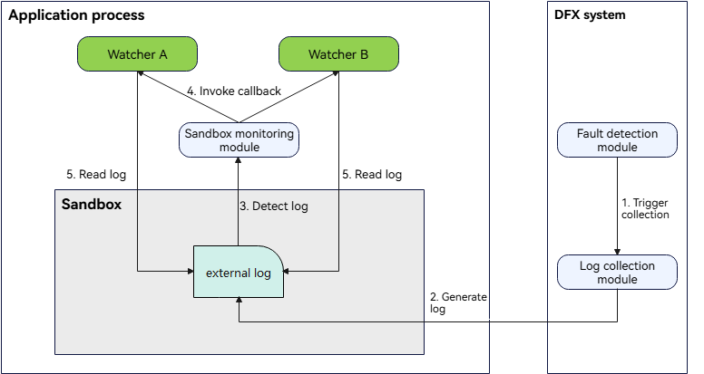

# Introduction to external_log Logs

<!--Kit: Performance Analysis Kit-->
<!--Subsystem: HiviewDFX-->
<!--Owner: @liujiaxing2024-->
<!--Designer: @jiangwenhao-->
<!--Tester: @gcw_KuLfPSbe-->
<!--Adviser: @jinqiuheng-->
<!-- md-trans-meta sourceCommit=cd8d7c80e214eec0c28814e8db1d37ffcbef77fe translatedAt=2026-11-05T00:59:07.218Z nl=1 -->

## Overview

Since API version 26.0.1, you can register an external_log manager to notify the app to clean up and delete external_log files when a fault log sandbox directory reaches its capacity threshold.

external_log specifies the path of a fault log file in the app sandbox. After an app subscribes to a system event through HiAppEvent, the event parameter object params contains an external_log field when that event occurs. You can read the fault log file using this path.

A system event supports multiple subscribers. Each subscriber receives a different external_log path so that its operations do not affect other subscribers. Only the first 100 subscribers receive independent log paths; subsequent subscribers share the same log path.

Choose either the ArkTS or C/C++ APIs to register an external_log manager as needed.

- [Cleaning Up external_log Files (ArkTS)](external-log-arkts.md)

- [Cleaning Up external_log Files (C/C++)](external-log-ndk.md)

## Working Principles
An app subscribes to a system event to obtain the external_log fault log content when that event occurs. The following figure shows how this works:

The detailed procedure is as follows:
1. When the subscribed system event occurs while the app is running, the fault detection module of the DFX system triggers fault log collection.
2. The DFX system writes the generated external_log file to the app sandbox directory.
3. HiAppEvent detects the new fault log in the app sandbox directory.
4. HiAppEvent writes the external_log field to the system event parameter object params and returns it to the app watcher through a callback.
5. Read the fault log file content using the external_log field.

## Log Specifications

The external_log directories include /data/storage/el2/log/hiappevent, /data/storage/el2/log/watchdog, and /data/storage/el2/log/resourcelimit.

For log specifications, see [System Event Fault Log Directory Specifications](./hiappevent-intro.md#system-event-fault-log-directory-specifications).

The capacity thresholds for the sandbox fault log directories are as follows:

1. The app is notified to clean up and delete external_log files when /data/storage/el2/log/hiappevent/ reaches 4 MB.

2. The app is notified to clean up and delete external_log files when /data/storage/el2/log/resourcelimit/ reaches 1500 MB.

## Constraints

Only one external_log manager can be registered. After registration succeeds, any repeated registration fails.

Registration is not persistent. The app does not retain its previous registration when it starts and must register again.