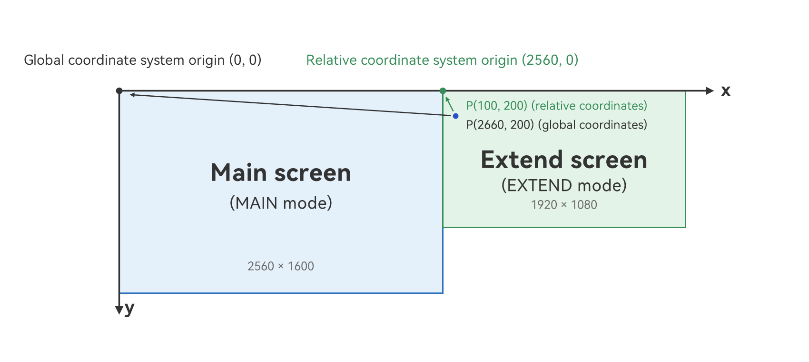

# Coordinate Conversion for Extended Screens
<!--Kit: ArkUI-->
<!--Subsystem: Window-->
<!--Owner: @oh_wangxk-->
<!--Designer: @wulong158-->
<!--Tester: @LiTongguan2026-->
<!--Adviser: @ge-yafang-->
<!-- md-trans-meta sourceCommit=0d8c45b21d8a570119acc3e826554bd3c3d6e189 translatedAt=2026-11-12T12:34:02.148Z nl=1 -->

## When to Use

An [extended screen](display-terminology.md#extended-screen) is a logical screen that extends the [main screen](display-terminology.md#main-screen) to increase the usable screen space. After an extended screen is connected to a device, the mouse and windows can move between the main screen and the extended screen.

In multi-screen scenarios, the system and applications use different reference points to describe positions. The system describes the entire multi-screen space using the [global coordinate system](../windowmanager/window-terminology.md#global-coordinate-system), whose origin is the upper left corner of the main screen. Application UI layouts and touch and mouse event coordinates use the [relative coordinate system](../windowmanager/window-terminology.md#relative-coordinate-system), whose origin is the upper left corner of the screen where the application is located. The same position has different values in the two coordinate systems. Therefore, applications need to make the following adaptations for cross-screen operations:

- Identify the display mode of each screen (main screen, extended screen, and more).

- Obtain the position of a screen in the global coordinate system.

- Convert between global and relative coordinates.

## Obtaining the Display Mode

The display mode is obtained through the `sourceMode` property of a `Display` object, which uses the [DisplaySourceMode](../reference/apis-arkui/js-apis-display.md#displaysourcemode19) enumeration.

After an external screen is connected and the device enters multi-screen mode, the following display modes are mainly involved:

| Name   | Value  | Description                                                                                                                                                                                                                                                                            |
| ------ | --- | -------------------------------------------------- |
| MAIN   | 1   | Indicates that the screen is currently the main screen. The main screen hosts the system's core UI (such as the taskbar) and the default interaction focus. Application windows are created and displayed on the main screen by default. When no external screen is connected, the device's built-in screen is the main screen.    |
| EXTEND | 3   | Indicates extended display mode. A screen in this mode is an extended screen. It forms a continuous display space with the main screen, and its position relative to the main screen can be set. The mouse and windows can move between the main and extended screens. The global coordinates of the upper left corner of the extended screen can be obtained through the x and y properties of its Display object. Applications can create windows on the extended screen to display content different from that on the main screen. |

Applications can adapt to multi-screen scenarios based on the display mode. For example:

- Create windows only on screens whose `sourceMode` is `EXTEND`, using the extended screens to display more content.
- Obtain main screen information from the screen whose `sourceMode` is `MAIN` for multi-screen layout calculations.

> **NOTE**
>
> After an external screen is connected, users can change its display mode in system settings.
>
> When users switch the screen casting mode or connect or disconnect a monitor, the `sourceMode` of the affected screens changes. Applications can listen for changes through [display.on('add'|'remove'|'change')](../reference/apis-arkui/js-apis-display.md#displayonadd-remove-change) and query the mode again. For details, see the following development steps.

1. Obtain the display modes of all screens.

    Call [getAllDisplays()](../reference/apis-arkui/js-apis-display.md#displaygetalldisplays9) to obtain all current `Display` objects, then iterate through them and read the `sourceMode` property to obtain the current display mode of each screen.

    <!-- @[get_all_displays_source_mode](https://gitcode.com/openharmony/applications_app_samples/blob/master/code/DocsSample/ArkUISample/DisplayBasicSample/entry/src/main/ets/pages/Index.ets) -->
    
    ``` TypeScript
    display.getAllDisplays().then((displays: Array<display.Display>) => {
      for (let i = 0; i < displays.length; i++) {
        // Obtain the display ID.
        hilog.info(DOMAIN, 'DisplayTest', `The display id is ${displays[i].id}`);
        // Obtain the display mode.
        hilog.info(DOMAIN, 'DisplayTest', `The display sourceMode is ${displays[i].sourceMode}`);
        if (displays[i].sourceMode === display.DisplaySourceMode.EXTEND) {
          // Handle extended screen operations, such as creating a window to display content.
        }
      }
    }).catch((err: BusinessError) => {
      hilog.error(DOMAIN, 'DisplayTest',
        `Failed to get all displays. Code: ${err.code}, message: ${err.message}`);
    });
    ```

2. Obtain the display mode of a specified screen.

    If the screen ID is known (available through the `displayId` property of [WindowProperties](../reference/apis-arkui/arkts-apis-window-i.md#windowproperties)), call [getDisplayByIdSync()](../reference/apis-arkui/js-apis-display.md#displaygetdisplaybyidsync12) to obtain the `sourceMode` property of the corresponding `Display` object.

    <!-- @[get_display_source_mode_by_id](https://gitcode.com/openharmony/applications_app_samples/blob/master/code/DocsSample/ArkUISample/DisplayBasicSample/entry/src/main/ets/pages/Index.ets) -->
    
    ``` TypeScript
    let displayClass: display.Display | null = null;
    try {
      // This displayId is only an example. Use a value appropriate for your scenario.
      let displayId: number = 1;
      displayClass = display.getDisplayByIdSync(displayId);
      // Obtain the display mode of the specified screen.
      hilog.info(DOMAIN, 'DisplayTest', `The display sourceMode is ${displayClass.sourceMode}`);
    } catch (exception) {
      hilog.error(DOMAIN, 'DisplayTest',
        `Failed to get display. Code: ${exception.code}, message: ${exception.message}`);
    }
    ```

3. Listen for display mode changes.

    When a screen is connected or removed, or its display mode changes (for example, when users switch the screen casting mode in system settings), an `'add'`, `'remove'`, or `'change'` event is triggered. Listen for these events through [display.on('add'|'remove'|'change')](../reference/apis-arkui/js-apis-display.md#displayonadd-remove-change), then query the display mode of each screen again in the callback to update application logic promptly.

    <!-- @[listen_source_mode_change](https://gitcode.com/openharmony/applications_app_samples/blob/master/code/DocsSample/ArkUISample/DisplayBasicSample/entry/src/main/ets/pages/Index.ets) -->
    
    ``` TypeScript
    let callback: Callback<number> = (displayId: number) => {
      hilog.info(DOMAIN, 'DisplayTest', `Display changed. displayId: ${displayId}`);
      // Query each screen's display mode again after a screen changes and update application logic.
      display.getAllDisplays().then((displays: Array<display.Display>) => {
        for (let i = 0; i < displays.length; i++) {
          hilog.info(DOMAIN, 'DisplayTest',
            `The display ${displays[i].id} sourceMode is ${displays[i].sourceMode}`);
        }
      });
    };
    try {
      // Listen for the addition of a display device, for example, when a monitor is connected.
      display.on('add', callback);
      // Listen for the removal of a display device, for example, when a monitor is disconnected.
      display.on('remove', callback);
      // Listen for display device changes, for example, display mode changes.
      display.on('change', callback);
      // Unregister the corresponding listeners when they are no longer needed.
      display.off('add', callback);
      display.off('remove', callback);
      display.off('change', callback);
    } catch (exception) {
      hilog.error(DOMAIN, 'DisplayTest',
        `Failed to register/unregister callback. Code: ${exception.code}, message: ${exception.message}`);
    }
    ```

## Using Coordinate Systems on Extended Screens

The following two coordinate systems are used in multi-screen scenarios:

- [Global coordinate system](../windowmanager/window-terminology.md#global-coordinate-system): uses the upper left corner of the main screen as the origin. In extended display mode, the main and extended screens are arranged according to their actual relative positions to form a continuous display space. The global coordinates of the upper left corner of any screen can be obtained through the `x` and `y` properties of its `Display` object. Only screens in `MAIN` (main screen) or `EXTEND` (extended screen) mode return actual coordinate values. Screens in other display modes (such as mirrored and heterogeneous screens) return the default value `0`.
- [Relative coordinate system](../windowmanager/window-terminology.md#relative-coordinate-system): uses the upper left corner of a specified screen as the origin. Coordinate values represent positions within that screen. UI component coordinates and coordinates reported by touch or mouse events in an application are usually relative to the screen where the application is located.



As shown above, consider a main screen with a resolution of 2560 x 1600 and an extended screen to its right with a resolution of 1920 x 1080. In extended display mode, the two screens form a continuous display space in the same global coordinate system.

- The upper left corner of the main screen is the global coordinate origin, at (0, 0). The `x` and `y` properties of its `Display` object are both `0`.
- The global coordinates of the upper left corner of the extended screen are (2560, 0). The `x` and `y` properties of its `Display` object are `2560` and `0`, respectively. In this example, the extended screen is to the right of the main screen, so the main screen width, 2560, is the horizontal offset between the upper left corners of the two screens.
- The point (100, 200) on the extended screen is expressed in relative coordinates (with the upper left corner of the extended screen as the origin). Its corresponding global coordinates are (2660, 200).

The two coordinate systems exist because the system and applications use different reference points to describe positions in multi-screen scenarios:

- From the system's perspective, the main and extended screens form a continuous display space. Operations such as moving windows across screens and positioning the mouse pointer across screens require a unified coordinate system to describe which screen an object is on and where it is located. Therefore, the global coordinate system uses the upper left corner of the main screen as the origin.
- From an application's perspective, UI layouts and coordinates reported by touch or mouse events naturally use the upper left corner of the application's screen as their reference point. Applications usually need to consider only positions within their own screen, without awareness of the entire continuous display space. Therefore, they use the relative coordinate system with the upper left corner of their screen as the origin.

The two coordinate systems are independent. When an operation spans screens, coordinates need to be converted between them. For example, convert the global coordinates of a mouse click to relative coordinates to determine which screen contains the position, or convert a window's relative coordinates to global coordinates to move the window from the main screen to an extended screen.

> **NOTE**
>
> The conversion relationship is: global coordinates = global coordinates of the screen's upper left corner (the `x` and `y` properties of `Display`) + relative coordinates.
>
> For details, see the following development steps and examples.

1. Obtain the screen's position in the global coordinate system.

    Call [getAllDisplays()](../reference/apis-arkui/js-apis-display.md#displaygetalldisplays9) to obtain `Display` objects, then read the `x` and `y` properties to obtain the global coordinates of each screen's upper left corner.

    <!-- @[get_display_global_position](https://gitcode.com/openharmony/applications_app_samples/blob/master/code/DocsSample/ArkUISample/DisplayBasicSample/entry/src/main/ets/pages/Index.ets) -->
    
    ``` TypeScript
    display.getAllDisplays().then((displays: Array<display.Display>) => {
      for (let i = 0; i < displays.length; i++) {
        if (displays[i].sourceMode === display.DisplaySourceMode.EXTEND) {
          // Obtain the global coordinates of the extended screen's upper left corner.
          hilog.info(DOMAIN, 'DisplayTest',
            `The extended display top-left corner is (${displays[i].x}, ${displays[i].y})`);
        }
      }
    }).catch((err: BusinessError) => {
      hilog.error(DOMAIN, 'DisplayTest',
        `Failed to get all displays. Code: ${err.code}, message: ${err.message}`);
    });
    ```

2. Convert between relative and global coordinates.

    - Call [convertRelativeToGlobalCoordinate()](../reference/apis-arkui/js-apis-display.md#displayconvertrelativetoglobalcoordinate20) to convert relative coordinates to global coordinates.

      <!-- @[convert_relative_to_global](https://gitcode.com/openharmony/applications_app_samples/blob/master/code/DocsSample/ArkUISample/DisplayBasicSample/entry/src/main/ets/pages/Index.ets) -->
      
      ``` TypeScript
      // Define the relative coordinates to convert. displayId is the ID of the screen containing the relative coordinate origin.
      let relativePosition: display.RelativePosition = {
        displayId: 1,
        position: {
          x: 100,
          y: 200
        }
      };
      
      try {
        // Convert relative coordinates to global coordinates.
        let position: display.Position = display.convertRelativeToGlobalCoordinate(relativePosition);
        hilog.info(DOMAIN, 'DisplayTest', `The global coordinate is (${position.x}, ${position.y})`);
      } catch (exception) {
        hilog.error(DOMAIN, 'DisplayTest',
          `Failed to convert the relative coordinate to the global coordinate. Code: ${exception.code}, ` +
          `message: ${exception.message}`);
      }
      ```

    - Call [convertGlobalToRelativeCoordinate()](../reference/apis-arkui/js-apis-display.md#displayconvertglobaltorelativecoordinate20) to convert global coordinates to relative coordinates.

      <!-- @[convert_global_to_relative](https://gitcode.com/openharmony/applications_app_samples/blob/master/code/DocsSample/ArkUISample/DisplayBasicSample/entry/src/main/ets/pages/Index.ets) -->
      
      ``` TypeScript
      // Define the global coordinates to convert.
      let position: display.Position = {
        x: 2660,
        y: 200
      };
      
      try {
        // Convert global coordinates to relative coordinates on the screen with displayId 1.
        let relPos: display.RelativePosition = display.convertGlobalToRelativeCoordinate(position, 1);
        hilog.info(DOMAIN, 'DisplayTest',
          `The relative coordinate is displayId: ${relPos.displayId}, x: ${relPos.position.x}, y: ${relPos.position.y}`);
      } catch (exception) {
        hilog.error(DOMAIN, 'DisplayTest',
          `Failed to convert the global coordinate to the relative coordinate. Code: ${exception.code}, ` +
          `message: ${exception.message}`);
      }
      ```

3. Determine which screen contains a global position.

    When calling [convertGlobalToRelativeCoordinate()](../reference/apis-arkui/js-apis-display.md#displayconvertglobaltorelativecoordinate20) without `displayId`, the `displayId` in the returned `RelativePosition` object is the ID of the screen containing the global position. This can be used to determine which screen contains a global position in scenarios such as mouse clicks.

    <!-- @[get_display_id_by_global_position](https://gitcode.com/openharmony/applications_app_samples/blob/master/code/DocsSample/ArkUISample/DisplayBasicSample/entry/src/main/ets/pages/Index.ets) -->
    
    ``` TypeScript
    // Define the global coordinates to check.
    let position: display.Position = {
      x: 2660,
      y: 200
    };
    
    try {
      // Omit displayId to return relative coordinates on the screen containing the global position.
      let relPos: display.RelativePosition = display.convertGlobalToRelativeCoordinate(position);
      // relPos.displayId is the ID of the screen containing the global position.
      hilog.info(DOMAIN, 'DisplayTest', `The position is on the display ${relPos.displayId}`);
    } catch (exception) {
      hilog.error(DOMAIN, 'DisplayTest',
        `Failed to convert the global coordinate to the relative coordinate. Code: ${exception.code}, ` +
        `message: ${exception.message}`);
    }
    ```

