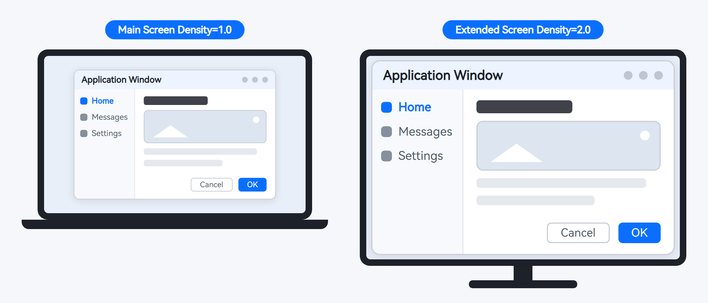
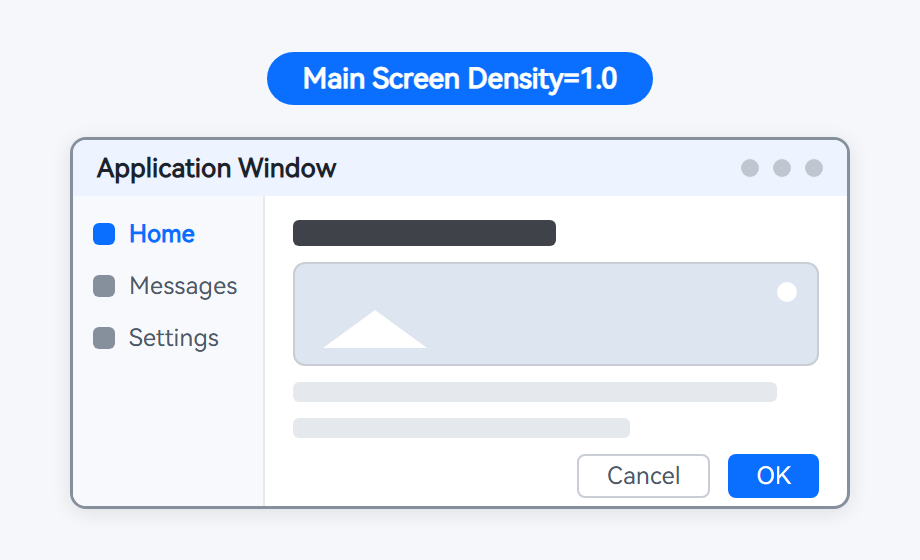
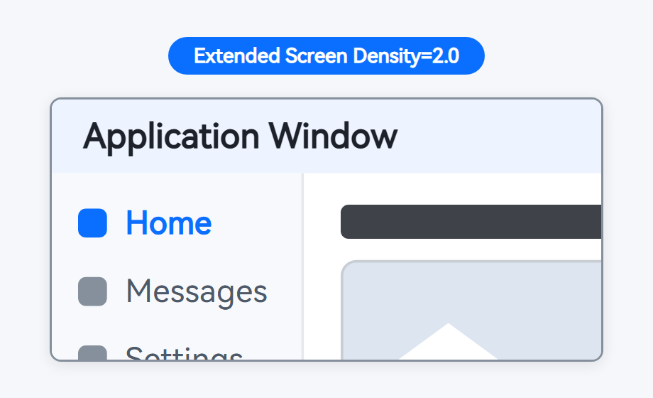

# Adapting to Display Density

<!--Kit: ArkUI-->
<!--Subsystem: Window-->
<!--Owner: @fei_1007-->
<!--Designer: @gcw_sPCsris4-->
<!--Tester: @jingbotao-->
<!--Adviser: @ge-yafang-->
<!-- md-trans-meta sourceCommit=7c37ecf165264e9f7393cf8be2d04866146f8e89 translatedAt=2026-11-12T12:34:02.149Z nl=1 -->

## When to Use

Page layouts are usually designed and verified for the display specifications of a single screen, with assumptions such as device type and density determined during development. Extended screens break these assumptions.

After an [extended screen](display-terminology.md#extended-screen) is connected to a PC or 2-in-1 device, the main and extended screens can have independent display size settings, that is, different display scaling factors (density). The mouse and windows can move between the main and extended screens. When a window moves across screens, its density changes to match the screen it is on, unless the application sets a fixed custom density. When a window is dragged across screens, its screen information is updated only after the mouse button or finger is released.



As shown above, the main and extended screens have different density settings, so elements in the same application window have different display sizes on the two screens.

### Typical Scenarios That Trigger Density Changes

Typical scenarios that trigger density changes are as follows:

- **Starting a window on an extended screen**: For example, when starting a main window through [startAbility()](../reference/apis-ability-kit/js-apis-inner-application-uiAbilityContext.md#startability-2), set `displayId` in [StartOptions](../reference/apis-ability-kit/js-apis-app-ability-startOptions.md#startoptions) to the extended screen ID. The window then starts on the extended screen with that screen's display scaling factor as its initial density, which may differ from the main screen's density.

- **Moving a window across screens**: When a user drags a window from the main screen to an extended screen (or an application moves it by calling an API such as [moveWindowToGlobal()](../reference/apis-arkui/arkts-apis-window-Window.md#movewindowtoglobal15)), its density changes to match the new screen after the screen containing the window changes.

For example, when a window moves across screens, the following display issues may occur if the application does not adapt to the extended screen's density:

| Before moving: the window displays normally on the main screen (density = 1.0) | After moving: elements are too large on the extended screen (density = 2.0), causing content to be truncated |
| ---------------------------------------- | ------------------------------------------ |
|  |  |

The root cause is that window density is no longer a single fixed value; it depends on the screen containing the window. The effective window density is related to the following three display scaling factors:

| Name | Value Range | Description |
| -------- | -------- | -------- |
| System density (systemDensity) | [0.5, 4.0] | The display scaling factor set by the user in system settings for the screen containing the window. |
| Default system density (defaultDensity) | [0.5, 4.0] | The default system display scaling factor of the screen containing the window. It changes with the screen containing the window. |
| Custom density (customDensity) | [0.5, 4.0] | The display scaling factor customized by the application for its main window. If not set, it follows changes to the system density. |

`customDensity` takes effect only for the main window. For subwindows, modal windows, global floating windows, and system windows, `customDensity` equals `systemDensity`.

### Adaptation Approaches

Starting a window on an extended screen or moving it across screens can change its density. If the application continues to use the main screen's density for pixel calculations or custom drawing (such as conversion between vp and px), UI elements may become too large or too small, or layouts may be truncated. The trigger and root cause can be difficult to identify quickly. This topic provides the following two approaches to help you locate and resolve these issues:

- [Automatic Adaptation Using Adaptive or Responsive Layouts](#automatic-adaptation-using-adaptive-or-responsive-layouts): Pages automatically adapt to window size changes without needing to track density. This approach is suitable for conventional page layouts.
- [Adapting to Multiple Screens and Densities Using Window APIs](#adapting-to-multiple-screens-and-densities-using-window-apis): Query and listening APIs obtain the latest window density information for layout calculations. You can also set the window's density policy when necessary. This approach is suitable for scenarios that depend on pixel calculations, such as custom drawing.

> **NOTE**
>
> This topic covers application adaptation after an extended screen is connected to a PC or 2-in-1 device. Support for the APIs described here may vary by device. For details, see the corresponding API reference.

## Automatic Adaptation Using Adaptive or Responsive Layouts

In typical ArkUI declarative layouts, element dimensions are mostly specified in vp. The layout system automatically recalculates layouts in response to window size changes (`px = vp * density`), without requiring the application to track density.

When the layout structure needs to change with the window size (for example, wrapping or rearranging elements), use the following ArkUI layout capabilities for automatic adaptation:

- **Adaptive layouts**: ArkUI provides seven adaptive layout capabilities: stretching, equal division, proportion, scaling, extension, hiding, and wrapping. Page elements automatically adjust their sizes and arrangement as the container size changes. These capabilities can be used independently or in combination. For details, see [Adaptive Layouts](https://developer.huawei.com/consumer/en/doc/doccenter-multi-device/bpta-multi-device-adaptive-layout).
- **Responsive layouts**: Based on responsive design principles, pages automatically adjust their layouts according to characteristics such as window size. Core capabilities include breakpoints, media queries, grids, and responsive components. For details, see [Responsive Layouts](https://developer.huawei.com/consumer/en/doc/doccenter-multi-device/bpta-multi-device-responsive-layout).

> **NOTE**
>
> Layout capabilities cannot automatically handle scenarios that depend on pixel calculations, such as custom drawing. Obtain the latest density information as described in [Adapting to Multiple Screens and Densities Using Window APIs](#adapting-to-multiple-screens-and-densities-using-window-apis) and perform the conversion yourself.

## Adapting to Multiple Screens and Densities Using Window APIs

If your application depends on density for pixel calculations or custom drawing, use Window APIs to obtain and listen for the latest window density information for conversion between vp and px. When necessary, set the window's density policy to determine which display scaling factor the window follows when recalculating its layout.

### Obtaining and Listening for the Latest Window Density

The following density query and listening APIs are available for extended screen scenarios:

| API | Description | When to Use |
| -------- | -------- | -------- |
| [getWindowDensityInfo()](../reference/apis-arkui/arkts-apis-window-Window.md#getwindowdensityinfo15) | Obtains the system density, default system density, and custom density information for the screen containing the current window. | Obtain current density information when a window starts or after it moves across screens. |
| [getWindowProperties()](../reference/apis-arkui/arkts-apis-window-Window.md#getwindowproperties9) | Obtains the current window's properties. The displayId property indicates the ID of the screen containing the window. | Obtain the ID of the screen containing the window. |
| [on('displayIdChange')](../reference/apis-arkui/arkts-apis-window-Window.md#ondisplayidchange14) | Starts listening for changes to the screen containing this window. The callback returns the displayId of that screen. | Detect screen changes when the window moves across screens. |
| [off('displayIdChange')](../reference/apis-arkui/arkts-apis-window-Window.md#offdisplayidchange14) | Stops listening for changes to the screen containing this window. | Unregister the listener when it is no longer needed. |
| [on('systemDensityChange')](../reference/apis-arkui/arkts-apis-window-Window.md#onsystemdensitychange15) | Starts listening for system density changes on the screen containing this window. The callback returns the updated system density. | When users adjust the display size of the screen containing the window, or the window moves to a screen with a different system density. |
| [off('systemDensityChange')](../reference/apis-arkui/arkts-apis-window-Window.md#offsystemdensitychange15) | Stops listening for system density changes on the screen containing this window. | Unregister the listener when it is no longer needed. |

The following describes density queries and listening in two typical scenarios.

**Querying density when a window starts**

When a window starts (for example, on an extended screen), query the density information of its screen for first-frame layout calculations. The steps are as follows:

1. Save `WindowStage` in the [loadContent()](../reference/apis-arkui/arkts-apis-window-WindowStage.md#loadcontent9) callback of `EntryAbility` for use by the page.

   <!--@[window_density_save_window_stage](https://gitcode.com/openharmony/applications_app_samples/blob/master/code/DocsSample/ArkUISample/ArkUIWindowSamples/WindowDensitySample/entry/src/main/ets/entryability/EntryAbility.ets)-->
   ```ts
   // EntryAbility.ets
   // Entry point of the sample application.
   import { UIAbility } from '@kit.AbilityKit';
   import { window } from '@kit.ArkUI';
   import { BusinessError } from '@kit.BasicServicesKit';

   export default class EntryAbility extends UIAbility {
     onWindowStageCreate(windowStage: window.WindowStage): void {
       windowStage.loadContent('pages/Index', (err: BusinessError) => {
         if (err.code) {
           console.error(`Failed to load the content. Cause code: ${err.code}, message: ${err.message}`);
           return;
         }
         // Save windowStage for pages to query density information and set the density policy.
         AppStorage.setOrCreate<window.WindowStage>('windowStage', windowStage);
       });
     }
   }
   ```

2. After the page is loaded, call [getMainWindowSync()](../reference/apis-arkui/arkts-apis-window-WindowStage.md#getmainwindowsync9) to obtain the main window, then call [getWindowDensityInfo()](../reference/apis-arkui/arkts-apis-window-Window.md#getwindowdensityinfo15) to query density information.

   Density information is returned through [WindowDensityInfo](../reference/apis-arkui/arkts-apis-window-i.md#windowdensityinfo15), which contains the `systemDensity`, `defaultDensity`, and `customDensity` fields. You can store it in `AppStorage` for page layout calculations.

   The following example shows how to obtain the main window and query the initial screen ID and density information after the page is loaded (in `aboutToAppear`).

   > **NOTE**
   >
   > If [getWindowDensityInfo()](../reference/apis-arkui/arkts-apis-window-Window.md#getwindowdensityinfo15) returns `[-1, -1, -1]`, the current device does not support this API.

   <!--@[window_density_query_density_info](https://gitcode.com/openharmony/applications_app_samples/blob/master/code/DocsSample/ArkUISample/ArkUIWindowSamples/WindowDensitySample/entry/src/main/ets/pages/Index.ets)-->
   ```ts
   // Index.ets
   // Main page of the sample application.
   import { window } from '@kit.ArkUI';
   // ...

   @Entry
   @Component
   struct Index {
     @State displayId: number = 0;
     @State systemDensity: number = 1.0;
     @State defaultDensity: number = 1.0;
     @State customDensity: number = 1.0;
     private mainWindow: window.Window | null = null;

     aboutToAppear(): void {
       let windowStage = AppStorage.get<window.WindowStage>('windowStage');
       if (!windowStage) {
         return;
       }
       this.mainWindow = windowStage.getMainWindowSync();
       // Query the initial screen ID and density information for the window.
       this.queryDensityInfo();
   // ...
     }

   // ...
   // ...
     // Query the screen ID and density information for the current window's screen.
     queryDensityInfo(): void {
       if (!this.mainWindow) {
         return;
       }
       try {
         this.displayId = this.mainWindow.getWindowProperties().displayId!;
         let densityInfo = this.mainWindow.getWindowDensityInfo();
         this.systemDensity = densityInfo.systemDensity;
         this.defaultDensity = densityInfo.defaultDensity;
         this.customDensity = densityInfo.customDensity;
       } catch (exception) {
         console.error(`Failed to obtain the window densityInfo. Cause code: ${exception.code}, message: ${exception.message}`);
       }
     }

     build() {
       Column({ space: 20 }) {
         Text(`Window screen ID: ${this.displayId}`)
           .fontSize(20)
         Text(`System density: ${this.systemDensity}`)
           .fontSize(20)
         Text(`Default system density: ${this.defaultDensity}`)
           .fontSize(20)
         Text(`Custom density: ${this.customDensity}`)
           .fontSize(20)
   // ...
       }
       .width('100%')
       .height('100%')
       .justifyContent(FlexAlign.Center)
     }
   }
   ```

**Listening for density changes after a window moves across screens**

A window can move across screens in the following main ways:

- A user drags the window's title bar to move the window from one screen to another.

- The application calls [startMoving()](../reference/apis-arkui/arkts-apis-window-Window.md#startmoving14) in the [onTouch](../reference/apis-arkui/arkui-ts/ts-universal-events-touch.md#ontouch) event callback (the event type must be `TouchType.Down`) to drag the window using the mouse or a touch point.

- The application calls [moveWindowToGlobal()](../reference/apis-arkui/arkts-apis-window-Window.md#movewindowtoglobal15) to move the window, specifying the target screen through the `displayId` parameter of [MoveConfiguration](../reference/apis-arkui/arkts-apis-window-i.md#moveconfiguration15). `displayId` supports only main and extended screens. If it is omitted, set to `undefined`, or set to a nonexistent target screen ID, the window moves to the specified position relative to the upper left corner of the current screen.

After a window moves across screens, perform the following adaptation steps:

1. Listen for changes to the screen containing the window through [on('displayIdChange')](../reference/apis-arkui/arkts-apis-window-Window.md#ondisplayidchange14). In the callback, call [getWindowDensityInfo()](../reference/apis-arkui/arkts-apis-window-Window.md#getwindowdensityinfo15) again to obtain the new screen's complete density information. This does not depend on the callback order of this event and `systemDensityChange`.

2. Listen for system density changes on the screen containing the window through [on('systemDensityChange')](../reference/apis-arkui/arkts-apis-window-Window.md#onsystemdensitychange15). In the callback, use the returned value directly for conversion between vp and px, for example, `px = vp * density`.

3. When density changes, the window's dimensions in vp also change. For scenarios that depend on pixel calculations, such as custom drawing, handle the changes using the latest density information.

The following example shows the complete query and listening process: query the initial screen ID and density information when the page is loaded (in `aboutToAppear`), refresh the page display when the window moves across screens or the system density changes, and unregister listeners before the page is destroyed (in `aboutToDisappear`).

<!--@[window_density_cross_screen_index](https://gitcode.com/openharmony/applications_app_samples/blob/master/code/DocsSample/ArkUISample/ArkUIWindowSamples/WindowDensitySample/entry/src/main/ets/pages/Index.ets)-->
```ts
// Index.ets
// Main page of the sample application.
import { window } from '@kit.ArkUI';
// ...

@Entry
@Component
struct Index {
  @State displayId: number = 0;
  @State systemDensity: number = 1.0;
  @State defaultDensity: number = 1.0;
  @State customDensity: number = 1.0;
  private mainWindow: window.Window | null = null;

  aboutToAppear(): void {
    let windowStage = AppStorage.get<window.WindowStage>('windowStage');
    if (!windowStage) {
      return;
    }
    this.mainWindow = windowStage.getMainWindowSync();
    // Query the initial screen ID and density information for the window.
    this.queryDensityInfo();
    try {
      // Listen for cross-screen window movement and query density information again after the window moves to a new screen.
      this.mainWindow.on('displayIdChange', (data: number) => {
        console.info('Window displayId changed, displayId=' + JSON.stringify(data));
        this.queryDensityInfo();
      });
      // Listen for system density changes on the screen containing this window.
      this.mainWindow.on('systemDensityChange', (data: number) => {
        console.info('System density changed, density=' + JSON.stringify(data));
        this.systemDensity = data;
      });
    } catch (exception) {
      console.error(`Failed to register callback. Cause code: ${exception.code}, message: ${exception.message}`);
    }
  }

// ...
  aboutToDisappear(): void {
    // Catch exceptions for each off() call separately so one failure does not prevent the other call.
    try {
      this.mainWindow?.off('displayIdChange');
    } catch (exception) {
      console.error(`Failed to unregister callback. Cause code: ${exception.code}, message: ${exception.message}`);
    }
    try {
      this.mainWindow?.off('systemDensityChange');
    } catch (exception) {
      console.error(`Failed to unregister callback. Cause code: ${exception.code}, message: ${exception.message}`);
    }
  }

  // Query the screen ID and density information for the current window's screen.
  queryDensityInfo(): void {
    if (!this.mainWindow) {
      return;
    }
    try {
      this.displayId = this.mainWindow.getWindowProperties().displayId!;
      let densityInfo = this.mainWindow.getWindowDensityInfo();
      this.systemDensity = densityInfo.systemDensity;
      this.defaultDensity = densityInfo.defaultDensity;
      this.customDensity = densityInfo.customDensity;
    } catch (exception) {
      console.error(`Failed to obtain the window densityInfo. Cause code: ${exception.code}, message: ${exception.message}`);
    }
  }

  build() {
    Column({ space: 20 }) {
      Text(`Window screen ID: ${this.displayId}`)
        .fontSize(20)
      Text(`System density: ${this.systemDensity}`)
        .fontSize(20)
      Text(`Default system density: ${this.defaultDensity}`)
        .fontSize(20)
      Text(`Custom density: ${this.customDensity}`)
        .fontSize(20)
// ...
    }
    .width('100%')
    .height('100%')
    .justifyContent(FlexAlign.Center)
  }
}
```

### Setting Window Density (Optional)

You can set window density as needed. If it is not set, the window recalculates its layout by following changes to the user-configured system density (`systemDensity`) of its screen, and layout capabilities adapt automatically. Most applications do not need to set density explicitly. Set it only when:

- The UI size must remain unchanged when users adjust **Display size** in system settings.

- The application provides a UI scaling setting (for example, setting the UI scale to 2.0).

The main window supports the following three density policies. After a policy is set, subwindows and system windows follow the main window's setting.

| Density Policy | API Call | Window Behavior | Typical Scenario |
| -------- | -------- | -------- | -------- |
| Follow default density | Call [setDefaultDensityEnabled()](../reference/apis-arkui/arkts-apis-window-WindowStage.md#setdefaultdensityenabled12) with true | The window uses the default system density (defaultDensity) of its screen and does not recalculate its layout in response to changes in the user-configured display size (systemDensity). | The application's UI size must remain unchanged when users adjust Display size in system settings. |
| Follow system density | Do not call an API (default behavior), or call [setDefaultDensityEnabled()](../reference/apis-arkui/arkts-apis-window-WindowStage.md#setdefaultdensityenabled12) with false | The window recalculates its layout by following changes to the user-configured system density (systemDensity) of its screen. | The application's UI size follows changes to the user's system settings. |
| Follow custom density | [setCustomDensity()](../reference/apis-arkui/arkts-apis-window-WindowStage.md#setcustomdensity15) | The window uses the application's custom density (customDensity) and retains this scaling factor after moving across screens. | The application provides a UI scaling setting. |

> **NOTE**
>
> - Call [setDefaultDensityEnabled()](../reference/apis-arkui/arkts-apis-window-WindowStage.md#setdefaultdensityenabled12) after initializing the layout through [loadContent()](../reference/apis-arkui/arkts-apis-window-WindowStage.md#loadcontent9) or [loadContentByName()](../reference/apis-arkui/arkts-apis-window-WindowStage.md#loadcontentbyname11) to ensure the correct API call sequence.
> - If both `setDefaultDensityEnabled()` with `true` and `setCustomDensity()` are used, the last call takes effect.
> - The custom display scaling factor passed to `setCustomDensity()` must be in the range [0.5, 4.0]. Passing `-1.0` makes the window use the system density (restores the system density policy).
> - Existing subwindows and system windows do not immediately recalculate their layouts when the main window's `customDensity` changes. The change takes effect the next time their layout information, such as position, size, or system display scaling, changes. Since API version 20, you can use the `applyToSubWindow` parameter of [setCustomDensity()](../reference/apis-arkui/arkts-apis-window-WindowStage.md#setcustomdensity20) to make existing subwindows and system windows immediately recalculate their layouts to follow the main window.

The development steps are as follows:

1. Setting a density policy depends on `WindowStage`. First save `WindowStage` in the [loadContent()](../reference/apis-arkui/arkts-apis-window-WindowStage.md#loadcontent9) callback of `EntryAbility` for use by the policy settings page.

   <!--@[window_density_save_window_stage](https://gitcode.com/openharmony/applications_app_samples/blob/master/code/DocsSample/ArkUISample/ArkUIWindowSamples/WindowDensitySample/entry/src/main/ets/entryability/EntryAbility.ets)-->
   ```ts
   // EntryAbility.ets
   // Entry point of the sample application.
   import { UIAbility } from '@kit.AbilityKit';
   import { window } from '@kit.ArkUI';
   import { BusinessError } from '@kit.BasicServicesKit';

   export default class EntryAbility extends UIAbility {
     onWindowStageCreate(windowStage: window.WindowStage): void {
       windowStage.loadContent('pages/Index', (err: BusinessError) => {
         if (err.code) {
           console.error(`Failed to load the content. Cause code: ${err.code}, message: ${err.message}`);
           return;
         }
         // Save windowStage for pages to query density information and set the density policy.
         AppStorage.setOrCreate<window.WindowStage>('windowStage', windowStage);
       });
     }
   }
   ```

2. Set a density policy. This example uses a switch to toggle the default density policy. When enabled, the window uses its screen's default system density and does not recalculate its layout when the user-configured display size changes. After the button is clicked to set the custom density policy, the window uses a fixed custom display scaling factor, which remains unchanged after the window moves across screens.

   <!--@[window_density_set_density_strategy](https://gitcode.com/openharmony/applications_app_samples/blob/master/code/DocsSample/ArkUISample/ArkUIWindowSamples/WindowDensitySample/entry/src/main/ets/pages/DensityStrategy.ets)-->
   ```ts
   // DensityStrategy.ets
   // Density policy settings page of the sample application.
   import { window } from '@kit.ArkUI';
   // ...

   @Entry
   @Component
   struct DensityStrategy {
     @State isDefaultDensityEnabled: boolean = false;
     @State strategyText: string = 'Current density policy: system density';

     // Toggle the default density policy. When enabled, the window uses its screen's default system density and does not relayout when the user-configured display size changes.
     private updateDefaultDensityEnabled(value: boolean): void {
       let windowStage = AppStorage.get<window.WindowStage>('windowStage');
       if (!windowStage) {
         return;
       }
       try {
         windowStage.setDefaultDensityEnabled(value);
         console.info('Succeeded in setting default density enabled.');
       } catch (exception) {
         console.error(`Failed to set default density enabled. Cause code: ${exception.code}, message: ${exception.message}`);
       }
       this.strategyText = value ? 'Current density policy: default density' : 'Current density policy: system density';
     }

     // Set a custom density policy so the window uses a fixed custom density that remains unchanged across screens.
     private setCustomDensityStrategy(): void {
       let windowStage = AppStorage.get<window.WindowStage>('windowStage');
       if (!windowStage) {
         return;
       }
       // For example, set the UI scale to 2.0 in the application.
       windowStage.setCustomDensity(2.0);
       // Pass -1.0 to use the system density.
       // windowStage.setCustomDensity(-1.0);
       // Since API version 20, existing subwindows and system windows can be set to immediately relayout to follow the main window.
       // windowStage.setCustomDensity(2.0, true);
       this.isDefaultDensityEnabled = false;
       this.strategyText = 'Current density policy: custom density (2.0)';
     }

     build() {
       Column({ space: 20 }) {
         Text(this.strategyText)
           .id('strategyText')
           .fontSize(16)
           .fontColor(Color.Gray)
         Row({ space: 8 }) {
           Text('Default density policy')
             .fontSize(16)
           Toggle({ type: ToggleType.Switch, isOn: this.isDefaultDensityEnabled })
             .id('defaultDensitySwitch')
             .onChange((value: boolean) => {
               this.isDefaultDensityEnabled = value;
               this.updateDefaultDensityEnabled(value);
             })
         }
         Button('Custom density policy (2.0)')
           .id('customDensityButton')
           .fontSize(16)
           .width('80%')
           .margin({ top: 8 })
           .onClick(() => {
             this.setCustomDensityStrategy();
           })
   // ...
       }
       .width('100%')
       .height('100%')
       .justifyContent(FlexAlign.Center)
     }
   }
   ```
