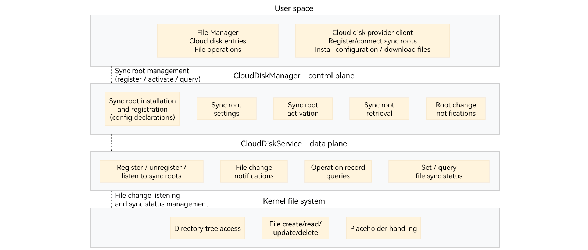

# Cloud Disk Foundation Overview
<!--Kit: Core File Kit-->
<!--Subsystem: FileManagement-->
<!--Owner: @lcm_kiku-->
<!--Designer: @wangyanyue-->
<!--Tester: @zsyztt-->
<!--Adviser: @jinqiuheng-->
<!-- md-trans-meta sourceCommit=5c324d8cebcd101e27f10fa7be68a44f484a4863 translatedAt=2026-11-05T00:54:18.360Z nl=1 -->

Cloud Disk Foundation maps cloud files to the local file system for cloud disk provider applications. After registering a cloud disk directory as a sync root, an application can use the Cloud Disk Foundation APIs ([oh_cloud_disk_manager.h](../reference/apis-core-file-kit/capi-oh-cloud-disk-manager-h.md)) to map cloud files to local placeholder files. Only metadata, such as file names, logical sizes, and modification times, is retained locally; actual contents are downloaded on demand.

As a system-level platform capability, Cloud Disk Foundation provides sync root management, file change monitoring and synchronization state management, placeholder file lifecycle management, and on-demand hydration/dehydration. It helps cloud disk provider applications integrate with the file manager while ensuring a consistent user experience and data reliability.

## Capabilities

- Sync root integration with the file manager: Cloud disk provider applications can register/unregister and activate/deactivate sync roots. After registration, a cloud disk entry appears in the file manager sidebar, allowing users to browse and access cloud files directly.
  - Display on registration: After an application registers a cloud disk directory as a sync root, the file manager automatically displays the cloud disk entry without additional user configuration.
  - Lifecycle management: Supports sync root registration, unregistration, activation, deactivation, list queries, and custom alias updates.
  - Batch cleanup: Unregistering a sync root automatically removes its placeholder files in batches, but retains ordinary files.
- Change notifications and historical operation queries: Detects file changes under sync roots to support file synchronization by cloud disk provider applications.
  - Change notifications: After sync root file change monitoring is registered, file additions, deletions, and modifications are reported to the application in real time through callbacks.
  - Historical queries: Supports incremental queries of historical operations under a sync root.
  - File synchronization state management: Allows applications to set and query file synchronization states under a sync root.
- Placeholder file mechanism: Maps cloud files to local placeholders, retaining only metadata without storing actual file data, to present large cloud disks with a small local footprint.
  - Placeholder creation: After registering a sync root, an application can create placeholders under it to map cloud files and set metadata such as creation and modification times, without consuming actual disk space.
  - File identification: Provides APIs to distinguish placeholders from ordinary files. Placeholders have protected private marks that ordinary processes cannot forge.
  - Modification and conversion: Supports renaming, moving, and deleting placeholders, and converting placeholders into 0-byte ordinary files.
- On-demand hydration and dehydration: Transfers actual cloud file data on demand, avoiding full downloads that consume local space.
  - Hydration: Downloads placeholders as ordinary files on demand. Hydration can be canceled.
  - Dehydration: Reverts hydrated files to an unhydrated state and releases local data blocks while allowing file contents to remain in the cloud.

## When to Use

- User scenarios
  - Managing cloud disk files.
  - Accessing cloud files on demand.
- Application scenarios
  - Integrating cloud disk provider applications with the file manager.
  - Mapping cloud files locally and downloading them on demand.
  - Detecting and synchronizing cloud file changes.
  - Releasing and managing device storage space.

## Basic Concepts

- CloudDiskService: The Cloud Disk Foundation process, responsible for file change notifications, placeholder lifecycle management, and file hydration/dehydration.
- Sync root: The local file system root of a cloud disk directory registered by a cloud disk provider application. It defines the boundary of local cloud file mapping. The system centrally monitors and records file changes within it. After registration, the directory appears as a cloud disk entry in the system file manager sidebar.
- Placeholder file: A special local file that maps to an actual cloud file and has an extended attribute marking it as a placeholder. Metadata such as the file name, logical size, and modification time is retained locally, but actual contents need not be stored yet; the file exists as a sparse file.
- Ordinary file: A file without a placeholder mark, read and written using ordinary file system semantics.
- Hydration: The process of downloading a placeholder's corresponding cloud data locally. Its state progresses from unhydrated to partially hydrated and fully hydrated.
- Dehydration: The process of releasing local file data blocks while retaining metadata such as logical size and modification time.

## Working Principles

Cloud Disk Foundation provides cloud disk provider applications with core APIs for sync root management, placeholder operations, and on-demand hydration/dehydration. After registering a cloud disk directory as a sync root, an application can call APIs in [oh_cloud_disk_manager.h](../reference/apis-core-file-kit/capi-oh-cloud-disk-manager-h.md) to create placeholders under it, identify placeholder states, update metadata, and respond to hydration/dehydration callbacks. Other file operations (opening, reading, renaming, deleting, and so on) use standard file access APIs. The system protects placeholder semantics and orchestrates synchronization in the background.

Cloud Disk Foundation is built on system-level services, with the following layers:

- **User space**: The file manager and cloud disk provider clients form the top layer. The file manager displays cloud disk entries and provides file operation entry points. Provider clients handle sync root registration and connection, installation configuration, and file downloads.
- **CloudDiskManager (control plane)**: Handles sync root installation registration (configuration declarations), settings, activation, retrieval, and root change notifications.
- **CloudDiskService (data plane)**: Handles sync root registration/unregistration/monitoring, file change notifications, operation record queries, and setting/querying file synchronization states.
- **Kernel file system**: Handles file directory tree access, file creation, deletion, modification, and queries, and placeholder processing, providing protected file system semantics for placeholders.

