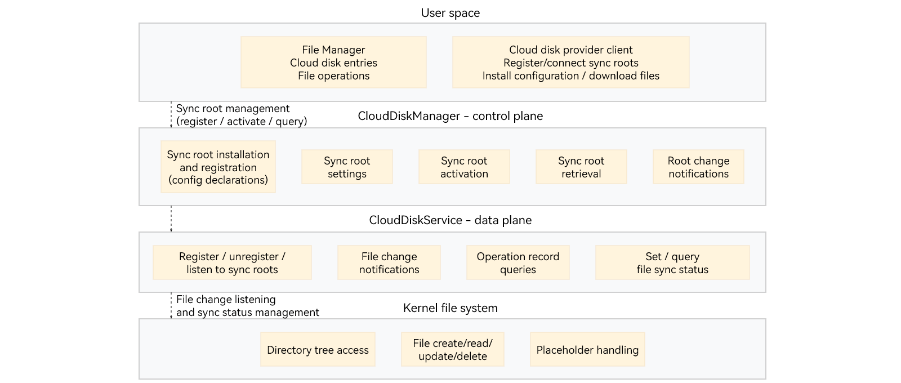

# Cloud Disk Service Foundation Overview
<!--Kit: Core File Kit-->
<!--Subsystem: FileManagement-->
<!--Owner: @lcm_kiku-->
<!--Designer: @wangyanyue-->
<!--Tester: @zsyztt-->
<!--Adviser: @jinqiuheng-->
<!-- md-trans-meta sourceCommit=99e141b81829cba41486c7ce7b2aa2cb918eb96e translatedAt=2026-10-29T10:30:53.770Z pushedAt=2026-10-29T10:30:53.770Z nl=1 -->

The cloud disk service foundation enables cloud disk provider applications to map cloud files to the local file system. After registering a cloud disk directory as a sync root, an application can use the APIs provided by the cloud disk service foundation ([oh_cloud_disk_manager.h](../reference/apis-core-file-kit/capi-oh-cloud-disk-manager-h.md)) to map cloud files to local placeholder files. Only metadata, such as file names, logical sizes, and modification times, is stored locally. The actual file content is downloaded on demand.

As a system-level capability, the cloud disk service foundation provides sync root management, file change listening and sync status management, placeholder file lifecycle management, and on-demand hydration and dehydration. These capabilities help cloud disk provider applications integrate with File Manager while ensuring a consistent user experience and data reliability.

## Capabilities

- Sync root integration with File Manager: allows cloud disk provider applications to register, unregister, activate, and deactivate sync roots. After registration, a cloud disk entry appears in the File Manager sidebar, allowing users to browse and access cloud files directly.
  - Display on registration: after an application registers a cloud disk directory as a sync root, File Manager automatically displays a cloud disk entry without requiring additional user configuration.
  - Lifecycle management: supports registering, unregistering, activating, and deactivating sync roots, querying the sync root list, and updating custom aliases.
  - Batch cleanup: automatically removes placeholder files under a sync root when the sync root is unregistered, while retaining regular files.
- Change notifications and historical operation queries: detects file changes under a sync root to support file synchronization by cloud disk provider applications.
  - Change notifications: after an application registers a listener for file changes under a sync root, callbacks notify the application of file additions, deletions, and modifications in real time.
  - Historical queries: supports incremental queries of historical file operations under a sync root.
  - File sync status management: allows applications to set and query the sync status of files under a sync root.
- Placeholder files: maps cloud files to local placeholders. Only metadata is stored locally, without writing the actual file content to disk, allowing large cloud disks to be represented with a small local storage footprint.
  - Placeholder creation: after registering a sync root, an application can create placeholder files under it to represent cloud files and set metadata, such as creation and modification times, without allocating disk space for the actual content.
  - File identification: provides APIs to distinguish placeholder files from regular files. Placeholder files have a protected private marker that ordinary processes cannot forge.
  - Modification and conversion: supports renaming, moving, and deleting placeholder files, and converting them to zero-byte regular files.
- On-demand hydration and dehydration: transfers cloud file content on demand to avoid using local storage for full downloads.
  - Hydration: downloads placeholder file content on demand to create regular files. Hydration can be canceled.
  - Dehydration: returns hydrated files to an unhydrated state and releases their local data blocks. The file content can remain in the cloud.

## When to Use

- User scenarios
  - Managing cloud disk files.
  - Accessing cloud files on demand.
- Application scenarios
  - Integrating cloud disk provider applications with File Manager.
  - Mapping cloud files locally and downloading them on demand.
  - Detecting and synchronizing cloud file changes.
  - Releasing and managing local storage space.

## Basic Concepts

- CloudDiskService: the cloud disk service foundation process, which handles file change notifications, placeholder lifecycle management, and file hydration and dehydration.
- Sync root: the local file system root of a cloud disk directory registered by a cloud disk provider application. It defines the boundary within which cloud files are mapped locally. The system monitors and records file changes within the sync root. After an application registers a cloud disk directory as a sync root, the directory appears as a cloud disk entry in the File Manager sidebar.
- Placeholder file: a special local file that represents an actual cloud file and has an extended attribute identifying it as a placeholder. Metadata, such as the file name, logical size, and modification time, is stored locally. The file can exist as a sparse file without its actual content being written to disk.
- Regular file: a file without a placeholder marker that is read and written using standard file system semantics.
- Hydration: the process of downloading the cloud data represented by a placeholder file to local storage. The placeholder progresses from unhydrated to partially hydrated and then fully hydrated.
- Dehydration: the process of releasing a file's local data blocks while retaining metadata, such as its logical size and modification time.

## Working Principles

The cloud disk service foundation provides APIs for sync root management, placeholder file operations, and on-demand hydration and dehydration. After registering a cloud disk directory as a sync root, a cloud disk provider application can call the APIs in [oh_cloud_disk_manager.h](../reference/apis-core-file-kit/capi-oh-cloud-disk-manager-h.md) to create placeholder files under the sync root, check their status, update metadata, and respond to hydration and dehydration callbacks. Other operations, such as opening, reading, renaming, and deleting files, use standard file access APIs. The system protects placeholder semantics and coordinates synchronization in the background.

The cloud disk service foundation is built on system-level services and consists of the following layers:

- **User space**: File Manager and the cloud disk provider client are at the top layer. File Manager displays cloud disk entries and provides access to file operations. The cloud disk provider client registers and connects sync roots, installs configurations, and downloads files.
- **CloudDiskManager (control plane)**: handles control plane operations, including sync root installation and registration (configuration declarations), configuration, activation, retrieval, and root change notifications.
- **CloudDiskService (data plane)**: handles data plane operations, including registering, unregistering, and listening to sync roots, notifying file changes, querying operation records, and setting and querying file sync status.
- **Kernel file system**: provides directory tree access, file creation, deletion, modification, and query operations, and placeholder file handling, with protected file system semantics for placeholders.

