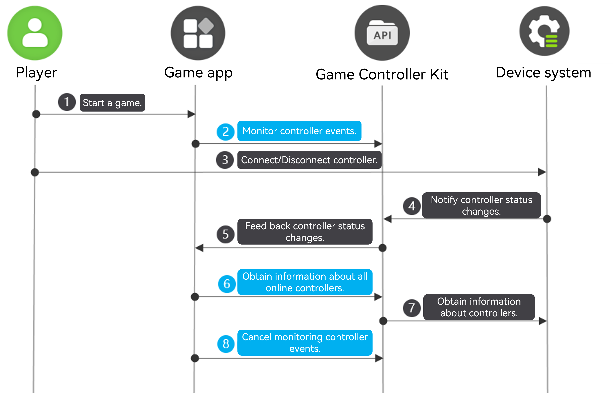

# Listening for Device Online/Offline Events (C/C++)

<!--Kit: Game Controller Kit-->
<!--Subsystem: Game-->
<!--Owner: @weixin_42784160-->
<!--Designer: @wudejun2025-->
<!--Tester: @fei_0805-->
<!--Adviser: @yuwenliang0514-->
<!-- md-trans-meta sourceCommit=1114c01c6d6bc126b9025685c4a37a86c8ed6e1f translatedAt=2026-11-05T01:00:48.361Z pushedAt=2026-08-22T03:23:13.952Z nl=2 -->

## When to Use

Game Controller Kit allows you to monitor game device online/offline events and query information about online devices. After registering a listener for these events, you can receive real-time callback notifications when devices are plugged in or unplugged. It also supports querying specific information about all online devices.

## Service Flow



1. A player starts a game.

2. The game calls the [OH_GameDevice_RegisterDeviceMonitor](../reference/apis-game-controller-kit/capi-game-device-h.md#oh_gamedevice_registerdevicemonitor) API to register a listener for device state change events.

3. The player plugs in or unplugs a device.

4. The device system notifies Game Controller Kit of the device state change.

5. Game Controller Kit feeds back the device state change to the game.

6. The game calls the [OH_GameDevice_GetAllDeviceInfos](../reference/apis-game-controller-kit/capi-game-device-h.md#oh_gamedevice_getalldeviceinfos) API to query Game Controller Kit for information about all online game devices.

7. Game Controller Kit obtains information about all online devices from the device system.

8. If the subscription is no longer needed, the game can call the [OH_GameDevice_UnregisterDeviceMonitor](../reference/apis-game-controller-kit/capi-game-device-h.md#oh_gamedevice_unregisterdevicemonitor) API to cancel the listener for device state change events.

## Available APIs

For detailed API descriptions, see [GameController](../reference/apis-game-controller-kit/capi-gamecontroller.md).

| API| Description|
| -------- | -------- |
| GameController_ErrorCode [OH_GameDevice_RegisterDeviceMonitor](../reference/apis-game-controller-kit/capi-game-device-h.md#oh_gamedevice_registerdevicemonitor) (GameDevice_DeviceMonitorCallback deviceMonitorCallback) | Registers a listener for device state change events. |
| GameController_ErrorCode [OH_GameDevice_UnregisterDeviceMonitor](../reference/apis-game-controller-kit/capi-game-device-h.md#oh_gamedevice_unregisterdevicemonitor) (void) | Unregisters the listener for device state change events. |
| GameController_ErrorCode [OH_GameDevice_GetAllDeviceInfos](../reference/apis-game-controller-kit/capi-game-device-h.md#oh_gamedevice_getalldeviceinfos) (GameDevice_AllDeviceInfos \*\*allDeviceInfos) | Obtains information about all online devices. |

## How to Develop

### Linking the Dynamic Library

<!-- @[link_game_controller_libs](https://gitcode.com/openharmony/applications_app_samples/blob/master/code/DocsSample/GameControllerKit/NdkGameControllerDemo/entry/src/main/cpp/CMakeLists.txt) -->

``` Text
target_link_libraries(entry PUBLIC libohgame_controller.z.so)
```

### Importing the Module

<!-- @[header_include_game_device](https://gitcode.com/openharmony/applications_app_samples/blob/master/code/DocsSample/GameControllerKit/NdkGameControllerDemo/entry/src/main/cpp/device_api.cpp) -->

``` C++
#include "GameControllerKit/game_device.h"
```

### Registering a Listener for Device Status Changes

Call the [OH_GameDevice_RegisterDeviceMonitor](../reference/apis-game-controller-kit/capi-game-device-h.md#oh_gamedevice_registerdevicemonitor) API to register a listener for device state changes and receive callback notifications for device connection and disconnection.

<!-- @[register_device_monitor](https://gitcode.com/openharmony/applications_app_samples/blob/master/code/DocsSample/GameControllerKit/NdkGameControllerDemo/entry/src/main/cpp/device_api.cpp) -->

``` C++
int32_t DeviceApi::RegisterDeviceMonitor()
{
    GameController_ErrorCode errorCode = OH_GameDevice_RegisterDeviceMonitor(DeviceApi::OnDeviceChanged);
    if (errorCode != GameController_ErrorCode::GAME_CONTROLLER_SUCCESS) {
        OH_LOG_ERROR(LOG_APP, "RegisterDeviceMonitor Failed, %{public}d", errorCode);
        return static_cast<int32_t>(errorCode);
    }
    OH_LOG_INFO(LOG_APP, "RegisterDeviceMonitor Success");
    return 0;
}

void DeviceApi::OnDeviceChanged(const struct GameDevice_DeviceEvent *deviceEvent)
{
    GameDevice_StatusChangedType type;
    OH_GameDevice_DeviceEvent_GetChangedType(deviceEvent, &type);
    GameDevice_DeviceInfo *deviceInfo;
    OH_GameDevice_DeviceEvent_GetDeviceInfo(deviceEvent, &deviceInfo);
    std::string temp = GetDeviceInfoStringForPrint(deviceInfo);
    Log::GetInstance()->PrintLog("OnDeviceChanged type[" + std::to_string(type) + "] DeviceInfo" + temp);
    OH_LOG_INFO(LOG_APP, "OnDeviceChanged type:%{public}d DeviceInfo:%{public}s", type, temp.c_str());
    OH_GameDevice_DestroyDeviceInfo(&deviceInfo);
}
```

### Unregistering a Listener for Device State Changes

If the subscription is no longer needed, call the [OH_GameDevice_UnregisterDeviceMonitor](../reference/apis-game-controller-kit/capi-game-device-h.md#oh_gamedevice_unregisterdevicemonitor) API to cancel the listener for device state change events.

<!-- @[unregister_device_monitor](https://gitcode.com/openharmony/applications_app_samples/blob/master/code/DocsSample/GameControllerKit/NdkGameControllerDemo/entry/src/main/cpp/device_api.cpp) -->

``` C++
int32_t DeviceApi::UnregisterDeviceMonitor()
{
    GameController_ErrorCode errorCode = OH_GameDevice_UnregisterDeviceMonitor();
    if (errorCode != GameController_ErrorCode::GAME_CONTROLLER_SUCCESS) {
        OH_LOG_ERROR(LOG_APP, "UnregisterDeviceMonitor Failed, %{public}d", errorCode);
        return static_cast<int32_t>(errorCode);
    }
    OH_LOG_INFO(LOG_APP, "UnregisterDeviceMonitor Success");
    return 0;
}
```

### Querying All Online Devices

Call the [OH_GameDevice_GetAllDeviceInfos](../reference/apis-game-controller-kit/capi-game-device-h.md#oh_gamedevice_getalldeviceinfos) API to query information about all online game devices.

<!-- @[query_all_device_infos](https://gitcode.com/openharmony/applications_app_samples/blob/master/code/DocsSample/GameControllerKit/NdkGameControllerDemo/entry/src/main/cpp/device_api.cpp) -->

``` C++
GameController_ErrorCode DeviceApi::DoQueryAllDeviceInfos()
{
    GameDevice_AllDeviceInfos *gameDeviceAllDeviceInfos;
    
    // Query all online devices.
    GameController_ErrorCode errorCode = OH_GameDevice_GetAllDeviceInfos(&gameDeviceAllDeviceInfos);
    if (errorCode != GameController_ErrorCode::GAME_CONTROLLER_SUCCESS) {
        OH_LOG_ERROR(LOG_APP, "GetAllDeviceInfos Failed, %{public}d", errorCode);
        Log::GetInstance()->PrintLog("GetAllDeviceInfos Failed, errorCode: " + std::to_string(errorCode));
        return errorCode;
    }
    
    // Obtain device info one by one.
    int count;
    OH_GameDevice_AllDeviceInfos_GetCount(gameDeviceAllDeviceInfos, &count);
    Log::GetInstance()->PrintLog("GetAllDeviceInfos Success, the count is " + std::to_string(count));
    for (int idx = 0; idx < count; idx++) {
        GameDevice_DeviceInfo *deviceInfo;
        errorCode = OH_GameDevice_AllDeviceInfos_GetDeviceInfo(gameDeviceAllDeviceInfos, idx, &deviceInfo);
        if (errorCode != GameController_ErrorCode::GAME_CONTROLLER_SUCCESS) {
            OH_LOG_ERROR(LOG_APP, "OH_GameDevice_AllDeviceInfos_GetDeviceInfo Failed, %{public}d", errorCode);
            Log::GetInstance()->PrintLog("OH_GameDevice_AllDeviceInfos_GetDeviceInfo Failed, errorCode: " +
                                         std::to_string(errorCode));
            OH_GameDevice_DestroyAllDeviceInfos(&gameDeviceAllDeviceInfos);
            return errorCode;
        }
        std::string temp = GetDeviceInfoStringForPrint(deviceInfo);
        Log::GetInstance()->PrintLog("AllDeviceInfos[" + std::to_string(idx) + "] " + temp);
        OH_LOG_INFO(LOG_APP, "AllDeviceInfos[%{public}d] DeviceInfo: %{public}s", idx, temp.c_str());
        OH_GameDevice_DestroyDeviceInfo(&deviceInfo);
    }
    
    // Destroy the pointer to the device query result.
    OH_GameDevice_DestroyAllDeviceInfos(&gameDeviceAllDeviceInfos);
    OH_LOG_INFO(LOG_APP, "GetAllDeviceInfos Success");
    return errorCode;
}

std::string DeviceApi::GetDeviceInfoStringForPrint(GameDevice_DeviceInfo *deviceInfo)
{
    // Obtain device info
    std::string log;
    char *deviceId = nullptr;
    OH_GameDevice_DeviceInfo_GetDeviceId(deviceInfo, &deviceId);
    log.append("deviceId:").append(deviceId);
    free(deviceId);
    char *name = nullptr;
    OH_GameDevice_DeviceInfo_GetName(deviceInfo, &name);
    log.append(", name:").append(name);
    free(name);
    int vendor;
    OH_GameDevice_DeviceInfo_GetVendor(deviceInfo, &vendor);
    log.append(", vendor:").append(std::to_string(vendor));
    int product;
    OH_GameDevice_DeviceInfo_GetProduct(deviceInfo, &product);
    log.append(", product:").append(std::to_string(product));
    int version;
    OH_GameDevice_DeviceInfo_GetVersion(deviceInfo, &version);
    log.append(", version:").append(std::to_string(version));
    char *physicalAddress = nullptr;
    OH_GameDevice_DeviceInfo_GetPhysicalAddress(deviceInfo, &physicalAddress);
    log.append(", physicalAddress:").append(physicalAddress);
    free(physicalAddress);
    GameDevice_DeviceType type;
    OH_GameDevice_DeviceInfo_GetDeviceType(deviceInfo, &type);
    log.append(", type:").append(std::to_string(type));
    return log;
}
```