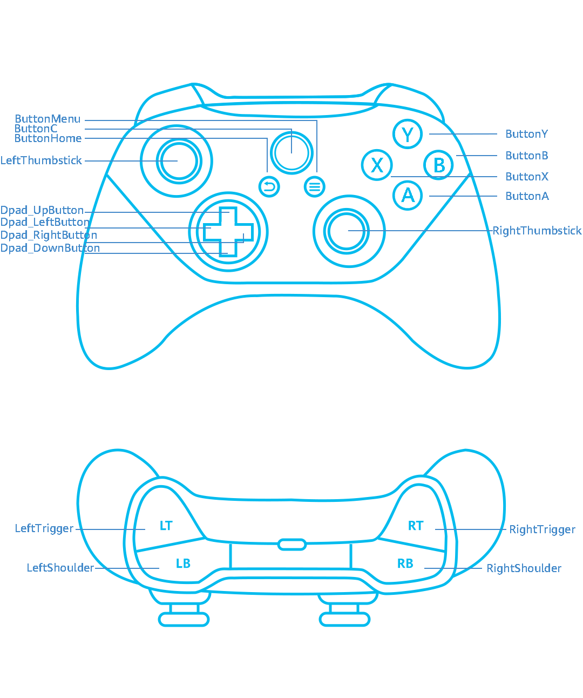

# Listening for Gamepad Axis and Button Events (C/C++)
<!--Kit: Game Controller Kit-->
<!--Subsystem: Game-->
<!--Owner: @weixin_42784160-->
<!--Designer: @wudejun2025-->
<!--Tester: @fei_0805-->
<!--Adviser: @yuwenliang0514-->
<!-- md-trans-meta sourceCommit=651ce9a015ccb0a7fedbe7ff38277a5e01ee88b9 translatedAt=2026-11-03T08:12:16.817Z pushedAt=2026-11-03T08:12:16.817Z -->

> **NOTE**<br>
> You need to develop [device online/offline status monitoring](game-controller-monitor-device.md) before registering listeners for gamepad axis and button events.


## When to Use

Game Controller Kit provides the capability of listening for gamepad axis and button events. After you register a listener for these events, callback notifications can be obtained when players operate the gamepad's buttons and joysticks.


## Buttons

The following figure shows the buttons supported by Game Controller Kit.




## Available APIs

For detailed API descriptions, see [GameController](../reference/apis-game-controller-kit/capi-gamecontroller.md).

| API| Description| 
| -------- | -------- |
| OH_GamePad_LeftShoulder_RegisterButtonInputMonitor | Registers a listener for the Left Shoulder button event.| 
| OH_GamePad_RightShoulder_RegisterButtonInputMonitor | Registers a listener for the Right Shoulder button event.| 
| OH_GamePad_LeftTrigger_RegisterButtonInputMonitor | Registers a listener for the Left Trigger button event.| 
| OH_GamePad_RightTrigger_RegisterButtonInputMonitor | Registers a listener for the Right Trigger button event.| 
| OH_GamePad_ButtonMenu_RegisterButtonInputMonitor | Registers a listener for the Menu button event.| 
| OH_GamePad_ButtonHome_RegisterButtonInputMonitor | Registers a listener for the Home button event.| 
| OH_GamePad_ButtonA_RegisterButtonInputMonitor | Registers a listener for the A button event.| 
| OH_GamePad_ButtonB_RegisterButtonInputMonitor | Registers a listener for the B button event.| 
| OH_GamePad_ButtonX_RegisterButtonInputMonitor | Registers a listener for the X button event.| 
| OH_GamePad_ButtonY_RegisterButtonInputMonitor | Registers a listener for the Y button event.| 
| OH_GamePad_ButtonC_RegisterButtonInputMonitor | Registers a listener for the C button event.| 
| OH_GamePad_ButtonNonstandard_RegisterButtonInputMonitor | Registers a listener for nonstandard button events. |
| OH_GamePad_Dpad_LeftButton_RegisterButtonInputMonitor | Registers a listener for the Left Directional button event.| 
| OH_GamePad_Dpad_RightButton_RegisterButtonInputMonitor | Registers a listener for the Right Directional button event.| 
| OH_GamePad_Dpad_UpButton_RegisterButtonInputMonitor | Registers a listener for the Up Directional button event.| 
| OH_GamePad_Dpad_DownButton_RegisterButtonInputMonitor | Registers a listener for the Down Directional button event.| 
| OH_GamePad_LeftThumbstick_RegisterButtonInputMonitor | Registers a listener for the Left Thumbstick button event.| 
| OH_GamePad_RightThumbstick_RegisterButtonInputMonitor | Registers a listener for the Right Thumbstick button event.| 
| OH_GamePad_LeftTrigger_RegisterAxisInputMonitor | Registers a listener for the Left Trigger axis event.| 
| OH_GamePad_RightTrigger_RegisterAxisInputMonitor | Registers a listener for the Right Trigger axis event.| 
| OH_GamePad_Dpad_RegisterAxisInputMonitor | Registers a listener for the Directional Pad button axis event.| 
| OH_GamePad_LeftThumbstick_RegisterAxisInputMonitor | Registers a listener for the Left Thumbstick axis event.| 
| OH_GamePad_RightThumbstick_RegisterAxisInputMonitor | Registers a listener for the Right Thumbstick axis event.| 


## How to Develop


### Linking the Dynamic Library

<!-- @[link_game_controller_libs](https://gitcode.com/openharmony/applications_app_samples/blob/master/code/DocsSample/GameControllerKit/NdkGameControllerDemo/entry/src/main/cpp/CMakeLists.txt) -->

``` Text
target_link_libraries(entry PUBLIC libohgame_controller.z.so)
```


### Importing the Module

<!-- @[header_include_game_pad](https://gitcode.com/openharmony/applications_app_samples/blob/master/code/DocsSample/GameControllerKit/NdkGameControllerDemo/entry/src/main/cpp/game_pad_api.cpp) -->

``` C++
#include "GameControllerKit/game_pad.h"
```


### Registering and Unregistering a Listener for the Axis Event

Call the corresponding APIs to register or unregister axis event callbacks and obtain the axis value through the callback functions.

The following table lists the physical axes and the APIs for obtaining their values.

| Physical Axis| Axis Value Acquisition API|
| -------- | -------- |
| LeftThumbstick | Obtain the axis value of the X axis through [OH_GamePad_AxisEvent_GetXAxisValue](../reference/apis-game-controller-kit/capi-game-pad-event-h.md#oh_gamepad_axisevent_getxaxisvalue).<br/>Obtain the axis value of the Y axis through [OH_GamePad_AxisEvent_GetYAxisValue](../reference/apis-game-controller-kit/capi-game-pad-event-h.md#oh_gamepad_axisevent_getyaxisvalue). |
| RightThumbstick | Obtain the axis value of the Z axis through [OH_GamePad_AxisEvent_GetZAxisValue](../reference/apis-game-controller-kit/capi-game-pad-event-h.md#oh_gamepad_axisevent_getzaxisvalue).<br/>Obtain the axis value of the RZ axis through [OH_GamePad_AxisEvent_GetRZAxisValue](../reference/apis-game-controller-kit/capi-game-pad-event-h.md#oh_gamepad_axisevent_getrzaxisvalue). |
| DPAD | Obtain the axis value of the HatX axis through [OH_GamePad_AxisEvent_GetHatXAxisValue](../reference/apis-game-controller-kit/capi-game-pad-event-h.md#oh_gamepad_axisevent_gethatxaxisvalue).<br/>Obtain the axis value of the HatY axis through [OH_GamePad_AxisEvent_GetHatYAxisValue](../reference/apis-game-controller-kit/capi-game-pad-event-h.md#oh_gamepad_axisevent_gethatyaxisvalue). |
| LeftTrigger | Obtain the axis value of the Brake axis through [OH_GamePad_AxisEvent_GetBrakeAxisValue](../reference/apis-game-controller-kit/capi-game-pad-event-h.md#oh_gamepad_axisevent_getbrakeaxisvalue). |
| RightTrigger | Obtain the axis value of the Gas axis through [OH_GamePad_AxisEvent_GetGasAxisValue](../reference/apis-game-controller-kit/capi-game-pad-event-h.md#oh_gamepad_axisevent_getgasaxisvalue). |

The following uses the Left Thumbstick axis event as an example.

<!-- @[button_input_monitor](https://gitcode.com/openharmony/applications_app_samples/blob/master/code/DocsSample/GameControllerKit/NdkGameControllerDemo/entry/src/main/cpp/game_pad_api.cpp) -->

``` C++
int32_t GamePad::LeftShoulderRegisterButtonInputMonitor()
{
    GameController_ErrorCode errorCode =
        OH_GamePad_LeftShoulder_RegisterButtonInputMonitor(GamePad::LeftShoulderOnButtonEvent);
    if (errorCode != GameController_ErrorCode::GAME_CONTROLLER_SUCCESS) {
        OH_LOG_ERROR(LOG_APP, "LeftShoulder_RegisterButtonInputMonitor Failed, %{public}d", errorCode);
        return static_cast<int32_t>(errorCode);
    }
    OH_LOG_INFO(LOG_APP, "LeftShoulder_RegisterButtonInputMonitor Success");
    return 0;
}

int32_t GamePad::LeftShoulderUnregisterButtonInputMonitor()
{
    GameController_ErrorCode errorCode = OH_GamePad_LeftShoulder_UnregisterButtonInputMonitor();
    if (errorCode != GameController_ErrorCode::GAME_CONTROLLER_SUCCESS) {
        OH_LOG_ERROR(LOG_APP, "LeftShoulder_UnregisterButtonInputMonitor Failed, %{public}d", errorCode);
        return static_cast<int32_t>(errorCode);
    }
    OH_LOG_INFO(LOG_APP, "LeftShoulder_UnregisterButtonInputMonitor Success");
    return 0;
}

void GamePad::LeftShoulderOnButtonEvent(const struct GamePad_ButtonEvent *buttonEvent)
{
    OnButtonEvent(buttonEvent, "LeftShoulder_OnButtonEvent");
}

void GamePad::OnButtonEvent(const struct GamePad_ButtonEvent *buttonEvent, const std::string &buttonName)
{
    std::string temp;
    temp.append("OnButtonEvent:").append(buttonName);
    char *deviceId;
    OH_GamePad_ButtonEvent_GetDeviceId(buttonEvent, &deviceId);
    temp.append(" ,deviceId:").append(deviceId);
    free(deviceId);
    GamePad_Button_ActionType action;
    OH_GamePad_ButtonEvent_GetButtonAction(buttonEvent, &action);
    temp.append(" ,action:").append(std::to_string(action));
    std::int32_t buttonCode;
    OH_GamePad_ButtonEvent_GetButtonCode(buttonEvent, &buttonCode);
    temp.append(" ,code:").append(std::to_string(buttonCode));
    char *buttonCodeName;
    OH_GamePad_ButtonEvent_GetButtonCodeName(buttonEvent, &buttonCodeName);
    temp.append(" ,codeName:").append(buttonCodeName);
    free(buttonCodeName);
    std::int64_t actionTime;
    OH_GamePad_ButtonEvent_GetActionTime(buttonEvent, &actionTime);
    temp.append(" ,actionTime:").append(std::to_string(actionTime));
    std::int32_t count;
    OH_GamePad_PressedButtons_GetCount(buttonEvent, &count);
    temp.append(" ,count:").append(std::to_string(count));
    std::string pressedButtonCodes;
    for (std::int32_t idx = 0; idx < count; idx++) {
        GamePad_PressedButton *pressedButton;
        OH_GamePad_PressedButtons_GetButtonInfo(buttonEvent, idx, &pressedButton);
        int code;
        OH_GamePad_PressedButton_GetButtonCode(pressedButton, &code);
        char *name;
        OH_GamePad_PressedButton_GetButtonCodeName(pressedButton, &name);
        if (idx != 0) {
            pressedButtonCodes = pressedButtonCodes.append(";");
        }
        pressedButtonCodes = pressedButtonCodes.append(std::to_string(code) + "|").append(name);
        free(name);
        OH_GamePad_DestroyPressedButton(&pressedButton);
    }
    temp.append(" ,pressedButtonCodes:").append(pressedButtonCodes);
    OH_LOG_INFO(LOG_APP, "%{public}s", temp.c_str());
    Log::GetInstance()->PrintLog(temp);
}
```


### Registering and Unregistering a Listener for the Button Event

Call the corresponding APIs to register or unregister button event callbacks and obtain the button value from the callback functions.

The following table lists the button names and their values.

| Button| Value|
| -------- | -------- |
| LeftShoulder | 2307 |
| RightShoulder | 2308 |
| LeftTrigger | 2309 |
| RightTrigger | 2310 |
| LeftThumbstick | 2314 |
| RightThumbstick | 2315 |
| ButtonHome | 2311 |
| ButtonMenu | 2312 |
| ButtonA | 2301 |
| ButtonB | 2302 |
| ButtonC | 2303 |
| ButtonX | 2304 |
| ButtonY | 2305 |
| Dpad_UpButton | 2012 |
| Dpad_DownButton | 2013 |
| Dpad_LeftButton | 2014 |
| Dpad_RightButton | 2015 |

> **NOTE**<br/>
> For the key codes of nonstandard buttons, see [KeyCode](../reference/apis-input-kit/js-apis-keycode.md#keycode).

The following uses the Left Shoulder button event as an example.

<!-- @[axis_input_monitor](https://gitcode.com/openharmony/applications_app_samples/blob/master/code/DocsSample/GameControllerKit/NdkGameControllerDemo/entry/src/main/cpp/game_pad_api.cpp) -->

``` C++
int32_t GamePad::LeftThumbstickRegisterAxisInputMonitor()
{
    GameController_ErrorCode errorCode =
        OH_GamePad_LeftThumbstick_RegisterAxisInputMonitor(GamePad::LeftThumbstickOnAxisEvent);
    if (errorCode != GameController_ErrorCode::GAME_CONTROLLER_SUCCESS) {
        OH_LOG_ERROR(LOG_APP, "LeftThumbstick_RegisterAxisInputMonitor Failed, %{public}d", errorCode);
        return static_cast<int32_t>(errorCode);
    }
    OH_LOG_INFO(LOG_APP, "LeftThumbstick_RegisterAxisInputMonitor Success");
    return 0;
}

int32_t GamePad::LeftThumbstickUnregisterAxisInputMonitor()
{
    GameController_ErrorCode errorCode = OH_GamePad_LeftThumbstick_UnregisterAxisInputMonitor();
    if (errorCode != GameController_ErrorCode::GAME_CONTROLLER_SUCCESS) {
        OH_LOG_ERROR(LOG_APP, "LeftThumbstick_UnregisterAxisInputMonitor Failed, %{public}d", errorCode);
        return static_cast<int32_t>(errorCode);
    }
    OH_LOG_INFO(LOG_APP, "LeftThumbstick_UnregisterAxisInputMonitor Success");
    return 0;
}

void GamePad::LeftThumbstickOnAxisEvent(const struct GamePad_AxisEvent *axisEvent)
{
    std::string val = "X";
    double xAxisValue;
    OH_GamePad_AxisEvent_GetXAxisValue(axisEvent, &xAxisValue);
    val.append(std::to_string(xAxisValue)).append("_Y");
    double yAxisValue;
    OH_GamePad_AxisEvent_GetYAxisValue(axisEvent, &yAxisValue);
    val.append(std::to_string(yAxisValue));
    OnAxisEvent(axisEvent, "LeftThumbstick_OnAxisEvent", val);
}
```
