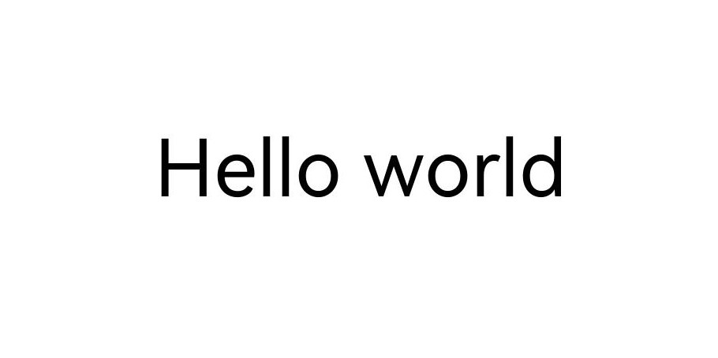
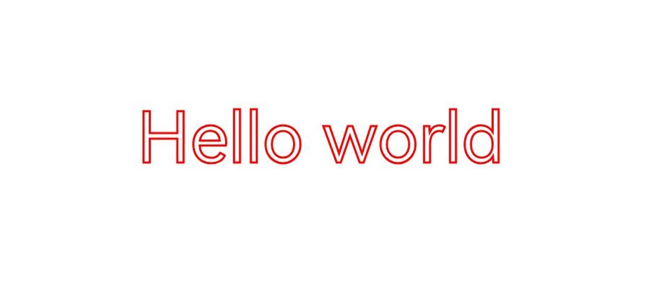
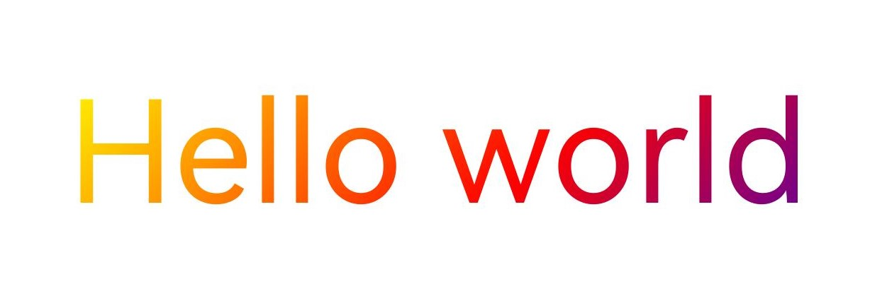
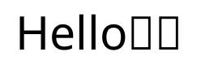
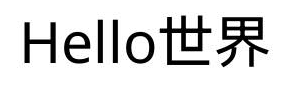
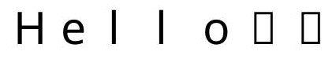
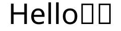

# Drawing TextBlobs (ArkTS)

<!--Kit: ArkGraphics 2D-->
<!--Subsystem: Graphics-->
<!--Owner: @hangmengxin-->
<!--Designer: @wanyanglan-->
<!--Tester: @nobuggers-->
<!--Adviser: @ge-yafang-->
<!-- md-trans-meta sourceCommit=bf5ca26b34dcc9d24248c2e964e66757af125da0 translatedAt=2026-10-19T01:37:33.924Z pushedAt=2026-10-19T10:44:09.720Z -->

## Overview

A TextBlob is a set of texts. You can draw both a single text and a paragraph by using TextBlobs.

In addition to basic TextBlob drawing, you can apply various drawing effects to text. Common TextBlob drawing scenarios include [text stroke](#text-stroke), [text gradient](#text-gradient), and [font fallback](#font-fallback). For more effects, see [Overview of Drawing Effects](drawing-effect-overview.md).

This topic does not involve text measurement and typography. For details about how to handle text drawing requirements, see [Introduction to Text Development](text-overview.md). This topic describes the typography policies and related usage.

## Basic TextBlob Drawing

The Canvas component draws TextBlobs using **drawTextBlob()**. This function takes three parameters: **TextBlob** object, and X and Y coordinates of the left end point of the text baseline.

For details about the **Canvas** object, see [Obtaining a Canvas and Displaying Drawing Results (ArkTS)](canvas-get-result-draw-arkts.md).

A **TextBlob** object can be created in multiple ways. For details about how to create a block and how to use the API, see [TextBlob](../reference/apis-arkgraphics2d/arkts-apis-graphics-drawing-TextBlob.md).

The following uses the **makeFromString()** API as an example to create a **TextBlob** object. The API takes three parameters:

- String text to be displayed.

- **font** object, which is used to set and obtain various font attributes, such as the font size, text style, font alignment mode, font rendering mode, and font stroke mode. For details about the APIs, see [Font](../reference/apis-arkgraphics2d/arkts-apis-graphics-drawing-Font.md).

- Text encoding mode. The following modes are supported:
  - **TEXT_ENCODING_UTF8**: One byte is used to indicate UTF-8 or ASCII characters.
  - **TEXT_ENCODING_UTF16**: Two bytes are used to indicate most Unicode characters.
  - **TEXT_ENCODING_UTF32**: Four bytes are used to indicate all Unicode characters.
  - **TEXT_ENCODING_GLYPH_ID**: Two bytes are used to indicate the glyph index.

The sample code and effect are as follows:

<!-- @[arkts_graphics_draw_base_text](https://gitcode.com/openharmony/applications_app_samples/blob/master/code/DocsSample/ArkGraphics2D/Drawing/ArkTSGraphicsDraw/entry/src/main/ets/drawing/pages/TextBlockDrawing.ets) -->

``` TypeScript
// Create a font object.
const font = new drawing.Font();
// Set the font size.
font.setSize(100);
// Create a TextBlob object.
const textBlob = drawing.TextBlob.makeFromString('Hello world', font, drawing.TextEncoding.TEXT_ENCODING_UTF8);
// Draw the TextBlob.
canvas.drawTextBlob(textBlob, VALUE_200, VALUE_300);
```



## Text Stroke

Based on the basic TextBlob drawing, you can also use the pen to implement the text stroke effect. For details, see [Stroke Effect](basic-drawing-effect-arkts.md#stroke-effect).

The following uses English and Chinese text strokes as examples.

### English Text Stroke

The following shows the sample code and effect of English text strokes.

<!-- @[arkts_graphics_draw_stroke_text](https://gitcode.com/openharmony/applications_app_samples/blob/master/code/DocsSample/ArkGraphics2D/Drawing/ArkTSGraphicsDraw/entry/src/main/ets/drawing/pages/TextBlockDrawing.ets) -->

``` TypeScript
// Create a pen.
let pen = new drawing.Pen();
// Set anti-aliasing.
pen.setAntiAlias(true);
// Set the stroke width.
pen.setStrokeWidth(3.0);
// Set the stroke color.
pen.setColor(0xFF, 0xFF, 0x00, 0x00);
// Create a font object.
const font = new drawing.Font();
// Set the font size.
font.setSize(100);
// Add the pen stroke effect.
canvas.attachPen(pen);
// Create a TextBlob object.
const textBlob = drawing.TextBlob.makeFromString('Hello world', font, drawing.TextEncoding.TEXT_ENCODING_UTF8);
// Draw the TextBlob.
canvas.drawTextBlob(textBlob, VALUE_200, VALUE_300);
// Remove the stroke effect.
canvas.detachPen();
```



### Chinese Text Stroke

To achieve the stroke effect for Chinese text, first use a pen to outline the strokes, then apply a brush to fill the inner color and eliminate impurities and overlapping areas in the middle of the font.

The following shows the sample code and effect of Chinese text strokes.

<!-- @[arkts_graphics_draw_chinese_stroke_text](https://gitcode.com/openharmony/applications_app_samples/blob/master/code/DocsSample/ArkGraphics2D/Drawing/ArkTSGraphicsDraw/entry/src/main/ets/drawing/pages/TextBlockDrawing.ets) -->

``` TypeScript

// Create a brush.
let brush = new drawing.Brush();
// Create a pen.
let pen = new drawing.Pen();
// Set anti-aliasing.
brush.setAntiAlias(true);
// Set the fill color.
brush.setColor(0xFF, 0xFF, 0xFF, 0xFF);

pen.setAntiAlias(true);
// Set the stroke width.
pen.setStrokeWidth(3.0);
// Set the stroke color.
pen.setColor(0xFF, 0xFF, 0x00, 0x00);

// Create a font object.
const font = new drawing.Font();
// Set the font size.
font.setSize(100);
// Add the pen stroke effect.
canvas.attachPen(pen);
// Create a TextBlob object.
const textBlob = drawing.TextBlob.makeFromString(STROKE_SAMPLE, font, drawing.TextEncoding.TEXT_ENCODING_UTF8);
// Draw the TextBlob.
canvas.drawTextBlob(textBlob, VALUE_200,  VALUE_300);
// Remove the stroke effect.
canvas.detachPen(); 

canvas.attachBrush(brush);
canvas.drawTextBlob(textBlob, VALUE_200, VALUE_300);
canvas.detachBrush();
```


## Text Gradient

In addition to TextBlob drawing, you can use a shader to implement the gradient effect of text. For more information about shaders, see [Shader Effect](complex-drawing-effect-arkts.md#shader-effect).

The following shows the sample code and effect of adding a linear gradient shader to text.

<!-- @[arkts_graphics_draw_gradient_text](https://gitcode.com/openharmony/applications_app_samples/blob/master/code/DocsSample/ArkGraphics2D/Drawing/ArkTSGraphicsDraw/entry/src/main/ets/drawing/pages/TextBlockDrawing.ets) -->

``` TypeScript
let startPt: common2D.Point = { x: VALUE_100, y: VALUE_100 };
let endPt: common2D.Point = { x: VALUE_900, y: VALUE_900 };
let colors = [0xFFFFFF00, 0xFFFF0000, 0xFF0000FF];
// Create a linear gradient shader.
let shaderEffect = drawing.ShaderEffect.createLinearGradient(startPt, endPt, colors, drawing.TileMode.CLAMP);
// Create a brush.
let brush = new drawing.Brush();
// Set the shader.
brush.setShaderEffect(shaderEffect);
// Add the brush fill effect.
canvas.attachBrush(brush);
// Create a font.
const font = new drawing.Font();
// Set the font size.
font.setSize(VALUE_200);
// Create a TextBlob.
const textBlob = drawing.TextBlob.makeFromString('Hello world', font, drawing.TextEncoding.TEXT_ENCODING_UTF8);
// Draw the TextBlob.
canvas.drawTextBlob(textBlob, VALUE_100, VALUE_300);
// Remove the fill effect.
canvas.detachBrush();
```



## Theme Font

Theme fonts are specialized custom fonts available for use in theme applications. For details about text measurement and typography, see [Using Theme Fonts (ArkTS)](theme-font-arkts.md).

The following shows the sample code and effect for setting the theme font.

<!-- @[arkts_graphics_draw_theme_text](https://gitcode.com/openharmony/applications_app_samples/blob/master/code/DocsSample/ArkGraphics2D/Drawing/ArkTSGraphicsDraw/entry/src/main/ets/drawing/pages/TextBlockDrawing.ets) --> 

``` TypeScript
// Create a font object.
const font = new drawing.Font();
// Set the text size.
font.setSize(100);
// Set the theme font.
font.setThemeFontFollowed(true);
// Create a TextBlob object.
const textBlob = drawing.TextBlob.makeFromString('Hello World', font, drawing.TextEncoding.TEXT_ENCODING_UTF8);
// Draw the TextBlob.
canvas.drawTextBlob(textBlob, VALUE_200, VALUE_300);
```

| Theme Font Not Followed| Theme Font Followed (For Reference)|
| -------- | -------- |
|  |  |

> **NOTE**
>
> You need to override the **onConfigurationUpdate** function in the application entry file (**EntryAbility.ets** in the default project) to respond to the theme font switching operation, ensuring that the page can be refreshed and take effect in a timely manner after the switching. For details, see [Using Theme Fonts (ArkTS)](theme-font-arkts.md).

## Single-Character Drawing

Single character drawing is a fine-grained control technique for text rendering in graphics rendering. Compared with TextBlob drawing, its core advantage lies in leveraging the font fallback mechanism: when the current font cannot display a certain character, it automatically falls back to the system font to render the character, improving compatibility with special characters and preventing missing characters. Additionally, single character drawing supports configuring font features (such as ligatures and alternative glyphs) on a per-character basis, meeting complex typography requirements and enhancing user experience. For detailed API information, see [drawSingleCharacter](../reference/apis-arkgraphics2d/arkts-apis-graphics-drawing-Canvas.md#drawsinglecharacter12).

Basic scenario: drawing characters without font features

In common text rendering scenarios where font features are not required, you can use **drawSingleCharacter** to draw a single character and use **measureSingleCharacter** to measure the width of a single character. The sample code and effect are as follows:

<!-- @[arkts_graphics_draw_single_text](https://gitcode.com/openharmony/applications_app_samples/blob/master/code/DocsSample/ArkGraphics2D/Drawing/ArkTSGraphicsDraw/entry/src/main/ets/drawing/pages/TextBlockDrawing.ets) -->

``` TypeScript
// Create a font object.
const font = new drawing.Font();
// Set the text size.
font.setSize(100);
let startX = 100;
let startY = 100;
let text = ['H', 'e', 'l', 'l', 'o'];
for (let s of text) {
  // Draw a single character.
  canvas.drawSingleCharacter(s, font, startX, startY);
  // Measure the width of a single character.
  let textWidth = font.measureSingleCharacter(s);
  startX += textWidth;
}
```


Advanced scenario: drawing characters with font features

In text rendering scenarios where font features are required, you can use **drawSingleCharacterWithFeatures** to draw a single character and use **measureSingleCharacterWithFeatures** to measure the width of a single character. The sample code and effect are as follows:

<!-- @[arkts_graphics_draw_feature_text](https://gitcode.com/openharmony/applications_app_samples/blob/master/code/DocsSample/ArkGraphics2D/Drawing/ArkTSGraphicsDraw/entry/src/main/ets/drawing/pages/TextBlockDrawing.ets) -->

``` TypeScript
// Create a font object.
const font = new drawing.Font();
// Set the text size.
font.setSize(100);
let startX = 100;
let startY = 100;
let text = ['a', '2', '+', 'b', '2'];
// Create an array of font feature objects.
let fontFeatures: drawing.FontFeature[] = [{name: 'frac', value: 1}];
for (let s of text) {
  // Draw a single character.
  canvas.drawSingleCharacterWithFeatures(s, font, startX, startY, fontFeatures);
  // Measure the width of a single character.
  let textWidth = font.measureSingleCharacterWithFeatures(s, fontFeatures);
  startX += textWidth;
}
```


> **NOTE**
>
> If `drawSingleCharacterWithFeatures` and `measureSingleCharacter` are used together, or `drawSingleCharacter` and `measureSingleCharacterWithFeatures` are used together, font drawing may overlap.

## Font Fallback

In actual development, the font you specify may not cover all characters in the text. For example, a font that contains only Latin characters cannot display Chinese, Arabic, or other characters. In this case, if you draw the text directly with this font, characters outside the font's coverage cannot be displayed properly. The font fallback capability automatically searches the system fonts for a font that supports these characters, thereby balancing a consistent font style with complete text rendering. You do not need to determine the character coverage yourself or specify a separate font for each language. If no system font supports a character, that character still cannot be displayed properly.

When you need to pay attention to character coverage or mix multiple languages in a piece of text, you can use the font fallback APIs described in this section. [Single-character drawing](#single-character-drawing) also supports font fallback and is suitable for character-by-character rendering. This section describes the font fallback APIs for TextBlob creation, glyph conversion, and text width measurement. For details about the APIs, see [TextBlob](../reference/apis-arkgraphics2d/arkts-apis-graphics-drawing-TextBlob.md) and [Font](../reference/apis-arkgraphics2d/arkts-apis-graphics-drawing-Font.md).

> **NOTE**
>
> The font fallback capability is available since API version 26.0.1.

### Text Block Drawing Supports Font Fallback

When the specified font cannot cover all characters in the text, you can use the TextBlob creation APIs that support font fallback, [makeFromStringWithFallback()](../reference/apis-arkgraphics2d/arkts-apis-graphics-drawing-TextBlob.md#makefromstringwithfallback) or [makeFromPosTextWithFallback()](../reference/apis-arkgraphics2d/arkts-apis-graphics-drawing-TextBlob.md#makefrompostextwithfallback). These APIs automatically look up the system fallback font for unsupported characters, group the text by font, and generate a set of TextBlob objects. When drawing, draw all TextBlobs at the same coordinate origin to render the entire text completely.

The main implementation steps are as follows: create a font object and set the font → prepare the text → call the fallback API to obtain the TextBlob array → traverse the array and draw each TextBlob at the same origin.

The following example code shows how to use [makeFromStringWithFallback()](../reference/apis-arkgraphics2d/arkts-apis-graphics-drawing-TextBlob.md#makefromstringwithfallback) to create a TextBlob array that supports font fallback from a string and draw it:

<!-- @[arkts_graphics_draw_textblob_string_fallback](https://gitcode.com/openharmony/applications_app_samples/blob/master/code/DocsSample/ArkGraphics2D/Drawing/ArkTSGraphicsDraw/entry/src/main/ets/drawing/pages/TextBlockDrawing.ets) -->

``` TypeScript
// Create a font object.
const font = new drawing.Font();
// Create a typeface object.
const myTypeface = drawing.Typeface.makeFromFile('/system/fonts/NotoSansArmenian[wdth,wght].ttf');
// Set the typeface for the font.
font.setTypeface(myTypeface);
// Set the font size.
font.setSize(VALUE_100);
// Create a TextBlob array that supports font fallback.
const textBlobs = drawing.TextBlob.makeFromStringWithFallback('Hello世界', font);
// Traverse the TextBlob array and draw each TextBlob at the same origin.
for (let textBlob of textBlobs) {
  canvas.drawTextBlob(textBlob, VALUE_200, VALUE_300);
}
```

| Using Non-fallback API makeFromString() | Using Fallback API makeFromStringWithFallback() |
| -------- | -------- |
|  |  |

The following example code shows how to use [makeFromPosTextWithFallback()](../reference/apis-arkgraphics2d/arkts-apis-graphics-drawing-TextBlob.md#makefrompostextwithfallback) to create a TextBlob array that supports font fallback from text and a coordinate point array and draw it:

<!-- @[arkts_graphics_draw_textblob_postext_fallback](https://gitcode.com/openharmony/applications_app_samples/blob/master/code/DocsSample/ArkGraphics2D/Drawing/ArkTSGraphicsDraw/entry/src/main/ets/drawing/pages/TextBlockDrawing.ets) -->

``` TypeScript
// Create a font object.
const font = new drawing.Font();
// Create a typeface object.
const myTypeface = drawing.Typeface.makeFromFile('/system/fonts/NotoSansArmenian[wdth,wght].ttf');
// Set the typeface for the font.
font.setTypeface(myTypeface);
// Set the font size.
font.setSize(VALUE_100);
// Text to draw.
const text = 'Hello世界';
// Obtain the number of glyphs.
const glyphCount = font.countText(text);
// Specify the coordinate position for each character.
let points: common2D.Point[] = [];
let xOffset = 0;
for (let i = 0; i < glyphCount; i++) {
  points.push({ x: VALUE_200 + xOffset, y: VALUE_300 });
  xOffset += 60;
}
// Create a text blob array that supports font fallback.
const textBlobs = drawing.TextBlob.makeFromPosTextWithFallback(text, glyphCount, points, font);
// Traverse the TextBlob array and draw.
for (let textBlob of textBlobs) {
  canvas.drawTextBlob(textBlob, 0, 0);
}
```

| Using Non-fallback API makeFromPosText() | Using Fallback API makeFromPosTextWithFallback() |
| -------- | -------- |
|  |  |

### Glyph Conversion and Text Width Measurement with Font Fallback

When you need to convert text into glyphs, or measure the actual width of text after font fallback, you can use the glyph conversion API [textToGlyphsWithFallback()](../reference/apis-arkgraphics2d/arkts-apis-graphics-drawing-Font.md#texttoglyphswithfallback) and the text width measurement API [measureTextWithFallback()](../reference/apis-arkgraphics2d/arkts-apis-graphics-drawing-Font.md#measuretextwithfallback) provided by Font, both of which support font fallback.

Use [textToGlyphsWithFallback()](../reference/apis-arkgraphics2d/arkts-apis-graphics-drawing-Font.md#texttoglyphswithfallback) to convert text into glyph information (the text is automatically grouped by fallback font during conversion), then set the corresponding font for each group, calculate positions based on glyph widths, and finally draw the glyphs through [drawGlyphs()](../reference/apis-arkgraphics2d/arkts-apis-graphics-drawing-Canvas.md#drawglyphs). The example code is as follows:

<!-- @[arkts_graphics_draw_font_texttoglyphs_fallback](https://gitcode.com/openharmony/applications_app_samples/blob/master/code/DocsSample/ArkGraphics2D/Drawing/ArkTSGraphicsDraw/entry/src/main/ets/drawing/pages/TextBlockDrawing.ets) -->

``` TypeScript
// Create a font object.
const font = new drawing.Font();
// Create a typeface object.
const myTypeface = drawing.Typeface.makeFromFile('/system/fonts/NotoSansArmenian[wdth,wght].ttf');
// Set the typeface for the font.
font.setTypeface(myTypeface);
// Set the font size.
font.setSize(VALUE_100);
// Text to convert.
const text = 'Hello世界';
// Obtain the number of glyphs.
const glyphCount = font.countText(text);
// Convert the text to glyph indexes, supporting font fallback.
const fallbackInfos = font.textToGlyphsWithFallback(text, glyphCount);
// Use drawGlyphs to draw glyphs grouped by fallback font.
let xOffset = 0;
// Traverse the fallback information. Each element contains an array of glyph IDs with the same typeface.
for (let info of fallbackInfos) {
  // info.typeface is the matched typeface.
  // info.glyphIds is the array of glyph IDs corresponding to the typeface.
  font.setTypeface(info.typeface);
  let positions: common2D.Point[] = [];
  let glyphWidths = font.getWidths(info.glyphIds);
  for (let j = 0; j < info.glyphIds.length; j++) {
    positions.push({ x: VALUE_200 + xOffset, y: VALUE_300 });
    xOffset += glyphWidths[j];
  }
  canvas.drawGlyphs(info.glyphIds, 0, positions, 0, info.glyphIds.length, font);
}
```

| Using Non-fallback API textToGlyphs() | Using Fallback API textToGlyphsWithFallback() |
| -------- | -------- |
|  |  |

The following example code uses the [measureTextWithFallback()](../reference/apis-arkgraphics2d/arkts-apis-graphics-drawing-Font.md#measuretextwithfallback) API to measure the actual width of text after font fallback:

<!-- @[arkts_graphics_draw_font_measure_fallback](https://gitcode.com/openharmony/applications_app_samples/blob/master/code/DocsSample/ArkGraphics2D/Drawing/ArkTSGraphicsDraw/entry/src/main/ets/drawing/pages/TextBlockDrawing.ets) -->

``` TypeScript
// Create a font object.
const font = new drawing.Font();
// Create a typeface object.
const myTypeface = drawing.Typeface.makeFromFile('/system/fonts/NotoSansArmenian[wdth,wght].ttf');
// Set the typeface for the font.
font.setTypeface(myTypeface);
// Set the font size.
font.setSize(VALUE_100);
// Text to measure.
const text = 'Hello世界';
// Measure the text width, supporting font fallback.
const textWidth = font.measureTextWithFallback(text, drawing.TextEncoding.TEXT_ENCODING_UTF8);
console.info('textWidth: ' + textWidth);
```

<!--RP1-->
## Samples

The following samples are provided to help you better understand how to use the **Drawing** APIs (ArkTS) for development:

- [ArkTSGraphicsDraw (API20)](https://gitcode.com/openharmony/applications_app_samples/tree/master/code/DocsSample/ArkGraphics2D/Drawing/ArkTSGraphicsDraw)
<!--RP1End-->

<!--no_check-->