# Drawing TextBlobs (C/C++)

<!--Kit: ArkGraphics 2D-->
<!--Subsystem: Graphics-->
<!--Owner: @hangmengxin-->
<!--Designer: @wanyanglan-->
<!--Tester: @nobuggers-->
<!--Adviser: @ge-yafang-->
<!-- md-trans-meta sourceCommit=24c8295b341559f93154a8b98db4410e65f15465 translatedAt=2026-11-05T01:00:48.368Z pushedAt=2026-09-02T01:59:20.283Z nl=2 -->

## Overview

A TextBlob is a collection of text. You can draw both a single character and a large block of text by using TextBlobs.

In addition to the basic TextBlob drawing, you can add various drawing effects to texts. Common TextBlob drawing scenarios include [text stroke](#text-stroke), [text gradient](#text-gradient), and [font fallback](#font-fallback). For more effects, see [Overview of Drawing Effects](drawing-effect-overview.md).

This topic does not involve text measurement and typography. For details about how to handle text drawing requirements, see [Introduction to Text Development](text-overview.md).

## Basic TextBlob Drawing

Use the **OH_Drawing_CanvasDrawTextBlob()** API to draw a TextBlob. The API takes four parameters: **Canvas** object, **TextBlob** object, and X and Y coordinates of the left endpoint of the text baseline.

For details about the **Canvas** object, see [Obtaining a Canvas and Displaying Drawing Results (C/C++)](canvas-get-result-draw-c.md).

A **TextBlob** object can be created in multiple ways. For details about how to create a block, see [drawing_text_blob.h](../reference/apis-arkgraphics2d/capi-drawing-text-blob-h.md).

The following uses the **OH_Drawing_TextBlobCreateFromString()** API as an example to create a **TextBlob** object. The API takes three parameters:

- Text string to be displayed.

- Pointer to an **OH_Drawing_Font** object. **OH_Drawing_Font** is used to set and obtain various font properties, such as font size, text style, font alignment, font rendering mode, and font stroke mode. For detailed API descriptions, see [drawing_font.h](../reference/apis-arkgraphics2d/capi-drawing-font-h.md).

- Text encoding mode.

The following shows the sample code and effect:

<!-- @[ndk_graphics_draw_base_text](https://gitcode.com/openharmony/applications_app_samples/blob/master/code/DocsSample/ArkGraphics2D/Drawing/NDKGraphicsDraw/entry/src/main/cpp/samples/sample_graphics.cpp) -->

``` C++
// Create a font object.
OH_Drawing_Font *font = OH_Drawing_FontCreate();
// Set the font size.
OH_Drawing_FontSetTextSize(font, value100_);
// Text to be drawn.
const char *str = "Hello world";
// Create a TextBlob object.
OH_Drawing_TextBlob *textBlob =
    OH_Drawing_TextBlobCreateFromString(str, font, TEXT_ENCODING_UTF8);
// Draw the TextBlob.
OH_Drawing_CanvasDrawTextBlob(canvas, textBlob, value200_, value800_);
// Release the TextBlob object.
OH_Drawing_TextBlobDestroy(textBlob);
// Release the font object.
OH_Drawing_FontDestroy(font);
```

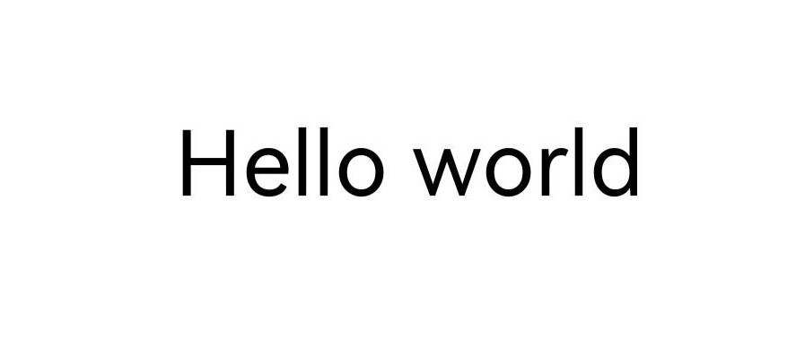

## Text Stroke

Based on the basic TextBlob drawing, you can also use the pen to implement the text stroke effect. For details, see [Stroke Effect](basic-drawing-effect-c.md#stroke-effect).

The following uses English and Chinese text strokes as examples.

### English Text Stroke

The following shows the sample code and effect of English text strokes.

<!-- @[ndk_graphics_draw_stroke_text](https://gitcode.com/openharmony/applications_app_samples/blob/master/code/DocsSample/ArkGraphics2D/Drawing/NDKGraphicsDraw/entry/src/main/cpp/samples/sample_graphics.cpp) -->

``` C++
// Create a pen.
OH_Drawing_Pen *pen = OH_Drawing_PenCreate();
// Set anti-aliasing.
OH_Drawing_PenSetAntiAlias(pen, true);
// Set the stroke color.
OH_Drawing_PenSetColor(pen, OH_Drawing_ColorSetArgb(RGBA_MAX, RGBA_MAX, RGBA_MIN, RGBA_MIN));
// Set the stroke width to 3.
OH_Drawing_PenSetWidth(pen, 3);
// Set the stroke effect of the pen.
OH_Drawing_CanvasAttachPen(canvas, pen);
// Create a font object.
OH_Drawing_Font *font = OH_Drawing_FontCreate();
// Set the font size.
OH_Drawing_FontSetTextSize(font, value150_);
const char *str = "Hello world";
// Create a TextBlob object.
OH_Drawing_TextBlob *textBlob =
    OH_Drawing_TextBlobCreateFromString(str, font, TEXT_ENCODING_UTF8);
// Draw the TextBlob.
OH_Drawing_CanvasDrawTextBlob(canvas, textBlob, value200_, value800_);
// Remove the stroke effect.
OH_Drawing_CanvasDetachPen(canvas);
// Destroy objects.
OH_Drawing_TextBlobDestroy(textBlob);
OH_Drawing_FontDestroy(font);
OH_Drawing_PenDestroy(pen);
```

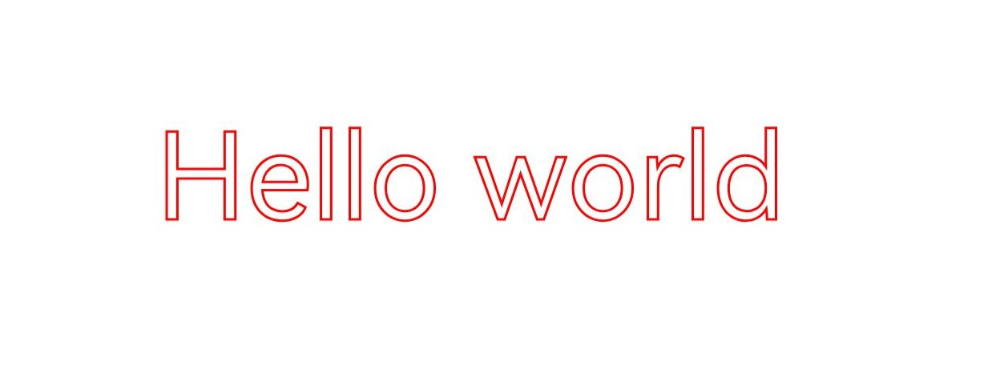

### Chinese Text Stroke

To achieve the stroke effect for Chinese text, first use a pen to outline the strokes, then apply a brush to fill the inner color and eliminate impurities and overlapping areas in the middle of the font.

The following shows the sample code and effect of Chinese text strokes.

<!-- @[ndk_graphics_draw_chinese_stroke_text](https://gitcode.com/openharmony/applications_app_samples/blob/master/code/DocsSample/ArkGraphics2D/Drawing/NDKGraphicsDraw/entry/src/main/cpp/samples/sample_graphics.cpp) -->

``` C++
// Create a brush.
OH_Drawing_Brush *brush = OH_Drawing_BrushCreate();
// Create a pen.
OH_Drawing_Pen *pen = OH_Drawing_PenCreate();
// Set anti-aliasing for the brush.
OH_Drawing_BrushSetAntiAlias(brush, true);
// Set the brush fill color.
OH_Drawing_BrushSetColor(brush, OH_Drawing_ColorSetArgb(0xFF, 0xFF, 0xFF, 0xFF));
// Set anti-aliasing for the pen.
OH_Drawing_PenSetAntiAlias(pen, true);
// Set the stroke width to 3.
OH_Drawing_PenSetWidth(pen, 3);
// Set the stroke color of the pen.
OH_Drawing_PenSetColor(pen, OH_Drawing_ColorSetArgb(0xFF, 0xFF, 0x00, 0x00));
// Set the stroke effect of the pen.
OH_Drawing_CanvasAttachPen(canvas, pen);
// Create a font object.
OH_Drawing_Font *font = OH_Drawing_FontCreate();
// Set the font size.
OH_Drawing_FontSetTextSize(font, value150_);
const char *str = "你好";
// Create a TextBlob object.
OH_Drawing_TextBlob *textBlob =
    OH_Drawing_TextBlobCreateFromString(str, font, TEXT_ENCODING_UTF8);
// Draw the TextBlob.
OH_Drawing_CanvasDrawTextBlob(canvas, textBlob, value200_, value800_);
// Remove the stroke effect.
OH_Drawing_CanvasDetachPen(canvas);
// Set the brush fill effect.
OH_Drawing_CanvasAttachBrush(canvas, brush);
OH_Drawing_CanvasDrawTextBlob(canvas, textBlob, value200_, value800_);
// Remove the brush from the canvas.
OH_Drawing_CanvasDetachBrush(canvas);

// Destroy objects.
OH_Drawing_TextBlobDestroy(textBlob);
OH_Drawing_FontDestroy(font);
OH_Drawing_PenDestroy(pen);
OH_Drawing_BrushDestroy(brush);
```

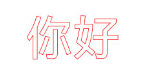

## Text Gradient

In addition to TextBlob drawing, you can use a shader to implement the gradient effect of text. For more information about shaders, see [Shader Effect](complex-drawing-effect-c.md#shader-effect).

The following shows the sample code and effect of adding a linear gradient shader to text.

<!-- @[ndk_graphics_draw_gradient_text](https://gitcode.com/openharmony/applications_app_samples/blob/master/code/DocsSample/ArkGraphics2D/Drawing/NDKGraphicsDraw/entry/src/main/cpp/samples/sample_graphics.cpp) -->

``` C++
// Start point.
OH_Drawing_Point *startPt = OH_Drawing_PointCreate(value100_, value100_);
// End point.
OH_Drawing_Point *endPt = OH_Drawing_PointCreate(value900_, value900_);
// Color array.
uint32_t colors[] = {0xFFFFFF00, 0xFFFF0000, 0xFF0000FF};
// Relative position array.
float pos[] = {0.0f, 0.5f, 1.0f};
// Create a linear gradient shader effect.
OH_Drawing_ShaderEffect *colorShaderEffect =
    OH_Drawing_ShaderEffectCreateLinearGradient(startPt, endPt, colors, pos, 3, CLAMP);
// Create a brush object.
OH_Drawing_Brush *brush = OH_Drawing_BrushCreate();
// Set the shader effect based on the brush.
OH_Drawing_BrushSetShaderEffect(brush, colorShaderEffect);
// Set the brush fill effect.
OH_Drawing_CanvasAttachBrush(canvas, brush);
// Create a font object.
OH_Drawing_Font *font = OH_Drawing_FontCreate();
// Set the font size.
OH_Drawing_FontSetTextSize(font, value150_);
const char *str = "Hello world";
// Create a TextBlob object.
OH_Drawing_TextBlob *textBlob =
    OH_Drawing_TextBlobCreateFromString(str, font, TEXT_ENCODING_UTF8);
// Draw the TextBlob.
OH_Drawing_CanvasDrawTextBlob(canvas, textBlob, value200_, value800_);
// Cancel the fill effect.
OH_Drawing_CanvasDetachBrush(canvas);
// Destroy objects.
OH_Drawing_TextBlobDestroy(textBlob);
OH_Drawing_FontDestroy(font);
OH_Drawing_BrushDestroy(brush);
OH_Drawing_ShaderEffectDestroy(colorShaderEffect);
OH_Drawing_PointDestroy(startPt);
OH_Drawing_PointDestroy(endPt);
```

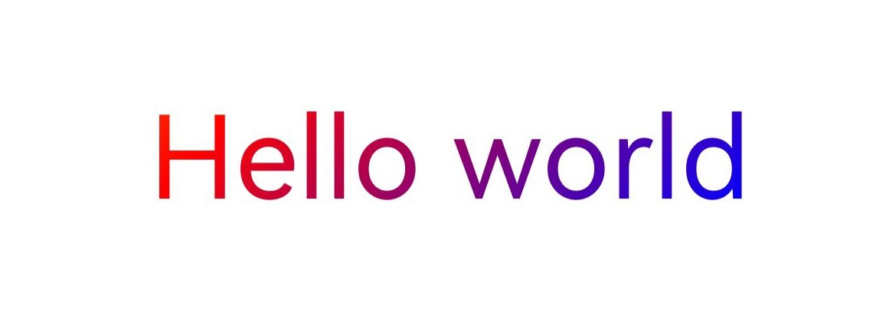

## Theme Font

Theme fonts are specialized custom fonts available for use in theme applications. For details about text measurement and typography, see [Using Theme Fonts (C/C++)](theme-font-c.md).

The following shows the sample code and effect for setting the theme font.

<!-- @[ndk_graphics_draw_theme_text](https://gitcode.com/openharmony/applications_app_samples/blob/master/code/DocsSample/ArkGraphics2D/Drawing/NDKGraphicsDraw/entry/src/main/cpp/samples/sample_graphics.cpp) -->

``` C++
// Create a font object.
OH_Drawing_Font *font = OH_Drawing_FontCreate();
// Set the text size.
OH_Drawing_FontSetTextSize(font, value100_);
// Set the theme font.
OH_Drawing_FontSetThemeFontFollowed(font, true);
// Text to be drawn.
const char *str = "Hello World";
// Create a TextBlob object.
OH_Drawing_TextBlob *textBlob =
    OH_Drawing_TextBlobCreateFromString(str, font, TEXT_ENCODING_UTF8);
// Draw the TextBlob.
OH_Drawing_CanvasDrawTextBlob(canvas, textBlob, value200_, value800_);
// Release the TextBlob object.
OH_Drawing_TextBlobDestroy(textBlob);
// Release the font object.
OH_Drawing_FontDestroy(font);
```

| Theme Font Not Followed| Theme Font Followed (For Reference)|
| -------- | -------- |
| 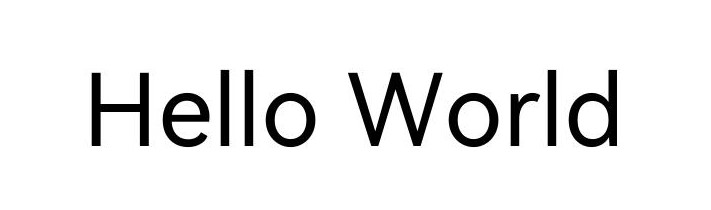 | 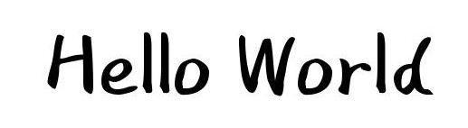 |

> **NOTE**
>
> You need to override the **onConfigurationUpdate** function in the application entry file (**EntryAbility.ets** in the default project) to respond to the theme font switching operation, ensuring that the page can be refreshed and take effect in a timely manner after the switching. For details, see [Using Theme Fonts (C/C++)](theme-font-c.md).

## Single-Character Drawing

Single-character drawing is a refined technology for controlling text rendering. Compared with TextBlob drawing, single-character drawing has the following advantages: The font degradation mechanism is used. If a character cannot be displayed in the current font, the system automatically uses the system font to draw the character, improving compatibility with special characters and avoiding character loss. In addition, single-character drawing supports character-by-character configuration of font features (such as ligatures and alternates) to meet complex typography requirements for better user experience. For details about the APIs, see [drawing_canvas.h](../reference/apis-arkgraphics2d/capi-drawing-canvas-h.md#oh_drawing_canvasdrawsinglecharacter).

Basic scenario: drawing characters without font features

In common text rendering scenarios where font features are not required, you can use **OH_Drawing_CanvasDrawSingleCharacter** to draw a single character and use **OH_Drawing_FontMeasureSingleCharacter** to measure the width of a single character. The sample code and effect are as follows:

<!-- @[ndk_graphics_draw_single_text](https://gitcode.com/openharmony/applications_app_samples/blob/master/code/DocsSample/ArkGraphics2D/Drawing/NDKGraphicsDraw/entry/src/main/cpp/samples/sample_graphics.cpp) -->

``` C++
// Create a font object.
OH_Drawing_Font *font = OH_Drawing_FontCreate();
// Set the text size.
OH_Drawing_FontSetTextSize(font, value100_);
float startX = 100;
float startY = 100;
int strLen = 5;
const char* str = "Hello";
for (int i = 0; i < strLen; ++i) {
    // Draw a single character.
    OH_Drawing_CanvasDrawSingleCharacter(canvas, &str[i], font, startX, startY);
    float textWidth = 0.f;
    // Measure the width of a single character.
    OH_Drawing_FontMeasureSingleCharacter(font, &str[i], &textWidth);
    startX += textWidth;
}
// Release the font object.
OH_Drawing_FontDestroy(font);
```

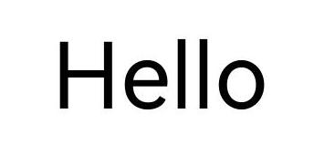

Advanced scenario: drawing characters with font features

In text rendering scenarios where font features are required, you can use **OH_Drawing_CanvasDrawSingleCharacterWithFeatures** to draw a single character and use **OH_Drawing_FontMeasureSingleCharacterWithFeatures** to measure the width of a single character. The sample code and effect are as follows:

<!-- @[ndk_graphics_draw_feature_text](https://gitcode.com/openharmony/applications_app_samples/blob/master/code/DocsSample/ArkGraphics2D/Drawing/NDKGraphicsDraw/entry/src/main/cpp/samples/sample_graphics.cpp) -->

``` C++
// Create a font object.
OH_Drawing_Font *font = OH_Drawing_FontCreate();
// Set the text size.
OH_Drawing_FontSetTextSize(font, value100_);
// Create a font feature object.
OH_Drawing_FontFeatures* features = OH_Drawing_FontFeaturesCreate();
OH_Drawing_FontFeaturesAddFeature(features, "frac", 1);
float startX = 100;
float startY = 100;
int strLen = 5;
const char* str = "a2+b2";
for (int i = 0; i < strLen; ++i) {
    // Draw a single character.
    OH_Drawing_CanvasDrawSingleCharacterWithFeatures(canvas, &str[i], font, startX, startY, features);
    float textWidth = 0.f;
    // Measure the width of a single character.
    OH_Drawing_FontMeasureSingleCharacterWithFeatures(font, &str[i], features, &textWidth);
    startX += textWidth;
}
// Release the font feature object.
OH_Drawing_FontFeaturesDestroy(features);
// Release the font object.
OH_Drawing_FontDestroy(font);
```

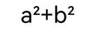

> **NOTE**
>
> If `OH_Drawing_CanvasDrawSingleCharacterWithFeatures` and `OH_Drawing_FontMeasureSingleCharacter` are used together, or `OH_Drawing_CanvasDrawSingleCharacter` and `OH_Drawing_FontMeasureSingleCharacterWithFeatures` are used together, font drawing may overlap.

## Font Fallback

The specified font may not cover all characters in the text. For example, a font containing only Latin characters cannot display Chinese or Arabic characters. If you draw text directly with this font, unsupported characters cannot be displayed correctly. Font fallback automatically finds system fonts that support these characters, maintaining a consistent font style while displaying the complete text. You do not need to determine character coverage or specify separate fonts for different languages. If no system font supports a character, that character still cannot be displayed correctly.

Use the APIs in this section when character coverage matters or when text contains multiple languages. [Single-Character Drawing](#single-character-drawing) also supports font fallback for character-by-character rendering. This section covers font fallback for TextBlob creation, glyph conversion, and text width measurement. For API details, see [drawing_text_blob.h](../reference/apis-arkgraphics2d/capi-drawing-text-blob-h.md) and [drawing_font.h](../reference/apis-arkgraphics2d/capi-drawing-font-h.md).

> **NOTE**
>
> Font fallback is supported since API version 26.0.1.

### Font Fallback for TextBlob Drawing

If the specified font does not cover all characters in the text, use [OH_Drawing_TextBlobCreateFromTextWithFallback()](../reference/apis-arkgraphics2d/capi-drawing-text-blob-h.md#oh_drawing_textblobcreatefromtextwithfallback), [OH_Drawing_TextBlobCreateFromPosTextWithFallback()](../reference/apis-arkgraphics2d/capi-drawing-text-blob-h.md#oh_drawing_textblobcreatefrompostextwithfallback) or [OH_Drawing_TextBlobCreateFromStringWithFallback()](../reference/apis-arkgraphics2d/capi-drawing-text-blob-h.md#oh_drawing_textblobcreatefromstringwithfallback) to create TextBlobs with font fallback. These APIs automatically find fallback system fonts for unsupported characters and group the text by font to create an array of TextBlobs. Draw all TextBlobs at the same coordinate origin to display the complete text.

The main steps are as follows: create a typeface and a font and set the typeface; call a fallback API to obtain a TextBlob array; draw every TextBlob at the same coordinate origin; and release the TextBlob array resources.

The following example uses [OH_Drawing_TextBlobCreateFromStringWithFallback()](../reference/apis-arkgraphics2d/capi-drawing-text-blob-h.md#oh_drawing_textblobcreatefromstringwithfallback) to create a TextBlob array with font fallback from a string and draw it:

<!-- @[ndk_graphics_draw_textblob_string_fallback](https://gitcode.com/openharmony/applications_app_samples/blob/master/code/DocsSample/ArkGraphics2D/Drawing/NDKGraphicsDraw/entry/src/main/cpp/samples/sample_graphics.cpp) -->

``` C++
// Create a typeface from a file.
OH_Drawing_Typeface *typeface = OH_Drawing_TypefaceCreateFromFile(
    "/system/fonts/NotoSansArmenian[wdth,wght].ttf", 0);
// Create a font object.
OH_Drawing_Font *font = OH_Drawing_FontCreate();
// Set the typeface for the font.
OH_Drawing_FontSetTypeface(font, typeface);
// Set the font size.
OH_Drawing_FontSetTextSize(font, value100_);
// Text to draw.
const char *str = "Hello世界";
// Declare output parameters.
OH_Drawing_TextBlob **textBlobs = nullptr;
uint32_t textBlobsCount = 0;
// Create a TextBlob array with font fallback.
OH_Drawing_TextBlobCreateFromStringWithFallback(str, font, TEXT_ENCODING_UTF8,
    &textBlobs, &textBlobsCount);
// Draw each TextBlob in the array at the same origin.
for (uint32_t i = 0; i < textBlobsCount; i++) {
    OH_Drawing_CanvasDrawTextBlob(canvas, textBlobs[i], value200_, value800_);
}
// Destroy the TextBlob array.
OH_Drawing_TextBlobsArrayDestroy(textBlobs, textBlobsCount);
// Release the font object.
OH_Drawing_FontDestroy(font);
// Release the typeface object.
OH_Drawing_TypefaceDestroy(typeface);
```

| Without fallback: OH_Drawing_TextBlobCreateFromString() | With fallback: OH_Drawing_TextBlobCreateFromStringWithFallback() |
| -------- | -------- |
| 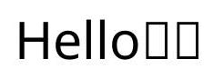 | 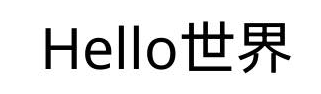 |

The following example uses [OH_Drawing_TextBlobCreateFromTextWithFallback()](../reference/apis-arkgraphics2d/capi-drawing-text-blob-h.md#oh_drawing_textblobcreatefromtextwithfallback) to create a TextBlob array with font fallback from text and draw it:

<!-- @[ndk_graphics_draw_textblob_text_fallback](https://gitcode.com/openharmony/applications_app_samples/blob/master/code/DocsSample/ArkGraphics2D/Drawing/NDKGraphicsDraw/entry/src/main/cpp/samples/sample_graphics.cpp) -->

``` C++
// Create a typeface from a file.
OH_Drawing_Typeface *typeface = OH_Drawing_TypefaceCreateFromFile(
    "/system/fonts/NotoSansArmenian[wdth,wght].ttf", 0);
// Create a font object.
OH_Drawing_Font *font = OH_Drawing_FontCreate();
// Set the typeface for the font.
OH_Drawing_FontSetTypeface(font, typeface);
// Set the font size.
OH_Drawing_FontSetTextSize(font, value100_);
// Text to draw.
const char *text = "Hello世界";
uint32_t byteLength = strlen(text);
// Declare output parameters.
OH_Drawing_TextBlob **textBlobs = nullptr;
uint32_t textBlobsCount = 0;
// Create a TextBlob array with font fallback.
OH_Drawing_TextBlobCreateFromTextWithFallback(text, byteLength, font, TEXT_ENCODING_UTF8,
    &textBlobs, &textBlobsCount);
// Draw each TextBlob in the array.
for (uint32_t i = 0; i < textBlobsCount; i++) {
    OH_Drawing_CanvasDrawTextBlob(canvas, textBlobs[i], value200_, value800_);
}
// Destroy the TextBlob array.
OH_Drawing_TextBlobsArrayDestroy(textBlobs, textBlobsCount);
// Release the font object.
OH_Drawing_FontDestroy(font);
// Release the typeface object.
OH_Drawing_TypefaceDestroy(typeface);
```

| Without fallback: OH_Drawing_TextBlobCreateFromText() | With fallback: OH_Drawing_TextBlobCreateFromTextWithFallback() |
| -------- | -------- |
| 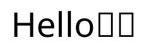 | 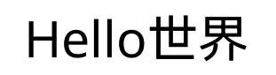 |

The following example uses [OH_Drawing_TextBlobCreateFromPosTextWithFallback()](../reference/apis-arkgraphics2d/capi-drawing-text-blob-h.md#oh_drawing_textblobcreatefrompostextwithfallback) to create a TextBlob array with font fallback from text and an array of coordinates and draw it:

<!-- @[ndk_graphics_draw_textblob_postext_fallback](https://gitcode.com/openharmony/applications_app_samples/blob/master/code/DocsSample/ArkGraphics2D/Drawing/NDKGraphicsDraw/entry/src/main/cpp/samples/sample_graphics.cpp) -->

``` C++
// Create a typeface from a file.
OH_Drawing_Typeface *typeface = OH_Drawing_TypefaceCreateFromFile(
    "/system/fonts/NotoSansArmenian[wdth,wght].ttf", 0);
// Create a font object.
OH_Drawing_Font *font = OH_Drawing_FontCreate();
// Set the typeface for the font.
OH_Drawing_FontSetTypeface(font, typeface);
// Set the font size.
OH_Drawing_FontSetTextSize(font, value100_);
// Text to draw.
const char *text = "Hello世界";
uint32_t byteLength = strlen(text);
// Obtain the glyph count.
int glyphCount = OH_Drawing_FontCountText(font, text, byteLength, TEXT_ENCODING_UTF8);
// Check the glyph count to avoid allocating an invalid amount of memory.
if (glyphCount <= 0) {
    SAMPLE_LOGE("DrawTextBlobPosTextFallback: glyphCount is invalid");
    OH_Drawing_FontDestroy(font);
    OH_Drawing_TypefaceDestroy(typeface);
    return;
}
// Specify the coordinates of each character.
OH_Drawing_Point2D *points = new OH_Drawing_Point2D[glyphCount];
float xOffset = 0;
for (int i = 0; i < glyphCount; i++) {
    points[i].x = value200_ + xOffset;
    points[i].y = value800_;
    xOffset += value100_;
}
// Declare output parameters.
OH_Drawing_TextBlob **textBlobs = nullptr;
uint32_t textBlobsCount = 0;
// Create a TextBlob array with font fallback.
OH_Drawing_TextBlobCreateFromPosTextWithFallback(text, byteLength, points, font,
    TEXT_ENCODING_UTF8, &textBlobs, &textBlobsCount);
// Draw each TextBlob in the array.
for (uint32_t i = 0; i < textBlobsCount; i++) {
    OH_Drawing_CanvasDrawTextBlob(canvas, textBlobs[i], 0, 0);
}
// Destroy the TextBlob array.
OH_Drawing_TextBlobsArrayDestroy(textBlobs, textBlobsCount);
// Release the coordinate array.
delete[] points;
// Release the font object.
OH_Drawing_FontDestroy(font);
// Release the typeface object.
OH_Drawing_TypefaceDestroy(typeface);
```

| Without fallback: OH_Drawing_TextBlobCreateFromPosText() | With fallback: OH_Drawing_TextBlobCreateFromPosTextWithFallback() |
| -------- | -------- |
| 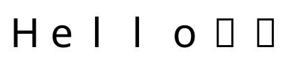 | 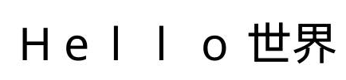 |

> **NOTE**
>
> Release TextBlob arrays and other resources promptly by calling the corresponding destruction APIs to avoid memory leaks. For details, see [drawing_text_blob.h](../reference/apis-arkgraphics2d/capi-drawing-text-blob-h.md).

### Font Fallback for Glyph Conversion and Text Width Measurement

To convert text to glyphs for drawing or measure its actual width after font fallback, use the font fallback glyph conversion API [OH_Drawing_FontTextToGlyphsWithFallback()](../reference/apis-arkgraphics2d/capi-drawing-font-h.md#oh_drawing_fonttexttoglyphswithfallback) and text width measurement APIs [OH_Drawing_FontMeasureTextWithFallback()](../reference/apis-arkgraphics2d/capi-drawing-font-h.md#oh_drawing_fontmeasuretextwithfallback) and [OH_Drawing_FontMeasureTextWithBrushOrPenWithFallback()](../reference/apis-arkgraphics2d/capi-drawing-font-h.md#oh_drawing_fontmeasuretextwithbrushorpenwithfallback).

Use [OH_Drawing_FontTextToGlyphsWithFallback()](../reference/apis-arkgraphics2d/capi-drawing-font-h.md#oh_drawing_fonttexttoglyphswithfallback) to convert text to glyph information, automatically grouped by fallback font. Set the corresponding font for each group, calculate positions based on glyph widths, and draw the glyphs with [OH_Drawing_CanvasDrawGlyphs()](../reference/apis-arkgraphics2d/capi-drawing-canvas-h.md#oh_drawing_canvasdrawglyphs). The following is an example:

<!-- @[ndk_graphics_draw_font_text_to_glyphs_fallback](https://gitcode.com/openharmony/applications_app_samples/blob/master/code/DocsSample/ArkGraphics2D/Drawing/NDKGraphicsDraw/entry/src/main/cpp/samples/sample_graphics.cpp) -->

``` C++
// Create a font object.
OH_Drawing_Font *font = OH_Drawing_FontCreate();
// Set the font size.
OH_Drawing_FontSetTextSize(font, value100_);
// Text to convert.
const char *text = "Hello世界";
uint32_t byteLength = strlen(text);
// Declare output parameters.
OH_Drawing_TypefaceFallbackInfo *fallbackInfos = nullptr;
uint32_t infosCount = 0;
// Convert text to glyph indices with font fallback.
OH_Drawing_FontTextToGlyphsWithFallback(font, text, byteLength, TEXT_ENCODING_UTF8,
    &fallbackInfos, &infosCount);
// Iterate over the fallback information. Each element contains glyph IDs for the same typeface.
float xOffset = 0;
for (uint32_t i = 0; i < infosCount; i++) {
    uint32_t glyphCount = fallbackInfos[i].glyphCount;
    // Set the typeface for this fallback group.
    OH_Drawing_FontSetTypeface(font, fallbackInfos[i].typeface);
    // Convert the uint16_t glyphIds to an int array.
    int *intGlyphIds = new int[glyphCount];
    for (uint32_t j = 0; j < glyphCount; j++) {
        intGlyphIds[j] = fallbackInfos[i].glyphIds[j];
    }
    // Specify the coordinates of each glyph.
    OH_Drawing_Point2D *positions = new OH_Drawing_Point2D[glyphCount];
    for (uint32_t j = 0; j < glyphCount; j++) {
        positions[j].x = value200_ + xOffset;
        positions[j].y = value800_;
        xOffset += value100_;
    }
    // Draw the glyph array.
    OH_Drawing_CanvasDrawGlyphs(canvas, intGlyphIds, glyphCount, 0,
        positions, glyphCount, 0, glyphCount, font);
    delete[] intGlyphIds;
    delete[] positions;
}
// Release the fallback information array.
OH_Drawing_FontTypefaceFallbackInfoDestroy(fallbackInfos, infosCount);
// Release the typeface object.
OH_Drawing_FontDestroy(font);
```

| Without fallback: OH_Drawing_FontTextToGlyphs() | With fallback: OH_Drawing_FontTextToGlyphsWithFallback() |
| -------- | -------- |
| 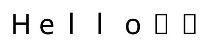 | 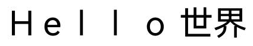 |

The following example uses [OH_Drawing_FontMeasureTextWithFallback()](../reference/apis-arkgraphics2d/capi-drawing-font-h.md#oh_drawing_fontmeasuretextwithfallback) to measure the actual text width and bounding box after font fallback and draw the text and bounding box:

<!-- @[ndk_graphics_draw_font_measure_text_fallback](https://gitcode.com/openharmony/applications_app_samples/blob/master/code/DocsSample/ArkGraphics2D/Drawing/NDKGraphicsDraw/entry/src/main/cpp/samples/sample_graphics.cpp) -->

``` C++
// Create a font object.
OH_Drawing_Font *font = OH_Drawing_FontCreate();
// Set the font size.
OH_Drawing_FontSetTextSize(font, value100_);
// Text to measure.
const char *text = "Hello世界";
uint32_t byteLength = strlen(text);
// Create a rectangle to receive the bounding box.
OH_Drawing_Rect *bounds = OH_Drawing_RectCreate(0, 0, 0, 0);
float textWidth = 0;
// Measure the text width with font fallback.
OH_Drawing_FontMeasureTextWithFallback(font, text, byteLength, TEXT_ENCODING_UTF8,
    bounds, &textWidth);
SAMPLE_LOGI("DrawFontMeasureTextFallback: textWidth = %{public}f, bounds left = %{public}f, "
    "top = %{public}f, right = %{public}f, bottom = %{public}f",
    textWidth, OH_Drawing_RectGetLeft(bounds), OH_Drawing_RectGetTop(bounds),
    OH_Drawing_RectGetRight(bounds), OH_Drawing_RectGetBottom(bounds));
// Starting position for text drawing.
float startX = value200_;
float startY = value800_;
// Create a TextBlob array with font fallback and draw the text.
OH_Drawing_TextBlob **textBlobs = nullptr;
uint32_t textBlobsCount = 0;
OH_Drawing_TextBlobCreateFromStringWithFallback(text, font, TEXT_ENCODING_UTF8,
    &textBlobs, &textBlobsCount);
SAMPLE_LOGI("DrawFontMeasureTextFallback: textBlobsCount = %{public}u", textBlobsCount);
for (uint32_t i = 0; i < textBlobsCount; i++) {
    OH_Drawing_CanvasDrawTextBlob(canvas, textBlobs[i], startX, startY);
}
OH_Drawing_TextBlobsArrayDestroy(textBlobs, textBlobsCount);
// Obtain bounding box coordinates and translate them to the text drawing origin.
float left = OH_Drawing_RectGetLeft(bounds) + startX;
float top = OH_Drawing_RectGetTop(bounds) + startY;
float right = OH_Drawing_RectGetRight(bounds) + startX;
float bottom = OH_Drawing_RectGetBottom(bounds) + startY;
// Create a pen to draw the bounding box.
OH_Drawing_Pen *pen = OH_Drawing_PenCreate();
OH_Drawing_PenSetAntiAlias(pen, true);
OH_Drawing_PenSetColor(pen, OH_Drawing_ColorSetArgb(RGBA_MAX, RGBA_MAX, RGBA_MIN, RGBA_MIN));
OH_Drawing_CanvasAttachPen(canvas, pen);
// Draw the bounding box rectangle.
OH_Drawing_Rect *measureBounds = OH_Drawing_RectCreate(left, top, right, bottom);
OH_Drawing_CanvasDrawRect(canvas, measureBounds);
OH_Drawing_CanvasDetachPen(canvas);
// Destroy the objects.
OH_Drawing_RectDestroy(measureBounds);
OH_Drawing_PenDestroy(pen);
// Release the rectangle.
OH_Drawing_RectDestroy(bounds);
// Release the typeface object.
OH_Drawing_FontDestroy(font);
```

The following example uses [OH_Drawing_FontMeasureTextWithBrushOrPenWithFallback()](../reference/apis-arkgraphics2d/capi-drawing-font-h.md#oh_drawing_fontmeasuretextwithbrushorpenwithfallback) with a brush or pen to measure the actual text width and bounding box after font fallback and draw the text and bounding box:

<!-- @[ndk_graphics_draw_font_measure_text_with_brush_or_pen_fallback](https://gitcode.com/openharmony/applications_app_samples/blob/master/code/DocsSample/ArkGraphics2D/Drawing/NDKGraphicsDraw/entry/src/main/cpp/samples/sample_graphics.cpp) -->

``` C++
// Create a font object.
OH_Drawing_Font *font = OH_Drawing_FontCreate();
// Set the font size.
OH_Drawing_FontSetTextSize(font, value100_);
// Text to measure.
const char *text = "Hello世界";
uint32_t byteLength = strlen(text);
// Create a brush.
OH_Drawing_Brush *brush = OH_Drawing_BrushCreate();
OH_Drawing_BrushSetAntiAlias(brush, true);
OH_Drawing_BrushSetColor(brush, OH_Drawing_ColorSetArgb(RGBA_MAX, RGBA_MAX, RGBA_MIN, RGBA_MIN));
// Create a pen.
OH_Drawing_Pen *pen = OH_Drawing_PenCreate();
OH_Drawing_PenSetAntiAlias(pen, true);
OH_Drawing_PenSetColor(pen, OH_Drawing_ColorSetArgb(RGBA_MAX, RGBA_MAX, 0x00, 0x00));
// Starting position for text drawing.
float startX = value200_;
float startY = value800_;
// Set the brush fill effect and draw the text.
OH_Drawing_CanvasAttachBrush(canvas, brush);
OH_Drawing_TextBlob **textBlobs = nullptr;
uint32_t textBlobsCount = 0;
OH_Drawing_TextBlobCreateFromStringWithFallback(text, font, TEXT_ENCODING_UTF8,
    &textBlobs, &textBlobsCount);
SAMPLE_LOGI("DrawFontMeasureTextWithBrushOrPenFallback: textBlobsCount = %{public}u",
    textBlobsCount);
for (uint32_t i = 0; i < textBlobsCount; i++) {
    OH_Drawing_CanvasDrawTextBlob(canvas, textBlobs[i], startX, startY);
}
OH_Drawing_TextBlobsArrayDestroy(textBlobs, textBlobsCount);
OH_Drawing_CanvasDetachBrush(canvas);
// Create a rectangle to receive the bounding box.
OH_Drawing_Rect *bounds = OH_Drawing_RectCreate(0, 0, 0, 0);
float textWidth = 0;
// Measure the text width with a brush and font fallback (brush and pen cannot both be passed).
OH_Drawing_FontMeasureTextWithBrushOrPenWithFallback(font, text, byteLength,
    TEXT_ENCODING_UTF8, brush, nullptr, bounds, &textWidth);
SAMPLE_LOGI("DrawFontMeasureTextWithBrushOrPenFallback: textWidth = %{public}f, bounds left = "
    "%{public}f, top = %{public}f, right = %{public}f, bottom = %{public}f",
    textWidth, OH_Drawing_RectGetLeft(bounds), OH_Drawing_RectGetTop(bounds),
    OH_Drawing_RectGetRight(bounds), OH_Drawing_RectGetBottom(bounds));
// Obtain bounding box coordinates and translate them to the text drawing origin.
float left = OH_Drawing_RectGetLeft(bounds) + startX;
float top = OH_Drawing_RectGetTop(bounds) + startY;
float right = OH_Drawing_RectGetRight(bounds) + startX;
float bottom = OH_Drawing_RectGetBottom(bounds) + startY;
// Set the pen stroke effect and draw the bounding box rectangle.
OH_Drawing_CanvasAttachPen(canvas, pen);
OH_Drawing_Rect *measureBounds = OH_Drawing_RectCreate(left, top, right, bottom);
OH_Drawing_CanvasDrawRect(canvas, measureBounds);
OH_Drawing_CanvasDetachPen(canvas);
// Destroy the objects.
OH_Drawing_RectDestroy(measureBounds);
OH_Drawing_PenDestroy(pen);
// Release the rectangle.
OH_Drawing_RectDestroy(bounds);
// Release the brush.
OH_Drawing_BrushDestroy(brush);
// Release the typeface object.
OH_Drawing_FontDestroy(font);
```


<!--RP1-->
## Samples

The following samples are provided to help you better understand how to use the **Drawing** APIs (C/C++) for development:

- [NDKGraphicsDraw (API20)](https://gitcode.com/openharmony/applications_app_samples/tree/master/code/DocsSample/ArkGraphics2D/Drawing/NDKGraphicsDraw)
<!--RP1End-->

<!--no_check-->