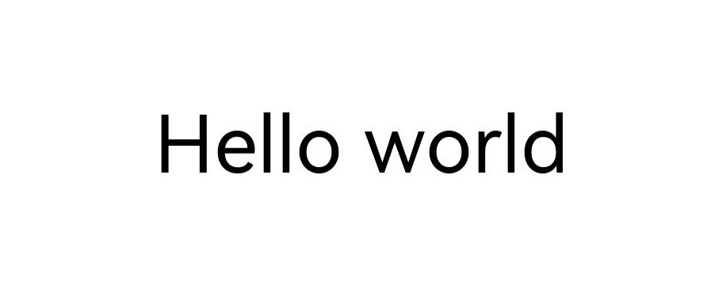
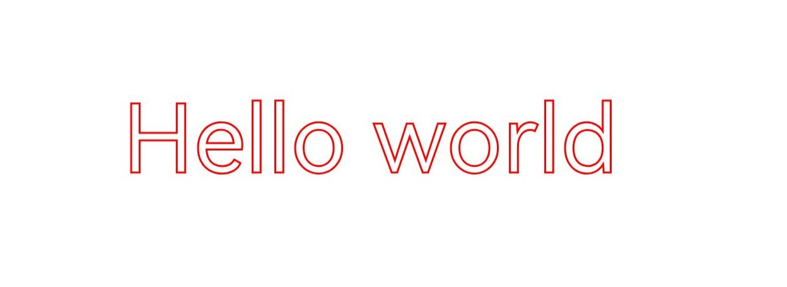
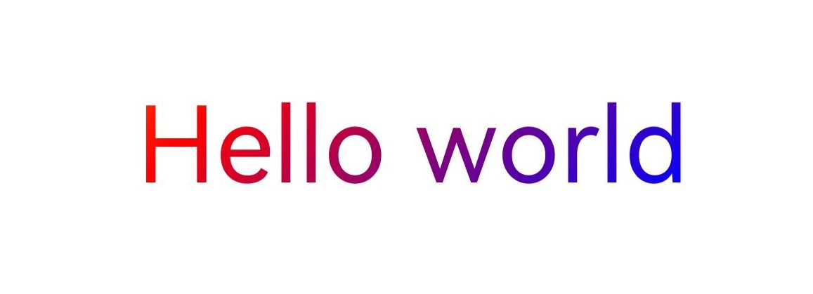
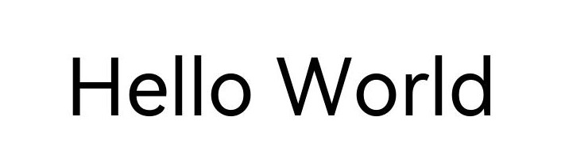
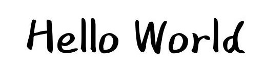
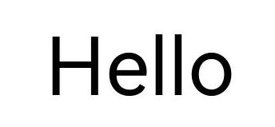
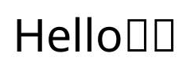
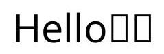
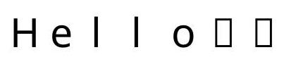
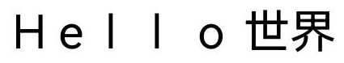

# Drawing TextBlobs (C/C++)

<!--Kit: ArkGraphics 2D-->
<!--Subsystem: Graphics-->
<!--Owner: @hangmengxin-->
<!--Designer: @wanyanglan-->
<!--Tester: @nobuggers-->
<!--Adviser: @ge-yafang-->
<!-- md-trans-meta sourceCommit=bf5ca26b34dcc9d24248c2e964e66757af125da0 translatedAt=2026-10-19T01:38:42.190Z pushedAt=2026-10-19T11:01:58.293Z -->

## Overview

A TextBlob is a collection of text. You can draw both a single character and a paragraph by using TextBlobs.

In addition to basic TextBlob drawing, you can apply various drawing effects to text. Common TextBlob drawing scenarios include [text stroke](#text-stroke), [text gradient](#text-gradient), and [font fallback](#font-fallback). For more effects, see [Drawing Effects](drawing-effect-overview.md).

This topic does not involve text measurement and typography. For details about how to handle text drawing requirements, see [Introduction to Text Development](text-overview.md). This topic describes the typography policies and related usage.

## Basic TextBlob Drawing

Use the **OH_Drawing_CanvasDrawTextBlob()** API to draw a TextBlob. The API takes four parameters: **Canvas** object, **TextBlob** object, and X and Y coordinates of the left endpoint of the text baseline.

For details about the **Canvas** object, see [Obtaining a Canvas and Displaying Drawing Results (C/C++)](canvas-get-result-draw-c.md).

A **TextBlob** object can be created in multiple ways. For details about how to create a block, see [drawing_text_blob.h](../reference/apis-arkgraphics2d/capi-drawing-text-blob-h.md).

The following uses the **OH_Drawing_TextBlobCreateFromString()** API as an example to create a **TextBlob** object. The API takes three parameters:

- Text string to be displayed.

- Pointer to an **OH_Drawing_Font** object. **OH_Drawing_Font** is used to set and obtain various font properties, such as font size, text style, font alignment, font rendering mode, and font stroke mode. For detailed API descriptions, see [drawing_font.h](../reference/apis-arkgraphics2d/capi-drawing-font-h.md).

- Text encoding mode.

The following shows the sample code and effect:

<!-- @[ndk_graphics_draw_base_text](https://gitcode.com/openharmony/applications_app_samples/blob/master/code/DocsSample/ArkGraphics2D/Drawing/NDKGraphicsDraw/entry/src/main/cpp/samples/sample_graphics.cpp) -->

``` C++
// Create a font object.
OH_Drawing_Font *font = OH_Drawing_FontCreate();
// Set the font size.
OH_Drawing_FontSetTextSize(font, value100_);
// Text to be drawn.
const char *str = "Hello world";
// Create a TextBlob object.
OH_Drawing_TextBlob *textBlob =
    OH_Drawing_TextBlobCreateFromString(str, font, TEXT_ENCODING_UTF8);
// Draw the TextBlob.
OH_Drawing_CanvasDrawTextBlob(canvas, textBlob, value200_, value800_);
// Release the TextBlob object.
OH_Drawing_TextBlobDestroy(textBlob);
// Release the font object.
OH_Drawing_FontDestroy(font);
```



## Text Stroke

Based on the basic TextBlob drawing, you can also use the brush to implement the text stroke effect. For details, see [Stroke Effect](basic-drawing-effect-c.md#stroke-effect).

The following uses English and Chinese text strokes as examples.

### English Text Stroke

The following shows the sample code and effect of English text strokes.

<!-- @[ndk_graphics_draw_stroke_text](https://gitcode.com/openharmony/applications_app_samples/blob/master/code/DocsSample/ArkGraphics2D/Drawing/NDKGraphicsDraw/entry/src/main/cpp/samples/sample_graphics.cpp) -->

``` C++
// Create a pen.
OH_Drawing_Pen *pen = OH_Drawing_PenCreate();
// Set anti-aliasing.
OH_Drawing_PenSetAntiAlias(pen, true);
// Set the stroke color.
OH_Drawing_PenSetColor(pen, OH_Drawing_ColorSetArgb(RGBA_MAX, RGBA_MAX, RGBA_MIN, RGBA_MIN));
// Set the stroke width to 3.
OH_Drawing_PenSetWidth(pen, 3);
// Set the stroke effect of the pen.
OH_Drawing_CanvasAttachPen(canvas, pen);
// Create a font object.
OH_Drawing_Font *font = OH_Drawing_FontCreate();
// Set the font size.
OH_Drawing_FontSetTextSize(font, value150_);
const char *str = "Hello world";
// Create a TextBlob object.
OH_Drawing_TextBlob *textBlob =
    OH_Drawing_TextBlobCreateFromString(str, font, TEXT_ENCODING_UTF8);
// Draw the TextBlob.
OH_Drawing_CanvasDrawTextBlob(canvas, textBlob, value200_, value800_);
// Remove the stroke effect.
OH_Drawing_CanvasDetachPen(canvas);
// Destroy objects.
OH_Drawing_TextBlobDestroy(textBlob);
OH_Drawing_FontDestroy(font);
OH_Drawing_PenDestroy(pen);
```



### Chinese Text Stroke

To achieve the stroke effect for Chinese text, first use a pen to outline the strokes, then apply a brush to fill the inner color and eliminate impurities and overlapping areas in the middle of the font.

The following shows the sample code and effect of Chinese text strokes.

<!-- @[ndk_graphics_draw_chinese_stroke_text](https://gitcode.com/openharmony/applications_app_samples/blob/master/code/DocsSample/ArkGraphics2D/Drawing/NDKGraphicsDraw/entry/src/main/cpp/samples/sample_graphics.cpp) -->

``` C++
// Create a brush.
OH_Drawing_Brush *brush = OH_Drawing_BrushCreate();
// Create a pen.
OH_Drawing_Pen *pen = OH_Drawing_PenCreate();
// Set anti-aliasing for the brush.
OH_Drawing_BrushSetAntiAlias(brush, true);
// Set the brush fill color.
OH_Drawing_BrushSetColor(brush, OH_Drawing_ColorSetArgb(0xFF, 0xFF, 0xFF, 0xFF));
// Set anti-aliasing for the pen.
OH_Drawing_PenSetAntiAlias(pen, true);
// Set the stroke width to 3.
OH_Drawing_PenSetWidth(pen, 3);
// Set the stroke color of the pen.
OH_Drawing_PenSetColor(pen, OH_Drawing_ColorSetArgb(0xFF, 0xFF, 0x00, 0x00));
// Set the stroke effect of the pen.
OH_Drawing_CanvasAttachPen(canvas, pen);
// Create a font object.
OH_Drawing_Font *font = OH_Drawing_FontCreate();
// Set the font size.
OH_Drawing_FontSetTextSize(font, value150_);
const char *str = "你好";
// Create a TextBlob object.
OH_Drawing_TextBlob *textBlob =
    OH_Drawing_TextBlobCreateFromString(str, font, TEXT_ENCODING_UTF8);
// Draw the TextBlob.
OH_Drawing_CanvasDrawTextBlob(canvas, textBlob, value200_, value800_);
// Remove the stroke effect.
OH_Drawing_CanvasDetachPen(canvas);
// Set the brush fill effect.
OH_Drawing_CanvasAttachBrush(canvas, brush);
OH_Drawing_CanvasDrawTextBlob(canvas, textBlob, value200_, value800_);
// Remove the brush from the canvas.
OH_Drawing_CanvasDetachBrush(canvas);

// Destroy objects.
OH_Drawing_TextBlobDestroy(textBlob);
OH_Drawing_FontDestroy(font);
OH_Drawing_PenDestroy(pen);
OH_Drawing_BrushDestroy(brush);
```


## Text Gradient

In addition to TextBlob drawing, you can use a shader to implement the gradient effect of text. For more information about shaders, see [Shader Effect](complex-drawing-effect-c.md#shader-effect).

The following shows the sample code and effect of adding a linear gradient shader to text.

<!-- @[ndk_graphics_draw_gradient_text](https://gitcode.com/openharmony/applications_app_samples/blob/master/code/DocsSample/ArkGraphics2D/Drawing/NDKGraphicsDraw/entry/src/main/cpp/samples/sample_graphics.cpp) -->

``` C++
// Start point.
OH_Drawing_Point *startPt = OH_Drawing_PointCreate(value100_, value100_);
// End point.
OH_Drawing_Point *endPt = OH_Drawing_PointCreate(value900_, value900_);
// Color array.
uint32_t colors[] = {0xFFFFFF00, 0xFFFF0000, 0xFF0000FF};
// Relative position array.
float pos[] = {0.0f, 0.5f, 1.0f};
// Create a linear gradient shader effect.
OH_Drawing_ShaderEffect *colorShaderEffect =
    OH_Drawing_ShaderEffectCreateLinearGradient(startPt, endPt, colors, pos, 3, CLAMP);
// Create a brush object.
OH_Drawing_Brush *brush = OH_Drawing_BrushCreate();
// Set the shader effect based on the brush.
OH_Drawing_BrushSetShaderEffect(brush, colorShaderEffect);
// Set the brush fill effect.
OH_Drawing_CanvasAttachBrush(canvas, brush);
// Create a font object.
OH_Drawing_Font *font = OH_Drawing_FontCreate();
// Set the font size.
OH_Drawing_FontSetTextSize(font, value150_);
const char *str = "Hello world";
// Create a TextBlob object.
OH_Drawing_TextBlob *textBlob =
    OH_Drawing_TextBlobCreateFromString(str, font, TEXT_ENCODING_UTF8);
// Draw the TextBlob.
OH_Drawing_CanvasDrawTextBlob(canvas, textBlob, value200_, value800_);
// Cancel the fill effect.
OH_Drawing_CanvasDetachBrush(canvas);
// Destroy objects.
OH_Drawing_TextBlobDestroy(textBlob);
OH_Drawing_FontDestroy(font);
OH_Drawing_BrushDestroy(brush);
OH_Drawing_ShaderEffectDestroy(colorShaderEffect);
OH_Drawing_PointDestroy(startPt);
OH_Drawing_PointDestroy(endPt);
```



## Theme Font

Theme fonts are specialized custom fonts available for use in theme applications. For details about text measurement and typography, see [Using Theme Fonts (C/C++)](theme-font-c.md).

The following shows the sample code and effect for setting the theme font.

<!-- @[ndk_graphics_draw_theme_text](https://gitcode.com/openharmony/applications_app_samples/blob/master/code/DocsSample/ArkGraphics2D/Drawing/NDKGraphicsDraw/entry/src/main/cpp/samples/sample_graphics.cpp) -->

``` C++
// Create a font object.
OH_Drawing_Font *font = OH_Drawing_FontCreate();
// Set the text size.
OH_Drawing_FontSetTextSize(font, value100_);
// Set the theme font.
OH_Drawing_FontSetThemeFontFollowed(font, true);
// Text to be drawn.
const char *str = "Hello World";
// Create a TextBlob object.
OH_Drawing_TextBlob *textBlob =
    OH_Drawing_TextBlobCreateFromString(str, font, TEXT_ENCODING_UTF8);
// Draw the TextBlob.
OH_Drawing_CanvasDrawTextBlob(canvas, textBlob, value200_, value800_);
// Release the TextBlob object.
OH_Drawing_TextBlobDestroy(textBlob);
// Release the font object.
OH_Drawing_FontDestroy(font);
```

| Theme Font Not Followed| Theme Font Followed (For Reference)|
| -------- | -------- |
|  |  |

> **NOTE**
>
> You need to override the **onConfigurationUpdate** function in the application entry file (**EntryAbility.ets** in the default project) to respond to the theme font switching operation, ensuring that the page can be refreshed and take effect in a timely manner after the switching. For details, see [Using Theme Fonts (C/C++)](theme-font-c.md).

## Single-Character Drawing

Single-character drawing is a refined technology for controlling text rendering. Compared with TextBlob drawing, single-character drawing has the following advantages: The font degradation mechanism is used. If a character cannot be displayed in the current font, the system automatically uses the system font to draw the character, improving compatibility with special characters and avoiding character loss. In addition, single-character drawing supports character-by-character configuration of font features (such as ligatures and alternates) to meet complex typography requirements for better user experience. For details about the APIs, see [drawing_canvas.h](../reference/apis-arkgraphics2d/capi-drawing-canvas-h.md#oh_drawing_canvasdrawsinglecharacter).

Basic scenario: drawing characters without font features

In common text rendering scenarios where font features are not required, you can use **OH_Drawing_CanvasDrawSingleCharacter** to draw a single character and use **OH_Drawing_FontMeasureSingleCharacter** to measure the width of a single character. The sample code and effect are as follows:

<!-- @[ndk_graphics_draw_single_text](https://gitcode.com/openharmony/applications_app_samples/blob/master/code/DocsSample/ArkGraphics2D/Drawing/NDKGraphicsDraw/entry/src/main/cpp/samples/sample_graphics.cpp) -->

``` C++
// Create a font object.
OH_Drawing_Font *font = OH_Drawing_FontCreate();
// Set the text size.
OH_Drawing_FontSetTextSize(font, value100_);
float startX = 100;
float startY = 100;
int strLen = 5;
const char* str = "Hello";
for (int i = 0; i < strLen; ++i) {
    // Draw a single character.
    OH_Drawing_CanvasDrawSingleCharacter(canvas, &str[i], font, startX, startY);
    float textWidth = 0.f;
    // Measure the width of a single character.
    OH_Drawing_FontMeasureSingleCharacter(font, &str[i], &textWidth);
    startX += textWidth;
}
// Release the font object.
OH_Drawing_FontDestroy(font);
```



Advanced scenario: drawing characters with font features

In text rendering scenarios where font features are required, you can use **OH_Drawing_CanvasDrawSingleCharacterWithFeatures** to draw a single character and use **OH_Drawing_FontMeasureSingleCharacterWithFeatures** to measure the width of a single character. The sample code and effect are as follows:

<!-- @[ndk_graphics_draw_feature_text](https://gitcode.com/openharmony/applications_app_samples/blob/master/code/DocsSample/ArkGraphics2D/Drawing/NDKGraphicsDraw/entry/src/main/cpp/samples/sample_graphics.cpp) -->

``` C++
// Create a font object.
OH_Drawing_Font *font = OH_Drawing_FontCreate();
// Set the text size.
OH_Drawing_FontSetTextSize(font, value100_);
// Create a font feature object.
OH_Drawing_FontFeatures* features = OH_Drawing_FontFeaturesCreate();
OH_Drawing_FontFeaturesAddFeature(features, "frac", 1);
float startX = 100;
float startY = 100;
int strLen = 5;
const char* str = "a2+b2";
for (int i = 0; i < strLen; ++i) {
    // Draw a single character.
    OH_Drawing_CanvasDrawSingleCharacterWithFeatures(canvas, &str[i], font, startX, startY, features);
    float textWidth = 0.f;
    // Measure the width of a single character.
    OH_Drawing_FontMeasureSingleCharacterWithFeatures(font, &str[i], features, &textWidth);
    startX += textWidth;
}
// Release the font feature object.
OH_Drawing_FontFeaturesDestroy(features);
// Release the font object.
OH_Drawing_FontDestroy(font);
```


> **NOTE**
>
> If `OH_Drawing_CanvasDrawSingleCharacterWithFeatures` and `OH_Drawing_FontMeasureSingleCharacter` are used together, or `OH_Drawing_CanvasDrawSingleCharacter` and `OH_Drawing_FontMeasureSingleCharacterWithFeatures` are used together, font drawing may overlap.

## Font Fallback

In actual development, the font you specify may not cover all characters in the text. For example, a font that contains only Latin characters cannot display Chinese, Arabic, or other characters. In this case, if you draw the text directly with this font, characters outside the font's coverage cannot be displayed properly. The font fallback capability automatically searches system fonts for a font that supports these characters, thereby balancing a consistent font style with complete text rendering. You do not need to determine the character coverage yourself or specify a separate font for each language. If no system font supports a character, that character still cannot be displayed properly.

When you need to pay attention to character coverage or mix multiple languages in a single piece of text, you can use the font fallback APIs described in this section. [Single character drawing](#single-character-drawing) also supports font fallback and is suitable for character-by-character rendering scenarios. This section describes the font fallback APIs for TextBlob creation, glyph conversion, and text measurement scenarios. For details about the APIs, see [drawing_text_blob.h](../reference/apis-arkgraphics2d/capi-drawing-text-blob-h.md) and [drawing_font.h](../reference/apis-arkgraphics2d/capi-drawing-font-h.md).

> **NOTE**
>
> Starting from API version 26.0.1, the font fallback capability is added.

### Text Block Drawing Supports Font Fallback

When the specified font cannot cover all characters in the text, you can use the TextBlob creation APIs that support font fallback: [OH_Drawing_TextBlobCreateFromTextWithFallback()](../reference/apis-arkgraphics2d/capi-drawing-text-blob-h.md#oh_drawing_textblobcreatefromtextwithfallback), [OH_Drawing_TextBlobCreateFromPosTextWithFallback()](../reference/apis-arkgraphics2d/capi-drawing-text-blob-h.md#oh_drawing_textblobcreatefrompostextwithfallback), or [OH_Drawing_TextBlobCreateFromStringWithFallback()](../reference/apis-arkgraphics2d/capi-drawing-text-blob-h.md#oh_drawing_textblobcreatefromstringwithfallback). These APIs automatically look up system fallback fonts for unsupported characters, group the text by font, and generate a set of TextBlob objects. When drawing, draw all TextBlobs at the same coordinate origin to render the entire text completely.

The main implementation steps are as follows: create the font and typeface objects and set the font → call the fallback API to obtain the TextBlob array → traverse the TextBlob array and draw at the same coordinate origin → release the TextBlob array resources.

The following example code shows how to use [OH_Drawing_TextBlobCreateFromStringWithFallback()](../reference/apis-arkgraphics2d/capi-drawing-text-blob-h.md#oh_drawing_textblobcreatefromstringwithfallback) to create a TextBlob array that supports font fallback from a string and draw it:

<!-- @[ndk_graphics_draw_textblob_string_fallback](https://gitcode.com/openharmony/applications_app_samples/blob/master/code/DocsSample/ArkGraphics2D/Drawing/NDKGraphicsDraw/entry/src/main/cpp/samples/sample_graphics.cpp) -->

``` C++
// Create a typeface object from a file.
OH_Drawing_Typeface *typeface = OH_Drawing_TypefaceCreateFromFile(
    "/system/fonts/NotoSansArmenian[wdth,wght].ttf", 0);
// Create a font object.
OH_Drawing_Font *font = OH_Drawing_FontCreate();
// Set the font for the typeface.
OH_Drawing_FontSetTypeface(font, typeface);
// Set the font size.
OH_Drawing_FontSetTextSize(font, value100_);
// Text to draw.
const char *str = "Hello世界";
// Declare the output parameters.
OH_Drawing_TextBlob **textBlobs = nullptr;
uint32_t textBlobsCount = 0;
// Create a TextBlob array that supports font fallback.
OH_Drawing_TextBlobCreateFromStringWithFallback(str, font, TEXT_ENCODING_UTF8,
    &textBlobs, &textBlobsCount);
// Traverse the TextBlob array and draw each TextBlob at the same origin.
for (uint32_t i = 0; i < textBlobsCount; i++) {
    OH_Drawing_CanvasDrawTextBlob(canvas, textBlobs[i], value200_, value800_);
}
// Destroy the TextBlob array.
OH_Drawing_TextBlobsArrayDestroy(textBlobs, textBlobsCount);
// Release the font object.
OH_Drawing_FontDestroy(font);
// Release the typeface object.
OH_Drawing_TypefaceDestroy(typeface);
```

| Using Non-fallback API OH_Drawing_TextBlobCreateFromString() | Using Fallback API OH_Drawing_TextBlobCreateFromStringWithFallback() |
| -------- | -------- |
|  |  |

The following example code shows how to use [OH_Drawing_TextBlobCreateFromTextWithFallback()](../reference/apis-arkgraphics2d/capi-drawing-text-blob-h.md#oh_drawing_textblobcreatefromtextwithfallback) to create a TextBlob array that supports font fallback from text and draw it:

<!-- @[ndk_graphics_draw_textblob_text_fallback](https://gitcode.com/openharmony/applications_app_samples/blob/master/code/DocsSample/ArkGraphics2D/Drawing/NDKGraphicsDraw/entry/src/main/cpp/samples/sample_graphics.cpp) -->

``` C++
// Create a typeface object from a file.
OH_Drawing_Typeface *typeface = OH_Drawing_TypefaceCreateFromFile(
    "/system/fonts/NotoSansArmenian[wdth,wght].ttf", 0);
// Create a font object.
OH_Drawing_Font *font = OH_Drawing_FontCreate();
// Set the font for the typeface.
OH_Drawing_FontSetTypeface(font, typeface);
// Set the font size.
OH_Drawing_FontSetTextSize(font, value100_);
// Text to draw.
const char *text = "Hello世界";
uint32_t byteLength = strlen(text);
// Declare the output parameters.
OH_Drawing_TextBlob **textBlobs = nullptr;
uint32_t textBlobsCount = 0;
// Create a TextBlob array that supports font fallback.
OH_Drawing_TextBlobCreateFromTextWithFallback(text, byteLength, font, TEXT_ENCODING_UTF8,
    &textBlobs, &textBlobsCount);
// Traverse the TextBlob array and draw.
for (uint32_t i = 0; i < textBlobsCount; i++) {
    OH_Drawing_CanvasDrawTextBlob(canvas, textBlobs[i], value200_, value800_);
}
// Destroy the TextBlob array.
OH_Drawing_TextBlobsArrayDestroy(textBlobs, textBlobsCount);
// Release the font object.
OH_Drawing_FontDestroy(font);
// Release the typeface object.
OH_Drawing_TypefaceDestroy(typeface);
```

| Using Non-fallback API OH_Drawing_TextBlobCreateFromText() | Using Fallback API OH_Drawing_TextBlobCreateFromTextWithFallback() |
| -------- | -------- |
|  |  |

The following example code shows how to use [OH_Drawing_TextBlobCreateFromPosTextWithFallback()](../reference/apis-arkgraphics2d/capi-drawing-text-blob-h.md#oh_drawing_textblobcreatefrompostextwithfallback) to create a TextBlob array that supports font fallback from text and a coordinate point array and draw it:

<!-- @[ndk_graphics_draw_textblob_postext_fallback](https://gitcode.com/openharmony/applications_app_samples/blob/master/code/DocsSample/ArkGraphics2D/Drawing/NDKGraphicsDraw/entry/src/main/cpp/samples/sample_graphics.cpp) -->

``` C++
// Create a typeface object from a file.
OH_Drawing_Typeface *typeface = OH_Drawing_TypefaceCreateFromFile(
    "/system/fonts/NotoSansArmenian[wdth,wght].ttf", 0);
// Create a font object.
OH_Drawing_Font *font = OH_Drawing_FontCreate();
// Set the font for the typeface.
OH_Drawing_FontSetTypeface(font, typeface);
// Set the font size.
OH_Drawing_FontSetTextSize(font, value100_);
// Text to draw.
const char *text = "Hello世界";
uint32_t byteLength = strlen(text);
// Obtain the number of glyphs.
int glyphCount = OH_Drawing_FontCountText(font, text, byteLength, TEXT_ENCODING_UTF8);
// Validate the glyph count to avoid allocating memory of an invalid size.
if (glyphCount <= 0) {
    SAMPLE_LOGE("DrawTextBlobPosTextFallback: glyphCount is invalid");
    OH_Drawing_FontDestroy(font);
    OH_Drawing_TypefaceDestroy(typeface);
    return;
}
// Specify the coordinate position for each character.
OH_Drawing_Point2D *points = new OH_Drawing_Point2D[glyphCount];
float xOffset = 0;
for (int i = 0; i < glyphCount; i++) {
    points[i].x = value200_ + xOffset;
    points[i].y = value800_;
    xOffset += value100_;
}
// Declare the output parameters.
OH_Drawing_TextBlob **textBlobs = nullptr;
uint32_t textBlobsCount = 0;
// Create a TextBlob array that supports font fallback.
OH_Drawing_TextBlobCreateFromPosTextWithFallback(text, byteLength, points, font,
    TEXT_ENCODING_UTF8, &textBlobs, &textBlobsCount);
// Traverse the TextBlob array and draw.
for (uint32_t i = 0; i < textBlobsCount; i++) {
    OH_Drawing_CanvasDrawTextBlob(canvas, textBlobs[i], 0, 0);
}
// Destroy the TextBlob array.
OH_Drawing_TextBlobsArrayDestroy(textBlobs, textBlobsCount);
// Release the coordinate point array.
delete[] points;
// Release the font object.
OH_Drawing_FontDestroy(font);
// Release the typeface object.
OH_Drawing_TypefaceDestroy(typeface);
```

| Using Non-fallback API OH_Drawing_TextBlobCreateFromPosText() | Using Fallback API OH_Drawing_TextBlobCreateFromPosTextWithFallback() |
| -------- | -------- |
|  |  |

> **NOTE**
>
> After using resources such as the TextBlob array, call the corresponding destroy API to release them in time to avoid memory leaks. For details about the APIs, see [drawing_text_blob.h](../reference/apis-arkgraphics2d/capi-drawing-text-blob-h.md).

### Glyph Conversion and Text Width Measurement with Font Fallback

When you need to convert text into glyphs for drawing, or measure the actual width of text after font fallback, you can use the glyph conversion API [OH_Drawing_FontTextToGlyphsWithFallback()](../reference/apis-arkgraphics2d/capi-drawing-font-h.md#oh_drawing_fonttexttoglyphswithfallback) and the text width measurement APIs [OH_Drawing_FontMeasureTextWithFallback()](../reference/apis-arkgraphics2d/capi-drawing-font-h.md#oh_drawing_fontmeasuretextwithfallback) and [OH_Drawing_FontMeasureTextWithBrushOrPenWithFallback()](../reference/apis-arkgraphics2d/capi-drawing-font-h.md#oh_drawing_fontmeasuretextwithbrushorpenwithfallback) provided by Font, all of which support font fallback.

Use [OH_Drawing_FontTextToGlyphsWithFallback()](../reference/apis-arkgraphics2d/capi-drawing-font-h.md#oh_drawing_fonttexttoglyphswithfallback) to convert text into glyph information (the text is automatically grouped by fallback font during conversion), then set the corresponding font for each group, calculate positions based on glyph widths, and finally draw with [OH_Drawing_CanvasDrawGlyphs()](../reference/apis-arkgraphics2d/capi-drawing-canvas-h.md#oh_drawing_canvasdrawglyphs). The example code is as follows:

<!-- @[ndk_graphics_draw_font_text_to_glyphs_fallback](https://gitcode.com/openharmony/applications_app_samples/blob/master/code/DocsSample/ArkGraphics2D/Drawing/NDKGraphicsDraw/entry/src/main/cpp/samples/sample_graphics.cpp) -->

``` C++
// Create a font object.
OH_Drawing_Font *font = OH_Drawing_FontCreate();
// Set the font size.
OH_Drawing_FontSetTextSize(font, value100_);
// Text to convert.
const char *text = "Hello世界";
uint32_t byteLength = strlen(text);
// Declare the output parameters.
OH_Drawing_TypefaceFallbackInfo *fallbackInfos = nullptr;
uint32_t infosCount = 0;
// Convert the text to glyph indices, supporting font fallback.
OH_Drawing_FontTextToGlyphsWithFallback(font, text, byteLength, TEXT_ENCODING_UTF8,
    &fallbackInfos, &infosCount);
// Traverse the fallback information, where each element contains an array of glyph IDs with the same typeface.
float xOffset = 0;
for (uint32_t i = 0; i < infosCount; i++) {
    uint32_t glyphCount = fallbackInfos[i].glyphCount;
    // Set the typeface for this fallback group.
    OH_Drawing_FontSetTypeface(font, fallbackInfos[i].typeface);
    // Convert the uint16_t glyphIds to an int array.
    int *intGlyphIds = new int[glyphCount];
    for (uint32_t j = 0; j < glyphCount; j++) {
        intGlyphIds[j] = fallbackInfos[i].glyphIds[j];
    }
    // Specify the coordinate position for each glyph.
    OH_Drawing_Point2D *positions = new OH_Drawing_Point2D[glyphCount];
    for (uint32_t j = 0; j < glyphCount; j++) {
        positions[j].x = value200_ + xOffset;
        positions[j].y = value800_;
        xOffset += value100_;
    }
    // Draw the glyph array.
    OH_Drawing_CanvasDrawGlyphs(canvas, intGlyphIds, glyphCount, 0,
        positions, glyphCount, 0, glyphCount, font);
    delete[] intGlyphIds;
    delete[] positions;
}
// Release the fallback information array.
OH_Drawing_FontTypefaceFallbackInfoDestroy(fallbackInfos, infosCount);
// Release the font object.
OH_Drawing_FontDestroy(font);
```

| Using Non-fallback API OH_Drawing_FontTextToGlyphs() | Using Fallback API OH_Drawing_FontTextToGlyphsWithFallback() |
| -------- | -------- |
|  |  |

The following example code uses [OH_Drawing_FontMeasureTextWithFallback()](../reference/apis-arkgraphics2d/capi-drawing-font-h.md#oh_drawing_fontmeasuretextwithfallback) to measure the actual width and bounding box of text after font fallback, and draws the text and the bounding box:

<!-- @[ndk_graphics_draw_font_measure_text_fallback](https://gitcode.com/openharmony/applications_app_samples/blob/master/code/DocsSample/ArkGraphics2D/Drawing/NDKGraphicsDraw/entry/src/main/cpp/samples/sample_graphics.cpp) -->

``` C++
// Create a font object.
OH_Drawing_Font *font = OH_Drawing_FontCreate();
// Set the font size.
OH_Drawing_FontSetTextSize(font, value100_);
// Text to measure.
const char *text = "Hello世界";
uint32_t byteLength = strlen(text);
// Create a rect object to receive the bounding box.
OH_Drawing_Rect *bounds = OH_Drawing_RectCreate(0, 0, 0, 0);
float textWidth = 0;
// Measure the text width, supporting font fallback.
OH_Drawing_FontMeasureTextWithFallback(font, text, byteLength, TEXT_ENCODING_UTF8,
    bounds, &textWidth);
SAMPLE_LOGI("DrawFontMeasureTextFallback: textWidth = %{public}f, bounds left = %{public}f, "
    "top = %{public}f, right = %{public}f, bottom = %{public}f",
    textWidth, OH_Drawing_RectGetLeft(bounds), OH_Drawing_RectGetTop(bounds),
    OH_Drawing_RectGetRight(bounds), OH_Drawing_RectGetBottom(bounds));
// Starting point for drawing the text.
float startX = value200_;
float startY = value800_;
// Create a TextBlob array that supports font fallback and draw the text.
OH_Drawing_TextBlob **textBlobs = nullptr;
uint32_t textBlobsCount = 0;
OH_Drawing_TextBlobCreateFromStringWithFallback(text, font, TEXT_ENCODING_UTF8,
    &textBlobs, &textBlobsCount);
SAMPLE_LOGI("DrawFontMeasureTextFallback: textBlobsCount = %{public}u", textBlobsCount);
for (uint32_t i = 0; i < textBlobsCount; i++) {
    OH_Drawing_CanvasDrawTextBlob(canvas, textBlobs[i], startX, startY);
}
OH_Drawing_TextBlobsArrayDestroy(textBlobs, textBlobsCount);
// Obtain the bounding box coordinates and translate them to the text drawing start point.
float left = OH_Drawing_RectGetLeft(bounds) + startX;
float top = OH_Drawing_RectGetTop(bounds) + startY;
float right = OH_Drawing_RectGetRight(bounds) + startX;
float bottom = OH_Drawing_RectGetBottom(bounds) + startY;
// Create a pen to draw the bounding box.
OH_Drawing_Pen *pen = OH_Drawing_PenCreate();
OH_Drawing_PenSetAntiAlias(pen, true);
OH_Drawing_PenSetColor(pen, OH_Drawing_ColorSetArgb(RGBA_MAX, RGBA_MAX, RGBA_MIN, RGBA_MIN));
OH_Drawing_CanvasAttachPen(canvas, pen);
// Draw the bounding box rect.
OH_Drawing_Rect *measureBounds = OH_Drawing_RectCreate(left, top, right, bottom);
OH_Drawing_CanvasDrawRect(canvas, measureBounds);
OH_Drawing_CanvasDetachPen(canvas);
// Destroy all objects.
OH_Drawing_RectDestroy(measureBounds);
OH_Drawing_PenDestroy(pen);
// Release the rect object.
OH_Drawing_RectDestroy(bounds);
// Release the font object.
OH_Drawing_FontDestroy(font);
```

The following example code uses [OH_Drawing_FontMeasureTextWithBrushOrPenWithFallback()](../reference/apis-arkgraphics2d/capi-drawing-font-h.md#oh_drawing_fontmeasuretextwithbrushorpenwithfallback) together with a brush or pen to measure the actual width and bounding box of text after font fallback, and draws the text and the bounding box:

<!-- @[ndk_graphics_draw_font_measure_text_with_brush_or_pen_fallback](https://gitcode.com/openharmony/applications_app_samples/blob/master/code/DocsSample/ArkGraphics2D/Drawing/NDKGraphicsDraw/entry/src/main/cpp/samples/sample_graphics.cpp) -->

``` C++
// Create a font object.
OH_Drawing_Font *font = OH_Drawing_FontCreate();
// Set the font size.
OH_Drawing_FontSetTextSize(font, value100_);
// Text to measure.
const char *text = "Hello世界";
uint32_t byteLength = strlen(text);
// Create a brush object.
OH_Drawing_Brush *brush = OH_Drawing_BrushCreate();
OH_Drawing_BrushSetAntiAlias(brush, true);
OH_Drawing_BrushSetColor(brush, OH_Drawing_ColorSetArgb(RGBA_MAX, RGBA_MAX, RGBA_MIN, RGBA_MIN));
// Create a pen object.
OH_Drawing_Pen *pen = OH_Drawing_PenCreate();
OH_Drawing_PenSetAntiAlias(pen, true);
OH_Drawing_PenSetColor(pen, OH_Drawing_ColorSetArgb(RGBA_MAX, RGBA_MAX, 0x00, 0x00));
// Starting point for drawing the text.
float startX = value200_;
float startY = value800_;
// Set the brush fill effect and draw the text.
OH_Drawing_CanvasAttachBrush(canvas, brush);
OH_Drawing_TextBlob **textBlobs = nullptr;
uint32_t textBlobsCount = 0;
OH_Drawing_TextBlobCreateFromStringWithFallback(text, font, TEXT_ENCODING_UTF8,
    &textBlobs, &textBlobsCount);
SAMPLE_LOGI("DrawFontMeasureTextWithBrushOrPenFallback: textBlobsCount = %{public}u",
    textBlobsCount);
for (uint32_t i = 0; i < textBlobsCount; i++) {
    OH_Drawing_CanvasDrawTextBlob(canvas, textBlobs[i], startX, startY);
}
OH_Drawing_TextBlobsArrayDestroy(textBlobs, textBlobsCount);
OH_Drawing_CanvasDetachBrush(canvas);
// Create a rect object to receive the bounding box.
OH_Drawing_Rect *bounds = OH_Drawing_RectCreate(0, 0, 0, 0);
float textWidth = 0;
// Measure the text width using the brush, supporting font fallback (brush and pen cannot be passed at the same time).
OH_Drawing_FontMeasureTextWithBrushOrPenWithFallback(font, text, byteLength,
    TEXT_ENCODING_UTF8, brush, nullptr, bounds, &textWidth);
SAMPLE_LOGI("DrawFontMeasureTextWithBrushOrPenFallback: textWidth = %{public}f, bounds left = "
    "%{public}f, top = %{public}f, right = %{public}f, bottom = %{public}f",
    textWidth, OH_Drawing_RectGetLeft(bounds), OH_Drawing_RectGetTop(bounds),
    OH_Drawing_RectGetRight(bounds), OH_Drawing_RectGetBottom(bounds));
// Obtain the bounding box coordinates and translate them to the text drawing start point.
float left = OH_Drawing_RectGetLeft(bounds) + startX;
float top = OH_Drawing_RectGetTop(bounds) + startY;
float right = OH_Drawing_RectGetRight(bounds) + startX;
float bottom = OH_Drawing_RectGetBottom(bounds) + startY;
// Set the pen stroke effect and draw the bounding box rect.
OH_Drawing_CanvasAttachPen(canvas, pen);
OH_Drawing_Rect *measureBounds = OH_Drawing_RectCreate(left, top, right, bottom);
OH_Drawing_CanvasDrawRect(canvas, measureBounds);
OH_Drawing_CanvasDetachPen(canvas);
// Destroy all objects.
OH_Drawing_RectDestroy(measureBounds);
OH_Drawing_PenDestroy(pen);
// Release the rect object.
OH_Drawing_RectDestroy(bounds);
// Release the brush object.
OH_Drawing_BrushDestroy(brush);
// Release the font object.
OH_Drawing_FontDestroy(font);
```

<!--RP1-->
## Samples

The following samples are provided to help you better understand how to use the **Drawing** APIs (C/C++) for development:

- [NDKGraphicsDraw (API20)](https://gitcode.com/openharmony/applications_app_samples/tree/master/code/DocsSample/ArkGraphics2D/Drawing/NDKGraphicsDraw)
<!--RP1End-->

<!--no_check-->