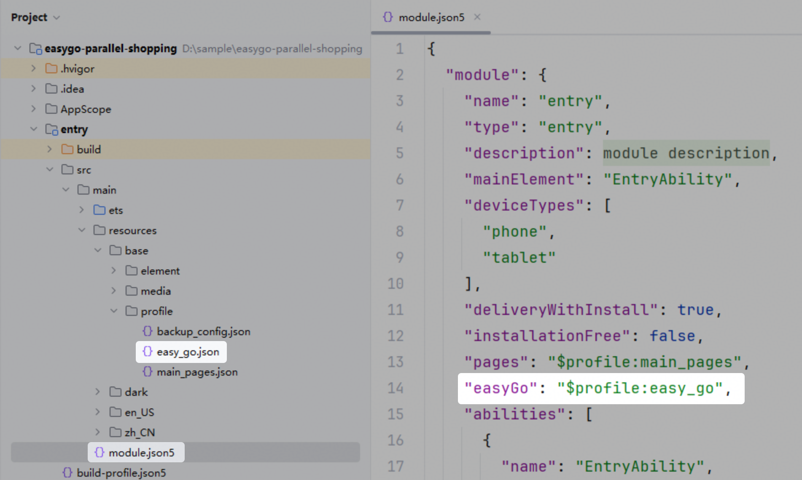

# Using the Input Method in a Custom Edit Box
<!--Kit: IME Kit-->
<!--Subsystem: MiscServices-->
<!--Owner: @codexu62-->
<!--Designer: @zhaolinglan-->
<!--Tester: @murphy84-->
<!--Adviser: @zhang_yixin13-->
<!-- md-trans-meta sourceCommit=1f8233ad6593c7f7354b5ed59c77736ac9b6d5d1 translatedAt=2026-11-03T08:26:27.517Z pushedAt=2026-11-03T08:26:27.517Z nl=1 -->

In the inputmethod framework, use [getController](../reference/apis-ime-kit/js-apis-inputmethod.md#inputmethodgetcontroller9) to obtain the [InputMethodController](../reference/apis-ime-kit/js-apis-inputmethod.md#inputmethodcontroller) instance for binding the input method and listening to various events of the input method application, such as insertion, deletion, selection, and cursor movement. In this way, the input method can be used in the custom edit box, implementing more flexible and free editing operations.

## How to Develop

1. In your project in DevEco Studio, create an .ets file and name it the name of the target custom component, for example, **CustomInput**. Define a custom component in the file, and import **inputMethod** from @kit.IMEKit.

   ```ets
   import { inputMethod } from '@kit.IMEKit';
   
   @Component
   export struct CustomInput {
     build() {
     }
   }
   ```

2. In the component, use the **Text** component to show the text in the custom edit box, and the **inputText** state variable to specify the text to display in the text input box.

   <!-- @[input_case_input_CustomInputText](https://gitcode.com/openharmony/applications_app_samples/blob/master/code/DocsSample/InputMethod/KikaInputMethod/entry/src/main/ets/components/CustomInput.ets) -->
   
   ``` TypeScript
   import { BusinessError } from '@kit.BasicServicesKit';
   import { inputMethod } from '@kit.IMEKit';
   import Log from '../model/Log';
   
   const TAG = '[Submenu]';
   
   @Component
   export struct CustomInput {
     @State inputText: string = ''; // inputText is the content to be displayed by the Text component.
     private isAttach: boolean = false;
     private inputController: inputMethod.InputMethodController = inputMethod.getController();
   
     build() {
       Text(this.inputText) // Use the Text component to show the text in the custom edit box.
         .fontSize(16)
         .width('100%')
         .lineHeight(40)
         .id('customInput')
         .height(45)
         .border({ color: '#554455', radius: 30, width: 1 })
         .maxLines(1)
         .onBlur(() => {
           this.off();
         })
         .onClick(() => {
           this.attachAndListener(); // Click the component.
         })
     }
   ```


3. In the component, obtain an **InputMethodController** instance. When the text is clicked, call the **controller** instance's **attach** method to bind and activate the soft keyboard, and register the input method to listen for text insertion and deletion events. This example only demonstrates insertion and deletion.

   > **NOTE**
   >
   > On PC/2-in-1 and tablet devices, a custom edit box inserts text by listening for the input method's **insertText** event. However, physical numeric key events cannot be consumed, preventing digits from being inserted. You can configure the custom edit box to accept numeric input from a physical keyboard. For details, see [Configuring a Custom Edit Box to Accept Physical Numeric Key Input](#configuring-a-custom-edit-box-to-accept-physical-numeric-key-input).

   <!-- @[input_case_input_CustomInput](https://gitcode.com/openharmony/applications_app_samples/blob/master/code/DocsSample/InputMethod/KikaInputMethod/entry/src/main/ets/components/CustomInput.ets) -->
   
   ``` TypeScript
   import { BusinessError } from '@kit.BasicServicesKit';
   import { inputMethod } from '@kit.IMEKit';
   import Log from '../model/Log';
   
   const TAG = '[Submenu]';
   
   @Component
   export struct CustomInput {
     @State inputText: string = ''; // inputText is the content to be displayed by the Text component.
     private isAttach: boolean = false;
     private inputController: inputMethod.InputMethodController = inputMethod.getController();
   
     build() {
       Text(this.inputText) // Use the Text component to show the text in the custom edit box.
         .fontSize(16)
         .width('100%')
         .lineHeight(40)
         .id('customInput')
         .height(45)
         .border({ color: '#554455', radius: 30, width: 1 })
         .maxLines(1)
         .onBlur(() => {
           this.off();
         })
         .onClick(() => {
           this.attachAndListener(); // Click the component.
         })
     }
     async attachAndListener() { // Bind and set a listener.
       focusControl.requestFocus('customInput');
       try {
         await this.inputController.attach(true, {
           inputAttribute: {
             textInputType: inputMethod.TextInputType.TEXT,
             enterKeyType: inputMethod.EnterKeyType.SEARCH
           }
         });
         if (!this.isAttach) {
           this.inputController.on('insertText', (text) => {
             this.inputText += text;
           })
           this.inputController.on('deleteLeft', (length) => {
             this.inputText = this.inputText.substring(0, this.inputText.length - length);
           })
           this.isAttach = true;
         }
       } catch (err) {
         let error = err as BusinessError;
         Log.showError(TAG, `attach catch error: ${error.code} ${error.message}`);
       }
     }
   
     off() {
       this.isAttach = false;
       this.inputController.off('insertText');
       this.inputController.off('deleteLeft');
     }
   }
   ```


4. Import the component to the application UI layout. In this example, the **Index.ets** and **CustomInput.ets** files are in the same directory.

   <!-- @[input_case_input_CustomInput](https://gitcode.com/openharmony/applications_app_samples/blob/master/code/DocsSample/InputMethod/KikaInputMethod/entry/src/main/ets/pages/PrivatePreview.ets) -->
   
   ``` TypeScript
   CustomInput()
   ```


## Configuring a Custom Edit Box to Accept Physical Numeric Key Input

Starting from API version 26.0.1, the input method framework supports physical numeric key input in CustomInput (custom edit box) scenarios. On PC/2-in-1 and tablet devices, physical numeric key events cannot normally be consumed by custom edit boxes, preventing digits from being inserted, for example, on a verification code input screen. This capability enables custom edit boxes to accept digits entered with a physical keyboard. You can enable or disable it through a configuration file.

> **NOTE**
>
> This configuration takes effect only on PC/2-in-1 and tablet devices.
> <!--RP1--><!--RP1End-->

### Configuration Procedure

1. Add a configuration file.

   Create a configuration file named **easy_go.json** in the application's **entry/src/main/resources/base/profile** directory. This is an example file name; you can use another name. Add the **easyGo** field to the [module.json5](../quick-start/module-configuration-file.md) configuration file and reference **easy_go.json**.

   

2. Add the physical numeric key conversion configuration.

   In **easy_go.json**, configure the properties for accepting physical numeric key input in custom edit boxes.

### Configuration Details

**easy_go.json** is a standard JSON object with two levels. The first level specifies device types, and the second specifies physical numeric key conversion options for each device type.

1. Device types

   The first-level configuration specifies how custom edit boxes accept physical numeric key input on different device types.

   ```json
   {
     "common": {},
     "phone": {},
     "2in1": {},
     "tablet": {}
   }
   ```

   | Value | Description | Optional |
   | --- | --- | --- |
   | common | Common device configuration that provides base defaults for all device types. | No |
   | phone | Configuration for phone devices. When specified, the common configuration no longer applies to phone devices. | Yes |
   | 2in1 | Configuration for PC/2-in-1 devices. When specified, the common configuration no longer applies to PC/2-in-1 devices. | Yes |
   | tablet | Configuration for tablet devices. When specified, the common configuration no longer applies to tablet devices. | Yes |

2. Numeric key options

   The second-level **numKeyOptions** field specifies the options for accepting physical numeric key input in custom edit boxes. Its fields are described below.

   | Field | Description | Optional |
   | --- | --- | --- |
   | autoConsumeNumKeysAndInsert | Whether to accept physical numeric key input. The value **true** enables this capability in custom edit boxes, and **false** disables it. | No |

3. Configuration examples

   > **NOTE**
   >
   > **autoConsumeNumKeysAndInsert** is mandatory and must be specified when **numKeyOptions** is configured.

   The following example enables physical numeric key input in custom edit boxes on PC/2-in-1 devices:

   ```json
   {
     "common": {},
     "2in1": {
       "numKeyOptions": {
         "autoConsumeNumKeysAndInsert": true
       }
     }
   }
   ```

   The following example disables physical numeric key input in custom edit boxes on tablet devices:

   ```json
   {
     "common": {},
     "tablet": {
       "numKeyOptions": {
         "autoConsumeNumKeysAndInsert": false
       }
     }
   }
   ```

## Effect
  
