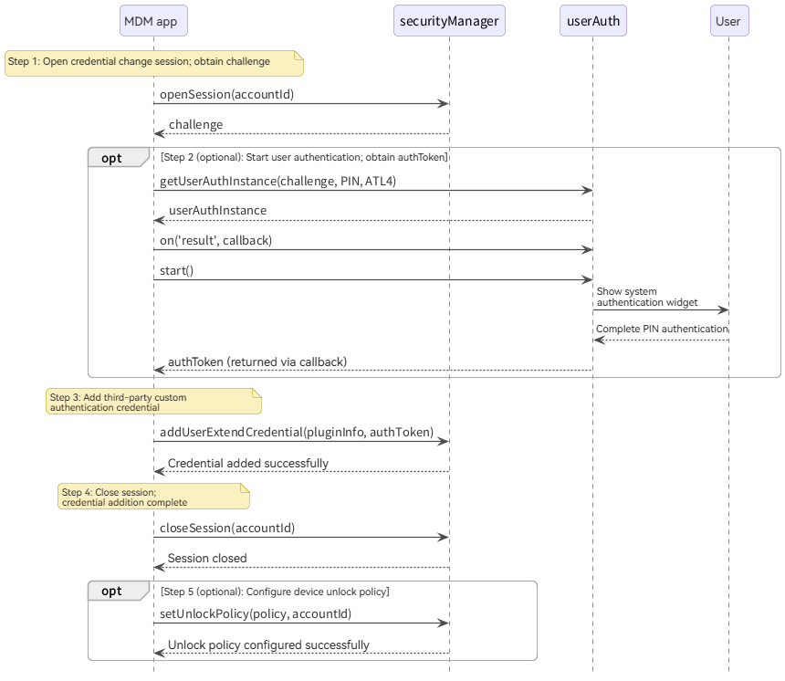
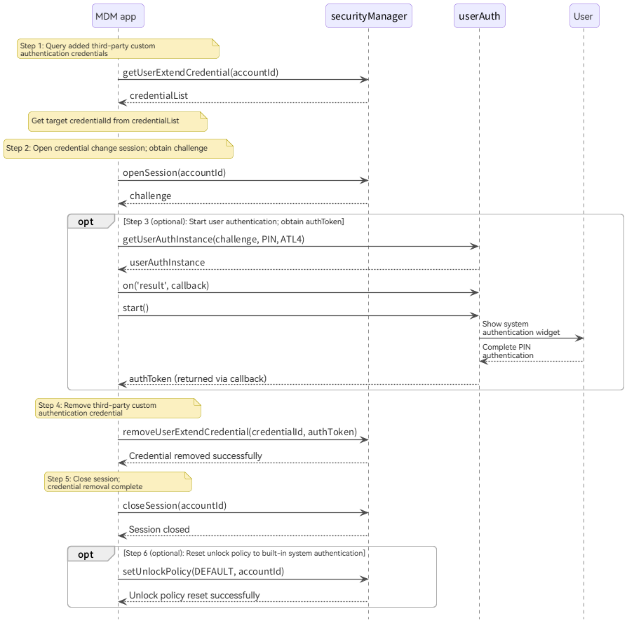

# Third-Party Custom Authentication

<!--Kit: MDM Kit-->
<!--Subsystem: Customization-->
<!--Owner: @huanleima; @weizai16-->
<!--Designer: @hp_guo-->
<!--Tester: @lpw_work-->
<!--Adviser: @zhang_yixin13-->
<!-- md-trans-meta sourceCommit=62e3350f6390d6b2895768f4779f800a830654b2 translatedAt=2026-11-05T01:00:48.376Z nl=1 -->

Since API version 26.0.1, the system supports extensions for third-party custom authentication to unlock and log in to devices. The lock screen provides a USB Key unlock and login interface that supports third-party custom USB Key authentication.

A USB Key (USB security key) is a hardware-based authentication device resembling a USB flash drive. Its built-in security chip stores digital certificates and keys. After the user inserts the device, it performs authentication using hardware-level encryption, providing higher security than passwords or biometrics alone. USB Keys are widely used in enterprise offices, finance, government services, and other high-security scenarios.

Mobile Device Management (MDM) applications can add, remove, and query third-party custom authentication credentials for accounts, and configure device unlock policies: built-in authentication only, third-party custom authentication only, or a combination of both.

## Available APIs

Third-party custom authentication involves the following APIs:

| Name | Module | Description |
| -------- | -------- | -------- |
| [openSession](../reference/apis-mdm-kit/js-apis-enterprise-securityManager.md#securitymanageropensession) | @kit.MDMKit | Opens a session for changing user authentication credentials and obtains a challenge to prevent replay attacks. |
| [closeSession](../reference/apis-mdm-kit/js-apis-enterprise-securityManager.md#securitymanagerclosesession) | @kit.MDMKit | Closes the session for changing user authentication credentials. |
| [addUserExtendCredential](../reference/apis-mdm-kit/js-apis-enterprise-securityManager.md#securitymanageradduserextendcredential) | @kit.MDMKit | Adds a third-party custom authentication credential. |
| [removeUserExtendCredential](../reference/apis-mdm-kit/js-apis-enterprise-securityManager.md#securitymanagerremoveuserextendcredential) | @kit.MDMKit | Removes a third-party custom authentication credential. |
| [getUserExtendCredential](../reference/apis-mdm-kit/js-apis-enterprise-securityManager.md#securitymanagergetuserextendcredential) | @kit.MDMKit | Queries the list of added third-party custom authentication credentials. |
| [setUnlockPolicy](../reference/apis-mdm-kit/js-apis-enterprise-securityManager.md#securitymanagersetunlockpolicy) | @kit.MDMKit | Sets the device unlock policy: built-in authentication only, third-party custom authentication only, or a combination of both. |
| [getUnlockPolicy](../reference/apis-mdm-kit/js-apis-enterprise-securityManager.md#securitymanagergetunlockpolicy) | @kit.MDMKit | Queries the current device unlock policy. |
| [getUserAuthInstance](../reference/apis-user-authentication-kit/js-apis-useriam-userauth.md#userauthgetuserauthinstance10) | @kit.UserAuthenticationKit | Starts user authentication and obtains an authentication token (authToken). |

## Constraints

- Third-party custom authentication is supported only on PCs and 2-in-1 devices.
- The application must have been activated as a device administrator application (super administrator).
- All APIs are available only in the stage model.
- After each call to `openSession`, promptly call `closeSession` when the operation is complete to release session resources.
- Only one system session exists. Calling `openSession` again automatically closes the previous session. A session also closes automatically when it expires (10 minutes by default). After a session closes, its challenge and authToken become invalid and must be obtained again.

## How to Develop

1. Request permissions: declare the following permissions in `requestPermissions` in the module's [module.json5](../quick-start/module-configuration-file.md) file:

   ``` JSON5
   "requestPermissions": [
     {
       "name": "ohos.permission.ENTERPRISE_MANAGE_SECURITY"
     },
     {
       "name": "ohos.permission.ACCESS_BIOMETRIC"
     }
   ]
   ```

   The permissions are used as follows:

   - `ohos.permission.ENTERPRISE_MANAGE_SECURITY`: required to call securityManager APIs.
   - `ohos.permission.ACCESS_BIOMETRIC`: required to start user authentication through userAuth. For details, see [Requesting Permissions](../security/UserAuthenticationKit/prerequisites.md#requesting-permissions).

2. Import the modules.

   <!-- @[import_usb_key](https://gitcode.com/openharmony/applications_app_samples/blob/master/code/DocsSample/MDMKit/UsbKeyAuth/entry/src/main/ets/service/UsbKeyAuthService.ets) -->

   ``` TypeScript
   import { securityManager } from '@kit.MDMKit';
   import { userAuth } from '@kit.UserAuthenticationKit';
   ```

3. Call [openSession](../reference/apis-mdm-kit/js-apis-enterprise-securityManager.md#securitymanageropensession) to open a session for changing user authentication credentials and obtain a challenge.

4. (Optional) Specify [AuthParam](../reference/apis-user-authentication-kit/js-apis-useriam-userauth.md#authparam10) using the challenge obtained in the previous step, and call [getUserAuthInstance](../reference/apis-user-authentication-kit/js-apis-useriam-userauth.md#userauthgetuserauthinstance10) to obtain an authentication object.

   > **NOTE**
   >
   > - [UserAuthType](../reference/apis-user-authentication-kit/js-apis-useriam-userauth.md#userauthtype8) supports only `PIN` (lock screen password authentication), not facial recognition, fingerprint recognition, or other authentication types.
   > - [AuthTrustLevel](../reference/apis-user-authentication-kit/js-apis-useriam-userauth.md#authtrustlevel8) supports only `ATL4`, the highest security level.
   > - `UserAuthInstance.start` displays the system password authentication widget and blocks until the user completes authentication. System actions such as locking the screen may also close the widget.
   > - Steps 4 and 5 are optional. A credential can be added without completing user authentication. However, when third-party custom authentication is first used to unlock the device, the user must complete local PIN or domain account password authentication. This is because third-party custom authentication must inherit the root key for decrypting the file system from a successful local PIN or domain account password authentication result.

5. (Optional) Call [UserAuthInstance.on('result')](../reference/apis-user-authentication-kit/js-apis-useriam-userauth.md#onresult10-1) to subscribe to authentication results, then call [UserAuthInstance.start](../reference/apis-user-authentication-kit/js-apis-useriam-userauth.md#start10) to start authentication and obtain authToken in the callback.

6. Call [addUserExtendCredential](../reference/apis-mdm-kit/js-apis-enterprise-securityManager.md#securitymanageradduserextendcredential) to add a credential or [removeUserExtendCredential](../reference/apis-mdm-kit/js-apis-enterprise-securityManager.md#securitymanagerremoveuserextendcredential) to remove one, passing authToken as required by your scenario. To add a credential, also pass `pluginInfo`, the identifier of the third-party custom authenticator supplied by its provider.

7. Call [closeSession](../reference/apis-mdm-kit/js-apis-enterprise-securityManager.md#securitymanagerclosesession) to close the session for changing user authentication credentials.

8. (Optional) Call [setUnlockPolicy](../reference/apis-mdm-kit/js-apis-enterprise-securityManager.md#securitymanagersetunlockpolicy) to configure the device unlock policy.

> **NOTE**
>
> The code snippets in this guide come from the [UsbKeyAuth sample project](https://gitcode.com/openharmony/applications_app_samples/tree/master/code/DocsSample/MDMKit/UsbKeyAuth). The `accountId` and `pluginInfo` definitions outside the snippets are in [Constants.ets](https://gitcode.com/openharmony/applications_app_samples/blob/master/code/DocsSample/MDMKit/UsbKeyAuth/entry/src/main/ets/common/Constants.ets). `Logger`, `MAX_RETRIES`, `isRetryable`, `buildFailureMessage`, and `resolveStringResource` are logging and retry helpers defined in [UsbKeyAuthService.ets](https://gitcode.com/openharmony/applications_app_samples/blob/master/code/DocsSample/MDMKit/UsbKeyAuth/entry/src/main/ets/service/UsbKeyAuthService.ets); you can replace them as needed. The `uiContext` parameter is the current page's UI context (`UIContext` from `@kit.ArkUI`), used to resolve the authentication widget title.

## Adding Third-Party Custom Authentication Credentials

Adding a credential is required to enable this authentication method. Without a credential, third-party custom authentication cannot unlock the device. This section details steps 3 through 8 in [How to Develop](#how-to-develop) for adding credentials. User authentication in steps 4 and 5 and the device unlock policy in step 8 are optional.

The process for adding a credential is as follows:

1. The MDM application calls `openSession` to open a session for changing user authentication credentials and obtain a challenge.
2. (Optional) The MDM application calls `getUserAuthInstance` with the challenge, PIN authentication type, and ATL4 trust level to start user authentication. The system authentication widget appears. After the user completes PIN authentication, the application obtains authToken through the callback.
3. The MDM application calls `addUserExtendCredential` with pluginInfo and authToken to add the third-party custom authentication credential.
4. The MDM application calls `closeSession` to close the session and complete credential addition.
5. (Optional) Call `setUnlockPolicy` to configure the device unlock policy.



> **NOTE**
>
> - `authType` supports only `PIN`, and `authTrustLevel` supports only `ATL4`.
> - `UserAuthInstance.start` displays the system password authentication widget and blocks until the user completes authentication. System actions such as locking the screen may also close the widget.

If user authentication is performed to obtain authToken when adding or removing credentials, the sample project encapsulates it in `requestAuthToken`:

<!-- @[request_auth_token](https://gitcode.com/openharmony/applications_app_samples/blob/master/code/DocsSample/MDMKit/UsbKeyAuth/entry/src/main/ets/service/UsbKeyAuthService.ets) -->

``` TypeScript
// Start user authentication and return authToken.
function requestAuthToken(challenge: Uint8Array, title: string): Promise<Uint8Array> {
  return new Promise((resolve, reject) => {
    const authParam: userAuth.AuthParam = {
      challenge: challenge,
      authType: [userAuth.UserAuthType.PIN],
      authTrustLevel: userAuth.AuthTrustLevel.ATL4,
    };
    const widgetParam: userAuth.WidgetParam = { title };
    const instance: userAuth.UserAuthInstance = userAuth.getUserAuthInstance(authParam, widgetParam);
    instance.on('result', {
      onResult: (result: userAuth.UserAuthResult) => {
        instance.off('result');
        if (result.result === userAuth.UserAuthResultCode.SUCCESS && result.token) {
          resolve(result.token);
        } else {
          reject(new Error(`Authentication failed, result code: ${result.result}`));
        }
      }
    });
    // start displays the password authentication widget and blocks until the user completes authentication.
    instance.start();
  });
}
```

The following is an example of adding a credential:

<!-- @[bind_usb_key](https://gitcode.com/openharmony/applications_app_samples/blob/master/code/DocsSample/MDMKit/UsbKeyAuth/entry/src/main/ets/service/UsbKeyAuthService.ets) -->

``` TypeScript
export async function bindUsbKey(uiContext: UIContext): Promise<string> {
  let retryCount: number = 0;

  while (retryCount < MAX_RETRIES) {
    try {
      // Step 1: Open a session and obtain a challenge.
      const challenge: Uint8Array = await securityManager.openSession(accountId);
      Logger.info('Succeeded in opening session.');

      // Step 2: Start user authentication and obtain an authentication token.
      const dialogTitle: string = resolveStringResource(uiContext, $r('app.string.bind_auth_dialog_title'));
      const authToken: Uint8Array = await requestAuthToken(challenge, dialogTitle);
      Logger.info('Authentication succeeded.');

      // Step 3: Bind the USB Key credential.
      const addInfo: securityManager.AddCredentialInfo = { pluginInfo, authToken };
      await securityManager.addUserExtendCredential(addInfo, accountId);
      Logger.info('Succeeded in adding USB Key credential.');

      // Step 4: Close the session.
      securityManager.closeSession(accountId);
      Logger.info('USB Key binding completed.');

      // Optional: Configure the USB Key unlock mode (EXTENDED_AUTH_REQUIRED requires both USB Key and lock screen password authentication).
      securityManager.setUnlockPolicy(
        securityManager.UnlockPolicy.EXTENDED_AUTH_REQUIRED,
        accountId
      );
      Logger.info('Succeeded in setting unlock policy.');
      return 'USB Key binding succeeded.';
    } catch (err) {
      const error: BusinessError = err as BusinessError;
      if (isRetryable(error.code) && retryCount < MAX_RETRIES - 1) {
        retryCount++;
        Logger.warn(`Operation failed with code ${error.code}, retrying... (${retryCount}/${MAX_RETRIES})`);
        await new Promise<void>(resolve => setTimeout(resolve, RETRY_INTERVAL));
        continue;
      }
      const failureMessage: string = buildFailureMessage('USB Key binding', error);
      try {
        securityManager.closeSession(accountId);
      } catch (closeErr) {
        // Ignore errors when closing the session.
      }
      return failureMessage;
    }
  }
  return 'USB Key binding failed.';
}
```

## Removing Third-Party Custom Authentication Credentials

Remove an added third-party custom authentication credential only when revoking this authentication method. This section details steps 3 through 8 in [How to Develop](#how-to-develop) for removing credentials. Unlike credential addition, removal requires first querying credentials to obtain credentialId. Step 8 optionally resets the unlock policy to built-in authentication.

The process for removing a credential is as follows:

1. The MDM application calls `getUserExtendCredential` to query the list of added third-party custom authentication credentials and obtain the target credentialId.
2. The MDM application calls `openSession` to open a session for changing user authentication credentials and obtain a challenge.
3. (Optional) The MDM application calls `getUserAuthInstance` with the challenge, PIN authentication type, and ATL4 trust level to start user authentication. After the user completes PIN authentication, the application obtains authToken through the callback.
4. The MDM application calls `removeUserExtendCredential` with credentialId and authToken to remove the third-party custom authentication credential.
5. The MDM application calls `closeSession` to close the session and complete credential removal.
6. (Optional) Call `setUnlockPolicy` to reset the device unlock policy to built-in authentication.



> **NOTE**
>
> - `authType` supports only `PIN`, and `authTrustLevel` supports only `ATL4`.
> - `UserAuthInstance.start` displays the system password authentication widget and blocks until the user completes authentication. System actions such as locking the screen may also close the widget.

The following is an example of removing a credential:

<!-- @[unbind_usb_key](https://gitcode.com/openharmony/applications_app_samples/blob/master/code/DocsSample/MDMKit/UsbKeyAuth/entry/src/main/ets/service/UsbKeyAuthService.ets) -->

``` TypeScript
export async function unbindUsbKey(uiContext: UIContext): Promise<string> {
  let retryCount: number = 0;

  // Step 1: Query bound USB Key credentials.
  let credentials: securityManager.UserExtCredentialInfo[];
  try {
    credentials = await securityManager.getUserExtendCredential(accountId);
  } catch (err) {
    const error: BusinessError = err as BusinessError;
    return buildFailureMessage('USB Key unbinding', error);
  }
  if (credentials.length === 0) {
    Logger.info('No USB Key credential found.');
    return 'No USB Key credential found.';
  }
  const targetCredentialId: Uint8Array = credentials[0].credentialId;

  while (retryCount < MAX_RETRIES) {
    try {
      // Step 2: Open a session and obtain a challenge.
      const challenge: Uint8Array = await securityManager.openSession(accountId);
      Logger.info('Succeeded in opening session.');

      // Step 3: Start user authentication and obtain an authentication token.
      const dialogTitle: string = resolveStringResource(uiContext, $r('app.string.unbind_auth_dialog_title'));
      const authToken: Uint8Array = await requestAuthToken(challenge, dialogTitle);
      Logger.info('Authentication succeeded.');

      // Step 4: Unbind the USB Key credential.
      const removeInfo: securityManager.RemoveCredentialInfo = {
        credentialId: targetCredentialId,
        authToken: authToken,
      };
      securityManager.removeUserExtendCredential(removeInfo, accountId);
      Logger.info('Succeeded in removing USB Key credential.');

      securityManager.closeSession(accountId);
      Logger.info('USB Key unbinding completed.');

      // Optional: Reset the unlock mode to the system default.
      securityManager.setUnlockPolicy(
        securityManager.UnlockPolicy.DEFAULT,
        accountId
      );
      Logger.info('Succeeded in resetting unlock policy.');
      return 'USB Key unbinding succeeded.';
    } catch (err) {
      const error: BusinessError = err as BusinessError;
      if (isRetryable(error.code) && retryCount < MAX_RETRIES - 1) {
        retryCount++;
        Logger.warn(`Operation failed with code ${error.code}, retrying... (${retryCount}/${MAX_RETRIES})`);
        await new Promise<void>(resolve => setTimeout(resolve, RETRY_INTERVAL));
        continue;
      }
      const failureMessage: string = buildFailureMessage('USB Key unbinding', error);
      try {
        securityManager.closeSession(accountId);
      } catch (closeErr) {
        // Ignore errors when closing the session.
      }
      return failureMessage;
    }
  }
  return 'USB Key unbinding failed.';
}
```

## Querying Third-Party Custom Authentication Credentials

Call [getUserExtendCredential](../reference/apis-mdm-kit/js-apis-enterprise-securityManager.md#securitymanagergetuserextendcredential) to query added third-party custom authentication credentials. The returned credentialId is used to remove a credential.

<!-- @[query_credentials](https://gitcode.com/openharmony/applications_app_samples/blob/master/code/DocsSample/MDMKit/UsbKeyAuth/entry/src/main/ets/service/UsbKeyAuthService.ets) -->

``` TypeScript
export async function queryCredentials(): Promise<string> {
  try {
    const credentials: securityManager.UserExtCredentialInfo[] =
      await securityManager.getUserExtendCredential(accountId);
    Logger.info(`Found ${credentials.length} USB Key credential(s).`);
    credentials.forEach((cred: securityManager.UserExtCredentialInfo, index: number) => {
      Logger.info(`Credential ${index}: pluginInfo=${cred.pluginInfo}`);
    });
    return `Found ${credentials.length} USB Key credential(s).`;
  } catch (err) {
    const error: BusinessError = err as BusinessError;
    return buildFailureMessage('Query credentials', error);
  }
}
```

## Configuring and Querying Unlock Policies

securityManager provides APIs for setting and querying device unlock policies. The following are examples:

### Setting the Unlock Policy

<!-- @[set_unlock_policy](https://gitcode.com/openharmony/applications_app_samples/blob/master/code/DocsSample/MDMKit/UsbKeyAuth/entry/src/main/ets/service/UsbKeyAuthService.ets) -->

``` TypeScript
export function setUnlockPolicy(): string {
  try {
    securityManager.setUnlockPolicy(securityManager.UnlockPolicy.EXTENDED_AUTH_ONLY, accountId);
    Logger.info('Succeeded in setting unlock policy to EXTENDED_AUTH_ONLY.');
    return 'Set unlock policy succeeded.';
  } catch (err) {
    const error: BusinessError = err as BusinessError;
    return buildFailureMessage('Set unlock policy', error);
  }
}
```

### Querying the Unlock Policy

<!-- @[get_unlock_policy](https://gitcode.com/openharmony/applications_app_samples/blob/master/code/DocsSample/MDMKit/UsbKeyAuth/entry/src/main/ets/service/UsbKeyAuthService.ets) -->

``` TypeScript
export function getUnlockPolicy(): string {
  try {
    const policy: securityManager.UnlockPolicy = securityManager.getUnlockPolicy(accountId);
    switch (policy) {
      case securityManager.UnlockPolicy.DEFAULT:
        Logger.info('Current unlock policy: DEFAULT (system default).');
        break;
      case securityManager.UnlockPolicy.EXTENDED_AUTH_ONLY:
        Logger.info('Current unlock policy: EXTENDED_AUTH_ONLY (USB Key only).');
        break;
      case securityManager.UnlockPolicy.EXTENDED_AUTH_REQUIRED:
        Logger.info('Current unlock policy: EXTENDED_AUTH_REQUIRED (USB Key + password).');
        break;
      default:
        Logger.info(`Unknown unlock policy: ${policy}`);
    }
    return `Current unlock policy: ${policy}`;
  } catch (err) {
    const error: BusinessError = err as BusinessError;
    return buildFailureMessage('Get unlock policy', error);
  }
}
```

## Exceptions and Handling

For error codes related to third-party custom authentication, see [Enterprise Device Management Error Codes](../reference/apis-mdm-kit/errorcode-enterpriseDeviceManager.md) and [Universal Error Codes](../reference/errorcode-universal.md).

## Retry Recommendations

| Exception | Retryable | Recommended Handling |
| -------- | ---------- | ------------ |
| Session or authentication token expired | Yes | Obtain a new session and authToken, then retry. |
| Service timeout | Yes | Wait 1-2 seconds before retrying, up to three retries. |
| Invalid parameters | No | Check and correct the parameters before retrying. |
| Permission or administrator error | No | Check permissions and administrator status. |
| Unsupported platform | No | Check the device type. |

## Samples

The following sample demonstrates third-party custom authentication:

- [USB Key-Based Authentication (ArkTS)](https://gitcode.com/openharmony/applications_app_samples/tree/master/code/DocsSample/MDMKit/UsbKeyAuth)
