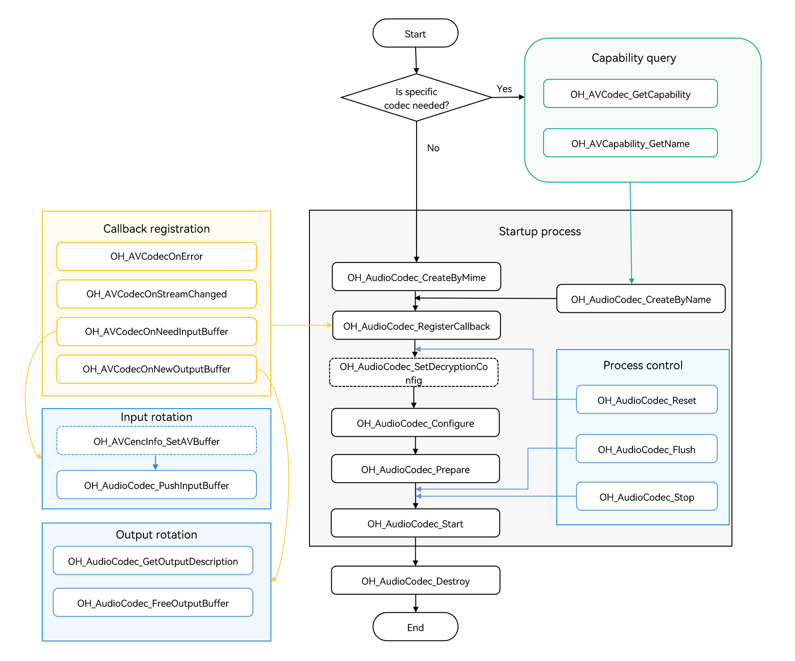
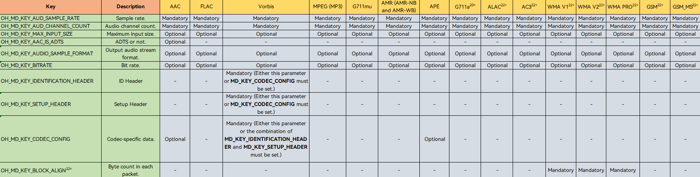
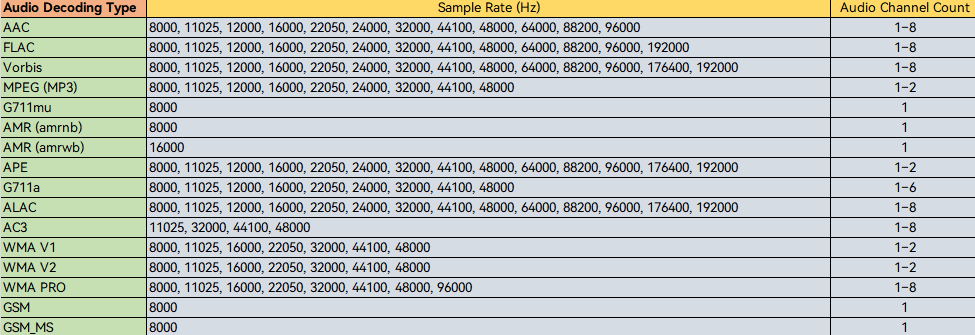

# Audio Decoding

<!--Kit: AVCodec Kit-->
<!--Subsystem: Multimedia-->
<!--Owner: @mr-chencxy-->
<!--Designer: @dpy2650--->
<!--Tester: @baotianhao-->
<!--Adviser: @w_Machine_cc-->
<!-- md-trans-meta sourceCommit=c0242b9f557a90ad752097b505e94c965b1162a4 translatedAt=2026-11-05T00:59:45.669Z pushedAt=2026-08-07T10:50:31.851Z nl=2 -->

You can call the Native APIs of this module to perform audio decoding, that is, to decode media data into a PCM stream.

For supported decoding capabilities, see [AVCodec Supported Formats](avcodec-support-formats.md#audio-decoding).

**When to Use**

- Audio playback

  Before playing audio, you need to decode the audio first and then send the data to the hardware speaker for playback.

- Audio rendering

Before applying audio effects to an audio file, you need to decode it first and then render it through the audio processing module.

- Audio editing

Audio editing (such as adjusting the playback speed of a single channel) must be performed based on PCM streams, so you need to decode the audio file first.
> **NOTE**
>
> A stream generated through the MP3 audio encoding process cannot be directly decoded through the MP3 audio decoding process. It is recommended to use the following process: PCM stream -> MP3 audio encoding -> muxing -> demuxing -> MP3 audio decoding.

## Development Guidelines

For detailed API descriptions, see [native_avcodec_audiocodec.h](../../reference/apis-avcodec-kit/capi-native-avcodec-audiocodec-h.md).

Refer to the following sample code to complete the full audio decoding process, including: creating a decoder, setting decoding parameters (sample rate/bitrate/number of channels, etc.), starting, flushing, resetting, and destroying resources.

The sample code uses custom utility macros and data structures defined in the sample project, such as CHECK_AND_RETURN_RET_LOG, AVCODEC_SAMPLE_ERR_\*, AVCODEC_SAMPLE_LOG\*, CodecUserData, CodecBufferInfo, SampleInfo. These are not SDK APIs. Refer to the sample project for their complete definitions, and implement or replace them when porting the code.

During app development, you must call methods in a specific order to perform corresponding operations. Otherwise, the system may throw exceptions or produce other undefined behaviors. For the specific sequence, refer to the following development steps and their descriptions.

The following figure shows the audio decoding call relationship:

- Dashed lines indicate optional operations.

- Solid lines indicate mandatory operations.



### Linking the Dynamic Libraries in the CMake Script

```cmake
target_link_libraries(sample PUBLIC libnative_media_codecbase.so)
target_link_libraries(sample PUBLIC libnative_media_core.so)
target_link_libraries(sample PUBLIC libnative_media_acodec.so)
```

> **NOTE**
>
> The word **sample** above is only an example. Replace it with the actual project directory name as needed.

### How to Develop

1. Add the required header files.

   ```cpp
   #include <multimedia/player_framework/native_avcodec_audiocodec.h>
   #include <multimedia/native_audio_channel_layout.h>
   #include <multimedia/player_framework/native_avcapability.h>
   #include <multimedia/player_framework/native_avcodec_base.h>
   #include <multimedia/player_framework/native_avformat.h>
   #include <multimedia/player_framework/native_avbuffer.h>
   ```

2. Create a decoder instance object. `OH_AVCodec *` is the pointer to the decoder instance.

   An app can create a decoder by media type or codec name.

   - Method 1: Create a decoder by MIME type.

   <!-- @[AudioDecoder::Create](https://gitcode.com/openharmony/applications_app_samples/blob/master/code/DocsSample/Media/AVCodec/AVCodec/entry/src/main/cpp/capabilities/audio_decoder.cpp) -->
   
   ``` C++
   int32_t AudioDecoder::Create(const std::string &codecMime)
   {
       // Set the encoding flag. false indicates decoding.
       constexpr bool isEncoder = false;
       // Create the decoder by MIME type. Use the MIME type of the actual decoding format.
       decoder_ = OH_AudioCodec_CreateByMime(codecMime.c_str(), isEncoder);
       CHECK_AND_RETURN_RET_LOG(decoder_ != nullptr, AVCODEC_SAMPLE_ERR_ERROR, "Create failed");
       return AVCODEC_SAMPLE_ERR_OK;
   }
   ```

   - Method 2: Create a decoder by codec name.

   <!-- @[AudioDecoder::CreateByName](https://gitcode.com/openharmony/applications_app_samples/blob/master/code/DocsSample/Media/AVCodec/AVCodec/entry/src/main/cpp/capabilities/audio_decoder.cpp) -->
   
   ``` C++
   int32_t AudioDecoder::CreateByName(const std::string &codecMime)
   {
       // Create the decoder by codec name.
       OH_AVCapability *capability = OH_AVCodec_GetCapability(codecMime.c_str(), false);
       CHECK_AND_RETURN_RET_LOG(capability != nullptr, AVCODEC_SAMPLE_ERR_ERROR, "GetCapability failed");
       const char *name = OH_AVCapability_GetName(capability);
       decoder_ = OH_AudioCodec_CreateByName(name);
       CHECK_AND_RETURN_RET_LOG(decoder_ != nullptr, AVCODEC_SAMPLE_ERR_ERROR, "CreateByName failed");
       return AVCODEC_SAMPLE_ERR_OK;
   }
   ```

3. Call `OH_AudioCodec_RegisterCallback()` to register callback functions.

   Register the callback function pointer set `OH_AVCodecCallback`, including:

   - `OH_AVCodecOnError`: decoder error.

   - `OH_AVCodecOnStreamChanged`: callback for stream information changes, including sample rate change, channel count change, and audio sample format change. The decoding formats that support detecting these changes are: <!--RP5--><!--RP5End-->AAC, FLAC, MP3, VORBIS. (Supported since API version 15)

   - `OH_AVCodecOnNeedInputBuffer`: callback indicating that new input data is needed during operation, meaning the decoder is ready and can accept data input.

   - `OH_AVCodecOnNewOutputBuffer`: callback indicating that new output data has been generated during operation, meaning decoding is complete.

   You can handle the information reported by this callback to ensure the decoder operates properly.

   CodecUserData in the sample is an app-defined passthrough data structure that passes buffer queues between callback and consumer threads.

   > **NOTE**
   >
   > Do not call decoder-related APIs or perform time-consuming operations in the callback.

   <!-- @[SampleCallback::OnCodecError](https://gitcode.com/openharmony/applications_app_samples/blob/master/code/DocsSample/Media/AVCodec/AVCodec/entry/src/main/cpp/common/sample_callback.cpp) -->
   
   ``` C++
   void SampleCallback::OnCodecError(OH_AVCodec *codec, int32_t errorCode, void *userData)
   {
       (void)codec;
       auto *codecUserData = static_cast<CodecUserData *>(userData);
       if (codecUserData != nullptr && !codecUserData->isDestroyed.load()) {
           codecUserData->SignalError();
       }
       AVCODEC_SAMPLE_LOGE("On codec error, error code: %{public}d", errorCode);
   }
   ```

   <!-- @[SampleCallback::OnCodecFormatChange](https://gitcode.com/openharmony/applications_app_samples/blob/master/code/DocsSample/Media/AVCodec/AVCodec/entry/src/main/cpp/common/sample_callback.cpp) -->
   
   ``` C++
   void SampleCallback::OnCodecFormatChange(OH_AVCodec *codec, OH_AVFormat *format, void *userData)
   {
       (void)codec;
       AVCODEC_SAMPLE_LOGI("On codec format change");
       auto *codecUserData = static_cast<CodecUserData *>(userData);
       if (codecUserData == nullptr || codecUserData->isDestroyed.load() || format == nullptr) {
           return;
       }
       // Audio stream information changes: sample rate, channel count, or sample format. The app can detect and handle changes accordingly.
       int32_t sampleRate = 0;
       int32_t channelCount = 0;
       int32_t sampleFormat = 0;
       if (OH_AVFormat_GetIntValue(format, OH_MD_KEY_AUD_SAMPLE_RATE, &sampleRate)) {
           AVCODEC_SAMPLE_LOGI("Audio sample rate changed: %{public}d", sampleRate);
       }
       if (OH_AVFormat_GetIntValue(format, OH_MD_KEY_AUD_CHANNEL_COUNT, &channelCount)) {
           AVCODEC_SAMPLE_LOGI("Audio channel count changed: %{public}d", channelCount);
       }
       if (OH_AVFormat_GetIntValue(format, OH_MD_KEY_AUDIO_SAMPLE_FORMAT, &sampleFormat)) {
           AVCODEC_SAMPLE_LOGI("Audio sample format changed: %{public}d", sampleFormat);
       }
       std::unique_lock<std::shared_mutex> codecLock(codecUserData->codecMutex);
       // Obtain the updated video width, height, stride, and other information from format.
       UpdateVideoOutputInfo(format, codecUserData);
       const int32_t pixelFormat = static_cast<int32_t>(codecUserData->outputPixelFormat);
       AVCODEC_SAMPLE_LOGI("Format changed: %{public}d*%{public}d, stride: %{public}d*%{public}d, "
           "pixel format: %{public}d",
           codecUserData->width, codecUserData->height,
           codecUserData->widthStride, codecUserData->heightStride, pixelFormat);
   }
   ```

   The sample functions serve both audio and video codecs. UpdateVideoOutputInfo() updates video information such as width, height, and pixel format. UpdateEncoderFirstInputDescription() in OnNeedInputBuffer() obtains information about the first video encoding frame by calling OH_VideoEncoder_GetInputDescription(). Neither applies to audio decoding, so you can ignore them.

   <!-- @[SampleCallback::OnNeedInputBuffer](https://gitcode.com/openharmony/applications_app_samples/blob/master/code/DocsSample/Media/AVCodec/AVCodec/entry/src/main/cpp/common/sample_callback.cpp) -->
   
   ``` C++
   void SampleCallback::OnNeedInputBuffer(OH_AVCodec *codec, uint32_t index, OH_AVBuffer *buffer, void *userData)
   {
       auto *codecUserData = static_cast<CodecUserData *>(userData);
       if (codecUserData == nullptr || codecUserData->isDestroyed.load()) {
           return;
       }
       if (codec == nullptr || buffer == nullptr) {
           AVCODEC_SAMPLE_LOGE("Invalid codec input callback argument");
           codecUserData->SignalError();
           return;
       }
       UpdateEncoderFirstInputDescription(codec, codecUserData);
       // Enqueue the input frame buffer and its index in inputBufferQueue.
       codecUserData->inputBufferQueue.Enqueue(std::make_shared<CodecBufferInfo>(index, buffer));
   }
   ```

   <!-- @[SampleCallback::OnNewOutputBuffer](https://gitcode.com/openharmony/applications_app_samples/blob/master/code/DocsSample/Media/AVCodec/AVCodec/entry/src/main/cpp/common/sample_callback.cpp) -->
   
   ``` C++
   void SampleCallback::OnNewOutputBuffer(OH_AVCodec *codec, uint32_t index, OH_AVBuffer *buffer, void *userData)
   {
       auto *codecUserData = static_cast<CodecUserData *>(userData);
       if (codecUserData == nullptr || codecUserData->isDestroyed.load()) {
           return;
       }
       if (codec == nullptr || buffer == nullptr) {
           AVCODEC_SAMPLE_LOGE("Invalid codec output callback argument");
           codecUserData->SignalError();
           return;
       }
       if (codecUserData->isDecFirstFrame) {
           OH_AVFormat *format = OH_VideoDecoder_GetOutputDescription(codec);
           if (format != nullptr) {
               UpdateVideoOutputInfo(format, codecUserData);
               OH_AVFormat_Destroy(format);
           }
           codecUserData->isDecFirstFrame = false;
       }
       // Enqueue the output frame buffer and its index in outputBufferQueue.
       codecUserData->outputBufferQueue.Enqueue(std::make_shared<CodecBufferInfo>(index, buffer));
   
       // Obtain temporal layer information from AVBuffer.
       int32_t layerID = GetTemporalLayerID(buffer);
       if (layerID >= 0 && index % LIMIT_LOGD_FREQUENCY == 0) {
           AVCODEC_SAMPLE_LOGD("Temporal layer ID: %{public}d", layerID);
       }
   }
   ```

   > **NOTE**
   >
   > The isDecFirstFrame branch calls OH_VideoDecoder_GetOutputDescription(), which is declared in native_avcodec_videodecoder.h and belongs to the video decoding library. The isDecFirstFrame branch and temporal layer information retrieval (GetTemporalLayerID()) extend video processing. They do not apply to audio decoding and can be ignored.


   Configure the callbacks:


   <!-- @[AudioDecoder::SetCallback](https://gitcode.com/openharmony/applications_app_samples/blob/master/code/DocsSample/Media/AVCodec/AVCodec/entry/src/main/cpp/capabilities/audio_decoder.cpp) -->
   
   ``` C++
   int32_t AudioDecoder::SetCallback(CodecUserData *codecUserData)
   {
       // In asynchronous mode, callbacks run on internal codec threads and access the supplied userData. Stop the decoder before destroying this context to prevent callbacks from accessing released objects.
       int32_t ret = AV_ERR_OK;
       ret = OH_AudioCodec_RegisterCallback(decoder_,
                                            {SampleCallback::OnCodecError, SampleCallback::OnCodecFormatChange,
                                             SampleCallback::OnNeedInputBuffer, SampleCallback::OnNewOutputBuffer},
                                            codecUserData);
       CHECK_AND_RETURN_RET_LOG(ret == AV_ERR_OK, AVCODEC_SAMPLE_ERR_ERROR, "Set callback failed, ret: %{public}d", ret);
   
       return AVCODEC_SAMPLE_ERR_OK;
   }
   ```

4. (Optional) Call `OH_AudioCodec_SetDecryptionConfig` to set the decryption configuration.

   After obtaining DRM information (see step 4 in [Media Data Demultiplexing](audio-video-demuxer.md)), configure decryption through this API.

   For details about DRM-related APIs, see [DRM API Reference](../../reference/apis-drm-kit/capi-drm.md).

   This API must be called before `Prepare`.

   Add the header files:

   ```c++
   #include <multimedia/drm_framework/native_mediakeysystem.h>
   #include <multimedia/drm_framework/native_mediakeysession.h>
   #include <multimedia/drm_framework/native_drm_err.h>
   #include <multimedia/drm_framework/native_drm_common.h>
   ```

   Link the dynamic library in the CMake script:

   ``` cmake
   target_link_libraries(sample PUBLIC libnative_drm.so)
   ```

   Usage example:

   ```c++
   // Create the specified DRM system based on DRM information. Here, "com.clearplay.drm" is used as an example.
   MediaKeySystem *system = nullptr;
   int32_t ret = OH_MediaKeySystem_Create("com.clearplay.drm", &system);
   if (system == nullptr) {
       printf("create media key system failed");
       return;
   }
   
   // Create a decryption session.
   MediaKeySession *session = nullptr;
   DRM_ContentProtectionLevel contentProtectionLevel = CONTENT_PROTECTION_LEVEL_SW_CRYPTO;
   ret = OH_MediaKeySystem_CreateMediaKeySession(system, &contentProtectionLevel, &session);
   if (ret != DRM_ERR_OK) {
       // If creation fails, check the DRM API documentation and log information.
       printf("create media key session failed.");
       return;
   }
   if (session == nullptr) {
       printf("media key session is nullptr.");
       return;
   }
   // Obtain the license request, set the license response, and so on.
   // Set the decryption configuration, that is, set the decryption session and the secure channel flag (currently audio decryption does not support secure channels, so set it to false) in the decoder.
   bool secureAudio = false;
   ret = OH_AudioCodec_SetDecryptionConfig(audioDec_, session, secureAudio);
   ```

5. Call `OH_AudioCodec_Configure()` to configure the decoder.

The following describes the configuration option keys:

   <!--RP6-->



   <!--RP6End-->

The following describes the parameter ranges for each audio decoding type:

   <!--RP7-->

   

   <!--RP7End-->

   Starting from API version 20, you can query the sample rate range capability through the [OH_AVCapability_GetAudioSupportedSampleRateRanges](../../reference/apis-avcodec-kit/capi-native-avcapability-h.md#oh_avcapability_getaudiosupportedsamplerateranges) API. The following audio decoding types support decoding at any sample rate within the range:

   | Audio Decoding Type | Sample Rate (Hz) |
   | ------------------- | ---------------- |
   | Flac                | 8000 ~ 384000    |
   | Vorbis              | 8000 ~ 192000    |
   | APE                 | 1 ~ 2147483647   |

   <!-- @[AudioDecoder::Configure](https://gitcode.com/openharmony/applications_app_samples/blob/master/code/DocsSample/Media/AVCodec/AVCodec/entry/src/main/cpp/capabilities/audio_decoder.cpp) -->
   
   ``` C++
   int32_t AudioDecoder::Configure(const SampleInfo &sampleInfo)
   {
       // The decoding capability table may not fully list the sample rates and channel information of some container codec formats.
       // The return value of the decoder Configure call is authoritative. The capability query result is logged for reference only.
       if (!CodecCapability::ValidateAudioConfiguration(sampleInfo, false)) {
           AVCODEC_SAMPLE_LOGW("Audio capability query did not fully describe mime: %{public}s; "
               "continue with decoder configure", sampleInfo.audio.audioCodecMime.c_str());
       }
       // The format is used only for this Configure call. Destroy it before returning on every failure and success path.
       OH_AVFormat *format = OH_AVFormat_Create();
       CHECK_AND_RETURN_RET_LOG(format != nullptr, AVCODEC_SAMPLE_ERR_ERROR, "AVFormat create failed");
   
       // Required: sample format, channel count, channel layout, and sample rate.
       OH_AVFormat_SetIntValue(format, OH_MD_KEY_AUDIO_SAMPLE_FORMAT, SAMPLE_S16LE);
       OH_AVFormat_SetIntValue(format, OH_MD_KEY_AUD_CHANNEL_COUNT, sampleInfo.audio.audioChannelCount);
       OH_AVFormat_SetLongValue(format, OH_MD_KEY_CHANNEL_LAYOUT, sampleInfo.audio.audioChannelLayout);
       OH_AVFormat_SetIntValue(format, OH_MD_KEY_AUD_SAMPLE_RATE, sampleInfo.audio.audioSampleRate);
       // Optional: synchronous mode. Set it as needed.
       if (sampleInfo.codec.codecSyncMode) {
           OH_AVFormat_SetIntValue(format, OH_MD_KEY_ENABLE_SYNC_MODE, sampleInfo.codec.codecSyncMode);
       }
   
       // Optional: codec-specific configuration data obtained by demuxing. Do not set it if unavailable.
       if (sampleInfo.audio.codecConfigLen > 0 &&
           sampleInfo.audio.codecConfig.size() >= sampleInfo.audio.codecConfigLen) {
           OH_AVFormat_SetBuffer(format, OH_MD_KEY_CODEC_CONFIG, sampleInfo.audio.codecConfig.data(),
               sampleInfo.audio.codecConfigLen);
       }
   
       // Configure the decoder.
       int ret = OH_AudioCodec_Configure(decoder_, format);
       CHECK_AND_RETURN_RET_LOG(ret == AV_ERR_OK, AVCODEC_SAMPLE_ERR_ERROR, "Config failed, ret: %{public}d", ret);
       OH_AVFormat_Destroy(format);
       format = nullptr;
   
       return AVCODEC_SAMPLE_ERR_OK;
   }
   ```

6. Call `OH_AudioCodec_Prepare()` to prepare the decoder.

   The sample project wraps OH_AudioCodec_Prepare() in Config(). Config() first completes Configure() and callback registration, then calls OH_AudioCodec_Prepare() to prepare the decoder. The following snippet shows the preparation part:

   <!-- @[AudioDecoder::Config](https://gitcode.com/openharmony/applications_app_samples/blob/master/code/DocsSample/Media/AVCodec/AVCodec/entry/src/main/cpp/capabilities/audio_decoder.cpp) -->
   
   ``` C++
   {
       // Prepare the decoder.
       int ret = OH_AudioCodec_Prepare(decoder_);
       CHECK_AND_RETURN_RET_LOG(ret == AV_ERR_OK, AVCODEC_SAMPLE_ERR_ERROR, "Prepare failed, ret: %{public}d", ret);
   }
   ```

7. Call `OH_AudioCodec_Start()` to start the decoder and enter the running state.

   <!-- @[AudioDecoder::Start](https://gitcode.com/openharmony/applications_app_samples/blob/master/code/DocsSample/Media/AVCodec/AVCodec/entry/src/main/cpp/capabilities/audio_decoder.cpp) -->
   
   ``` C++
   int32_t AudioDecoder::Start()
   {
       CHECK_AND_RETURN_RET_LOG(decoder_ != nullptr, AVCODEC_SAMPLE_ERR_ERROR, "Decoder is null");
   
       int ret = OH_AudioCodec_Start(decoder_);
       CHECK_AND_RETURN_RET_LOG(ret == AV_ERR_OK, AVCODEC_SAMPLE_ERR_ERROR, "Start failed, ret: %{public}d", ret);
       return AVCODEC_SAMPLE_ERR_OK;
   }
   ```

8. (Optional) Call `OH_AVCencInfo_SetAVBuffer()` to set cencInfo.

   If the currently playing program is a DRM-encrypted program and the upper-layer app performs [media demuxing](audio-video-demuxer.md), you must call `OH_AVCencInfo_SetAVBuffer()` to set cencInfo to the AVBuffer for decrypting the media data in the AVBuffer.

   Add the header file:

   ```c++
   #include <multimedia/player_framework/native_cencinfo.h>
   ```

   Link the dynamic library in the CMake script:

   ``` cmake
   target_link_libraries(sample PUBLIC libnative_media_avcencinfo.so)
   ```

   Usage example:

   ```c++
   OH_AVBuffer *buffer = ...; // Input buffer to decrypt. For how to obtain it, see step 9.
   uint32_t keyIdLen = DRM_KEY_ID_SIZE;
   uint8_t keyId[] = {
       0xd4, 0xb2, 0x01, 0xe4, 0x61, 0xc8, 0x98, 0x96,
       0xcf, 0x05, 0x22, 0x39, 0x8d, 0x09, 0xe6, 0x28};
   uint32_t ivLen = DRM_KEY_IV_SIZE;
   uint8_t iv[] = {
       0xbf, 0x77, 0xed, 0x51, 0x81, 0xde, 0x36, 0x3e,
       0x52, 0xf7, 0x20, 0x4f, 0x72, 0x14, 0xa3, 0x95};
   uint32_t encryptedBlockCount = 0;
   uint32_t skippedBlockCount = 0;
   uint32_t firstEncryptedOffset = 0;
   uint32_t subsampleCount = 1;
   DrmSubsample subsamples[1] = { { .clearHeaderLen = 0x10, .payLoadLen = 0x16 } };
   // Create a CencInfo instance.
   OH_AVCencInfo *cencInfo = OH_AVCencInfo_Create();
   if (cencInfo == nullptr) {
       // Handle the exception.
   }
   // Set the decryption algorithm.
   OH_AVErrCode errNo = OH_AVCencInfo_SetAlgorithm(cencInfo, DRM_ALG_CENC_AES_CTR);
   if (errNo != AV_ERR_OK) {
       // Handle the exception.
   }
   // Set KeyId and Iv.
   errNo = OH_AVCencInfo_SetKeyIdAndIv(cencInfo, keyId, keyIdLen, iv, ivLen);
   if (errNo != AV_ERR_OK) {
       // Handle the exception.
   }
   // Set sample information.
   errNo = OH_AVCencInfo_SetSubsampleInfo(cencInfo, encryptedBlockCount, skippedBlockCount, firstEncryptedOffset,
       subsampleCount, subsamples);
   if (errNo != AV_ERR_OK) {
       // Handle the exception.
   }
   // Set the mode: KeyId, Iv, and SubSamples have been set.
   errNo = OH_AVCencInfo_SetMode(cencInfo, DRM_CENC_INFO_KEY_IV_SUBSAMPLES_SET);
   if (errNo != AV_ERR_OK) {
       // Handle the exception.
   }
   // Set CencInfo in AVBuffer.
   errNo = OH_AVCencInfo_SetAVBuffer(cencInfo, buffer);
   if (errNo != AV_ERR_OK) {
       // Handle the exception.
   }
   // Destroy the CencInfo instance.
   errNo = OH_AVCencInfo_Destroy(cencInfo);
   if (errNo != AV_ERR_OK) {
       // Handle the exception.
   }
   cencInfo = nullptr;
   ```

9. Call `OH_AudioCodec_PushInputBuffer()` to write the data to be decoded.

   Call this API after filling in the complete input data.

At the end, set the flags to `AVCODEC_BUFFER_FLAGS_EOS`.

   <!-- @[AudioDecoder::PushInputBuffer](https://gitcode.com/openharmony/applications_app_samples/blob/master/code/DocsSample/Media/AVCodec/AVCodec/entry/src/main/cpp/capabilities/audio_decoder.cpp) -->
   
   ``` C++
   int32_t AudioDecoder::PushInputBuffer(CodecBufferInfo &info)
   {
       CHECK_AND_RETURN_RET_LOG(decoder_ != nullptr, AVCODEC_SAMPLE_ERR_ERROR, "Decoder is null");
       CHECK_AND_RETURN_RET_LOG(info.buffer != nullptr, AVCODEC_SAMPLE_ERR_ERROR, "Input buffer is null");
       int32_t ret = OH_AVBuffer_SetBufferAttr(info.buffer, &info.attr);
       CHECK_AND_RETURN_RET_LOG(ret == AV_ERR_OK, AVCODEC_SAMPLE_ERR_ERROR, "Set avbuffer attr failed");
       ret = OH_AudioCodec_PushInputBuffer(decoder_, info.bufferIndex);
       CHECK_AND_RETURN_RET_LOG(ret == AV_ERR_OK, AVCODEC_SAMPLE_ERR_ERROR, "Push input data failed");
       return AVCODEC_SAMPLE_ERR_OK;
   }
   ```

   In this sample, data to decode is read from the demuxer. OH_AVDemuxer_ReadSampleBuffer writes pts, size, and flags to the buffer attributes. The following example shows input thread consumption:

   <!-- @[Player::AudioDecInputThread](https://gitcode.com/openharmony/applications_app_samples/blob/master/code/DocsSample/Media/AVCodec/AVCodec/entry/src/main/cpp/sample/player/output/audio/PlayerAudioOutput.cpp) -->
   
   ``` C++
   void Player::AudioDecInputThread()
   {
       while (isStarted_ && audioWorkerRunning_) {
           WaitIfPaused(true);
           CHECK_AND_BREAK_LOG(isStarted_ && audioWorkerRunning_, "Decoder input thread out");
           std::shared_ptr<CodecBufferInfo> bufferInfo = audioDecContext_->inputBufferQueue.Dequeue();
           std::shared_lock<std::shared_mutex> codecLock(audioDecContext_->codecMutex);
           CHECK_AND_BREAK_LOG(isStarted_ && audioWorkerRunning_, "Work done, thread out");
           CHECK_AND_CONTINUE_LOG(bufferInfo != nullptr, "Buffer queue is empty, continue");
           audioDecContext_->inputFrameCount++;
           int32_t ret = demuxer_->ReadSample(demuxer_->GetAudioTrackId(), bufferInfo->buffer, bufferInfo->attr);
           if (ret != AVCODEC_SAMPLE_ERR_OK) {
               AVCODEC_SAMPLE_LOGE("Read audio sample failed");
               playbackFailed_ = true;
               isStarted_ = false;
               break;
           }
           ret = audioDecoder_->PushInputBuffer(*bufferInfo);
           if (ret != AVCODEC_SAMPLE_ERR_OK) {
               playbackFailed_ = true;
               isStarted_ = false;
               break;
           }
           CHECK_AND_BREAK_LOG(!(bufferInfo->attr.flags & AVCODEC_BUFFER_FLAGS_EOS), "Catch EOS, thread out");
       }
   }
   ```

10. Call `OH_AudioCodec_FreeOutputBuffer()` to release the decoded data.

    After obtaining the decoded PCM stream, call `OH_AudioCodec_FreeOutputBuffer()` to release it in a timely manner.

    <!-- @[AudioDecoder::FreeOutputBuffer](https://gitcode.com/openharmony/applications_app_samples/blob/master/code/DocsSample/Media/AVCodec/AVCodec/entry/src/main/cpp/capabilities/audio_decoder.cpp) -->
    
    ``` C++
    int32_t AudioDecoder::FreeOutputBuffer(uint32_t bufferIndex, bool render)
    {
        CHECK_AND_RETURN_RET_LOG(decoder_ != nullptr, AVCODEC_SAMPLE_ERR_ERROR, "Decoder is null");
    
        int32_t ret = AVCODEC_SAMPLE_ERR_OK;
        ret = OH_AudioCodec_FreeOutputBuffer(decoder_, bufferIndex);
        CHECK_AND_RETURN_RET_LOG(ret == AV_ERR_OK, AVCODEC_SAMPLE_ERR_ERROR, "Free output data failed");
        return AVCODEC_SAMPLE_ERR_OK;
    }
    ```

    The output thread dequeues decoded data from the output buffer queue and promptly releases the buffer after retrieving the PCM data. The following example shows output consumption:

    <!-- @[AudioOutputPump::ProcessAsyncOutput](https://gitcode.com/openharmony/applications_app_samples/blob/master/code/DocsSample/Media/AVCodec/AVCodec/entry/src/main/cpp/sample/player/output/audio/AudioOutputPump.cpp) -->
    
    ``` C++
    bool AudioOutputPump::ProcessAsyncOutput()
    {
        CHECK_AND_RETURN_RET_LOG(running_, false, "Audio decoder output thread out");
        std::shared_ptr<CodecBufferInfo> bufferInfo = context_.outputBufferQueue.Dequeue();
        std::shared_lock<std::shared_mutex> codecLock(context_.codecMutex);
        if (bufferInfo == nullptr) {
            AVCODEC_SAMPLE_LOGW("Buffer queue is empty, continue");
            return true;
        }
        if (!running_) {
            (void)ReleaseOutputBuffer(*bufferInfo, "audio output worker stopped");
            return false;
        }
        if (bufferInfo->attr.flags & AVCODEC_BUFFER_FLAGS_EOS) {
            (void)ReleaseOutputBuffer(*bufferInfo, "audio output EOS");
            AVCODEC_SAMPLE_LOGI("Catch EOS, audio output thread out");
            return false;
        }
        return HandleOutputBuffer(*bufferInfo, true);
    }
    ```

    <!--RP3-->
    <!--RP3End-->

11. (Optional) Call `OH_AudioCodec_Flush()` to flush the decoder.

    After calling `OH_AudioCodec_Flush()`, the decoder remains in the running state, but the current queue is cleared and decoded data is released.

    In this case, you need to call `OH_AudioCodec_Start()` to restart decoding.

    When to use:

    * After the decoding output buffer property is `AVCODEC_BUFFER_FLAGS_EOS`, if you want to resume decoding with the same configuration, you need to call flush.

    * If a recoverable error occurs during execution (that is, `OH_AudioCodec_IsValid()` returns `true`), you can call flush and then call `OH_AudioCodec_Start()` to restart decoding.

    <!-- @[AudioDecoder::Flush](https://gitcode.com/openharmony/applications_app_samples/blob/master/code/DocsSample/Media/AVCodec/AVCodec/entry/src/main/cpp/capabilities/audio_decoder.cpp) -->
    
    ``` C++
    int32_t AudioDecoder::Flush()
    {
        CHECK_AND_RETURN_RET_LOG(decoder_ != nullptr, AVCODEC_SAMPLE_ERR_ERROR, "Decoder is null");
    
        // Flush the decoder and clear the current queue. Call Start() afterward to restart decoding.
        int32_t ret = OH_AudioCodec_Flush(decoder_);
        CHECK_AND_RETURN_RET_LOG(ret == AV_ERR_OK, AVCODEC_SAMPLE_ERR_ERROR, "Flush failed, ret: %{public}d", ret);
        return AVCODEC_SAMPLE_ERR_OK;
    }
    ```

12. (Optional) Call `OH_AudioCodec_Reset()` to reset the decoder.

    After calling `OH_AudioCodec_Reset()`, the decoder returns to the initialized state. All input/output buffers obtained before the reset become invalid. You must call `OH_AudioCodec_Configure()` to reconfigure the decoder, and then call `OH_AudioCodec_Start()` to restart decoding. After the decoder starts, obtain new input/output buffers.

    <!-- @[AudioDecoder::Reset](https://gitcode.com/openharmony/applications_app_samples/blob/master/code/DocsSample/Media/AVCodec/AVCodec/entry/src/main/cpp/capabilities/audio_decoder.cpp) -->
    
    ``` C++
    int32_t AudioDecoder::Reset()
    {
        CHECK_AND_RETURN_RET_LOG(decoder_ != nullptr, AVCODEC_SAMPLE_ERR_ERROR, "Decoder is null");
    
        // Reset the decoder. Call Configure() again to configure it, and Start() to start it.
        int32_t ret = OH_AudioCodec_Reset(decoder_);
        CHECK_AND_RETURN_RET_LOG(ret == AV_ERR_OK, AVCODEC_SAMPLE_ERR_ERROR, "Reset failed, ret: %{public}d", ret);
        return AVCODEC_SAMPLE_ERR_OK;
    }
    ```

13. Call `OH_AudioCodec_Stop()` to stop the decoder.

After stopping, you can call `OH_AudioCodec_Start()` to re-enter the started state. The input/output buffers obtained before stopping can no longer be used. You must obtain new input/output buffers after restarting.

    <!-- @[AudioDecoder::Stop](https://gitcode.com/openharmony/applications_app_samples/blob/master/code/DocsSample/Media/AVCodec/AVCodec/entry/src/main/cpp/capabilities/audio_decoder.cpp) -->
    
    ``` C++
    int32_t AudioDecoder::Stop()
    {
        CHECK_AND_RETURN_RET_LOG(decoder_ != nullptr, AVCODEC_SAMPLE_ERR_ERROR, "Decoder is null");
    
        int32_t ret = OH_AudioCodec_Stop(decoder_);
        CHECK_AND_RETURN_RET_LOG(ret == AV_ERR_OK, AVCODEC_SAMPLE_ERR_ERROR, "Stop failed, ret: %{public}d", ret);
        return AVCODEC_SAMPLE_ERR_OK;
    }
    ```

14. Call `OH_AudioCodec_Destroy()` to destroy the decoder instance and release resources.

> **NOTE**
>
> Do not destroy the decoder repeatedly.

    <!-- @[AudioDecoder::Release](https://gitcode.com/openharmony/applications_app_samples/blob/master/code/DocsSample/Media/AVCodec/AVCodec/entry/src/main/cpp/capabilities/audio_decoder.cpp) -->
    
    ``` C++
    int32_t AudioDecoder::Release()
    {
        if (decoder_ != nullptr) {
            // Flush and stop the decoder before destruction. Do not destroy it more than once.
            Flush();
            Stop();
            OH_AudioCodec_Destroy(decoder_);
            decoder_ = nullptr;
        }
        return AVCODEC_SAMPLE_ERR_OK;
    }
    ```