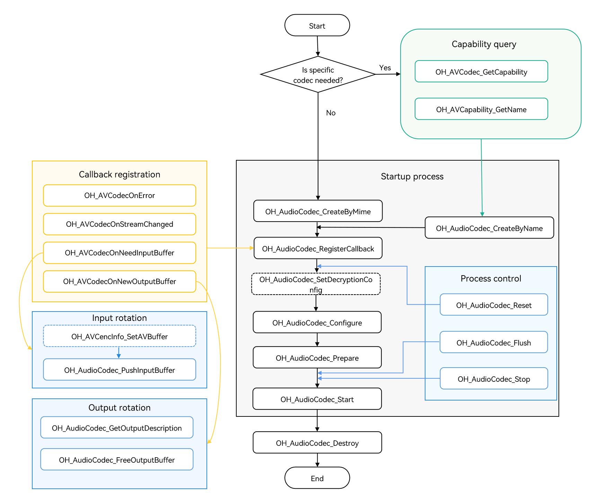

# Asynchronous Audio Decoding

<!--Kit: AVCodec Kit-->
<!--Subsystem: Multimedia-->
<!--Owner: @mr-chencxy-->
<!--Designer: @dpy2650--->
<!--Tester: @baotianhao-->
<!--Adviser: @w_Machine_cc-->
<!-- md-trans-meta sourceCommit=66c49c549588a50aa036f806393d8098f913c4aa translatedAt=2026-10-22T03:50:49.250Z pushedAt=2026-10-22T10:44:33.335Z nl=1 -->

You can call native APIs to perform audio decoding, which decodes media data into PCM streams.

For details about the supported decoding capabilities, see [AVCodec Supported Formats](avcodec-support-formats.md#audio-decoding).

**When to Use**

- Audio playback

  Decode audio and transmit the data to the speaker for playing.
- Audio rendering

  Decode audio and transmit the data to the audio processing module for audio rendering.
- Audio editing

  Decode audio and transmit the data for audio editing (for example, adjusting the playback speed of a channel). Audio editing is performed based on PCM streams.
> **NOTE**
>
> Streams generated in the MP3 audio encoding process cannot be directly decoded through the MP3 audio decoding process. The following process is recommended: PCM stream -> MP3 audio encoding -> multiplexing -> demultiplexing -> MP3 audio decoding.

## Development Guidelines

For detailed API descriptions, see [native_avcodec_audiocodec.h](../../reference/apis-avcodec-kit/capi-native-avcodec-audiocodec-h.md).

Refer to the code snippet below to complete the entire audio decoding process, including creating a decoder, setting decoding parameters (such as the sample rate, bit rate, and audio channel count), and starting, refreshing, resetting, and destroying the decoder.

The sample code references the utility macros and data structures defined in the sample project (such as `CHECK_AND_RETURN_RET_LOG`, `AVCODEC_SAMPLE_ERR_\*`, `AVCODEC_SAMPLE_LOG\*`, `CodecUserData`, `CodecBufferInfo`, and `SampleInfo`). These are not SDK APIs. For their complete definitions, see the sample project. When porting the code, implement or replace them as needed.

During application development, you must call the APIs in the defined sequence. Otherwise, the system may throw exceptions or exhibit other undefined behaviors.

The figure below shows the call relationship of audio decoding.

- The dotted line indicates an optional operation.

- The solid line indicates a mandatory operation.



### Linking the Dynamic Libraries in the CMake Script

```cmake
target_link_libraries(sample PUBLIC libnative_media_codecbase.so)
target_link_libraries(sample PUBLIC libnative_media_core.so)
target_link_libraries(sample PUBLIC libnative_media_acodec.so)
```
> **NOTE**
>
> The word **sample** in the preceding code snippet is only an example. Use the actual project directory name.

### How to Develop

1. Add the required header files.

   ```cpp
   #include <multimedia/player_framework/native_avcodec_audiocodec.h>
   #include <multimedia/native_audio_channel_layout.h>
   #include <multimedia/player_framework/native_avcapability.h>
   #include <multimedia/player_framework/native_avcodec_base.h>
   #include <multimedia/player_framework/native_avformat.h>
   #include <multimedia/player_framework/native_avbuffer.h>
   ```

2. Create a decoder instance. In the code snippet below, OH_AVCodec * is the pointer to the decoder instance created.

   You can create a decoder by MIME type or codec name.

   - Method 1: Create a decoder by MIME type.

   <!-- @[AudioDecoder::Create](https://gitcode.com/openharmony/applications_app_samples/blob/master/code/BasicFeature/Media/AVCodec/entry/src/main/cpp/capabilities/audio_decoder.cpp) -->
   
   ``` C++
   int32_t AudioDecoder::Create(const std::string &codecMime)
   {
       // Set whether this is encoding. false indicates that this is decoding.
       constexpr bool isEncoder = false;
       // Create a decoder via the mime type. The mime type passed here is subject to the actual decoding format.
       decoder_ = OH_AudioCodec_CreateByMime(codecMime.c_str(), isEncoder);
       CHECK_AND_RETURN_RET_LOG(decoder_ != nullptr, AVCODEC_SAMPLE_ERR_ERROR, "Create failed");
       return AVCODEC_SAMPLE_ERR_OK;
   }
   ```

   - Method 2: Create a decoder by codec name.

   <!-- @[AudioDecoder::CreateByName](https://gitcode.com/openharmony/applications_app_samples/blob/master/code/BasicFeature/Media/AVCodec/entry/src/main/cpp/capabilities/audio_decoder.cpp) -->
   
   ``` C++
   int32_t AudioDecoder::CreateByName(const std::string &codecMime)
   {
       // Create the decoder via the codec name.
       OH_AVCapability *capability = OH_AVCodec_GetCapability(codecMime.c_str(), false);
       CHECK_AND_RETURN_RET_LOG(capability != nullptr, AVCODEC_SAMPLE_ERR_ERROR, "GetCapability failed");
       const char *name = OH_AVCapability_GetName(capability);
       decoder_ = OH_AudioCodec_CreateByName(name);
       CHECK_AND_RETURN_RET_LOG(decoder_ != nullptr, AVCODEC_SAMPLE_ERR_ERROR, "CreateByName failed");
       return AVCODEC_SAMPLE_ERR_OK;
   }
   ```

3. Call **OH_AudioCodec_RegisterCallback()** to register callback functions.

   Register the **OH_AVCodecCallback** struct that defines the following callback function pointers:

   - `OH_AVCodecOnError`: decoder error.
   - `OH_AVCodecOnStreamChanged`: callback used to report stream information changes, including changes in the sample rate, audio channel count, and audio sample format. The decoding formats that support detecting these changes are: <!--RP5--><!--RP5End-->AAC, FLAC, MP3, VORBIS. (Supported since API version 15)
   - `OH_AVCodecOnNeedInputBuffer`: callback indicating that new input data is needed during operation, meaning the decoder is ready and can accept data input.
   - `OH_AVCodecOnNewOutputBuffer`: callback indicating that new output data has been generated during operation, meaning decoding is complete.

   You need to process the callback functions to ensure that the decoder runs properly.

   In the sample, `CodecUserData` is an application-defined pass-through data structure used to pass the buffer queue between the callback thread and the consumer thread.

   > **NOTE**
   >
   > Do not call the decoder APIs or perform time-consuming operations in the callbacks.

   <!-- @[SampleCallback::OnCodecError](https://gitcode.com/openharmony/applications_app_samples/blob/master/code/BasicFeature/Media/AVCodec/entry/src/main/cpp/common/sample_callback.cpp) -->
   
   ``` C++
   void SampleCallback::OnCodecError(OH_AVCodec *codec, int32_t errorCode, void *userData)
   {
       (void)codec;
       auto *codecUserData = static_cast<CodecUserData *>(userData);
       if (codecUserData != nullptr && !codecUserData->isDestroyed.load()) {
           codecUserData->SignalError();
       }
       AVCODEC_SAMPLE_LOGE("On codec error, error code: %{public}d", errorCode);
   }
   ```

   <!-- @[SampleCallback::OnCodecFormatChange](https://gitcode.com/openharmony/applications_app_samples/blob/master/code/BasicFeature/Media/AVCodec/entry/src/main/cpp/common/sample_callback.cpp) -->
   
   ``` C++
   void SampleCallback::OnCodecFormatChange(OH_AVCodec *codec, OH_AVFormat *format, void *userData)
   {
       (void)codec;
       AVCODEC_SAMPLE_LOGI("On codec format change");
       auto *codecUserData = static_cast<CodecUserData *>(userData);
       if (codecUserData == nullptr || codecUserData->isDestroyed.load() || format == nullptr) {
           return;
       }
       // Audio stream information changes: sample rate/channel count/sample format. The application can detect the change and handle it accordingly.
       int32_t sampleRate = 0;
       int32_t channelCount = 0;
       int32_t sampleFormat = 0;
       if (OH_AVFormat_GetIntValue(format, OH_MD_KEY_AUD_SAMPLE_RATE, &sampleRate)) {
           AVCODEC_SAMPLE_LOGI("Audio sample rate changed: %{public}d", sampleRate);
       }
       if (OH_AVFormat_GetIntValue(format, OH_MD_KEY_AUD_CHANNEL_COUNT, &channelCount)) {
           AVCODEC_SAMPLE_LOGI("Audio channel count changed: %{public}d", channelCount);
       }
       if (OH_AVFormat_GetIntValue(format, OH_MD_KEY_AUDIO_SAMPLE_FORMAT, &sampleFormat)) {
           AVCODEC_SAMPLE_LOGI("Audio sample format changed: %{public}d", sampleFormat);
       }
       std::unique_lock<std::shared_mutex> codecLock(codecUserData->codecMutex);
       // Obtain the changed video width, height, stride, and so on via format.
       UpdateVideoOutputInfo(format, codecUserData);
       const int32_t pixelFormat = static_cast<int32_t>(codecUserData->outputPixelFormat);
       AVCODEC_SAMPLE_LOGI("Format changed: %{public}d*%{public}d, stride: %{public}d*%{public}d, "
           "pixel format: %{public}d",
           codecUserData->width, codecUserData->height,
           codecUserData->widthStride, codecUserData->heightStride, pixelFormat);
   }
   ```

   The sample functions serve both audio and video codecs. `UpdateVideoOutputInfo()` updates video information such as the width, height, and pixel format. `UpdateEncoderFirstInputDescription()` in `OnNeedInputBuffer()` obtains the information of the first video encoding frame (it internally calls `OH_VideoEncoder_GetInputDescription()`). Neither of these takes effect in the audio decoding scenario and can be ignored.

   <!-- @[SampleCallback::OnNeedInputBuffer](https://gitcode.com/openharmony/applications_app_samples/blob/master/code/BasicFeature/Media/AVCodec/entry/src/main/cpp/common/sample_callback.cpp) -->
   
   ``` C++
   void SampleCallback::OnNeedInputBuffer(OH_AVCodec *codec, uint32_t index, OH_AVBuffer *buffer, void *userData)
   {
       auto *codecUserData = static_cast<CodecUserData *>(userData);
       if (codecUserData == nullptr || codecUserData->isDestroyed.load()) {
           return;
       }
       if (codec == nullptr || buffer == nullptr) {
           AVCODEC_SAMPLE_LOGE("Invalid codec input callback argument");
           codecUserData->SignalError();
           return;
       }
       UpdateEncoderFirstInputDescription(codec, codecUserData);
       // Send the data buffer of the input frame and its corresponding index to the inputBufferQueue.
       codecUserData->inputBufferQueue.Enqueue(std::make_shared<CodecBufferInfo>(index, buffer));
   }
   ```

   <!-- @[SampleCallback::OnNewOutputBuffer](https://gitcode.com/openharmony/applications_app_samples/blob/master/code/BasicFeature/Media/AVCodec/entry/src/main/cpp/common/sample_callback.cpp) -->
   
   ``` C++
   void SampleCallback::OnNewOutputBuffer(OH_AVCodec *codec, uint32_t index, OH_AVBuffer *buffer, void *userData)
   {
       auto *codecUserData = static_cast<CodecUserData *>(userData);
       if (codecUserData == nullptr || codecUserData->isDestroyed.load()) {
           return;
       }
       if (codec == nullptr || buffer == nullptr) {
           AVCODEC_SAMPLE_LOGE("Invalid codec output callback argument");
           codecUserData->SignalError();
           return;
       }
       if (codecUserData->isDecFirstFrame) {
           OH_AVFormat *format = OH_VideoDecoder_GetOutputDescription(codec);
           if (format != nullptr) {
               UpdateVideoOutputInfo(format, codecUserData);
               OH_AVFormat_Destroy(format);
           }
           codecUserData->isDecFirstFrame = false;
       }
       // Send the data buffer of the output frame and its corresponding index to the outputBufferQueue.
       codecUserData->outputBufferQueue.Enqueue(std::make_shared<CodecBufferInfo>(index, buffer));
   
       // Obtain the temporal layer information from AVBuffer.
       int32_t layerID = GetTemporalLayerID(buffer);
       if (layerID >= 0 && index % LIMIT_LOGD_FREQUENCY == 0) {
           AVCODEC_SAMPLE_LOGD("Temporal layer ID: %{public}d", layerID);
       }
   }
   ```

   > **NOTE**
   >
   > The `isDecFirstFrame` branch internally calls `OH_VideoDecoder_GetOutputDescription()`, which is declared in `native_avcodec_videodecoder.h` and belongs to the video decoding library. In the sample, the `isDecFirstFrame` branch and the retrieval of temporal layer information (`GetTemporalLayerID()`) are extended logic for the video decoding scenario. They do not take effect in the audio decoding scenario and can be ignored.

   Configure the callbacks:

   <!-- @[AudioDecoder::SetCallback](https://gitcode.com/openharmony/applications_app_samples/blob/master/code/BasicFeature/Media/AVCodec/entry/src/main/cpp/capabilities/audio_decoder.cpp) -->
   
   ``` C++
   int32_t AudioDecoder::SetCallback(CodecUserData *codecUserData)
   {
       // In asynchronous mode, the callback is triggered by the codec's internal thread and accesses the passed-in userData; stop the decoder before destroying this context to prevent the callback from accessing a released object.
       int32_t ret = AV_ERR_OK;
       ret = OH_AudioCodec_RegisterCallback(decoder_,
                                            {SampleCallback::OnCodecError, SampleCallback::OnCodecFormatChange,
                                             SampleCallback::OnNeedInputBuffer, SampleCallback::OnNewOutputBuffer},
                                            codecUserData);
       CHECK_AND_RETURN_RET_LOG(ret == AV_ERR_OK, AVCODEC_SAMPLE_ERR_ERROR, "Set callback failed, ret: %{public}d", ret);
   
       return AVCODEC_SAMPLE_ERR_OK;
   }
   ```

4. (Optional) Call **OH_AudioCodec_SetDecryptionConfig** to set the decryption configuration.

   After obtaining DRM information (see step 4 in [Media Data Demultiplexing](audio-video-demuxer.md)), configure decryption through this API.

   For details about DRM-related APIs, see [DRM API Reference](../../reference/apis-drm-kit/capi-drm.md).

   This API must be called before `Prepare`.

   Add the header files:

   ```c++
   #include <multimedia/drm_framework/native_mediakeysystem.h>
   #include <multimedia/drm_framework/native_mediakeysession.h>
   #include <multimedia/drm_framework/native_drm_err.h>
   #include <multimedia/drm_framework/native_drm_common.h>
   ```
   Link the dynamic library in the CMake script:
   
   ``` cmake
   target_link_libraries(sample PUBLIC libnative_drm.so)
   ```
   
   Usage example:
   ```c++
   // Create the specified DRM system based on the DRM information, using "com.clearplay.drm" as an example.
   MediaKeySystem *system = nullptr;
   int32_t ret = OH_MediaKeySystem_Create("com.clearplay.drm", &system);
   if (system == nullptr) {
       printf("create media key system failed");
       return;
   }
   
   // Create a decryption session.
   MediaKeySession *session = nullptr;
   DRM_ContentProtectionLevel contentProtectionLevel = CONTENT_PROTECTION_LEVEL_SW_CRYPTO;
   ret = OH_MediaKeySystem_CreateMediaKeySession(system, &contentProtectionLevel, &session);
   if (ret != DRM_ERR_OK) {
       // If creation fails, see the DRM API documentation and log information.
       printf("create media key session failed.");
       return;
   }
   if (session == nullptr) {
       printf("media key session is nullptr.");
       return;
   }
   // Obtain the license request, set the license response, and so on.
   // Set the decryption configuration, that is, set the decryption session and the secure channel flag (secure channel is not supported for audio decryption, so set it to false) in the decoder.
   bool secureAudio = false;
   ret = OH_AudioCodec_SetDecryptionConfig(audioDec_, session, secureAudio);
   ```

5. Call **OH_AudioCodec_Configure()** to configure the decoder.

   Key values of configuration options are described as follows:

   <!--RP6-->
   
   <!--RP6End-->

   The sample below lists the value range of each audio decoding type.

   <!--RP7-->
   
   <!--RP7End-->

   Starting from API version 20, you can query the sample rate range capability through the [OH_AVCapability_GetAudioSupportedSampleRateRanges](../../reference/apis-avcodec-kit/capi-native-avcapability-h.md#oh_avcapability_getaudiosupportedsamplerateranges) API. The following audio decoding types support decoding at any sample rate within the range:

   | Audio Decoding Type|    Sample Rate (Hz)  |
   | ----------- | --------------- |
   | FLAC       | 8000 – 384000  |
   | Vorbis      | 8000 – 192000  |
   | APE         | 1 – 2147483647 |

   <!-- @[AudioDecoder::Configure](https://gitcode.com/openharmony/applications_app_samples/blob/master/code/BasicFeature/Media/AVCodec/entry/src/main/cpp/capabilities/audio_decoder.cpp) -->
   
   ``` C++
   int32_t AudioDecoder::Configure(const SampleInfo &sampleInfo)
   {
       // The decoding capability table may not fully list the sample rate/channel information for some container encoding formats.
       // The return value of the decoder Configure call is the final basis for judgment. The capability query result here is only used as a reference log.
       if (!CodecCapability::ValidateAudioConfiguration(sampleInfo, false)) {
           AVCODEC_SAMPLE_LOGW("Audio capability query did not fully describe mime: %{public}s; "
               "continue with decoder configure", sampleInfo.audio.audioCodecMime.c_str());
       }
       // format is used only for this Configure call. Destroy it before returning on all failure and success paths.
       OH_AVFormat *format = OH_AVFormat_Create();
       CHECK_AND_RETURN_RET_LOG(format != nullptr, AVCODEC_SAMPLE_ERR_ERROR, "AVFormat create failed");
   
       // Required: sample format, channel count, channel layout, and sample rate.
       OH_AVFormat_SetIntValue(format, OH_MD_KEY_AUDIO_SAMPLE_FORMAT, SAMPLE_S16LE);
       OH_AVFormat_SetIntValue(format, OH_MD_KEY_AUD_CHANNEL_COUNT, sampleInfo.audio.audioChannelCount);
       OH_AVFormat_SetLongValue(format, OH_MD_KEY_CHANNEL_LAYOUT, sampleInfo.audio.audioChannelLayout);
       OH_AVFormat_SetIntValue(format, OH_MD_KEY_AUD_SAMPLE_RATE, sampleInfo.audio.audioSampleRate);
       // Optional: synchronous mode. Set it as needed.
       if (sampleInfo.codec.codecSyncMode) {
           OH_AVFormat_SetIntValue(format, OH_MD_KEY_ENABLE_SYNC_MODE, sampleInfo.codec.codecSyncMode);
       }
   
       // Optional: codec-specific data (codec config), obtained from demuxing. Do not set it if it is unavailable.
       if (sampleInfo.audio.codecConfigLen > 0 &&
           sampleInfo.audio.codecConfig.size() >= sampleInfo.audio.codecConfigLen) {
           OH_AVFormat_SetBuffer(format, OH_MD_KEY_CODEC_CONFIG, sampleInfo.audio.codecConfig.data(),
               sampleInfo.audio.codecConfigLen);
       }
   
       // Configure the decoder.
       int ret = OH_AudioCodec_Configure(decoder_, format);
       CHECK_AND_RETURN_RET_LOG(ret == AV_ERR_OK, AVCODEC_SAMPLE_ERR_ERROR, "Config failed, ret: %{public}d", ret);
       OH_AVFormat_Destroy(format);
       format = nullptr;
   
       return AVCODEC_SAMPLE_ERR_OK;
   }
   ```

6. Call **OH_AudioCodec_Prepare()** to prepare internal resources for the decoder.

   In the sample project, `OH_AudioCodec_Prepare()` is wrapped in the `Config()` function. In `Config()`, `Configure()` is first called to complete the configuration and callback registration, and then `OH_AudioCodec_Prepare()` is called to make the decoder ready. The following shows the Prepare part of the code:

   <!-- @[AudioDecoder::Config](https://gitcode.com/openharmony/applications_app_samples/blob/master/code/BasicFeature/Media/AVCodec/entry/src/main/cpp/capabilities/audio_decoder.cpp) -->
   
   ``` C++
   {
       // The decoder is ready.
       int ret = OH_AudioCodec_Prepare(decoder_);
       CHECK_AND_RETURN_RET_LOG(ret == AV_ERR_OK, AVCODEC_SAMPLE_ERR_ERROR, "Prepare failed, ret: %{public}d", ret);
   }
   ```

7. Call **OH_AudioCodec_Start()** to start the decoder.

   <!-- @[AudioDecoder::Start](https://gitcode.com/openharmony/applications_app_samples/blob/master/code/BasicFeature/Media/AVCodec/entry/src/main/cpp/capabilities/audio_decoder.cpp) -->
   
   ``` C++
   int32_t AudioDecoder::Start()
   {
       CHECK_AND_RETURN_RET_LOG(decoder_ != nullptr, AVCODEC_SAMPLE_ERR_ERROR, "Decoder is null");
   
       int ret = OH_AudioCodec_Start(decoder_);
       CHECK_AND_RETURN_RET_LOG(ret == AV_ERR_OK, AVCODEC_SAMPLE_ERR_ERROR, "Start failed, ret: %{public}d", ret);
       return AVCODEC_SAMPLE_ERR_OK;
   }
   ```

8. (Optional) Call **OH_AVCencInfo_SetAVBuffer()** to set the Common Encryption Scheme (CENC) information.

   If the currently playing program is a DRM-encrypted program and the upper-layer app performs [media demuxing](audio-video-demuxer.md), you must call `OH_AVCencInfo_SetAVBuffer()` to set cencInfo to the AVBuffer for decrypting the media data in the AVBuffer.

   Add the header files.

   ```c++
   #include <multimedia/player_framework/native_cencinfo.h>
   ```
   Link the dynamic library in the CMake script:

   ``` cmake
   target_link_libraries(sample PUBLIC libnative_media_avcencinfo.so)
   ```

   The sample code is as follows:
   ```c++
   OH_AVBuffer *buffer = ...; // Input buffer to be decrypted. For details about how to obtain it, see step 9.
   uint32_t keyIdLen = DRM_KEY_ID_SIZE;
   uint8_t keyId[] = {
       0xd4, 0xb2, 0x01, 0xe4, 0x61, 0xc8, 0x98, 0x96,
       0xcf, 0x05, 0x22, 0x39, 0x8d, 0x09, 0xe6, 0x28};
   uint32_t ivLen = DRM_KEY_IV_SIZE;
   uint8_t iv[] = {
       0xbf, 0x77, 0xed, 0x51, 0x81, 0xde, 0x36, 0x3e,
       0x52, 0xf7, 0x20, 0x4f, 0x72, 0x14, 0xa3, 0x95};
   uint32_t encryptedBlockCount = 0;
   uint32_t skippedBlockCount = 0;
   uint32_t firstEncryptedOffset = 0;
   uint32_t subsampleCount = 1;
   DrmSubsample subsamples[1] = { { .clearHeaderLen = 0x10, .payLoadLen = 0x16 } };
   // Create a CencInfo instance.
   OH_AVCencInfo *cencInfo = OH_AVCencInfo_Create();
   if (cencInfo == nullptr) {
       // Handle exceptions.
   }
   // Set the decryption algorithm.
   OH_AVErrCode errNo = OH_AVCencInfo_SetAlgorithm(cencInfo, DRM_ALG_CENC_AES_CTR);
   if (errNo != AV_ERR_OK) {
       // Handle exceptions.
   }
   // Set KeyId and Iv.
   errNo = OH_AVCencInfo_SetKeyIdAndIv(cencInfo, keyId, keyIdLen, iv, ivLen);
   if (errNo != AV_ERR_OK) {
       // Handle exceptions.
   }
   // Set the sample information.
   errNo = OH_AVCencInfo_SetSubsampleInfo(cencInfo, encryptedBlockCount, skippedBlockCount, firstEncryptedOffset,
       subsampleCount, subsamples);
   if (errNo != AV_ERR_OK) {
       // Handle exceptions.
   }
   // Set the mode: KeyId, Iv, and SubSamples have been set.
   errNo = OH_AVCencInfo_SetMode(cencInfo, DRM_CENC_INFO_KEY_IV_SUBSAMPLES_SET);
   if (errNo != AV_ERR_OK) {
       // Handle exceptions.
   }
   // Set CencInfo to the AVBuffer.
   errNo = OH_AVCencInfo_SetAVBuffer(cencInfo, buffer);
   if (errNo != AV_ERR_OK) {
       // Handle exceptions.
   }
   // Destroy the CencInfo instance.
   errNo = OH_AVCencInfo_Destroy(cencInfo);
   if (errNo != AV_ERR_OK) {
       // Handle exceptions.
   }
   cencInfo = nullptr;
   ```

9. Call **OH_AudioCodec_PushInputBuffer()** to write the data to decode.

   You should fill in complete input data before calling this API.

   When finished, set the flags to **AVCODEC_BUFFER_FLAGS_EOS**.

   <!-- @[AudioDecoder::PushInputBuffer](https://gitcode.com/openharmony/applications_app_samples/blob/master/code/BasicFeature/Media/AVCodec/entry/src/main/cpp/capabilities/audio_decoder.cpp) -->
   
   ``` C++
   int32_t AudioDecoder::PushInputBuffer(CodecBufferInfo &info)
   {
       CHECK_AND_RETURN_RET_LOG(decoder_ != nullptr, AVCODEC_SAMPLE_ERR_ERROR, "Decoder is null");
       CHECK_AND_RETURN_RET_LOG(info.buffer != nullptr, AVCODEC_SAMPLE_ERR_ERROR, "Input buffer is null");
       int32_t ret = OH_AVBuffer_SetBufferAttr(info.buffer, &info.attr);
       CHECK_AND_RETURN_RET_LOG(ret == AV_ERR_OK, AVCODEC_SAMPLE_ERR_ERROR, "Set avbuffer attr failed");
       ret = OH_AudioCodec_PushInputBuffer(decoder_, info.bufferIndex);
       CHECK_AND_RETURN_RET_LOG(ret == AV_ERR_OK, AVCODEC_SAMPLE_ERR_ERROR, "Push input data failed");
       return AVCODEC_SAMPLE_ERR_OK;
   }
   ```

   In the sample, the data to be decoded is read from the demuxer module. The `pts`, `size`, and `flags` values are written to the buffer attributes by `OH_AVDemuxer_ReadSampleBuffer`. The following shows how the input thread consumes the buffer:

   <!-- @[Player::AudioDecInputThread](https://gitcode.com/openharmony/applications_app_samples/blob/master/code/BasicFeature/Media/AVCodec/entry/src/main/cpp/sample/player/output/audio/PlayerAudioOutput.cpp) -->
   
   ``` C++
   void Player::AudioDecInputThread()
   {
       while (isStarted_ && audioWorkerRunning_) {
           WaitIfPaused(true);
           CHECK_AND_BREAK_LOG(isStarted_ && audioWorkerRunning_, "Decoder input thread out");
           std::shared_ptr<CodecBufferInfo> bufferInfo = audioDecContext_->inputBufferQueue.Dequeue();
           std::shared_lock<std::shared_mutex> codecLock(audioDecContext_->codecMutex);
           CHECK_AND_BREAK_LOG(isStarted_ && audioWorkerRunning_, "Work done, thread out");
           CHECK_AND_CONTINUE_LOG(bufferInfo != nullptr, "Buffer queue is empty, continue");
           audioDecContext_->inputFrameCount++;
           int32_t ret = demuxer_->ReadSample(demuxer_->GetAudioTrackId(), bufferInfo->buffer, bufferInfo->attr);
           if (ret != AVCODEC_SAMPLE_ERR_OK) {
               AVCODEC_SAMPLE_LOGE("Read audio sample failed");
               playbackFailed_ = true;
               isStarted_ = false;
               break;
           }
           ret = audioDecoder_->PushInputBuffer(*bufferInfo);
           if (ret != AVCODEC_SAMPLE_ERR_OK) {
               playbackFailed_ = true;
               isStarted_ = false;
               break;
           }
           CHECK_AND_BREAK_LOG(!(bufferInfo->attr.flags & AVCODEC_BUFFER_FLAGS_EOS), "Catch EOS, thread out");
       }
   }
   ```

10. Call **OH_AudioCodec_FreeOutputBuffer()** to release the decoded data.

    Once you have retrieved the decoded PCM stream, call **OH_AudioCodec_FreeOutputBuffer()** to free up the data.

    <!-- @[AudioDecoder::FreeOutputBuffer](https://gitcode.com/openharmony/applications_app_samples/blob/master/code/BasicFeature/Media/AVCodec/entry/src/main/cpp/capabilities/audio_decoder.cpp) -->
    
    ``` C++
    int32_t AudioDecoder::FreeOutputBuffer(uint32_t bufferIndex, bool render)
    {
        CHECK_AND_RETURN_RET_LOG(decoder_ != nullptr, AVCODEC_SAMPLE_ERR_ERROR, "Decoder is null");
    
        int32_t ret = AVCODEC_SAMPLE_ERR_OK;
        ret = OH_AudioCodec_FreeOutputBuffer(decoder_, bufferIndex);
        CHECK_AND_RETURN_RET_LOG(ret == AV_ERR_OK, AVCODEC_SAMPLE_ERR_ERROR, "Free output data failed");
        return AVCODEC_SAMPLE_ERR_OK;
    }
    ```

    The output thread retrieves decoded data from the output buffer queue, takes the PCM data, and releases the buffer in a timely manner. The following shows an example of output consumption:

    <!-- @[AudioOutputPump::ProcessAsyncOutput](https://gitcode.com/openharmony/applications_app_samples/blob/master/code/BasicFeature/Media/AVCodec/entry/src/main/cpp/sample/player/output/audio/AudioOutputPump.cpp) -->
    
    ``` C++
    bool AudioOutputPump::ProcessAsyncOutput()
    {
        CHECK_AND_RETURN_RET_LOG(running_, false, "Audio decoder output thread out");
        std::shared_ptr<CodecBufferInfo> bufferInfo = context_.outputBufferQueue.Dequeue();
        std::shared_lock<std::shared_mutex> codecLock(context_.codecMutex);
        if (bufferInfo == nullptr) {
            AVCODEC_SAMPLE_LOGW("Buffer queue is empty, continue");
            return true;
        }
        if (!running_) {
            (void)ReleaseOutputBuffer(*bufferInfo, "audio output worker stopped");
            return false;
        }
        if (bufferInfo->attr.flags & AVCODEC_BUFFER_FLAGS_EOS) {
            (void)ReleaseOutputBuffer(*bufferInfo, "audio output EOS");
            AVCODEC_SAMPLE_LOGI("Catch EOS, audio output thread out");
            return false;
        }
        return HandleOutputBuffer(*bufferInfo, true);
    }
    ```
    <!--RP3-->
    <!--RP3End-->

11. (Optional) Call **OH_AudioCodec_Flush()** to refresh the decoder.

    After **OH_AudioCodec_Flush()** is called, the decoder remains in the running state, but the current queue is cleared and the buffer storing the decoded data is freed.

    To continue decoding, you must call **OH_AudioCodec_Start()** again.

    You need to call **OH_AudioCodec_Start()** in the following cases:

    * To use the same decoder configuration after **AVCODEC_BUFFER_FLAGS_EOS** of the output buffer is set, call **OH_AudioCodec_Flush()** to refresh the decoder.
    * If a recoverable error occurs during the execution (**OH_AudioCodec_IsValid()** returns **true**), you can call **OH_AudioCodec_Flush()** to refresh the decoder and then call **OH_AudioCodec_Start()** to start decoding again.

    <!-- @[AudioDecoder::Flush](https://gitcode.com/openharmony/applications_app_samples/blob/master/code/BasicFeature/Media/AVCodec/entry/src/main/cpp/capabilities/audio_decoder.cpp) -->
    
    ``` C++
    int32_t AudioDecoder::Flush()
    {
        CHECK_AND_RETURN_RET_LOG(decoder_ != nullptr, AVCODEC_SAMPLE_ERR_ERROR, "Decoder is null");
    
        // Flush the decoder, clear the current queue, and then call Start() to restart decoding.
        int32_t ret = OH_AudioCodec_Flush(decoder_);
        CHECK_AND_RETURN_RET_LOG(ret == AV_ERR_OK, AVCODEC_SAMPLE_ERR_ERROR, "Flush failed, ret: %{public}d", ret);
        return AVCODEC_SAMPLE_ERR_OK;
    }
    ```

12. (Optional) Call **OH_AudioCodec_Reset()** to reset the decoder.

    After **OH_AudioCodec_Reset()** is called, the decoder returns to the initialized state. The input and output buffers obtained before the reset cannot be used. You must call **OH_AudioCodec_Configure()** to reconfigure the decoder and then call **OH_AudioCodec_Start()** to start decoding again. Obtain the input and output buffers again after the decoder is started.

    <!-- @[AudioDecoder::Reset](https://gitcode.com/openharmony/applications_app_samples/blob/master/code/BasicFeature/Media/AVCodec/entry/src/main/cpp/capabilities/audio_decoder.cpp) -->
    
    ``` C++
    int32_t AudioDecoder::Reset()
    {
        CHECK_AND_RETURN_RET_LOG(decoder_ != nullptr, AVCODEC_SAMPLE_ERR_ERROR, "Decoder is null");
    
        // Reset the decoder. After that, call Configure() and Start() again.
        int32_t ret = OH_AudioCodec_Reset(decoder_);
        CHECK_AND_RETURN_RET_LOG(ret == AV_ERR_OK, AVCODEC_SAMPLE_ERR_ERROR, "Reset failed, ret: %{public}d", ret);
        return AVCODEC_SAMPLE_ERR_OK;
    }
    ```

13. Call **OH_AudioCodec_Stop()** to stop the decoder.

    After the decoder is stopped, you can call **OH_AudioCodec_Start()** to start it again. The input and output buffers obtained before the decoder is stopped cannot be reused. You must obtain them again after the decoder is started.

    <!-- @[AudioDecoder::Stop](https://gitcode.com/openharmony/applications_app_samples/blob/master/code/BasicFeature/Media/AVCodec/entry/src/main/cpp/capabilities/audio_decoder.cpp) -->
    
    ``` C++
    int32_t AudioDecoder::Stop()
    {
        CHECK_AND_RETURN_RET_LOG(decoder_ != nullptr, AVCODEC_SAMPLE_ERR_ERROR, "Decoder is null");
    
        int32_t ret = OH_AudioCodec_Stop(decoder_);
        CHECK_AND_RETURN_RET_LOG(ret == AV_ERR_OK, AVCODEC_SAMPLE_ERR_ERROR, "Stop failed, ret: %{public}d", ret);
        return AVCODEC_SAMPLE_ERR_OK;
    }
    ```

14. Call **OH_AudioCodec_Destroy()** to destroy the decoder instance and release resources.

    > **NOTE**
    >
    > You only need to call this API once.

    <!-- @[AudioDecoder::Release](https://gitcode.com/openharmony/applications_app_samples/blob/master/code/BasicFeature/Media/AVCodec/entry/src/main/cpp/capabilities/audio_decoder.cpp) -->
    
    ``` C++
    int32_t AudioDecoder::Release()
    {
        if (decoder_ != nullptr) {
            // Flush and stop the decoder before destroying it. Do not call destroy repeatedly.
            Flush();
            Stop();
            OH_AudioCodec_Destroy(decoder_);
            decoder_ = nullptr;
        }
        return AVCODEC_SAMPLE_ERR_OK;
    }
    ```