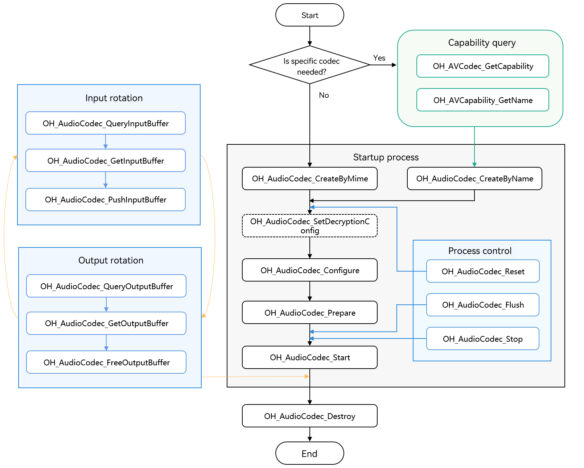
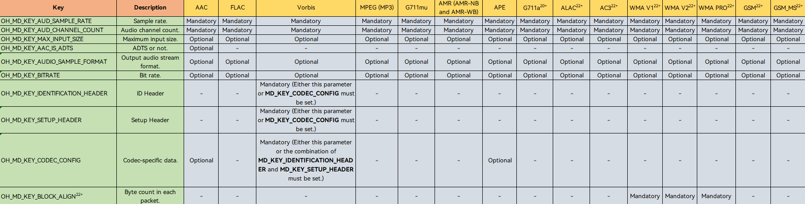
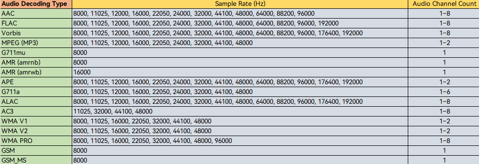

# Synchronous Audio Decoding

<!--Kit: AVCodec Kit-->
<!--Subsystem: Multimedia-->
<!--Owner: @mr-chencxy-->
<!--Designer: @dpy2650--->
<!--Tester: @baotianhao-->
<!--Adviser: @w_Machine_cc-->
<!-- md-trans-meta sourceCommit=66c49c549588a50aa036f806393d8098f913c4aa translatedAt=2026-10-22T04:05:28.240Z pushedAt=2026-10-22T13:01:40.194Z nl=1 -->

Starting from API version 20, audio decoding in synchronous mode is supported.

You can call native APIs to perform audio decoding in synchronous mode, which decodes media data into PCM streams.

For details about the implementation, see [Samples](https://gitcode.com/openharmony/applications_app_samples/tree/master/code/BasicFeature/Media/AVCodec).

For details about the supported decoding capabilities, see [AVCodec Supported Formats](avcodec-support-formats.md#audio-decoding).

**When to Use**

Asynchronous mode is generally recommended. For details, see [Asynchronous Audio Decoding](audio-decoding.md). Use synchronous mode if you need to actively request buffers to deliver frames.

Decoding an audio/video file into a PCM stream typically involves the following steps: [media data demultiplexing](audio-video-demuxer.md) -> audio decoding.

This guide outlines the audio decoding process: inputting audio frames and decoding them into PCM streams.

## Development Guidelines

Read [AudioCodec](../../reference/apis-avcodec-kit/capi-native-avcodec-audiocodec-h.md) for the API reference.

Refer to the code snippet below to complete the entire audio decoding process, including creating a decoder, setting decoding parameters (such as the sample rate, bit rate, and audio channel count), and starting, refreshing, resetting, and destroying the decoder.

The sample code references custom utility macros and data structures defined in the sample project (such as CHECK_AND_RETURN_RET_LOG, AVCODEC_SAMPLE_ERR_\*, AVCODEC_SAMPLE_LOG\*, CodecUserData, CodecBufferInfo, and SampleInfo). These are not SDK APIs. For their complete definitions, see the sample project. Implement or replace them as needed when porting.

During application development, you must call the APIs in the defined sequence. Otherwise, an exception or undefined behavior may occur.

The figure below shows the call relationship of audio decoding in synchronous mode.

- The dotted line indicates an optional operation.

- The solid line indicates a mandatory operation.



### Linking the Dynamic Libraries in the CMake Script

```cmake
target_link_libraries(sample PUBLIC libnative_media_codecbase.so)
target_link_libraries(sample PUBLIC libnative_media_core.so)
target_link_libraries(sample PUBLIC libnative_media_acodec.so)
```
> **NOTE**
>
> The word **sample** in the preceding code snippet is only an example. Use the actual project directory name.

### How to Develop

1. Add the header files and namespace.

   ```cpp
   #include <multimedia/player_framework/native_avcodec_audiocodec.h>
   #include <multimedia/native_audio_channel_layout.h>
   #include <multimedia/player_framework/native_avcapability.h>
   #include <multimedia/player_framework/native_avcodec_base.h>
   #include <multimedia/player_framework/native_avformat.h>
   #include <multimedia/player_framework/native_avbuffer.h>

   // C++ standard library namespace.
   using namespace std;
   ```

2. Create a decoder instance. In the code snippet below, **OH_AVCodec *** is the pointer to the decoder instance created.

   You can create a decoder by MIME type or codec name.

   - Method 1: Create a decoder by MIME type.

   <!-- @[AudioDecoder::Create](https://gitcode.com/openharmony/applications_app_samples/blob/master/code/BasicFeature/Media/AVCodec/entry/src/main/cpp/capabilities/audio_decoder.cpp) -->
   
   ``` C++
   int32_t AudioDecoder::Create(const std::string &codecMime)
   {
       // Set whether this is encoding. false indicates decoding.
       constexpr bool isEncoder = false;
       // Create a decoder by mime type. The mime type passed here depends on the actual decoding format.
       decoder_ = OH_AudioCodec_CreateByMime(codecMime.c_str(), isEncoder);
       CHECK_AND_RETURN_RET_LOG(decoder_ != nullptr, AVCODEC_SAMPLE_ERR_ERROR, "Create failed");
       return AVCODEC_SAMPLE_ERR_OK;
   }
   ```

   - Method 2: Create a decoder by codec name.

   <!-- @[AudioDecoder::CreateByName](https://gitcode.com/openharmony/applications_app_samples/blob/master/code/BasicFeature/Media/AVCodec/entry/src/main/cpp/capabilities/audio_decoder.cpp) -->
   
   ``` C++
   int32_t AudioDecoder::CreateByName(const std::string &codecMime)
   {
       // Create the decoder by codec name.
       OH_AVCapability *capability = OH_AVCodec_GetCapability(codecMime.c_str(), false);
       CHECK_AND_RETURN_RET_LOG(capability != nullptr, AVCODEC_SAMPLE_ERR_ERROR, "GetCapability failed");
       const char *name = OH_AVCapability_GetName(capability);
       decoder_ = OH_AudioCodec_CreateByName(name);
       CHECK_AND_RETURN_RET_LOG(decoder_ != nullptr, AVCODEC_SAMPLE_ERR_ERROR, "CreateByName failed");
       return AVCODEC_SAMPLE_ERR_OK;
   }
   ```

3. (Optional) Call **OH_AudioCodec_SetDecryptionConfig** to set the decryption configuration.

   After obtaining DRM information (see step 4 in [Media Data Demultiplexing](audio-video-demuxer.md)), configure decryption through this API.

   For details about DRM-related APIs, see [DRM](../../reference/apis-drm-kit/capi-drm.md).

   This API must be called before `Prepare`.

   Add the header files.

   ```c++
   #include <multimedia/drm_framework/native_mediakeysystem.h>
   #include <multimedia/drm_framework/native_mediakeysession.h>
   #include <multimedia/drm_framework/native_drm_err.h>
   #include <multimedia/drm_framework/native_drm_common.h>
   ```
   Link the dynamic library in the CMake script.

   ``` cmake
   target_link_libraries(sample PUBLIC libnative_drm.so)
   ```

   The sample code is as follows:
   ```c++
   // Create the specified DRM system based on the DRM information, using "com.clearplay.drm" as an example.
   MediaKeySystem *system = nullptr;
   int32_t ret = OH_MediaKeySystem_Create("com.clearplay.drm", &system);
   if (system == nullptr) {
       printf("create media key system failed");
       return;
   }

   // Create a decryption session.
   MediaKeySession *session = nullptr;
   DRM_ContentProtectionLevel contentProtectionLevel = CONTENT_PROTECTION_LEVEL_SW_CRYPTO;
   ret = OH_MediaKeySystem_CreateMediaKeySession(system, &contentProtectionLevel, &session);
   if (ret != DRM_ERR_OK) {
       // If creation fails, see the DRM API documentation and log information.
       printf("create media key session failed.");
       return;
   }
   if (session == nullptr) {
       printf("media key session is nullptr.");
       return;
   }
   // Obtain the license request, set the license response, and so on.
   // Set the decryption information. Set the decryption session to the decoder. Secure decoders are not supported for audio decoding, so set this to false.
   bool secureAudio = false;
   ret = OH_AudioCodec_SetDecryptionConfig(audioDec_, session, secureAudio);
   ```

4. Call **OH_AudioCodec_Configure()** to configure the decoder.

   Key values of configuration options are described as follows:

   <!--RP1-->
   
   <!--RP1End-->

   The sample below lists the value range of each audio decoding type.

   <!--RP2-->
   
   <!--RP2End-->

   Starting from API version 20, you can query the sample rate range capability through the [OH_AVCapability_GetAudioSupportedSampleRateRanges](../../reference/apis-avcodec-kit/capi-native-avcapability-h.md#oh_avcapability_getaudiosupportedsamplerateranges) API. The following audio decoding types support decoding at any sample rate within the range:

   | Audio Decoding Type|    Sample Rate (Hz)  |
   | ----------- | --------------- |
   | FLAC       | 8000 – 384000  |
   | Vorbis      | 8000 – 192000  |
   | APE         | 1 – 2147483647 |

   Synchronous mode is enabled through `OH_MD_KEY_ENABLE_SYNC_MODE`: to use synchronous mode, set `OH_MD_KEY_ENABLE_SYNC_MODE` to `1` in the `OH_AVFormat` passed to `Configure`. In the sample, whether to set this parameter depends on whether synchronous mode is used:

   <!-- @[AudioDecoder::Configure](https://gitcode.com/openharmony/applications_app_samples/blob/master/code/BasicFeature/Media/AVCodec/entry/src/main/cpp/capabilities/audio_decoder.cpp) -->
   
   ``` C++
   int32_t AudioDecoder::Configure(const SampleInfo &sampleInfo)
   {
       // The decoding capability table may not fully list the sample rate/channel information of some container encoding formats.
       // The return value of the decoder Configure call is the final basis for judgment. Here, the capability query result is used only as a reference log.
       if (!CodecCapability::ValidateAudioConfiguration(sampleInfo, false)) {
           AVCODEC_SAMPLE_LOGW("Audio capability query did not fully describe mime: %{public}s; "
               "continue with decoder configure", sampleInfo.audio.audioCodecMime.c_str());
       }
       // format is used only for this Configure call. Destroy it on all failure and success paths before returning.
       OH_AVFormat *format = OH_AVFormat_Create();
       CHECK_AND_RETURN_RET_LOG(format != nullptr, AVCODEC_SAMPLE_ERR_ERROR, "AVFormat create failed");
   
       // Required: sample format, channel count, channel layout, and sample rate.
       OH_AVFormat_SetIntValue(format, OH_MD_KEY_AUDIO_SAMPLE_FORMAT, SAMPLE_S16LE);
       OH_AVFormat_SetIntValue(format, OH_MD_KEY_AUD_CHANNEL_COUNT, sampleInfo.audio.audioChannelCount);
       OH_AVFormat_SetLongValue(format, OH_MD_KEY_CHANNEL_LAYOUT, sampleInfo.audio.audioChannelLayout);
       OH_AVFormat_SetIntValue(format, OH_MD_KEY_AUD_SAMPLE_RATE, sampleInfo.audio.audioSampleRate);
       // Optional: synchronous mode. Set it as needed.
       if (sampleInfo.codec.codecSyncMode) {
           OH_AVFormat_SetIntValue(format, OH_MD_KEY_ENABLE_SYNC_MODE, sampleInfo.codec.codecSyncMode);
       }
   
       // Optional: codec-specific data (codec config), obtained from demuxing. Do not set it if unavailable.
       if (sampleInfo.audio.codecConfigLen > 0 &&
           sampleInfo.audio.codecConfig.size() >= sampleInfo.audio.codecConfigLen) {
           OH_AVFormat_SetBuffer(format, OH_MD_KEY_CODEC_CONFIG, sampleInfo.audio.codecConfig.data(),
               sampleInfo.audio.codecConfigLen);
       }
   
       // Configure the decoder.
       int ret = OH_AudioCodec_Configure(decoder_, format);
       CHECK_AND_RETURN_RET_LOG(ret == AV_ERR_OK, AVCODEC_SAMPLE_ERR_ERROR, "Config failed, ret: %{public}d", ret);
       OH_AVFormat_Destroy(format);
       format = nullptr;
   
       return AVCODEC_SAMPLE_ERR_OK;
   }
   ```

5. Call **OH_AudioCodec_Prepare()** to prepare internal resources for the decoder.

   The sample project wraps `OH_AudioCodec_Prepare()` in the `Config()` function: the `Config()` function first completes the `Configure()` configuration, and then calls `OH_AudioCodec_Prepare()` to make the decoder ready. The following shows the `Prepare` part of the code:

   <!-- @[AudioDecoder::Config](https://gitcode.com/openharmony/applications_app_samples/blob/master/code/BasicFeature/Media/AVCodec/entry/src/main/cpp/capabilities/audio_decoder.cpp) -->
   
   ``` C++
   {
       // The decoder is ready.
       int ret = OH_AudioCodec_Prepare(decoder_);
       CHECK_AND_RETURN_RET_LOG(ret == AV_ERR_OK, AVCODEC_SAMPLE_ERR_ERROR, "Prepare failed, ret: %{public}d", ret);
   }
   ```

6. Call **OH_AudioCodec_Start()** to start the decoder.

   <!-- @[AudioDecoder::Start](https://gitcode.com/openharmony/applications_app_samples/blob/master/code/BasicFeature/Media/AVCodec/entry/src/main/cpp/capabilities/audio_decoder.cpp) -->
   
   ``` C++
   int32_t AudioDecoder::Start()
   {
       CHECK_AND_RETURN_RET_LOG(decoder_ != nullptr, AVCODEC_SAMPLE_ERR_ERROR, "Decoder is null");
   
       int ret = OH_AudioCodec_Start(decoder_);
       CHECK_AND_RETURN_RET_LOG(ret == AV_ERR_OK, AVCODEC_SAMPLE_ERR_ERROR, "Start failed, ret: %{public}d", ret);
       return AVCODEC_SAMPLE_ERR_OK;
   }
   ```

7. (Optional) Call **OH_AVCencInfo_SetAVBuffer()** to set the Common Encryption Scheme (CENC) information.

   If the currently playing program is a DRM-encrypted program and the upper-layer application performs [media data demuxing](audio-video-demuxer.md), call **OH_AVCencInfo_SetAVBuffer()** to set cencInfo to the AVBuffer to decrypt the media data.

   Add the header files.

   ```c++
   #include <multimedia/player_framework/native_cencinfo.h>
   ```
   Link the dynamic library in the CMake script.

   ``` cmake
   target_link_libraries(sample PUBLIC libnative_media_avcencinfo.so)
   ```

   The sample code is as follows:
   ```c++
   OH_AVBuffer *buffer = ...; // Input buffer to be decrypted. For details about how to obtain it, see step 8.
   uint32_t keyIdLen = DRM_KEY_ID_SIZE;
   uint8_t keyId[] = {
       0xd4, 0xb2, 0x01, 0xe4, 0x61, 0xc8, 0x98, 0x96,
       0xcf, 0x05, 0x22, 0x39, 0x8d, 0x09, 0xe6, 0x28};
   uint32_t ivLen = DRM_KEY_IV_SIZE;
   uint8_t iv[] = {
       0xbf, 0x77, 0xed, 0x51, 0x81, 0xde, 0x36, 0x3e,
       0x52, 0xf7, 0x20, 0x4f, 0x72, 0x14, 0xa3, 0x95};
   uint32_t encryptedBlockCount = 0;
   uint32_t skippedBlockCount = 0;
   uint32_t firstEncryptedOffset = 0;
   uint32_t subsampleCount = 1;
   DrmSubsample subsamples[1] = { {0x10, 0x16} };
   // Create a CencInfo instance.
   OH_AVCencInfo *cencInfo = OH_AVCencInfo_Create();
   if (cencInfo == nullptr) {
       // Handle exceptions.
   }
   // Set the decryption algorithm.
   OH_AVErrCode errNo = OH_AVCencInfo_SetAlgorithm(cencInfo, DRM_ALG_CENC_AES_CTR);
   if (errNo != AV_ERR_OK) {
       // Handle exceptions.
   }
   // Set KeyId and Iv.
   errNo = OH_AVCencInfo_SetKeyIdAndIv(cencInfo, keyId, keyIdLen, iv, ivLen);
   if (errNo != AV_ERR_OK) {
       // Handle exceptions.
   }
   // Set the sample information.
   errNo = OH_AVCencInfo_SetSubsampleInfo(cencInfo, encryptedBlockCount, skippedBlockCount, firstEncryptedOffset,
       subsampleCount, subsamples);
   if (errNo != AV_ERR_OK) {
       // Handle exceptions.
   }
   // Set the mode: KeyId, Iv, and SubSamples have been set.
   errNo = OH_AVCencInfo_SetMode(cencInfo, DRM_CENC_INFO_KEY_IV_SUBSAMPLES_SET);
   if (errNo != AV_ERR_OK) {
       // Handle exceptions.
   }
   // Set CencInfo to the AVBuffer.
   errNo = OH_AVCencInfo_SetAVBuffer(cencInfo, buffer);
   if (errNo != AV_ERR_OK) {
       // Handle exceptions.
   }
   // Destroy the CencInfo instance.
   errNo = OH_AVCencInfo_Destroy(cencInfo);
   if (errNo != AV_ERR_OK) {
       // Handle exceptions.
   }
   cencInfo = nullptr;
   ```

8. Invoke synchronous mode to write the data to decode and obtain the decoded output.

   Actively request an input buffer: first call **OH_AudioCodec_QueryInputBuffer()** to query the available input buffer index. If it times out, **AV_ERR_TRY_AGAIN_LATER** is returned. Then call **OH_AudioCodec_GetInputBuffer()** to obtain the input buffer.

   <!-- @[AudioDecoder::GetInputBuffer](https://gitcode.com/openharmony/applications_app_samples/blob/master/code/BasicFeature/Media/AVCodec/entry/src/main/cpp/capabilities/audio_decoder.cpp) -->
   
   ``` C++
   OH_AVBuffer *AudioDecoder::GetInputBuffer(CodecBufferInfo &info, int64_t timeoutUs)
   {
       CHECK_AND_RETURN_RET_LOG(decoder_ != nullptr, nullptr, "Decoder is null");
       int32_t ret = OH_AudioCodec_QueryInputBuffer(decoder_, &info.bufferIndex, timeoutUs);
       switch (ret) {
           case AV_ERR_OK: {
               OH_AVBuffer *buffer = OH_AudioCodec_GetInputBuffer(decoder_, info.bufferIndex);
               CHECK_AND_RETURN_RET_LOG(buffer != nullptr, nullptr, "Input buffer is null");
               // The buffer is managed by the codec. The application side writes to it only before calling PushInputBuffer, and must not cache the address or hold it across threads for a long time.
               info.buffer = buffer;
               return buffer;
           }
           case AV_ERR_TRY_AGAIN_LATER: {
               AVCODEC_SAMPLE_LOGE("Get input buffer timeout.");
               return nullptr;
           }
           default: {
               return nullptr;
           }
       }
       return nullptr;
   }
   ```

   This API must be called after you fill in the complete input data. In the sample, the data to be decoded is read from the demuxing module, and pts, size, and flags are written to the buffer attributes by OH_AVDemuxer_ReadSampleBuffer. The following is an example of the synchronous input thread:

   <!-- @[Player::AudioDecInputSyncThread](https://gitcode.com/openharmony/applications_app_samples/blob/master/code/BasicFeature/Media/AVCodec/entry/src/main/cpp/sample/player/output/audio/PlayerAudioOutput.cpp) -->   
   
   ``` C++
   void Player::AudioDecInputSyncThread()
   {
       while (isStarted_ && audioWorkerRunning_) {
           WaitIfPaused(true);
           CHECK_AND_BREAK_LOG(isStarted_ && audioWorkerRunning_, "Decoder input thread out");
           std::unique_lock<std::mutex> lock(audioDecContext_->inputMutex);
           CodecBufferInfo bufferInfo;
           auto buffer = audioDecoder_->GetInputBuffer(bufferInfo, CODEC_BUFFER_TIMEOUT_US);
           CHECK_AND_CONTINUE_LOG(buffer != nullptr, "Get input buffer timeout, retry");
           CHECK_AND_BREAK_LOG(isStarted_ && audioWorkerRunning_, "Work done, thread out");
           bufferInfo.buffer = buffer;
           // ...
           audioDecContext_->inputFrameCount++;
           lock.unlock();
           int32_t ret = demuxer_->ReadSample(demuxer_->GetAudioTrackId(), buffer, bufferInfo.attr);
           if (ret != AVCODEC_SAMPLE_ERR_OK) {
               AVCODEC_SAMPLE_LOGE("Read audio sample failed");
               playbackFailed_ = true;
               isStarted_ = false;
               break;
           }
           if ((bufferInfo.attr.flags & AVCODEC_BUFFER_FLAGS_EOS) && isLoop_) {
               ret = demuxer_->Seek(0);
               if (ret != AVCODEC_SAMPLE_ERR_OK) {
                   playbackFailed_ = true;
                   isStarted_ = false;
                   break;
               }
               ret = demuxer_->ReadSample(demuxer_->GetAudioTrackId(), bufferInfo.buffer, bufferInfo.attr);
               if (ret != AVCODEC_SAMPLE_ERR_OK) {
                   playbackFailed_ = true;
                   isStarted_ = false;
                   break;
               }
           }
           ret = audioDecoder_->PushInputBuffer(bufferInfo);
           if (ret != AVCODEC_SAMPLE_ERR_OK) {
               playbackFailed_ = true;
               isStarted_ = false;
               break;
           }
           CHECK_AND_BREAK_LOG(!(bufferInfo.attr.flags & AVCODEC_BUFFER_FLAGS_EOS), "Catch EOS, thread out");
       }
   }
   ```

   When finished, set the flags to **AVCODEC_BUFFER_FLAGS_EOS**.

   Obtain the decoded output: call **OH_AudioCodec_QueryOutputBuffer()** to query the available output buffer. If it times out, **AV_ERR_TRY_AGAIN_LATER** is returned. If **AV_ERR_STREAM_CHANGED** is returned, it indicates that the bitstream information has changed (for example, the sampling rate, number of channels, or sampling format has changed). You can call **OH_AudioCodec_GetOutputDescription()** to obtain the new bitstream information, and then continue to query the decoded output after processing:

   <!-- @[AudioDecoder::GetOutputBuffer](https://gitcode.com/openharmony/applications_app_samples/blob/master/code/BasicFeature/Media/AVCodec/entry/src/main/cpp/capabilities/audio_decoder.cpp) -->
   
   ``` C++
   int32_t AudioDecoder::GetOutputBuffer(CodecBufferInfo &info, int64_t timeoutUs)
   {
       info.buffer = nullptr;
       CHECK_AND_RETURN_RET_LOG(decoder_ != nullptr, AVCODEC_SAMPLE_ERR_ERROR, "Decoder is null");
       OH_AVErrCode ret = OH_AudioCodec_QueryOutputBuffer(decoder_, &info.bufferIndex, timeoutUs);
       if (ret == AV_ERR_TRY_AGAIN_LATER) {
           // A timeout usually indicates that the wait time is too short, or that an output buffer was not returned in time, leaving the codec with no available buffer.
           AVCODEC_SAMPLE_LOGW("Get output buffer timeout.");
           return AVCODEC_SAMPLE_ERR_AGAIN; // continue;
       }
       if (ret != AV_ERR_OK) {
           AVCODEC_SAMPLE_LOGE("query output buffer failed, ret: %{public}d", ret);
           return AVCODEC_SAMPLE_ERR_ERROR; // break;
       }
   
       OH_AVBuffer *outputBuf = OH_AudioCodec_GetOutputBuffer(decoder_, info.bufferIndex);
       if (outputBuf == nullptr) {
           // The output index has been obtained. Even if obtaining the buffer fails later, it must still be returned to avoid occupying the codec's output queue.
           const int32_t freeRet = OH_AudioCodec_FreeOutputBuffer(decoder_, info.bufferIndex);
           AVCODEC_SAMPLE_LOGE("Get output buffer failed, free ret: %{public}d", freeRet);
           return AVCODEC_SAMPLE_ERR_ERROR; // break;
       }
   
       ret = OH_AVBuffer_GetBufferAttr(outputBuf, &info.attr);
       if (ret != AV_ERR_OK) {
           const int32_t freeRet = OH_AudioCodec_FreeOutputBuffer(decoder_, info.bufferIndex);
           AVCODEC_SAMPLE_LOGE("Get output buffer attr failed, ret: %{public}d, free ret: %{public}d", ret, freeRet);
           return AVCODEC_SAMPLE_ERR_ERROR; // break;
       }
       info.buffer = outputBuf;
       if (info.attr.flags & AVCODEC_BUFFER_FLAGS_EOS) {
           // The EOS output must also be returned. Do not access outputBuf or this index afterwards.
           OH_AudioCodec_FreeOutputBuffer(decoder_, info.bufferIndex);
           info.buffer = nullptr;
           AVCODEC_SAMPLE_LOGI("Out buffer end");
           // Decoding output ends.
           return AVCODEC_SAMPLE_ERR_END;
       }
       return AVCODEC_SAMPLE_ERR_OK;
   }
   ```

   After taking the decoded PCM bitstream, call **OH_AudioCodec_FreeOutputBuffer()** in time to release the output buffer. The following is an example of the synchronous output thread:

   <!-- @[AudioOutputPump::ProcessSyncOutput](https://gitcode.com/openharmony/applications_app_samples/blob/master/code/BasicFeature/Media/AVCodec/entry/src/main/cpp/sample/player/output/audio/AudioOutputPump.cpp) -->
   
   ``` C++
   bool AudioOutputPump::ProcessSyncOutput()
   {
       CHECK_AND_RETURN_RET_LOG(running_, false, "Audio decoder output sync thread out");
       CodecBufferInfo bufferInfo;
       int32_t errCode = decoder_.GetOutputBuffer(bufferInfo, CODEC_BUFFER_TIMEOUT_US);
       if (errCode == AVCODEC_SAMPLE_ERR_END) {
           // The synchronous decoder has already returned the EOS index in GetOutputBuffer(), so it must not be released again here.
           AVCODEC_SAMPLE_LOGI("Audio decoder reached EOS");
           return false;
       }
       if (errCode == AVCODEC_SAMPLE_ERR_ERROR) {
           // When the query succeeds but reading the attribute fails, the encapsulation layer may still leave the obtained Buffer; return it only when the pointer is valid.
           (void)ReleaseOutputBuffer(bufferInfo, "get audio output buffer failed");
           MarkPlaybackFailed("Audio decoder output failed");
           return false;
       }
       if (errCode != AVCODEC_SAMPLE_ERR_OK) {
           AVCODEC_SAMPLE_LOGI("No audio output buffer available, continue");
           return true;
       }
       return HandleOutputBuffer(bufferInfo, false);
   }
   ```

9. (Optional) Call **OH_AudioCodec_Flush()** to refresh the decoder.

   After **OH_AudioCodec_Flush()** is called, the decoder remains in the running state, but the current queue is cleared and the buffer storing the decoded data is freed. The input and output buffers obtained before flushing cannot be reused.

   To continue decoding, you must call **OH_AudioCodec_Start()** again.

   You need to call **OH_AudioCodec_Start()** in the following cases:
   * Previously input data is no longer needed, for example, after seeking during demultiplexing.
   * To use the same decoder configuration after **AVCODEC_BUFFER_FLAGS_EOS** of the output buffer is set, call **OH_AudioCodec_Flush()** to refresh the decoder.
   * If a recoverable error occurs during the execution (**OH_AudioCodec_IsValid()** returns **true**), you can call **OH_AudioCodec_Flush()** to refresh the decoder and then call **OH_AudioCodec_Start()** to start decoding again.

   <!-- @[AudioDecoder::Flush](https://gitcode.com/openharmony/applications_app_samples/blob/master/code/BasicFeature/Media/AVCodec/entry/src/main/cpp/capabilities/audio_decoder.cpp) -->
   
   ``` C++
   int32_t AudioDecoder::Flush()
   {
       CHECK_AND_RETURN_RET_LOG(decoder_ != nullptr, AVCODEC_SAMPLE_ERR_ERROR, "Decoder is null");
   
       // Flush the decoder to clear the current queue, and then call Start() to restart decoding.
       int32_t ret = OH_AudioCodec_Flush(decoder_);
       CHECK_AND_RETURN_RET_LOG(ret == AV_ERR_OK, AVCODEC_SAMPLE_ERR_ERROR, "Flush failed, ret: %{public}d", ret);
       return AVCODEC_SAMPLE_ERR_OK;
   }
   ```

10. (Optional) Call **OH_AudioCodec_Reset()** to reset the decoder.

    After **OH_AudioCodec_Reset()** is called, the decoder returns to the initialized state. The input and output buffers obtained before the reset cannot be used. You must call **OH_AudioCodec_Configure()** to reconfigure the decoder and then call **OH_AudioCodec_Start()** to start decoding again. Obtain the input and output buffers again after the decoder is started.

    <!-- @[AudioDecoder::Reset](https://gitcode.com/openharmony/applications_app_samples/blob/master/code/BasicFeature/Media/AVCodec/entry/src/main/cpp/capabilities/audio_decoder.cpp) -->
    
    ``` C++
    int32_t AudioDecoder::Reset()
    {
        CHECK_AND_RETURN_RET_LOG(decoder_ != nullptr, AVCODEC_SAMPLE_ERR_ERROR, "Decoder is null");
    
        // Reset the decoder. After that, call Configure() to configure and Start() to start again.
        int32_t ret = OH_AudioCodec_Reset(decoder_);
        CHECK_AND_RETURN_RET_LOG(ret == AV_ERR_OK, AVCODEC_SAMPLE_ERR_ERROR, "Reset failed, ret: %{public}d", ret);
        return AVCODEC_SAMPLE_ERR_OK;
    }
    ```

11. Call **OH_AudioCodec_Stop()** to stop the decoder.

    After the decoder is stopped, you can call **OH_AudioCodec_Start()** to start it again. The input and output buffers obtained before the decoder is stopped cannot be reused. You must obtain them again after the decoder is started.

    <!-- @[AudioDecoder::Stop](https://gitcode.com/openharmony/applications_app_samples/blob/master/code/BasicFeature/Media/AVCodec/entry/src/main/cpp/capabilities/audio_decoder.cpp) -->
    
    ``` C++
    int32_t AudioDecoder::Stop()
    {
        CHECK_AND_RETURN_RET_LOG(decoder_ != nullptr, AVCODEC_SAMPLE_ERR_ERROR, "Decoder is null");
    
        int32_t ret = OH_AudioCodec_Stop(decoder_);
        CHECK_AND_RETURN_RET_LOG(ret == AV_ERR_OK, AVCODEC_SAMPLE_ERR_ERROR, "Stop failed, ret: %{public}d", ret);
        return AVCODEC_SAMPLE_ERR_OK;
    }
    ```

12. Call **OH_AudioCodec_Destroy()** to destroy the decoder instance and release resources.

    > **NOTE**
    >
    > You only need to call this API once.

    <!-- @[AudioDecoder::Release](https://gitcode.com/openharmony/applications_app_samples/blob/master/code/BasicFeature/Media/AVCodec/entry/src/main/cpp/capabilities/audio_decoder.cpp) -->
    
    ``` C++
    int32_t AudioDecoder::Release()
    {
        if (decoder_ != nullptr) {
            // Flush and stop the decoder before destroying it. Do not call destroy repeatedly.
            Flush();
            Stop();
            OH_AudioCodec_Destroy(decoder_);
            decoder_ = nullptr;
        }
        return AVCODEC_SAMPLE_ERR_OK;
    }
    ```
