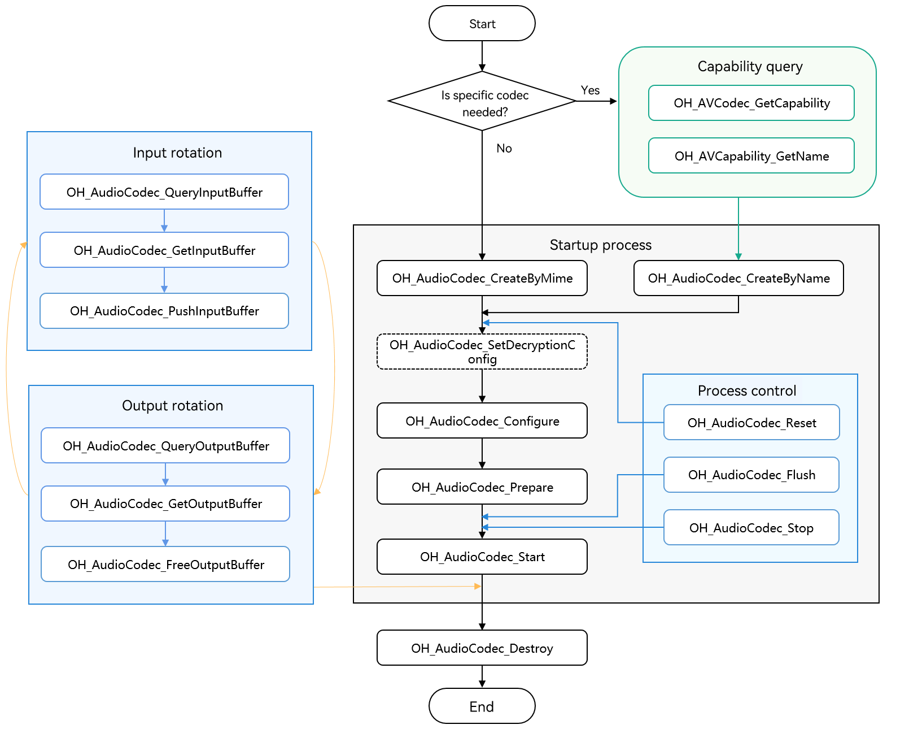
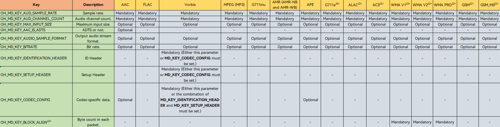
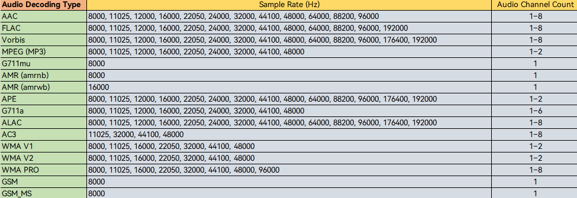

# Synchronous Audio Decoding

<!--Kit: AVCodec Kit-->
<!--Subsystem: Multimedia-->
<!--Owner: @mr-chencxy-->
<!--Designer: @dpy2650--->
<!--Tester: @baotianhao-->
<!--Adviser: @w_Machine_cc-->
<!-- md-trans-meta sourceCommit=c0242b9f557a90ad752097b505e94c965b1162a4 translatedAt=2026-11-05T00:59:45.673Z nl=1 -->

Starting from API version 20, audio decoding in synchronous mode is supported.

You can call native APIs to perform audio decoding in synchronous mode, which decodes media data into PCM streams.

For implementation details, see the [sample project](https://gitcode.com/openharmony/applications_app_samples/tree/master/code/DocsSample/Media/AVCodec/AVCodec).

For details about the supported decoding capabilities, see [AVCodec Supported Formats](avcodec-support-formats.md#audio-decoding).

**When to Use**

Asynchronous mode is generally recommended for most use cases. For details, see [Audio Decoding](audio-decoding.md). Synchronous mode can be used if you need to actively request buffers for frame delivery.

Decoding an audio/video file into a PCM stream typically involves the following steps: [media data demultiplexing](audio-video-demuxer.md) -> audio decoding.

This guide outlines the audio decoding process: inputting audio frames and decoding them into PCM streams.

## Development Guidelines

Read [AudioCodec](../../reference/apis-avcodec-kit/capi-native-avcodec-audiocodec-h.md) for the API reference.

Refer to the code snippet below to complete the entire audio decoding process, including creating a decoder, setting decoding parameters (such as the sample rate, bit rate, and audio channel count), and starting, refreshing, resetting, and destroying the decoder.

The sample code uses custom utility macros and data structures defined in the sample project, such as CHECK_AND_RETURN_RET_LOG, AVCODEC_SAMPLE_ERR_\*, AVCODEC_SAMPLE_LOG\*, CodecUserData, CodecBufferInfo, SampleInfo. These are not SDK APIs. Refer to the sample project for their complete definitions, and implement or replace them when porting the code.

During application development, you must call the APIs in the defined sequence. Otherwise, an exception or undefined behavior may occur.  

The figure below shows the call relationship of audio decoding in synchronous mode.

- The dotted line indicates an optional operation.

- The solid line indicates a mandatory operation.



### Linking the Dynamic Libraries in the CMake Script

```cmake
target_link_libraries(sample PUBLIC libnative_media_codecbase.so)
target_link_libraries(sample PUBLIC libnative_media_core.so)
target_link_libraries(sample PUBLIC libnative_media_acodec.so)
```
> **NOTE**
>
> The word **sample** in the preceding code snippet is only an example. Use the actual project directory name.

### How to Develop

1. Add the header files and namespace.

    ```cpp
    #include <multimedia/player_framework/native_avcodec_audiocodec.h>
    #include <multimedia/native_audio_channel_layout.h>
    #include <multimedia/player_framework/native_avcapability.h>
    #include <multimedia/player_framework/native_avcodec_base.h>
    #include <multimedia/player_framework/native_avformat.h>
    #include <multimedia/player_framework/native_avbuffer.h>

    // Namespace of the C++ standard library.
    using namespace std;
    ```

2. Create a decoder instance. In the code snippet below, **OH_AVCodec *** is the pointer to the decoder instance created.

   You can create a decoder by MIME type or codec name.

   - Method 1: Create a decoder by MIME type.

   <!-- @[AudioDecoder::Create](https://gitcode.com/openharmony/applications_app_samples/blob/master/code/DocsSample/Media/AVCodec/AVCodec/entry/src/main/cpp/capabilities/audio_decoder.cpp) -->
   
   ``` C++
   int32_t AudioDecoder::Create(const std::string &codecMime)
   {
       // Set the encoding flag. false indicates decoding.
       constexpr bool isEncoder = false;
       // Create the decoder by MIME type. Use the MIME type of the actual decoding format.
       decoder_ = OH_AudioCodec_CreateByMime(codecMime.c_str(), isEncoder);
       CHECK_AND_RETURN_RET_LOG(decoder_ != nullptr, AVCODEC_SAMPLE_ERR_ERROR, "Create failed");
       return AVCODEC_SAMPLE_ERR_OK;
   }
   ```

   - Method 2: Create a decoder by codec name.

   <!-- @[AudioDecoder::CreateByName](https://gitcode.com/openharmony/applications_app_samples/blob/master/code/DocsSample/Media/AVCodec/AVCodec/entry/src/main/cpp/capabilities/audio_decoder.cpp) -->
   
   ``` C++
   int32_t AudioDecoder::CreateByName(const std::string &codecMime)
   {
       // Create the decoder by codec name.
       OH_AVCapability *capability = OH_AVCodec_GetCapability(codecMime.c_str(), false);
       CHECK_AND_RETURN_RET_LOG(capability != nullptr, AVCODEC_SAMPLE_ERR_ERROR, "GetCapability failed");
       const char *name = OH_AVCapability_GetName(capability);
       decoder_ = OH_AudioCodec_CreateByName(name);
       CHECK_AND_RETURN_RET_LOG(decoder_ != nullptr, AVCODEC_SAMPLE_ERR_ERROR, "CreateByName failed");
       return AVCODEC_SAMPLE_ERR_OK;
   }
   ```

3. (Optional) Call **OH_AudioCodec_SetDecryptionConfig** to set the decryption configuration.

    Call this API after the media key system information is obtained but before **Prepare()** is called. For details about how to obtain such information, see step 4 in [Media Data Demultiplexing](audio-video-demuxer.md).

    For details about DRM APIs, see [DRM](../../reference/apis-drm-kit/capi-drm.md).

     

    Add the header files.

    ```c++
    #include <multimedia/drm_framework/native_mediakeysystem.h>
    #include <multimedia/drm_framework/native_mediakeysession.h>
    #include <multimedia/drm_framework/native_drm_err.h>
    #include <multimedia/drm_framework/native_drm_common.h>
    ```
    Link the dynamic libraries in the CMake script.

    ``` cmake
    target_link_libraries(sample PUBLIC libnative_drm.so)
    ```

    The sample code is as follows:
    ```c++
    // Create a media key system based on the media key system information. The following uses com.clearplay.drm as an example.
    MediaKeySystem *system = nullptr;
    int32_t ret = OH_MediaKeySystem_Create("com.clearplay.drm", &system);
    if (system == nullptr) {
        printf("create media key system failed");
        return;
    }

    // Create a media key session.
    MediaKeySession *session = nullptr;
    DRM_ContentProtectionLevel contentProtectionLevel = CONTENT_PROTECTION_LEVEL_SW_CRYPTO;
    ret = OH_MediaKeySystem_CreateMediaKeySession(system, &contentProtectionLevel, &session);
    if (ret != DRM_ERR_OK) {
        // If the creation fails, refer to the DRM interface document and check logs.
        printf("create media key session failed.");
        return;
    }
    if (session == nullptr) {
        printf("media key session is nullptr.");
        return;
    }
    // Generate a media key request and set the response to the media key request.
    // Set the decryption configuration, that is, assign the decryption session to the decoder. Currently, audio decryption does not support secure decoders. Therefore, set the secureAudio parameter to false.
    bool secureAudio = false;
    ret = OH_AudioCodec_SetDecryptionConfig(audioDec_, session, secureAudio);
    ```

4. Call **OH_AudioCodec_Configure()** to configure the decoder.

   Key values of configuration options are described as follows:

   <!--RP1-->
   
   <!--RP1End-->

   The sample below lists the value range of each audio decoding type.

   <!--RP2-->
   
   <!--RP2End-->

   Starting from API version 20, you can query the supported sample rate ranges through [OH_AVCapability_GetAudioSupportedSampleRateRanges](../../reference/apis-avcodec-kit/capi-native-avcapability-h.md#oh_avcapability_getaudiosupportedsamplerateranges). The following audio decoding types support decoding of any sample rate within their range:

   | Audio Decoding Type|    Sample Rate (Hz)  |
   | ----------- | --------------- |
   | FLAC       | 8000-384000  |
   | Vorbis      | 8000-192000  |
   | APE         | 1-2147483647 |

   Enable synchronous mode with OH_MD_KEY_ENABLE_SYNC_MODE: set it to 1 in the OH_AVFormat passed to Configure when synchronous mode is required. The sample sets this parameter only when synchronous mode is used:

   <!-- @[AudioDecoder::Configure](https://gitcode.com/openharmony/applications_app_samples/blob/master/code/DocsSample/Media/AVCodec/AVCodec/entry/src/main/cpp/capabilities/audio_decoder.cpp) -->
   
   ``` C++
   int32_t AudioDecoder::Configure(const SampleInfo &sampleInfo)
   {
       // The decoding capability table may not fully list the sample rates and channel information of some container codec formats.
       // The return value of the decoder Configure call is authoritative. The capability query result is logged for reference only.
       if (!CodecCapability::ValidateAudioConfiguration(sampleInfo, false)) {
           AVCODEC_SAMPLE_LOGW("Audio capability query did not fully describe mime: %{public}s; "
               "continue with decoder configure", sampleInfo.audio.audioCodecMime.c_str());
       }
       // The format is used only for this Configure call. Destroy it before returning on every failure and success path.
       OH_AVFormat *format = OH_AVFormat_Create();
       CHECK_AND_RETURN_RET_LOG(format != nullptr, AVCODEC_SAMPLE_ERR_ERROR, "AVFormat create failed");
   
       // Required: sample format, channel count, channel layout, and sample rate.
       OH_AVFormat_SetIntValue(format, OH_MD_KEY_AUDIO_SAMPLE_FORMAT, SAMPLE_S16LE);
       OH_AVFormat_SetIntValue(format, OH_MD_KEY_AUD_CHANNEL_COUNT, sampleInfo.audio.audioChannelCount);
       OH_AVFormat_SetLongValue(format, OH_MD_KEY_CHANNEL_LAYOUT, sampleInfo.audio.audioChannelLayout);
       OH_AVFormat_SetIntValue(format, OH_MD_KEY_AUD_SAMPLE_RATE, sampleInfo.audio.audioSampleRate);
       // Optional: synchronous mode. Set it as needed.
       if (sampleInfo.codec.codecSyncMode) {
           OH_AVFormat_SetIntValue(format, OH_MD_KEY_ENABLE_SYNC_MODE, sampleInfo.codec.codecSyncMode);
       }
   
       // Optional: codec-specific configuration data obtained by demuxing. Do not set it if unavailable.
       if (sampleInfo.audio.codecConfigLen > 0 &&
           sampleInfo.audio.codecConfig.size() >= sampleInfo.audio.codecConfigLen) {
           OH_AVFormat_SetBuffer(format, OH_MD_KEY_CODEC_CONFIG, sampleInfo.audio.codecConfig.data(),
               sampleInfo.audio.codecConfigLen);
       }
   
       // Configure the decoder.
       int ret = OH_AudioCodec_Configure(decoder_, format);
       CHECK_AND_RETURN_RET_LOG(ret == AV_ERR_OK, AVCODEC_SAMPLE_ERR_ERROR, "Config failed, ret: %{public}d", ret);
       OH_AVFormat_Destroy(format);
       format = nullptr;
   
       return AVCODEC_SAMPLE_ERR_OK;
   }
   ```

5. Call **OH_AudioCodec_Prepare()** to prepare internal resources for the decoder.

   The sample project wraps OH_AudioCodec_Prepare() in Config(). Config() first completes Configure(), then calls OH_AudioCodec_Prepare() to prepare the decoder. The following snippet shows the preparation part:

   <!-- @[AudioDecoder::Config](https://gitcode.com/openharmony/applications_app_samples/blob/master/code/DocsSample/Media/AVCodec/AVCodec/entry/src/main/cpp/capabilities/audio_decoder.cpp) -->
   
   ``` C++
   {
       // Prepare the decoder.
       int ret = OH_AudioCodec_Prepare(decoder_);
       CHECK_AND_RETURN_RET_LOG(ret == AV_ERR_OK, AVCODEC_SAMPLE_ERR_ERROR, "Prepare failed, ret: %{public}d", ret);
   }
   ```

6. Call **OH_AudioCodec_Start()** to start the decoder.

   <!-- @[AudioDecoder::Start](https://gitcode.com/openharmony/applications_app_samples/blob/master/code/DocsSample/Media/AVCodec/AVCodec/entry/src/main/cpp/capabilities/audio_decoder.cpp) -->
   
   ``` C++
   int32_t AudioDecoder::Start()
   {
       CHECK_AND_RETURN_RET_LOG(decoder_ != nullptr, AVCODEC_SAMPLE_ERR_ERROR, "Decoder is null");
   
       int ret = OH_AudioCodec_Start(decoder_);
       CHECK_AND_RETURN_RET_LOG(ret == AV_ERR_OK, AVCODEC_SAMPLE_ERR_ERROR, "Start failed, ret: %{public}d", ret);
       return AVCODEC_SAMPLE_ERR_OK;
   }
   ```
   
7. (Optional) Call **OH_AVCencInfo_SetAVBuffer()** to set the Common Encryption Scheme (CENC) information.

    If the content being played is DRM encrypted and [demultiplexing](audio-video-demuxer.md) is performed by the upper-layer application, call **OH_AVCencInfo_SetAVBuffer()** to set the CENC information to the AVBuffer for media data decryption.

    Add the header file.

    ```c++
    #include <multimedia/player_framework/native_cencinfo.h>
    ```
    Link the dynamic libraries in the CMake script.

    ``` cmake
    target_link_libraries(sample PUBLIC libnative_media_avcencinfo.so)
    ```

    The sample code is as follows:
   ```c++
   OH_AVBuffer *buffer = ...; // Input buffer to decrypt. For how to obtain it, see step 8.
   uint32_t keyIdLen = DRM_KEY_ID_SIZE;
   uint8_t keyId[] = {
       0xd4, 0xb2, 0x01, 0xe4, 0x61, 0xc8, 0x98, 0x96,
       0xcf, 0x05, 0x22, 0x39, 0x8d, 0x09, 0xe6, 0x28};
   uint32_t ivLen = DRM_KEY_IV_SIZE;
   uint8_t iv[] = {
       0xbf, 0x77, 0xed, 0x51, 0x81, 0xde, 0x36, 0x3e,
       0x52, 0xf7, 0x20, 0x4f, 0x72, 0x14, 0xa3, 0x95};
   uint32_t encryptedBlockCount = 0;
   uint32_t skippedBlockCount = 0;
   uint32_t firstEncryptedOffset = 0;
   uint32_t subsampleCount = 1;
   DrmSubsample subsamples[1] = { {0x10, 0x16} };
   // Create a CencInfo instance.
   OH_AVCencInfo *cencInfo = OH_AVCencInfo_Create();
   if (cencInfo == nullptr) {
       // Handle exceptions.
   }
   // Set the decryption algorithm.
   OH_AVErrCode errNo = OH_AVCencInfo_SetAlgorithm(cencInfo, DRM_ALG_CENC_AES_CTR);
   if (errNo != AV_ERR_OK) {
       // Handle exceptions.
   }
   // Set KeyId and Iv.
   errNo = OH_AVCencInfo_SetKeyIdAndIv(cencInfo, keyId, keyIdLen, iv, ivLen);
   if (errNo != AV_ERR_OK) {
       // Handle exceptions.
   }
   // Set sample information.
   errNo = OH_AVCencInfo_SetSubsampleInfo(cencInfo, encryptedBlockCount, skippedBlockCount, firstEncryptedOffset,
       subsampleCount, subsamples);
   if (errNo != AV_ERR_OK) {
       // Handle exceptions.
   }
   // Set the mode: KeyId, Iv, and SubSamples have been set.
   errNo = OH_AVCencInfo_SetMode(cencInfo, DRM_CENC_INFO_KEY_IV_SUBSAMPLES_SET);
   if (errNo != AV_ERR_OK) {
       // Handle exceptions.
   }
   // Set CencInfo in AVBuffer.
   errNo = OH_AVCencInfo_SetAVBuffer(cencInfo, buffer);
   if (errNo != AV_ERR_OK) {
       // Handle exceptions.
   }
   // Destroy the CencInfo instance.
   errNo = OH_AVCencInfo_Destroy(cencInfo);
   if (errNo != AV_ERR_OK) {
       // Handle exceptions.
   }
   cencInfo = nullptr;
   ```
   
8. Invoke synchronous mode to write the data to decode and obtain the decoded output.

   Request an input buffer: call OH_AudioCodec_QueryInputBuffer() to query an available input buffer index (AV_ERR_TRY_AGAIN_LATER is returned on timeout), then call OH_AudioCodec_GetInputBuffer() to obtain the buffer.

   <!-- @[AudioDecoder::GetInputBuffer](https://gitcode.com/openharmony/applications_app_samples/blob/master/code/DocsSample/Media/AVCodec/AVCodec/entry/src/main/cpp/capabilities/audio_decoder.cpp) -->
   
   ``` C++
   OH_AVBuffer *AudioDecoder::GetInputBuffer(CodecBufferInfo &info, int64_t timeoutUs)
   {
       CHECK_AND_RETURN_RET_LOG(decoder_ != nullptr, nullptr, "Decoder is null");
       int32_t ret = OH_AudioCodec_QueryInputBuffer(decoder_, &info.bufferIndex, timeoutUs);
       switch (ret) {
           case AV_ERR_OK: {
               OH_AVBuffer *buffer = OH_AudioCodec_GetInputBuffer(decoder_, info.bufferIndex);
               CHECK_AND_RETURN_RET_LOG(buffer != nullptr, nullptr, "Input buffer is null");
               // The codec owns the buffer. Write to it only before PushInputBuffer; do not cache its address or retain it across threads for an extended period.
               info.buffer = buffer;
               return buffer;
           }
           case AV_ERR_TRY_AGAIN_LATER: {
               AVCODEC_SAMPLE_LOGE("Get input buffer timeout.");
               return nullptr;
           }
           default: {
               return nullptr;
           }
       }
       return nullptr;
   }
   ```

   Fill in the complete input data before calling this API. In this sample, data to decode is read from the demuxer. OH_AVDemuxer_ReadSampleBuffer writes pts, size, and flags to the buffer attributes. The following example shows the synchronous input thread:

   <!-- @[Player::AudioDecInputSyncThread](https://gitcode.com/openharmony/applications_app_samples/blob/master/code/DocsSample/Media/AVCodec/AVCodec/entry/src/main/cpp/sample/player/output/audio/PlayerAudioOutput.cpp) -->   
   
   ``` C++
   void Player::AudioDecInputSyncThread()
   {
       while (isStarted_ && audioWorkerRunning_) {
           WaitIfPaused(true);
           CHECK_AND_BREAK_LOG(isStarted_ && audioWorkerRunning_, "Decoder input thread out");
           std::unique_lock<std::mutex> lock(audioDecContext_->inputMutex);
           CodecBufferInfo bufferInfo;
           auto buffer = audioDecoder_->GetInputBuffer(bufferInfo, CODEC_BUFFER_TIMEOUT_US);
           CHECK_AND_CONTINUE_LOG(buffer != nullptr, "Get input buffer timeout, retry");
           CHECK_AND_BREAK_LOG(isStarted_ && audioWorkerRunning_, "Work done, thread out");
           bufferInfo.buffer = buffer;
           // ...
           audioDecContext_->inputFrameCount++;
           lock.unlock();
           int32_t ret = demuxer_->ReadSample(demuxer_->GetAudioTrackId(), buffer, bufferInfo.attr);
           if (ret != AVCODEC_SAMPLE_ERR_OK) {
               AVCODEC_SAMPLE_LOGE("Read audio sample failed");
               playbackFailed_ = true;
               isStarted_ = false;
               break;
           }
           if ((bufferInfo.attr.flags & AVCODEC_BUFFER_FLAGS_EOS) && isLoop_) {
               ret = demuxer_->Seek(0);
               if (ret != AVCODEC_SAMPLE_ERR_OK) {
                   playbackFailed_ = true;
                   isStarted_ = false;
                   break;
               }
               ret = demuxer_->ReadSample(demuxer_->GetAudioTrackId(), bufferInfo.buffer, bufferInfo.attr);
               if (ret != AVCODEC_SAMPLE_ERR_OK) {
                   playbackFailed_ = true;
                   isStarted_ = false;
                   break;
               }
           }
           ret = audioDecoder_->PushInputBuffer(bufferInfo);
           if (ret != AVCODEC_SAMPLE_ERR_OK) {
               playbackFailed_ = true;
               isStarted_ = false;
               break;
           }
           CHECK_AND_BREAK_LOG(!(bufferInfo.attr.flags & AVCODEC_BUFFER_FLAGS_EOS), "Catch EOS, thread out");
       }
   }
   ```

   When finished, set the flags to **AVCODEC_BUFFER_FLAGS_EOS**.

   Obtain decoded output: call OH_AudioCodec_QueryOutputBuffer() to query an available output buffer. AV_ERR_TRY_AGAIN_LATER is returned on timeout. AV_ERR_STREAM_CHANGED indicates a change in stream information, such as the sample rate, channel count, or sample format. Call OH_AudioCodec_GetOutputDescription() to obtain the new stream information, handle the change, and continue querying decoded output:

   <!-- @[AudioDecoder::GetOutputBuffer](https://gitcode.com/openharmony/applications_app_samples/blob/master/code/DocsSample/Media/AVCodec/AVCodec/entry/src/main/cpp/capabilities/audio_decoder.cpp) -->
   
   ``` C++
   int32_t AudioDecoder::GetOutputBuffer(CodecBufferInfo &info, int64_t timeoutUs)
   {
       info.buffer = nullptr;
       CHECK_AND_RETURN_RET_LOG(decoder_ != nullptr, AVCODEC_SAMPLE_ERR_ERROR, "Decoder is null");
       OH_AVErrCode ret = OH_AudioCodec_QueryOutputBuffer(decoder_, &info.bufferIndex, timeoutUs);
       if (ret == AV_ERR_TRY_AGAIN_LATER) {
           // A timeout usually means the wait is too short, or output buffers have not been returned promptly, leaving no buffers available to the codec.
           AVCODEC_SAMPLE_LOGW("Get output buffer timeout.");
           return AVCODEC_SAMPLE_ERR_AGAIN; // continue;
       }
       if (ret != AV_ERR_OK) {
           AVCODEC_SAMPLE_LOGE("query output buffer failed, ret: %{public}d", ret);
           return AVCODEC_SAMPLE_ERR_ERROR; // break;
       }
   
       OH_AVBuffer *outputBuf = OH_AudioCodec_GetOutputBuffer(decoder_, info.bufferIndex);
       if (outputBuf == nullptr) {
           // Return the acquired output index even if obtaining its buffer fails, to avoid filling the codec output queue.
           const int32_t freeRet = OH_AudioCodec_FreeOutputBuffer(decoder_, info.bufferIndex);
           AVCODEC_SAMPLE_LOGE("Get output buffer failed, free ret: %{public}d", freeRet);
           return AVCODEC_SAMPLE_ERR_ERROR; // break;
       }
   
       ret = OH_AVBuffer_GetBufferAttr(outputBuf, &info.attr);
       if (ret != AV_ERR_OK) {
           const int32_t freeRet = OH_AudioCodec_FreeOutputBuffer(decoder_, info.bufferIndex);
           AVCODEC_SAMPLE_LOGE("Get output buffer attr failed, ret: %{public}d, free ret: %{public}d", ret, freeRet);
           return AVCODEC_SAMPLE_ERR_ERROR; // break;
       }
       info.buffer = outputBuf;
       if (info.attr.flags & AVCODEC_BUFFER_FLAGS_EOS) {
           // Return EOS output as well. Do not access outputBuf or its index afterward.
           OH_AudioCodec_FreeOutputBuffer(decoder_, info.bufferIndex);
           info.buffer = nullptr;
           AVCODEC_SAMPLE_LOGI("Out buffer end");
           // Decoded output ends.
           return AVCODEC_SAMPLE_ERR_END;
       }
       return AVCODEC_SAMPLE_ERR_OK;
   }
   ```

   After retrieving the decoded PCM stream, promptly call OH_AudioCodec_FreeOutputBuffer() to release the output buffer. The following example shows the synchronous output thread:

   <!-- @[AudioOutputPump::ProcessSyncOutput](https://gitcode.com/openharmony/applications_app_samples/blob/master/code/DocsSample/Media/AVCodec/AVCodec/entry/src/main/cpp/sample/player/output/audio/AudioOutputPump.cpp) -->
   
   ``` C++
   bool AudioOutputPump::ProcessSyncOutput()
   {
       CHECK_AND_RETURN_RET_LOG(running_, false, "Audio decoder output sync thread out");
       CodecBufferInfo bufferInfo;
       int32_t errCode = decoder_.GetOutputBuffer(bufferInfo, CODEC_BUFFER_TIMEOUT_US);
       if (errCode == AVCODEC_SAMPLE_ERR_END) {
           // The synchronous decoder has already returned the EOS index in GetOutputBuffer(). Do not release it again here.
           AVCODEC_SAMPLE_LOGI("Audio decoder reached EOS");
           return false;
       }
       if (errCode == AVCODEC_SAMPLE_ERR_ERROR) {
           // If the query succeeds but reading attributes fails, the wrapper may retain the acquired buffer. Return it only if the pointer is valid.
           (void)ReleaseOutputBuffer(bufferInfo, "get audio output buffer failed");
           MarkPlaybackFailed("Audio decoder output failed");
           return false;
       }
       if (errCode != AVCODEC_SAMPLE_ERR_OK) {
           AVCODEC_SAMPLE_LOGI("No audio output buffer available, continue");
           return true;
       }
       return HandleOutputBuffer(bufferInfo, false);
   }
   ```

9. (Optional) Call **OH_AudioCodec_Flush()** to refresh the decoder.

   After **OH_AudioCodec_Flush()** is called, the decoder remains in the running state, but the current queue is cleared and the buffer storing the decoded data is freed. The input and output buffers obtained before flushing cannot be reused.

   To continue decoding, you must call **OH_AudioCodec_Start()** again.

   You need to call **OH_AudioCodec_Start()** in the following cases:
   * Previously input data is no longer needed, for example, after seeking during demultiplexing.
   * To use the same decoder configuration after **AVCODEC_BUFFER_FLAGS_EOS** of the output buffer is set, call **OH_AudioCodec_Flush()** to refresh the decoder.
   * If a recoverable error occurs during the execution (**OH_AudioCodec_IsValid()** returns **true**), you can call **OH_AudioCodec_Flush()** to refresh the decoder and then call **OH_AudioCodec_Start()** to start decoding again.

   <!-- @[AudioDecoder::Flush](https://gitcode.com/openharmony/applications_app_samples/blob/master/code/DocsSample/Media/AVCodec/AVCodec/entry/src/main/cpp/capabilities/audio_decoder.cpp) -->
   
   ``` C++
   int32_t AudioDecoder::Flush()
   {
       CHECK_AND_RETURN_RET_LOG(decoder_ != nullptr, AVCODEC_SAMPLE_ERR_ERROR, "Decoder is null");
   
       // Flush the decoder and clear the current queue. Call Start() afterward to restart decoding.
       int32_t ret = OH_AudioCodec_Flush(decoder_);
       CHECK_AND_RETURN_RET_LOG(ret == AV_ERR_OK, AVCODEC_SAMPLE_ERR_ERROR, "Flush failed, ret: %{public}d", ret);
       return AVCODEC_SAMPLE_ERR_OK;
   }
   ```

10. (Optional) Call **OH_AudioCodec_Reset()** to reset the decoder.

    After **OH_AudioCodec_Reset()** is called, the decoder returns to the initialized state. The input and output buffers obtained before the reset cannot be used. You must call **OH_AudioCodec_Configure()** to reconfigure the decoder and then call **OH_AudioCodec_Start()** to start decoding again. Obtain the input and output buffers again after the decoder is started.

    <!-- @[AudioDecoder::Reset](https://gitcode.com/openharmony/applications_app_samples/blob/master/code/DocsSample/Media/AVCodec/AVCodec/entry/src/main/cpp/capabilities/audio_decoder.cpp) -->
    
    ``` C++
    int32_t AudioDecoder::Reset()
    {
        CHECK_AND_RETURN_RET_LOG(decoder_ != nullptr, AVCODEC_SAMPLE_ERR_ERROR, "Decoder is null");
    
        // Reset the decoder. Call Configure() again to configure it, and Start() to start it.
        int32_t ret = OH_AudioCodec_Reset(decoder_);
        CHECK_AND_RETURN_RET_LOG(ret == AV_ERR_OK, AVCODEC_SAMPLE_ERR_ERROR, "Reset failed, ret: %{public}d", ret);
        return AVCODEC_SAMPLE_ERR_OK;
    }
    ```

11. Call **OH_AudioCodec_Stop()** to stop the decoder.

    After the decoder is stopped, you can call **OH_AudioCodec_Start()** to start it again. The input and output buffers obtained before the decoder is stopped cannot be reused. You must obtain them again after the decoder is started.

    <!-- @[AudioDecoder::Stop](https://gitcode.com/openharmony/applications_app_samples/blob/master/code/DocsSample/Media/AVCodec/AVCodec/entry/src/main/cpp/capabilities/audio_decoder.cpp) -->
    
    ``` C++
    int32_t AudioDecoder::Stop()
    {
        CHECK_AND_RETURN_RET_LOG(decoder_ != nullptr, AVCODEC_SAMPLE_ERR_ERROR, "Decoder is null");
    
        int32_t ret = OH_AudioCodec_Stop(decoder_);
        CHECK_AND_RETURN_RET_LOG(ret == AV_ERR_OK, AVCODEC_SAMPLE_ERR_ERROR, "Stop failed, ret: %{public}d", ret);
        return AVCODEC_SAMPLE_ERR_OK;
    }
    ```

12. Call **OH_AudioCodec_Destroy()** to destroy the decoder instance and release resources.

    > **NOTE**
    >
    > You only need to call this API once.

    <!-- @[AudioDecoder::Release](https://gitcode.com/openharmony/applications_app_samples/blob/master/code/DocsSample/Media/AVCodec/AVCodec/entry/src/main/cpp/capabilities/audio_decoder.cpp) -->
    
    ``` C++
    int32_t AudioDecoder::Release()
    {
        if (decoder_ != nullptr) {
            // Flush and stop the decoder before destruction. Do not destroy it more than once.
            Flush();
            Stop();
            OH_AudioCodec_Destroy(decoder_);
            decoder_ = nullptr;
        }
        return AVCODEC_SAMPLE_ERR_OK;
    }
    ```
