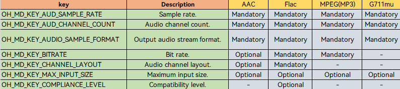
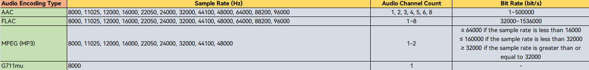

# Synchronous Audio Encoding

<!--Kit: AVCodec Kit-->
<!--Subsystem: Multimedia-->
<!--Owner: @mr-chencxy-->
<!--Designer: @dpy2650--->
<!--Tester: @baotianhao-->
<!--Adviser: @w_Machine_cc-->
<!-- md-trans-meta sourceCommit=66c49c549588a50aa036f806393d8098f913c4aa translatedAt=2026-10-22T04:06:16.862Z pushedAt=2026-10-22T13:24:02.694Z nl=1 -->

Starting from API version 20, audio encoding in synchronous mode is supported.

You can call native APIs to perform audio encoding, which compresses audio PCM data into a desired format.

PCM data can be from any source. For example, you can use a microphone to record audio data or import edited PCM data. After audio encoding, you can output streams in the desired format and encapsulate the streams into a target file.

For details about the supported encoding capabilities, see [AVCodec Supported Formats](avcodec-support-formats.md#audio-encoding).

**When to Use**

Asynchronous mode is generally recommended for most use cases. For details, see [Asynchronous Mode Audio Encoding](audio-encoding.md). Synchronous mode can be used if you need to actively request buffers for PCM encoding.
- Audio recording

  Record PCM data, encode it into the desired format, and then multiplex it in the target file format. For details about multiplexing, see [Media Data Multiplexing](audio-video-muxer.md).
- Audio editing

  Export edited PCM data, encode it into the corresponding audio format, and then multiplex it into a file. For details about multiplexing, see [Media Data Multiplexing](audio-video-muxer.md).
> **NOTE**
> - AAC encoders adopt the VBR mode by default. This may result in differences from the expected bit rate.
> - By default, AAC encoders include an ADTS header in its output, which occupies the first 7 bytes of each frame.

## Development Guidelines

Read [AudioCodec](../../reference/apis-avcodec-kit/capi-native-avcodec-audiocodec-h.md) for the API reference.

Refer to the code snippet below to complete the entire audio encoding process, including creating an encoder, setting encoding parameters (such as the sample rate, bit rate, and audio channel count), and starting, refreshing, resetting, and destroying the encoder.

The sample code references custom utility macros and data structures defined in the sample project (such as CHECK_AND_RETURN_RET_LOG, AVCODEC_SAMPLE_ERR_\*, AVCODEC_SAMPLE_LOG\*, CodecUserData, CodecBufferInfo, and SampleInfo). These are not SDK interfaces. For their complete definitions, see the sample project. You need to implement or replace them when porting the code.

During application development, you must call the APIs in the defined sequence. Otherwise, an exception or undefined behavior may occur.

The figure below shows the call relationship of audio encoding in synchronous mode.

- The dotted line indicates an optional operation. Audio encoding does not involve decryption. Therefore, you do not need to call **OH_AudioCodec_SetDecryptionConfig**.

- The solid line indicates a mandatory operation.


### Linking the Dynamic Libraries in the CMake Script

```cmake
target_link_libraries(sample PUBLIC libnative_media_codecbase.so)
target_link_libraries(sample PUBLIC libnative_media_core.so)
target_link_libraries(sample PUBLIC libnative_media_acodec.so)
```
> **NOTE**
>
> The word **sample** in the preceding code snippet is only an example. Use the actual project directory name.

### How to Develop

1. Add the header files and namespace.

   ```cpp
   #include <multimedia/player_framework/native_avcodec_audiocodec.h>
   #include <multimedia/native_audio_channel_layout.h>
   #include <multimedia/player_framework/native_avcapability.h>
   #include <multimedia/player_framework/native_avcodec_base.h>
   #include <multimedia/player_framework/native_avformat.h>
   #include <multimedia/player_framework/native_avbuffer.h>

   // C++ standard library namespace.
   using namespace std;
   ```

2. Create an encoder instance. In the code snippet below, **OH_AVCodec *** is the pointer to the encoder instance created.

   You can create an encoder by MIME type or codec name.

   - Method 1: Create an encoder by MIME type.

   <!-- @[AudioEncoder::Create](https://gitcode.com/openharmony/applications_app_samples/blob/master/code/BasicFeature/Media/AVCodec/entry/src/main/cpp/capabilities/audio_encoder.cpp) -->
   
   ``` C++
   int32_t AudioEncoder::Create(const std::string &codecMime)
   {
       // Set whether it is encoding. true indicates that the current operation is encoding.
       constexpr bool isEncoder = true;
       // Create an encoder through the mime type. The mime type passed in here is subject to the actual encoding format.
       encoder_ = OH_AudioCodec_CreateByMime(codecMime.c_str(), isEncoder);
       CHECK_AND_RETURN_RET_LOG(encoder_ != nullptr, AVCODEC_SAMPLE_ERR_ERROR, "Create failed");
       return AVCODEC_SAMPLE_ERR_OK;
   }
   ```

   - Method 2: Create an encoder by codec name.

   <!-- @[AudioEncoder::CreateByName](https://gitcode.com/openharmony/applications_app_samples/blob/master/code/BasicFeature/Media/AVCodec/entry/src/main/cpp/capabilities/audio_encoder.cpp) -->
   
   ``` C++
   int32_t AudioEncoder::CreateByName(const std::string &codecMime)
   {
       // Create an encoder through the codec name.
       OH_AVCapability *capability = OH_AVCodec_GetCapability(codecMime.c_str(), true);
       CHECK_AND_RETURN_RET_LOG(capability != nullptr, AVCODEC_SAMPLE_ERR_ERROR, "GetCapability failed");
       const char *name = OH_AVCapability_GetName(capability);
       encoder_ = OH_AudioCodec_CreateByName(name);
       CHECK_AND_RETURN_RET_LOG(encoder_ != nullptr, AVCODEC_SAMPLE_ERR_ERROR, "CreateByName failed");
       return AVCODEC_SAMPLE_ERR_OK;
   }
   ```

3. Call **OH_AudioCodec_Configure** to configure the encoder.

   Key values of configuration options are described as follows:

   <!--RP1-->
   
   <!--RP1End-->

   The sample below lists the value range of each audio encoding type.

   <!--RP2-->
   
   <!--RP2End-->

   The code snippet below shows the API call process, where AAC encoding at the bit rate of 32000 bit/s is carried out on the PCM audio with the 44100 Hz sample rate, 2-channel stereo, and SAMPLE_S16LE sample format.

   Before configuration, you are advised to call the OH_AVCapability query API to verify that the parameters to be configured are within the range supported by the encoder. In synchronous mode, enable the mode through **OH_MD_KEY_ENABLE_SYNC_MODE**: when synchronous mode is required, set **OH_MD_KEY_ENABLE_SYNC_MODE** to **1** in the **OH_AVFormat** passed to **Configure**. In the sample, whether to set this parameter is determined by whether synchronous mode is used.

   <!--RP3-->
   <!-- @[AudioEncoder::Configure](https://gitcode.com/openharmony/applications_app_samples/blob/master/code/BasicFeature/Media/AVCodec/entry/src/main/cpp/capabilities/audio_encoder.cpp) -->
   
   ``` C++
   int32_t AudioEncoder::Configure(const SampleInfo &sampleInfo)
   {
       CHECK_AND_RETURN_RET_LOG(CodecCapability::ValidateAudioConfiguration(sampleInfo, true),
           AVCODEC_SAMPLE_ERR_ERROR, "Audio encoder configuration is not supported");
       // The configuration object is not taken over by the encoder; after successful configuration, it is destroyed by this function, and the caller does not need to take it over.
       OH_AVFormat *format = OH_AVFormat_Create();
       CHECK_AND_RETURN_RET_LOG(format != nullptr, AVCODEC_SAMPLE_ERR_ERROR, "AVFormat create failed");
   
       // Mandatory: sample format, number of channels, sample rate, bit rate, and channel layout.
       OH_AVFormat_SetIntValue(format, OH_MD_KEY_AUDIO_SAMPLE_FORMAT, sampleInfo.audio.audioSampleFormat);
       OH_AVFormat_SetIntValue(format, OH_MD_KEY_AUD_CHANNEL_COUNT, sampleInfo.audio.audioChannelCount);
       OH_AVFormat_SetIntValue(format, OH_MD_KEY_AUD_SAMPLE_RATE, sampleInfo.audio.audioSampleRate);
       OH_AVFormat_SetLongValue(format, OH_MD_KEY_BITRATE, sampleInfo.audio.audioBitRate);
       OH_AVFormat_SetLongValue(format, OH_MD_KEY_CHANNEL_LAYOUT, sampleInfo.audio.audioChannelLayout);
       // Optional: maximum input length. After being set for frame-aligned encoders such as FLAC and MP3, the input data is allowed to be unaligned with the frame size.
       OH_AVFormat_SetIntValue(format, OH_MD_KEY_MAX_INPUT_SIZE, sampleInfo.audio.audioMaxInputSize);
       if (sampleInfo.codec.codecSyncMode) {
           OH_AVFormat_SetIntValue(format, OH_MD_KEY_ENABLE_SYNC_MODE, sampleInfo.codec.codecSyncMode);
       }
   
       // Configure the encoder.
       int ret = OH_AudioCodec_Configure(encoder_, format);
       CHECK_AND_RETURN_RET_LOG(ret == AV_ERR_OK, AVCODEC_SAMPLE_ERR_ERROR, "Config failed, ret: %{public}d", ret);
       OH_AVFormat_Destroy(format);
       format = nullptr;
   
       return AVCODEC_SAMPLE_ERR_OK;
   }
   ```
   <!--RP3End-->

   In addition to the parameters configured above, you can also configure the following optional parameters during the Configure phase:

   - `OH_MD_KEY_AUDIO_MAX_INPUT_BUFFER_SIZE`: Configures the maximum input buffer size (in bytes) for the audio encoder. For frame-aligned encoders such as FLAC and MP3, setting this parameter enables the internal PCM caching mechanism, allowing input data to be accepted without frame-size alignment. The encoder automatically caches and splits frames. The actual buffer size is subject to encoder implementation limits. If the configured value exceeds the upper limit, it is set to the upper limit (10 MB).

   - `OH_MD_KEY_AUDIO_ENCODER_PTS_MODE`: Configures the output PTS mode of the audio encoder. The value type is [OH_AudioEncoderPTSMode](../../reference/apis-avcodec-kit/capi-native-avcodec-base-h.md#oh_audioencoderptsmode). The PTS calculation method for output frames varies by mode:
     - `OH_AUDIO_ENCODER_PTS_MODE_DEFAULT`: Default behavior. The PTS output method may vary across different encoders.
     - `OH_AUDIO_ENCODER_PTS_MODE_ZERO_START`: PTS starts from 0 and increments by frame duration. This mode is suitable for scenarios where input PTS is not relied upon and timing needs to start from 0.
     - `OH_AUDIO_ENCODER_PTS_MODE_FIRST_INPUT_START`: PTS starts from the PTS of the first input frame and increments by frame duration. This mode is suitable for scenarios where PTS continuity with the input stream must be maintained.

   - `OH_MD_KEY_AUDIO_ENCODER_ENABLE_SAMPLE_FORMAT_CONVERT`: Configures the sample format conversion switch for the audio encoder. 1 indicates enabled, and 0 indicates disabled (default). Audio encoders natively support a limited set of sample formats (for example, G711mu supports only SAMPLE_S16LE). When enabled, the encoder automatically converts the input PCM data to a format supported by the encoder for encoding. The supported input sample formats are extended to: SAMPLE_U8, SAMPLE_S16LE, SAMPLE_S24LE, SAMPLE_S32LE, and SAMPLE_F32LE. This is suitable for scenarios where the input PCM format differs from the encoder's native format.

   ```cpp
   // Configure the maximum input buffer size of the encoder (optional). After this is set for FLAC/MP3, non-frame-aligned input data can be accepted. The value 4096 here is only a reference; you can set it dynamically based on actual needs.
   OH_AVFormat_SetIntValue(format, OH_MD_KEY_AUDIO_MAX_INPUT_BUFFER_SIZE, 4096);
   // Configure the PTS output mode of the encoder (optional).
   OH_AVFormat_SetIntValue(format, OH_MD_KEY_AUDIO_ENCODER_PTS_MODE,
       OH_AUDIO_ENCODER_PTS_MODE_FIRST_INPUT_START);
   // Configure the sample format conversion switch of the encoder (optional). After it is enabled, more sample formats are supported for input.
   OH_AVFormat_SetIntValue(format, OH_MD_KEY_AUDIO_ENCODER_ENABLE_SAMPLE_FORMAT_CONVERT, 1);
   ```

4. Call **OH_AudioCodec_Prepare()** to prepare internal resources for the encoder.

   In the sample project, **OH_AudioCodec_Prepare()** is encapsulated in the **Config()** function: the **Config()** function first completes the **Configure()** configuration, and then calls **OH_AudioCodec_Prepare()** to make the encoder ready. The following is the code of the **Prepare** part:

   <!-- @[AudioEncoder::Config](https://gitcode.com/openharmony/applications_app_samples/blob/master/code/BasicFeature/Media/AVCodec/entry/src/main/cpp/capabilities/audio_encoder.cpp) -->
   
   ``` C++
   {
       // The encoder is ready.
       int ret = OH_AudioCodec_Prepare(encoder_);
       CHECK_AND_RETURN_RET_LOG(ret == AV_ERR_OK, AVCODEC_SAMPLE_ERR_ERROR, "Prepare failed, ret: %{public}d", ret);
   }
   ```

5. Call **OH_AudioCodec_Start()** to start the encoder.

   <!-- @[AudioEncoder::Start](https://gitcode.com/openharmony/applications_app_samples/blob/master/code/BasicFeature/Media/AVCodec/entry/src/main/cpp/capabilities/audio_encoder.cpp) -->
   
   ``` C++
   int32_t AudioEncoder::Start()
   {
       CHECK_AND_RETURN_RET_LOG(encoder_ != nullptr, AVCODEC_SAMPLE_ERR_ERROR, "Encoder is null");
   
       int ret = OH_AudioCodec_Start(encoder_);
       CHECK_AND_RETURN_RET_LOG(ret == AV_ERR_OK, AVCODEC_SAMPLE_ERR_ERROR, "Start failed, ret: %{public}d", ret);
       return AVCODEC_SAMPLE_ERR_OK;
   }
   ```

6. Invoke synchronous mode to write PCM samples to encode and obtain the encoded audio frames.

   The method for determining the number of samples per frame (**SAMPLES_PER_FRAME**) is as follows:

   AAC-LC encodes 1024 PCM samples per frame. Therefore, you are advised to input exactly 1024 samples at a time.

   <!--RP4--><!--RP4End-->

   For FLAC encoding, set **SAMPLES_PER_FRAME** based on the table below.

   | Sample Rate| Sample Count|
   | :----: | :----: |
   |  8000  |  576  |
   | 16000 |  1152  |
   | 22050 |  2304  |
   | 24000 |  2304  |
   | 32000 |  2304  |
   | 44100 |  4608  |
   | 48000 |  4608  |
   | 88200 |  8192  |
   | 96000 |  8192  |

   Data volume (in bytes) of a single encoding input: Number of samples (**SAMPLES_PER_FRAME**) * Number of channels * Number of bytes per sample.

   Actively request an input buffer: first call **OH_AudioCodec_QueryInputBuffer()** to query the index of an available input buffer. If the call times out, **AV_ERR_TRY_AGAIN_LATER** is returned. Then call **OH_AudioCodec_GetInputBuffer()** to obtain the input buffer.

   <!-- @[AudioEncoder::GetInputBuffer](https://gitcode.com/openharmony/applications_app_samples/blob/master/code/BasicFeature/Media/AVCodec/entry/src/main/cpp/capabilities/audio_encoder.cpp) -->
   
   ``` C++
   OH_AVBuffer *AudioEncoder::GetInputBuffer(CodecBufferInfo &info, int64_t timeoutUs)
   {
       CHECK_AND_RETURN_RET_LOG(encoder_ != nullptr, nullptr, "Encoder is null");
       auto ret = OH_AudioCodec_QueryInputBuffer(encoder_, &info.bufferIndex, timeoutUs);
       switch (ret) {
           case AV_ERR_OK: {
               OH_AVBuffer *buffer = OH_AudioCodec_GetInputBuffer(encoder_, info.bufferIndex);
               CHECK_AND_RETURN_RET_LOG(buffer != nullptr, nullptr, "Input buffer is null");
               // This buffer can only be filled before PushInputData; after submission, ownership returns to the codec.
               info.buffer = buffer;
               return buffer;
           }
           case AV_ERR_TRY_AGAIN_LATER: {
               AVCODEC_SAMPLE_LOGE("Get input buffer timeout.");
               return nullptr;
           }
           default: {
               return nullptr;
           }
       }
       return nullptr;
   }
   ```

   This API must be called after you have filled in the complete input data. In the sample, the microphone recording (AudioCapturer) is used as the PCM data source. The recorded data is first written to the application-defined PCM cache. After enough data for one input buffer is accumulated, it is filled into the encoder input buffer and sent to the encoder. The following is an example of the synchronous input thread:

   <!-- @[Recorder::AudioEncInputSyncThread](https://gitcode.com/openharmony/applications_app_samples/blob/master/code/BasicFeature/Media/AVCodec/entry/src/main/cpp/sample/recorder/Recorder.cpp) -->
   
   ``` C++
   void Recorder::AudioEncInputSyncThread()
   {
       while (true) {
           CHECK_AND_BREAK_LOG(isStarted_, "Audio encoder sync thread out");
           // Stop submitting new input after EOS is received, but the output thread continues to drain encoded samples.
           if (isEos_.load()) {
               AVCODEC_SAMPLE_LOGI("Audio input thread received EOS signal, stopping input");
               break;
           }
           // Wait until the buffer accumulates a full frame; incomplete audio data causes duration and timestamp anomalies.
           if (!WaitForAudioInputFrame(100ms)) {
               if (!isStarted_ || isEos_.load()) {
                   break;
               }
               continue;
           }
           // Request a codec input Buffer only after data is sufficient; this reduces the risk of failing to return the buffer in time due to insufficient cache after a successful request.
           CodecBufferInfo bufferInfo;
           bufferInfo.bufferIndex = std::numeric_limits<uint32_t>::max();
           auto buffer = audioEncoder_->GetInputBuffer(bufferInfo, TIMEOUT_US);
           if (buffer == nullptr) {
               if (bufferInfo.bufferIndex != std::numeric_limits<uint32_t>::max()) {
                   // When Query succeeds but Get fails, the index may still be held by the application; end the session to let the codec reclaim it.
                   AbortRecording("Synchronous audio input buffer retrieval failed");
                   break;
               }
               AVCODEC_SAMPLE_LOGW("Get input buffer timeout, retry");
               continue;
           }
           if (!SubmitAudioInputFrame(bufferInfo, buffer, true)) {
               break;
           }
       }
   }
   ```

   In the preceding example, **attr.flags** indicates the type of the buffer flag.

   At the end, set flags to **AVCODEC_BUFFER_FLAGS_EOS**. In the sample, when recording ends, an input buffer is obtained, data of length 0 is filled in, and the EOS flag is set before the buffer is sent to the encoder.

   <!-- @[AudioEncoder::NotifyEndOfStream](https://gitcode.com/openharmony/applications_app_samples/blob/master/code/BasicFeature/Media/AVCodec/entry/src/main/cpp/capabilities/audio_encoder.cpp) -->
   
   ``` C++
   int32_t AudioEncoder::NotifyEndOfStream()
   {
       CHECK_AND_RETURN_RET_LOG(encoder_ != nullptr, AVCODEC_SAMPLE_ERR_ERROR, "Encoder is null");
   
       // Use an empty input buffer to carry EOS. Even if there is no media data, this buffer must be submitted so that the encoder outputs the trailing data.
       CodecBufferInfo bufferInfo;
       auto buffer = GetInputBuffer(bufferInfo, TIMEOUT_US);
       if (buffer == nullptr) {
           AVCODEC_SAMPLE_LOGW("GetInputBuffer for EOS failed");
           return AVCODEC_SAMPLE_ERR_ERROR;
       }
   
       // EOS contains no valid audio bytes; after PushInputBuffer is called, this buffer is immediately managed by the codec.
       bufferInfo.attr.size = 0;
       bufferInfo.attr.flags = AVCODEC_BUFFER_FLAGS_EOS;
       int32_t ret = OH_AVBuffer_SetBufferAttr(buffer, &bufferInfo.attr);
       if (ret != AV_ERR_OK) {
           AVCODEC_SAMPLE_LOGE("SetBufferAttr for EOS failed, ret: %{public}d", ret);
           return AVCODEC_SAMPLE_ERR_ERROR;
       }
   
       bufferInfo.buffer = buffer;
       ret = OH_AudioCodec_PushInputBuffer(encoder_, bufferInfo.bufferIndex);
       CHECK_AND_RETURN_RET_LOG(ret == AV_ERR_OK, AVCODEC_SAMPLE_ERR_ERROR,
                                "PushInputBuffer for EOS failed, ret: %{public}d", ret);
       return AVCODEC_SAMPLE_ERR_OK;
   }
   ```

   | Value| Description| 
   | -------- | -------- |
   | AVCODEC_BUFFER_FLAGS_NONE | Common frame.| 
   | AVCODEC_BUFFER_FLAGS_EOS | The buffer is an end-of-stream frame.| 
   | AVCODEC_BUFFER_FLAGS_CODEC_DATA | The buffer contains codec-specific data.| 

   Obtain the encoded output: call **OH_AudioCodec_QueryOutputBuffer()** to query an available output buffer. When the input data can be encoded into multiple frames, you need to call the API multiple times to obtain output buffers until all encoded data is retrieved:

   <!-- @[AudioEncoder::GetOutputBuffer](https://gitcode.com/openharmony/applications_app_samples/blob/master/code/BasicFeature/Media/AVCodec/entry/src/main/cpp/capabilities/audio_encoder.cpp) -->
   
   ``` C++
   int32_t AudioEncoder::GetOutputBuffer(CodecBufferInfo &info, int64_t timeoutUs)
   {
       info.buffer = nullptr;
       CHECK_AND_RETURN_RET_LOG(encoder_ != nullptr, AVCODEC_SAMPLE_ERR_ERROR, "Encoder is null");
       // A batch of input may produce multiple output frames, which must be continuously retrieved and returned until the codec has no output or returns EOS.
       OH_AVErrCode ret = OH_AudioCodec_QueryOutputBuffer(encoder_, &info.bufferIndex, timeoutUs);
       if (ret == AV_ERR_TRY_AGAIN_LATER) {
           // Timeout: the input data may be insufficient to encode one frame, or the timeout is set too short.
           AVCODEC_SAMPLE_LOGW("Get output buffer timeout.");
           return AVCODEC_SAMPLE_ERR_AGAIN; // continue;
       }
       if (ret != AV_ERR_OK) {
           AVCODEC_SAMPLE_LOGE("query output buffer failed, ret: %{public}d", ret);
           return AVCODEC_SAMPLE_ERR_ERROR; // break;
       }
   
       OH_AVBuffer *outputBuf = OH_AudioCodec_GetOutputBuffer(encoder_, info.bufferIndex);
       if (outputBuf == nullptr) {
           // After a successful query, the index has been handed over to the application by the codec; the exception path also requires returning it.
           const int32_t freeRet = OH_AudioCodec_FreeOutputBuffer(encoder_, info.bufferIndex);
           AVCODEC_SAMPLE_LOGE("Get output buffer failed, free ret: %{public}d", freeRet);
           return AVCODEC_SAMPLE_ERR_ERROR; // break;
       }
       ret = OH_AVBuffer_GetBufferAttr(outputBuf, &info.attr);
       if (ret != AV_ERR_OK) {
           const int32_t freeRet = OH_AudioCodec_FreeOutputBuffer(encoder_, info.bufferIndex);
           AVCODEC_SAMPLE_LOGE("Get output buffer attr failed, ret: %{public}d, free ret: %{public}d", ret, freeRet);
           return AVCODEC_SAMPLE_ERR_ERROR; // break;
       }
   
       info.buffer = outputBuf;
       if (info.attr.flags & AVCODEC_BUFFER_FLAGS_EOS) {
           AVCODEC_SAMPLE_LOGI("Out buffer EOS flag detected");
           return AVCODEC_SAMPLE_ERR_OK;
       }
       return AVCODEC_SAMPLE_ERR_OK;
   }
   ```

   After the encoded stream is retrieved, call **OH_AudioCodec_FreeOutputBuffer()** in time to release the output buffer. In the sample, the encoded output stream is written to the encapsulation module. If you need to encapsulate it into an audio file, see [Media Data Multiplexing](audio-video-muxer.md). The following is an example of the synchronous output thread:

   <!-- @[Recorder::AudioEncOutputSyncThread](https://gitcode.com/openharmony/applications_app_samples/blob/master/code/BasicFeature/Media/AVCodec/entry/src/main/cpp/sample/recorder/Recorder.cpp) -->
   
   ``` C++
   void Recorder::AudioEncOutputSyncThread()
   {
       while (true) {
           CHECK_AND_BREAK_LOG(isStarted_, "Audio encoder output thread out");
           CodecBufferInfo bufferInfo;
           int32_t errCode = audioEncoder_->GetOutputBuffer(bufferInfo, TIMEOUT_US);
           if (errCode == AVCODEC_SAMPLE_ERR_OK) {
               AVCODEC_SAMPLE_LOGI("AVCODEC_SAMPLE_ERR_OK");
           } else if (errCode == AVCODEC_SAMPLE_ERR_END || errCode == AVCODEC_SAMPLE_ERR_ERROR) {
               AVCODEC_SAMPLE_LOGW("Audio output thread received END or ERROR");
               break;
           } else {
               AVCODEC_SAMPLE_LOGW("Get output buffer timeout, retry");
               continue;
           }
   
           audioEncContext_->outputFrameCount++;
           AVCODEC_SAMPLE_LOGW(
               "Audio Out buffer sync count: %{public}u, size: %{public}d, flag: %{public}u, pts: %{public}" PRId64,
               audioEncContext_->outputFrameCount, bufferInfo.attr.size, bufferInfo.attr.flags, bufferInfo.attr.pts);
           // Muxer writing does not take over the buffer; after writing, it must still be explicitly returned to the audio encoder.
           muxer_->WriteSample(muxer_->GetAudioTrackId(), bufferInfo.buffer,
                               bufferInfo.attr);
           int32_t ret = audioEncoder_->FreeOutputData(bufferInfo.bufferIndex);
           CHECK_AND_BREAK_LOG(ret == AVCODEC_SAMPLE_ERR_OK, "Encoder output thread out");
           CHECK_AND_BREAK_LOG(!(bufferInfo.attr.flags & AVCODEC_BUFFER_FLAGS_EOS), "Catch EOS, thread out");
       }
       // In synchronous mode, release is still triggered by the video thread; when audio ends first, the video is still using the Muxer.
       AVCODEC_SAMPLE_LOGI("Audio output thread exited, waiting for video thread to trigger release");
   }
   ```

7. (Optional) Call **OH_AudioCodec_Reset()** to reset the encoder.

   After **OH_AudioCodec_Reset()** is called, the encoder returns to the initialized state. The input and output buffers obtained before the reset cannot be used. You must call **OH_AudioCodec_Configure()** to reconfigure the encoder and then call **OH_AudioCodec_Start()** to start encoding again. Obtain the input and output buffers again after the decoder is started.

   <!-- @[AudioEncoder::Reset](https://gitcode.com/openharmony/applications_app_samples/blob/master/code/BasicFeature/Media/AVCodec/entry/src/main/cpp/capabilities/audio_encoder.cpp) -->
   
   ``` C++
   int32_t AudioEncoder::Reset()
   {
       CHECK_AND_RETURN_RET_LOG(encoder_ != nullptr, AVCODEC_SAMPLE_ERR_ERROR, "Encoder is null");
   
       // Reset the encoder. After that, call Configure() to configure and Start() to start again.
       int32_t ret = OH_AudioCodec_Reset(encoder_);
       CHECK_AND_RETURN_RET_LOG(ret == AV_ERR_OK, AVCODEC_SAMPLE_ERR_ERROR, "Reset failed, ret: %{public}d", ret);
       return AVCODEC_SAMPLE_ERR_OK;
   }
   ```

8. (Optional) Call **OH_AudioCodec_Stop()** to stop the encoder.

   After the encoder is stopped, you can call **OH_AudioCodec_Start()** to start it again. The input and output buffers obtained before the decoder is stopped cannot be reused. You must obtain them again after the decoder is started.

   <!-- @[AudioEncoder::Stop](https://gitcode.com/openharmony/applications_app_samples/blob/master/code/BasicFeature/Media/AVCodec/entry/src/main/cpp/capabilities/audio_encoder.cpp) -->
   
   ``` C++
   int32_t AudioEncoder::Stop()
   {
       CHECK_AND_RETURN_RET_LOG(encoder_ != nullptr, AVCODEC_SAMPLE_ERR_ERROR, "Encoder is null");
   
       int ret = Flush();
       CHECK_AND_RETURN_RET_LOG(ret == AVCODEC_SAMPLE_ERR_OK, AVCODEC_SAMPLE_ERR_ERROR,
                                "Flush failed, ret: %{public}d", ret);
   
       ret = OH_AudioCodec_Stop(encoder_);
       CHECK_AND_RETURN_RET_LOG(ret == AV_ERR_OK, AVCODEC_SAMPLE_ERR_ERROR, "Stop failed, ret: %{public}d", ret);
       return AVCODEC_SAMPLE_ERR_OK;
   }
   ```

9. Call **OH_AudioCodec_Destroy()** to destroy the encoder instance and release resources.

   > **NOTE**
   >
   > You only need to call this API once.

   <!-- @[AudioEncoder::Release](https://gitcode.com/openharmony/applications_app_samples/blob/master/code/BasicFeature/Media/AVCodec/entry/src/main/cpp/capabilities/audio_encoder.cpp) -->
   
   ``` C++
   int32_t AudioEncoder::Release()
   {
       if (encoder_ != nullptr) {
           // Flush and stop the encoder before destruction. Repeated destroy is prohibited.
           Flush();
           Stop();
           OH_AudioCodec_Destroy(encoder_);
           encoder_ = nullptr;
       }
       return AVCODEC_SAMPLE_ERR_OK;
   }
   ```
