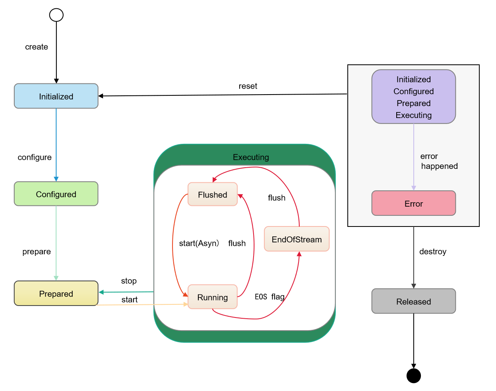
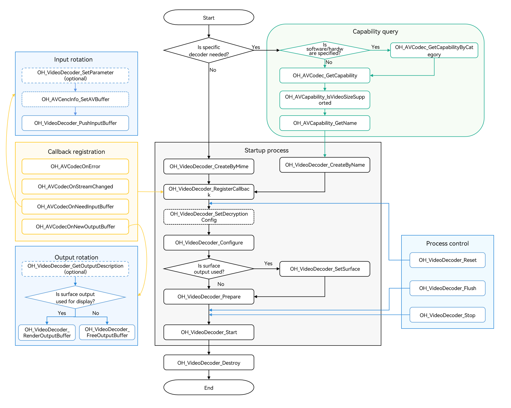

# Asynchronous Video Decoding

<!--Kit: AVCodec Kit-->
<!--Subsystem: Multimedia-->
<!--Owner: @rchdlee-->
<!--Designer: @dpy2650--->
<!--Tester: @cyakee-->
<!--Adviser: @w_Machine_cc-->

Video decoding is a core part of multimedia processing that converts compressed video streams into raw pixel data. It supports synchronous and asynchronous modes, which differ primarily in how buffers are obtained. Choose the API calling mode that suits your application.

This document describes video decoding in asynchronous mode. For synchronous mode, see [Synchronous Video Decoding](synchronous-video-decoding.md). Depending on how decoded data is processed, video decoding provides surface and buffer output modes for different scenarios.

- Surface mode

  Decoded image frames are output through [NativeWindow](../../reference/apis-arkgraphics2d/capi-nativewindow-nativewindow.md), which can connect to other modules, such as the display module [Custom Rendering (XComponent)](../../ui/napi-xcomponent-guidelines.md). This mode is suitable for video playback, live previews, and other scenarios that render decoded frames to the screen.

- Buffer mode

  Decoded raw YUV data is output through shared memory, allowing you to access and process each image frame directly. This mode is suitable for video editing, saving raw YUV data, and other scenarios that require access to raw data.

| Difference | Surface Mode | Buffer Mode |
| --- | --- | --- |
| Configuration | Before calling **OH_VideoDecoder_Prepare**, call **OH_VideoDecoder_SetSurface** to set the OHNativeWindow. | - |
| Output processing | To discard a decoded frame without displaying it, call **OH_VideoDecoder_FreeOutputBuffer**.<br>To display and release a decoded frame, call **OH_VideoDecoder_RenderOutputBuffer**, or call **OH_VideoDecoder_RenderOutputBufferAtTime** to display and release it at a specified time. Prefer **OH_VideoDecoder_RenderOutputBufferAtTime** for audio-video synchronization or display speed control. | After processing the output data, call **OH_VideoDecoder_FreeOutputBuffer** to release it. |
| Callback data | Only metadata about the buffer passed to the output callback is available. | Both the shared memory address and metadata of the buffer passed to the output callback are available. |

For the video decoding formats supported by AVCodec, see [Video Decoding](avcodec-support-formats.md#video-decoding).

For details about the implementation, see [Samples](https://gitcode.com/openharmony/applications_app_samples/tree/master/code/BasicFeature/Media/AVCodec).

## State Machine Interaction

1. Initialized state.
   - A newly created decoder instance is in the Initialized state.
   - Call **OH_VideoDecoder_Reset** in any state to return to the Initialized state.
2. Configured state.
   - In the Initialized state, call **OH_VideoDecoder_Configure** to configure the decoder. After successful configuration, the decoder enters the Configured state.
3. Prepared state.
   - In the Configured state, call **OH_VideoDecoder_Prepare** to enter the Prepared state.
   - In the Executing state, call **OH_VideoDecoder_Stop** to return to the Prepared state.
4. Executing state.
   - In the Prepared state, call **OH_VideoDecoder_Start** to enter the Executing state.
   - The Executing state has three substates: Running, Flushed, and End-of-Stream.
     - Running: Call **OH_VideoDecoder_Start** to enter this substate.
     - Flushed: Call **OH_VideoDecoder_Flush** to enter this substate.
     - End-of-Stream: The decoder enters this substate when it receives an input buffer with its **flag** set to **AVCODEC_BUFFER_FLAGS_EOS** from [OH_AVCodecBufferFlags](../../reference/apis-avcodec-kit/capi-native-avbuffer-info-h.md#oh_avcodecbufferflags). In this state, the decoder does not accept new input, but continues to generate output until the last frame is output.
5. Error state.
   - In rare cases, the decoder enters the Error state when an error occurs. APIs return an error code, or an exception is reported through the **OH_AVCodecOnError** callback.
   - In the Error state, call **OH_VideoDecoder_Reset** to return to the Initialized state, or call **OH_VideoDecoder_Destroy** to enter the final Released state.
6. Released state.
   - When the decoder is no longer needed, call **OH_VideoDecoder_Destroy** to destroy the instance and enter the Released state.

**Figure 1** State machine interaction



## How to Develop

For detailed API descriptions, see [native_avcodec_videodecoder.h](../../reference/apis-avcodec-kit/capi-native-avcodec-videodecoder-h.md).

Use the following sample code to implement the basic video decoding process, including creating the decoder, setting decoding parameters, starting, flushing, resetting, stopping, and releasing resources.

**Figure 2** Video decoding call relationship

- The dotted line indicates an optional operation.

- The solid line indicates a mandatory operation.



### Linking the Dynamic Libraries in the CMake Script

``` cmake
target_link_libraries(sample PUBLIC libnative_media_codecbase.so)
target_link_libraries(sample PUBLIC libnative_media_core.so)
target_link_libraries(sample PUBLIC libnative_media_vdec.so)
```

> **NOTE**
>
> The word **sample** in the preceding code snippet is only an example. Use the actual project directory name.

### Defining the Basic Structure

The sample code provided in this section adheres to the C++17 standard and is for reference only. You can define your own buffer objects by referring to it.

1. Add the header files.

    ```c++
    #include <condition_variable>
    #include <memory>
    #include <mutex>
    #include <queue>
    #include <shared_mutex>
    ```

2. Define the information about the decoder callback buffer.

    ```c++
    struct CodecBufferInfo {
        CodecBufferInfo(uint32_t index, OH_AVBuffer *buffer): index(index), buffer(buffer), isValid(true) {}
        // Callback buffer.
        OH_AVBuffer *buffer = nullptr;
        // Index of the callback buffer.
        uint32_t index = 0;
        // Check whether the current buffer information is valid.
        bool isValid = true;
    };
    ```

3. Define the input and output queue for decoding.

    ```c++
    class CodecBufferQueue {
    public:
        // Pass the callback buffer information to the queue.
        void Enqueue(const std::shared_ptr<CodecBufferInfo> bufferInfo)
        {
            std::unique_lock<std::mutex> lock(mutex_);
            bufferQueue_.push(bufferInfo);
            cond_.notify_all();
        }

        // Obtain the information about the callback buffer.
        std::shared_ptr<CodecBufferInfo> Dequeue(int32_t timeoutMs = 1000)
        {
            std::unique_lock<std::mutex> lock(mutex_);
            (void)cond_.wait_for(lock, std::chrono::milliseconds(timeoutMs), [this]() { return !bufferQueue_.empty(); });
            if (bufferQueue_.empty()) {
                return nullptr;
            }
            std::shared_ptr<CodecBufferInfo> bufferInfo = bufferQueue_.front();
            bufferQueue_.pop();
            return bufferInfo;
        }

        // Clear the queue. The previous callback buffer becomes unavailable.
        void Flush()
        {
            std::unique_lock<std::mutex> lock(mutex_);
            while (!bufferQueue_.empty()) {
                std::shared_ptr<CodecBufferInfo> bufferInfo = bufferQueue_.front();
                // After the flush, stop, reset, and destroy operations are performed, the previous callback buffer information is invalid.
                bufferInfo->isValid = false;
                bufferQueue_.pop();
            }
        }

    private:
        std::mutex mutex_;
        std::condition_variable cond_;
        std::queue<std::shared_ptr<CodecBufferInfo>> bufferQueue_;
    };
    ```

4. Configure global variables.

   These global variables are for reference only. They can be encapsulated into an object based on service requirements.

    ```c++
    // Video frame width.
    int32_t width = 320;
    // Video frame height.
    int32_t height = 240;
    // Video pixel format.
     OH_AVPixelFormat pixelFormat = AV_PIXEL_FORMAT_NV12;
    // Video width stride.
    int32_t widthStride = 0;
    // Video height stride.
    int32_t heightStride = 0;
    // Pointer to the decoder instance.
    OH_AVCodec *videoDec = nullptr;
    // Decoder synchronization lock.
    std::shared_mutex codecMutex;
    // Decoder input queue.
    CodecBufferQueue inQueue;
    // Decoder output queue.
    CodecBufferQueue outQueue;
    ```

### Surface Mode

The following walks you through how to implement the entire video decoding process in surface mode with asynchronous buffer processing. In this example, an H.264 stream file is input, decoded, and rendered.

1. Add the header files.

    ```c++
    #include <multimedia/player_framework/native_avcodec_videodecoder.h>
    #include <multimedia/player_framework/native_avcapability.h>
    #include <multimedia/player_framework/native_avcodec_base.h>
    #include <multimedia/player_framework/native_avformat.h>
    #include <multimedia/player_framework/native_avbuffer.h>
    #include <fstream>
    ```

2. Create a decoder instance.

   You can create a decoder by name or MIME type. In the code snippet below, the following variables are used:

   - **videoDec**: pointer to the video decoder instance.
   - **capability**: pointer to the decoder capability query instance.
   - **OH_AVCODEC_MIMETYPE_VIDEO_AVC**: AVC video codec.

    ```c++
    // To create a decoder by name, call OH_AVCapability_GetName to obtain the codec names available and then call OH_VideoDecoder_CreateByName. If your application has special requirements, for example, expecting a decoder that supports a certain resolution, you can call OH_AVCodec_GetCapability to query the capability first.
    OH_AVCapability *capability = OH_AVCodec_GetCapability(OH_AVCODEC_MIMETYPE_VIDEO_AVC, false);
    // Create a hardware decoder instance.
    OH_AVCapability *capability= OH_AVCodec_GetCapabilityByCategory(OH_AVCODEC_MIMETYPE_VIDEO_AVC, false, HARDWARE);
    const char *name = OH_AVCapability_GetName(capability);
    OH_AVCodec *videoDec = OH_VideoDecoder_CreateByName(name);
    ```

    ```c++
    // Create a decoder by MIME type. Only specific codecs recommended by the system can be created in this way.
    // If multiple codecs need to be created, create hardware decoder instances first. If the hardware resources are insufficient, create software decoder instances.
    // Create an H.264 decoder for software/hardware decoding.
    OH_AVCodec *videoDec = OH_VideoDecoder_CreateByMime(OH_AVCODEC_MIMETYPE_VIDEO_AVC);
    // Create an H.265 decoder for software/hardware decoding.
    OH_AVCodec *videoDec = OH_VideoDecoder_CreateByMime(OH_AVCODEC_MIMETYPE_VIDEO_HEVC);
    ```

3. Call **OH_VideoDecoder_RegisterCallback()** to register the callback functions.

   Register the **OH_AVCodecCallback** struct that defines the following callback function pointers:

   - **OH_AVCodecOnError**, a callback used to report a decoder operation error. For details about the error codes, see [OH_AVCodecOnError](../../reference/apis-avcodec-kit/capi-native-avcodec-base-h.md#oh_avcodeconerror).
   - **OH_AVCodecOnStreamChanged**, a callback used to report a codec stream change, for example, stream width or height change.
   - **OH_AVCodecOnNeedInputBuffer**, a callback used to report input data required, which means that the decoder is ready for receiving data.
   - **OH_AVCodecOnNewOutputBuffer**, a callback used to report output data generated, which means that decoding is complete.

   You need to process the callback functions to ensure that the decoder runs properly.

   <!--RP2--><!--RP2End-->

    ```c++
    // Implement the OH_AVCodecOnError callback function.
    static void OnError(OH_AVCodec *codec, int32_t errorCode, void *userData)
    {
        // Process the error code in the callback.
        (void)codec;
        (void)errorCode;
        (void)userData;
    }

    // Implement the OH_AVCodecOnStreamChanged callback function.
    // This callback is triggered when the resolution of the input video stream changes.
    static void OnStreamChanged(OH_AVCodec *codec, OH_AVFormat *format, void *userData)
    {
        // The changed video width and height can be obtained through format.
        (void)codec;
        (void)userData;
        bool ret = OH_AVFormat_GetIntValue(format, OH_MD_KEY_VIDEO_PIC_WIDTH, &width) &&
                   OH_AVFormat_GetIntValue(format, OH_MD_KEY_VIDEO_PIC_HEIGHT, &height);
        if (!ret) {
            // Handle exceptions.
        }
    }

    // Implement the OH_AVCodecOnNeedInputBuffer callback function.
    static void OnNeedInputBuffer(OH_AVCodec *codec, uint32_t index, OH_AVBuffer *buffer, void *userData)
    {
        // The data buffer of the input frame and its index are sent to inQueue.
        (void)codec;
        (void)userData;
        inQueue.Enqueue(std::make_shared<CodecBufferInfo>(index, buffer));
    }

    // Implement the OH_AVCodecOnNewOutputBuffer callback function.
    static void OnNewOutputBuffer(OH_AVCodec *codec, uint32_t index, OH_AVBuffer *buffer, void *userData)
    {
        // The data buffer of the finished frame and its index are sent to outQueue.
        (void)codec;
        (void)userData;
        outQueue.Enqueue(std::make_shared<CodecBufferInfo>(index, buffer));
    }

    // Call OH_VideoDecoder_RegisterCallback() to register the callback functions.
    OH_AVCodecCallback cb = {&OnError, &OnStreamChanged, &OnNeedInputBuffer, &OnNewOutputBuffer};
    // Set the asynchronous callbacks.
    OH_AVErrCode ret = OH_VideoDecoder_RegisterCallback(videoDec, cb, nullptr); // nullptr: userData on which the callback depends is empty.
    if (ret != AV_ERR_OK) {
        // Handle exceptions.
    }
    ```

   > **NOTE**
   >
   > 1. In the callback functions, pay attention to multi-thread synchronization for operations on the data queue.
   > 2. During video playback, if the Sequence Parameter Set (SPS) of the video stream contains color information (such as RangeFlag, ColorPrimary, MatrixCoefficient, and TransferCharacteristic), the decoder returns this information through the **OH_AVFormat** parameter in the **OH_AVCodecOnStreamChanged** callback.
   > 3. In surface mode of video decoding, the internal data is processed by using High Efficiency Bandwidth Compression (HEBC) by default, and the values of **widthStride** and **heightStride** cannot be obtained.

4. (Optional) Call **OH_VideoDecoder_SetDecryptionConfig** to set the decryption configuration. Call this API after obtaining the DRM information and completing the DRM license request, but before calling **Prepare()**. For details about how to obtain such information, see step 4 in [Media Data Demultiplexing](audio-video-demuxer.md).  In surface mode, the DRM decryption capability supports both secure and non-secure video channels. For details about DRM APIs, see [DRM](../../reference/apis-drm-kit/capi-drm.md).

   Add the header files.

    ```c++
    #include <multimedia/drm_framework/native_mediakeysystem.h>
    #include <multimedia/drm_framework/native_mediakeysession.h>
    #include <multimedia/drm_framework/native_drm_err.h>
    #include <multimedia/drm_framework/native_drm_common.h>
    ```

   Link the dynamic libraries in the CMake script.

    ``` cmake
    target_link_libraries(sample PUBLIC libnative_drm.so)
    ```

   <!--RP4-->The sample code is as follows:<!--RP4End-->

    ```c++
    // Create a media key system based on the media key system information. The following uses com.clearplay.drm as an example.
    MediaKeySystem *system = nullptr;
    int32_t ret = OH_MediaKeySystem_Create("com.clearplay.drm", &system);
    if (system == nullptr) {
        printf("create media key system failed");
        return;
    }

    // Create a decryption session. If a secure video channel is used, create a MediaKeySession with the content protection level of CONTENT_PROTECTION_LEVEL_HW_CRYPTO or higher.
    // To use a non-secure video channel, create a MediaKeySession with the content protection level of CONTENT_PROTECTION_LEVEL_SW_CRYPTO or higher.
    MediaKeySession *session = nullptr;
    DRM_ContentProtectionLevel contentProtectionLevel = CONTENT_PROTECTION_LEVEL_SW_CRYPTO;
    ret = OH_MediaKeySystem_CreateMediaKeySession(system, &contentProtectionLevel, &session);
    if (ret != DRM_ERR_OK) {
        // If the creation fails, refer to the DRM interface document and check logs.
        printf("create media key session failed.");
        return;
    }
    if (session == nullptr) {
        printf("media key session is nullptr.");
        return;
    }

    // Generate a media key request and set the response to the media key request.

    // Set the decryption configuration, that is, set the decryption session and secure video channel flag to the decoder.
    // If the DRM scheme supports a secure video channel, set secureVideoPath to true and create a secure decoder before using the channel.
    // That is, in step 2, call OH_VideoDecoder_CreateByName, with a decoder name followed by .secure (for example, [CodecName].secure) passed in, to create a secure decoder.
    bool secureVideoPath = false;
    ret = OH_VideoDecoder_SetDecryptionConfig(videoDec, session, secureVideoPath);
    ```

5. Call **OH_VideoDecoder_Configure()** to configure the decoder.

   For details about the configurable options, see the video-specific key-value pairs in [Media Data Key-Value Pairs](../../reference/apis-avcodec-kit/capi-codecbase.md#media-data-key-value-pairs).

   For details about the parameter verification rules, see [OH_VideoDecoder_Configure()](../../reference/apis-avcodec-kit/capi-native-avcodec-videodecoder-h.md#oh_videodecoder_configure).

   The parameter value ranges can be obtained through the capability query interface. For details, see [Obtaining Supported Codecs](obtain-supported-codecs.md).

   Currently, the following options must be configured for all supported formats: video frame width and height.

    ```c++

    auto format = std::shared_ptr<OH_AVFormat>(OH_AVFormat_Create(), OH_AVFormat_Destroy);
    if (format == nullptr) {
        // Handle exceptions.
    }
    // Set the format.
    OH_AVFormat_SetIntValue(format.get(), OH_MD_KEY_WIDTH, width); // Mandatory.
    OH_AVFormat_SetIntValue(format.get(), OH_MD_KEY_HEIGHT, height); // Mandatory.
    OH_AVFormat_SetIntValue(format.get(), OH_MD_KEY_PIXEL_FORMAT, pixelFormat);
    // (Optional) Configure low-latency decoding.
    // If supported by the platform, the video decoder outputs frames in the decoding sequence when OH_MD_KEY_VIDEO_ENABLE_LOW_LATENCY is enabled.
    OH_AVFormat_SetIntValue(format.get(), OH_MD_KEY_VIDEO_ENABLE_LOW_LATENCY, 1);
    // Configure the decoder.
    OH_AVErrCode ret = OH_VideoDecoder_Configure(videoDec, format.get());
    if (ret != AV_ERR_OK) {
        // Handle exceptions.
    }
    ```

6. Set the surface.

   You can obtain NativeWindow in either of the following ways:

   6.1 If the image is directly displayed after being decoded, obtain NativeWindow from the **XComponent**.

   Add the header files.

    ```c++
    #include <native_window/external_window.h>
    ```

   Link the dynamic libraries in the CMake script.

    ``` cmake
    target_link_libraries(sample PUBLIC libnative_window.so)
    ```

   6.1.1 On ArkTS, call **getXComponentSurfaceId()** of the xComponentController to obtain the surface ID of the XComponent. For details about the operation, see [Custom Rendering (XComponent)](../../ui/napi-xcomponent-guidelines.md).

   6.1.2 On the native side, call **OH_NativeWindow_CreateNativeWindowFromSurfaceId** to create a NativeWindow instance.

    ```c++
    OHNativeWindow* nativeWindow;
    // Create a NativeWindow instance based on the surface ID obtained in step 1.1.
    OH_NativeWindow_CreateNativeWindowFromSurfaceId(surfaceId, &nativeWindow);
    ```

   6.2 If OpenGL post-processing is performed after decoding, obtain NativeWindow from NativeImage. For details about the operation, see [NativeImage](../../graphics/native-image-guidelines.md).

   In surface mode, you can perform this step during decoding to switch the surface dynamically.

    ```c++
    // Set the surface.
    // Set the window parameters.
    OH_AVErrCode ret = OH_VideoDecoder_SetSurface(videoDec, nativeWindow);  // Obtain a NativeWindow instance using either of the preceding methods.
    if (ret != AV_ERR_OK) {
        // Handle exceptions.
    }
    // Configure the matching mode between the video and screen. (Scale the buffer at the original aspect ratio to enable the smaller side of the buffer to match the window, while making the excess part transparent.)
    OH_NativeWindow_NativeWindowSetScalingModeV2(nativeWindow, OH_SCALING_MODE_SCALE_CROP_V2);
    ```

   > **NOTE**
   > If both decoder 1 and decoder 2 are bound to the same NativeWindow using the **OH_VideoDecoder_SetSurface** function, and decoder 2 is running, destroying decoder 1 with **OH_VideoDecoder_Destroy** will cause decoder 2's video playback to freeze.
   >
   > Consider the following approaches:
   > 1. Wait for decoder 1 to be fully released before starting decoder 2 with **OH_VideoDecoder_Start**.
   > 2. Use surface 1 for decoder 1, and create a temporary surface for decoder 2 using **OH_ConsumerSurface_Create**. Once decoder 1 is released, bind decoder 2 to surface 1 using **OH_VideoDecoder_SetSurface**. For details, see [Concurrently Creating a Video Decoder and Initializing NativeWindow](../../media/avcodec/parallel-decoding-nativeWindow.md).


7. Call **OH_VideoDecoder_Prepare()** to prepare the decoder.

   This API prepares data before the decoder starts running.

    ```c++
    OH_AVErrCode ret = OH_VideoDecoder_Prepare(videoDec);
    if (ret != AV_ERR_OK) {
        // Handle exceptions.
    }
    ```

8. Call **OH_VideoDecoder_Start()** to start the decoder.

    ```c++
    // Start the decoder.
    OH_AVErrCode ret = OH_VideoDecoder_Start(videoDec);
    if (ret != AV_ERR_OK) {
        // Handle exceptions.
    }
    ```

9. (Optional) Call **OH_VideoDecoder_SetParameter()** to set the surface parameters of the decoder.

   For details about the configurable options, see the video-specific key-value pairs in [Media Data Key-Value Pairs](../../reference/apis-avcodec-kit/capi-codecbase.md#media-data-key-value-pairs).

    ```c++
    auto format = std::shared_ptr<OH_AVFormat>(OH_AVFormat_Create(), OH_AVFormat_Destroy);
    if (format == nullptr) {
        // Handle exceptions.
    }
    // Configure the display rotation angle.
    OH_AVFormat_SetIntValue(format.get(), OH_MD_KEY_ROTATION, 90);
    OH_AVErrCode ret = OH_VideoDecoder_SetParameter(videoDec, format.get());
    if (ret != AV_ERR_OK) {
        // Handle exceptions.
    }
    ```

10. (Optional) Call **OH_AVCencInfo_SetAVBuffer()** to set the Common Encryption Scheme (CENC) information.

    If the program to play is DRM encrypted and the application implements media demultiplexing instead of using the system's [demuxer](audio-video-demuxer.md), you must call **OH_AVCencInfo_SetAVBuffer()** to set the CENC information to the AVBuffer. In this way, the AVBuffer carries the data to be decrypted and CENC information, so that the media data in the AVBuffer can be decrypted. You do not need to call this API when the application uses the system's [demuxer](audio-video-demuxer.md).

    Add the header files.

    ```c++
    #include <multimedia/player_framework/native_cencinfo.h>
    ```

    Link the dynamic libraries in the CMake script.

    ``` cmake
    target_link_libraries(sample PUBLIC libnative_media_avcencinfo.so)
    ```

    In the code snippet below, the following variable is used:
    - **buffer**: parameter passed by the callback function **OnNeedInputBuffer**.
    ```c++
    uint32_t keyIdLen = DRM_KEY_ID_SIZE;
    uint8_t keyId[] = {
        0xd4, 0xb2, 0x01, 0xe4, 0x61, 0xc8, 0x98, 0x96,
        0xcf, 0x05, 0x22, 0x39, 0x8d, 0x09, 0xe6, 0x28};
    uint32_t ivLen = DRM_KEY_IV_SIZE;
    uint8_t iv[] = {
        0xbf, 0x77, 0xed, 0x51, 0x81, 0xde, 0x36, 0x3e,
        0x52, 0xf7, 0x20, 0x4f, 0x72, 0x14, 0xa3, 0x95};
    uint32_t encryptedBlockCount = 0;
    uint32_t skippedBlockCount = 0;
    uint32_t firstEncryptedOffset = 0;
    uint32_t subsampleCount = 1;
    DrmSubsample subsamples[1] = { {0x10, 0x16} };
    // Create a CencInfo instance.
    OH_AVCencInfo *cencInfo = OH_AVCencInfo_Create();
    if (cencInfo == nullptr) {
        // Handle exceptions.
    }
    // Set the decryption algorithm.
    OH_AVErrCode errNo = OH_AVCencInfo_SetAlgorithm(cencInfo, DRM_ALG_CENC_AES_CTR);
    if (errNo != AV_ERR_OK) {
        // Handle exceptions.
    }
    // Set KeyId and Iv.
    errNo = OH_AVCencInfo_SetKeyIdAndIv(cencInfo, keyId, keyIdLen, iv, ivLen);
    if (errNo != AV_ERR_OK) {
        // Handle exceptions.
    }
    // Set the sample information.
    errNo = OH_AVCencInfo_SetSubsampleInfo(cencInfo, encryptedBlockCount, skippedBlockCount, firstEncryptedOffset,
        subsampleCount, subsamples);
    if (errNo != AV_ERR_OK) {
        // Handle exceptions.
    }
    // Set the mode. KeyId, Iv, and SubSamples have been set.
    errNo = OH_AVCencInfo_SetMode(cencInfo, DRM_CENC_INFO_KEY_IV_SUBSAMPLES_SET);
    if (errNo != AV_ERR_OK) {
        // Handle exceptions.
    }
    // Set CencInfo to the AVBuffer.
    errNo = OH_AVCencInfo_SetAVBuffer(cencInfo, buffer);
    if (errNo != AV_ERR_OK) {
        // Handle exceptions.
    }
    // Destroy the CencInfo instance.
    errNo = OH_AVCencInfo_Destroy(cencInfo);
    if (errNo != AV_ERR_OK) {
        // Handle exceptions.
    }
    ```

11. Call **OH_VideoDecoder_PushInputBuffer()** to push the stream to the input buffer for decoding.

    In the code snippet below, the following variables are used:

    - **size**, **offset**, **pts**, and **frameData**: size, offset, timestamp, and frame data. For details about how to obtain such information, see step 9 in [Media Data Demultiplexing](./audio-video-demuxer.md).
    - **flags**: type of the buffer flag. For details, see [OH_AVCodecBufferFlags](../../reference/apis-avcodec-kit/capi-native-avbuffer-info-h.md#oh_avcodecbufferflags).

    The member variables of **bufferInfo** are as follows:

    - **buffer**: parameter passed by the callback function **OnNeedInputBuffer**. You can obtain the virtual address of the input stream by calling [OH_AVBuffer_GetAddr](../../reference/apis-avcodec-kit/capi-native-avbuffer-h.md#oh_avbuffer_getaddr).
    - **index**: parameter passed by the callback function **OnNeedInputBuffer**, which uniquely corresponds to the buffer.
    - **isValid**: whether the buffer instance stored in **bufferInfo** is valid.

    ```c++
    std::shared_ptr<CodecBufferInfo> bufferInfo = inQueue.Dequeue();
    std::shared_lock<std::shared_mutex> lock(codecMutex);
    if (bufferInfo == nullptr || !bufferInfo->isValid) {
        // Handle exceptions.
    }
    // Write stream data.
    uint8_t *addr = OH_AVBuffer_GetAddr(bufferInfo->buffer);
    if (addr == nullptr) {
       // Handle exceptions.
    }
    int32_t capacity = OH_AVBuffer_GetCapacity(bufferInfo->buffer);
    if (size > capacity) {
        // Handle exceptions.
    }
    memcpy(addr, frameData, size);
    // Configure the size, offset, and timestamp of the frame data.
    OH_AVCodecBufferAttr info;
    info.size = size;
    info.offset = offset;
    info.pts = pts;
    info.flags = flags;
    // Write the information to the buffer.
    OH_AVErrCode setBufferRet = OH_AVBuffer_SetBufferAttr(bufferInfo->buffer, &info);
    if (setBufferRet != AV_ERR_OK) {
        // Handle exceptions.
    }
    // Send the data to the input buffer for decoding.
    OH_AVErrCode pushInputRet = OH_VideoDecoder_PushInputBuffer(videoDec, bufferInfo->index);
    if (pushInputRet != AV_ERR_OK) {
        // Handle exceptions.
    }
    ```

12. Call **OH_VideoDecoder_RenderOutputBuffer()** or **OH_VideoDecoder_RenderOutputBufferAtTime()** to render the data and free the output buffer, or call **OH_VideoDecoder_FreeOutputBuffer()** to directly free the output buffer.

    In the following example, the member variables of **bufferInfo** are as follows:
    - **index**: parameter passed by the callback function **OnNewOutputBuffer**, which uniquely corresponds to the buffer.
    - **buffer**: parameter passed by the callback function **OnNewOutputBuffer**. In surface mode, you cannot obtain the virtual address of the image by calling [OH_AVBuffer_GetAddr](../../reference/apis-avcodec-kit/capi-native-avbuffer-h.md#oh_avbuffer_getaddr).
    - **isValid**: whether the buffer instance stored in **bufferInfo** is valid.

    ```c++
    std::shared_ptr<CodecBufferInfo> bufferInfo = outQueue.Dequeue();
    std::shared_lock<std::shared_mutex> lock(codecMutex);
    if (bufferInfo == nullptr || !bufferInfo->isValid) {
        // Handle exceptions.
    }
    // Obtain the decoded information.
    OH_AVCodecBufferAttr info;
    OH_AVErrCode getBufferRet = OH_AVBuffer_GetBufferAttr(bufferInfo->buffer, &info);
    if (getBufferRet != AV_ERR_OK) {
        // Handle exceptions.
    }
    // You can determine the value.
    bool isRender;
    bool isNeedRenderAtTime;
    OH_AVErrCode ret = AV_ERR_OK;
    if (isRender) {
        // Render the data and free the output buffer. index is the index of the buffer.
        if (isNeedRenderAtTime){
            // Obtain the absolute system time. Set renderTimestamp to the desired display time for your application.
            int64_t renderTimestamp =
                std::chrono::duration_cast<std::chrono::nanoseconds>(std::chrono::high_resolution_clock::now().time_since_epoch()).count();
            ret = OH_VideoDecoder_RenderOutputBufferAtTime(videoDec, bufferInfo->index, renderTimestamp);
        } else {
            ret = OH_VideoDecoder_RenderOutputBuffer(videoDec, bufferInfo->index);
        }

    } else {
        // Free the output buffer.
        ret = OH_VideoDecoder_FreeOutputBuffer(videoDec, bufferInfo->index);
    }
    if (ret != AV_ERR_OK) {
        // Handle exceptions.
    }

    ```

    > **NOTE**
    >
    > 1. To obtain the buffer attributes, such as **pixel_format** and **stride**, call [OH_NativeWindow_NativeWindowHandleOpt](../../reference/apis-arkgraphics2d/capi-external-window-h.md#oh_nativewindow_nativewindowhandleopt).
    > 2. To render the data and free the output buffer, prefer [OH_VideoDecoder_RenderOutputBufferAtTime](../../reference/apis-avcodec-kit/capi-native-avcodec-videodecoder-h.md#oh_videodecoder_renderoutputbufferattime).
    >

13. (Optional) Call **OH_VideoDecoder_Flush()** to refresh the decoder.

    After **OH_VideoDecoder_Flush** is called, the decoder remains in the Running state, but the input and output data and parameter set (such as the H.264 PPS/SPS) buffered in the decoder are cleared. To continue decoding, you must call **OH_VideoDecoder_Start** again.

    In the code snippet below, the following variables are used:

    - **xpsData** and **xpsSize**: PPS/SPS information. For details about how to obtain such information, see [Media Data Demultiplexing](./audio-video-demuxer.md).

    ```c++
    std::unique_lock<std::shared_mutex> lock(codecMutex);
    // Refresh the decoder.
    OH_AVErrCode flushRet = OH_VideoDecoder_Flush(videoDec);
    if (flushRet != AV_ERR_OK) {
        // Handle exceptions.
    }
    inQueue.Flush();
    outQueue.Flush();
    // Start decoding again.
    OH_AVErrCode startRet = OH_VideoDecoder_Start(videoDec);
    if (startRet != AV_ERR_OK) {
        // Handle exceptions.
    }

    std::shared_ptr<CodecBufferInfo> bufferInfo = inQueue.Dequeue();
    if (bufferInfo == nullptr || !bufferInfo->isValid) {
        // Handle exceptions.
    }
    // Retransfer PPS/SPS.
    // Configure the frame PPS/SPS information.
    uint8_t *addr = OH_AVBuffer_GetAddr(bufferInfo->buffer);
    if (addr == nullptr) {
       // Handle exceptions.
    }
    int32_t capacity = OH_AVBuffer_GetCapacity(bufferInfo->buffer);
    if (xpsSize > capacity) {
        // Handle exceptions.
    }
    memcpy(addr, xpsData, xpsSize);
    OH_AVCodecBufferAttr info;
    info.flags = AVCODEC_BUFFER_FLAG_CODEC_DATA;
    // Write the information to the buffer.
    OH_AVErrCode setBufferRet = OH_AVBuffer_SetBufferAttr(bufferInfo->buffer, &info);
    if (setBufferRet != AV_ERR_OK) {
        // Handle exceptions.
    }
    // Push the frame data to the decoder. index is the index of the corresponding queue.
    OH_AVErrCode pushInputRet = OH_VideoDecoder_PushInputBuffer(videoDec, bufferInfo->index);
    if (pushInputRet != AV_ERR_OK) {
        // Handle exceptions.
    }

    ```

14. (Optional) Call **OH_VideoDecoder_Reset()** to reset the decoder.

    After **OH_VideoDecoder_Reset** is called, the decoder returns to the Initialized state. To continue decoding, you must call **OH_VideoDecoder_Configure**, **OH_VideoDecoder_SetSurface**, and **OH_VideoDecoder_Prepare** in sequence.

    ```c++
    std::unique_lock<std::shared_mutex> lock(codecMutex);
    // Reset the decoder.
    OH_AVErrCode resetRet = OH_VideoDecoder_Reset(videoDec);
    if (resetRet != AV_ERR_OK) {
        // Handle exceptions.
    }
    inQueue.Flush();
    outQueue.Flush();
    // Reconfigure the decoder.
    auto format = std::shared_ptr<OH_AVFormat>(OH_AVFormat_Create(), OH_AVFormat_Destroy);
    if (format == nullptr) {
        // Handle exceptions.
    }
    OH_AVErrCode configRet = OH_VideoDecoder_Configure(videoDec, format.get());
    if (configRet != AV_ERR_OK) {
        // Handle exceptions.
    }
    // Reconfigure the surface in surface mode. This is not required in buffer mode.
    OH_AVErrCode setRet = OH_VideoDecoder_SetSurface(videoDec, nativeWindow);
    if (setRet != AV_ERR_OK) {
        // Handle exceptions.
    }
    // The decoder is ready again.
    OH_AVErrCode prepareRet = OH_VideoDecoder_Prepare(videoDec);
    if (prepareRet != AV_ERR_OK) {
        // Handle exceptions.
    }
    ```

15. (Optional) Call **OH_VideoDecoder_Stop()** to stop the decoder.

    After **OH_VideoDecoder_Stop()** is called, the decoder retains the decoding instance and releases the input and output buffers. You can directly call **OH_VideoDecoder_Start** to continue decoding. The first input buffer must carry the parameter set, starting from the IDR frame.

    ```c++
    std::unique_lock<std::shared_mutex> lock(codecMutex);
    // Stop the decoder.
    OH_AVErrCode ret = OH_VideoDecoder_Stop(videoDec);
    if (ret != AV_ERR_OK) {
        // Handle exceptions.
    }
    inQueue.Flush();
    outQueue.Flush();
    ```

16. Call **OH_VideoDecoder_Destroy()** to destroy the decoder instance and release resources.

    > **NOTE**
    >
    > 1. This API cannot be called in the callback function.
    > 2. After this step, set **videoDec** to **nullptr** to prevent program errors caused by a dangling pointer.

    ```c++
    std::unique_lock<std::shared_mutex> lock(codecMutex);
    // Release the nativeWindow instance.
    if(nativeWindow != nullptr){
        OH_NativeWindow_DestroyNativeWindow(nativeWindow);
        nativeWindow = nullptr;
    }
    // Call OH_VideoDecoder_Destroy to destroy the decoder.
    OH_AVErrCode ret = AV_ERR_OK;
    if (videoDec != nullptr) {
        OH_VideoDecoder_Destroy(videoDec);
        videoDec = nullptr;
    }
    inQueue.Flush();
    outQueue.Flush();
    ```

### Buffer Mode

The following walks you through how to implement the entire video decoding process in buffer mode with asynchronous buffer processing. In this example, an H.264 stream file is input and decoded into a YUV file.


1. Add the header files.

    ```c++
    #include <multimedia/player_framework/native_avcodec_videodecoder.h>
    #include <multimedia/player_framework/native_avcapability.h>
    #include <multimedia/player_framework/native_avcodec_base.h>
    #include <multimedia/player_framework/native_avformat.h>
    #include <multimedia/player_framework/native_avbuffer.h>
    #include <native_buffer/native_buffer.h>
    #include <fstream>
    ```

2. Create a decoder instance.

   The procedure is the same as that in surface mode and is not described here.

    ```c++
    // To create a decoder by name, call OH_AVCapability_GetName to obtain the codec names available and then call OH_VideoDecoder_CreateByName. If your application has special requirements, for example, expecting a decoder that supports a certain resolution, you can call OH_AVCodec_GetCapability to query the capability first.
    OH_AVCapability *capability = OH_AVCodec_GetCapability(OH_AVCODEC_MIMETYPE_VIDEO_AVC, false);
    const char *name = OH_AVCapability_GetName(capability);
    OH_AVCodec *videoDec = OH_VideoDecoder_CreateByName(name);
    ```

    ```c++
    // Create a decoder by MIME type. Only specific codecs recommended by the system can be created in this way.
    // If multiple codecs need to be created, create hardware decoder instances first. If the hardware resources are insufficient, create software decoder instances.
    // Create an H.264 decoder for software/hardware decoding.
    OH_AVCodec *videoDec = OH_VideoDecoder_CreateByMime(OH_AVCODEC_MIMETYPE_VIDEO_AVC);
    // Create an H.265 decoder for hardware decoding.
    OH_AVCodec *videoDec = OH_VideoDecoder_CreateByMime(OH_AVCODEC_MIMETYPE_VIDEO_HEVC);
    ```

3. Call **OH_VideoDecoder_RegisterCallback()** to register the callback functions.

   Register the **OH_AVCodecCallback** struct that defines the following callback function pointers:

   - **OH_AVCodecOnError**, a callback used to report a decoder operation error. For details about the error codes, see [OH_AVCodecOnError](../../reference/apis-avcodec-kit/capi-native-avcodec-base-h.md#oh_avcodeconerror).
   - **OH_AVCodecOnStreamChanged**, a callback used to report a codec stream change, for example, stream width or height change.
   - **OH_AVCodecOnNeedInputBuffer**, a callback used to report input data required, which means that the decoder is ready for receiving data.
   - **OH_AVCodecOnNewOutputBuffer**, a callback used to report output data generated, which means that decoding is complete.

   You need to process the callback functions to ensure that the decoder runs properly.

   <!--RP2--><!--RP2End-->

    ```c++
    int32_t cropTop = 0;
    int32_t cropBottom = 0;
    int32_t cropLeft = 0;
    int32_t cropRight = 0;
    bool isFirstFrame = true;
    // Implement the OH_AVCodecOnError callback function.
    static void OnError(OH_AVCodec *codec, int32_t errorCode, void *userData)
    {
        // Process the error code in the callback.
        (void)codec;
        (void)errorCode;
        (void)userData;
    }

    // Implement the OH_AVCodecOnStreamChanged callback function.
    // This callback is triggered when the resolution of the input video stream changes.
    static void OnStreamChanged(OH_AVCodec *codec, OH_AVFormat *format, void *userData)
    {
        // Optional. Configure the data when you want to obtain the video width, height, and stride.
        // The changed video width, height, and stride can be obtained through format.
        (void)codec;
        (void)userData;
        bool ret = OH_AVFormat_GetIntValue(format, OH_MD_KEY_VIDEO_PIC_WIDTH, &width) &&
                   OH_AVFormat_GetIntValue(format, OH_MD_KEY_VIDEO_PIC_HEIGHT, &height) &&
                   OH_AVFormat_GetIntValue(format, OH_MD_KEY_VIDEO_STRIDE, &widthStride) &&
                   OH_AVFormat_GetIntValue(format, OH_MD_KEY_VIDEO_SLICE_HEIGHT, &heightStride) &&
                   // (Optional) Obtain the cropped rectangle information.
                   OH_AVFormat_GetIntValue(format, OH_MD_KEY_VIDEO_CROP_TOP, &cropTop) &&
                   OH_AVFormat_GetIntValue(format, OH_MD_KEY_VIDEO_CROP_BOTTOM, &cropBottom) &&
                   OH_AVFormat_GetIntValue(format, OH_MD_KEY_VIDEO_CROP_LEFT, &cropLeft) &&
                   OH_AVFormat_GetIntValue(format, OH_MD_KEY_VIDEO_CROP_RIGHT, &cropRight);
        if (!ret) {
            // Handle exceptions.
        }
    }

    // Implement the OH_AVCodecOnNeedInputBuffer callback function.
    static void OnNeedInputBuffer(OH_AVCodec *codec, uint32_t index, OH_AVBuffer *buffer, void *userData)
    {
        // The data buffer of the input frame and its index are sent to inQueue.
        (void)codec;
        (void)userData;
        inQueue.Enqueue(std::make_shared<CodecBufferInfo>(index, buffer));
    }

    // Implement the OH_AVCodecOnNewOutputBuffer callback function.
    static void OnNewOutputBuffer(OH_AVCodec *codec, uint32_t index, OH_AVBuffer *buffer, void *userData)
    {
        // Optional. Configure the data when you want to obtain the video width, height, and stride.
        // Obtain the video width, height, and stride.
        if (isFirstFrame) {
            auto format = std::shared_ptr<OH_AVFormat>(OH_VideoDecoder_GetOutputDescription(codec), OH_AVFormat_Destroy);
            if (format == nullptr) {
                // Handle exceptions.
            }
            bool ret = OH_AVFormat_GetIntValue(format.get(), OH_MD_KEY_VIDEO_PIC_WIDTH, &width) &&
                       OH_AVFormat_GetIntValue(format.get(), OH_MD_KEY_VIDEO_PIC_HEIGHT, &height) &&
                       OH_AVFormat_GetIntValue(format.get(), OH_MD_KEY_VIDEO_STRIDE, &widthStride) &&
                       OH_AVFormat_GetIntValue(format.get(), OH_MD_KEY_VIDEO_SLICE_HEIGHT, &heightStride) &&
                       // (Optional) Obtain the cropped rectangle information.
                       OH_AVFormat_GetIntValue(format.get(), OH_MD_KEY_VIDEO_CROP_TOP, &cropTop) &&
                       OH_AVFormat_GetIntValue(format.get(), OH_MD_KEY_VIDEO_CROP_BOTTOM, &cropBottom) &&
                       OH_AVFormat_GetIntValue(format.get(), OH_MD_KEY_VIDEO_CROP_LEFT, &cropLeft) &&
                       OH_AVFormat_GetIntValue(format.get(), OH_MD_KEY_VIDEO_CROP_RIGHT, &cropRight);
            if (!ret) {
                // Handle exceptions.
            }
            isFirstFrame = false;
        }
        // The data buffer of the finished frame and its index are sent to outQueue.
        (void)userData;
        outQueue.Enqueue(std::make_shared<CodecBufferInfo>(index, buffer));
    }
    // Call OH_VideoDecoder_RegisterCallback() to register the callback functions.
    OH_AVCodecCallback cb = {&OnError, &OnStreamChanged, &OnNeedInputBuffer, &OnNewOutputBuffer};
    // Set the asynchronous callbacks.
    OH_AVErrCode ret = OH_VideoDecoder_RegisterCallback(videoDec, cb, nullptr); // nullptr: userData on which the callback depends is empty.
    if (ret != AV_ERR_OK) {
        // Handle exceptions.
    }
    ```

   > **NOTE**
   >
   > In the callback functions, pay attention to multi-thread synchronization for operations on the data queue.

4. (Optional) Call **OH_VideoDecoder_SetDecryptionConfig** to set the decryption configuration. Call this API after obtaining the DRM information and completing the DRM license request, but before calling **Prepare()**. For details about how to obtain such information, see step 4 in [Media Data Demultiplexing](audio-video-demuxer.md).  In buffer mode, the DRM decryption capability supports only non-secure video channels. For details about DRM APIs, see [DRM](../../reference/apis-drm-kit/capi-drm.md).

   Add the header files.

    ```c++
    #include <multimedia/drm_framework/native_mediakeysystem.h>
    #include <multimedia/drm_framework/native_mediakeysession.h>
    #include <multimedia/drm_framework/native_drm_err.h>
    #include <multimedia/drm_framework/native_drm_common.h>
    ```

   Link the dynamic libraries in the CMake script.

    ``` cmake
    target_link_libraries(sample PUBLIC libnative_drm.so)
    ```

   The sample code is as follows.

    ```c++
    // Create a media key system based on the media key system information. The following uses com.clearplay.drm as an example.
    MediaKeySystem *system = nullptr;
    int32_t ret = OH_MediaKeySystem_Create("com.clearplay.drm", &system);
    if (system == nullptr) {
        printf("create media key system failed");
        return;
    }

    // Create a media key session.
    // To use a non-secure video channel, create a MediaKeySession with the content protection level of CONTENT_PROTECTION_LEVEL_SW_CRYPTO or higher.
    MediaKeySession *session = nullptr;
    DRM_ContentProtectionLevel contentProtectionLevel = CONTENT_PROTECTION_LEVEL_SW_CRYPTO;
    ret = OH_MediaKeySystem_CreateMediaKeySession(system, &contentProtectionLevel, &session);
    if (ret != DRM_ERR_OK) {
        // If the creation fails, refer to the DRM interface document and check logs.
        printf("create media key session failed.");
        return;
    }
    if (session == nullptr) {
        printf("media key session is nullptr.");
        return;
    }
    // Generate a media key request and set the response to the media key request.
    // Set the decryption configuration, that is, set the decryption session and secure video channel flag to the decoder.
    bool secureVideoPath = false;
    ret = OH_VideoDecoder_SetDecryptionConfig(videoDec, session, secureVideoPath);
    ```

5. Call **OH_VideoDecoder_Configure()** to configure the decoder.

   The procedure is the same as that in surface mode and is not described here.

    ```c++
    auto format = std::shared_ptr<OH_AVFormat>(OH_AVFormat_Create(), OH_AVFormat_Destroy);
    if (format == nullptr) {
        // Handle exceptions.
    }
    // Set the format.
    OH_AVFormat_SetIntValue(format.get(), OH_MD_KEY_WIDTH, width); // Mandatory.
    OH_AVFormat_SetIntValue(format.get(), OH_MD_KEY_HEIGHT, height); // Mandatory.
    OH_AVFormat_SetIntValue(format.get(), OH_MD_KEY_PIXEL_FORMAT, pixelFormat);
    // Configure the decoder.
    OH_AVErrCode ret = OH_VideoDecoder_Configure(videoDec, format.get());
    if (ret != AV_ERR_OK) {
        // Handle exceptions.
    }
    ```

6. Call **OH_VideoDecoder_Prepare()** to prepare the decoder.

   This API prepares data before the decoder starts running.

    ```c++
    OH_AVErrCode ret = OH_VideoDecoder_Prepare(videoDec);
    if (ret != AV_ERR_OK) {
        // Handle exceptions.
    }
    ```

7. Call **OH_VideoDecoder_Start()** to start the decoder.

    ```c++
    std::unique_ptr<std::ofstream> outputFile = std::make_unique<std::ofstream>();
    if (outputFile != nullptr) {
        outputFile->open("/*yourpath*.yuv", std::ios::out | std::ios::binary | std::ios::ate);
    }
    // Start the decoder.
    OH_AVErrCode ret = OH_VideoDecoder_Start(videoDec);
    if (ret != AV_ERR_OK) {
        // Handle exceptions.
    }
    ```

8. (Optional) Call **OH_VideoDecoder_SetParameter()** to set the decoder parameters.

   For details about the configurable options, see the video-specific key-value pairs in [Media Data Key-Value Pairs](../../reference/apis-avcodec-kit/capi-codecbase.md#media-data-key-value-pairs).

    ```c++
    auto format = std::shared_ptr<OH_AVFormat>(OH_AVFormat_Create(), OH_AVFormat_Destroy);
    if (format == nullptr) {
        // Handle exceptions.
    }
    // Set the frame rate.
    OH_AVFormat_SetDoubleValue(format.get(), OH_MD_KEY_FRAME_RATE, 30.0);
    OH_AVErrCode ret = OH_VideoDecoder_SetParameter(videoDec, format.get());
    if (ret != AV_ERR_OK) {
        // Handle exceptions.
    }
    ```

9. (Optional) Call **OH_AVCencInfo_SetAVBuffer()** to set the CENC information.

   The procedure is the same as that in surface mode and is not described here.

   The sample code is as follows.

    ```c++
    uint32_t keyIdLen = DRM_KEY_ID_SIZE;
    uint8_t keyId[] = {
        0xd4, 0xb2, 0x01, 0xe4, 0x61, 0xc8, 0x98, 0x96,
        0xcf, 0x05, 0x22, 0x39, 0x8d, 0x09, 0xe6, 0x28};
    uint32_t ivLen = DRM_KEY_IV_SIZE;
    uint8_t iv[] = {
        0xbf, 0x77, 0xed, 0x51, 0x81, 0xde, 0x36, 0x3e,
        0x52, 0xf7, 0x20, 0x4f, 0x72, 0x14, 0xa3, 0x95};
    uint32_t encryptedBlockCount = 0;
    uint32_t skippedBlockCount = 0;
    uint32_t firstEncryptedOffset = 0;
    uint32_t subsampleCount = 1;
    DrmSubsample subsamples[1] = { {0x10, 0x16} };
    // Create a CencInfo instance.
    OH_AVCencInfo *cencInfo = OH_AVCencInfo_Create();
    if (cencInfo == nullptr) {
        // Handle exceptions.
    }
    // Set the decryption algorithm.
    OH_AVErrCode errNo = OH_AVCencInfo_SetAlgorithm(cencInfo, DRM_ALG_CENC_AES_CTR);
    if (errNo != AV_ERR_OK) {
        // Handle exceptions.
    }
    // Set KeyId and Iv.
    errNo = OH_AVCencInfo_SetKeyIdAndIv(cencInfo, keyId, keyIdLen, iv, ivLen);
    if (errNo != AV_ERR_OK) {
        // Handle exceptions.
    }
    // Set the sample information.
    errNo = OH_AVCencInfo_SetSubsampleInfo(cencInfo, encryptedBlockCount, skippedBlockCount, firstEncryptedOffset,
        subsampleCount, subsamples);
    if (errNo != AV_ERR_OK) {
        // Handle exceptions.
    }
    // Set the mode. KeyId, Iv, and SubSamples have been set.
    errNo = OH_AVCencInfo_SetMode(cencInfo, DRM_CENC_INFO_KEY_IV_SUBSAMPLES_SET);
    if (errNo != AV_ERR_OK) {
        // Handle exceptions.
    }
    // Set CencInfo to the AVBuffer.
    errNo = OH_AVCencInfo_SetAVBuffer(cencInfo, buffer);
    if (errNo != AV_ERR_OK) {
        // Handle exceptions.
    }
    // Destroy the CencInfo instance.
    errNo = OH_AVCencInfo_Destroy(cencInfo);
    if (errNo != AV_ERR_OK) {
        // Handle exceptions.
    }
    ```

10. Call **OH_VideoDecoder_PushInputBuffer()** to push the stream to the input buffer for decoding.

    The procedure is the same as that in surface mode and is not described here.

    ```c++
    std::shared_ptr<CodecBufferInfo> bufferInfo = inQueue.Dequeue();
    std::shared_lock<std::shared_mutex> lock(codecMutex);
    if (bufferInfo == nullptr || !bufferInfo->isValid) {
        // Handle exceptions.
    }
    // Write stream data.
    uint8_t *addr = OH_AVBuffer_GetAddr(bufferInfo->buffer);
    if (addr == nullptr) {
       // Handle exceptions.
    }
    int32_t capacity = OH_AVBuffer_GetCapacity(bufferInfo->buffer);
    if (size > capacity) {
        // Handle exceptions.
    }
    memcpy(addr, frameData, size);
    // Configure the size, offset, and timestamp of the frame data.
    OH_AVCodecBufferAttr info;
    info.size = size;
    info.offset = offset;
    info.pts = pts;
    info.flags = flags;
    // Write the information to the buffer.
    OH_AVErrCode setBufferRet = OH_AVBuffer_SetBufferAttr(bufferInfo->buffer, &info);
    if (setBufferRet != AV_ERR_OK) {
        // Handle exceptions.
    }
    // Send the data to the input buffer for decoding. index is the index of the buffer.
    OH_AVErrCode pushInputRet = OH_VideoDecoder_PushInputBuffer(videoDec, bufferInfo->index);
    if (pushInputRet != AV_ERR_OK) {
        // Handle exceptions.
    }
    ```

11. Call **OH_VideoDecoder_FreeOutputBuffer()** to free the output buffer.

    In the following example, the member variables of **bufferInfo** are as follows:

    - **index**: parameter passed by the callback function **OnNewOutputBuffer**, which uniquely corresponds to the buffer.
    - **buffer**: parameter passed by the callback function **OnNewOutputBuffer**. You can obtain the virtual address of an image by calling [OH_AVBuffer_GetAddr](../../reference/apis-avcodec-kit/capi-native-avbuffer-h.md#oh_avbuffer_getaddr).
    - **isValid**: whether the buffer instance stored in **bufferInfo** is valid.

    ```c++
    std::shared_ptr<CodecBufferInfo> bufferInfo = outQueue.Dequeue();
    std::shared_lock<std::shared_mutex> lock(codecMutex);
    if (bufferInfo == nullptr || !bufferInfo->isValid) {
        // Handle exceptions.
    }
    // Obtain the decoded information.
    OH_AVCodecBufferAttr info;
    OH_AVErrCode getBufferRet = OH_AVBuffer_GetBufferAttr(bufferInfo->buffer, &info);
    if (getBufferRet != AV_ERR_OK) {
        // Handle exceptions.
    }
    // Write the decoded data (specified by data) to the output file.
    uint8_t *addr = OH_AVBuffer_GetAddr(bufferInfo->buffer);
    if (addr == nullptr) {
       // Handle exceptions.
    }
    if (outputFile != nullptr && outputFile->is_open()) {
        outputFile->write(reinterpret_cast<char *>(addr), info.size);
    }
    // Free the buffer that stores the output data. index is the index of the buffer.
    OH_AVErrCode freeOutputRet = OH_VideoDecoder_FreeOutputBuffer(videoDec, bufferInfo->index);
    if (freeOutputRet != AV_ERR_OK) {
        // Handle exceptions.
    }
    ```

    To copy the Y, U, and V components of an NV12 or NV21 image to another buffer in sequence, perform the following steps (taking an NV12 image as an example),

    presenting the image layout of **width**, **height**, **wStride**, and **hStride**.

    - **OH_MD_KEY_VIDEO_PIC_WIDTH** corresponds to **width**.
    - **OH_MD_KEY_VIDEO_PIC_HEIGHT** corresponds to **height**.
    - **OH_MD_KEY_VIDEO_STRIDE** corresponds to **wStride**.
    - **OH_MD_KEY_VIDEO_SLICE_HEIGHT** corresponds to **hStride**.

    

    Add the header files.

    ```c++
    #include <string.h>
    ```

    The sample code is as follows.

    ```c++
    // Obtain the width and height of the source buffer by using the callback function OnStreamChanged or OH_VideoDecoder_GetOutputDescription.
    struct Rect
    {
        int32_t width;
        int32_t height;
    };

    struct DstRect // Width stride and height stride of the destination buffer. They are set by the caller.
    {
        int32_t wStride;
        int32_t hStride;
    };
    // Obtain the width stride and height stride of the source buffer by using the callback function OnStreamChanged or OH_VideoDecoder_GetOutputDescription.
    struct SrcRect
    {
        int32_t wStride;
        int32_t hStride;
    };

    Rect rect = {320, 240};
    DstRect dstRect = {320, 240};
    SrcRect srcRect = {320, 256};
    uint8_t* dst = new uint8_t[dstRect.hStride * dstRect.wStride * 3 / 2]; // Pointer to the target memory area.
    uint8_t* src = new uint8_t[srcRect.hStride * srcRect.wStride * 3 / 2]; // Pointer to the source memory area.
    uint8_t* dstTemp = dst;
    uint8_t* srcTemp = src;
    rect.height = ((rect.height + 1) / 2)  * 2; // This ensures the height is always even.
    rect.width = ((rect.width + 1) / 2)  * 2; // This ensures the width is always even.

    // Y: Copy the source data in the Y region to the target data in another region.
    for (int32_t i = 0; i < rect.height; ++i) {
        // Copy a row of data from the source to a row of the target.
        memcpy(dstTemp, srcTemp, rect.width);
        // Update the pointers to the source data and target data to copy the next row. The pointers to the source data and target data are moved downwards by one wStride each time the source data and target data are updated.
        dstTemp += dstRect.wStride;
        srcTemp += srcRect.wStride;
    }
    // Padding.
    // Update the pointers to the source data and target data. The pointers move downwards by one padding.
    dstTemp += (dstRect.hStride - rect.height) * dstRect.wStride;
    srcTemp += (srcRect.hStride - rect.height) * srcRect.wStride;
    rect.height >>= 1;
    // UV: Copy the source data in the UV region to the target data in another region.
    for (int32_t i = 0; i < rect.height; ++i) {
        memcpy(dstTemp, srcTemp, rect.width);
        dstTemp += dstRect.wStride;
        srcTemp += srcRect.wStride;
    }

    delete[] dst;
    dst = nullptr;
    delete[] src;
    src = nullptr;
    ```

    When processing buffer data (before releasing data) during hardware decoding, the output callback AVBuffer receives the image data after width and height alignment.

    Generally, obtain the image width, height, stride, and pixel format to ensure correct processing of the decoded data.

    For details, see step 3 in [Buffer Mode](#buffer-mode), which registers callbacks through **OH_VideoDecoder_RegisterCallback()** to obtain the width, height, stride, and pixel format.

The subsequent processes (including refreshing, resetting, stopping, and destroying the decoder) are the same as those in surface mode. For details, see steps 13–16 in [Surface Mode](#surface-mode).

## Precautions

1. After a flush, reset, or stop operation, resend the SPS/PPS parameter sets when calling **OH_VideoDecoder_Start** to restart decoding. For an example, see step 13, calling **OH_VideoDecoder_Flush()**, in [Surface Mode](#surface-mode).
2. Call **Flush**, **Reset**, **Stop**, and **Destroy** from a non-callback thread. These APIs block until all triggered callbacks have completed, and then return the execution result.
3. Hardware decoder resources are limited. Call **OH_VideoDecoder_Destroy** to destroy each decoder instance and release its resources when it is no longer needed.
4. Video decoding input streams support only the AnnexB format. All slices of the same frame must be submitted to the decoder together.
5. Calling **Flush**, **Reset**, or **Stop** causes the system to reclaim OH_AVBuffer instances. Do not continue to operate on OH_AVBuffer instances obtained through earlier callbacks.
6. DRM decryption supports both secure and non-secure video paths in surface mode, but only non-secure video paths in buffer mode.
7. In buffer mode, after obtaining an OH_AVBuffer through **OH_AVCodecOnNewOutputBuffer**, call **OH_VideoDecoder_FreeOutputBuffer** to release it so that the system can write subsequent decoded data to the corresponding location. If you call **OH_AVBuffer_GetNativeBuffer** to obtain an OH_NativeBuffer whose lifetime extends beyond that of the current OH_AVBuffer, copy the data manually and manage the lifetime of the newly created OH_NativeBuffer to ensure that it is used and released correctly.
<!--RP6--><!--RP6End-->

<!--RP5--><!--RP5End-->

## Supported Video Decoding Capabilities

| Capability | Description |
| --- | --- |
| Dynamic resolution switching | Only hardware decoders support changes to the input stream resolution. A resolution change triggers the **OnStreamChanged()** callback registered through **OH_VideoDecoder_RegisterCallback**.<br>For details, see step 3 in surface mode or step 3 in buffer mode. |
| Dynamic surface switching | Call **OH_VideoDecoder_SetSurface** to switch the OHNativeWindow dynamically. This capability is available only in surface mode.<br>For details, see step 6 in surface mode. |
| Low-latency decoding | Call **OH_VideoDecoder_Configure** to set the low-latency key.<br>For details, see step 5 in surface mode or step 5 in buffer mode. |
