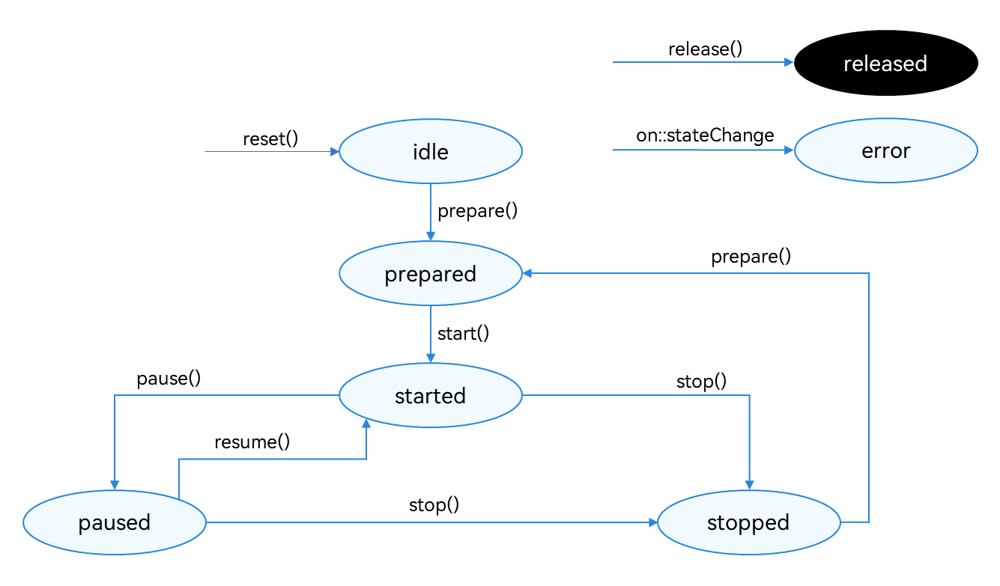

# Using AVRecorder to Record Audio (ArkTS)
<!--Kit: Media Kit-->
<!--Subsystem: Multimedia-->
<!--Owner: @gcw_dyOv3Sds-->
<!--Designer: @chris2981-->
<!--Tester: @xdlinc-->
<!--Adviser: @zzs911-->
<!-- md-trans-meta sourceCommit=fad818ddde47c4c4b5803a21ea6fe025b8af7405 translatedAt=2026-10-30T03:21:54.417Z pushedAt=2026-10-30T03:21:54.417Z nl=1 -->

In this topic, you will learn how to use [AVRecorder](media-kit-intro.md#avrecorder) to develop audio recording functionalities including starting, pausing, resuming, and stopping recording.

During application development, you can use the **state** property of AVRecorder to obtain its current state or use [on('stateChange')](../../reference/apis-media-kit/arkts-apis-media-AVRecorder.md#onstatechange9) to listen for state change events. During development, you must strictly comply with the state machine requirements. For example, you can call the [pause](../../reference/apis-media-kit/arkts-apis-media-AVRecorder.md#pause9-1) API only in the **started** state and call the [resume](../../reference/apis-media-kit/arkts-apis-media-AVRecorder.md#resume9-1) API only in the **paused** state.

**Figure 1** Recording state transition



For details about the states, see [AVRecorderState](../../reference/apis-media-kit/arkts-apis-media-t.md#avrecorderstate9).

## Requesting Permissions

Before your development, configure the following permissions for your application.

- To use the microphone, request the ohos.permission.MICROPHONE permission. For details about how to request user authorization, see [Requesting User Authorization](../../security/AccessToken/request-user-authorization.md).
- To read and save audio files, preferentially use [AudioViewPicker](../../reference/apis-core-file-kit/js-apis-file-picker.md#audioviewpicker).

> **NOTE**
>
> To clone, back up, or synchronize audio files in users' public directory, request the ohos.permission.READ_AUDIO and ohos.permission.WRITE_AUDIO permissions for reading and writing audio files. For details, see <!--RP1-->[Requesting Restricted Permissions](../../security/AccessToken/declare-permissions-in-acl.md)<!--RP1End-->.

## Precautions for Developing Audio Recording Applications

- If continuous recording or background recording is required, the application must request a continuous task to prevent it from being suspended. For details, see [Continuous Task](../../task-management/continuous-task.md).
- The application must start recording when it runs in the foreground. It can switch to the background after the recording is started. Recording cannot be started in the background.
- To record audio, the application must use an appropriate recording stream type. For details, see [Selecting the Appropriate Audio Stream Types](../audio/using-right-sourcetype-for-recording.md).
- To switch the input device route when recording audio, see [Switching Audio Input Devices](../audio/audio-input-device-switcher.md).

## How to Develop

For details about the APIs, see [AVRecorder](../../reference/apis-media-kit/arkts-apis-media-AVRecorder.md).

1. Create an AVRecorder instance. The AVRecorder is in the **idle** state.

   > **NOTE**
   >
   > Perform the subsequent operations after the AVRecorder completes value assignment.

   <!-- @[create_recorder](https://gitcode.com/openharmony/applications_app_samples/blob/master/code/DocsSample/Media/AVRecorder/AVRecorder/entry/src/main/ets/services/AVRecorderService.ets) -->
   
   ``` TypeScript
   this.avRecorder = await media.createAVRecorder();
   ```

2. Set the events to listen for.
   | Event Type| Description|
   | -------- | -------- |
   | stateChange | Mandatory; used to listen for changes of the **state** property of the AVRecorder.|
   | error | Mandatory; used to listen for AVRecorder errors.|

   <!-- @[set_callback](https://gitcode.com/openharmony/applications_app_samples/blob/master/code/DocsSample/Media/AVRecorder/AVRecorder/entry/src/main/ets/services/AVRecorderService.ets) -->
   
   ``` TypeScript
   this.avRecorder?.on('stateChange', (state: media.AVRecorderState, reason: media.StateChangeReason) => {
     console.info(`AVRecorder state is changed to ${state}, reason: ${reason}`);
     // Add the actions to perform after a state change here.
     onStateChanged(state, reason);
   });
   this.avRecorder?.on('error', (error: BusinessError) => {
     console.error(`Error occurred in avRecorder, error code: ${error.code}, message: ${error.message}`);
   });
   ```

3. Set audio recording parameters and call [prepare](../../reference/apis-media-kit/arkts-apis-media-AVRecorder.md#prepare9-1) to enter the **prepared** state.

   > **NOTE**
   > Pay attention to the following when configuring parameters:
   >
   > - Before parameter configuration, ensure that you have gained the required permissions. For details, see [Requesting Permissions](#requesting-permissions).
   >
   > - In pure audio recording scenarios, set only audio-related parameters in **avConfig** of **prepare()**.
   >   If video recording is required, follow the instructions provided in [Video Recording Development](video-recording.md). If video-related parameters are configured, an error will be reported in subsequent steps.
   > - The [recording specifications](media-kit-intro.md#supported-formats) in use must be those supported. The specific recording parameters must strictly comply with the specified [recording parameter configuration](../../reference/apis-media-kit/arkts-apis-media-i.md#avrecorderprofile9).
   > - The recording output URL (URL in **avConfig** in the sample code) must be in the format of fd://xx (where xx indicates a file descriptor). You must call [ohos.file.fs of Core File Kit](../../reference/apis-core-file-kit/js-apis-file-fs.md) to implement access to the application file. For details, see [Accessing Application Files](../../file-management/app-file-access.md).
   > - For details about the audio encoding format (**audioCodec**), extended audio encoding format (**aacProfile**), and encapsulation format (**fileFormat**) configured in the example, see [AVRecorderProfile](../../reference/apis-media-kit/arkts-apis-media-i.md#avrecorderprofile9).

   <!-- @[prepare_audio_recorder](https://gitcode.com/openharmony/applications_app_samples/blob/master/code/DocsSample/Media/AVRecorder/AVRecorder/entry/src/main/ets/services/AVRecorderService.ets) -->
   
   ``` TypeScript
   public async prepareAudioRecorder(context: common.Context): Promise<void> {
     let path: string = context.filesDir + '/audio_example.m4a';
     let file: fileIo.File = await fileIo.open(path, fileIo.OpenMode.READ_WRITE | fileIo.OpenMode.CREATE);
     this.fileFd = file.fd;
   
     let avRecorderConfig: media.AVRecorderConfig = {
       audioSourceType: media.AudioSourceType.AUDIO_SOURCE_TYPE_MIC, // Audio source type.
       profile: {
         audioBitrate: 112000, // Audio bit rate.
         audioChannels: 2, // Number of audio channels.
         audioCodec: media.CodecMimeType.AUDIO_AAC, // Audio encoding format.
         audioSampleRate: this.audioSampleRate, // Audio sampling rate.
         fileFormat: media.ContainerFormatType.CFT_MPEG_4A // Container format.
       } as media.AVRecorderProfile,
       url: 'fd://' + file.fd.toString()
     };
   
     try {
       if (this.avRecorder?.state === 'idle' || this.avRecorder?.state === 'stopped') {
         await this.avRecorder?.prepare(avRecorderConfig);
       }
     } catch (error) {
       let err = error as BusinessError;
       console.error(`Failed to prepare avRecorder, error code: ${err.code}, message: ${err.message}`);
       await this.closeFd();
     }
   }
   ```

4. Call [start](../../reference/apis-media-kit/arkts-apis-media-AVRecorder.md#start9-1) to start recording and enter the **started** state.

   <!-- @[start_recorder](https://gitcode.com/openharmony/applications_app_samples/blob/master/code/DocsSample/Media/AVRecorder/AVRecorder/entry/src/main/ets/services/AVRecorderService.ets) -->
   
   ``` TypeScript
   await this.avRecorder?.start();
   ```

5. Call [pause](../../reference/apis-media-kit/arkts-apis-media-AVRecorder.md#pause9-1) to pause recording and enter the **paused** state.

   <!-- @[pause_recorder](https://gitcode.com/openharmony/applications_app_samples/blob/master/code/DocsSample/Media/AVRecorder/AVRecorder/entry/src/main/ets/services/AVRecorderService.ets) -->
   
   ``` TypeScript
   await this.avRecorder?.pause();
   ```

6. Call [resume](../../reference/apis-media-kit/arkts-apis-media-AVRecorder.md#resume9-1) to resume recording and enter the **started** state again.

   <!-- @[resume_recorder](https://gitcode.com/openharmony/applications_app_samples/blob/master/code/DocsSample/Media/AVRecorder/AVRecorder/entry/src/main/ets/services/AVRecorderService.ets) -->
   
   ``` TypeScript
   await this.avRecorder?.resume();
   ```

7. Call [stop](../../reference/apis-media-kit/arkts-apis-media-AVRecorder.md#stop9-1) to stop recording and enter the **stopped** state.

   <!-- @[stop_recorder](https://gitcode.com/openharmony/applications_app_samples/blob/master/code/DocsSample/Media/AVRecorder/AVRecorder/entry/src/main/ets/services/AVRecorderService.ets) -->
   
   ``` TypeScript
   await this.avRecorder?.stop();
   await this.closeFd();
   ```

8. Call [reset](../../reference/apis-media-kit/arkts-apis-media-AVRecorder.md#reset9-1) to reset resources. The AVRecorder enters the **idle** state and recording parameters can be configured again.

   <!-- @[reset_recorder](https://gitcode.com/openharmony/applications_app_samples/blob/master/code/DocsSample/Media/AVRecorder/AVRecorder/entry/src/main/ets/services/AVRecorderService.ets) -->
   
   ``` TypeScript
   await this.avRecorder?.reset();
   ```

9. Call [release](../../reference/apis-media-kit/arkts-apis-media-AVRecorder.md#release9-1) to release the instance, enter the **released** state, and exit recording.

   <!-- @[release_recorder](https://gitcode.com/openharmony/applications_app_samples/blob/master/code/DocsSample/Media/AVRecorder/AVRecorder/entry/src/main/ets/services/AVRecorderService.ets) -->
   
   ``` TypeScript
   await this.avRecorder?.release();
   ```

## Complete Sample Code

  Refer to the sample code below to complete the process of starting, pausing, resuming, and stopping recording.

  Before using the sample code, you need to apply for the ohos.permission.MICROPHONE microphone permission. For details about how to request user authorization, see [Requesting User Authorization](../../security/AccessToken/request-user-authorization.md).

<!-- @[full_audio_recorder](https://gitcode.com/openharmony/applications_app_samples/blob/master/code/DocsSample/Media/AVRecorder/AVRecorder/entry/src/main/ets/services/AVRecorderService.ets) -->

``` TypeScript
import { BusinessError } from '@kit.BasicServicesKit';
import { media } from '@kit.MediaKit';
import { fileIo } from '@kit.CoreFileKit';
import { common } from '@kit.AbilityKit';
import { Resolution } from './CommonTypes';

export default class AVRecorderService {
  private avRecorder: media.AVRecorder | undefined = undefined;
  private fileFd: number | undefined = undefined;

  private audioSampleRate: number = 48000;
  private videoSourceType: media.VideoSourceType = media.VideoSourceType.VIDEO_SOURCE_TYPE_SURFACE_YUV;
  private videoResolution: Resolution = { frameWidth: 1920, frameHeight: 1080 } as Resolution;

  public async createRecorder(): Promise<void> {
    await this.releaseRecorder();
    try {
      this.avRecorder = await media.createAVRecorder();
    } catch (err) {
      let error: BusinessError = err as BusinessError;
      console.error(`Failed to create avRecorder, error code: ${error.code}, message: ${error.message}`);
    }
  }

  public setCallback(onStateChanged: media.OnAVRecorderStateChangeHandler): void {
    if (this.avRecorder) {
      console.info('setCallback');
    }
    this.avRecorder?.on('stateChange', (state: media.AVRecorderState, reason: media.StateChangeReason) => {
      console.info(`AVRecorder state is changed to ${state}, reason: ${reason}`);
      // Add the actions to perform after a state change here.
      onStateChanged(state, reason);
    });
    this.avRecorder?.on('error', (error: BusinessError) => {
      console.error(`Error occurred in avRecorder, error code: ${error.code}, message: ${error.message}`);
    });
  }

  // ...

  public async prepareAudioRecorder(context: common.Context): Promise<void> {
    let path: string = context.filesDir + '/audio_example.m4a';
    let file: fileIo.File = await fileIo.open(path, fileIo.OpenMode.READ_WRITE | fileIo.OpenMode.CREATE);
    this.fileFd = file.fd;

    let avRecorderConfig: media.AVRecorderConfig = {
      audioSourceType: media.AudioSourceType.AUDIO_SOURCE_TYPE_MIC, // Audio source type.
      profile: {
        audioBitrate: 112000, // Audio bit rate.
        audioChannels: 2, // Number of audio channels.
        audioCodec: media.CodecMimeType.AUDIO_AAC, // Audio encoding format.
        audioSampleRate: this.audioSampleRate, // Audio sampling rate.
        fileFormat: media.ContainerFormatType.CFT_MPEG_4A // Container format.
      } as media.AVRecorderProfile,
      url: 'fd://' + file.fd.toString()
    };

    try {
      if (this.avRecorder?.state === 'idle' || this.avRecorder?.state === 'stopped') {
        await this.avRecorder?.prepare(avRecorderConfig);
      }
    } catch (error) {
      let err = error as BusinessError;
      console.error(`Failed to prepare avRecorder, error code: ${err.code}, message: ${err.message}`);
      await this.closeFd();
    }
  }

  // ...

  public async startRecorder(): Promise<void> {
    try {
      if (this.avRecorder?.state === 'prepared') {
        await this.avRecorder?.start();
      }
    } catch (error) {
      let err = error as BusinessError;
      console.error(`Failed to start avRecorder, error code: ${err.code}, message: ${err.message}`);
    }
  }

  public async pauseRecorder(): Promise<void> {
    try {
      if (this.avRecorder?.state === 'started') {
        await this.avRecorder?.pause();
      }
    } catch (error) {
      let err = error as BusinessError;
      console.error(`Failed to pause avRecorder, error code: ${err.code}, message: ${err.message}`);
    }
  }

  public async resumeRecorder(): Promise<void> {
    try {
      if (this.avRecorder?.state === 'paused') {
        await this.avRecorder?.resume();
      }
    } catch (error) {
      let err = error as BusinessError;
      console.error(`Failed to resume avRecorder, error code: ${err.code}, message: ${err.message}`);
    }
  }

  public async stopRecorder(): Promise<void> {
    try {
      if (this.avRecorder?.state === 'started' || this.avRecorder?.state === 'paused') {
        await this.avRecorder?.stop();
        await this.closeFd();
      }
    } catch (error) {
      let err = error as BusinessError;
      console.error(`Failed to stop avRecorder, error code: ${err.code}, message: ${err.message}`);
      await this.closeFd();
    }
  }

  public async resetRecorder(): Promise<void> {
    try {
      await this.avRecorder?.reset();
    } catch (error) {
      let err = error as BusinessError;
      console.error(`Failed to reset avRecorder, error code: ${err.code}, message: ${err.message}`);
    }
  }

  public async releaseRecorder(): Promise<void> {
    try {
      this.avRecorder?.off('stateChange');
      this.avRecorder?.off('error');
      await this.avRecorder?.release();
      this.avRecorder = undefined;
    } catch (error) {
      let err = error as BusinessError;
      console.error(`Failed to release avRecorder, error code: ${err.code}, message: ${err.message}`);
    }
  }

  public async closeFd(): Promise<void> {
    try {
      if (this.fileFd) {
        await fileIo.close(this.fileFd!);
        this.fileFd = undefined;
      }
    } catch (error) {
      let err = error as BusinessError;
      console.error(`Failed to close fd, error code: ${err.code}, message: ${err.message}`);
    }
  }
}
```
