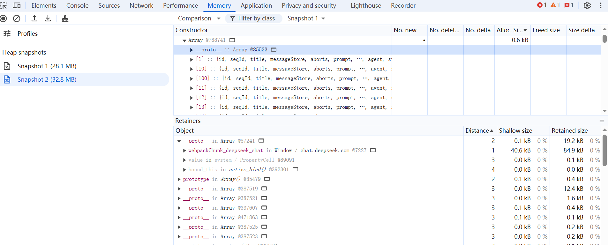

# Troubleshooting JSVM-API Memory Leaks
<!--Kit: ArkTS-->
<!--Subsystem: arkcompiler-->
<!--Owner: @yuanxiaogou-->
<!--Designer: @knightaoko-->
<!--Tester: @test_lzz-->
<!--Adviser: @k1ngqaquuu-->
<!-- md-trans-meta sourceCommit=25218241875d539d4b08132167f7bbef0936d3c0 translatedAt=2026-11-04T06:41:56.301Z pushedAt=2026-11-04T06:41:56.301Z nl=1 -->

JSVM memory usage includes native memory usage (C/C++ memory usage) and heap memory usage of the underlying JavaScript engine. The JavaScript engine maintains a heap to manage the JavaScript objects it generates, and the lifecycle of these objects is maintained by the JavaScript engine. Other memory is called native memory. When using JSVM, you may encounter these two types of abnormal memory growth.

This topic describes how to determine the memory leak type and how to locate the native memory leak and JavaScript engine heap memory leak.

## Determining the Memory Leak Type

You can connect to the device via hdc and run the following command to sample the memory of the target app, then compare the memory changes over a period of time to qualitatively determine whether the issue is a Native memory leak or abnormal JS heap memory growth. In the following figure, under the Pss Total column, native heap corresponds to Native memory usage, and AnonPage other corresponds to JS heap memory usage.
```hdc
hidumper --mem $(pidof dest_app)
```
<div align=left></div>


## Locating Native Memory Leaks
### When to Use
1. **OH_JSVM_CreateReference** and **OH_JSVM_DeleteReference** are not called in pairs. As a result, references are not released.
```c++
JSVM_Value obj = nullptr;
OH_JSVM_CreateObject(env, &obj);
// Create a reference.
JSVM_Ref reference;
OH_JSVM_CreateReference(env, obj, 1, &reference);

// Use the reference.
JSVM_Value result;
OH_JSVM_GetReferenceValue(env, reference, &result);

// The reference is not released.
// OH_JSVM_DeleteReference(env, reference);
```

### How to Locate
To analyze native memory leaks, you can use the memory analysis module of DevEco Studio. For details, see [Memory Analysis and Optimization](https://developer.huawei.com/consumer/en/doc/harmonyos-guides/ide-insight-session-allocations-memory).
1. Use the **Allocation** module of Profiler to record the native memory information within a period of time.

   <div align=left></div>  

2. Compare the memory changes in **Created & Existing** during this period. If the unreleased memory accounts for a large proportion and the value of **Count** is large, a memory leak may occur. In this case, check the call stack.

   <div align=left></div> 


## Locating JavaScript Engine Heap Memory Leaks
### When to Use
1. Global variables are misused. As a result, DOM elements are not released.
```js
const elements = [];
function createElements() {
  for (let i = 0; i < 1000; i++) {
    const el = document.createElement('div');
    document.body.appendChild(el);
    elements.push(el); // Even if the element is removed from the DOM, the array still holds the reference.
  }
}
```

### How to Locate

Currently, JSVM provides `OH_JSVM_OpenInspector` to enable the inspector. For details, see [Using OH_JSVM_OpenInspector](https://developer.huawei.com/consumer/en/doc/harmonyos-guides/jsvm-debugger-cpuprofiler-heapsnapshot#using-oh_jsvm_openinspector) and [Using Chrome Inspect](https://developer.huawei.com/consumer/en/doc/harmonyos-guides/jsvm-debugger-cpuprofiler-heapsnapshot#using-chrome-inspect).

Use DevTools to take a snapshot of the heap memory in the target scenario (click the garbage collection button above before taking a snapshot). Compare the snapshots to find the unreleased JavaScript objects and their locations in the source code to further locate the cause of the unreleased heap memory.

<div align=left></div> 

### Automatically Exporting a Heap Dump on OOM with --heap-dump-on-oom

In addition to manually capturing heap snapshots with DevTools for comparison, JSVM can automatically export the current heap to a dump file when the JavaScript heap runs out of memory (OOM). You can use this file to locate heap memory leaks after the event.

To enable this capability, pass `--heap-dump-on-oom` through `argc`/`argv` in `JSVM_InitOptions` when initializing JSVM. `OH_JSVM_Init` forwards the engine arguments in argv to the underlying JavaScript engine.

```c++
// Enable OOM heap dumps when initializing JSVM.
static int32_t TestJSVM()
{
  JSVM_InitOptions initOptions = {0};
  int argc = 2;
  const char* argv[2] = {
    "",
    "--heap-dump-on-oom",
  };
  initOptions.argc = &argc;
  initOptions.argv = const_cast<char**>(argv);
  // Initialize the JavaScript engine instance.
  JSVM_CALL(OH_JSVM_Init(&initOptions));
  // ... Create a VM/Env and execute service logic.
  return 0;
}
```

> **NOTE**
>
> - `--heap-dump-on-oom` is a development and debugging option that incurs some performance overhead. Enable it temporarily only when locating JavaScript heap memory leaks. It is not recommended for production releases.
> - When the JavaScript heap reaches its limit and triggers OOM, the engine writes the current heap snapshot to a dump file before the process exits.
> - The default output directory is `/data/app/el2/100/base/<package_name>/`. For example, for the package `com.example.Test`, files are written to `/data/app/el2/100/base/com.example.Test/`. File names have the form `xxx.rawheap`. Use hdc to retrieve the files from the device for analysis.
> - Convert the `xxx.rawheap` file to `.heapsnapshot` format with `js_rawheap_translator` before visual analysis. For details, see [js-rawheap-translator](../tools/js-rawheap-translator.md).
> - Import the converted `.heapsnapshot` file into DevTools or DevEco Studio to locate unreleased JavaScript objects and their reference chains.
