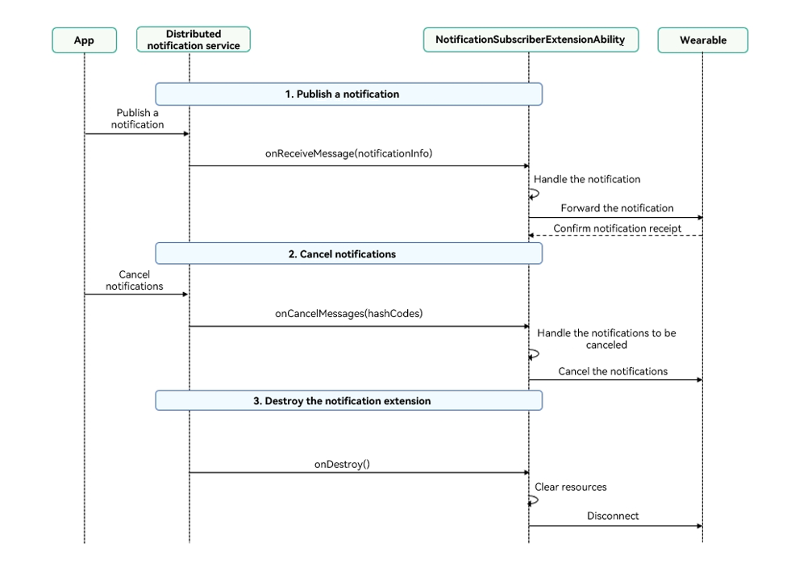

# Introduction to NotificationSubscriberExtensionAbility
<!--Kit: Notification Kit-->
<!--Subsystem: Notification-->
<!--Owner: @HuYueRong-->
<!--Designer: @wangsen1994-->
<!--Tester: @wanghong1997-->
<!--Adviser: @fang-jinxu-->
<!-- md-trans-meta sourceCommit=4faed534b39ef26ef8f9b647802a53e9f8d2b792 translatedAt=2026-10-08T03:49:34.099Z pushedAt=2026-10-08T06:50:29.828Z -->

## Functionality Overview
The core purpose of this extension ability is to allow third-party apps to receive system notifications. In this extension ability, an app can implement data transmission with a wearable. After the app sends a notification to the [distributed notification](notification-glossary.md#distributed-notification) service, the service forwards the notification to the [NotificationSubscriberExtensionAbility](../reference/apis-notification-kit/js-apis-notificationSubscriberExtensionAbility.md) implemented by the third-party app. If no new notification is published within a certain period of time, the currently running [NotificationSubscriberExtensionAbility](../reference/apis-notification-kit/js-apis-notificationSubscriberExtensionAbility.md) is automatically destroyed by the system.

## Prerequisites
- The user has paired the wearable with the phone using the wearable app.
- In the wearable app, the user has enabled the **Allow obtaining local notifications** and **Obtained local notifications** switches in the semi-modal dialog box launched by the [openSubscriptionSettingsWithResult](../reference/apis-notification-kit/js-apis-notificationExtensionSubscription.md#notificationextensionsubscriptionopensubscriptionsettingswithresult) API.
- For devices that support [HFP](../connectivity/bluetooth/terminology.md#hfp) connection, ensure that the HFP connection remains active at all times.

## When to Use
<!--Del-->
- Ecosystem requirement: Support third-party wearables in receiving system notifications.
<!--DelEnd-->
- **Use scenario**: Synchronize system notifications to a wearable.
- Transmission modes: Bluetooth Low Energy (BLE) and classic Bluetooth.

## Constraints
1. This sample runs only on standard systems and supports phones and tablets.
2. This sample uses the stage model and requires an SDK with API version 22 or later.
3. This sample can only be compiled and run in DevEco Studio 6.0.2 or later.
4. The third-party wearable application should request the [ohos.permission.SUBSCRIBE_NOTIFICATION](../security/AccessToken/restricted-permissions.md#ohospermissionsubscribe_notification) permission (system_basic level).

## Working Principles
