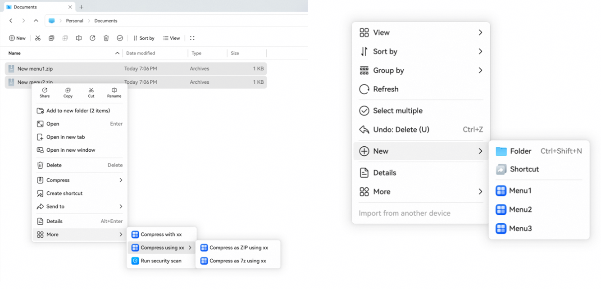

# Configuring the Context Menu for Applications (PC/2-in-1 Device)
<!--Kit: Ability Kit-->
<!--Subsystem: BundleManager-->
<!--Owner: @dzsam520-->
<!--Designer: @alone1985-->
<!--Tester: @aimeechen728-->
<!--Adviser: @HelloCrease-->
<!-- md-trans-meta sourceCommit=2583699ed0911c786b3be3e9491f0736485d6f2e translatedAt=2026-10-30T06:21:33.935Z pushedAt=2026-10-30T06:21:33.935Z nl=1 -->

By configuring the context menu, an application can register custom menu items in the context menus of the desktop and File Manager. When a user clicks a custom menu item, the application is started to perform the corresponding operation. In this way, application capabilities can be conveniently integrated into the system file operation process. Typical scenarios are as follows:

- An application needs to add a custom menu to the context menus of the desktop and File Manager to start the application and implement service logic, for example, security check.
- An application needs to add a **New** menu to the context menus of the desktop and File Manager to create files, for example, creating a text document named **New Text Document.txt**.

## Declaring the Context Menu

Configure the **fileContextMenu** field in the [module.json5 configuration file](./module-configuration-file.md). This field points to a profile file resource. You need to define the corresponding menu configuration file, for example, **menu.json**, in the **resources/base/profile** directory. The **menu.json** file name can be customized, but it must be the same as the resource name specified by **fileContextMenu**.

In the menu configuration file, you can define the context menu items registered by the application and their response behavior to declare the context menu configuration of the current HAP.

> **NOTE**
>
> This field can be configured only in modules of the entry type.

<!-- @[module_fileContextMenu](https://gitcode.com/openharmony/applications_app_samples/blob/master/code/DocsSample/bmsSample/ModuleConfigurationFile01/entry/src/main/module.json5) -->

``` JSON5
{
  "module": {
    // ...
    "fileContextMenu": "$profile:menu", // Resource configuration, which points to the menu.json configuration file defined in profile.
    // ...
  }
}
```

## Registering the More Menu

The root node of the **menu.json** configuration file is **fileContextMenu**, which is an object array and identifies the number of **More** context menus registered by the current module.

A single module and a single application can register a maximum of 10 menus. If more than 10 menus are configured, only 10 random menus are parsed.

**Table 1** Description of the fileContextMenu tag

| Name | Description | Data Type | Optional |
| -------- | -------- | -------- | -------- |
| abilityName | Name of the ability to start for the current context menu.<br/>**Note:**<br/>When menuSubItems is configured, set this tag to an empty string. | String | No |
| menuItem | Information displayed in the context menu. Naming suggestions:<br/>Principle 1: [Action] + [Application name]. Examples: Open with {App}, Open with {App} ({Plugin}).<br/>Principle 2: [Action] + [Purpose]. Examples: Compress to {File name}, Compress to {Path}, Convert to {Format} with {App}. | Resource ID | No |
| menuIcon | Custom icon resource displayed in the context menu. The value is a string of no more than 255 bytes. The icon must be a PNG image no larger than 5 MB and comply with the application icon design specifications.<br/>**Note:**<br/>This tag is supported since API version 23.<br/>To use a custom icon, the application must request the `ohos.permission.CUSTOMIZE_MENU_ICON` permission. If the permission is not granted or the resource format does not meet the requirements, the custom icon is not displayed for the menu item. | String | Yes. The default value is empty. |
| menuSubItems | List of submenu items for this menu item. When this tag is configured, the current menu item is displayed only as a parent node. Its abilityName, menuHandler, and menuContext tags are no longer read; instead, each submenu item provides these tags to define its response behavior and display conditions.<br/>**Note:**<br/>This tag is supported since API version 26.1.0.<br/>Submenu items are filtered according to their menuContext. The parent menu item and its submenu are displayed only when at least one submenu item matches the current context. | Object array | Yes. The default value is empty. |
| menuHandler | An ability can create multiple context menus. This tag maps to a context menu display item and is used to distinguish different context menu items used to start the application. You can customize the value of this tag and ensure that it is unique within the ability. When the user clicks a context menu item to start the application, this value is passed to the application as a parameter.<br/>**Note:**<br/>When menuSubItems is configured, set this tag to an empty string. | String | No |
| menuContext | Context required for displaying the menu item, including the trigger scenario (blank area, file, folder, and so on), selection mode (single selection or multiple selections), and file type filter.<br/>**Note:**<br/>When menuSubItems is configured, set this tag to an empty array. | Object array | No |

**Table 2** Description of the menuSubItems tag

| Name | Description | Data Type | Optional |
| -------- | -------- | -------- | -------- |
| abilityName | Name of the ability to start for the submenu item. | String | No |
| menuItem | Text displayed for the submenu item. | Resource ID | No |
| menuIcon | Custom icon resource displayed for the submenu item. The value is a string of no more than 255 bytes. The icon must be a PNG image no larger than 5 MB and comply with the application icon design specifications.<br/>**Note:**<br/>To use a custom icon, the application must request the `ohos.permission.CUSTOMIZE_MENU_ICON` permission. If the permission is not granted or the resource format does not meet the requirements, the custom icon is not displayed for the menu item. | String | Yes. The default value is empty. |
| menuHandler | An ability can create multiple context menus. This tag maps to a context menu display item and is used to distinguish different context menu items used to start the application. You can customize the value of this tag and ensure that it is unique within the ability. When the user clicks a context menu item to start the application, this value is passed to the application as a parameter. | String | No |
| menuContext | Context required for displaying the menu item, including the trigger scenario (blank area, file, folder, and so on), selection mode (single selection or multiple selections), and file type filter. | Object array | No |

**Table 3** Description of the menuContext tag

| Name | Description | Data Type | Optional |
| -------- | -------- | -------- | -------- |
| menuKind | Type that triggers the context menu when clicked. The value can be:<br/>-&nbsp;0: blank area<br/>-&nbsp;1: file<br/>-&nbsp;2: folder<br/>-&nbsp;3: file and folder | Number | No |
| menuRule | Mode in which a file or folder is selected to trigger the context menu. The value can be:<br/>-&nbsp;"single": single selection<br/>-&nbsp;"multi": multiple selections<br/>-&nbsp;"both": single selection or multiple selections | String | No, if **menuKind** is **1** or **2**. This tag is read only in this case. |
| fileSupportType | Displays the context menu when the selected file list contains files of the specified type.<br/>When this tag is set to ["*"], the **fileNotSupportType** tag is read.<br/>When this tag is set to [], no processing is performed. | String array | No, if **menuKind** is **1**. This tag is read only in this case. |
| fileNotSupportType | Does not display the context menu when the selected file list contains files of these types.<br/>This tag is read only when **menuKind** is **1** and **fileSupportType** is ["*"]. | String array | Yes. The default value is empty. |
| ignoreActiveStatus | Whether to ignore the active status of a third-party cloud drive sync folder. If this tag is set to **true**, the menu item can be displayed even when the sync folder is not activated. If this tag is set to **false**, the menu item is displayed only when the sync folder is active.<br/>**Note:**<br/>This tag is supported since API version 24.<br/>This tag takes effect only when the user is in a third-party cloud drive sync directory. It does not affect the menu display logic in a local directory. | Boolean | Yes. The default value is **false**. |
| fileSupportSyncStatus | File sync status filter for third-party cloud drives. The menu item is displayed only when the file is in one of the sync states specified in the array. The value can be:<br/>-&nbsp;"IDLE": no status<br/>-&nbsp;"CLOUD": cloud file<br/>-&nbsp;"SYNCING": syncing<br/>-&nbsp;"SYNC_SUCCESSED": synced<br/>-&nbsp;"SYNC_FAILED": sync failed<br/>-&nbsp;"SYNC_CANCELED": sync canceled<br/>-&nbsp;"SYNC_CONFLICTED": sync conflicted <br/>**Note:**<br/>This tag is supported since API version 24.<br/>This tag takes effect only when the user is in a third-party cloud drive sync directory, and the bundle name of the application required by the menu item must be the same as that of the third-party cloud drive application corresponding to the current directory. Otherwise, the menu item is not displayed. | String array | Yes. The default value is **IDLE**. |

The following is an example of the **menu.json** configuration file in the **resources/base/profile** directory:
```json
{
  "fileContextMenu": [
    {
      "abilityName": "EntryAbility",
      "menuItem": "$string:module_desc",
      "menuIcon": "$media:custom_icon",
      "menuHandler": "openCompress",
      "menuContext": [
        {
          "menuKind": 0
        },
        {
          "menuKind": 1,
          "menuRule": "both",
          "fileSupportType": [
            ".rar",
            ".zip"
          ]
        },
        {
          "menuKind": 2,
          "menuRule": "single"
        },
        {
          "menuKind": 3
        }
      ]
    }
  ]
}
```

The following example shows a three-level menu configuration using **menuSubItems**:
```json
{
  "fileContextMenu": [
    {
      "abilityName": "",
      "menuItem": "$string:compress_menu",
      "menuIcon": "$media:compress_icon",
      "menuHandler": "",
      "menuContext": [],
      "menuSubItems": [
        {
          "abilityName": "EntryAbility",
          "menuItem": "$string:compress_to_zip",
          "menuIcon": "$media:compress_to_zip_icon",
          "menuHandler": "compressToZip",
          "menuContext": [
            {
              "menuKind": 1,
              "menuRule": "both",
              "fileSupportType": [
                ".rar",
                ".zip"
              ]
            }
          ]
        },
        {
          "abilityName": "EntryAbility",
          "menuItem": "$string:compress_to_7z",
          "menuIcon": "$media:compress_to_7z_icon",
          "menuHandler": "compressTo7z",
          "menuContext": [
            {
              "menuKind": 1,
              "menuRule": "both",
              "fileSupportType": [
                ".rar",
                ".zip"
              ]
            }
          ]
        }
      ]
    }
  ]
}
```

**Response behavior**

After an application registers the context menu, a **More** option is displayed in the context menu opened by right-clicking in File Manager. After the user clicks **More**, the registered **menuItem** list is displayed. After the user clicks any option, File Manager starts the third-party application by calling **startAbility** by default. In addition to the bundle name and ability name of the specified third-party application, the following tags are passed in **parameter** of **want**:

**Table 4** Description of the parameter tags in want

| Parameter | Value | Data Type |
| -------- | -------- | -------- |
| menuHandler | Value of **menuHandler** in the registered configuration file. | String |
| uriList | URI value triggered when the user right-clicks a specific file. If the response is triggered from a blank area, this value is empty. If the response is triggered from a single file, the array length is 1. If the response is triggered from multiple files, the URI values of all corresponding files are passed. | String array |

## Registering the New Menu

Same as the **More** extension menu, the **menu.json** configuration file is stored in the **resources/base/profile** directory and shared with the **More** extension menu. However, the configuration file content must be written separately. You can add the configuration based on the configuration file of the **More** extension menu, or include only the configuration items for creating files.

The root node of the **menu.json** configuration file is **newFile**, which is an object array and identifies the number of new files registered by the current module.

A single module and a single application can register a maximum of five new files. If more than five new files are configured, only five random new files are parsed.

**Table 5** Description of the newFile tag

| Name | Description | Data Type | Optional |
| -------- | -------- | -------- | -------- |
| menuName | Content displayed in the context menu for creating files, for example, **Text Document**. | Resource ID | No |
| menuIcon | Icon path of the file to create. | String | No |
| fileType | Format type of the file to create. | String | No |
| fileContent | Template path of the file to create. | String | No |

The following is an example of the **menu.json** configuration file in the **resources/base/profile** directory:
```json
{
  "newFile": [
    {
      "menuName": "$string:menu1",
      "menuIcon": "icon/menuIcon1.png",
      "fileType": ".docx",
      "fileContent": "template/demo.docx"
    },
    {
      "menuName": "$string:menu2",
      "menuIcon": "icon/menuIcon2.png",
      "fileType": ".txt",
      "fileContent": "template/demo.txt"
    },
    {
      "menuName": "$string:menu3",
      "menuIcon": "icon/menuIcon3.png",
      "fileType": ".xlsx",
      "fileContent": "template/demo.xlsx"
    }
  ]
}
```
## Complete Example

The following is a complete **menu.json** configuration file example, including the **More** menu and **New** menu.

```json
{
  "fileContextMenu": [
    {
      "abilityName": "EntryAbility",
      "menuItem": "$string:compress_menu",
      "menuIcon": "$media:compress_icon",
      "menuHandler": "compress",
      "menuContext": [
        {
          "menuKind": 0
        },
        {
          "menuKind": 1,
          "menuRule": "both",
          "fileSupportType": [
            ".rar",
            ".zip"
          ]
        }
      ]
    },
    {
      "abilityName": "",
      "menuItem": "$string:compress_menu_as",
      "menuIcon": "$media:compress_icon",
      "menuHandler": "",
      "menuContext": [],
      "menuSubItems": [
        {
          "abilityName": "EntryAbility",
          "menuItem": "$string:compress_to_zip",
          "menuIcon": "$media:compress_to_zip_icon",
          "menuHandler": "compressToZip",
          "menuContext": [
            {
              "menuKind": 1,
              "menuRule": "both",
              "fileSupportType": [
                ".rar",
                ".zip"
              ]
            }
          ]
        },
        {
          "abilityName": "EntryAbility",
          "menuItem": "$string:compress_to_7z",
          "menuIcon": "$media:compress_to_7z_icon",
          "menuHandler": "compressTo7z",
          "menuContext": [
            {
              "menuKind": 1,
              "menuRule": "both",
              "fileSupportType": [
                ".rar",
                ".zip"
              ]
            }
          ]
        }
      ]
    }
  ],
  "newFile": [
    {
      "menuName": "$string:menu1",
      "menuIcon": "icon/menuIcon1.png",
      "fileType": ".docx",
      "fileContent": "template/demo.docx"
    },
    {
      "menuName": "$string:menu2",
      "menuIcon": "icon/menuIcon2.png",
      "fileType": ".txt",
      "fileContent": "template/demo.txt"
    },
    {
      "menuName": "$string:menu3",
      "menuIcon": "icon/menuIcon3.png",
      "fileType": ".xlsx",
      "fileContent": "template/demo.xlsx"
    }
  ]
}
```

The following figure shows the effect.

