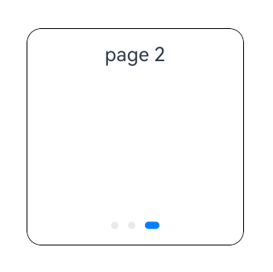

# Class (PageSwitchActionProposal)
<!--Kit: ArkUI-->
<!--Subsystem: ArkUI-->
<!--Owner: @zhou-chaobo-->
<!--Designer: @piggyguy-->
<!--Tester: @songyanhong-->
<!--Adviser: @Brilliantry_Rui-->
<!-- md-trans-meta sourceCommit=3b17ae247298f1cf952b1cbdcb60f1ff0e80beac translatedAt=2026-11-02T12:47:09.709Z pushedAt=2026-11-06T09:12:37.290Z nl=1 -->

Handles the smart gesture page turning action. The default direction is forward page turning, including rightward and downward. It inherits from [TargetedGestureProposal](arkts-apis-uicontext-targetedgestureproposal.md). When dynamically customizing the smart gesture behavior through the [registerMonitor](./arkts-apis-uicontext-smartgesturecontroller.md#registermonitor) API, setting **selectedProposal** of the return value [Class (GestureHandlingResolution)](./arkts-apis-uicontext-gesturehandlingresolution.md) to an object of this type triggers the page turning operation of the target component.

**Since**: 26.0.0

## constructor

constructor(node: FrameNode, pageCount: number)

Constructor for the smart gesture page turning action handling.

**Since**: 26.0.0

**Model restriction**: This API can be used only in the stage model.

**Atomic service API**: This API can be used in atomic services since API version 26.0.0.

**System capability:** SystemCapability.ArkUI.ArkUI.Full

**Parameters**

| Name | Type | Mandatory | Description |
| ---- | ---- | ---- | ---- |
| node | [FrameNode](js-apis-arkui-frameNode.md#framenode-1) | Yes | Target node that responds to the page turning action. |
| pageCount | number | Yes | Number of pages to turn.<br>Value range: [0, +∞). Values less than 0 are treated as 0.<br>Unit: page. |

## Properties

**Since**: 26.0.0

**Model restriction**: This API can be used only in the stage model.

**Atomic service API**: This API can be used in atomic services since API version 26.0.0.

**System capability:** SystemCapability.ArkUI.ArkUI.Full

| Name | Type | Read-Only | Optional | Description |
| ---- | ---- | ---- | ---- | ---- |
| pageCount | number | No | No | Number of pages for the smart gesture page turning.<br>Value range: [0, +∞). Values less than 0 are treated as 0.<br>Unit: page. |

**Example**

This example implements custom smart gesture action handling as smart gesture page turning action handling in the smart gesture listening callback. For the complete example, see [Example 1: Enabling Smart Gestures and Customizing Action Handling](./arkts-apis-uicontext-smartgesturecontroller.md#example-1-enabling-smart-gestures-and-customizing-action-handling).

```ts
import {
  BaseGestureHandlingProposal,
  GestureHandlingResolution,
  PageSwitchActionProposal,
} from '@kit.ArkUI';

@Entry
@Component
struct SmartGestureControllerExample {
  private controller = this.getUIContext().getSmartGestureController();
  private smartGestureMonitor = (proposal: BaseGestureHandlingProposal) => {
    let result = new GestureHandlingResolution(true);
    let node = this.getUIContext().getFrameNodeById('target_swiper');
    if (node) {
      let pageSwitchProposal = new PageSwitchActionProposal(node, 2);
      result.selectedProposal = pageSwitchProposal;
    }
    return result;
  };

  aboutToAppear(): void {
    this.controller.enableSmartTapAndSlideGestures(true);
    this.controller.registerMonitor(this.smartGestureMonitor);
  }

  aboutToDisappear(): void {
    this.controller.clearMonitors();
    this.controller.enableSmartTapAndSlideGestures(false);
  }

  build() {
    Scroll() {
      Column({ space: 12 }) {
        Swiper() {
          Column({ space: 8 }) {
            Text('page 0')
          }
          .justifyContent(FlexAlign.Start)
          .padding(12)

          Column({ space: 8 }) {
            Text('page 1')
          }
          .justifyContent(FlexAlign.Start)
          .padding(12)

          Column({ space: 8 }) {
            Text('page 2')
          }
          .justifyContent(FlexAlign.Start)
          .padding(12)
        }
        .width(180)
        .height(180)
        .id('target_swiper')
        .index(0)
        .loop(false)
        .borderRadius(12)
        .borderWidth(1)
      }.width('100%')
    }
    .layoutWeight(1)
    .width('100%')
    .height('100%')
    .padding(12)
  }
}
```


