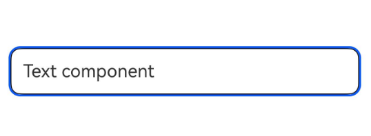

# Class (TargetedGestureProposal)
<!--Kit: ArkUI-->
<!--Subsystem: ArkUI-->
<!--Owner: @zhou-chaobo-->
<!--Designer: @piggyguy-->
<!--Tester: @songyanhong-->
<!--Adviser: @Brilliantry_Rui-->
<!-- md-trans-meta sourceCommit=3b17ae247298f1cf952b1cbdcb60f1ff0e80beac translatedAt=2026-11-02T12:53:00.583Z pushedAt=2026-11-06T10:59:02.346Z nl=1 -->

Base class for smart gesture handling with a target node. Inherits from [BaseGestureHandlingProposal](arkts-apis-uicontext-basegesturehandlingproposal.md).

**Since**: 26.0.0

## Properties

**Since**: 26.0.0

**Model restriction**: This API can be used only in the stage model.

**Atomic service API**: This API can be used in atomic services since API version 26.0.0.

**System capability:** SystemCapability.ArkUI.ArkUI.Full

| Name | Type | Read-Only | Optional | Description |
| ---- | ---- | ---- | ---- | ---- |
| node | [FrameNode](js-apis-arkui-frameNode.md#framenode-1) | No | No | Target node for handling the current smart gesture. |

**Example**

This example demonstrates how to obtain smart gesture handling information from TargetedGestureProposal in the smart gesture listening callback. For the complete example, see [Example 1 (Enabling Smart Gestures and Customizing Action Handling)](./arkts-apis-uicontext-smartgesturecontroller.md#example-1-enabling-smart-gestures-and-customizing-action-handling).

```ts
import {
  BaseGestureHandlingProposal,
  GestureHandlingResolution,
  TargetedGestureProposal,
} from '@kit.ArkUI';

@Entry
@Component
struct SmartGestureControllerExample {
  private controller = this.getUIContext().getSmartGestureController();
  private smartGestureMonitor = (proposal: BaseGestureHandlingProposal) => {
    let targetProposal = proposal as TargetedGestureProposal;
    console.info('smartGesture action is', targetProposal.action, ', operateIntention is',
      targetProposal.operateIntention, ', nodeId is', targetProposal.node.getId());
    return new GestureHandlingResolution(true);
  };

  aboutToAppear(): void {
    this.controller.enableSmartTapAndSlideGestures(true);
    this.controller.registerMonitor(this.smartGestureMonitor);
  }

  aboutToDisappear(): void {
    this.controller.clearMonitors();
    this.controller.enableSmartTapAndSlideGestures(false);
  }

  build() {
    Scroll() {
      Column({ space: 12 }) {
        Text('Text component')
          .id('target_text')
          .fontSize(18)
          .width('100%')
          .padding(12)
          .borderRadius(10)
          .borderWidth(1)
          .smartGestureShortcut({ action: GestureShortcut.PRIMARY, enabled: true, selectable: true })
          .onClick(() => {
            console.info('smartGesture click is triggered');
          })
      }.width('100%')
    }
    .layoutWeight(1)
    .width('100%')
    .height('100%')
    .padding(12)
  }
}
```


