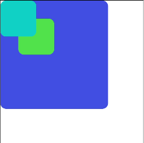

# stack
<!--Kit: ArkUI-->
<!--Subsystem: ArkUI-->
<!--Owner: @fenglinbailu-->
<!--Designer: @fenglinbailu-->
<!--Tester: @liuli0427-->
<!--Adviser: @Brilliantry_Rui-->
<!-- md-trans-meta sourceCommit=75a7d62c0702c21a06ca0119552a942305a023cc translatedAt=2026-11-12T04:37:00.289Z pushedAt=2026-11-18T03:30:52.744Z nl=1 -->

>  **NOTE**
>
>  This component is supported since API version 4. Updates will be marked with a superscript to indicate their earliest API version.

The **Stack** component provides a stack container where child components are successively stacked and the latter one overwrites the previous one.

## Required Permissions

None


## Child Components

Supported


## Attributes

The [universal attributes](js-components-common-attributes.md) are supported.


## Styles

The [universal styles](js-components-common-styles.md) are supported.


## Events

The [universal events](js-components-common-events.md) are supported.

## Methods

The [universal methods](js-components-common-methods.md) are supported.


## Example

```html
<!-- xxx.hml -->
<stack class="stack-parent">
  <div class="back-child bd-radius"></div>
  <div class="positioned-child bd-radius"></div>
  <div class="front-child bd-radius"></div>
</stack>
```

```css
/* xxx.css */
.stack-parent {
  width: 400px;
  height: 400px;
  background-color: #ffffff;
  border-width: 1px;
  border-style: solid;
}
.back-child {
  width: 300px;
  height: 300px;
  background-color: #3f56ea;
}
.front-child {
  width: 100px;
  height: 100px;
  background-color: #00bfc9;
}
.positioned-child {
  width: 100px;
  height: 100px;
  left: 50px;
  top: 50px;
  background-color: #47cc47;
}
.bd-radius {
  border-radius: 16px;
}
```


