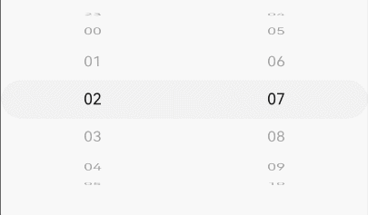

# DatePickerComponent
<!--Kit: ArkUI-->
<!--Subsystem: ArkUI-->
<!--Owner: @luoying_ace_admin-->
<!--Designer: @weixin_52725220-->
<!--Tester: @xiong0104-->
<!--Adviser: @Brilliantry_Rui-->
<!-- md-trans-meta sourceCommit=d7f05d5f0bf3cf76aead2edec1f5b30142fe941e translatedAt=2026-11-03T01:31:48.618Z pushedAt=2026-11-13T01:05:59.869Z nl=1 -->

The **DatePickerComponent** is used to select dates (year, month, and day) and times (hour, minute, and second).

**Since:** 26.0.0

## Modules to Import

```ts
import { DatePickerComponent, DatePickerComponentOptions, DisplayMode, DateMode, TimeFormat, DatePickerComponentResult } from '@kit.ArkUI';
```

## Child Components

None

## DatePickerComponent

DatePickerComponent({ options: DatePickerComponentOptions })

Defines a date and time picker component.

**Since:** 26.0.0

**Decorator:** @Component

**Atomic service API:** This API can be used in atomic services since API version 26.0.0.

**System capability:** SystemCapability.ArkUI.ArkUI.Full

**Model restriction:** This API can be used only in the stage model.

| Name | Type | Mandatory | Decorator Type | Description |
| ---- | ---- | ---- | ---------- | ---- |
| options | [DatePickerComponentOptions](#datepickercomponentoptions) | Yes | @Prop | Options of the date and time picker component. |

## DatePickerComponentOptions

Defines the options of the date and time picker component.

**Since:** 26.0.0

**Atomic service API:** This API can be used in atomic services since API version 26.0.0.

**System capability:** SystemCapability.ArkUI.ArkUI.Full

**Model restriction:** This API can be used only in the stage model.

| Name | Type | Read-Only | Optional | Description |
| ---- | ---- | ---- | ---- | ---- |
| displayMode | [DisplayMode](#displaymode) | No | Yes | Display mode of the picker.<br>Default value: **DisplayMode.DATE**<br>**NOTE**<br>- **DATE**: Displays only the date using **dateOptions**. This value is applicable to scenarios where only the date needs to be selected, such as birthday selection and schedule date setting.<br>- **TIME**: Displays only the time using **timeOptions**. This value is applicable to scenarios where only the time needs to be selected, such as alarm setting and reminder time setting.<br>- **DATE_TIME**: Displays both the date and time, with **dateOptions** and **timeOptions** taking effect simultaneously. This value is applicable to scenarios where both the date and time need to be selected, such as event scheduling and meeting time setting. |
| dateOptions | [DateOptions](#dateoptions) | No | Yes | Date options. |
| timeOptions | [TimeOptions](#timeoptions) | No | Yes | Time options. |

## DisplayMode

Enumerates the display modes of the picker.

**Since:** 26.0.0

**Atomic service API:** This API can be used in atomic services since API version 26.0.0.

**System capability:** SystemCapability.ArkUI.ArkUI.Full

**Model restriction:** This API can be used only in the stage model.

| Name | Value | Description |
| ---- | -- | ---- |
| DATE | 0 | Date only. |
| TIME | 1 | Time only. |
| DATE_TIME | 2 | Both date and time. |

## DateMode

Enumerates the modes of the date picker.

**Since:** 26.0.0

**Atomic service API:** This API can be used in atomic services since API version 26.0.0.

**System capability:** SystemCapability.ArkUI.ArkUI.Full

**Model restriction:** This API can be used only in the stage model.

| Name | Value | Description |
| ---- | -- | ---- |
| DATE | 0 | Three columns: year, month, and day. |
| YEAR_AND_MONTH | 1 | Two columns: year and month. |
| MONTH_AND_DAY | 2 | Two columns: month and day. In this mode, the year is specified by **selected** and remains unchanged; if **selected** is not specified, the current system year is used. When the month changes from December to January, the year does not increment. When the month changes from January to December, the year does not decrement. When scrolling through months causes the day to exceed the valid range, the day is automatically adjusted to the last day of that month. |

## TimeFormat

Enumerates the formats of the time picker.

**Since:** 26.0.0

**Atomic service API:** This API can be used in atomic services since API version 26.0.0.

**System capability:** SystemCapability.ArkUI.ArkUI.Full

**Model restriction:** This API can be used only in the stage model.

| Name | Value | Description |
| ---- | -- | ---- |
| HOUR_MINUTE | 0 | Hours and minutes. |
| HOUR_MINUTE_SECOND | 1 | Hours, minutes, and seconds. |

## DatePickerComponentResult

Defines the selection result of the date and time picker, including the year, month, day, hour, minute, and second selected by the user. It is used to pass the specific date and time values in the **onChange** and **onScrollStop** callbacks.

> **NOTE**
>
> Since API version 26.1.0, when [hideYear](#dateoptions) is **true**, if the user selects "----", **year** returns **undefined**; if a specific year is selected, **year** is the selected specific year. In lunar calendar mode, if the user selects "----", **year** also returns **undefined**, and the returned month and day are lunar calendar values; if a specific year is selected, the corresponding Gregorian calendar values of the year, month, and day are still returned. When [hideYear](#dateoptions) is **false**, the year, month, and day always return Gregorian calendar values.

**Since:** 26.0.0

**Atomic service API:** This API can be used in atomic services since API version 26.0.0.

**System capability:** SystemCapability.ArkUI.ArkUI.Full

**Model restriction:** This API can be used only in the stage model.

| Name | Type | Read-Only | Optional | Description |
| ---- | ---- | ---- | ---- | ---- |
| year | number | No | Yes | Year of the selected date. The value must be an integer.<br>When [hideYear](#dateoptions) is true and the user selects "----", year returns undefined; when a specific year is selected, the value is the selected specific year. |
| month | number | No | Yes | Month index of the selected date, starting from 0. The value **0** indicates January, and **11** indicates December. |
| day | number | No | Yes | Day of the selected date. |
| hour | number | No | Yes | Hour of the selected time. |
| minute | number | No | Yes | Minute of the selected time. |
| second | number | No | Yes | Second of the selected time. |

## CommonOptions

Defines the common options of the date and time picker.

> **NOTE**
>
> - The parameter order of the **Date** constructor is: year, month index (0-11), day, hour, minute, second. Note: The year parameter must be greater than 99 or less than 0 to avoid 1900s mapping.
> - For the usage of **Date**, see [TimePickerOptions](ts-basic-components-timepicker.md#timepickeroptions). Note that when you need to set a date with a year from 1 to 99, do not use the `new Date(1, 0, 1)` syntax, because the JavaScript `new Date(year, month, day)` constructor has special handling for years from 1 to 99 and automatically adds 1900, that is, the year becomes 1901. Therefore, it is recommended to use the `new Date('0001-01-01')` syntax in this case.
> - The text font size of **DatePickerComponent** varies with the total number of displayed columns. When the number of columns is greater than or equal to 6, the font size is 14 vp; in other cases, it is 16 vp. When the component width is too narrow, text truncation may occur.
> - When a parameter is omitted or set to **undefined**, the default value is retained.
> - When **start**, **end**, and **selected** are set in [DateOptions](#dateoptions), only the date part (year, month, and day) takes effect. When **start**, **end**, and **selected** are set in [TimeOptions](#timeoptions), only the time part (hour, minute, and second) takes effect. The system automatically filters the corresponding part of the **Date** object and applies the constraint based on the configured **displayMode** and the corresponding **Options** type.
> - [extendSelected](#commonoptions) has a higher priority than [selected](#commonoptions). Since API version 26.1.0, when both are set, **selected** does not take effect. **extendSelected** supports passing in [DatePickerComponentResult](#datepickercomponentresult) to return the last selection result, which is applicable to scenarios where the selection state is restored across component reconstruction (for example, restoring the date and time last selected by the user after page navigation).

**Since:** 26.0.0

**System capability:** SystemCapability.ArkUI.ArkUI.Full

**Model restriction:** This API can be used only in the stage model.

| Name | Type | Read-Only | Optional | Description |
| ---- | ---- | ---- | ---- | ---- |
| start | Date | No | Yes | Start date or time of the picker.<br>Default value: Date('1970-01-01T00:00:00')<br>Value range: \[Date('0001-01-01T00:00:00'), Date('9999-12-31T23:59:59')] <br>**Note:**<br>When start is set to a valid value, loop does not take effect before API version 26.1.0. Starting from API version 26.1.0, loop takes effect on non-boundary columns but not on boundary columns.<br>**Atomic service API:** Starting from API version 26.0.0, this API is supported in atomic services.|
| end | Date | No | Yes | End date or time of the picker.<br>Default value: Date('2100-12-31T23:59:59')<br>Value range: \[Date('0001-01-01T00:00:00'), Date('9999-12-31T23:59:59')] <br>**Note:**<br>When end is set to a valid value, loop does not take effect before API version 26.1.0. Starting from API version 26.1.0, loop takes effect on non-boundary columns but not on boundary columns.<br>**Atomic service API:** Starting from API version 26.0.0, this API is supported in atomic services.|
| selected | Date | No | Yes | Selected date or time, which is displayed as the initial selected value after being set.<br>The default value is the current system date or time.<br>**Note:**<br>In DateMode.MONTH_AND_DAY mode, only the month and day fields participate in selection; the year takes the value specified by selected, or the current system year if not specified, and remains unchanged during scrolling.<br>Starting from API version 26.1.0, when set together with [extendSelected](#commonoptions), selected does not take effect.<br>**Atomic service API:** Starting from API version 26.0.0, this API is supported in atomic services. |
| extendSelected | Date \| [DatePickerComponentResult](#datepickercomponentresult) | No | Yes | Selected date or time, which is displayed as the initial selected value after being set.<br>**Takes precedence over [selected](#commonoptions)**: when both are set, selected does not take effect.<br>The default value is the current system date or time.<br>**Note:**<br>This parameter is added since API version 26.1.0. It supports passing [DatePickerComponentResult](#datepickercomponentresult) to restore the previous selection state by returning the selection result received in the [onChange](#commonoptions) or [onScrollStop](#commonoptions) callback:<br>- When a Date is passed, the behavior is the same as selected.<br>- When a **DatePickerComponentResult** is passed, each set field takes effect, and unset fields take the corresponding system default part (field-level default). For example, when `{hour: 10, minute: 30}` is passed (second is not set), hour and minute take effect, and second takes the system default value.<br>- When [hideYear](#dateoptions) is true and year is undefined, the year column selects "----", year is ignored, and only month/day are used.<br>- When the passed date or time is invalid, it falls back to the system default date.<br>**Since:** 26.1.0<br>**Atomic service API:** Starting from API version 26.1.0, this API is supported in atomic services. |
| loop | boolean | No | Yes | Whether to enable the loop mode.<br>- **true**: enables the loop mode, allowing continuous cyclic selection when scrolling to the boundary.<br>- **false**: disables the loop mode, stopping at the boundary when scrolling.<br>Default value: **true**<br>**Usage scenario:**<br>The loop mode is suitable for scenarios that require continuous cyclic selection, such as quickly browsing years and months; the non-loop mode is suitable for scenarios that require a clear boundary range.<br>**Atomic service API:** Starting from API version 26.0.0, this API is supported in atomic services. |
| onChange | [Callback](ts-types.md#callback12)<[DatePickerComponentResult](#datepickercomponentresult)> | No | Yes | Callback invoked after a date or time is selected.<br>**Atomic service API:** Starting from API version 26.0.0, this API is supported in atomic services. |
| onScrollStop | [Callback](ts-types.md#callback12)<[DatePickerComponentResult](#datepickercomponentresult)> | No | Yes | Callback invoked when a picker item is selected and scrolling stops.<br>**Atomic service API:** Starting from API version 26.0.0, this API is supported in atomic services. |
| enableHapticFeedback | boolean | No | Yes | Whether to enable haptic feedback.<br>Default value: true<br>- **true**: enables haptic feedback, suitable for scenarios that require enhanced user interaction experience, such as games and musical instrument applications.<br>- **false**: disables haptic feedback, suitable for scenarios that do not require haptic feedback or need to save device resources.<br>**Note:**<br>1. After being set to **true**, whether it takes effect depends on whether the system hardware supports it.<br>2. To enable haptic feedback, configure the requestPermissions field in [module.json5](../../../quick-start/module-configuration-file.md) of the project to enable the vibration permission, as follows:<br>"requestPermissions": [{"name": "ohos.permission.VIBRATE"}]<br>**Atomic service API:** Starting from API version 26.0.0, this API is supported in atomic services. |

> **NOTE**
>
> - **onChange** is triggered when the user selects a date or time, and is used to respond to the user's selection.
> - **onScrollStop** is triggered after scrolling completely stops, and returns the current selected item regardless of whether the value has changed.
> - Both can be used together or separately as needed: **onChange** is used for immediate response to user selection, and **onScrollStop** is used to obtain the stable result after scrolling stops.


**Exception handling for the start date, end date, and selected date**

| Exception Scenario   | Result  |
| -------- |  ------------------------------------------------------------ |
| The start date is later than the end date, and the selected date is not set.    | The start date, end date, and selected date all use the default values. |
| The start date is later than the end date, and the selected date is earlier than the default start date.    | The start date and end date use the default values, and the selected date uses the default start date.  |
| The start date is later than the end date, and the selected date is later than the default end date.    | The start date and end date use the default values, and the selected date uses the default end date.  |
| The start date is later than the end date, and the selected date is within the range of the default start date and default end date.    | The start date and end date use the default values, and the selected date uses the set value. |
| The selected date is earlier than the start date.    | The selected date is set to the start date.  |
| The selected date is later than the end date.    | The selected date is set to the end date.  |
| The start date is later than the current system date, and the selected date is not set.    | The selected date is set to the start date.  |
| The end date is earlier than the current system date, and the selected date is not set.    | The selected date is set to the end date.  |
| The **Date** object constructor parameters are invalid or non-compliant, for example, the year, month, or day parameters are out of the valid range, or an invalid string is passed, resulting in an invalid date.   | The default value is used.  |
| The start date or end date is earlier than the minimum value of the valid range.    | The start date or end date uses the default start date. |
| The start date or end date is later than the maximum value of the valid range.    | The start date or end date uses the default end date. |
| Both the start date and end date are earlier than the minimum value of the valid range. | The start date and end date use the earliest date in the system valid range. |
| Both the start date and end date are later than the maximum value of the valid range. | The start date and end date use the latest date in the system valid range. |

**Exception handling for the start time and end time**

| Exception Scenario   | Result  |
| -------- |  ------------------------------------------------------------ |
| The start time is later than the end time.    | The start time and end time both use the default values.  |
| The selected time is earlier than the start time.   | The selected time is set to the start time.  |
| The selected time is later than the end time.    | The selected time is set to the end time.  |
| The start time is later than the current system time, and the selected time is not set.    | The selected time is set to the start time. |
| The end time is earlier than the current system time, and the selected time is not set.    | The selected time is set to the end time.  |
| The **Date** object constructor parameters are invalid or non-compliant, for example, the hour, minute, or second parameters are out of the valid range, or an invalid string is passed, resulting in an invalid date.   | The default value is used.  |

## DateOptions

Defines the options of the date picker.

This API inherits from [CommonOptions](#commonoptions).

**Since:** 26.0.0

**System capability:** SystemCapability.ArkUI.ArkUI.Full

**Model restriction:** This API can be used only in the stage model.

| Name | Type | Read-Only | Optional | Description |
| ---- | ---- | ---- | ---- | ---- |
| mode | [DateMode](#datemode) | No | Yes | Mode of the date picker.<br>Default value: **DateMode.DATE**<br>**Atomic service API:** Since API version 26.0.0, this API is supported in atomic services. |
| lunar | boolean | No | Yes | Whether to display the lunar calendar.<br>- **true**: displays the lunar calendar, which applies to scenarios that require traditional lunar dates, such as traditional festivals, lunar birthdays, and lunar anniversaries.<br>- **false**: does not display the lunar calendar, which applies to scenarios that use Gregorian calendar dates.<br>Default value: **false**<br>**Note:**<br>This attribute takes effect only in the Simplified Chinese and Traditional Chinese language environments. In other language environments, setting this attribute has no effect.<br>**Atomic service API:** Since API version 26.0.0, this API is supported in atomic services. |
| hideYear | boolean | No | Yes | Whether to enable the "hide year" option.<br>- **true**: appends a "----" option after [end](#commonoptions). Users can select "----" to indicate that they do not care about the specific year, which applies to scenarios such as birthdays and anniversaries that do not require a specific year.<br>- **false**: does not display the "----" option. The year column displays only the specific years within the range of [start](#commonoptions) and [end](#commonoptions).<br>Default value: **false**<br>**Note:**<br>1. This attribute takes effect only when [displayMode](#datepickercomponentoptions) is **DisplayMode.DATE** or **DisplayMode.DATE_TIME**, and [mode](#dateoptions) is **DateMode.DATE** or **DateMode.YEAR_AND_MONTH**.<br>2. When this attribute is **true**, users can still scroll to select a specific year, and can freely switch between the "----" option and specific years.<br>3. This attribute supports dynamic switching at runtime. When the attribute value changes, the year column is updated accordingly.<br>**Since:** 26.1.0<br>**Atomic service API:** Since API version 26.1.0, this API is supported in atomic services. |

## TimeOptions

Defines the options of the time picker.

This API inherits from [CommonOptions](#commonoptions).

> **NOTE**
>
> If the **start** or **end** parameter is set to a valid value, the **loop** parameter will not take effect. For details, see the parameter description of [CommonOptions](#commonoptions).

**Since:** 26.0.0

**Atomic service API:** This API can be used in atomic services since API version 26.0.0.

**System capability:** SystemCapability.ArkUI.ArkUI.Full

**Model restriction:** This API can be used only in the stage model.

| Name | Type | Read-Only | Optional | Description |
| ---- | ---- | ---- | ---- | ---- |
| format | [TimeFormat](#timeformat) | No | Yes | Format of the time picker.<br>Default value: **TimeFormat.HOUR_MINUTE** |
| useMilitaryTime | boolean | No | Yes | Whether to display time in 24-hour format.<br>- **true**: The time is displayed in 24-hour format, applicable to international applications and professional scenarios that require precise time expression (such as healthcare, transportation, and military).<br>- **false**: The time is displayed in 12-hour format, applicable to daily application scenarios targeting general users, which better aligns with users' everyday reading habits.<br>Default value: **false** |

## Examples

### Example 1: Date Picker

This example implements a date picker by setting **displayMode** in [DatePickerComponentOptions](#datepickercomponentoptions) to **DisplayMode.DATE**.

Since API version 26.0.0, the [DatePickerComponentOptions](#datepickercomponentoptions) parameter is added.

```ts
import { DatePickerComponent, DisplayMode, DateMode } from '@kit.ArkUI';

@Entry
@Component
struct DatePickerExample {
  @State selectedYear: number = 2026
  @State selectedMonth: number = 0
  @State selectedDay: number = 1

  build() {
    Column() {
      DatePickerComponent({
        options: {
          displayMode: DisplayMode.DATE,
          dateOptions: {
            mode: DateMode.DATE,
            selected: new Date(this.selectedYear, this.selectedMonth, this.selectedDay),
            start: new Date('2020-03-01'),
            end: new Date('2030-10-31'),
            enableHapticFeedback: true,
            onChange: (result) => {
              console.info('Selected date: ' + (result.year ?? 0) + '-' + ((result.month ?? 0) + 1) + '-' + (result.day ?? 0));
              if (result.year !== undefined) {
                this.selectedYear = result.year
              }
              if (result.month !== undefined) {
                this.selectedMonth = result.month
              }
              if (result.day !== undefined) {
                this.selectedDay = result.day
              }
            },
            onScrollStop: (result) => {
              console.info('Scroll stop: ' + (result.year ?? 0) + '-' + ((result.month ?? 0) + 1) + '-' + (result.day ?? 0));
            }
          }
        }
      })
    }
  }
}

```

<!--Del--> <!--DelEnd-->

### Example 2: Time Picker

This example implements a time picker by setting **displayMode** in [DatePickerComponentOptions](#datepickercomponentoptions) to **DisplayMode.TIME**.

Since API version 26.0.0, the [DatePickerComponentOptions](#datepickercomponentoptions) parameter is added.

```ts
import { DatePickerComponent, DisplayMode, TimeFormat } from '@kit.ArkUI';

@Entry
@Component
struct TimePickerExample {
  build() {
    Column() {
      DatePickerComponent({
        options: {
          displayMode: DisplayMode.TIME,
          timeOptions: {
            format: TimeFormat.HOUR_MINUTE,
            useMilitaryTime: true,
            enableHapticFeedback: true,
            onChange: (result) => {
              console.info('Selected time: ' + (result.hour ?? 0) + ':' + (result.minute ?? 0));
            },
            onScrollStop: (result) => {
              console.info('Scroll stop: ' + (result.hour ?? 0) + ':' + (result.minute ?? 0));
            }
          }
        }
      })
    }
  }
}
```



### Example 3: Date and Time Picker

This example sets **displayMode** in [DatePickerComponentOptions](#datepickercomponentoptions) to **DisplayMode.DATE_TIME** to select both date and time.

Since API version 26.0.0, the [DatePickerComponentOptions](#datepickercomponentoptions) parameter is added.

```ts
import { DatePickerComponent, DisplayMode, DateMode, TimeFormat } from '@kit.ArkUI';

@Entry
@Component
struct DateTimePickerExample {
  build() {
    Column() {
      DatePickerComponent({
        options: {
          displayMode: DisplayMode.DATE_TIME,
          dateOptions: {
            mode: DateMode.DATE,
            lunar: false,
            enableHapticFeedback: true,
            onChange: (result) => {
              console.info('Selected: ' + JSON.stringify(result));
            },
            onScrollStop: (result) => {
              console.info('Scroll stop: ' + JSON.stringify(result));
            }
          },
          timeOptions: {
            format: TimeFormat.HOUR_MINUTE_SECOND,
            useMilitaryTime: false,
            onChange: (result) => {
              console.info('Selected: ' + JSON.stringify(result));
            },
            onScrollStop: (result) => {
              console.info('Scroll stop: ' + JSON.stringify(result));
            }
          }
        }
      })
    }
  }
}
```

<!--Del--> <!--DelEnd-->

### Example 4: Disabling Loop Mode

This example disables the loop scrolling mode of the picker by setting **loop** in [DateOptions](#dateoptions) to **false**.

Since API version 26.0.0, the [DateOptions](#dateoptions) parameter is added.

```ts
import { DatePickerComponent, DisplayMode, DateMode } from '@kit.ArkUI';

@Entry
@Component
struct NoLoopPickerExample {
  build() {
    Column() {
      DatePickerComponent({
        options: {
          displayMode: DisplayMode.DATE,
          dateOptions: {
            mode: DateMode.DATE,
            selected: new Date(),
            start: new Date('2020-01-01'),
            end: new Date('2030-12-31'),
            loop: false,
            onChange: (result) => {
              console.info('Selected date: ' + (result.year ?? 0) + '-' + ((result.month ?? 0) + 1) + '-' + (result.day ?? 0));
            }
          }
        }
      })
    }
  }
}
```

<!--Del--> <!--DelEnd-->

### Example 5 Hiding the Year Option and Returning the Result

This example uses the **hideYear** parameter in [DateOptions](#dateoptions) to enable the "----" option, and uses the **extendSelected** parameter in [CommonOptions](#commonoptions) to return the previous selection result (including the "----" selection) to restore the selection state.

Since API version 26.1.0, [DateOptions](#dateoptions) adds the **hideYear** parameter, and [CommonOptions](#commonoptions) adds the **extendSelected** parameter.

```ts
import { DatePickerComponent, DisplayMode, DateMode, DatePickerComponentResult } from '@kit.ArkUI';

@Entry
@Component
struct HideYearAndExtendSelectedExample {
  // Save the last selection result for return.
  @State lastResult: DatePickerComponentResult = { year: undefined, month: 10, day: 20 };

  build() {
    Column() {
      DatePickerComponent({
        options: {
          displayMode: DisplayMode.DATE,
          dateOptions: {
            mode: DateMode.DATE,
            start: new Date('2020-01-01'),
            end: new Date('2030-12-31'),
            hideYear: true,
            // extendSelected takes precedence over selected; pass in the last result to restore the selection state.
            extendSelected: this.lastResult,
            onChange: (result) => {
              this.lastResult = result
              console.info('Selected: year=' + (result.year ?? '----') +
                ', month=' + (result.month ?? 0) + ', day=' + (result.day ?? 0))
            },
            onScrollStop: (result) => {
              console.info('Scroll stop: year=' + (result.year ?? '----') +
                ', month=' + (result.month ?? 0) + ', day=' + (result.day ?? 0))
            }
          }
        }
      })
    }
  }
}
```

<!--Del--> <!--DelEnd-->
