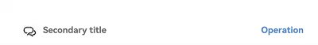
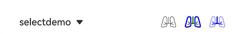
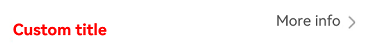
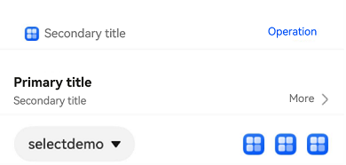

# SubHeader
<!--Kit: ArkUI-->
<!--Subsystem: ArkUI-->
<!--Owner: @huangxiaolinabc-->
<!--Designer: @fangzhiyuan1-->
<!--Tester: @Giacinta-->
<!--Adviser: @Brilliantry_Rui-->
<!-- md-trans-meta sourceCommit=a2be072c98789f4da04ce6df0c49a90391628186 translatedAt=2026-11-26T03:42:57.659Z pushedAt=2026-11-26T09:22:16.460Z nl=1 -->


The **SubHeader** component is positioned at the top of list items or content sections, organizing lists or content into distinct groups. The subheader text summarizes the content within each respective section.


> **NOTE**
>
> - This component is supported since API version 10. Updates will be marked with a superscript to indicate their earliest API version.
>
> - This component can be used only in the stage model.
>
> - If the **SubHeader** component has [universal attributes](ts-component-general-attributes.md) and [universal events](ts-component-general-events.md) configured, the compiler toolchain automatically generates an additional \_\_Common\_\_ node and mounts the universal attributes and universal events on this node rather than the **SubHeader** component itself. As a result, the configured universal attributes and universal events may fail to take effect or behave as intended. For this reason, avoid using universal attributes and events with the **SubHeader** component.


## Modules to Import

```ts
import { SubHeader } from '@kit.ArkUI';
```


## Child Components

Not supported

> **NOTE**
>
> Text-related settings are not supported.

## SubHeader

SubHeader({icon?: ResourceStr, iconSymbolOptions?: SymbolOptions, endIcon?: ResourceStr, endIconSymbolOptions?: SymbolOptions, primaryTitle?: ResourceStr, secondaryTitle?: ResourceStr, select?: SelectOptions, operationType?: OperationType, operationItem?: Array&lt;OperationOption&gt;, operationSymbolOptions?: Array&lt;SymbolOptions&gt;, primaryTitleModifier?: TextModifier, secondaryTitleModifier?: TextModifier, titleBuilder?: () => void, contentMargin?: LocalizedMargin, contentPadding?: LocalizedPadding, titleAccessibilityText?: ResourceStr, titleId?: string })

**Decorator**: @Component

**System capability**: SystemCapability.ArkUI.ArkUI.Full

**Device behavior differences**: On wearables, calling this API results in a runtime exception indicating that the API is undefined. On other devices, the API works correctly.

| Name | Type | Mandatory | Decorator | Description |
| -------- | -------- | -------- |---------------| -------- |
| icon | [ResourceStr](ts-types.md#resourcestr) | No | \@Prop        | Icon setting item.<br/>Default value: **undefined**, indicating that no icon is displayed.<br/>The **icon** attribute takes effect only when the **secondaryTitle** attribute is used.<br/>**Atomic service API:** This API supports use in atomic services since API version 11. |
| iconSymbolOptions<sup>12+</sup> | [SymbolOptions](#symboloptions12) | No | -             | Settings when **icon** is [SymbolGlyph](ts-basic-components-symbolGlyph.md).<br/>Default value: **undefined**, indicating that no icon is displayed.<br/>**Atomic service API:** This API can be used in atomic services since API version 12. |
| endIcon | [ResourceStr](ts-types.md#resourcestr) | No | @Prop | Icon resource at the title end.<br/>This attribute takes effect only when the **primaryTitle** or **secondaryTitle** attribute is used.<br/>Default value: **undefined**, indicating that the icon at the title end is not displayed.<br/>**Since:** 26.0.1 <br/>**Atomic service API:** This API is supported in atomic services since API version 26.0.1. <br/>**Model restriction:** This API can be used only in the stage model. |
| endIconSymbolOptions | [SymbolOptions](#symboloptions12) | No | -             | Settings for **endIcon** when it is a [SymbolGlyph](ts-basic-components-symbolGlyph.md).<br/>Default value: **undefined**, indicating that the style of the Symbol icon at the title end is not set.<br/>**Since:** 26.0.1 <br/>**Atomic service API:** This API is supported in atomic services since API version 26.0.1. <br/>**Model restriction:** This API can be used only in the stage model. |
| primaryTitle | [ResourceStr](ts-types.md#resourcestr) | No | \@Prop        | Primary title content.<br/>Default value: **undefined**, indicating that no title is displayed.<br/>When the **primaryTitle**, **secondaryTitle**, and **icon** attributes are used together, the **primaryTitle** attribute does not take effect.<br/>**Atomic service API:** This API can be used in atomic services since API version 11. |
| secondaryTitle | [ResourceStr](ts-types.md#resourcestr) | No | \@Prop        | Secondary title content.<br/>Default value: **undefined**, indicating that no secondary title is displayed. When the **primaryTitle**, **secondaryTitle**, and **icon** attributes are used together, the **primaryTitle** attribute does not take effect.<br/>**Atomic service API:** This API can be used in atomic services since API version 11. |
| select | [SelectOptions](#selectoptions) | No | -             | Dropdown box content and events.<br/>Default value: **undefined**, indicating that no dropdown box is displayed.<br/>**Atomic service API:** This API can be used in atomic services since API version 11. |
| operationType | [OperationType](#operationtype) | No | \@Prop        | Element style of the operation area (right side).<br/>Default value: **OperationType.BUTTON**<br/>**Atomic service API:** This API can be used in atomic services since API version 11. |
| operationItem | Array&lt;[OperationOption](#operationoption)&gt; | No | -             | Setting item of the operation area (right side).<br/>Default value: **undefined**, indicating that no operation area is displayed.<br/>**Atomic service API:** This API supports use in atomic services since API version 11. |
| operationSymbolOptions<sup>12+</sup> | Array&lt;[SymbolOptions](#symboloptions12)&gt; | No | -             | Settings when **operationType** is **OperationType.ICON_GROUP**, **operationItem** is set with multiple icons, and the icons are [SymbolGlyph](ts-basic-components-symbolGlyph.md).<br/>Default value: **undefined**, indicating that no symbol icon is set.<br/>**Atomic service API:** This API can be used in atomic services since API version 12. |
| primaryTitleModifier<sup>12+</sup> | [TextModifier](ts-universal-attributes-attribute-modifier.md#custom-modifier) | No | -             | Used to set the title text attributes, such as title color, font size, font weight, etc.<br/>Default value: **undefined**, indicating that the system default style is used.<br/>**Atomic service API:** This API supports use in atomic services since API version 12. |
| secondaryTitleModifier<sup>12+</sup> | [TextModifier](ts-universal-attributes-attribute-modifier.md#custom-modifier) | No | -             | Used to set the secondary title text attributes, such as title color, font size, font weight, etc.<br/>Default value: **undefined**, indicating that the system default style is used.<br/>**Atomic service API:** This API can be used in atomic services since API version 12. |
| titleBuilder<sup>12+</sup> | () => void | No | @BuilderParam | Custom title area content.<br/>Default value: **undefined**, indicating that no custom title definition is adopted for the title.<br/>**Atomic service API:** This API supports use in atomic services since API version 12. |
| contentMargin<sup>12+</sup> | [LocalizedMargin](ts-types.md#localizedmargin12) | No | @Prop         | Margin of the subheader. Negative values are not supported.<br />Default value:<br /> `{start: LengthMetrics.resource(` <br /> `$r('sys.float.margin_left'))`, <br /> `end: LengthMetrics.resource(` <br /> `$r('sys.float.margin_right'))}`<br/>**Atomic service API:** This API can be used in atomic services since API version 12. |
| contentPadding<sup>12+</sup> | [LocalizedPadding](ts-types.md#localizedpadding12) | No | @Prop         | Padding of the subheader.<br />Default value:<br />When the left side contains a secondary title or a secondary title with an icon:<br /> {start: LengthMetrics.vp(12), end: LengthMetrics.vp(12)}.<br/>**Atomic service API:** This API supports use in atomic services since API version 12.|
| titleAccessibilityText<sup>23+</sup>  | [ResourceStr](ts-types.md#resourcestr) | No | @Prop         | Custom spoken content of the title.<br/>Default value: **undefined**<br/>When the value is **undefined**, the title content displayed by the component is read aloud by default.<br/>**Atomic service API:** This API supports use in atomic services since API version 23.   |
| titleId<sup>24+</sup>  | string | No | @Prop         | Title ID. Set this parameter when an ID needs to be set for the title. When omitted, this parameter is not set.<br/>Default value: **undefined**, indicating that no title ID is set.<br/>**Atomic service API:** This API supports use in atomic services since API version 24.   |

## OperationType

Defines the style of elements in the subheader operation area.

**Atomic service API**: This API can be used in atomic services since API version 11.

**System capability**: SystemCapability.ArkUI.ArkUI.Full

**Device behavior differences**: On wearables, calling this API results in a runtime exception indicating that the API is undefined. On other devices, the API works correctly.

| Name| Value| Description|
| -------- | -------- | -------- |
| TEXT_ARROW |  0  | Text button with a right arrow.|
| BUTTON |  1  |  Text button without a right arrow.|
| ICON_GROUP |  2  |  Icon-attached button (A maximum of three icons can be configured.)|
| LOADING |  3  |  Loading animation.|

## SelectOptions

**System capability**: SystemCapability.ArkUI.ArkUI.Full

**Device behavior differences**: On wearables, calling this API results in a runtime exception indicating that the API is undefined. On other devices, the API works correctly.

| Name| Type| Read-Only| Optional| Description                                                                                                                                                          |
| -------- | -------- |---|---|--------------------------------------------------------------------------------------------------------------------------------------------------------------|
| options | Array&lt;[SelectOption](ts-basic-components-select.md#selectoption)&gt; | No| No| Options of an item in the drop-down list box.<br>**Atomic service API**: This API can be used in atomic services since API version 11.                                                                                                |
| selected | number | No| Yes| Index of the initially selected item in the drop-down list box.<br>The value must be greater than or equal to -1.<br>The index of the first item is 0.<br>If this attribute is not set, the default value **-1** is used, indicating that the option is not selected.<br>Values less than -1 are treated as no selection.<br>**Atomic service API**: This API can be used in atomic services since API version 11.|
| value | [ResourceStr](ts-types.md#resourcestr) | No| Yes| Text content of the drop-down list button itself.<br>The default value is an empty string.<br>Note: If the text length exceeds the column width, it will be truncated. The Resource type is supported since API version 20.<br>**Atomic service API**: This API can be used in atomic services since API version 11.                      |
| onSelect | (index:&nbsp;number,&nbsp;value?:&nbsp;string)&nbsp;=&gt;&nbsp;void | No| Yes| Callback invoked when an item in the drop-down list box is selected.<br>- **index**: index of the selected option.<br>- **value**: value of the selected option.<br>**Atomic service API**: This API can be used in atomic services since API version 11.                                          |
| defaultFocus<sup>18+</sup> | boolean | No| Yes| Whether the drop-down button is the default focus.<br>**true**: The drop-down button is the default focus.<br>**false**: The drop-down button is not the default focus.<br>Default value: **false**<br>**Atomic service API**: This API can be used in atomic services since API version 18.                                |

## OperationOption

**System capability**: SystemCapability.ArkUI.ArkUI.Full

**Device behavior differences**: On wearables, calling this API results in a runtime exception indicating that the API is undefined. On other devices, the API works correctly.

| Name | Type | Read-Only | Optional | Description                                                                                                                                                                                                                                                       |
| -------- | -------- |---|---|----------------------------------------------------------------------------------------------------------------------------------------------------------------------------------------------------------------------------------------------------------|
| value | [ResourceStr](ts-types.md#resourcestr) | No | No | Operation area element content. When **operationType** is **TEXT_ARROW** or **BUTTON**, **value** is the text content; when **operationType** is **ICON_GROUP**, **value** is the icon resource.<br/>**Atomic service API:** This API can be used in atomic services since API version 11. |
| action | ()=&gt;void | No | Yes | Click event of the subheader end button.<br/>**Atomic service API**: This API can be used in atomic services since API version 11.                                                                                                                                                                                                                                                    |
| accessibilityLevel<sup>18+</sup>       | string  | No | Yes | Accessibility level of the subheader end button. It is used to control whether the current item can be recognized by accessibility services.<br/>Supported values:<br/>**"auto"**: The current component is converted to **"yes"**.<br/>**"yes"**: The current component can be recognized by accessibility services.<br/>**"no"**: The current component cannot be recognized by accessibility services.<br/>**"no-hide-descendants"**: The current component and all its child components cannot be recognized by accessibility services.<br/>Default value: **"auto"**<br/>**Atomic service API**: This API can be used in atomic services since API version 18. |
| accessibilityText<sup>18+</sup>        | [ResourceStr](ts-types.md#resourcestr) | No | Yes | Accessibility text of the subheader end button. When a component does not contain a text attribute, the screen reader does not announce anything when this component is selected, and the user cannot clearly know which component is currently selected. To address this scenario, developers can set accessibility text for components that do not contain text information. When the screen reader selects this component, it announces the content of the accessibility text, helping screen reader users clearly know which component they have selected.<br/>Default value: When the type is **TEXT_ARROW** or **BUTTON**, the default value is the content of the value attribute of the current item; for other types, the default value is " ".<br/>**Atomic service API**: This API can be used in atomic services since API version 18. |
| accessibilityDescription<sup>18+</sup> | [ResourceStr](ts-types.md#resourcestr) | No | Yes | Accessibility description of the subheader end button. This description is used to explain the current component to the user in detail. You should provide a relatively detailed text description for this attribute of the component to help users understand the operation to be performed and its possible consequences, especially when these consequences cannot be directly learned from the component's attributes and accessibility text alone. If a component has both a text attribute and an accessibility description attribute, when the component is selected, the system first announces the component's text attribute and then announces the content of the accessibility description attribute.<br/>Default value: When the type is **LOADING**, the default value is "Loading"; for other types, the default value is "Double-tap with one finger to execute".<br/>**Atomic service API**: This API can be used in atomic services since API version 18.        |
| defaultFocus<sup>18+</sup> | boolean | No | Yes | Whether the subheader end button is the default focus.<br/>**true**: The subheader end button is the default focus.<br/>**false**: The subheader end button is not the default focus.<br />Default value: false <br/>**Atomic service API**: This API can be used in atomic services since API version 18.                                                                                                                                            |
| id<sup>24+</sup> | string | No | Yes | ID of the subheader end button. Set this parameter when an ID needs to be set for the subheader end button. By default, this parameter is not set.<br/>Default value: **undefined**, indicating that the ID of the subheader end button is not set. <br/>**Atomic service API**: This API can be used in atomic services since API version 24.      |

## SymbolOptions<sup>12+</sup>

**Atomic service API**: This API can be used in atomic services since API version 12.

**System capability**: SystemCapability.ArkUI.ArkUI.Full

**Device behavior differences**: On wearables, calling this API results in a runtime exception indicating that the API is undefined. On other devices, the API works correctly.

| Name| Type| Read-Only| Optional| Description                                                                                                                                                                                                                                             |
| -------- | -------- |---|---|-------------------------------------------------------------------------------------------------------------------------------------------------------------------------------------------------------------------------------------------------|
| fontColor | Array&lt;[ResourceColor](ts-types.md#resourcecolor)&gt; | No| Yes| Color of the [symbol glyph](ts-basic-components-symbolGlyph.md).<br>Default value: depending on the rendering strategy                                                                                                                                                                      |
| fontSize | number \|&nbsp;string \|&nbsp;[Resource](ts-types.md#resource) | No| Yes| Size of the [symbol glyph](ts-basic-components-symbolGlyph.md).<br>For the number type, the value must be greater than or equal to 0.<br>For the string type, numeric string values with optional units, for example, **"10"** or **"10fp"**, are supported.<br>Default value: system default value                                                                                                |
| fontWeight | number \|&nbsp;[FontWeight](ts-appendix-enums.md#fontweight)&nbsp;\|&nbsp;string | No| Yes| Weight of the [symbol glyph](ts-basic-components-symbolGlyph.md).<br>For the number type, the value ranges from 100 to 900, at an interval of 100. A larger value indicates a heavier font weight. The default value is **400**.<br>For the string type, only strings of the number type are supported, for example, **"400"**, **"bold"**, **"bolder"**, **"lighter"**, **"regular"**, and **"medium"**, which correspond to the enumerated values in **FontWeight**.<br>Default value: **FontWeight.Normal**.|
| renderingStrategy | [SymbolRenderingStrategy](ts-basic-components-symbolGlyph.md#symbolrenderingstrategy11) | No| Yes| Rendering strategy of the [symbol glyph](ts-basic-components-symbolGlyph.md).<br>Default value: **SymbolRenderingStrategy.SINGLE**.<br>**NOTE**<br>For the resources referenced in **$r('sys.symbol.ohos_*')**, only **ohos_trash_circle**, **ohos_folder_badge_plus**, and **ohos_lungs** support the **MULTIPLE_COLOR** modes.                                      |
| effectStrategy | [SymbolEffectStrategy](ts-basic-components-symbolGlyph.md#symboleffectstrategy11) | No| Yes| Effect strategy of the [symbol glyph](ts-basic-components-symbolGlyph.md).<br>Default value: **SymbolEffectStrategy.NONE**.<br>**NOTE**<br>For the resources referenced in **$r('sys.symbol.ohos_*')**, only **ohos_wifi** supports the hierarchical effect.                                                                                      |

## Events
The [universal events](ts-component-general-events.md) are not supported.

## Example
### Example 1: Implementing an Efficiency-oriented Subheader
This example demonstrates how to implement a subheader where the left side contains an icon and a secondary title, and the right side has a text button.

```ts
import { Prompt, OperationType, SubHeader } from '@kit.ArkUI';

@Entry
@Component
struct SubHeaderExample {
  build() {
    Column() {
      SubHeader({
        icon: $r('sys.media.ohos_ic_public_email'),
        secondaryTitle: 'Secondary title',
        operationType: OperationType.BUTTON,
        operationItem: [{
          value: 'Operation',
          action: () => {
            Prompt.showToast({ message: 'demo' });
          }
        }]
      })
    }
  }
}
```



### Example 2: Implementing a Double-Line Text Content-Rich Subheader
This example showcases a subheader with a primary title and a secondary title on the left, and a text button with a right arrow on the right.

```ts
import { Prompt, OperationType, SubHeader } from '@kit.ArkUI';

@Entry
@Component
struct SubHeaderExample {
  build() {
    Column() {
      SubHeader({
        primaryTitle: 'Primary title',
        secondaryTitle: 'Secondary title',
        operationType: OperationType.TEXT_ARROW,
        operationItem: [{
          value: 'More',
          action: () => {
            Prompt.showToast({ message: 'demo' });
          }
        }]
      })
    }
  }
}
```


### Example 3: Implementing a Spinner Content-Rich Subheader
This example showcases a subheader with content and events for selection on the left, and an icon-attached button on the right.

```ts
import { Prompt, OperationType, SubHeader } from '@kit.ArkUI';

@Entry
@Component
struct SubHeaderExample {
  build() {
    Column() {
      SubHeader({
        // The left side is a drop-down box for selection.
        select: {
          options: [{ value: 'aaa' }, { value: 'bbb' }, { value: 'ccc' }],
          value: 'selectDemo',
          selected: 2,
          onSelect: () => {
            Prompt.showToast({ message: 'demo' });
          }
        },
        operationType: OperationType.ICON_GROUP,
        // The right side has three icons.
        operationItem: [{
          value: $r('sys.media.ohos_ic_public_email'),
          action: () => {
            Prompt.showToast({ message: 'demo' })
          }
        }, {
          value: $r('sys.media.ohos_ic_public_email'),
          action: () => {
            Prompt.showToast({ message: 'demo' });
          }
        }, {
          value: $r('sys.media.ohos_ic_public_email'),
          action: () => {
            Prompt.showToast({ message: 'demo' });
          }
        }]
      })
    }
  }
}
```


### Example 4: Setting the Icon Symbol for the Left Side
This example demonstrates how to set the icon symbol for the left side of the subheader.

```ts

import { Prompt, OperationType, SubHeader } from '@kit.ArkUI';

@Entry
@Component
struct SubHeaderExample {
  build() {
    Column() {
      SubHeader({
        // Set the icon to a symbol icon.
        icon: $r('sys.symbol.ohos_wifi'),
        iconSymbolOptions: {
          effectStrategy: SymbolEffectStrategy.HIERARCHICAL,
        },
        secondaryTitle: 'Title',
        operationType: OperationType.BUTTON,
        operationItem: [{
          value: 'Operation',
          action: () => {
            Prompt.showToast({ message: 'demo' });
          }
        }]
      })
    }
  }
}
```


### Example 5: Setting the Icon Symbol for the Right Side
The following example shows how to set **operationType** to **OperationType.ICON_GROUP** for the right side of the subheader, with **operationItem** set to a symbol icon.

```ts
import { Prompt, OperationType, SubHeader } from '@kit.ArkUI';

@Entry
@Component
struct SubHeaderExample {
  build() {
    Column() {
      SubHeader({
        // Set the left side to a drop-down box for selection.
        select: {
          options: [{ value: 'aaa' }, { value: 'bbb' }, { value: 'ccc' }],
          value: 'selectDemo',
          selected: 2,
          onSelect: () => {
            Prompt.showToast({ message: 'demo' });
          }
        },
        operationType: OperationType.ICON_GROUP,
        // Set the right side to icons.
        operationItem: [{
          value: $r('sys.symbol.ohos_lungs'),
          action: () => {
            Prompt.showToast({ message: 'icon1' });
          }
        }, {
          value: $r('sys.symbol.ohos_lungs'),
          action: () => {
            Prompt.showToast({ message: 'icon2' });
          }
        }, {
          value: $r('sys.symbol.ohos_lungs'),
          action: () => {
            Prompt.showToast({ message: 'icon3' });
          }
        }],
        // Set the symbol style for the right side icons.
        operationSymbolOptions: [{
          fontWeight: FontWeight.Lighter,
        }, {
          renderingStrategy: SymbolRenderingStrategy.MULTIPLE_COLOR,
          fontColor: [Color.Blue, Color.Grey, Color.Green],
        }, {
          renderingStrategy: SymbolRenderingStrategy.MULTIPLE_OPACITY,
          fontColor: [Color.Blue, Color.Grey, Color.Green],
        }]
      })
    }
  }
}
```



### Example 6: Customizing Title Content
 This example demonstrates how to customize the title content with a **titleBuilder** object for the subheader.

```ts
import { Prompt, OperationType, SubHeader } from '@kit.ArkUI';

@Entry
@Component
struct SubHeaderExample {
  // Set the custom title on the left side.
  @Builder
  TitleBuilder(): void {
    Text('Custom title')
      .fontSize(24)
      .fontColor(Color.Blue)
      .fontWeight(FontWeight.Bold)
  }

  build() {
    Column() {
      SubHeader({
        // Call the custom title builder.
        titleBuilder: () => {
          this.TitleBuilder();
        },
        primaryTitle: 'Primary title',
        secondaryTitle: 'Secondary title',
        icon: $r('sys.symbol.ohos_star'),
        operationType: OperationType.TEXT_ARROW,
        operationItem: [{
          value: 'More info',
          action: () => {
            Prompt.showToast({ message: 'demo' });
          }
        }]
      })
    }
  }
}
```


### Example 7: Customizing the Title Style
This example demonstrates how to set the font style, margin, and padding for the primary and secondary titles in the subheader.

```ts
import { Prompt, OperationType, SubHeader, LengthMetrics, TextModifier } from '@kit.ArkUI';

@Entry
@Component
struct SubHeaderExample {
  // Set the font color for the primary and secondary titles.
  @State primaryModifier: TextModifier = new TextModifier().fontColor(Color.Blue);
  @State secondaryModifier: TextModifier = new TextModifier().fontColor(Color.Blue);

  build() {
    Column() {
      SubHeader({
        primaryTitle: 'primaryTitle',
        secondaryTitle: 'secondaryTitle',
        primaryTitleModifier: this.primaryModifier,
        secondaryTitleModifier: this.secondaryModifier,
        operationType: OperationType.TEXT_ARROW,
        operationItem: [{
          value: 'More info',
          action: () => {
            Prompt.showToast({ message: 'demo' });
          }
        }],
        // Set the margin and padding for the subheader.
        contentMargin: { start: LengthMetrics.vp(20), end: LengthMetrics.vp(20) },
        contentPadding: { start: LengthMetrics.vp(20), end: LengthMetrics.vp(20) }
      })
    }
  }
}
```


### Example 8: Implementing Announcement for the Button on the Right Side
This example customizes the screen reader announcement text by setting the **accessibilityText**, **accessibilityDescription**, and **accessibilityLevel** properties of the button on the right side of the **SubHeader** component. This functionality is supported since API version 18.
```ts
import { Prompt, OperationType, SubHeader } from '@kit.ArkUI';

@Entry
@Component
struct SubHeaderExample {
  build() {
    Column() {
      Divider().color('grey').width('100%').height('2vp')
      SubHeader({
        // Icon + secondary title, with a button on the right
        icon: $r('sys.media.ohos_ic_public_email'),
        secondaryTitle: 'Secondary title',
        operationType: OperationType.BUTTON,
        operationItem: [{
          value: 'Operation',
          action: () => {
            Prompt.showToast({ message: 'demo' })
          }
        }]
      })
      Divider().color('grey').width('100%').height('2vp')
      SubHeader({
        // Text button with a right-side arrow
        primaryTitle: 'Primary title',
        secondaryTitle: 'Secondary title',
        operationType: OperationType.TEXT_ARROW,
        operationItem: [{
          value: 'More',
          action: () => {
            Prompt.showToast({ message: 'demo' })
          }
        }]
      })
      Divider().color('grey').width('100%').height('2vp')
      SubHeader({
        // Selection on the left and icons (focused in sequence) on the right
        select: {
          options: [{ value: 'aaa' }, { value: 'bbb' }, { value: 'ccc' }],
          value: 'selectDemo',
          selected: 0,
          onSelect: (index: number, value?: string) => {
            console.info(`SubHeader onSelect index : ${index}, value: ${value}`);
          }
        },
        operationType: OperationType.ICON_GROUP,
        operationItem: [{
          value: $r('sys.media.ohos_ic_public_email'),
          accessibilityText: 'Icon 1',
          accessibilityLevel: 'yes',
        }, {
          value: $r('sys.media.ohos_ic_public_email'),
          accessibilityText: 'Icon 2',
          accessibilityLevel: 'no',
        }, {
          value: $r('sys.media.ohos_ic_public_email'),
          accessibilityText: 'Icon 3',
          accessibilityDescription: 'Tap to operate icon 3',
        }]
      })
      Divider().color('grey').width('100%').height('2vp')
    }
  }
}
```


### Example 9: Setting the Right-Side Button to Obtain Focus by Default
This example demonstrates how to set the **defaultFocus** attribute in **SubHeader** to ensure the right-side button obtains focus by default in the focused state.

The **defaultFocus** API is added to [OperationOption](#operationoption) since API version 18.
```ts
import { Prompt, OperationType, SubHeader } from '@kit.ArkUI';

@Entry
@Component
struct SubHeaderExample {
  build() {
    Column() {
      SubHeader({
        // Icon + secondary title, with a button on the right
        icon: $r('sys.media.ohos_ic_public_email'),
        secondaryTitle: 'Secondary title',
        operationType: OperationType.BUTTON,
        operationItem: [{
          value: 'Operation',
          defaultFocus: true,
          action: () => {
            Prompt.showToast({ message: 'demo' })
          }
        }]
      })
    }
  }
}
```


### Example 10: Setting the Subheader End Icon
This example demonstrates how to set the **endIcon** for the subheader, in two forms: a common image resource and a Symbol icon.

Since API version 26.0.1, [SubHeader](#subheader-1) adds the **endIcon** and **endIconSymbolOptions** attributes.
```ts
import { SubHeader } from '@kit.ArkUI';

@Entry
@Component
struct SubHeaderExample {
  build() {
    Column() {
      SubHeader({
        // Icon + secondary title + end icon (Image)
        // $r('app.media.startIcon') needs to be replaced with the image resource file required by the developer.
        icon: $r('app.media.startIcon'),
        secondaryTitle: 'Secondary title',
        endIcon: $r('app.media.startIcon')
      })
      SubHeader({
        // Icon + secondary title + end icon (Symbol)
        icon: $r('sys.media.ohos_ic_public_email'),
        secondaryTitle: 'Secondary title',
        endIcon: $r('sys.symbol.ohos_lungs'),
        endIconSymbolOptions: {
          renderingStrategy: SymbolRenderingStrategy.MULTIPLE_COLOR,
          fontColor: [Color.Blue, Color.Grey, Color.Green]
        }
      })
    }
  }
}
```

<!--Del--> <!--DelEnd-->