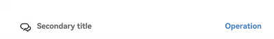
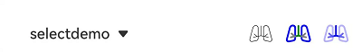
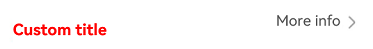
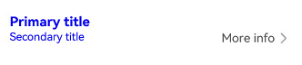
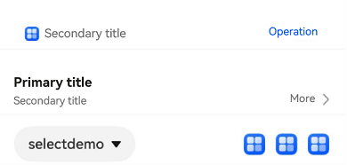

# SubHeaderV2
<!--Kit: ArkUI-->
<!--Subsystem: ArkUI-->
<!--Owner: @huangxiaolinabc-->
<!--Designer: @fangzhiyuan1-->
<!--Tester: @Giacinta-->
<!--Adviser: @Brilliantry_Rui-->
<!-- md-trans-meta sourceCommit=61796f5da750583de829c16c25f6281b835d823a translatedAt=2026-11-03T01:39:20.523Z pushedAt=2026-11-13T01:05:59.883Z nl=1 -->


The component is positioned at the top of list items or content sections, organizing lists or content into distinct groups. The subheader text summarizes the content within each respective section.

This component is implemented based on [state management V2](../../../ui/state-management/arkts-state-management-overview.md#state-management-v2). Compared with [state management V1](../../../ui/state-management/arkts-state-management-overview.md#state-management-v1), V2 offers a higher level of observation and management over data objects beyond the component level. You can now more easily manage subheader data and states with greater flexibility, leading to faster UI updates.


> **NOTE**
>
> - This component is supported since API version 18. Updates will be marked with a superscript to indicate their earliest API version.
>
> - This component can be used only in the stage model.
>
> - If the **SubHeaderV2** component has [universal attributes](ts-component-general-attributes.md) and [universal events](ts-component-general-events.md) configured, the compiler toolchain automatically generates an additional **__Common__** node and mounts the universal attributes and universal events on this node rather than the **SubHeaderV2** component itself. As a result, the configured universal attributes and universal events may fail to take effect or behave as intended. For this reason, avoid using universal attributes and events with the **SubHeaderV2** component.


## Modules to Import

```ts
import { SubHeaderV2 } from '@kit.ArkUI';
```


## Child Components

Not supported

## SubHeaderV2

SubHeaderV2({ icon?: SubHeaderV2IconType, endIcon?: SubHeaderV2IconType, title?: SubHeaderV2Title, select?: SubHeaderV2Select, operationType?: SubHeaderV2OperationType, operationItems?: SubHeaderV2OperationItem[], titleBuilder?: SubHeaderV2TitleBuilder })

A subheader is used at the top of a list item or content item to divide the list or content into a section, and the subheader name summarizes the content of the section. It is applicable to scenarios such as grouped lists, settings pages, and information display, helping users quickly identify and locate content sections. This component provides flexible layout configuration capabilities and supports the combination of multiple elements such as icons, titles, dropdown selections, and operation areas. Developers can quickly build subheader styles that comply with design specifications based on actual requirements.

**Decorator**: @ComponentV2

**System capability**: SystemCapability.ArkUI.ArkUI.Full

**Device behavior differences**: On wearables, calling this API results in a runtime exception indicating that the API is undefined. On other devices, the API works correctly.

| Name| Type                                                     | Mandatory| Decorator| Description                                    |
| -------- |---------------------------------------------------------| -------- | -------- |----------------------------------------|
| icon| [SubHeaderV2IconType](#subheaderv2icontype)             | No | @Param | Icon setting item, used to add an icon identifier to the subtitle.<br />Default value: **undefined**<br/>When **title** uses the **secondaryTitle** attribute, setting the **icon** attribute takes effect.<br/>**Atomic service API:** Since API version 18, this API is supported in atomic services.              |
| endIcon| [SubHeaderV2IconType](#subheaderv2icontype)             | No | @Param | Subtitle end icon setting item, used to add an end icon identifier to the subtitle.<br/>When title uses the **primaryTitle** or **secondaryTitle** attribute, setting the **endIcon** attribute takes effect.<br/>Default value: **undefined**, indicating that the subtitle end icon is not displayed.<br/>**Since:** 26.0.1 <br/>**Atomic service API:** Since API version 26.0.1, this API is supported in atomic services. <br/>**Model restriction:** This API can be used only in the stage model.              |
| title| [SubHeaderV2Title](#subheaderv2title)                   | No | @Param| Title setting item.<br />Default value: **undefined** <br/>**Atomic service API:** Since API version 18, this API is supported in atomic services.                 |
| select| [SubHeaderV2Select](#subheaderv2select)                 | No | @Param | Configuration item of the dropdown selector, including the dropdown option content, selected state, and callback event.<br />Default value: **undefined** <br/>**Atomic service API:** Since API version 18, this API is supported in atomic services.         |
| operationType | [SubHeaderV2OperationType](#subheaderv2operationtype)   | No | @Param| Operation area element style, used to define the display form of the operation button at the subtitle end.<br />Default value: **SubHeaderV2OperationType.BUTTON** <br/>**Atomic service API:** Since API version 18, this API is supported in atomic services.    |
| operationItems | [SubHeaderV2OperationItem](#subheaderv2operationitem)[] | No | @Param| Setting item of the operation area, used to configure the operation button at the subtitle end.<br />Default value: undefined<br/>When operationType is ICON_GROUP, the array contains at most three elements. <br/>**Atomic service API:** Since API version 18, this API is supported in atomic services.               |
| titleBuilder | [SubHeaderV2TitleBuilder](#subheaderv2titlebuilder)                            | No | @BuilderParam | Custom title area content. When this parameter is set, the title parameter does not take effect.<br />Default value: () => void  <br/>**Atomic service API:** Since API version 18, this API is supported in atomic services.           |

## SubHeaderV2IconType

type SubHeaderV2IconType = ResourceStr | SymbolGlyphModifier

Defines the union type for the icon content.

**Atomic service API**: This API can be used in atomic services since API version 18.

**System capability**: SystemCapability.ArkUI.ArkUI.Full

**Device behavior differences**: On wearables, calling this API results in a runtime exception indicating that the API is undefined. On other devices, the API works correctly.

| Type                       | Description                    |
| ----------------------------- |------------------------|
| [ResourceStr](ts-types.md#resourcestr)                 | Resource type for defining common icons.        |
| [SymbolGlyphModifier](ts-universal-attributes-attribute-symbolglyphmodifier.md#symbolglyphmodifier) | Symbol type for defining symbol icons.|

## SubHeaderV2Title
Defines the title settings for the subheader.

**Decorator**: @ObservedV2

### Properties

**System capability**: SystemCapability.ArkUI.ArkUI.Full

**Device behavior differences**: On wearables, calling this API results in a runtime exception indicating that the API is undefined. On other devices, the API works correctly.

| Name | Type | Read-Only | Optional | Description                           |
| -------- | -------- |---|----|------------------------------|
| primaryTitle|  [ResourceStr](ts-types.md#resourcestr)  | No | Yes  | Title content.<br />When the primaryTitle, secondaryTitle, and icon attributes are used together in [SubHeaderV2](#subheaderv2-1), setting the primaryTitle attribute does not take effect.<br />Default value: undefined<br/>Decorator type: @Trace  <br/>**Atomic service API:** This API can be used in atomic services since API version 18.                     |
| secondaryTitle|  [ResourceStr](ts-types.md#resourcestr)  | No | Yes  | Subtitle content.<br />Default value: undefined<br/>Decorator type: @Trace  <br/>**Atomic service API:** This API can be used in atomic services since API version 18.                     |
| primaryTitleModifier|  [TextModifier](ts-universal-attributes-attribute-modifier.md#custom-modifier)  | No | Yes  | Sets the text attributes of the title, such as the title color, font size, and font weight.<br />Default value: undefined<br/>Decorator type: @Trace <br/>**Atomic service API:** This API can be used in atomic services since API version 18.|
| secondaryTitleModifier|   [TextModifier](ts-universal-attributes-attribute-modifier.md#custom-modifier)  | No | Yes  | Sets the text attributes of the subtitle, such as the subtitle color, font size, and font weight.<br />Default value: undefined<br/>Decorator type: @Trace <br/>**Atomic service API:** This API can be used in atomic services since API version 18.|
| titleAccessibilityText<sup>23+</sup>|   [ResourceStr](ts-types.md#resourcestr)  | No | Yes  | Sets the custom spoken content of the title.<br />Default value: undefined<br/>When the value is undefined, the title content displayed by the component is read aloud by default.<br/>Decorator type: @Trace <br/>**Atomic service API:** This API can be used in atomic services since API version 23. |
| id<sup>24+</sup>|  string  | No | Yes  | Title ID. Set this parameter when an ID needs to be set for the title. When omitted, this parameter is not set.<br />Default value: undefined, indicating that no title ID is set.<br/>Decorator type: @Trace <br/>**Atomic service API:** This API can be used in atomic services since API version 24. |

### constructor

constructor(options: SubHeaderV2TitleOptions)

A constructor used to create a **SubHeaderV2Title** object.

**Atomic service API**: This API can be used in atomic services since API version 18.

**System capability**: SystemCapability.ArkUI.ArkUI.Full

**Device behavior differences**: On wearables, calling this API results in a runtime exception indicating that the API is undefined. On other devices, the API works correctly.

**Parameters**

| Name   | Type                                                 | Mandatory| Description            |
| --------- |-----------------------------------------------------| ------ | ------------------ |
| options | [SubHeaderV2TitleOptions](#subheaderv2titleoptions) | Yes  | Options for initializing the title.|

## SubHeaderV2TitleOptions

Defines the options for initializing a **SubHeaderV2Title** object.

**System capability**: SystemCapability.ArkUI.ArkUI.Full

**Device behavior differences**: On wearables, calling this API results in a runtime exception indicating that the API is undefined. On other devices, the API works correctly.

| Name | Type | Read-Only | Optional | Description                          |
| -------- | -------- |----|----|-----------------------------|
| primaryTitle|  [ResourceStr](ts-types.md#resourcestr)  |  No  | Yes  | Title content.<br />When the primaryTitle, secondaryTitle, and icon attributes are used together in [SubHeaderV2](#subheaderv2-1), the primaryTitle will not be displayed.<br />Default value: undefined   <br/>**Atomic service API:** This API can be used in atomic services since API version 18.                    |
| secondaryTitle|  [ResourceStr](ts-types.md#resourcestr)  |  No  | Yes  | Subtitle content.<br />Default value: undefined  <br/>**Atomic service API:** This API can be used in atomic services since API version 18.                    |
| primaryTitleModifier|  [TextModifier](ts-universal-attributes-attribute-modifier.md#custom-modifier)  |  No  | Yes  | Sets the text attributes of the title, such as the primary title color, font size, and font weight.<br />Default value: undefined <br/>**Atomic service API:** This API can be used in atomic services since API version 18.|
| secondaryTitleModifier|   [TextModifier](ts-universal-attributes-attribute-modifier.md#custom-modifier)  |  No  | Yes  | Sets the text attributes of the subtitle, such as the subtitle color, font size, and font weight.<br />Default value: undefined <br/>**Atomic service API:** This API can be used in atomic services since API version 18.|
| titleAccessibilityText<sup>23+</sup>|   [ResourceStr](ts-types.md#resourcestr)  | No | Yes  | Sets the custom spoken content of the title.<br />Default value: undefined<br/>When the value is undefined, the title content displayed by the component is read aloud by default.<br/>**Atomic service API:** This API can be used in atomic services since API version 23. |
| id<sup>24+</sup>|   string | No | Yes  | Title ID. Set this parameter when an ID needs to be set for the title. When omitted, this parameter is not set.<br />Default value: undefined, indicating that no title ID is set.<br/>**Atomic service API:** This API can be used in atomic services since API version 24. |

## SubHeaderV2Select

Defines the configuration options of the dropdown selector, including the dropdown option content, selection state, and callback events.

**Decorator**: @ObservedV2

### Properties

**System capability**: SystemCapability.ArkUI.ArkUI.Full

**Device behavior differences**: On wearables, calling this API results in a runtime exception indicating that the API is undefined. On other devices, the API works correctly.

| Name | Type                                                               | Read-Only | Optional | Description                                                                        |
| -------- |------------------------------------------------------------------|----|----|---------------------------------------------------------------------------|
| options | [SelectOption](ts-basic-components-select.md#selectoption)[] |  No  | No  | Dropdown option content.<br/>Decorator type: @Trace <br/>**Atomic service API:** This API can be used in atomic services since API version 18.          |
| selectedIndex | number       |  No  | Yes  | Sets the index of the initial option in the dropdown menu.<br />The index of the first item is 0.<br />When the selectedIndex attribute is not set,<br />the default selected value is -1, and no menu item is selected.<br/>Decorator type: @Trace <br/>**Atomic service API:** This API can be used in atomic services since API version 18.          |
| selectedContent | [ResourceStr](ts-types.md#resourcestr)                         |  No  | Yes  | Sets the text content of the dropdown button itself. Default value: ''. Since API version 20, the Resource type is supported.<br/>Decorator type: @Trace <br/>**Atomic service API:** This API can be used in atomic services since API version 18.        |
| onSelect | [SubHeaderV2SelectOnSelect](#subheaderv2selectonselect)                                   |  No  | Yes  | Callback invoked when an item is selected in the dropdown menu. <br />Default value: undefined<br/>Decorator type: @Trace <br/>**Atomic service API:** This API can be used in atomic services since API version 18.      |
| defaultFocus | boolean |  No  | Yes  |Whether the dropdown button is the default focus.<br/>true: The dropdown button is the default focus.<br/>false: The dropdown button is not the default focus.<br />Default value: false<br/>Decorator type: @Trace <br/>**Atomic service API:** This API can be used in atomic services since API version 18.      |
| id<sup>24+</sup> | string |  No  | Yes  |Dropdown button ID. Set this parameter when an ID needs to be set for the dropdown button. When omitted, this parameter is not set.<br />Default value: undefined, indicating that no dropdown button ID is set.<br/>Decorator type: @Trace <br/>**Atomic service API:** This API can be used in atomic services since API version 24. |

### constructor

constructor(options: SubHeaderV2SelectOptions)

A constructor used to create a **SubHeaderV2SelectOptions** object.

**Atomic service API**: This API can be used in atomic services since API version 18.

**System capability**: SystemCapability.ArkUI.ArkUI.Full

**Device behavior differences**: On wearables, calling this API results in a runtime exception indicating that the API is undefined. On other devices, the API works correctly.

**Parameters**

| Name   | Type                           | Mandatory| Description            |
| --------- |-------------------------------| ------ | ------------------ |
| options | [SubHeaderV2SelectOptions](#subheaderv2selectoptions) | Yes  | Options of the drop-down list box.|

## SubHeaderV2SelectOptions

Defines the options for initializing a **SubHeaderV2Select** object.

**System capability**: SystemCapability.ArkUI.ArkUI.Full

**Device behavior differences**: On wearables, calling this API results in a runtime exception indicating that the API is undefined. On other devices, the API works correctly.

| Name | Type                                                               | Read-Only | Optional | Description                                                                        |
| -------- |------------------------------------------------------------------|----|----|---------------------------------------------------------------------------| 
| options | [SelectOption](ts-basic-components-select.md#selectoption)[] |  No  | No  | Dropdown option content.<br/>**Atomic service API:** This API can be used in atomic services since API version 18.           |
| selectedIndex | number        |  No  | Yes  | Sets the index of the initial option in the dropdown menu.<br/>The index of the first item is 0.<br/>When the selectedIndex attribute is not set,<br/>the default selected value is -1, and no menu item is selected.<br/>**Atomic service API:** This API can be used in atomic services since API version 18.           |
| selectedContent | [ResourceStr](ts-types.md#resourcestr)       |  No  | Yes  | Sets the text content of the dropdown button itself. Default value: ''. Since API version 20, the Resource type is supported.<br/>**Atomic service API:** This API can be used in atomic services since API version 18.  |
| onSelect | [SubHeaderV2SelectOnSelect](#subheaderv2selectonselect)          |  No  | Yes  | Callback invoked when an item is selected in the dropdown menu.<br />Default value: undefined <br/>**Atomic service API:** This API can be used in atomic services since API version 18.           |
| defaultFocus | boolean |  No  | Yes  | Whether the dropdown button is the default focus.<br/>true: The dropdown button is the default focus.<br/>false: The dropdown button is not the default focus.<br />Default value: false <br/>**Atomic service API:** This API can be used in atomic services since API version 18.  |
| id<sup>24+</sup> | string |  No  | Yes  | Dropdown button ID. Set this parameter when an ID needs to be set for the dropdown button. When omitted, this parameter is not set.<br />Default value: undefined, indicating that no dropdown button ID is set. <br/>**Atomic service API:** This API can be used in atomic services since API version 24.    |

## SubHeaderV2SelectOnSelect

type SubHeaderV2SelectOnSelect = (selectedIndex: number, selectedContent?: string) => void

Defines the callback invoked when an item in the drop-down list box is selected.

**Atomic service API**: This API can be used in atomic services since API version 18.

**System capability**: SystemCapability.ArkUI.ArkUI.Full

**Device behavior differences**: On wearables, calling this API results in a runtime exception indicating that the API is undefined. On other devices, the API works correctly.

**Parameters**

| Name           | Type    | Mandatory| Description                      |
|:--------------|:-------|:---|:-------------------------|
| selectedIndex   | number | Yes  | Index of the selected dropdown menu item. The index starts from 0. |
| selectedContent | string | No  | Text content of the selected dropdown menu item, that is, the text displayed for the menu item selected by the user. |

## SubHeaderV2OperationType

Defines the style of elements in the operation area.

**Atomic service API**: This API can be used in atomic services since API version 18.

**System capability**: SystemCapability.ArkUI.ArkUI.Full

**Device behavior differences**: On wearables, calling this API results in a runtime exception indicating that the API is undefined. On other devices, the API works correctly.

| Name| Value| Description|
| -------- | -------- | -------- |
| TEXT_ARROW |  0  | Text button with a right arrow.|
| BUTTON |  1  |  Text button without a right arrow.|
| ICON_GROUP |  2  |  Icon-attached button (A maximum of three icons can be configured.)|
| LOADING |  3  |  Loading animation.|

## SubHeaderV2OperationItemType

type SubHeaderV2OperationItemType = ResourceStr | SymbolGlyphModifier

Defines the union type for the content of elements in the operation area.

**Atomic service API**: This API can be used in atomic services since API version 18.

**System capability**: SystemCapability.ArkUI.ArkUI.Full

**Device behavior differences**: On wearables, calling this API results in a runtime exception indicating that the API is undefined. On other devices, the API works correctly.

| Type                       | Description                               |
| ----------------------------- |-----------------------------------|
| [ResourceStr](ts-types.md#resourcestr)                 | String type for defining text display or common icons; resource type for defining common icons.|
| [SymbolGlyphModifier](ts-universal-attributes-attribute-symbolglyphmodifier.md#symbolglyphmodifier) | Symbol type for defining symbol icons.           |

## SubHeaderV2OperationItem

Represents an item in the operation area.

**Decorator**: @ObservedV2

### Properties

**System capability**: SystemCapability.ArkUI.ArkUI.Full

**Device behavior differences**: On wearables, calling this API results in a runtime exception indicating that the API is undefined. On other devices, the API works correctly.

| Name | Type | Read-Only | Optional | Description                                                                                                                                                                                                                                              |
| -------- | -------- |---|---|-------------------------------------------------------------------------------------------------------------------------------------------------------------------------------------------------------------------------------------------------|
| content |  [SubHeaderV2OperationItemType](#subheaderv2operationitemtype)  | No | No | Operation area element content.<br/>Decorator type: @Trace <br/>**Atomic service API:** This API can be used in atomic services since API version 18.             |
| action | [SubHeaderV2OperationItemAction](#subheaderv2operationitemaction)| No | Yes | Operation area event callback. Default value: () => void.<br/>Decorator type: @Trace <br/>**Atomic service API:** This API can be used in atomic services since API version 18.    |
| accessibilityText |[ResourceStr](ts-types.md#resourcestr) | No | Yes | Accessibility description of the subtitle end operation item. <br />Default value: undefined<br/>Decorator type: @Trace <br/>**Atomic service API:** This API can be used in atomic services since API version 18.      |
| accessibilityLevel | string | No | Yes | Accessibility importance of the subtitle end operation item.<br/>Supported values:<br/>"auto": The subtitle end operation item is comprehensively determined by the accessibility grouping service and ArkUI as to whether it can be recognized by the accessibility auxiliary service.<br/>"yes": The subtitle end operation item can be recognized by the accessibility auxiliary service.<br/>"no": The subtitle end operation item cannot be recognized by the accessibility auxiliary service.<br/>"no-hide-descendants": The subtitle end operation item and all its child components cannot be recognized by the accessibility auxiliary service.<br>Default value: "yes".<br/>Decorator type: @Trace <br/>**Atomic service API:** This API can be used in atomic services since API version 18. | 
| accessibilityDescription|[ResourceStr](ts-types.md#resourcestr) | No | Yes | Accessibility description of the subtitle end operation item, used to further explain the current component to the user.<br>Default value: "Single-finger double-tap to execute".<br/>Decorator type: @Trace <br/>**Atomic service API:** This API can be used in atomic services since API version 18.         |
| defaultFocus | boolean | No | Yes | Whether the subtitle end operation item is the default focus.<br/>true: The subtitle end operation item is the default focus.<br/>false: The subtitle end operation item is not the default focus.<br />Default value: false<br/>Decorator type: @Trace <br/>**Atomic service API:** This API can be used in atomic services since API version 18.       |
| id<sup>24+</sup> | string | No | Yes | Subtitle end operation item ID. Set this parameter when an ID needs to be set for the subtitle end operation item. When omitted, this parameter is not set.<br />Default value: undefined, indicating that no subtitle end operation item ID is set.<br/>Decorator type: @Trace <br/>**Atomic service API:** This API can be used in atomic services since API version 24.   |

### constructor

constructor(options: SubHeaderV2OperationItemOptions)

Constructor of **SubHeaderV2OperationItem**.

**Atomic service API**: This API can be used in atomic services since API version 18.

**System capability**: SystemCapability.ArkUI.ArkUI.Full

**Device behavior differences**: On wearables, calling this API results in a runtime exception indicating that the API is undefined. On other devices, the API works correctly.

**Parameters**

| Name   | Type                                                                 | Mandatory| Description            |
| --------- |---------------------------------------------------------------------| ------ | ------------------ |
| options | [SubHeaderV2OperationItemOptions](#subheaderv2operationitemoptions) | Yes  | Operation item configuration information. Defines the options for initializing a **SubHeaderV2OperationItem** object.|

## SubHeaderV2OperationItemAction

type SubHeaderV2OperationItemAction = () => void

Defines the callback event type of the operation area setting item.

**Atomic service API**: This API can be used in atomic services since API version 18.

**System capability**: SystemCapability.ArkUI.ArkUI.Full

**Device behavior differences**: On wearables, calling this API results in a runtime exception indicating that the API is undefined. On other devices, the API works correctly.


## SubHeaderV2OperationItemOptions

Defines the options for initializing a **SubHeaderV2OperationItem** object.

**System capability**: SystemCapability.ArkUI.ArkUI.Full

**Device behavior differences**: On wearables, calling this API results in a runtime exception indicating that the API is undefined. On other devices, the API works correctly.

| Name                     | Type                     | Read-Only | Optional | Description                        |
|--------------------------|-------------------------|---|---|-----------------------------|
| content                  | [SubHeaderV2OperationItemType](#subheaderv2operationitemtype) | No | No | Content displayed by the operation item.<br/>**Atomic service API:** This API can be used in atomic services since API version 18.       |
| action                   | [SubHeaderV2OperationItemAction](#subheaderv2operationitemaction)         | No | Yes | Callback for the option operation event, triggered when the operation item is clicked, used to perform a custom operation. Default value: () => void.<br/>**Atomic service API:** This API can be used in atomic services since API version 18.             |
| accessibilityText        | [ResourceStr](ts-types.md#resourcestr)      | No | Yes | Accessibility description of the subtitle end operation item.<br />Default value: undefined <br/>**Atomic service API:** This API can be used in atomic services since API version 18.                |
| accessibilityLevel       | string | No | Yes | Accessibility importance of the subtitle end operation item.<br/>Supported values:<br/>"auto": The subtitle end operation item is comprehensively determined by the accessibility grouping service and ArkUI as to whether it can be recognized by the accessibility auxiliary service.<br/>"yes": The subtitle end operation item can be recognized by the accessibility auxiliary service.<br/>"no": The subtitle end operation item cannot be recognized by the accessibility auxiliary service.<br/>"no-hide-descendants": The subtitle end operation item and all its child components cannot be recognized by the accessibility auxiliary service.<br>Default value: "yes". <br/>**Atomic service API:** This API can be used in atomic services since API version 18. | 
| accessibilityDescription | [ResourceStr](ts-types.md#resourcestr)      | No | Yes | Accessibility description of the subtitle end operation item, used to further explain the current component to the user.<br>Default value: "Single-finger double-tap to execute".<br/>**Atomic service API:** This API can be used in atomic services since API version 18.              |
| defaultFocus | boolean | No | Yes | Whether the subtitle end operation item is the default focus.<br/>true: The subtitle end operation item is the default focus.<br/>false: The subtitle end operation item is not the default focus.<br />Default value: false <br/>**Atomic service API:** This API can be used in atomic services since API version 18.             |
| id<sup>24+</sup> | string | No | Yes | Subtitle end operation item ID. Set this parameter when an ID needs to be set for the subtitle end operation item. When omitted, this parameter is not set.<br />Default value: undefined, indicating that no subtitle end operation item ID is set.<br/>**Atomic service API:** This API can be used in atomic services since API version 24.     |

## SubHeaderV2TitleBuilder

type SubHeaderV2TitleBuilder= () => void

Defines the callback used to customize the content of the title area.

**Atomic service API**: This API can be used in atomic services since API version 18.

**System capability**: SystemCapability.ArkUI.ArkUI.Full

**Device behavior differences**: On wearables, calling this API results in a runtime exception indicating that the API is undefined. On other devices, the API works correctly.


## Events
The [universal events](ts-component-general-events.md) are not supported.

## Example
### Example 1: Implementing an Efficiency-oriented Subheader
This example demonstrates how to implement a subheader where the left side contains an icon and a secondary title, and the right side has a text button.

```ts
import {
  SubHeaderV2OperationType,
  SubHeaderV2,
  SubHeaderV2Title,
  SubHeaderV2OperationItem,
  Prompt
} from '@kit.ArkUI';

@Entry
@ComponentV2
struct SubHeaderExample {
  @Local selectText: string = 'TTTTT'
  @Local selectIndex: number = 2
  @Local flag: boolean = true;
  @Local index: number = 1;
  @Local primaryTitle: ResourceStr = 'Primary title';
  @Local secondaryTitle: ResourceStr = 'Secondary title';
  @Local subHeaderIcon: Resource = $r('sys.media.ohos_ic_public_email');
  @Local title: SubHeaderV2Title = new SubHeaderV2Title({ primaryTitle: 'Primary title' });
  @Local subHeaderOperationType: SubHeaderV2OperationType = SubHeaderV2OperationType.BUTTON;
  @Local operationItems: SubHeaderV2OperationItem[] = [];

  aboutToAppear(): void {
    this.title = new SubHeaderV2Title({
      primaryTitle: this.primaryTitle,
      secondaryTitle: this.secondaryTitle,
    });
    this.operationItems = [new SubHeaderV2OperationItem({
      content: 'Operation',
      action: () => {
        Prompt.showToast({ message: 'demo2' })
      }
    })]
  }

  build() {
    Column() {
      Column() {
        SubHeaderV2({
          icon: this.subHeaderIcon,
          title: this.title,
          operationType: this.subHeaderOperationType,
          operationItems: this.operationItems
        });
      }
    }
  }
}
```



### Example 2: Implementing a Double-Line Text Content-rich Subheader
This example showcases a subheader with a primary title and a secondary title on the left, and a text button with a right arrow on the right.

```ts
import {
  SubHeaderV2OperationType,
  SubHeaderV2,
  SubHeaderV2Title,
  SubHeaderV2OperationItem,
  Prompt
} from '@kit.ArkUI';

@Entry
@ComponentV2
struct SubHeaderExample {
  @Local title: SubHeaderV2Title = new SubHeaderV2Title({ primaryTitle: 'Primary title', secondaryTitle: 'Secondary title' });
  @Local subHeaderOperationType: SubHeaderV2OperationType = SubHeaderV2OperationType.TEXT_ARROW;
  @Local operationItems: SubHeaderV2OperationItem[] = [];

  aboutToAppear(): void {
    this.title = new SubHeaderV2Title({
      primaryTitle: 'Primary title',
      secondaryTitle: 'Secondary title'
    });
    this.operationItems = [new SubHeaderV2OperationItem({
      content: 'More',
      action: () => {
        Prompt.showToast({ message: 'demo2' })
      }
    })]
  }

  build() {
    Column() {
      Column() {
        SubHeaderV2({
          title: this.title,
          operationType: this.subHeaderOperationType,
          operationItems: this.operationItems
        });
      }
    }
  }
}
```


### Example 3: Implementing a Spinner Content-rich Subheader
This example showcases a subheader with content and events for selection on the left, and an icon-attached button on the right.

```ts
import {
  SubHeaderV2,
  SubHeaderV2OperationType,
  SubHeaderV2OperationItem,
  SubHeaderV2Title,
  SubHeaderV2Select,
  Prompt
} from '@kit.ArkUI';

@Entry
@ComponentV2
struct SubHeaderExample {
  @Local selectedValue: string = 'aaa';
  @Local selectedIndex: number = 0;
  @Local title: SubHeaderV2Title = new SubHeaderV2Title({ primaryTitle: 'Primary title', secondaryTitle: 'Secondary title' });
  @Local operationItems: SubHeaderV2OperationItem[] = [];
  @Local select: SubHeaderV2Select =
    new SubHeaderV2Select({ options: [{ value: 'aaa' }, { value: 'bbb' }, { value: 'ccc' }] });

  aboutToAppear(): void {

    this.title = new SubHeaderV2Title({
      primaryTitle: 'Primary title',
      secondaryTitle: 'Secondary title'
    });

    this.selectedValue = 'selectDemo';
    this.select = new SubHeaderV2Select({
      options: [{ value: 'aaa' }, { value: 'bbb' }, { value: 'ccc' }],
      selectedContent: this.selectedValue,
      selectedIndex: this.selectedIndex,
      onSelect: (index: number, value?: string) => {
        Prompt.showToast({ message: 'selectDemo' })
      }
    })

    this.operationItems = [
      new SubHeaderV2OperationItem({
        content: $r('sys.media.ohos_ic_public_email'),
        action: () => {
          Prompt.showToast({ message: 'demo' })
        }
      }),
      new SubHeaderV2OperationItem({
        content: $r('sys.media.ohos_ic_public_email'),
        action: () => {
          Prompt.showToast({ message: 'demo' })
        }
      }),
      new SubHeaderV2OperationItem({
        content: $r('sys.media.ohos_ic_public_email'),
        action: () => {
          Prompt.showToast({ message: 'demo' })
        }
      })]
  }

  build() {
    Column() {
      Column() {
        SubHeaderV2({
          select: this.select,
          operationType: SubHeaderV2OperationType.ICON_GROUP,
          operationItems: this.operationItems
        })
      }
    }
  }
}
```


### Example 4: Setting the Icon Symbol for the Left Side
This example demonstrates how to set the icon symbol for the left side of the subheader.

```ts
import {
  SubHeaderV2,
  SubHeaderV2OperationType,
  SubHeaderV2OperationItem,
  SubHeaderV2Title,
  Prompt,
  SymbolGlyphModifier
} from '@kit.ArkUI';

@Entry
@ComponentV2
struct SubHeaderExample {
  @Local icon: SymbolGlyphModifier = new SymbolGlyphModifier($r('sys.symbol.ohos_wifi'));

  aboutToAppear(): void {
    this.icon = new SymbolGlyphModifier($r('sys.symbol.ohos_wifi')).fontSize(24);
    this.icon.effectStrategy(SymbolEffectStrategy.HIERARCHICAL);
  }

  build() {
    Column() {
      SubHeaderV2({
        icon: this.icon,
        title: new SubHeaderV2Title({ secondaryTitle: 'Title' }),
        operationType: SubHeaderV2OperationType.BUTTON,
        operationItems: [new SubHeaderV2OperationItem({
          content: 'Operation',
          action: () => {
            Prompt.showToast({ message: 'demo' })
          }
        })]
      })
    }
  }
}
```


### Example 5: Setting the Icon Symbol for the Right Side
The following example shows how to set **operationType** to **OperationType.ICON_GROUP** for the right side of the subheader, with **operationItem** set to a symbol icon.

```ts
import {
  SubHeaderV2,
  SubHeaderV2OperationType,
  SubHeaderV2OperationItem,
  SubHeaderV2Title,
  SubHeaderV2Select,
  Prompt,
  SymbolGlyphModifier
} from '@kit.ArkUI';

@Entry
@ComponentV2
struct SubHeaderExample {
  @Local icon: SymbolGlyphModifier = new SymbolGlyphModifier($r('sys.symbol.ohos_wifi'));
  @Local selectedValue: string = 'aaa';
  @Local selectedIndex: number = 2;
  @Local title: SubHeaderV2Title = new SubHeaderV2Title({ primaryTitle: 'Primary title', secondaryTitle: 'Secondary title' });
  @Local operationItem: SubHeaderV2OperationItem[] = [];
  @Local select: SubHeaderV2Select =
    new SubHeaderV2Select({ options: [{ value: 'aaa' }, { value: 'bbb' }, { value: 'ccc' }] });

  aboutToAppear(): void {
    this.icon = new SymbolGlyphModifier($r('sys.symbol.ohos_wifi'));
    this.icon.effectStrategy(SymbolEffectStrategy.HIERARCHICAL);

    this.selectedValue = 'selectDemo';
    this.selectedIndex = 2;
    this.title = new SubHeaderV2Title({
      primaryTitle: 'Primary title',
      secondaryTitle: 'Secondary title'
    });
    this.select = new SubHeaderV2Select({
      options: [{ value: 'aaa' }, { value: 'bbb' }, { value: 'ccc' }],
      selectedContent: this.selectedValue,
      selectedIndex: this.selectedIndex,
      onSelect: (index: number, value?: string) => {
        Prompt.showToast({ message: 'demo' })
      }
    })

    this.operationItem = [
      new SubHeaderV2OperationItem({
        content: new SymbolGlyphModifier($r('sys.symbol.ohos_lungs')).fontWeight(FontWeight.Lighter),
        action: () => {
          Prompt.showToast({ message: 'demo1' })
        }
      }),
      new SubHeaderV2OperationItem({
        content: new SymbolGlyphModifier($r('sys.symbol.ohos_lungs'))
          .renderingStrategy(SymbolRenderingStrategy.MULTIPLE_COLOR)
          .fontColor([Color.Blue, Color.Grey, Color.Green]),
        action: () => {
          Prompt.showToast({ message: 'demo2' })
        }
      }),
      new SubHeaderV2OperationItem({
        content: new SymbolGlyphModifier($r('sys.symbol.ohos_lungs'))
          .renderingStrategy(SymbolRenderingStrategy.MULTIPLE_OPACITY)
          .fontColor([Color.Blue, Color.Grey, Color.Green]),
        action: () => {
          Prompt.showToast({ message: 'demo3' })
        }
      })]
  }

  build() {
    Column() {
      SubHeaderV2({
        select: this.select,
        operationType: SubHeaderV2OperationType.ICON_GROUP,
        operationItems: this.operationItem
      })
    }
  }
}
```



### Example 6: Customizing Title Content
This example mainly demonstrates the effect of setting a **titleBuilder** to customize the title content for the **SubHeaderV2** component.

```ts
import {
  SubHeaderV2,
  SubHeaderV2OperationType,
  SubHeaderV2OperationItem,
  SubHeaderV2Title,
  Prompt
} from '@kit.ArkUI';

@Entry
@ComponentV2
struct SubHeaderExample {
  @Local title: SubHeaderV2Title = new SubHeaderV2Title({ primaryTitle: 'Primary title' });
  @Local operationItem: SubHeaderV2OperationItem[] = [];

  aboutToAppear(): void {
    this.title = new SubHeaderV2Title({
      primaryTitle: 'Primary title',
      secondaryTitle: 'Secondary title'
    });
    this.operationItem = [new SubHeaderV2OperationItem({
      content: 'More info',
      action: () => {
        Prompt.showToast({ message: 'demo' })
      }
    })]
  }

  @Builder
  TitleBuilder(): void {
    Text('Custom title')
      .fontSize(24)
      .fontColor(Color.Blue)
      .fontWeight(FontWeight.Bold)
  }

  build() {
    Column() {
      SubHeaderV2({
        titleBuilder: () => {
          this.TitleBuilder();
        },
        title: this.title,

        operationType: SubHeaderV2OperationType.TEXT_ARROW,
        operationItems: this.operationItem
      })
    }
  }
}
```



### Example 7: Customizing the Title Style
This example demonstrates how to set custom font styles for the primary and secondary titles in the **SubHeaderV2** component.

```ts
import {
  SubHeaderV2,
  SubHeaderV2OperationType,
  SubHeaderV2OperationItem,
  SubHeaderV2Title,
  Prompt,
  TextModifier
} from '@kit.ArkUI';

@Entry
@ComponentV2
struct SubHeaderExample {
  @Local primaryModifier: TextModifier = new TextModifier().fontColor(Color.Blue);
  @Local secondaryModifier: TextModifier = new TextModifier().fontColor(Color.Blue);
  @Local title: SubHeaderV2Title = new SubHeaderV2Title({ primaryTitle: 'Primary title' });
  @Local operationItems4: SubHeaderV2OperationItem[] = [];

  aboutToAppear(): void {
    this.title = new SubHeaderV2Title({
      primaryTitle: 'Primary title',
      primaryTitleModifier: this.primaryModifier,
      secondaryTitle: 'Secondary title',
      secondaryTitleModifier: this.secondaryModifier
    });
    this.operationItems4 = [new SubHeaderV2OperationItem({
      content: 'More info',
      action: () => {
        Prompt.showToast({ message: 'demo' })
      }
    })]
  }

  build() {
    Column() {
      SubHeaderV2({
        title: this.title,
        operationType: SubHeaderV2OperationType.TEXT_ARROW,
        operationItems: this.operationItems4
      })
    }
  }
}
```




### Example 8: Implementing Announcement for the Button on the Right Side
This example customizes the screen reader announcement text by setting the **accessibilityText**, **accessibilityDescription**, and **accessibilityLevel** properties of the button on the right side of the **SubHeaderV2** component.
```ts
import {
  SubHeaderV2OperationType,
  SubHeaderV2,
  SubHeaderV2Title,
  SubHeaderV2OperationItem,
  SubHeaderV2IconType,
  SubHeaderV2Select,
  Prompt
} from '@kit.ArkUI';

@Entry
@ComponentV2
struct SubHeaderExample {
  @Local index: number = 1;
  @Local primaryTitle: ResourceStr = 'Primary title';
  @Local secondaryTitle: ResourceStr = 'Secondary title';
  @Local subHeaderIcon: SubHeaderV2IconType | undefined = $r('sys.media.ohos_ic_public_email');
  @Local title: SubHeaderV2Title = new SubHeaderV2Title({ primaryTitle: 'Primary title' });
  @Local title2: SubHeaderV2Title = new SubHeaderV2Title({ primaryTitle: 'Primary title', secondaryTitle: 'Secondary title' });
  @Local subHeaderOperationType: SubHeaderV2OperationType = SubHeaderV2OperationType.BUTTON;
  @Local subHeaderOperationType2: SubHeaderV2OperationType = SubHeaderV2OperationType.TEXT_ARROW;
  @Local subHeaderOperationType3: SubHeaderV2OperationType = SubHeaderV2OperationType.ICON_GROUP;
  @Local operationItems: SubHeaderV2OperationItem[] = [];
  @Local selectedValue: string | undefined = 'selectDemo';
  @Local selectedIndex: number = 0;
  @Local select: SubHeaderV2Select =
    new SubHeaderV2Select({ options: [{ value: 'aaa' }, { value: 'bbb' }, { value: 'ccc' }] });

  aboutToAppear(): void {
    this.select = new SubHeaderV2Select({ options: [] });
    this.title = new SubHeaderV2Title({
      primaryTitle: this.primaryTitle,
      secondaryTitle: this.secondaryTitle,
    });
    this.operationItems = [new SubHeaderV2OperationItem({
      content: 'Operation',
      action: () => {
        Prompt.showToast({ message: 'demo2' })
      }
    })]
  }

  build() {
    Column() {
      Column() {
        SubHeaderV2({
          icon: this.subHeaderIcon,
          title: this.title,
          select: this.select,
          operationType: this.subHeaderOperationType,
          operationItems: this.operationItems
        });
        Divider().color('grey').width('100%').height('2vp')
        SubHeaderV2({
          title: this.title2,
          select: this.select,
          operationType: this.subHeaderOperationType2,
          operationItems: this.operationItems
        });
        Divider().color('grey').width('100%').height('2vp')
        SubHeaderV2({
          select: new SubHeaderV2Select({
            options: [{ value: 'aaa' }, { value: 'bbb' }, { value: 'ccc' }],
            selectedIndex: this.selectedIndex,
            selectedContent: this.selectedValue,
            onSelect: (index: number, value?: string) => {
              this.selectedIndex = index;
              this.selectedValue = value;
              Prompt.showToast({ message: this.selectedValue })
            }
          }),
          operationType: this.subHeaderOperationType3,
          operationItems: [new SubHeaderV2OperationItem({
            content: $r('sys.media.ohos_ic_public_email'),
            accessibilityText: 'Icon 1',
            accessibilityLevel: 'yes',
          }), new SubHeaderV2OperationItem({
            content: $r('sys.media.ohos_ic_public_email'),
            accessibilityText: 'Icon 2',
            accessibilityLevel: 'no',
          }), new SubHeaderV2OperationItem({
            content: $r('sys.media.ohos_ic_public_email'),
            accessibilityText: 'Icon 3',
            accessibilityDescription: 'Tap to operate icon 3',
          })]
        });
      }
      Divider().color('grey').width('100%').height('2vp')
    }
  }
}
```


### Example 9: Setting the Right-Side Button to Obtain Focus by Default
This example demonstrates how to set **defaultFocus** in **SubHeaderV2** to ensure the right-side button obtains focus by default in the focused state.

The **defaultFocus** API is added to [SubHeaderV2OperationItem](#subheaderv2operationitemoptions) since API version 18.
```ts
import {
  SubHeaderV2OperationType,
  SubHeaderV2,
  SubHeaderV2Title,
  SubHeaderV2OperationItem,
  Prompt
} from '@kit.ArkUI';

@Entry
@ComponentV2
struct SubHeaderExample {
  @Local primaryTitle: ResourceStr = 'Primary title';
  @Local secondaryTitle: ResourceStr = 'Secondary title';
  @Local subHeaderIcon: Resource = $r('sys.media.ohos_ic_public_email');
  @Local title: SubHeaderV2Title = new SubHeaderV2Title({ primaryTitle: 'Primary title' });
  @Local subHeaderOperationType: SubHeaderV2OperationType = SubHeaderV2OperationType.BUTTON;
  @Local operationItems: SubHeaderV2OperationItem[] = [];

  aboutToAppear(): void {
    this.title = new SubHeaderV2Title({
      secondaryTitle: this.secondaryTitle,
    });
    this.operationItems = [new SubHeaderV2OperationItem({
      content: 'Action',
      defaultFocus: true,
      action: () => {
        Prompt.showToast({ message: 'demo2' })
      }
    })]
  }

  build() {
    Column() {
      Column() {
        SubHeaderV2({
          icon: this.subHeaderIcon,
          title: this.title,
          operationType: this.subHeaderOperationType,
          operationItems: this.operationItems
        });
      }
    }
  }
}
```


### Example 10: Setting the Subtitle Tail Icon
This example demonstrates how to set the **endIcon** end icon for the subtitle, in two forms: a common image resource and a Symbol icon.

Since API version 26.0.1, the **endIcon** attribute is added to [SubHeaderV2](#subheaderv2-1).
```ts
import {
  SubHeaderV2,
  SubHeaderV2Title,
  SubHeaderV2IconType,
  SymbolGlyphModifier
} from '@kit.ArkUI';

@Entry
@ComponentV2
struct SubHeaderExample {
  @Local title: SubHeaderV2Title = new SubHeaderV2Title({ secondaryTitle: 'Secondary title' });
  // Replace $r('app.media.startIcon') with the image resource file required by the developer.
  @Local endIcon: SubHeaderV2IconType = $r('app.media.startIcon');
  @Local endIconSymbol: SymbolGlyphModifier = new SymbolGlyphModifier($r('sys.symbol.ohos_lungs'));

  aboutToAppear(): void {
    this.title = new SubHeaderV2Title({
      secondaryTitle: 'Secondary title'
    });
    this.endIconSymbol = new SymbolGlyphModifier($r('sys.symbol.ohos_lungs'))
      .renderingStrategy(SymbolRenderingStrategy.MULTIPLE_COLOR)
      .fontColor([Color.Blue, Color.Grey, Color.Green]);
  }

  build() {
    Column() {
      // Icon + secondary title + end icon (Image)
      SubHeaderV2({
        icon: $r('sys.media.ohos_ic_public_email'),
        endIcon: this.endIcon,
        title: this.title
      })
      // Icon + secondary title + end icon (Symbol)
      SubHeaderV2({
        icon: $r('sys.media.ohos_ic_public_email'),
        endIcon: this.endIconSymbol,
        title: this.title
      })
    }
  }
}
```

<!--Del--> <!--DelEnd-->