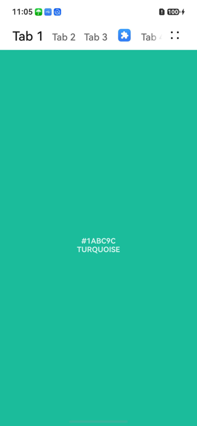
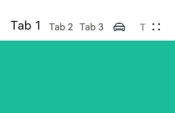

# TabTitleBar
<!--Kit: ArkUI-->
<!--Subsystem: ArkUI-->
<!--Owner: @wangrunsen-->
<!--Designer: @YanSanzo-->
<!--Tester: @ybhou1993-->
<!--Adviser: @Brilliantry_Rui-->
<!-- md-trans-meta sourceCommit=d08210eed02f7b4c83d962789382725753871a13 translatedAt=2026-10-10T01:49:32.756Z pushedAt=2026-10-10T07:53:51.931Z -->


The **TabTitleBar** component is a tab title bar used to switch between tabs pages. It is applicable only to level-1 pages.


> **NOTE**
>
> - This component is supported since API version 10. Newly added content in later versions will be marked with a superscript to indicate the version in which it was introduced.
>
> - This component can be used only in the stage model.
>
> - If [universal attributes](ts-component-general-attributes.md) and [universal events](ts-component-general-events.md) are set for **TabTitleBar**, the compilation toolchain additionally generates a node named \_\_Common\_\_ and mounts the universal attributes or universal events on \_\_Common\_\_ instead of directly applying them to **TabTitleBar** itself. This may cause the universal attributes or universal events set by the developer to not take effect or not meet expectations. Therefore, it is not recommended to set universal attributes and universal events for **TabTitleBar**.


## Modules to Import

```ts
import { TabTitleBar } from '@kit.ArkUI';
```


## Child Components

Not supported

## TabTitleBar

TabTitleBar({tabItems: Array&lt;TabTitleBarTabItem&gt;, menuItems?: Array&lt;TabTitleBarMenuItem&gt;, swiperContent: () =&gt; void})

**Decorator**: @Component

**Atomic service API**: This API can be used in atomic services since API version 11.

**System capability**: SystemCapability.ArkUI.ArkUI.Full

**Device behavior differences**: On wearables, calling this API results in a runtime exception indicating that the API is undefined. On other devices, the API works correctly.

| Name| Type| Mandatory| Decorator| Description|
| -------- | -------- | -------- | -------- | -------- |
| tabItems | Array&lt;[TabTitleBarTabItem](#tabtitlebartabitem)&gt; | Yes| - | List of tab items on the left of the title bar.|
| menuItems | Array&lt;[TabTitleBarMenuItem](#tabtitlebarmenuitem)&gt; | No | - | List of menu items on the right side of the title bar, defining the menu items on the right side of the title bar. If not passed, the menu items on the right side are not displayed. |
| swiperContent | () =&gt; void | Yes| \@BuilderParam | Constructor for page content pertaining to the tab list.|

> **NOTE**
> 
> The input parameter cannot be **undefined**, that is, calling **TabTitleBar(undefined)** is not allowed.

## TabTitleBarMenuItem

**System capability**: SystemCapability.ArkUI.ArkUI.Full

**Device behavior differences**: On wearables, calling this API results in a runtime exception indicating that the API is undefined. On other devices, the API works correctly.

<!--Table: 20%; 20%; 8%; 8%; 44%-->
| Name| Type| Read-Only| Optional| Description|
| -------- | -------- |---|---| -------- |
| value | [ResourceStr](ts-types.md#resourcestr) | No| No| Icon resource.<br>**Atomic service API**: This API can be used in atomic services since API version 11.|
| symbolStyle<sup>18+</sup> | [SymbolGlyphModifier](ts-universal-attributes-attribute-symbolglyphmodifier.md#symbolglyphmodifier) | No| Yes| Symbol icon resource, which has higher priority than **value**.<br>**Atomic service API**: This API can be used in atomic services since API version 18.|
| label<sup>13+</sup> | [ResourceStr](ts-types.md#resourcestr) | No| Yes| Icon label.<br>**Atomic service API**: This API can be used in atomic services since API version 13.|
| isEnabled | boolean | No | Yes | Whether to enable. **true**: enable; **false**: disable.<br/>Default value: **false**<br/>**Atomic service API:** Since API version 11, this API is supported in atomic services. |
| action | () =&gt; void | No| Yes| Action to perform.<br>**Atomic service API**: This API can be used in atomic services since API version 11.|
| accessibilityLevel<sup>18+</sup>       | string  | No | Yes | Accessibility importance of the custom button on the right side of the title bar. It is used to control whether the current item can be recognized by accessibility services.<br/>Supported values:<br/>"auto": the current component is converted to 'yes'.<br/>"yes": the current component can be recognized by accessibility services.<br/>"no": the current component cannot be recognized by accessibility services.<br/>"no-hide-descendants": the current component and all its child components cannot be recognized by accessibility services.<br/>Default value: "auto".<br/>**Atomic service API:** Since API version 18, this API is supported in atomic services. |
| accessibilityText<sup>18+</sup>        | [ResourceStr](ts-types.md#resourcestr) | No | Yes | Accessibility text attribute of the custom button on the right side of the title bar. When a component does not contain a text attribute, the screen reader does not announce anything when this component is selected, and the user cannot clearly know which component is currently selected. To address this scenario, developers can set accessibility text for components that do not contain text information. When the screen reader selects this component, it announces the content of the accessibility text, helping screen reader users clearly know which component they have selected.<br/>Default value: if a label is set, the default value is the content of the label attribute of the current item; if no label is set, the default value is " ".<br/>**Atomic service API:** Since API version 18, this API is supported in atomic services.                                     |
| accessibilityDescription<sup>18+</sup> | [ResourceStr](ts-types.md#resourcestr) | No | Yes | Accessibility description of the custom button on the right side of the title bar. This description is used to explain the current component to users in detail. Developers should provide a relatively detailed text description for this attribute of the component to help users understand the operation to be performed and its possible consequences, especially when these consequences cannot be directly learned from the component's attributes and accessibility text alone. If a component has both a text attribute and an accessibility description attribute, when the component is selected, the system first announces the component's text attribute and then announces the content of the accessibility description attribute.<br/>Default value: "Double-tap with one finger to execute."<br/>**Atomic service API:** Since API version 18, this API is supported in atomic services.           |

## TabTitleBarTabItem

**System capability**: SystemCapability.ArkUI.ArkUI.Full

**Device behavior differences**: On wearables, calling this API results in a runtime exception indicating that the API is undefined. On other devices, the API works correctly.

| Name| Type| Read-Only| Optional| Description|
| -------- | -------- | -------- | -------- | -------- |
| title | [ResourceStr](ts-types.md#resourcestr) | No| No| Text of the tab.<br>**Atomic service API**: This API can be used in atomic services since API version 11.|
| icon | [ResourceStr](ts-types.md#resourcestr) | No| Yes| Icon of the tab.<br>**Atomic service API**: This API can be used in atomic services since API version 11.|
| symbolStyle<sup>18+</sup> | [SymbolGlyphModifier](ts-universal-attributes-attribute-symbolglyphmodifier.md#symbolglyphmodifier) | No| Yes| Symbol icon of the tab, which has higher priority than **icon**.<br>**Atomic service API**: This API can be used in atomic services since API version 18.|


## Events
The [universal events](ts-component-general-events.md) are not supported.

## Example

### Example 1: Implementing a Simple Tab Title Bar
This example demonstrates a tab title bar with tabs on the left and a menu list on the right.
```ts
import { TabTitleBar, Prompt, TabTitleBarTabItem, TabTitleBarMenuItem } from '@kit.ArkUI';

@Entry
@Component
struct Index {
  @Builder
  // Define the pages associated with the tab list.
  componentBuilder() {
    Text("#1ABC9C\nTURQUOISE")
      .fontWeight(FontWeight.Bold)
      .fontSize(14)
      .width("100%")
      .textAlign(TextAlign.Center)
      .fontColor("#CCFFFFFF")
      .backgroundColor("#1ABC9C")
    Text("#16A085\nGREEN SEA")
      .fontWeight(FontWeight.Bold)
      .fontSize(14)
      .width("100%")
      .textAlign(TextAlign.Center)
      .fontColor("#CCFFFFFF")
      .backgroundColor("#16A085")
    Text("#2ECC71\nEMERALD")
      .fontWeight(FontWeight.Bold)
      .fontSize(14)
      .width("100%")
      .textAlign(TextAlign.Center)
      .fontColor("#CCFFFFFF")
      .backgroundColor("#2ECC71")
    Text("#27AE60\nNEPHRITIS")
      .fontWeight(FontWeight.Bold)
      .fontSize(14)
      .width("100%")
      .textAlign(TextAlign.Center)
      .fontColor("#CCFFFFFF")
      .backgroundColor("#27AE60")
    Text("#3498DB\nPETER RIVER")
      .fontWeight(FontWeight.Bold)
      .fontSize(14)
      .width("100%")
      .textAlign(TextAlign.Center)
      .fontColor("#CCFFFFFF")
      .backgroundColor("#3498DB")
  }

  // Define several tab items on the left.
  private readonly tabItems: Array<TabTitleBarTabItem> =
    [
      { title: 'Tab 1' },
      { title: 'Tab 2' },
      { title: 'Tab 3' },
      { title: 'icon', icon: $r('sys.media.ohos_app_icon') },
      { title: 'Tab 4' },
    ]
  // Define several menu items on the right.
  private readonly menuItems: Array<TabTitleBarMenuItem> = [
    {
      value: $r('sys.media.ohos_save_button_filled'),
      isEnabled: true,
      action: () => Prompt.showToast({ message: "on item click! index 0" })
    },
    {
      value: $r('sys.media.ohos_ic_public_copy'),
      isEnabled: true,
      action: () => Prompt.showToast({ message: "on item click! index 1" })
    },
    {
      value: $r('sys.media.ohos_ic_public_edit'),
      isEnabled: true,
      action: () => Prompt.showToast({ message: "on item click! index 2" })
    },
  ]

  // TabTitleBar effect demonstration.
  build() {
    Row() {
      Column() {
        TabTitleBar({
          swiperContent: this.componentBuilder,
          tabItems: this.tabItems,
          menuItems: this.menuItems,
        })
      }.width('100%')
    }.height('100%')
  }
}
```



### Example 2: Implementing Announcement for the Custom Button on the Right Side
This example customizes the screen reader announcement text by setting the **accessibilityText**, **accessibilityDescription**, and **accessibilityLevel** properties of the custom button on the right side of the title bar. This functionality is supported since API version 18.
```ts
import { TabTitleBar, Prompt, TabTitleBarTabItem, TabTitleBarMenuItem } from '@kit.ArkUI';

@Entry
@Component
struct Index {
  @Builder
  // Define the pages associated with the tab list.
  componentBuilder() {
    Text("#1ABC9C\nTURQUOISE")
      .fontWeight(FontWeight.Bold)
      .fontSize(14)
      .width("100%")
      .textAlign(TextAlign.Center)
      .fontColor("#CCFFFFFF")
      .backgroundColor("#1ABC9C")
    Text("#16A085\nGREEN SEA")
      .fontWeight(FontWeight.Bold)
      .fontSize(14)
      .width("100%")
      .textAlign(TextAlign.Center)
      .fontColor("#CCFFFFFF")
      .backgroundColor("#16A085")
    Text("#2ECC71\nEMERALD")
      .fontWeight(FontWeight.Bold)
      .fontSize(14)
      .width("100%")
      .textAlign(TextAlign.Center)
      .fontColor("#CCFFFFFF")
      .backgroundColor("#2ECC71")
    Text("#27AE60\nNEPHRITIS")
      .fontWeight(FontWeight.Bold)
      .fontSize(14)
      .width("100%")
      .textAlign(TextAlign.Center)
      .fontColor("#CCFFFFFF")
      .backgroundColor("#27AE60")
    Text("#3498DB\nPETER RIVER")
      .fontWeight(FontWeight.Bold)
      .fontSize(14)
      .width("100%")
      .textAlign(TextAlign.Center)
      .fontColor("#CCFFFFFF")
      .backgroundColor("#3498DB")
  }

  // Define several tab items on the left.
  private readonly tabItems: Array<TabTitleBarTabItem> =
    [
      { title: 'Tab 1' },
      { title: 'Tab 2' },
      { title: 'Tab 3' },
      { title: 'icon', icon: $r('sys.media.ohos_app_icon') },
      { title: 'Tab 4' },
    ]
  // Define several menu items on the right.
  private readonly menuItems: Array<TabTitleBarMenuItem> = [
    {
      value: $r('sys.media.ohos_save_button_filled'),
      isEnabled: true,
      action: () => Prompt.showToast({ message: "on item click! index 0" }),
      accessibilityText: 'Save',
      // The value is no, so the screen reader does not focus on it.
      accessibilityLevel: 'no',
      accessibilityDescription: 'Tap to save the icon'
    },
    {
      value: $r('sys.media.ohos_ic_public_copy'),
      isEnabled: true,
      action: () => Prompt.showToast({ message: "on item click! index 1" }),
      accessibilityText: 'Copy',
      accessibilityLevel: 'yes',
      accessibilityDescription: 'Tap to copy the icon'
    },
    {
      value: $r('sys.media.ohos_ic_public_edit'),
      isEnabled: true,
      action: () => Prompt.showToast({ message: "on item click! index 2" }),
      // Text announced by the screen reader, with a higher priority than label.
      accessibilityText: 'Edit',
      // Whether the screen reader can focus on it.
      accessibilityLevel: 'yes',
      // Description text announced last by the screen reader.
      accessibilityDescription: 'Tap to edit the icon'
    },
  ]

  // Display the TabTitleBar effect.
  build() {
    Row() {
      Column() {
        TabTitleBar({
          swiperContent: this.componentBuilder,
          tabItems: this.tabItems,
          menuItems: this.menuItems,
        })
      }.width('100%')
    }.height('100%')
  }
}
```


### Example 3: Setting the Symbol Icon
This example demonstrates how to use **symbolStyle** in **TabTitleBarTabItem** and **TabTitleBarMenuItem** to set custom symbol icons. This functionality is supported since API version 18.
```ts
import { TabTitleBar, Prompt, TabTitleBarTabItem, TabTitleBarMenuItem, SymbolGlyphModifier } from '@kit.ArkUI';

@Entry
@Component
struct Index {
  @Builder
  // Define the pages associated with the tab list.
  componentBuilder() {
    Text("#1ABC9C\nTURQUOISE")
      .fontWeight(FontWeight.Bold)
      .fontSize(14)
      .width("100%")
      .textAlign(TextAlign.Center)
      .fontColor("#CCFFFFFF")
      .backgroundColor("#1ABC9C")
    Text("#16A085\nGREEN SEA")
      .fontWeight(FontWeight.Bold)
      .fontSize(14)
      .width("100%")
      .textAlign(TextAlign.Center)
      .fontColor("#CCFFFFFF")
      .backgroundColor("#16A085")
    Text("#2ECC71\nEMERALD")
      .fontWeight(FontWeight.Bold)
      .fontSize(14)
      .width("100%")
      .textAlign(TextAlign.Center)
      .fontColor("#CCFFFFFF")
      .backgroundColor("#2ECC71")
    Text("#27AE60\nNEPHRITIS")
      .fontWeight(FontWeight.Bold)
      .fontSize(14)
      .width("100%")
      .textAlign(TextAlign.Center)
      .fontColor("#CCFFFFFF")
      .backgroundColor("#27AE60")
    Text("#3498DB\nPETER RIVER")
      .fontWeight(FontWeight.Bold)
      .fontSize(14)
      .width("100%")
      .textAlign(TextAlign.Center)
      .fontColor("#CCFFFFFF")
      .backgroundColor("#3498DB")
  }

  // Define several tab items on the left.
  private readonly tabItems: Array<TabTitleBarTabItem> =
    [
      { title: 'Tab 1' },
      { title: 'Tab 2' },
      { title: 'Tab 3' },
      {
        title: 'icon',
        icon: $r('sys.media.ohos_app_icon'),
        symbolStyle: new SymbolGlyphModifier($r('sys.symbol.car'))
      },
      { title: 'Tab 4' },
    ]
  // Define several menu items on the right.
  private readonly menuItems: Array<TabTitleBarMenuItem> = [
    {
      value: $r('sys.media.ohos_save_button_filled'),
      symbolStyle: new SymbolGlyphModifier($r('sys.symbol.save')),
      isEnabled: true,
      action: () => Prompt.showToast({ message: "on item click! index 0" }),
      accessibilityText: 'Save',
      // The value is no, indicating that the screen reader does not focus on it.
      accessibilityLevel: 'no',
      accessibilityDescription: 'Tap to save the icon'
    },
    {
      value: $r('sys.media.ohos_ic_public_copy'),
      symbolStyle: new SymbolGlyphModifier($r('sys.symbol.car')),
      isEnabled: true,
      action: () => Prompt.showToast({ message: "on item click! index 1" }),
      accessibilityText: 'Copy',
      accessibilityLevel: 'yes',
      accessibilityDescription: 'Tap to copy the icon'
    },
    {
      value: $r('sys.media.ohos_ic_public_edit'),
      symbolStyle: new SymbolGlyphModifier($r('sys.symbol.ai_edit')),
      isEnabled: true,
      action: () => Prompt.showToast({ message: "on item click! index 2" }),
      // Text announced by the screen reader, with a higher priority than label.
      accessibilityText: 'Edit',
      // Whether the screen reader can focus on it.
      accessibilityLevel: 'yes',
      // Description text announced last by the screen reader.
      accessibilityDescription: 'Tap to edit the icon'
    },
  ]

  // Demonstrate the TabTitleBar effect.
  build() {
    Row() {
      Column() {
        TabTitleBar({
          swiperContent: this.componentBuilder,
          tabItems: this.tabItems,
          menuItems: this.menuItems,
        })
      }.width('100%')
    }.height('100%')
  }
}
```
