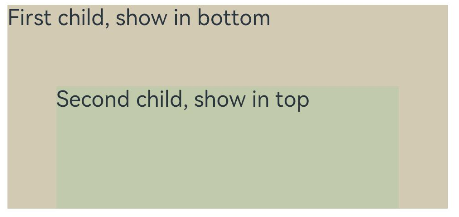

# Stack
<!--Kit: ArkUI-->
<!--Subsystem: ArkUI-->
<!--Owner: @fenglinbailu-->
<!--Designer: @fenglinbailu-->
<!--Tester: @liuli0427-->
<!--Adviser: @Brilliantry_Rui-->
<!-- md-trans-meta sourceCommit=f9301fbea4fd597b80ddd3f3a3f2fa3e52dda948 translatedAt=2026-11-17T04:32:02.339Z pushedAt=2026-11-19T08:20:04.907Z nl=1 -->

Defines a stack container where child components are successively stacked and the latter one overwrites the previous one. The stacking order is based on the declaration order of child components in the parent container. A child component declared later has a higher rendering level and visually covers the preceding child components. It is suitable for scenarios that require layered layout, such as floating buttons or prompt messages on a page, text labels overlaid on images or videos, and multi-layer pop-up windows or dialog boxes. Compared with nesting multiple containers to achieve the layered effect, **Stack** provides a simpler and more efficient solution.

> **NOTE**
>
> - This component is supported since API version 7. Updates will be marked with a superscript to indicate their earliest API version.
> 
> - The universal attribute [align](./ts-universal-attributes-location.md#align) supports the mirroring capability on this component.


## Child Components

Supported.

## APIs

Stack(options?: StackOptions)

Defines a stack container where child components are successively stacked and the latter one overwrites the previous one. The stacking order is based on the declaration order of child components in the parent container. A child component declared later has a higher rendering level and visually covers the preceding child components.

> **NOTE**
>
> Excessive component nesting can degrade performance. In scenarios where the same layout effect can be implemented through component attributes or system APIs, use these alternatives to reduce nesting and optimize performance. For best practices, see [Component Nesting Optimization - Prefer Component Attributes over Nested Components](https://developer.huawei.com/consumer/en/doc/best-practices/bpta-component-nesting-optimization#section78181114123811).
>
> When both the alignContent parameter of this API and [align](./ts-universal-attributes-location.md#align) are set, the attribute value set later overwrites the attribute value set earlier. When both the alignContent parameter of this API and the alignContent attribute are set, the value set by the attribute prevails.

**Widget capability**: This API can be used in ArkTS widgets since API version 9.

**Atomic service API**: This API can be used in atomic services since API version 11.

**System capability**: SystemCapability.ArkUI.ArkUI.Full

**Parameters**

| Name      | Type                                   | Mandatory| Description                                                   |
| ------------ | ------------------------------------------- | ---- | ----------------------------------------------------------- |
| options | [StackOptions](#stackoptions18) | No | Sets the alignment mode of child components within the container. This parameter is passed when child components need to be aligned to a specific position (such as top, bottom, or top-left corner) instead of the default center; if this parameter is not passed, the default configuration of StackOptions is used, where alignContent defaults to Alignment.Center. |

## StackOptions<sup>18+</sup>

Sets the alignment method of the child component in the stack container.

> **NOTE**
>
> To standardize anonymous object definitions, the element definitions here have been revised in API version 18. The initial version information of the historical anonymous objects has been retained, which may result in the outer element's @since version number being later than the inner element's version number. However, this does not affect the use of the API.

**Widget capability**: This API can be used in ArkTS widgets since API version 18.

**Atomic service API**: This API can be used in atomic services since API version 18.

**Model restriction**: This API can be used only in the stage model.

**System capability**: SystemCapability.ArkUI.ArkUI.Full

| Name| Type| Read-Only| Optional| Description|
| -------- | -------- | -------- | -------- | -------- |
| alignContent<sup>7+</sup> | [Alignment](ts-appendix-enums.md#alignment) | No | Yes | Sets the alignment mode of child components within the container. When both this attribute and the constructor input parameter of the API are set, the value set by the attribute prevails.<br>Default value: Alignment.Center<br>Invalid value: treated as the default value.<br>**Note:** When this parameter and [align](./ts-universal-attributes-location.md#align) are set at the same time, the attribute value set later overwrites the attribute value set earlier.<br>**Widget capability:** Since API version 9, this API is supported in ArkTS widgets.<br>**Atomic service API:** Since API version 11, this API can be used in atomic services. |

## Attributes

In addition to the [universal attributes](ts-component-general-attributes.md), the following attributes are supported.

### alignContent

alignContent(value: Alignment)

Sets the alignment of child components in the container. When both this attribute and [align](ts-universal-attributes-location.md#align) are set, whichever is set last takes effect. When both this attribute and the constructor input parameter are set, the value set by the attribute takes effect, regardless of the setting order.

**Atomic service API**: This API can be used in atomic services since API version 11.

**Widget capability**: This API can be used in ArkTS widgets since API version 9.

**System capability**: SystemCapability.ArkUI.ArkUI.Full

**Parameters** 

| Name| Type                                       | Mandatory| Description                                                       |
| ------ | ------------------------------------------- | ---- | ----------------------------------------------------------- |
| value  | [Alignment](ts-appendix-enums.md#alignment) | Yes   | Alignment mode of all child components in the container.<br>Default value: Alignment.Center <br>Invalid value: treated as the default value. |

### syncLoad

syncLoad(enable: boolean)

Sets whether to synchronously load all child components in the stack container. During synchronous loading, all child components complete layout calculation and rendering within the current frame. During asynchronous loading, the system dynamically adjusts the layout timing of child components based on the layout duration of the current frame to avoid blocking the main thread.

**Since:** 26.0.0

**Atomic service API:** This API can be used in atomic services since API version 26.0.0.

**System capability**: SystemCapability.ArkUI.ArkUI.Full

**Model restriction:** This API can be used only in the stage model.

**Parameters**

| Name| Type                                       | Mandatory| Description                                |
| ------ | ------------------------------------------- | ---- | ----------------------------------- |
| enable   | boolean | Yes   | Whether to synchronously load all child components in the Stack area.<br>The value **true** means synchronous loading, and **false** means asynchronous loading.<br>Default value: **true**<br>**NOTE**<br>When this parameter is set to **false**, in the first display scenario, if the layout of the current frame takes more than 50 ms, the child components in the Stack area that have not been laid out are deferred to the next frame for layout. |

## Events

The [universal events](ts-component-general-events.md) are supported.

## Example

When the [alignContent](#aligncontent) attribute of the **Stack** component is set to **Alignment.Bottom** and [syncLoad](#syncload) is set to **true**, the child components are displayed horizontally centered at the bottom of the **Stack** component, and all child components are loaded within the same frame.

The **syncLoad** attribute is added since API version 26.0.0.

```ts
// xxx.ets
@Entry
@Component
struct StackExample {
  build() {
    // Set child components in the Stack container to align at the bottom.
    Stack({ alignContent: Alignment.Bottom }) {
      // The first child component, displayed at the bottom.
      Text('First child, show in bottom').width('90%').height('100%').backgroundColor(0xd2cab3).align(Alignment.Top)
      // The second child component, displayed in the upper layer.
      Text('Second child, show in top').width('70%').height('60%').backgroundColor(0xc1cbac).align(Alignment.Top)
    }.width('100%').height(150).margin({ top: 5 })
    // Since API version 26.0.0, the syncLoad attribute is added. When set to true, it indicates synchronous loading of all child components in the Stack area.
    .syncLoad(true)
  }
}
```


