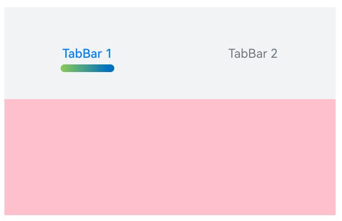
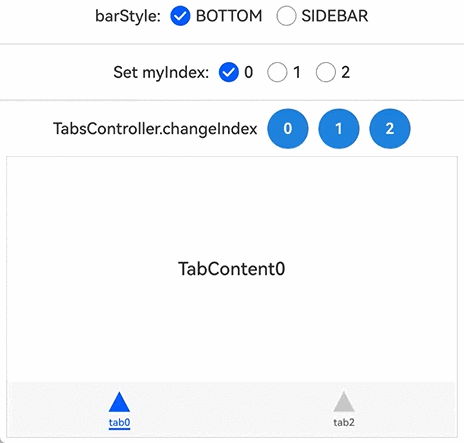
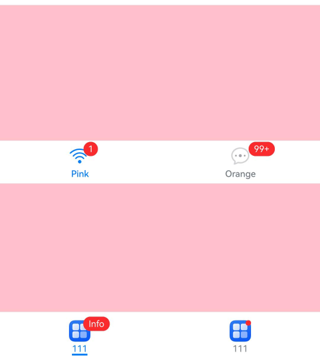

# TabContent
<!--Kit: ArkUI-->
<!--Subsystem: ArkUI-->
<!--Owner: @Hu_ZeQi-->
<!--Designer: @Hu_ZeQi-->
<!--Tester: @gouyuanyuan-->
<!--Adviser: @Brilliantry_Rui-->
<!-- md-trans-meta sourceCommit=54fc14960b9c8e483372fd532da8f4e92d9f52cd translatedAt=2026-11-03T02:28:05.277Z pushedAt=2026-11-13T01:05:59.984Z nl=1 -->

The **TabContent** component is used to define the content view of each tab in [Tabs](ts-container-tabs.md). It supports features such as rendering a single child component, content clipping control, and custom tab styles. It is applicable to application scenarios that require switching between multiple tabs, such as category navigation and function module switching, helping developers quickly implement content pagination display and interaction.

>  **NOTE**
>
> - This component is supported since API version 7. Updates will be marked with a superscript to indicate their earliest API version.
>
> - By default, the [clip](ts-universal-attributes-sharp-clipping.md#clip12) attribute of this component is set to **true**. If you want to extend the content area to the outside of the component, disable the **clip** attribute first.


## Child Components

This component supports only one child component.

>  **NOTE**
>
>  Built-in system and custom components, and rendering control types ([if/else](../../../ui/rendering-control/arkts-rendering-control-ifelse.md), [ForEach](../../../ui/rendering-control/arkts-rendering-control-foreach.md), and [LazyForEach](../../../ui/rendering-control/arkts-rendering-control-lazyforeach.md)) are supported.


## APIs

TabContent()

Creates the **TabContent** component, which represents the content associated with a specific tab.

>  **NOTE**
>
>  The **TabContent** component can be used only as a child component of the **Tabs** component. Otherwise, the component cannot be displayed properly.

**Atomic service API**: This API can be used in atomic services since API version 11.

**System capability**: SystemCapability.ArkUI.ArkUI.Full

## Attributes

In addition to the [universal attributes](ts-component-general-attributes.md), the following attributes are supported.

### tabBar

tabBar(options: string | Resource | CustomBuilder | TabBarOptions)

Sets the content displayed on the tab bar.

If the content exceeds the space provided by the tab bar, it will be clipped.

**Atomic service API**: This API can be used in atomic services since API version 11.

**System capability**: SystemCapability.ArkUI.ArkUI.Full

**Parameters** 

| Name| Type| Mandatory| Description|
| -------- | -------- | -------- | -------- |
| options | string&nbsp;\|&nbsp;[Resource](ts-types.md#resource)&nbsp;\|<br>[CustomBuilder](ts-types.md#custombuilder8)<sup>8+</sup>\|&nbsp;<br>[TabBarOptions](#tabbaroptions18)<sup>18+</sup> | Yes| Content displayed on the tab bar.<br>**CustomBuilder**: builder, to which components can be passed (applicable to API version 8 and later versions).|

### tabBar<sup>9+</sup>

tabBar(value: SubTabBarStyle | BottomTabBarStyle)

Sets the content displayed on the tab bar. The bottom style has no indicator effect. When the icon resource fails to load or does not exist, a gray block is displayed.

If the icon uses an SVG-format image source, its built-in width and height attributes need to be deleted. Otherwise, the icon size will use the built-in width and height attribute values of the SVG image source.

The set content is clipped when it exceeds the tab bar.

>  **NOTE**
>
>  - Sub-tab ([SubTabBarStyle](#subtabbarstyle9)) style: a tab style that usually consists of text + indicator or text + board. The text style can be set. It is recommended that the subtab be placed at the top or bottom. By default, an animated transition effect is supported when switching tabs. It is applicable to top-level categories of information applications (such as "Following, Videos, Digital") and secondary navigation scenarios of function modules.
>  
>  - Bottom tab/side tab ([BottomTabBarStyle](#bottomtabbarstyle9)) style: no indicator or board effect. The tab style is usually a combination of icon + text. By default, no animated transition effect is available when switching tabs. The bottom tab is usually used for the main navigation of an application (such as Home, Discover, and Recommendations). The side tab is applicable to wide-screen scenarios. You can set **vertical(true)** to enable the vertical layout so that the tab is displayed on the side, on the left by default.

**Atomic service API**: This API can be used in atomic services since API version 11.

**System capability**: SystemCapability.ArkUI.ArkUI.Full

**Parameters** 

| Name| Type                                                        | Mandatory| Description                                                        |
| ------ | ------------------------------------------------------------ | ---- | ------------------------------------------------------------ |
| value  | [SubTabBarStyle](#subtabbarstyle9) \| [BottomTabBarStyle](#bottomtabbarstyle9) | Yes   | Content displayed on the **TabBar**, which supports the sub-tab style or the bottom tab style.<br/>**SubTabBarStyle**:&nbsp;sub-tab style.<br/>**BottomTabBarStyle**:&nbsp;bottom tab and side tab style. The bottom style has no indicator effect. |

### tabBar<sup>18+</sup>

tabBar(content: ComponentContent | SubTabBarStyle | BottomTabBarStyle | string | Resource | CustomBuilder | TabBarOptions)

Sets the content displayed on the tab bar.

When **BottomTabBarStyle** or **TabBarOptions** is used as the input parameter and **icon** is set, a gray block is displayed when the icon resource fails to load or does not exist. If the icon uses an SVG-format image source, its built-in width and height attributes need to be deleted. Otherwise, the icon size will use the built-in width and height attribute values of the SVG image source.

If the content exceeds the space provided by the tab bar, it will be clipped.

**Atomic service API**: This API can be used in atomic services since API version 18.

**Model restriction**: This API can be used only in the stage model.

**System capability**: SystemCapability.ArkUI.ArkUI.Full

**Parameters** 

| Name | Type                                                        | Mandatory| Description                                                        |
| ------- | ------------------------------------------------------------ | ---- | ------------------------------------------------------------ |
| content | [ComponentContent](../js-apis-arkui-ComponentContent.md)&nbsp;\|<br/>[SubTabBarStyle](#subtabbarstyle9) \|[BottomTabBarStyle](#bottomtabbarstyle9)&nbsp;\|<br/>string&nbsp;\|&nbsp;[Resource](ts-types.md#resource)&nbsp;\|<br/>[CustomBuilder](ts-types.md#custombuilder8)\|&nbsp;<br/>[TabBarOptions](#tabbaroptions18) | Yes | Content displayed on the tab bar.<br/>**ComponentContent**: entity encapsulation of component content, which can set custom content.<br/>**Note:**<br/>1. Custom content does not support the **labelStyle** attribute.<br/>2. If the custom content exceeds the tab range, the exceeding part is not displayed.<br/>3. If the custom content is smaller than the tab range, it is center-aligned.<br/>4. If the custom content is abnormal or no display component is available, a blank is displayed.<br/>**SubTabBarStyle**:&nbsp;sub-tab style.<br/>**BottomTabBarStyle**:&nbsp;style of the bottom tab and side tab. The bottom style has no indicator effect.<br/>**string**: string type.<br/>**Resource**: resource reference type, which references a string in system resources or application resources.<br/>**CustomBuilder**: builder, in which components can be passed.<br/>**TabBarOptions**: sets the image and text content within the tab. |

>  **NOTE**
>
>  - The **TabContent** component does not support setting the universal width attribute. By default, its width is the width of the parent **Tabs** component.
>  - The **TabContent** component does not support setting the universal height attribute. Its height is determined by the height of the parent **Tabs** component and the height of the **TabBar** component.
>  - When **vertical** is set to **false**, the preceding two restrictions are swapped.
>  - The **TabContent** component does not support page scrolling when the content is too long. To scroll the page, nest a **List** component.
>  - It is recommended that a unified parameter type be used for the **tabBar** attribute of all **TabContent** child components of the **Tabs** component.
>  - If there are focusable components inside **TabContent**, focus movement between the **TabContent** component and the **TabBar** component in the **Tabs** component is supported only through the arrow keys on the keyboard.
>  - After the attributes of **TabBar** are dynamically modified, the component is re-rendered, the related attributes are updated, and the positions of all tabs are reset.

### tabBarVisibility

tabBarVisibility(visibility: TabVisibility, displayMode?: TabBarDisplayMode)

Sets the visibility of the tab. If this API is not called, the tab visibility defaults to **TabVisibility.VISIBLE**.

> **NOTE**
>
> - When **visibility** is **TabVisibility.HIDDEN** and **displayMode** is **TabBarDisplayMode.SIDEBAR**, this tab is not displayed in the side bar, but remains visible in the bottom **TabBar**.
> - When **visibility** is **TabVisibility.HIDDEN** and **displayMode** is **TabBarDisplayMode.BOTTOM_TABBAR**, this tab is not displayed in the bottom **TabBar**, but remains visible in the side bar.
> - When visibility is **TabVisibility.HIDDEN** and **displayMode** is not set, this tab is not displayed in either display mode.
> - The content of a hidden tab can still be displayed by calling **TabsController.changeIndex()** or by modifying the index state variable.

**Since:** 26.0.1

**Model restriction**: This API can be used only in the stage model.

**Atomic service API:** This API can be used in atomic services since API version 26.0.1.

**System capability**: SystemCapability.ArkUI.ArkUI.Full

**Parameters** 

| Name | Type | Mandatory | Description |
| ------- | ---------- | ---- | ----- |
| visibility | [TabVisibility](#tabvisibility) | Yes | Tab visibility. |
| displayMode | [TabBarDisplayMode](./ts-container-tabs.md#tabbardisplaymode) | No | Display mode corresponding to the **visibility**.<br/>If not set, **visibility** applies to both the side bar and the bottom **TabBar**.<br/>If set to **TabBarDisplayMode.SIDEBAR**, **visibility** applies only to the side bar. If set to **TabBarDisplayMode.BOTTOM_TABBAR**, **visibility** applies only to the bottom **TabBar**. |

## TabBarOptions<sup>18+</sup>

Defines the options for configuring images and text content on the tabs.

> **NOTE**
>
> To standardize anonymous object definitions, the element definitions here have been revised in API version 18. While historical version information is preserved for anonymous objects, there may be cases where the outer element's @since version number is higher than inner elements'. This does not affect interface usability.

**Atomic service API**: This API can be used in atomic services since API version 18.

**Model restriction**: This API can be used only in the stage model.

**System capability**: SystemCapability.ArkUI.ArkUI.Full

| Name| Type        | Read-Only| Optional| Description|
| -------- | -------- | --- | ----- | -------- |
| icon<sup>7+</sup> | string \| [Resource](ts-types.md#resource) | No | Yes | Image content within the tab. If not set, no image is displayed. If icon uses an SVG format image source, its built-in width and height attributes need to be deleted. Otherwise, the icon size will use the built-in width and height attribute values of the SVG image source.<br/>**Atomic service API:** This API can be used in atomic services since API version 11. |
| text<sup>7+</sup> | string \| [Resource](ts-types.md#resource) | No| Yes| Text for the tab. If this parameter is not set, no text is displayed.<br>**Atomic service API**: This API can be used in atomic services since API version 11.|
| badge | [TabBarBadgeStyle](#tabbarbadgestyle) | No | Yes | Badge style of the tab. If not set, no badge is displayed.<br/>**Since:** 26.1.0<br/>**Model Constraint:** This API can be used only in the stage model.<br/>**Atomic service API:** This API can be used in atomic services since API version 26.1.0. |

## SubTabBarStyle<sup>9+</sup>

Implements the subtab style. A transition animation is played when the user switches between tabs.

### constructor

constructor(content: ResourceStr)

Constructor used to create a **SubTabBarStyle** instance.

**Atomic service API**: This API can be used in atomic services since API version 11.

**System capability**: SystemCapability.ArkUI.ArkUI.Full

**Parameters**

| Name| Type        | Mandatory| Description|
| -------- | -------- | -------- | -------- |
| content | [ResourceStr](ts-types.md#resourcestr) | Yes| Text for the tab.|

### constructor<sup>12+</sup>

constructor(content: ResourceStr | ComponentContent)

Constructor used to create a **SubTabBarStyle** instance. You can set custom content with **ComponentContent**.

**Atomic service API**: This API can be used in atomic services since API version 12.

**Model restriction**: This API can be used only in the stage model.

**System capability**: SystemCapability.ArkUI.ArkUI.Full

**Parameters**

| Name| Type        | Mandatory| Description|
| -------- | -------- | -------- | -------- |
| content | [ResourceStr](ts-types.md#resourcestr) \| [ComponentContent](../js-apis-arkui-ComponentContent.md) | Yes| Content on the tab.<br>**NOTE**<br>1. Custom content does not support the **labelStyle** attribute.<br>2. If the custom content exceeds the content box of the tab page, the excess part is not displayed.<br>3. If the custom content is within the content box of the tab page, it is aligned in the center.<br>4. If the custom content is abnormal or no display component is available, a blank area is displayed.|

### of<sup>10+</sup>

static of(content: ResourceStr): SubTabBarStyle

Static constructor used to create a **SubTabBarStyle** instance.

**Atomic service API**: This API can be used in atomic services since API version 11.

**Model restriction**: This API can be used only in the stage model.

**System capability**: SystemCapability.ArkUI.ArkUI.Full

**Parameters**

| Name | Type                                  | Mandatory| Description          |
| ------- | ------------------------------------------ | ---- | ------------------ |
| content | [ResourceStr](ts-types.md#resourcestr) | Yes  | Text for the tab.|

**Return value**

| Type   | Description                                                        |
| ------- | ------------------------------------------------------------ |
| [SubTabBarStyle](#subtabbarstyle9) | **SubTabBarStyle** object, which is used to set the sub-tab style. |

### of<sup>12+</sup>

static of(content: ResourceStr | ComponentContent): SubTabBarStyle

Static constructor used to create a **SubTabBarStyle** instance. You can set custom content with **ComponentContent**.

**Atomic service API**: This API can be used in atomic services since API version 12.

**Model restriction**: This API can be used only in the stage model.

**System capability**: SystemCapability.ArkUI.ArkUI.Full

**Parameters**

| Name | Type                                  | Mandatory| Description          |
| ------- | ------------------------------------------ | ---- | ------------------ |
| content | [ResourceStr](ts-types.md#resourcestr) \| [ComponentContent](../js-apis-arkui-ComponentContent.md) | Yes  | Content on the tab. You can set custom content with **ComponentContent**.<br>**NOTE**<br>1. Custom content does not support the **labelStyle** attribute.<br>2. If the custom content exceeds the content box of the tab page, the excess part is not displayed.<br>3. If the custom content is within the content box of the tab page, it is aligned in the center.<br>4. If the custom content is abnormal or no display component is available, a blank area is displayed.|

**Return value**

| Type   | Description                                                        |
| ------- | ------------------------------------------------------------ |
| [SubTabBarStyle](#subtabbarstyle9) | **SubTabBarStyle** object, used to set the sub-tab style. |

### indicator<sup>10+</sup>

indicator(value: IndicatorStyle): SubTabBarStyle

Sets the indicator style of the selected subtab. It takes effect only in the horizontal layout.

**Atomic service API**: This API can be used in atomic services since API version 11.

**Model restriction**: This API can be used only in the stage model.

**System capability**: SystemCapability.ArkUI.ArkUI.Full

**Parameters**

| Name | Type                                  | Mandatory| Description          |
| ------- | ------------------------------------- | ---- | ------------- |
| value | [IndicatorStyle](#indicatorstyle10) | Yes | Underline style object of the selected sub-tab, used to set the color, height, width, and corner radius of the indicator. |

**Return value**

| Type   | Description                                                        |
| ------- | ------------------------------------------------------------ |
| [SubTabBarStyle](#subtabbarstyle9) | **SubTabBarStyle** object itself for chained calls. |

### indicator<sup>22+</sup>

indicator(value: IndicatorStyle | DrawableTabBarIndicator): SubTabBarStyle

Sets the indicator style of the selected subtab. Compared with [indicator](#indicator10), the image format is added. For details about the display effect of the image, see [ImageFit.Cover](ts-appendix-enums.md#imagefit). It takes effect only in the horizontal layout.

**Atomic service API**: This API can be used in atomic services since API version 22.

**Model restriction**: This API can be used only in the stage model.

**System capability**: SystemCapability.ArkUI.ArkUI.Full

**Parameters**

| Name | Type                                  | Mandatory| Description          |
| ------- | ------------------------------------- | ---- | ------------- |
| value | [IndicatorStyle](#indicatorstyle10) | [DrawableTabBarIndicator](#drawabletabbarindicator22)| Yes  | Indicator style object for the selected subtab.<br>**IndicatorStyle**: common indicator style.<br>**DrawableTabBarIndicator**: image indicator style.|

> **NOTE**
> - **IndicatorStyle**: a solid line. By default, the animation transition effect is displayed when a tab is switched.
> - **DrawableTabBarIndicator**: an image. By default, the animation transition effect is not displayed when a tab is switched. If an invalid image source is passed, the common indicator style is displayed.

**Return value**

| Type   | Description                                                        |
| ------- | ------------------------------------------------------------ |
| [SubTabBarStyle](#subtabbarstyle9) | **SubTabBarStyle** object itself for chained calls. |

### selectedMode<sup>10+</sup>

selectedMode(value: SelectedMode): SubTabBarStyle

Sets the display mode of the selected subtab. It takes effect only in the horizontal layout.

**Atomic service API**: This API can be used in atomic services since API version 11.

**Model restriction**: This API can be used only in the stage model.

**System capability**: SystemCapability.ArkUI.ArkUI.Full

**Parameters**

| Name | Type                                  | Mandatory| Description          |
| ------- | ------------------------------------- | ---- | ------------- |
| value | [SelectedMode](#selectedmode10-1) | Yes | Display mode of the selected sub-tab, used to control the selected effect style of the sub-tab. Optional values: **SelectedMode.INDICATOR** (indicator mode, applicable to scenarios that require a clear indication of the selected state), **SelectedMode.BOARD** (board mode, applicable to scenarios that require highlighting the selected tab).<br />Default value: **SelectedMode.INDICATOR** |

**Return value**

| Type   | Description                                                        |
| ------- | ------------------------------------------------------------ |
| [SubTabBarStyle](#subtabbarstyle9) | **SubTabBarStyle** object, which is used for chained calls. |

### board<sup>10+</sup>

board(value: BoardStyle): SubTabBarStyle

Sets the background style (board style) of the selected subtab. It takes effect only in the horizontal layout.

**Atomic service API**: This API can be used in atomic services since API version 11.

**Model restriction**: This API can be used only in the stage model.

**System capability**: SystemCapability.ArkUI.ArkUI.Full

**Parameters**

| Name | Type                                  | Mandatory| Description          |
| ------- | ------------------------------------- | ---- | ------------- |
| value | [BoardStyle](#boardstyle10) | Yes | Board style object of the selected sub-tab, used to set styles such as the corner radius of the board. |

**Return value**

| Type   | Description                                                        |
| ------- | ------------------------------------------------------------ |
| [SubTabBarStyle](#subtabbarstyle9) | **SubTabBarStyle** object, which is used for chained calls. |

### labelStyle<sup>10+</sup>

labelStyle(value: LabelStyle): SubTabBarStyle

Sets the style of the label text and font for the subtab. The style of the label text and font for the subtab takes effect only in horizontal mode.

**Atomic service API**: This API can be used in atomic services since API version 11.

**Model restriction**: This API can be used only in the stage model.

**System capability**: SystemCapability.ArkUI.ArkUI.Full

**Parameters**

| Name | Type                                  | Mandatory| Description          |
| ------- | ------------------------------------- | ---- | ------------- |
| value | [LabelStyle](#labelstyle10-1) | Yes | Style object of the label text and font of the sub-tab, used to set the color, size, font, and number of lines of the text. |

**Return value**

| Type   | Description                                                        |
| ------- | ------------------------------------------------------------ |
| [SubTabBarStyle](#subtabbarstyle9) | **SubTabBarStyle** object, which is used for chained calls. |

### padding<sup>10+</sup>

padding(value: Padding | Dimension): SubTabBarStyle

Sets the padding of the subtab. It cannot be set in percentage. When the parameter is of the Dimension type, the value applies to all sides.

**Atomic service API**: This API can be used in atomic services since API version 11.

**Model restriction**: This API can be used only in the stage model.

**System capability**: SystemCapability.ArkUI.ArkUI.Full

**Parameters**

| Name | Type                                  | Mandatory| Description          |
| ------- | ------------------------------------- | ---- | ------------- |
| value | [Padding](ts-types.md#padding) \| [Dimension](ts-types.md#dimension10) | Yes | Padding of the sub-tab (percentage settings are not supported), used to adjust the distance between the tab content and the boundary.<br/>Value range: [0, +∞]<br/>The default value is used when the value is abnormal.<br />Default value: **{left:8.0vp,right:8.0vp,top:17.0vp,bottom:18.0vp}**<br/>**Note:**<br/>Since API version 12, the new [padding<sup>12+</sup>](#padding12) method supports the [LocalizedPadding](ts-types.md#localizedpadding12) type and mirroring capability. |

**Return value**

| Type   | Description                                                        |
| ------- | ------------------------------------------------------------ |
| [SubTabBarStyle](#subtabbarstyle9) | **SubTabBarStyle** object, which is used for chained calls. |

### padding<sup>12+</sup>

padding(padding: LocalizedPadding): SubTabBarStyle

Sets the padding of the subtab. This API supports mirroring but does not support percentage-based settings.

**Atomic service API**: This API can be used in atomic services since API version 12.

**Model restriction**: This API can be used only in the stage model.

**System capability**: SystemCapability.ArkUI.ArkUI.Full

**Parameters**

| Name | Type                                  | Mandatory| Description          |
| ------- | ------------------------------------- | ---- | ------------- |
| padding | [LocalizedPadding](ts-types.md#localizedpadding12) | Yes | Padding of the sub-tab (percentage setting not supported), used to adjust the distance between the tab content and the boundary, with mirroring capability supported.<br/>Value range: [0, +∞]<br/>The default value is used when the value is abnormal.<br />Default value: {start:LengthMetrics.vp(8),end:LengthMetrics.vp(8),<br/>top:LengthMetrics.vp(17),bottom:LengthMetrics.vp(18)} |

**Return value**

| Type   | Description                                                        |
| ------- | ------------------------------------------------------------ |
| [SubTabBarStyle](#subtabbarstyle9) | **SubTabBarStyle** object, which is used for chained calls. |

### id<sup>11+</sup>

id(value: string): SubTabBarStyle

Sets the ID of the subtab. It can be used to find or control a specified tab through **TabsController**, and to identify different tabs in state management and event handling.

**Atomic service API**: This API can be used in atomic services since API version 12.

**Model restriction**: This API can be used only in the stage model.

**System capability**: SystemCapability.ArkUI.ArkUI.Full

**Parameters**

| Name | Type                                  | Mandatory| Description          |
| ------- | ------------------------------------- | ---- | ------------- |
| value | string | Yes | ID of the sub-tab, used to identify and distinguish different tabs. Set this parameter when you need to control the display, hiding, or other operations of a specific tab through code. The ID value must be unique within the same **Tabs** component. |

**Return value**

| Type   | Description                                                        |
| ------- | ------------------------------------------------------------ |
| [SubTabBarStyle](#subtabbarstyle9) | **SubTabBarStyle** object, which is used for chained calls. |

## IndicatorStyle<sup>10+</sup>

Represents an indicator style object.

**Atomic service API**: This API can be used in atomic services since API version 11.

**Model restriction**: This API can be used only in the stage model.

**System capability**: SystemCapability.ArkUI.ArkUI.Full

| Name| Type| Read-Only| Optional| Description|
| -------- | -------- | -------- | --------- | ----------------------- |
| color | [ResourceColor](ts-types.md#resourcecolor) | No | Yes | Color of the indicator and the board.<br/>Default value: **#FF007DFF**, light blue. |
| height | [Length](ts-types.md#length) | No | Yes | Height of the indicator (percentage settings are not supported).<br/>Default value: **2.0**<br/>Unit: vp<br/>Value range: [0, +∞). The default value is used when an invalid value is set. |
| width | [Length](ts-types.md#length) | No | Yes | Width of the indicator (percentage settings are not supported).<br/>Default value: **0.0**<br/>Unit: vp<br/>Value range: [0, +∞). The default value is used when an invalid value is set.<br/>**Note:** <br/>When the width is set to **0**, the indicator is displayed based on the tab text width.|
| borderRadius | [Length](ts-types.md#length) | No | Yes | Corner radius of the indicator (percentage settings are not supported).<br/>Default value: **0.0**<br/>Unit: vp<br/>Value range: [0, +∞). The default value is used when an invalid value is set. |
| marginTop | [Length](ts-types.md#length) | No | Yes | Spacing between the indicator and the text (percentage settings are not supported).<br/>Default value: **8.0**<br/>Unit: vp<br/>Value range: [0, +∞). The default value is used when an invalid value is set. |

## DrawableTabBarIndicator<sup>22+</sup>

Uses an image resource as the indicator.

**Atomic service API**: This API can be used in atomic services since API version 22.

**Model restriction**: This API can be used only in the stage model.

**System capability**: SystemCapability.ArkUI.ArkUI.Full

| Name| Type| Read-Only| Optional| Description|
| -------- | -------- | -------- | --------- | ----------------------- |
| drawable | [DrawableDescriptor](#drawabledescriptor22) | No| Yes| Image resource of the indicator.<br>Supported types: [DrawableDescriptor](../js-apis-arkui-drawableDescriptor.md#drawabledescriptor), [PixelMapDrawableDescriptor](../js-apis-arkui-drawableDescriptor.md#pixelmapdrawabledescriptor12), [LayeredDrawableDescriptor](../js-apis-arkui-drawableDescriptor.md#layereddrawabledescriptor), and [AnimatedDrawableDescriptor](../js-apis-arkui-drawableDescriptor.md#animateddrawabledescriptor12). If an invalid image resource is passed, the default solid indicator is displayed.|
| height | [Length](ts-types.md#length) | No | Yes | Height of the indicator (percentage setting is not supported).<br/>Default value: **2.0**<br/>Unit: vp<br/>Value range: [0, +∞). The default value is used when the value is abnormal. |
| width | [Length](ts-types.md#length) | No | Yes | Width of the indicator (percentage setting is not supported).<br/>Default value: **0.0**<br/>Unit: vp<br/>Value range: [0, +∞). The default value is used when the value is abnormal.<br />When the width is set to **0**, the indicator is displayed based on the tab text width. |
| borderRadius | [Length](ts-types.md#length) | No | Yes | Corner radius of the indicator (percentage setting is not supported).<br/>Default value: **0.0**<br/>Unit: vp<br/>Value range: [0, +∞). The default value is used when the value is abnormal. |
| marginTop | [Length](ts-types.md#length) | No | Yes | Spacing between the indicator and the text (percentage setting is not supported).<br/>Default value: **8.0**<br/>Unit: vp<br/>Value range: [0, +∞). The default value is used when the value is abnormal. |

## DrawableDescriptor<sup>22+</sup>

type DrawableDescriptor = DrawableDescriptor

Defines the input parameter object of the **drawable** attribute in the **DrawableTabBarIndicator** object.

**Atomic service API**: This API can be used in atomic services since API version 22.

**Model restriction**: This API can be used only in the stage model.

**System capability**: SystemCapability.ArkUI.ArkUI.Full

| Type    | Description      |
| ------ | ---------- |
| [DrawableDescriptor](../js-apis-arkui-drawableDescriptor.md#drawabledescriptor)  | **DrawableDescriptor** object.|

## SelectedMode<sup>10+</sup>

Enumerates the display modes of selected subtabs.

**Atomic service API**: This API can be used in atomic services since API version 11.

**Model restriction**: This API can be used only in the stage model.

**System capability**: SystemCapability.ArkUI.ArkUI.Full

| Name      | Value| Description              |
| ---------- | ----- | ------------------------ |
| INDICATOR | 0 | Uses the indicator mode. Applicable to scenarios that require clearly indicating the selected state, such as news and information applications. |
| BOARD   | 1 | Uses the board mode. Applicable to scenarios that require clearly distinguishing the selected tab, such as function navigation applications.     |

## BoardStyle<sup>10+</sup>

Represents a board style object.

**Atomic service API**: This API can be used in atomic services since API version 11.

**Model restriction**: This API can be used only in the stage model.

**System capability**: SystemCapability.ArkUI.ArkUI.Full

| Name| Type| Read-Only| Optional| Description|
| -------- | -------- | -------- | ------------ | ------------------------ |
| borderRadius | [Length](ts-types.md#length) | No | Yes | Corner radius of the board (percentage setting is not supported).<br/>Default value: **8.0**<br/>Unit: vp<br/>Value range: [0, +∞). The default value is used when the value is abnormal. |

## LabelStyle<sup>10+</sup>

Represents a style object for the label text and font.

**Model restriction**: This API can be used only in the stage model.

**System capability**: SystemCapability.ArkUI.ArkUI.Full

| Name                | Type                                                    | Read-Only| Optional| Description                                                        |
| -------------------- | ----------------------- | ------------------------------------- | ---- | ------------------------------------------------------------ |
| overflow             | [TextOverflow](ts-appendix-enums.md#textoverflow)            | No  | Yes  | Display mode when the label text is too long. The default value is ellipsis truncation.<br/>**Atomic service API:** Since API version 11, this API is supported in atomic services. |
| maxLines             | number                                                       | No  | Yes  | Maximum number of lines for the label text. If this parameter is specified, the text will not exceed the specified number of lines. If there is extra text, the truncation mode can be specified through **textOverflow**. The default value is **1**.<br/>Value range: [1, +∞). The default value is used when the value is abnormal.<br/>**Atomic service API:** Since API version 11, this API is supported in atomic services. |
| minFontSize          | number \| [ResourceStr](ts-types.md#resourcestr)             | No  | Yes  | Minimum display font size of the label text (percentage settings are not supported). It must be used together with **maxFontSize** and **maxLines** or layout size constraints. After adaptive text size takes effect, **font.size** does not take effect. The default value is **0.0fp**, which means adaptive text size does not take effect by default.<br/>Value range: (0, +∞). It does not take effect when the value is abnormal.<br/>**Atomic service API:** Since API version 11, this API is supported in atomic services. |
| maxFontSize          | number \| [ResourceStr](ts-types.md#resourcestr)             | No  | Yes  | Maximum display font size of the label text (percentage settings are not supported). It must be used together with **minFontSize** and **maxLines** or layout size constraints. After adaptive text size takes effect, **font.size** does not take effect. The default value is **0.0fp**, which means adaptive text size does not take effect by default.<br/>Value range: [minFontSize, +∞). It does not take effect when the value is abnormal.<br/>**Atomic service API:** Since API version 11, this API is supported in atomic services. |
| heightAdaptivePolicy | [TextHeightAdaptivePolicy](ts-appendix-enums.md#textheightadaptivepolicy10) | No| Yes  | Adaptive height policy for the label text. By default, the **maxLines** settings are prioritized.<br>**Atomic service API**: This API can be used in atomic services since API version 11.|
| font                 | [Font](ts-types.md#font)                                     | No  | Yes | Font style of the label text.<br/>When the tab is a sub-tab, the default value is a font size of 16.0 fp, font type 'HarmonyOS Sans', normal font style, medium font weight when selected, and normal font weight when unselected.<br/>When the tab is a bottom tab, the default value is a font size of 10.0 fp, font type 'HarmonyOS Sans', normal font style, and medium font weight.<br/>Since API version 12, the default font size is 12.0 fp when the bottom tab content is arranged horizontally.<br/>**Atomic service API:** Since API version 11, this API is supported in atomic services. |
| unselectedColor<sup>12+</sup> | [ResourceColor](ts-types.md#resourcecolor) | No | Yes | Color of the label text font when unselected.<br/>Default value: **#99182431** <br/>**Atomic service API:** Since API version 12, this API is supported in atomic services.|
| selectedColor<sup>12+</sup> | [ResourceColor](ts-types.md#resourcecolor) | No | Yes | Color of the label text font when selected.<br/>Default value: **#FF007DFF** <br/>**Atomic service API:** Since API version 12, this API is supported in atomic services.|

## BottomTabBarStyle<sup>9+</sup>

Implements the bottom and side tab style.

### constructor

constructor(icon: ResourceStr | TabBarSymbol, text: ResourceStr)

A constructor used to create a **BottomTabBarStyle** instance.

**Atomic service API**: This API can be used in atomic services since API version 11.

**System capability**: SystemCapability.ArkUI.ArkUI.Full

**Parameters**

| Name| Type        | Mandatory| Description|
| -------- | -------- | -------- | -------- |
| icon | [ResourceStr](ts-types.md#resourcestr) \| [TabBarSymbol<sup>12+</sup>](#tabbarsymbol12) | Yes | Image content within the tab. When the icon resource fails to load or does not exist, a gray block is displayed. If the icon uses an SVG image source, its built-in width and height attributes need to be deleted. Otherwise, the icon size will use the built-in width and height attribute values of the SVG image source. |
| text | [ResourceStr](ts-types.md#resourcestr) | Yes| Text for the tab.|

### of<sup>10+</sup>

static of(icon: ResourceStr | TabBarSymbol, text: ResourceStr): BottomTabBarStyle

Static constructor used to create a **BottomTabBarStyle** instance.

**Atomic service API**: This API can be used in atomic services since API version 11.

**Model restriction**: This API can be used only in the stage model.

**System capability**: SystemCapability.ArkUI.ArkUI.Full

**Parameters**

| Name| Type        | Mandatory| Description|
| -------- | -------- | -------- | -------- |
| icon | [ResourceStr](ts-types.md#resourcestr) \| [TabBarSymbol<sup>12+</sup>](#tabbarsymbol12) | Yes | Image content within the tab. When the icon resource fails to load or does not exist, a gray block is displayed. If the icon uses an SVG format image source, its built-in width and height attributes need to be deleted. Otherwise, the icon size will use the built-in width and height attribute values of the SVG image source. |
| text | [ResourceStr](ts-types.md#resourcestr) | Yes| Text for the tab.|

**Return value**

| Type   | Description                                                        |
| ------- | ------------------------------------------------------------ |
| [BottomTabBarStyle](#bottomtabbarstyle9) | **BottomTabBarStyle** object, which is used to set the bottom tab and side tab styles. |

### padding<sup>10+</sup>

padding(value: Padding | Dimension | LocalizedPadding): BottomTabBarStyle

Sets the padding of the bottom tab. It cannot be set in percentage. When the parameter is of the Dimension type, the value applies to all sides.

**Atomic service API**: This API can be used in atomic services since API version 11.

**Model restriction**: This API can be used only in the stage model.

**System capability**: SystemCapability.ArkUI.ArkUI.Full

**Parameters**

| Name | Type                                  | Mandatory| Description          |
| ------- | ------------------------------------- | ---- | ------------- |
| value | [Padding](ts-types.md#padding) \| [Dimension](ts-types.md#dimension10) \| [LocalizedPadding<sup>12+</sup>](ts-types.md#localizedpadding12) | Yes | Padding of the bottom tab, used to set the distance between the tab content and the boundary (percentage setting is not supported). Pass a custom value when you need to adjust the internal space distribution of the tab and optimize the visual effect.<br/>Value range: [0, +∞]<br/>Default value: **{left:4.0vp,right:4.0vp,top:0.0vp,bottom:0.0vp}**<br/>When **LocalizedPadding** is used, mirroring is supported.<br />Default value: {start:LengthMetrics.vp(4),end:LengthMetrics.vp(4),<br/>top:LengthMetrics.vp(0),bottom:LengthMetrics.vp(0)} |

**Return value**

| Type   | Description                                                        |
| ------- | ------------------------------------------------------------ |
| [BottomTabBarStyle](#bottomtabbarstyle9) | **BottomTabBarStyle** object, which is used for chained calls. |

### verticalAlign<sup>10+</sup>

verticalAlign(value: VerticalAlign): BottomTabBarStyle

Sets the vertical alignment mode of the images and text on the bottom tab.

**Atomic service API**: This API can be used in atomic services since API version 11.

**Model restriction**: This API can be used only in the stage model.

**System capability**: SystemCapability.ArkUI.ArkUI.Full

**Parameters**

| Name | Type                                  | Mandatory| Description          |
| ------- | ------------------------------------- | ---- | ------------- |
| value | [VerticalAlign](ts-appendix-enums.md#verticalalign) | Yes  | Vertical alignment mode of the images and text on the bottom tab.<br>Default value: **VerticalAlign.Center**|

**Return value**

| Type   | Description                                                        |
| ------- | ------------------------------------------------------------ |
| [BottomTabBarStyle](#bottomtabbarstyle9) | **BottomTabBarStyle** object, which is used for chained calls. |

### layoutMode<sup>10+</sup>

layoutMode(value: LayoutMode): BottomTabBarStyle

Sets the layout mode of the images and texts on the bottom tab.

**Atomic service API**: This API can be used in atomic services since API version 11.

**Model restriction**: This API can be used only in the stage model.

**System capability**: SystemCapability.ArkUI.ArkUI.Full

**Parameters**

| Name | Type                                  | Mandatory| Description          |
| ------- | ------------------------------------- | ---- | ------------- |
| value | [LayoutMode](#layoutmode10) | Yes  | Layout mode of the images and text on the bottom tab.<br>Default value: **LayoutMode.VERTICAL**|

**Return value**

| Type   | Description                                                        |
| ------- | ------------------------------------------------------------ |
| [BottomTabBarStyle](#bottomtabbarstyle9) | **BottomTabBarStyle** object, which is used for chained calls. |

### symmetricExtensible<sup>10+</sup>

symmetricExtensible(value: boolean): BottomTabBarStyle

Sets whether the images and text on the bottom tab can be symmetrically extended by the minimum value of the available space on the left and right bottom tabs. This parameter is valid only between bottom tabs in fixed horizontal mode.

**Atomic service API**: This API can be used in atomic services since API version 11.

**Model restriction**: This API can be used only in the stage model.

**System capability**: SystemCapability.ArkUI.ArkUI.Full

**Parameters**

| Name | Type                                  | Mandatory| Description          |
| ------- | ------------------------------------- | ---- | ------------- |
| value | boolean | Yes | Whether the image and text of a bottom tab can symmetrically borrow the minimum of the free space of the left and right bottom tabs. The value **true** enables the symmetric borrowing feature (select this when you need to optimize the tab layout and make full use of space), and the value **false** disables the symmetric borrowing feature (select this when you need to keep the tab layout fixed and avoid changes in the tab content position).<br/>Default value: **false**. |

**Return value**

| Type   | Description                                                        |
| ------- | ------------------------------------------------------------ |
| [BottomTabBarStyle](#bottomtabbarstyle9) | **BottomTabBarStyle** object, which is used for chained calls. |

### labelStyle<sup>10+</sup>

labelStyle(value: LabelStyle): BottomTabBarStyle

Sets the style of the label text and font for the bottom tab.

**Atomic service API**: This API can be used in atomic services since API version 11.

**Model restriction**: This API can be used only in the stage model.

**System capability**: SystemCapability.ArkUI.ArkUI.Full

**Parameters**

| Name | Type                                  | Mandatory| Description          |
| ------- | ------------------------------------- | ---- | ------------- |
| value | [LabelStyle](#labelstyle10) | Yes | Style of the label text and font of the bottom tab, used to set the color, size, font, and number of lines of the text. |

**Return value**

| Type   | Description                                                        |
| ------- | ------------------------------------------------------------ |
| [BottomTabBarStyle](#bottomtabbarstyle9) | **BottomTabBarStyle** object, which is used for chained calls. |

### id<sup>11+</sup>

id(value: string): BottomTabBarStyle

Defines the ID of the bottom tab.

**Atomic service API**: This API can be used in atomic services since API version 12.

**Model restriction**: This API can be used only in the stage model.

**System capability**: SystemCapability.ArkUI.ArkUI.Full

**Parameters**

| Name | Type                                  | Mandatory| Description          |
| ------- | ------------------------------------- | ---- | ------------- |
| value | string | Yes | ID of the bottom tab. |

**Return value**

| Type   | Description                                                        |
| ------- | ------------------------------------------------------------ |
| [BottomTabBarStyle](#bottomtabbarstyle9) | **BottomTabBarStyle** object, which is used for chained calls. |

### iconStyle<sup>12+</sup>

iconStyle(style: TabBarIconStyle): BottomTabBarStyle

Sets the style of the bottom tab icon.

**Atomic service API**: This API can be used in atomic services since API version 12.

**Model restriction**: This API can be used only in the stage model.

**System capability**: SystemCapability.ArkUI.ArkUI.Full

**Parameters**

| Name | Type                                  | Mandatory| Description          |
| ------- | ------------------------------------- | ---- | ------------- |
| style | [TabBarIconStyle](#tabbariconstyle12) | Yes | Style of the bottom tab icon, used to set the colors of the icon in the selected and unselected states. |

**Return value**

| Type    | Description                                                         |
| ------- | ------------------------------------------------------------ |
| [BottomTabBarStyle](#bottomtabbarstyle9) | **BottomTabBarStyle** object, which is used for chained calls. |

### badge

badge(badgeStyle: TabBarBadgeStyle): BottomTabBarStyle

Sets the badge style of the bottom tab. If not set, no badge is displayed.

**Since:** 26.1.0

**Atomic service API:** This API can be used in atomic services since API version 26.1.0.

**Model restriction**: This API can be used only in the stage model.

**System capability**: SystemCapability.ArkUI.ArkUI.Full

**Parameters**

| Name | Type | Mandatory | Description |
| -------- | -------- | -------- | -------- |
| badgeStyle | [TabBarBadgeStyle](#tabbarbadgestyle) | Yes | Badge style of the bottom tab. |

**Return value**

| Type   | Description                                                        |
| ------- | ------------------------------------------------------------ |
| [BottomTabBarStyle](#bottomtabbarstyle9) | **BottomTabBarStyle** object, which is used for chained calls. |

## TabBarSymbol<sup>12+</sup>

Represents a tab bar symbol style object.

**Atomic service API**: This API can be used in atomic services since API version 12.

**Model restriction**: This API can be used only in the stage model.

**System capability**: SystemCapability.ArkUI.ArkUI.Full

| Name| Type        | Read-Only| Optional| Description|
| -------- | -------- | --- | ----- | -------- |
| normal | [SymbolGlyphModifier](ts-universal-attributes-attribute-symbolglyphmodifier.md#symbolglyphmodifier) | No| No| Symbol icon in the normal style.<br>Default value:<br>**fontColor**: **#66182431**<br>**renderingStrategy**: **SymbolRenderingStrategy.MULTIPLE_OPACITY**<br>**fontSize**: **24vp**|
| selected | [SymbolGlyphModifier](ts-universal-attributes-attribute-symbolglyphmodifier.md#symbolglyphmodifier) | No| Yes| Symbol icon in the selected style.<br>Default value:<br>**fontColor**: **#ff007dff**<br>**renderingStrategy**: **SymbolRenderingStrategy.MULTIPLE_OPACITY**<br>**fontSize**: **24vp**|

## LayoutMode<sup>10+</sup>

Enumerates the layout modes of the images and texts on the bottom tabs.

**Atomic service API**: This API can be used in atomic services since API version 11.

**Model restriction**: This API can be used only in the stage model.

**System capability**: SystemCapability.ArkUI.ArkUI.Full

| Name        | Value| Description                                    |
| ----------  | - | ---------------------------------------- |
| AUTO        | 0 | If the tab width is greater than 104 vp, the tab content is laid out horizontally (icon on the left and text on the right); otherwise, the tab content is laid out vertically (icon on the top and text on the bottom). This takes effect only when the **TabBar** is in vertical mode or Fixed horizontal mode. |
| VERTICAL    | 1 | The tab content is laid out vertically, with the icon on the top and the text on the bottom. This is suitable for scenarios where the tab width is limited and space needs to be saved. |
| HORIZONTAL  | 2 | The tab content is laid out horizontally, with the icon on the left and the text on the right. This is suitable for scenarios where the tab width is sufficient and more content needs to be displayed. |

## TabBarIconStyle<sup>12+</sup>

Defines the tab icon style object.

**Atomic service API**: This API can be used in atomic services since API version 12.

**Model restriction**: This API can be used only in the stage model.

**System capability**: SystemCapability.ArkUI.ArkUI.Full

| Name                | Type                                                    | Read-Only| Optional| Description                                                        |
| -------------------- | ------------------------------------------ | ------------------ | ---- | ------------------------------------------------------------ |
| unselectedColor | [ResourceColor](ts-types.md#resourcecolor) | No | Yes | Color of the icon when it is not selected.<br/>Default value: **#33182431** <br/>**Note:** <br/>Takes effect only on SVG image sources. After being set, it replaces the fill color of the SVG image. |
| selectedColor | [ResourceColor](ts-types.md#resourcecolor) | No | Yes | Color of the icon when it is selected.<br/>Default value: **#FF007DFF** <br/>**Note:** <br/>Takes effect only on SVG image sources. After being set, it replaces the fill color of the SVG image. |

## TabVisibility

Enumerates the visibility of tabs.

**Since:** 26.0.1

**Model restriction**: This API can be used only in the stage model.

**Atomic service API:** This API can be used in atomic services since API version 26.0.1.

**System capability**: SystemCapability.ArkUI.ArkUI.Full

| Name | Value | Description |
| ----- | ----- | ------- |
| VISIBLE | 0 | Visible. |
| HIDDEN | 1 | Hidden. |

## TabBarBadgeStyle

Defines the style object for the tab badge.

**Since:** 26.1.0

**Atomic service API:** This API can be used in atomic services since API version 26.1.0.

**Model restriction**: This API can be used only in the stage model.

**System capability**: SystemCapability.ArkUI.ArkUI.Full

| Name | Type | Read-Only | Optional | Description |
| -------- | -------- | --- | ----- | -------- |
| value | [TabBarBadgeType](#tabbarbadgetype) | No | Yes | Badge content. If this parameter is not set or is set to **undefined**, the badge is displayed as a content-free dot with a diameter of 6 vp, which is smaller than a dot that displays content normally. When the type is number, the badge is not displayed if the value is less than or equal to 0 and less than **maxCount**. |
| maxCount | number | No | Yes | Maximum number of badge content to display. This attribute takes effect only when **value** is of the number type. If it is not set, the maximum number is not limited, and the badge is displayed based on the actual **value**. When the badge content exceeds this number, only **maxCount**+ is displayed. For example, when **maxCount** is 99, `99+` is displayed.<br>Default value: **99**<br>If the value is not an integer, the decimal part is discarded and only the integer part is used. For example, 5.5 becomes 5. |

## TabBarBadgeType

type TabBarBadgeType = number | ResourceStr

Defines the union type of the content displayed by the badge.

**Since:** 26.1.0

**Atomic service API:** This API can be used in atomic services since API version 26.1.0.

**Model restriction**: This API can be used only in the stage model.

**System capability**: SystemCapability.ArkUI.ArkUI.Full

| Type | Description |
| -------- | -------- |
| number | Numeric type, used for a badge that displays numeric content. |
| [ResourceStr](ts-types.md#resourcestr) | Text type, used for a badge that displays text content. |

## Events

In addition to the [universal events](ts-component-general-events.md), the following events are supported.

### onWillShow<sup>12+</sup>

onWillShow(event: VoidCallback)

Called when the tab content is about to be displayed. The scenarios include the first-time display, tab switching, page switching, and window switching between the foreground and background.

>  **NOTE**
>
> This API can be called in [attributeModifier](ts-universal-attributes-attribute-modifier.md#attributemodifier) since API version 20.

**Atomic service API**: This API can be used in atomic services since API version 12.

**Model restriction**: This API can be used only in the stage model.

**System capability**: SystemCapability.ArkUI.ArkUI.Full

**Parameters** 

| Name| Type                                          | Mandatory| Description                                |
| ------ | --------------------------------------------- | ---- | ----------------------------------- |
| event  | [VoidCallback](ts-types.md#voidcallback12)    | Yes  | Callback for when the tab content is about to be displayed.       |

### onWillHide<sup>12+</sup>

onWillHide(event: VoidCallback)

Called when the tab content is about to be hidden. The scenarios include the tab switching, page switching, and window switching between the foreground and background.

>  **NOTE**
>
> This API can be called in [attributeModifier](ts-universal-attributes-attribute-modifier.md#attributemodifier) since API version 20.

**Atomic service API**: This API can be used in atomic services since API version 12.

**Model restriction**: This API can be used only in the stage model.

**System capability**: SystemCapability.ArkUI.ArkUI.Full

**Parameters** 

| Name| Type                                          | Mandatory| Description                                |
| ------ | --------------------------------------------- | ---- | ----------------------------------- |
| event  | [VoidCallback](ts-types.md#voidcallback12)    | Yes  | Callback for when the tab content is about to be hidden.       |

## Example

### Example 1: Implementing Custom Tab Switching Synchronization

This example uses [onAnimationStart](ts-container-tabs.md#onanimationstart11) and [onChange](ts-container-tabs.md#onchange) to implement the linkage between the custom **tabBar** and **TabContent** during switching.

> **NOTE**
>
> The resources used in this example are not located in the **src** > **main** > **resource** directory. Starting from DevEco Studio 6.0.0 Beta2, the resources that are located outside the **resources** directory are not packaged by default when a project or module is created. To package these resources, go to **buildOptions** > **resOptions** > **copyCodeResource** in the module's **build-profile.json5** file, and set **enable** to **true**. For details, see the description of [resOptions](https://developer.huawei.com/consumer/en/doc/harmonyos-guides/ide-hvigor-build-profile#section754823013348).

```ts
// xxx.ets
@Entry
@Component
struct TabContentExample {
  @State fontColor: string = '#182431';
  @State selectedFontColor: string = '#007DFF';
  @State currentIndex: number = 0;
  @State selectedIndex: number = 0;
  // Create the Tabs controller to control TabContent switching.
  private controller: TabsController = new TabsController();

  // Customize the TabBar builder to switch icon and text colors based on the selected state.
  @Builder tabBuilder(index: number) {
    Column() {
      // The common directory is at the same level as pages.
      Image(this.selectedIndex === index ? '/common/public_icon_on.svg' : '/common/public_icon_off.svg')
        .width(24)
        .height(24)
        .margin({ bottom: 4 })
        .objectFit(ImageFit.Contain)
      Text(`Tab${index + 1}`)
        .fontColor(this.selectedIndex === index ? this.selectedFontColor : this.fontColor)
        .fontSize(10)
        .fontWeight(500)
        .lineHeight(14)
    }.width('100%')
  }

  build() {
    Column() {
      // Create the Tabs component, set the TabBar position to the bottom, and bind the controller.
      Tabs({ barPosition: BarPosition.End, controller: this.controller }) {
        TabContent() {
          Column() {
            Text('Tab1')
              .fontSize(36)
              .fontColor('#182431')
              .fontWeight(500)
              .opacity(0.4)
              .margin({ top: 30, bottom: 56.5 })
            Divider()
              .strokeWidth(0.5)
              .color('#182431')
              .opacity(0.05)
          }.width('100%')
        }.tabBar(this.tabBuilder(0)) // Set the TabBar to a custom style.

        TabContent() {
          Column() {
            Text('Tab2')
              .fontSize(36)
              .fontColor('#182431')
              .fontWeight(500)
              .opacity(0.4)
              .margin({ top: 30, bottom: 56.5 })
            Divider()
              .strokeWidth(0.5)
              .color('#182431')
              .opacity(0.05)
          }.width('100%')
        }.tabBar(this.tabBuilder(1))

        TabContent() {
          Column() {
            Text('Tab3')
              .fontSize(36)
              .fontColor('#182431')
              .fontWeight(500)
              .opacity(0.4)
              .margin({ top: 30, bottom: 56.5 })
            Divider()
              .strokeWidth(0.5)
              .color('#182431')
              .opacity(0.05)
          }.width('100%')
        }.tabBar(this.tabBuilder(2))

        TabContent() {
          Column() {
            Text('Tab4')
              .fontSize(36)
              .fontColor('#182431')
              .fontWeight(500)
              .opacity(0.4)
              .margin({ top: 30, bottom: 56.5 })
            Divider()
              .strokeWidth(0.5)
              .color('#182431')
              .opacity(0.05)
          }.width('100%')
        }.tabBar(this.tabBuilder(3))
      }
      .vertical(false)
      .barHeight(56)
      .onChange((index: number) => {
        // currentIndex controls the TabContent display tab, and selectedIndex controls the custom TabBar color switching.
        this.currentIndex = index;
        this.selectedIndex = index;
      })
      .onAnimationStart((index: number, targetIndex: number, event: TabsAnimationEvent) => {
        // When the current tab index is the same as the target index, there is no need to update the state.
        if (index === targetIndex) {
          return;
        }
        // selectedIndex controls the color switching for the image and text in the custom tab bar.
        this.selectedIndex = targetIndex;
      })
      .width(360)
      .height(190)
      .backgroundColor('#F1F3F5')
      .margin({ top: 38 })
    }.width('100%')
  }
}
```


### Example 2: Implementing a Custom Side Tabs

This example uses [vertical](./ts-container-tabs.md#vertical) and [barPosition](./ts-container-tabs.md#barposition9) to implement the side tab.

> **NOTE**
>
> The resources used in this example are not located in the **src** > **main** > **resource** directory. Starting from DevEco Studio 6.0.0 Beta2, the resources that are located outside the **resources** directory are not packaged by default when a project or module is created. To package these resources, go to **buildOptions** > **resOptions** > **copyCodeResource** in the module's **build-profile.json5** file, and set **enable** to **true**. For details, see the description of [resOptions](https://developer.huawei.com/consumer/en/doc/harmonyos-guides/ide-hvigor-build-profile#section754823013348).

```ts
// xxx.ets
@Entry
@Component
struct TabContentExample {
  @State fontColor: string = '#182431';
  @State selectedFontColor: string = '#007DFF';
  @State currentIndex: number = 0;
  @State selectedIndex: number = 0;
  private controller: TabsController = new TabsController();

  @Builder tabBuilder(index: number) {
    Column() {
      // The common directory is at the same level as pages.
      Image(this.selectedIndex === index ? '/common/public_icon_on.svg' : '/common/public_icon_off.svg')
        .width(24)
        .height(24)
        .margin({ bottom: 4 })
        .objectFit(ImageFit.Contain)
      Text('Tab')
        .fontColor(this.selectedIndex === index ? this.selectedFontColor : this.fontColor)
        .fontSize(10)
        .fontWeight(500)
        .lineHeight(14)
    }.width('100%').height('100%').justifyContent(FlexAlign.Center)
  }

  build() {
    Column() {
      // Create the Tabs component, set the TabBar position to the start, and bind the controller.
      Tabs({ barPosition: BarPosition.Start, controller: this.controller }) {
        TabContent()
          .tabBar(this.tabBuilder(0)) // Set the TabBar to a custom style.
        TabContent()
          .tabBar(this.tabBuilder(1))
        TabContent()
          .tabBar(this.tabBuilder(2))
        TabContent()
          .tabBar(this.tabBuilder(3))
      }
      .vertical(true)
      .barWidth(96)
      .barHeight(414)
      .onChange((index: number) => {
        // currentIndex controls the tab displayed by TabContent, and selectedIndex controls the color switch of the custom TabBar.
        this.currentIndex = index;
        this.selectedIndex = index;
      })
      .onAnimationStart((index: number, targetIndex: number, event: TabsAnimationEvent) => {
        // When the current tab index is the same as the target index, there is no need to update the state.
        if (index === targetIndex) {
          return;
        }
        // selectedIndex controls the color switching for the image and text in the custom tab bar.
        this.selectedIndex = targetIndex;
      })
      .width(96)
      .height(414)
      .backgroundColor('#F1F3F5')
      .margin({ top: 52 })
    }.width('100%')
  }
}
```


### Example 3: Implementing Different Styles of Tabs

This example uses [SubTabBarStyle](#subtabbarstyle9) and [BottomTabBarStyle](#bottomtabbarstyle9) to implement the sub-tab, bottom tab, and side tab.

```ts
// xxx.ets
@Entry
@Component
struct TabBarStyleExample {
  build() {
    Column({ space: 5 }) {
      Text('Subtab style')
      Column() {
        // Create the Tabs component and set the TabBar position at the start.
        Tabs({ barPosition: BarPosition.Start }) {
          TabContent() {
            Column().width('100%').height('100%').backgroundColor(Color.Pink)
          }.tabBar(new SubTabBarStyle('Pink')) // Set the TabBar to the sub-tab style.
          .onWillShow(() => {
            // Trigger the callback when TabContent is about to be displayed.
            console.info('Pink will show');
          })
          .onWillHide(() => {
            // Trigger the callback when TabContent is about to be hidden.
            console.info('Pink will hide');
          })

          TabContent() {
            Column().width('100%').height('100%').backgroundColor(Color.Yellow)
          }.tabBar(new SubTabBarStyle('Yellow'))
          .onWillShow(() => {
            console.info('Yellow will show');
          })
          .onWillHide(() => {
            console.info('Yellow will hide');
          })

          TabContent() {
            Column().width('100%').height('100%').backgroundColor(Color.Blue)
          }.tabBar(new SubTabBarStyle('Blue'))
          .onWillShow(() => {
            console.info('Blue will show');
          })
          .onWillHide(() => {
            console.info('Blue will hide');
          })

          TabContent() {
            Column().width('100%').height('100%').backgroundColor(Color.Green)
          }.tabBar(new SubTabBarStyle('Green'))
          .onWillShow(() => {
            console.info('Green will show');
          })
          .onWillHide(() => {
            console.info('Green will hide');
          })
        }
        .vertical(false)
        .scrollable(true)
        .barMode(BarMode.Fixed)
        .onChange((index: number) => {
          console.info(index.toString());
        })
        .width('100%')
        .backgroundColor(0xF1F3F5)
      }.width('100%').height(200)
      Text('Bottom tab style')
      Column() {
        // Create the Tabs component and set the TabBar position at the bottom.
        Tabs({ barPosition: BarPosition.End }) {
          TabContent() {
            Column().width('100%').height('100%').backgroundColor(Color.Pink)
          }.tabBar(new BottomTabBarStyle($r('sys.media.ohos_app_icon'), 'Pink')) // Set the TabBar to the bottom tab style.
          .onWillShow(() => {
            console.info('Pink will show');
          })
          .onWillHide(() => {
            console.info('Pink will hide');
          })

          TabContent() {
            Column().width('100%').height('100%').backgroundColor(Color.Yellow)
          }.tabBar(new BottomTabBarStyle($r('sys.media.ohos_app_icon'), 'Yellow'))
          .onWillShow(() => {
            console.info('Yellow will show');
          })
          .onWillHide(() => {
            console.info('Yellow will hide');
          })

          TabContent() {
            Column().width('100%').height('100%').backgroundColor(Color.Blue)
          }.tabBar(new BottomTabBarStyle($r('sys.media.ohos_app_icon'), 'Blue'))
          .onWillShow(() => {
            console.info('Blue will show');
          })
          .onWillHide(() => {
            console.info('Blue will hide');
          })

          TabContent() {
            Column().width('100%').height('100%').backgroundColor(Color.Green)
          }.tabBar(new BottomTabBarStyle($r('sys.media.ohos_app_icon'), 'Green'))
          .onWillShow(() => {
            console.info('Green will show');
          })
          .onWillHide(() => {
            console.info('Green will hide');
          })
        }
        .vertical(false)
        .scrollable(true)
        .barMode(BarMode.Fixed)
        .onChange((index: number) => {
          console.info(index.toString());
        })
        .width('100%')
        .backgroundColor(0xF1F3F5)
      }.width('100%').height(200)
      Text('Side tab style')
      Column() {
        Tabs({ barPosition: BarPosition.Start }) {
          TabContent() {
            Column().width('100%').height('100%').backgroundColor(Color.Pink)
          }.tabBar(new BottomTabBarStyle($r('sys.media.ohos_app_icon'), 'Pink'))
          .onWillShow(() => {
            console.info('Pink will show');
          })
          .onWillHide(() => {
            console.info('Pink will hide');
          })

          TabContent() {
            Column().width('100%').height('100%').backgroundColor(Color.Yellow)
          }.tabBar(new BottomTabBarStyle($r('sys.media.ohos_app_icon'), 'Yellow'))
          .onWillShow(() => {
            console.info('Yellow will show');
          })
          .onWillHide(() => {
            console.info('Yellow will hide');
          })

          TabContent() {
            Column().width('100%').height('100%').backgroundColor(Color.Blue)
          }.tabBar(new BottomTabBarStyle($r('sys.media.ohos_app_icon'), 'Blue'))
          .onWillShow(() => {
            console.info('Blue will show');
          })
          .onWillHide(() => {
            console.info('Blue will hide');
          })

          TabContent() {
            Column().width('100%').height('100%').backgroundColor(Color.Green)
          }.tabBar(new BottomTabBarStyle($r('sys.media.ohos_app_icon'), 'Green'))
          .onWillShow(() => {
            console.info('Green will show');
          })
          .onWillHide(() => {
            console.info('Green will hide');
          })
        }
        .vertical(true) // Set to side tab mode.
        .scrollable(true).barMode(BarMode.Fixed)
        .onChange((index: number) => {
          console.info(index.toString());
        })
        .width('100%')
        .backgroundColor(0xF1F3F5)
      }.width('100%').height(400)
    }
  }
}
```


### Example 4: Setting the Indicator for Subtabs

This example uses the [indicator](#indicator10) attribute in **SubTabBarStyle** to display the basic attributes of the sub-tab indicator.

```ts
// xxx.ets
@Entry
@Component
struct TabsAttr {
  private controller: TabsController = new TabsController();
  @State indicatorColor: Color = Color.Blue;
  @State indicatorWidth: number = 40;
  @State indicatorHeight: number = 10;
  @State indicatorBorderRadius: number = 5;
  @State indicatorSpace: number = 10;
  @State subTabBorderRadius: number = 20;
  @State selectedMode: SelectedMode = SelectedMode.INDICATOR;
  private colorFlag: boolean = true;
  private widthFlag: boolean = true;
  private heightFlag: boolean = true;
  private borderFlag: boolean = true;
  private spaceFlag: boolean = true;

  build() {
    Column() {
      Button('Change Indicator Color').width('100%').margin({ bottom: '12vp' })
        .onClick((event?: ClickEvent) => {
          // Configure animation for the indicator color property.
          if (this.colorFlag) {
            this.getUIContext()?.animateTo({
              duration: 1000, // Animation duration.
              curve: Curve.Linear, // Animation curve.
              delay: 200, // Animation delay.
              iterations: 1, // Number of playback times.
              playMode: PlayMode.Normal, // Animation playback mode.
              onFinish: () => {
                console.info('play end');
              }
            }, () => {
              this.indicatorColor = Color.Red;
            });
          } else {
            this.getUIContext()?.animateTo({
              duration: 1000, // Animation duration.
              curve: Curve.Linear, // Animation curve.
              delay: 200, // Animation delay.
              iterations: 1, // Number of playback times.
              playMode: PlayMode.Normal, // Animation playback mode.
              onFinish: () => {
                console.info('play end');
              }
            }, () => {
              this.indicatorColor = Color.Yellow;
            });
          }
          this.colorFlag = !this.colorFlag;
        })
      Button('Change Indicator Height').width('100%').margin({ bottom: '12vp' })
        .onClick((event?: ClickEvent) => {
          // Configure animation for the indicator height property.
          if (this.heightFlag) {
            this.getUIContext()?.animateTo({
              duration: 1000, // Animation duration.
              curve: Curve.Linear, // Animation curve.
              delay: 200, // Animation delay.
              iterations: 1, // Number of playback times.
              playMode: PlayMode.Normal, // Animation playback mode.
              onFinish: () => {
                console.info('play end');
              }
            }, () => {
              this.indicatorHeight = 20;
            });
          } else {
            this.getUIContext()?.animateTo({
              duration: 1000, // Animation duration.
              curve: Curve.Linear, // Animation curve.
              delay: 200, // Animation delay.
              iterations: 1, // Number of playback times.
              playMode: PlayMode.Normal, // Animation playback mode.
              onFinish: () => {
                console.info('play end');
              }
            }, () => {
              this.indicatorHeight = 10;
            });
          }
          this.heightFlag = !this.heightFlag;
        })
      Button('Change Indicator Width').width('100%').margin({ bottom: '12vp' })
        .onClick((event?: ClickEvent) => {
          // Configure animation for the indicator width property.
          if (this.widthFlag) {
            this.getUIContext()?.animateTo({
              duration: 1000, // Animation duration.
              curve: Curve.Linear, // Animation curve.
              delay: 200, // Animation delay.
              iterations: 1, // Number of playback times.
              playMode: PlayMode.Normal, // Animation playback mode.
              onFinish: () => {
                console.info('play end');
              }
            }, () => {
              this.indicatorWidth = 30;
            });
          } else {
            this.getUIContext()?.animateTo({
              duration: 1000, // Animation duration.
              curve: Curve.Linear, // Animation curve.
              delay: 200, // Animation delay.
              iterations: 1, // Number of playback times.
              playMode: PlayMode.Normal, // Animation playback mode.
              onFinish: () => {
                console.info('play end');
              }
            }, () => {
              this.indicatorWidth = 50;
            });
          }
          this.widthFlag = !this.widthFlag;
        })
      Button('Change Indicator Corner Radius').width('100%').margin({ bottom: '12vp' })
        .onClick((event?: ClickEvent) => {
          // Configure animation for the indicator corner radius property.
          if (this.borderFlag) {
            this.getUIContext()?.animateTo({
              duration: 1000, // Animation duration.
              curve: Curve.Linear, // Animation curve.
              delay: 200, // Animation delay.
              iterations: 1, // Number of playback times.
              playMode: PlayMode.Normal, // Animation playback mode.
              onFinish: () => {
                console.info('play end');
              }
            }, () => {
              this.indicatorBorderRadius = 0;
            });
          } else {
            this.getUIContext()?.animateTo({
              duration: 1000, // Animation duration.
              curve: Curve.Linear, // Animation curve.
              delay: 200, // Animation delay.
              iterations: 1, // Number of playback times.
              playMode: PlayMode.Normal, // Animation playback mode.
              onFinish: () => {
                console.info('play end');
              }
            }, () => {
              this.indicatorBorderRadius = 5;
            });
          }
          this.borderFlag = !this.borderFlag;
        })
      Button('Change Indicator Spacing').width('100%').margin({ bottom: '12vp' })
        .onClick((event?: ClickEvent) => {
          // Configure animation for the indicator spacing property.
          if (this.spaceFlag) {
            this.getUIContext()?.animateTo({
              duration: 1000, // Animation duration.
              curve: Curve.Linear, // Animation curve.
              delay: 200, // Animation delay.
              iterations: 1, // Number of playback times.
              playMode: PlayMode.Normal, // Animation playback mode.
              onFinish: () => {
                console.info('play end');
              }
            }, () => {
              this.indicatorSpace = 20;
            });
          } else {
            this.getUIContext()?.animateTo({
              duration: 1000, // Animation duration.
              curve: Curve.Linear, // Animation curve.
              delay: 200, // Animation delay.
              iterations: 1, // Number of playback times.
              playMode: PlayMode.Normal, // Animation playback mode.
              onFinish: () => {
                console.info('play end');
              }
            }, () => {
              this.indicatorSpace = 10;
            });
          }
          this.spaceFlag = !this.spaceFlag;
        })
      Tabs({ barPosition: BarPosition.End, controller: this.controller }) {
        TabContent() {
          Column().width('100%').height('100%').backgroundColor(Color.Pink).borderRadius('12vp')
        }.tabBar(SubTabBarStyle.of('pink')
          .indicator({
            color: this.indicatorColor, // Indicator color.
            height: this.indicatorHeight, // Indicator height.
            width: this.indicatorWidth, // Indicator width.
            borderRadius: this.indicatorBorderRadius, // Rounded corner radius of the indicator.
            marginTop: this.indicatorSpace // Spacing between the indicator and text.
          })
          .selectedMode(this.selectedMode)
          .board({ borderRadius: this.subTabBorderRadius })
          .labelStyle({})
        )

        TabContent() {
          Column().width('100%').height('100%').backgroundColor(Color.Yellow).borderRadius('12vp')
        }.tabBar('yellow')

        TabContent() {
          Column().width('100%').height('100%').backgroundColor(Color.Blue).borderRadius('12vp')
        }.tabBar('blue')

        TabContent() {
          Column().width('100%').height('100%').backgroundColor(Color.Green).borderRadius('12vp')
        }.tabBar('green')

        TabContent() {
          Column().width('100%').height('100%').backgroundColor(Color.Gray).borderRadius('12vp')
        }.tabBar('gray')

        TabContent() {
          Column().width('100%').height('100%').backgroundColor(Color.Orange).borderRadius('12vp')
        }.tabBar('orange')
      }
      .vertical(false)
      .scrollable(true)
      .barMode(BarMode.Scrollable)
      .barHeight(140)
      .animationDuration(400)
      .onChange((index: number) => {
        console.info(index.toString());
      })
      .backgroundColor(0xF5F5F5)
      .height(320)
    }.width('100%').height(250).padding({ top: '24vp', left: '24vp', right: '24vp' })
  }
}
```


### Example 5: Setting Adaptive Height for Subtab Text

This example implements adaptive height of sub-tab text through [heightAdaptivePolicy](#labelstyle10).

```ts
// xxx.ets
@Entry
@Component
struct TabsTextOverflow {
  private controller: TabsController = new TabsController();

  build() {
    Column() {
      Tabs({ barPosition: BarPosition.Start, controller: this.controller }) {
        TabContent() {
          Column() {
            Text('Use an ellipsis').fontSize(30).fontColor(0xFF000000)
          }.width('100%').height('100%').backgroundColor(Color.Pink)
        }
        .tabBar(SubTabBarStyle.of('Start [Use an ellipsis; Use an ellipsis; Use an ellipsis; Use an ellipsis; Use an ellipsis; Use an ellipsis; Use an ellipsis; Use an ellipsis; Use an ellipsis; Use an ellipsis] End')
          .labelStyle({
            overflow: TextOverflow.Ellipsis,
            maxLines: 1,
            minFontSize: 10,
            heightAdaptivePolicy: TextHeightAdaptivePolicy.MAX_LINES_FIRST,
            font: { size: 20 }
          }))

        TabContent() {
          Column() {
            Text('Scale down and then clip').fontSize(30).fontColor(0xFF000000)
          }.width('100%').height('100%').backgroundColor(Color.Pink)
        }
        .tabBar(SubTabBarStyle.of('Start [Scale down and then clip; Scale down and then clip; Scale down and then clip; Scale down and then clip; Scale down and then clip; Scale down and then clip; Scale down and then clip; Scale down and then clip; Scale down and then clip; Scale down and then clip; Scale down and then clip; Scale down and then clip; Scale down and then clip; Scale down and then clip] End')
          .labelStyle({
            overflow: TextOverflow.Clip,
            maxLines: 1,
            minFontSize: 15,
            maxFontSize: 15,
            heightAdaptivePolicy: TextHeightAdaptivePolicy.MIN_FONT_SIZE_FIRST,
            font: { size: 20 }
          }))

        TabContent() {
          Column() {
            Text('Scale down, start a new line, and then clip').fontSize(30).fontColor(0xFF000000)
          }.width('100%').height('100%').backgroundColor(Color.Pink)
        }
        .tabBar(SubTabBarStyle.of('Start [Scale down, start a new line, and then clip; Scale down, start a new line, and then clip] End')
          .labelStyle({
            overflow: TextOverflow.Clip,
            maxLines: 2,
            minFontSize: 15,
            maxFontSize: 15,
            heightAdaptivePolicy: TextHeightAdaptivePolicy.MIN_FONT_SIZE_FIRST,
            font: { size: 20 }
          }))

        TabContent() {
          Column() {
            Text('Start a new line').fontSize(30).fontColor(0xFF000000)
          }
          .width('100%').height('100%').backgroundColor(Color.Pink)
        }.tabBar(SubTabBarStyle.of('Start [Start a new line; Start a new line; Start a new line; Start a new line; Start a new line; Start a new line; Start a new line; Start a new line; Start a new line; Start a new line; Start a new line; Start a new line; Start a new line; Start a new line; Start a new line] End')
          .labelStyle({
            overflow: TextOverflow.Clip,
            maxLines: 10,
            minFontSize: 10,
            heightAdaptivePolicy: TextHeightAdaptivePolicy.MAX_LINES_FIRST,
            font: { size: 20 }
          }))
      }
      .vertical(true).scrollable(true)
      .barMode(BarMode.Fixed)
      .barHeight(720)
      .barWidth(200).animationDuration(400)
      .onChange((index: number) => {
        console.info(index.toString());
      })
      .height('100%').width('100%')
    }
    .height('100%')
  }
}
```


### Example 6: Setting Basic Attributes for Bottom Tabs

This example displays the basic attributes of the bottom tab through [padding](#padding10), [verticalAlign](#verticalalign10), [layoutMode](#layoutmode10), and [symmetricExtensible](#symmetricextensible10).

```ts
// xxx.ets
@Entry
@Component
struct TabContentExample6 {
  private controller: TabsController = new TabsController();
  @State text: string = '2';
  @State tabPadding: number = 0;
  @State symmetricExtensible: boolean = false;
  @State layoutMode: LayoutMode = LayoutMode.VERTICAL;
  @State verticalAlign: VerticalAlign = VerticalAlign.Center;

  build() {
    Column() {
      Row() {
        Button('padding+10 ' + this.tabPadding)
          .width('47%')
          .height(50)
          .margin({ top: 5 })
          .onClick((event?: ClickEvent) => {
            this.tabPadding += 10;
          })
          .margin({ right: '6%', bottom: '12vp' })
        Button('padding-10 ' + this.tabPadding)
          .width('47%')
          .height(50)
          .margin({ top: 5 })
          .onClick((event?: ClickEvent) => {
            this.tabPadding -= 10;
          })
          .margin({ bottom: '12vp' })
      }

      Row() {
        Button('Add Text')
          .width('47%')
          .height(50)
          .margin({ top: 5 })
          .onClick((event?: ClickEvent) => {
            this.text += 'Add Text';
          })
          .margin({ right: '6%', bottom: '12vp' })
        Button('Reset Text')
          .width('47%')
          .height(50)
          .margin({ top: 5 })
          .onClick((event?: ClickEvent) => {
            this.text = '2';
          })
          .margin({ bottom: '12vp' })
      }

      Row() {
        Button('Set SymmetricExtensible to ' + this.symmetricExtensible)
          .width('100%')
          .height(50)
          .margin({ top: 5 })
          .onClick((event?: ClickEvent) => {
            this.symmetricExtensible = !this.symmetricExtensible;
          })
          .margin({ bottom: '12vp' })
      }

      Row() {
        Button('Vertical Layout')
          .width('47%')
          .height(50)
          .margin({ top: 5 })
          .onClick((event?: ClickEvent) => {
            this.layoutMode = LayoutMode.VERTICAL;
          })
          .margin({ right: '6%', bottom: '12vp' })
        Button('Horizontal Layout')
          .width('47%')
          .height(50)
          .margin({ top: 5 })
          .onClick((event?: ClickEvent) => {
            this.layoutMode = LayoutMode.HORIZONTAL;
          })
          .margin({ bottom: '12vp' })
      }

      Row() {
        Button('VerticalAlign.Top')
          .width('100%')
          .height(50)
          .margin({ top: 5 })
          .onClick((event?: ClickEvent) => {
            this.verticalAlign = VerticalAlign.Top;
          })
          .margin({ bottom: '12vp' })
      }

      Row() {
        Button('VerticalAlign.Center')
          .width('100%')
          .height(50)
          .margin({ top: 5 })
          .onClick((event?: ClickEvent) => {
            this.verticalAlign = VerticalAlign.Center;
          })
          .margin({ bottom: '12vp' })
      }

      Row() {
        Button('VerticalAlign.Bottom')
          .width('100%')
          .height(50)
          .margin({ top: 5 })
          .onClick((event?: ClickEvent) => {
            this.verticalAlign = VerticalAlign.Bottom;
          })
          .margin({ bottom: '12vp' })
      }


      Tabs({ barPosition: BarPosition.End, controller: this.controller }) {
        TabContent() {
          Column().width('100%').height('100%').backgroundColor(Color.Pink)
        }.tabBar(BottomTabBarStyle.of($r('sys.media.ohos_app_icon'), '1'))

        TabContent() {
          Column().width('100%').height('100%').backgroundColor(Color.Green)
        }.tabBar(BottomTabBarStyle.of($r('sys.media.ohos_app_icon'), this.text)
          .padding(this.tabPadding)
          .verticalAlign(this.verticalAlign)
          .layoutMode(this.layoutMode)
          .symmetricExtensible(this.symmetricExtensible))

        TabContent() {
          Column().width('100%').height('100%').backgroundColor(Color.Blue)
        }.tabBar(BottomTabBarStyle.of($r('sys.media.ohos_app_icon'), '3'))
      }
      .animationDuration(300)
      .height('60%')
      .backgroundColor(0xf1f3f5)
      .barMode(BarMode.Fixed)
    }
    .width('100%')
    .height(500)
    .margin({ top: 5 })
    .padding('24vp')
  }
}
```


### Example 7: Setting Text and Icon Colors for Subtabs and Bottom Tabs

This example changes the text color of the bottom tab and sub-tab through **unselectedColor** and **selectedColor** in [LabelStyle](#labelstyle10-1).

Change the icon color of the bottom tab through **unselectedColor** and **selectedColor** in [iconStyle](#iconstyle12).

> **NOTE**
>
> The resources used in this example are not located in the **src** > **main** > **resource** directory. Starting from DevEco Studio 6.0.0 Beta2, the resources that are located outside the **resources** directory are not packaged by default when a project or module is created. To package these resources, go to **buildOptions** > **resOptions** > **copyCodeResource** in the module's **build-profile.json5** file, and set **enable** to **true**. For details, see the description of [resOptions](https://developer.huawei.com/consumer/en/doc/harmonyos-guides/ide-hvigor-build-profile#section754823013348).

```ts
// xxx.ets
@Entry
@Component
struct TabBarStyleExample {
  build() {
    Column({ space: 5 }) {
      Text('Subtab style')
      Column() {
        Tabs({ barPosition: BarPosition.Start }) {
          TabContent() {
            Column().width('100%').height('100%').backgroundColor(Color.Pink)
          }.tabBar(new SubTabBarStyle('Pink')
            .labelStyle({ unselectedColor: Color.Red, selectedColor: Color.Green }))

          TabContent() {
            Column().width('100%').height('100%').backgroundColor(Color.Yellow)
          }.tabBar(new SubTabBarStyle('Yellow')
            .labelStyle({ unselectedColor: Color.Red, selectedColor: Color.Green }))

          TabContent() {
            Column().width('100%').height('100%').backgroundColor(Color.Blue)
          }.tabBar(new SubTabBarStyle('Blue')
            .labelStyle({ unselectedColor: Color.Red, selectedColor: Color.Green }))

          TabContent() {
            Column().width('100%').height('100%').backgroundColor(Color.Green)
          }.tabBar(new SubTabBarStyle('Green')
            .labelStyle({ unselectedColor: Color.Red, selectedColor: Color.Green })
          )
        }
        .vertical(false)
        .scrollable(true)
        .barMode(BarMode.Fixed)
        .onChange((index: number) => {
          console.info(index.toString());
        })
        .width('100%')
        .backgroundColor(0xF1F3F5)
      }.width('100%').height(200)

      Text('Bottom tab style')
      Column() {
        Tabs({ barPosition: BarPosition.End }) {
          TabContent() {
            Column().width('100%').height('100%').backgroundColor(Color.Pink)
          }
          // The common directory is at the same level as pages.
          .tabBar(new BottomTabBarStyle('/common/public_icon_off.svg', 'pink')
            .labelStyle({ unselectedColor: Color.Red, selectedColor: Color.Green })
            .iconStyle({ unselectedColor: Color.Red, selectedColor: Color.Green })
          )

          TabContent() {
            Column().width('100%').height('100%').backgroundColor(Color.Yellow)
          }.tabBar(new BottomTabBarStyle('/common/public_icon_off.svg', 'Yellow')
            .labelStyle({ unselectedColor: Color.Red, selectedColor: Color.Green })
            .iconStyle({ unselectedColor: Color.Red, selectedColor: Color.Green })
          )

          TabContent() {
            Column().width('100%').height('100%').backgroundColor(Color.Blue)
          }.tabBar(new BottomTabBarStyle('/common/public_icon_off.svg', 'Blue')
            .labelStyle({ unselectedColor: Color.Red, selectedColor: Color.Green })
            .iconStyle({ unselectedColor: Color.Red, selectedColor: Color.Green })
          )

          TabContent() {
            Column().width('100%').height('100%').backgroundColor(Color.Green)
          }.tabBar(new BottomTabBarStyle('/common/public_icon_off.svg', 'Green')
            .labelStyle({ unselectedColor: Color.Red, selectedColor: Color.Green })
            .iconStyle({ unselectedColor: Color.Red, selectedColor: Color.Green })
          )
        }
        .vertical(false)
        .scrollable(true)
        .barMode(BarMode.Fixed)
        .onChange((index: number) => {
          console.info(index.toString());
        })
        .width('100%')
        .backgroundColor(0xF1F3F5)
      }.width('100%').height(200)
    }
  }
}
```


### Example 8 (Set Bottom Tab to Use Symbol Icon)

This example implements passing a Symbol as the image of [BottomTabBarStyle](#bottomtabbarstyle9).

```ts
// xxx.ets
import { SymbolGlyphModifier } from '@kit.ArkUI';

@Entry
@Component
struct Index {
  @State symbolModifier1: SymbolGlyphModifier = new SymbolGlyphModifier($r('sys.symbol.ohos_wifi'));
  @State symbolModifier2: SymbolGlyphModifier = new SymbolGlyphModifier($r('sys.symbol.ellipsis_bubble'));
  @State symbolModifier3: SymbolGlyphModifier = new SymbolGlyphModifier($r('sys.symbol.dot_video'));
  @State symbolModifier4: SymbolGlyphModifier = new SymbolGlyphModifier($r('sys.symbol.exposure'));
  build() {
    Column({space: 5}) {
      Text('Bottom tab style')
      Column() {
        Tabs({barPosition: BarPosition.End}) {
          TabContent() {
            Column().width('100%').height('100%').backgroundColor(Color.Pink)
          }.tabBar(new BottomTabBarStyle({
            normal: this.symbolModifier1,
          }, 'Pink'))
          .onWillShow(() => {
            console.info('Pink will show');
          })
          .onWillHide(() => {
            console.info('Pink will hide');
          })

          TabContent() {
            Column().width('100%').height('100%').backgroundColor(Color.Orange)
          }.tabBar(new BottomTabBarStyle({
            normal: this.symbolModifier2,
          }, 'Orange'))
          .onWillShow(() => {
            console.info('Orange will show');
          })
          .onWillHide(() => {
            console.info('Orange will hide');
          })

          TabContent() {
            Column().width('100%').height('100%').backgroundColor(Color.Blue)
          }.tabBar(new BottomTabBarStyle({
            normal: this.symbolModifier3,
          }, 'Blue'))
          .onWillShow(() => {
            console.info('Blue will show');
          })
          .onWillHide(() => {
            console.info('Blue will hide');
          })

          TabContent() {
            Column().width('100%').height('100%').backgroundColor(Color.Green)
          }.tabBar(new BottomTabBarStyle({
            normal: this.symbolModifier4,
          }, 'Green'))
          .onWillShow(() => {
            console.info('Green will show');
          })
          .onWillHide(() => {
            console.info('Green will hide');
          })
        }
        .vertical(false)
        .scrollable(true)
        .barMode(BarMode.Fixed)
        .onChange((index: number) => {
          console.info(index.toString());
        })
        .width('100%')
        .backgroundColor(0xF1F3F5)
      }.width('100%').height(200)
    }
  }
}
```


### Example 9: Setting TabBar Through ComponentContent

This example encapsulates component content through [ComponentContent](../js-apis-arkui-ComponentContent.md#componentcontent-1) to set the [TabBar](#tabbar18). The **TabBar** is updated through the [update](../js-apis-arkui-ComponentContent.md#update) function of **ComponentContent**.

```ts
// xxx.ets
import { ComponentContent, UIContext } from '@kit.ArkUI';

class Params {
  text: string = '';
  fontColor: string = '';

  constructor(text: string, fontColor: string) {
    this.text = text;
    this.fontColor = fontColor;
  }
}

@Builder
function buildText(params: Params) {
  Column() {
    Text(params.text)
      .fontColor(params.fontColor)
      .fontSize(20)
      .fontWeight(FontWeight.Bold)
      .margin(20)
  }
}

@Entry
@Component
struct Index {
  @State currentIndex: number = 0;
  @State message1: string = 'tabBar1';
  @State message2: string = 'tabBar2';
  unselectedFontColor: string = '#182431';
  selectedFontColor: string = '#007DFF';
  context: UIContext = this.getUIContext();
  private count1 = 0;
  private count2 = 0;
  private controller: TabsController = new TabsController();

  getTabBar1() {
    this.tabBar1.update(new Params(this.message1,
      this.currentIndex === 0 ? this.selectedFontColor : this.unselectedFontColor));
    return this.tabBar1;
  }

  getTabBar2() {
    this.tabBar2.update(new Params(this.message2,
      this.currentIndex === 1 ? this.selectedFontColor : this.unselectedFontColor));
    return this.tabBar2;
  }

  tabBar1: ComponentContent<Params> =
    new ComponentContent<Params>(this.context, wrapBuilder<[Params]>(buildText),
      new Params(this.message1, this.selectedFontColor));
  tabBar2: ComponentContent<Params> =
    new ComponentContent<Params>(this.context, wrapBuilder<[Params]>(buildText),
      new Params(this.message2, this.unselectedFontColor));

  build() {
    Row() {
      Column() {
        Button('Update tabBar1').width('90%').margin(20)
          .onClick((event?: ClickEvent) => {
            this.count1 += 1;
            this.message1 = 'Update 1_' + this.count1.toString();
            this.tabBar1.update(new Params(this.message1, this.unselectedFontColor));
          })
        Button('Update tabBar2').width('90%').margin(20)
          .onClick((event?: ClickEvent) => {
            this.count2 += 1;
            this.message2 = 'Update 2_' + this.count2.toString();
            this.tabBar2.update(new Params(this.message2, this.unselectedFontColor));
          })
        Tabs({ barPosition: BarPosition.Start, controller: this.controller }) {
          TabContent() {
            Column().width('100%').height('100%').backgroundColor(Color.Pink).borderRadius('12vp')
          }.tabBar(this.getTabBar1())

          TabContent() {
            Column().width('100%').height('100%').backgroundColor(Color.Blue).borderRadius('12vp')
          }.tabBar(this.getTabBar2())
        }
        .vertical(false)
        .barWidth(414)
        .barHeight(96)
        .width(414)
        .height(414)
        .backgroundColor('#F1F3F5')
        .margin({ top: 20 })
        .onChange((index: number) => {
          this.currentIndex = index;
        })
      }
      .width('100%')
      .height('100%')
    }
    .height('100%')
  }
}
```


### Example 10: Preloading Child Nodes Through ComponentContent

This example sets the **TabBar** through **ComponentContent** and uses [preloadItems](ts-container-tabs.md#preloaditems12) of **TabsController** to preload child nodes.

```ts
// xxx.ets
import { BusinessError } from '@kit.BasicServicesKit';
import { ComponentContent } from '@kit.ArkUI';

class Params {
  text: string = '';
  fontColor: string = '';

  constructor(text: string, fontColor: string) {
    this.text = text;
    this.fontColor = fontColor;
  }
}

@Component
struct imageCom {
  build() {
    Image($r('app.media.startIcon'))
      .alt($r('app.media.background'))
      .width(15)
      .height(15)
  }
}

@Builder
function TabBuilder(params: Params) {
  Column({ space: 4 }) {
    imageCom()

    Text(params.text)
      .fontSize(10)
      .fontColor(params.fontColor)
  }
}

@Entry
@Component
struct TabsPreloadItems {
  @State currentIndex: number = 0;
  private tabsController: TabsController = new TabsController();
  context: UIContext = this.getUIContext();
  unselectedFontColor: string = '#182431';
  selectedFontColor: string = '#007DFF';

  getTabBar1() {
    this.tabBar1.update(new Params('green',
      this.currentIndex === 0 ? this.selectedFontColor : this.unselectedFontColor));
    return this.tabBar1;
  }

  getTabBar2() {
    this.tabBar2.update(new Params('blue',
      this.currentIndex === 1 ? this.selectedFontColor : this.unselectedFontColor));
    return this.tabBar2;
  }

  getTabBar3() {
    this.tabBar3.update(new Params('yellow',
      this.currentIndex === 2 ? this.selectedFontColor : this.unselectedFontColor));
    return this.tabBar3;
  }

  getTabBar4() {
    this.tabBar4.update(new Params('pink',
      this.currentIndex === 3 ? this.selectedFontColor : this.unselectedFontColor));
    return this.tabBar4;
  }

  tabBar1: ComponentContent<Params> =
    new ComponentContent<Params>(this.context, wrapBuilder<[Params]>(TabBuilder),
      new Params('green', this.selectedFontColor));
  tabBar2: ComponentContent<Params> =
    new ComponentContent<Params>(this.context, wrapBuilder<[Params]>(TabBuilder),
      new Params('blue', this.unselectedFontColor));
  tabBar3: ComponentContent<Params> =
    new ComponentContent<Params>(this.context, wrapBuilder<[Params]>(TabBuilder),
      new Params('yellow', this.unselectedFontColor));
  tabBar4: ComponentContent<Params> =
    new ComponentContent<Params>(this.context, wrapBuilder<[Params]>(TabBuilder),
      new Params('pink', this.unselectedFontColor));

  build() {
    Column() {
      Tabs({ index: this.currentIndex, controller: this.tabsController }) {
        TabContent() {
          MyComponent({ color: '#00CB87' })
        }.tabBar(this.getTabBar1())

        TabContent() {
          MyComponent({ color: '#007DFF' })
        }.tabBar(this.getTabBar2())

        TabContent() {
          MyComponent({ color: '#FFBF00' })
        }.tabBar(this.getTabBar3())

        TabContent() {
          MyComponent({ color: '#E67C92' })
        }.tabBar(this.getTabBar4())
      }
      .width(360)
      .height(296)
      .backgroundColor('#F1F3F5')
      .onChange((index: number) => {
        this.currentIndex = index;
      })

      Button('preload items: [1,2,3]')
        .margin(5)
        .onClick(() => {
          // Preload the child nodes whose indexes are 1 to 3.
          this.tabsController.preloadItems([1, 2, 3])
            .then(() => {
              console.info('preloadItems success.');
            })
            .catch((error: BusinessError) => {
              console.error(`preloadItems failed. Code: ${error.code}, message: ${error.message}`);
            });
        })

      Button('preload items: [1]')
        .margin(5)
        .onClick(() => {
          // Preload the child node whose index is 1.
          this.tabsController.preloadItems([1])
            .then(() => {
              console.info('preloadItems success.');
            })
            .catch((error: BusinessError) => {
              console.error(`preloadItems failed. Code: ${error.code}, message: ${error.message}`);
            });
        })
      Button('preload items: [3]')
        .margin(5)
        .onClick(() => {
          // Preload the child node whose index is 3.
          this.tabsController.preloadItems([3])
            .then(() => {
              console.info('preloadItems success.');
            })
            .catch((error: BusinessError) => {
              console.error(`preloadItems failed. Code: ${error.code}, message: ${error.message}`);
            });
        })
    }
  }
}

@Component
struct MyComponent {
  private color: string = '';

  aboutToAppear(): void {
    console.info('aboutToAppear backgroundColor:' + this.color);
  }

  aboutToDisappear(): void {
    console.info('aboutToDisappear backgroundColor:' + this.color);
  }

  build() {
    Column()
      .width('100%')
      .height('100%')
      .backgroundColor(this.color)
  }
}
```


### Example 11: Setting the Sub-tab Indicator to an Image

This example uses the [indicator](#indicator22) attribute in **SubTabBarStyle** to implement an image-format indicator style for the sub-tab.

Since API version 22, the **indicator** attribute with an input parameter type that includes an image is added.

```ts
import { DrawableDescriptor } from '@kit.ArkUI';

@Entry
@Component
struct TabsIndicatorExample {
  @State pixmapDesc: DrawableDescriptor | null = null;

  async aboutToAppear() {
    const resManager = this.getUIContext().getHostContext()?.resourceManager;
    if (!resManager) {
      return;
    }
    // Replace $r('app.media.indicator') with the image resource file you use.
    let pixmapDescResult = resManager.getDrawableDescriptor($r('app.media.indicator').id);
    if (pixmapDescResult) {
      this.pixmapDesc = pixmapDescResult as DrawableDescriptor;
    }
  }

  build() {
    Column() {
      Tabs() {
        TabContent() {
          Column().width('100%').height('100%').backgroundColor(Color.Pink)
        }.tabBar(SubTabBarStyle.of('TabBar 1')
          .indicator({
            drawable: this.pixmapDesc,
            height: 10,
            width: 70,
            borderRadius: 5,
            marginTop: 5
          }))

        TabContent() {
          Column().width('100%').height('100%').backgroundColor(Color.Green)
        }.tabBar(SubTabBarStyle.of('TabBar 2')
          .indicator({
            drawable: this.pixmapDesc,
            height: 10,
            width: 70,
            borderRadius: 5,
            marginTop: 5
          }))
      }
      .height('60%')
      .backgroundColor(0xf1f3f5)
      .barMode(BarMode.Fixed)
      .barHeight(120)
      .vertical(false)
    }
    .width('100%')
    .height(500)
    .padding('24vp')
  }
}

```



### Example 12: Setting Tab Visibility in Different Tab Bars

This example uses the [tabBarVisibility](#tabbarvisibility) attribute to set the visibility of tabs in tab bars of different styles.

Since API version 26.0.1, **TabContent** supports the [tabBarVisibility](#tabbarvisibility) attribute.

```ts
// xxx.ets
@Entry
@Component
struct TabBarVisibilityExample {
  @State myIndex: number = 0;
  @State isBottomType: boolean = true;
  private controller: TabsController = new TabsController();

  build() {
    Column() {
      Row() {
        Text('barStyle: ')
        Radio({group: `barStyle`, value: `BOTTOM`}).checked(this.isBottomType).onChange((isChecked: boolean) => {
          if (isChecked) {
            this.isBottomType = true;
          }
        })
        Text('BOTTOM  ')
        Radio({group: `barStyle`, value: `SIDEBAR`}).checked(!this.isBottomType).onChange((isChecked: boolean) => {
          if (isChecked) {
            this.isBottomType = false;
          }
        })
        Text('SIDEBAR')
      }.width(450)
      .height(55)
      .justifyContent(FlexAlign.Center)
      Divider().vertical(false).strokeWidth(1).color('#ffd9d9d9')
      Row() {
        // Even if some tabs are hidden through the tabBarVisibility attribute, you can still switch to the corresponding page by modifying the index state variable.
        Text('Set myIndex: ')
        Radio({group: `myIndex`, value: `0`}).checked(this.myIndex === 0).onChange((isChecked: boolean) => {
          if (isChecked) {
            this.myIndex = 0;
          }
        })
        Text('0  ')
        Radio({group: `myIndex`, value: `1`}).checked(this.myIndex === 1).onChange((isChecked: boolean) => {
          if (isChecked) {
            this.myIndex = 1;
          }
        })
        Text('1  ')
        Radio({group: `myIndex`, value: `2`}).checked(this.myIndex === 2).onChange((isChecked: boolean) => {
          if (isChecked) {
            this.myIndex = 2;
          }
        })
        Text('2')
      }.width(450)
      .height(55)
      .justifyContent(FlexAlign.Center)
      Divider().vertical(false).strokeWidth(1).color('#ffd9d9d9')
      Row() {
        // Even if some tabs are hidden through the tabBarVisibility attribute, you can still switch to the corresponding page through the TabsController.changeIndex API.
        Text('TabsController.changeIndex').margin({right: 10})
        Button('0').onClick(() => {
          this.controller.changeIndex(0)
        }).margin({right: 10}).fontSize(15).backgroundColor('#ff2787d9')
        Button('1').onClick(() => {
          this.controller.changeIndex(1)
        }).margin({right: 10}).fontSize(15).backgroundColor('#ff2787d9')
        Button('2').onClick(() => {
          this.controller.changeIndex(2)
        }).fontSize(15).backgroundColor('#ff2787d9')
      }.width(450)
      .height(55)
      .justifyContent(FlexAlign.Center)
      Tabs({index: this.myIndex, controller: this.controller}) {
        TabContent() {
          Stack({alignContent: Alignment.Center}) {
            Text('TabContent0').fontSize(18)
          }.width('100%').height('100%')
        }
        // Replace $r('app.media.arrow') with the actual resource.
        // By default, the tab is visible in both the TabBarDisplayMode.BOTTOM_TABBAR and TabBarDisplayMode.SIDEBAR display modes.
        .tabBar({icon: $r('app.media.arrow'), text: 'tab0'})
        TabContent() {
          Stack({alignContent: Alignment.Center}) {
            Text('TabContent1').fontSize(18)
          }.width('100%').height('100%')
        }
        // Replace $r('app.media.arrow') with the actual resource.
        .tabBar({icon: $r('app.media.arrow'), text: 'tab1'})
        // Set this tab to be invisible in the TabBarDisplayMode.BOTTOM_TABBAR display mode.
        .tabBarVisibility(TabVisibility.HIDDEN, TabBarDisplayMode.BOTTOM_TABBAR)
        TabContent() {
          Stack({alignContent: Alignment.Center}) {
            Text('TabContent2').fontSize(18)
          }.width('100%').height('100%')
        }
        // Replace $r('app.media.arrow') with the actual resource.
        .tabBar({icon: $r('app.media.arrow'), text: 'tab2'})
        // Set this tab to be invisible in the TabBarDisplayMode.SIDEBAR display mode.
        .tabBarVisibility(TabVisibility.HIDDEN, TabBarDisplayMode.SIDEBAR)
      }
      .width(450)
      .height('80%')
      .border({width: 1, color: '#ffd9d9d9'})
      .barBackgroundColor('#fff7f7f7')
      .barStyle(this.isBottomType ? TabBarStyle.BOTTOM : TabBarStyle.SIDEBAR)
      .barPosition(BarPosition.End)
      .vertical(false)
    }.width('100%')
    .height(350)
    .alignItems(HorizontalAlign.Center)
    .justifyContent(FlexAlign.Center)
  }
}
```



### Example 13: Setting the Badge Content of a Tab

This example uses the **badge** attribute of [TabBarOptions](#tabbaroptions18) and the [badge](#badge) attribute of [BottomTabBarStyle](#bottomtabbarstyle9) to set the badge content of a tab.

Since API version 26.1.0, both [TabBarOptions](#tabbaroptions18) and [BottomTabBarStyle](#bottomtabbarstyle9) have added the **badge** attribute.

```ts
// xxx.ets
import { SymbolGlyphModifier } from '@kit.ArkUI';

@Entry
@Component
struct Index {
  @State symbolModifier1: SymbolGlyphModifier = new SymbolGlyphModifier($r('sys.symbol.ohos_wifi'));
  @State symbolModifier2: SymbolGlyphModifier = new SymbolGlyphModifier($r('sys.symbol.ellipsis_bubble'));

  build() {
    Column({ space: 5 }) {
      Column() {
        Tabs({ barPosition: BarPosition.End }) {
          TabContent() {
            Column().width('100%').height('100%').backgroundColor(Color.Pink)
          }.tabBar(new BottomTabBarStyle({
            normal: this.symbolModifier1,
          }, 'Pink').badge({ value: 1 })) // Set the badge content to a common numeric type.

          TabContent() {
            Column().width('100%').height('100%').backgroundColor(Color.Orange)
          }.tabBar(new BottomTabBarStyle({
            normal: this.symbolModifier2,
          }, 'Orange').badge({ value: 100, maxCount: 99 })) // Set the badge content and the maximum display count.
        }
        .vertical(false)
        .width('100%').height(200)

        Tabs({ barPosition: BarPosition.End }) {
          TabContent() {
            Column().width('100%').height('100%').backgroundColor(Color.Pink)
          // Set the badge text content to text.
          }.tabBar({ icon: $r('app.media.startIcon'), text: '111', badge: { value: 'Info' } })

          TabContent() {
            Column().width('100%').height('100%').backgroundColor(Color.Orange)
          // No badge content is set, so a dot with no content is displayed.
          }.tabBar({ icon: $r('app.media.startIcon'), text: '111', badge: {} })
        }
        .vertical(false)
        .width('100%').height(200)
      }.width('100%')
    }
  }
}
```


