# Tabs
<!--Kit: ArkUI-->
<!--Subsystem: ArkUI-->
<!--Owner: @Hu_ZeQi-->
<!--Designer: @Hu_ZeQi-->
<!--Tester: @gouyuanyuan-->
<!--Adviser: @Brilliantry_Rui-->
<!-- md-trans-meta sourceCommit=30562be9be51d9c09d0e7d52e92c054b80893385 translatedAt=2026-11-17T04:41:41.784Z pushedAt=2026-11-17T08:36:28.035Z nl=1 -->

The **Tabs** component is a container component that allows users to switch between content views through tabs. Each tab page corresponds to a content view.

>  **NOTE**
>
>  - This component is supported since API version 7. Updates will be marked with a superscript to indicate their earliest API version.
>
>  - Since API version 11, this component supports the safe area avoidance feature. The default value of the [expandSafeArea](ts-universal-attributes-expand-safe-area.md#expandsafearea) attribute is **expandSafeArea([SafeAreaType.SYSTEM], [SafeAreaEdge.BOTTOM])**. You can override the default behavior by rewriting this attribute. For versions earlier than API version 11, you need to manually implement safe area avoidance together with the **expandSafeArea** attribute.


## Child Components

Only the child component [TabContent](ts-container-tabcontent.md) and rendering control types [if/else](../../../ui/rendering-control/arkts-rendering-control-ifelse.md) and [ForEach](../../../ui/rendering-control/arkts-rendering-control-foreach.md) are supported. You are advised not to use custom components as child components. If **if/else** or **ForEach** is used, only **TabContent** can be used as the child component. You are advised not to use custom components as child components.

>  **NOTE**
>
>  If the universal attribute [visibility](ts-universal-attributes-visibility.md#visibility) of the child component of **Tabs** is set to **None** or **Hidden**, the child component is not displayed, but still occupies space in the window.
>
>  When a displayed **Tabs** child component **TabContent** is hidden, it is not destroyed. For details about how to implement lazy loading and release on the page, see [Example 13](#example-13-implementing-lazy-loading-and-resource-release-of-pages).
>
>  If [height](ts-universal-attributes-size.md#height) is set to **auto** for **Tabs**, the tab height can be automatically adjusted based on that of the child component. When [width](ts-universal-attributes-size.md#width) is set to **auto**, the tab width can be automatically adjusted based on that of the child component.


## APIs

Tabs(options?: TabsOptions)

Create a **Tabs** container.

**Atomic service API**: This API can be used in atomic services since API version 11.

**System capability**: SystemCapability.ArkUI.ArkUI.Full

**Parameters**

| Name| Type        | Mandatory| Description|
| -------- | -------- | -------- | -------- |
| options | [TabsOptions](#tabsoptions15) | No| Options of the **Tabs** component.|

## TabsOptions<sup>15+</sup>

Provides parameters for configuring the **Tabs** component, including tab positions, the current index of the displayed tab, the **Tabs** controller, and [universal attributes](ts-component-general-attributes.md) for the **TabBar**.

**Model restriction**: This API can be used only in the stage model.

**System capability**: SystemCapability.ArkUI.ArkUI.Full

<!--Table: 15%; 15%; 8%; 8%; 54%-->
| Name        | Type                             | Read Only| Optional  | Description                                    |
| ----------- | --------------------------------- | ---- | --------- | ------------------------------- |
| barPosition<sup>7+</sup> | [BarPosition](#barposition)| No| Yes   | Position of the **Tabs** component.<br>Default value: **BarPosition.Start**<br>**Atomic service API**: This API can be used in atomic services since API version 11.  |
| index<sup>7+</sup>       | number                            | No | Yes   | Index of the currently displayed tab.<br/>Default value: **0**<br/>**NOTE**<br/>When set to a value less than 0, the default value is used.<br/>The value range is [0, number of child nodes of **TabContent** - 1].<br/>When **index** is directly modified to switch pages, the switching animation does not take effect. When [changeIndex](#changeindex) of **TabsController** is used, the switching animation takes effect by default. You can set [animationDuration](#animationduration) to **0** to disable the animation.<br />Since API version 10, this parameter supports two-way binding with [$$](../../../ui/state-management/arkts-two-way-sync.md) variables.<br/>When **Tabs** is rebuilt, system resources are switched (such as system font switching or system light/dark mode switching), or component attributes change, the page corresponding to **index** is displayed. If you do not want to jump in the preceding cases, use two-way binding.<br/>**Atomic service API:** This API can be used in atomic services since API version 11. |
| controller<sup>7+</sup>  | [TabsController](#tabscontroller) | No| Yes   | Tab controller.<br>**Atomic service API**: This API can be used in atomic services since API version 11.        |
| barModifier  | [CommonModifier](#commonmodifier15) | No | Yes    | Used to set the [universal attributes](ts-component-general-attributes.md) of the **TabBar**.<br/>**Note:** <br/>When dynamically set to **undefined**, the current state remains unchanged and the universal attributes are not reset. <br/>When switching from one **CommonModifier** to another, duplicate attributes are overwritten, and non-duplicate attributes take effect simultaneously without resetting the general attributes of the previous **CommonModifier**.<br/>The [barWidth](#barwidth), [barHeight](#barheight), [barBackgroundColor](#barbackgroundcolor10), [barBackgroundBlurStyle](#barbackgroundblurstyle18), and [barBackgroundEffect](#barbackgroundeffect18) attributes of **Tabs** override the [width](ts-universal-attributes-size.md#width), [height](ts-universal-attributes-size.md#height), [backgroundColor](ts-universal-attributes-background.md#backgroundcolor18), [backgroundBlurStyle](ts-universal-attributes-background.md#backgroundblurstyle18), and [backgroundEffect](ts-universal-attributes-background.md#backgroundeffect18) attributes of **CommonModifier**.<br/>Since API version 26.0.1, the [sidebarWidth](#sidebarwidth), [sidebarBackgroundColor](#sidebarbackgroundcolor), and [sidebarBackgroundBlurStyle](#sidebarbackgroundblurstyle) attributes of **Tabs** override the [width](ts-universal-attributes-size.md#width), [backgroundColor](ts-universal-attributes-background.md#backgroundcolor18), and [backgroundBlurStyle](ts-universal-attributes-background.md#backgroundblurstyle18) attributes of **CommonModifier**.<br/>The [align](ts-universal-attributes-location.md#align) attribute takes effect only in [BarMode.Scrollable](#barmode10-1) mode, and when Tabs is horizontal, it takes effect only when [nonScrollableLayoutStyle](#scrollablebarmodeoptions10) is not set or is set to an abnormal value.<br/>When the [tabBar](ts-container-tabcontent.md#tabbar18) attribute of the [TabContent](ts-container-tabcontent.md) component is a bottom tab style, the drag function is not supported.<br/>**Atomic service API:** Since API version 15, this API can be used in atomic services. |

## BarPosition

Enumerates the positions of the **Tabs** component.

**Atomic service API**: This API can be used in atomic services since API version 11.

**System capability**: SystemCapability.ArkUI.ArkUI.Full

| Name | Value| Description                                                        |
| ----- | ----- | ------------------------------------------------------------ |
| Start | 0 | If the **vertical** attribute is set to **true**, the tab is on the left of the container. If the **vertical** attribute is set to **false**, the tab is on the top of the container.|
| End   | 1 | If the **vertical** attribute is set to **true**, the tab is on the right of the container. If the **vertical** attribute is set to **false**, the tab is at the bottom of the container.|

## TabBarStyle

Enumerates the display styles of the tab bar.

**Since:** 26.0.1

**Model restriction**: This API can be used only in the stage model.

**Atomic service API:** This API can be used in atomic services since API version 26.0.1.

**System capability**: SystemCapability.ArkUI.ArkUI.Full

| Name  | Value | Description                                                         |
| ----- | ----- | ------------------------------------------------------------ |
| BOTTOM | 0 | Bottom tab bar style. The tab bar position can be adjusted through the **vertical** and **barPosition** attributes of **Tabs**. |
| SIDEBAR | 1 | Side tab bar style. The tab bar is displayed as a sidebar. |
| SIDEBAR_ADAPTABLE | 2 | Adaptive side tab bar style. The tab bar can switch between the bottom tab bar style and the sidebar style based on the size of the **Tabs** container. |

## Attributes

In addition to the [universal attributes](ts-component-general-attributes.md), the following attributes are supported.

### vertical

vertical(value: boolean)

Sets whether the tabs are vertical.

**Atomic service API**: This API can be used in atomic services since API version 11.

**System capability**: SystemCapability.ArkUI.ArkUI.Full

**Parameters** 

<!--Table: 10%; 10%; 10%; 70%-->
| Name| Type   | Mandatory| Description                                                        |
| ------ | ------- | ---- | ------------------------------------------------------------ |
| value  | boolean | Yes  | Whether the tabs are vertical.<br>The value **true** means to use vertical tabs, and **false** means to use horizontal tabs.<br>Default value: **false**<br>When the horizontal **Tabs** component's **height** is set to **auto**, the Tabs component height adapts to the child component height, which equals the [tabBar](ts-container-tabcontent.md#tabbar) height + **divider** line width + **TabContent** height + top and bottom **padding** values + top and bottom border widths.<br>If set to have a width of **auto**, vertical tabs auto-adapt the width to child components, which is calculated as follows: Tab bar width + Divider width + Tab content width + Left and right paddings + Left and right border widths.<br>To avoid animation jitter when switching between tabs, maintain a consistent size for child components on each tab.|

### scrollable

scrollable(value: boolean)

Sets whether the tabs are scrollable.

**Atomic service API**: This API can be used in atomic services since API version 11.

**System capability**: SystemCapability.ArkUI.ArkUI.Full

**Parameters** 

| Name| Type   | Mandatory| Description                                                        |
| ------ | ------- | ---- | ------------------------------------------------------------ |
| value  | boolean | Yes  | Whether the tabs are scrollable.<br>**true** (default): The tabs are scrollable.<br> **false**: The tabs are not scrollable.|

### barMode

barMode(value: BarMode, options?: ScrollableBarModeOptions)

Sets the tab bar layout mode.

**Atomic service API**: This API can be used in atomic services since API version 11.

**System capability**: SystemCapability.ArkUI.ArkUI.Full

**Parameters** 

| Name               | Type                                                        | Mandatory| Description                                                        |
| --------------------- | ------------------------------------------------------------ | ---- | ------------------------------------------------------------ |
| value                 | [BarMode](#barmode-1)                                  | Yes  | Layout mode.<br>Default value: **BarMode.Fixed**                                                |
| options<sup>10+</sup> | [ScrollableBarModeOptions](#scrollablebarmodeoptions10) | No   | Layout style of the tab bar in Scrollable mode.<br/>**Note:** <br/>This parameter is valid only when **value** is **Scrollable** and the mode is horizontal.<br/>**Model restriction:** This API can be used only in the stage model. |

### barMode<sup>10+</sup>

barMode(value: BarMode.Fixed)

Sets the tab bar layout mode to **BarMode.Fixed**.

**Atomic service API**: This API can be used in atomic services since API version 11.

**Model restriction**: This API can be used only in the stage model.

**System capability**: SystemCapability.ArkUI.ArkUI.Full

**Parameters** 

| Name   | Type                            | Mandatory| Description                                   |
| -------- | -------------------------------- | ---- | ------------------------------------ |
| value    | [BarMode.Fixed](#barmode)| Yes  | The width of each tab is determined by equally dividing the number of tabs by the bar width (or bar height in the vertical layout).  |

### barMode<sup>10+</sup>

barMode(value: BarMode.Scrollable, options: ScrollableBarModeOptions)

Sets the tab bar layout mode to **BarMode.Scrollable**.

**Atomic service API**: This API can be used in atomic services since API version 11.

**Model restriction**: This API can be used only in the stage model.

**System capability**: SystemCapability.ArkUI.ArkUI.Full

**Parameters** 

| Name   | Type                             | Mandatory| Description                                   |
| -------- | --------------------------------- | ---- | ------------------------------------- |
| value    | [BarMode.Scrollable](#barmode)| Yes  | The width of each tab is determined by the actual layout. The tabs are scrollable in the following case: In horizontal layout, the total width exceeds the tab bar width; in vertical layout, the total height exceeds the tab bar height.       |
| options | [ScrollableBarModeOptions](#scrollablebarmodeoptions10)| Yes  | Layout style of the tab bar in scrollable mode.<br>**NOTE**<br>This parameter is effective only when the tab bar is in scrollable mode. |

### barWidth

barWidth(value: Length)

Sets the width value of the tab bar. If the value is set to less than 0 or greater than the width of **Tabs**, the default value is used. This API can also set the width of the side tab bar of **Tabs**. For details, see [sidebarWidth](#sidebarwidth).

**Atomic service API**: This API can be used in atomic services since API version 11.

**System capability**: SystemCapability.ArkUI.ArkUI.Full

**Parameters** 

<!--Table: 10%; 10%; 10%; 70%-->
| Name| Type                                     | Mandatory| Description                                                        |
| ------ | ----------------------------------------- | ---- | ------------------------------------------------------------ |
| value  | [Length](ts-types.md#length)<sup>8+</sup> | Yes  | Width of the tab bar.<br>Default value:<br>If the tab bar has the **vertical** attribute set to **false** and does not have [SubTabBarStyle](ts-container-tabcontent.md#subtabbarstyle9) or [BottomTabBarStyle](ts-container-tabcontent.md#bottomtabbarstyle9) specified, the default value is the width of the **Tabs** component.<br>If neither **SubTabBarStyle** nor **BottomTabBarStyle** is set, and the **vertical** attribute is **true**, the default value is 56 vp.<br>If **SubTabBarStyle** is set, and the **vertical** attribute is **false**, the default value is the width of the **Tabs** component.<br>If **SubTabBarStyle** is set, and the **vertical** attribute is **true**, the default value is 56 vp.<br>If **BottomTabBarStyle** is set, and the **vertical** attribute is **true**, the default value is 96 vp.<br>If **BottomTabBarStyle** is set, and the **vertical** attribute is **false**, the default value is the width of the **Tabs** component.|

### barHeight

barHeight(value: Length)

Sets the height of the tab bar. For horizontal **Tabs** components, you can set the height to **'auto'** to allow the tab bar to automatically adapt to the height of its child components. If the height is set to a value less than 0 or greater than the height of the **Tabs** component, the default value is used.

In versions earlier than API version 14, setting **barHeight** to a fixed value prevents the tab bar from extending beyond the bottom safe area. Since API version 14, the [safeAreaPadding](./ts-universal-attributes-size.md#safeareapadding14) attribute is supported. When **safeAreaPadding** is set to 0 or is not explicitly set, the tab bar is allowed to extend beyond the bottom safe area.

**Atomic service API**: This API can be used in atomic services since API version 11.

**System capability**: SystemCapability.ArkUI.ArkUI.Full

**Parameters** 

<!--Table: 10%; 10%; 10%; 70%-->
| Name| Type                                     | Mandatory| Description                                                        |
| ------ | ----------------------------------------- | ---- | ------------------------------------------------------------ |
| value  | [Length](ts-types.md#length)<sup>8+</sup> | Yes  | Height of the tab bar.<br>Default value:<br>If no style is set or **CustomBuilder** is used to set a custom style for the **TabBar**, and **vertical** is set to **false**, the default value is 56 vp.<br>If no style is set or **CustomBuilder** is used to set a custom style for the **TabBar**, and **vertical** is set to **true**, the default value is the height of the **Tabs** component.<br>If [SubTabBarStyle](ts-container-tabcontent.md#subtabbarstyle9) is set, and the **vertical** attribute is **false**, the default value is 56 vp.<br>If **SubTabBarStyle** is set, and the **vertical** attribute is **true**, the default value is the height of the **Tabs** component.<br>If [BottomTabBarStyle](ts-container-tabcontent.md#bottomtabbarstyle9) is set, and the **vertical** attribute is **true**, the default value is the height of the **Tabs** component.<br>If **BottomTabBarStyle** is set, and the **vertical** attribute is **false**, the default value is 56 vp in versions earlier than API version 12 and 48 vp since API version 12.|

### barHeight<sup>20+</sup>

barHeight(height: Length, noMinHeightLimit: boolean)

Sets the height of the tab bar. For horizontal **Tabs** components, you can set the height to **'auto'** to allow the tab bar to automatically adapt to the height of its child components; you can also set **noMinHeightLimit** to **true** so that the adaptive height can be less than the default tab bar height. If the height is set to a value less than 0 or greater than the height of the **Tabs** component, the default value is used.

**Atomic service API**: This API can be used in atomic services since API version 20.

**Model restriction**: This API can be used only in the stage model.

**System capability**: SystemCapability.ArkUI.ArkUI.Full

**Parameters** 

<!--Table: 20%; 10%; 10%; 60%-->
| Name          | Type                        | Mandatory| Description                                                        |
| ---------------- | ---------------------------- | ---- | ------------------------------------------------------------ |
| height           | [Length](ts-types.md#length) | Yes  | Height of the tab bar.<br>Default value:<br>If no style is set or **CustomBuilder** is used to set a custom style for the **TabBar**, and **vertical** is set to **false**, the default value is 56 vp.<br>If no style is set or **CustomBuilder** is used to set a custom style for the **TabBar**, and **vertical** is set to **true**, the default value is the height of the **Tabs** component.<br>If [SubTabBarStyle](ts-container-tabcontent.md#subtabbarstyle9) is set, and the **vertical** attribute is **false**, the default value is 56 vp.<br>If **SubTabBarStyle** is set, and the **vertical** attribute is **true**, the default value is the height of the **Tabs** component.<br>If [BottomTabBarStyle](ts-container-tabcontent.md#bottomtabbarstyle9) is set, and the **vertical** attribute is **true**, the default value is the height of the **Tabs** component.<br>If **BottomTabBarStyle** is set, and the **vertical** attribute is **false**, the default value is 48 vp.|
| noMinHeightLimit | boolean                      | Yes  | Whether to remove the minimum height limit of the tab bar when **height** is set to **'auto'**. The default value is **false**.<br>**NOTE**<br>**true**: removes the minimum height limit, allowing the height to be less than the default value.<br>**false**: enforces the minimum height limit, meaning the height cannot be less than the default value.|

### animationCurve<sup>20+</sup>

animationCurve(curve: Curve | ICurve)

Sets the tab switching animation curve for the **Tabs** component. For details about commonly used curves, refer to the [Curve](ts-appendix-enums.md#curve) enum. Custom interpolation curve objects can also be created using the APIs provided in the [interpolation calculation](../js-apis-curve.md) module.

**Atomic service API**: This API can be used in atomic services since API version 20.

**Model restriction**: This API can be used only in the stage model.

**System capability**: SystemCapability.ArkUI.ArkUI.Full

**Parameters** 

<!--Table: 10%; 20%; 10%; 60%-->
| Name| Type                                                        | Mandatory| Description                                       |
| ------ | ------------------------------------------------------------ | ---- | ------------------------------------------- |
| curve  | [Curve](ts-appendix-enums.md#curve)&nbsp;\|&nbsp;[ICurve](../js-apis-curve.md#icurve9) | Yes  | Tab switching animation curve.<br>Default value:<br>When pages are turned by swiping in **TabContent**, the default value is **interpolatingSpring(-1, 1, 228, 30)**.<br>When pages are turned by tapping tabs or calling the **changeIndex** API of **TabsController**, the default value is **cubicBezierCurve(0.2, 0.0, 0.1, 1.0)**.<br>When a custom animation curve is set, it applies to all tab switching animations—whether triggered by swiping, tapping a tab, or calling the **changeIndex** API.|

### animationDuration

animationDuration(value: number)

Sets the duration of the tab switching animation for the **Tabs** component.

If **animationCurve** is not set, **animationDuration** only controls the duration of tab switching animations triggered by tapping a tab or calling the **changeIndex** API, and page-turning animations triggered by swiping in **TabContent**, the duration is determined by the intrinsic parameters of the default curve **interpolatingSpring(-1, 1, 228, 30)**.

For details about curves unaffected by **animationDuration**, see [Interpolation Calculation](../js-apis-curve.md). These curves include curves of type [springMotion](../js-apis-curve.md#curvesspringmotion9), [responsiveSpringMotion](../js-apis-curve.md#curvesresponsivespringmotion9), and [interpolatingSpring](../js-apis-curve.md#curvesinterpolatingspring10).

**Atomic service API**: This API can be used in atomic services since API version 11.

**System capability**: SystemCapability.ArkUI.ArkUI.Full

**Parameters** 

<!--Table: 10%; 10%; 10%; 70%-->
| Name| Type  | Mandatory| Description                                                        |
| ------ | ------ | ---- | ------------------------------------------------------------ |
| value  | number | Yes  | Duration of the tab switching animation.<br>Default value:<br>API version 10 and earlier versions: If this parameter is set to **null** or is not set, the default value **0**, which means no animation for tab switching. If this parameter is set to **undefined** or a value less than 0, the default value is **300**.<br>API version 11 and later versions: If this parameter is set to an invalid value or is not set, the default value is **0** when the tab bar is set to **BottomTabBarStyle** and **300** when the tab bar is set to any other style.<br>Unit: ms<br>Value range: [0, +∞).|

### animationMode<sup>12+</sup>

animationMode(mode: Optional\<AnimationMode\>)

Sets the animation mode for tab switching initiated by clicking a specific tab or by calling the **changeIndex** API of **TabsController**.

>  **NOTE**
>
> This attribute cannot be called within [attributeModifier](ts-universal-attributes-attribute-modifier.md#attributemodifier).

**Atomic service API**: This API can be used in atomic services since API version 12.

**Model restriction**: This API can be used only in the stage model.

**System capability**: SystemCapability.ArkUI.ArkUI.Full

**Parameters**

<!--Table: 10%; 25%; 10%; 55%-->
| Name| Type  | Mandatory| Description                                                        |
| ------ | ------ | ---- | ------------------------------------------------------------ |
| mode  | [Optional](ts-universal-attributes-custom-property.md#optionalt)\<[AnimationMode](#animationmode12)\>| Yes  | Animation mode for tab switching initiated by clicking a specific tab or by calling the **changeIndex** API of **TabsController**.<br>Default value: **AnimationMode.CONTENT_FIRST**, which means the target page content is loaded first, followed by the animation.|

### barPosition<sup>9+</sup>

barPosition(value: BarPosition)

Sets the position of the **Tabs** component.

**Atomic service API**: This API can be used in atomic services since API version 11.

**System capability**: SystemCapability.ArkUI.ArkUI.Full

**Parameters** 

| Name| Type                              | Mandatory| Description                 |
| ----- | ---------------------------------- | ---- | -------------------- |
| value | [BarPosition](#barposition)| Yes | Position of the **Tabs** component.<br>Default value: **BarPosition.Start**  |

### divider<sup>10+</sup>

divider(value: DividerStyle | null)

Sets the divider style that distinguishes the tab bar from the tab content. This API can also set the divider style of the side tab bar of **Tabs**. For details, see [sidebarDivider](#sidebardivider).

**Atomic service API**: This API can be used in atomic services since API version 11.

**Model restriction**: This API can be used only in the stage model.

**System capability**: SystemCapability.ArkUI.ArkUI.Full

**Parameters** 

| Name| Type                                                     | Mandatory| Description                                                        |
| ------ | --------------------------------------------------------- | ---- | ------------------------------------------------------------ |
| value  | [DividerStyle](#dividerstyle10)&nbsp;\|&nbsp;null| Yes  | Divider style. By default, the divider is not displayed.<br>**DividerStyle**: divider style.<br>**null**: No divider is displayed.|

### fadingEdge<sup>10+</sup>

fadingEdge(value: boolean)

Sets whether the tabs fade out when they exceed the container width. It is recommended that this attribute be used together with the [barBackgroundColor](#barbackgroundcolor10) attribute. If **barBackgroundColor** is not defined, the default fade effect shows a white gradient at the container's edge.

**Atomic service API**: This API can be used in atomic services since API version 11.

**Model restriction**: This API can be used only in the stage model.

**System capability**: SystemCapability.ArkUI.ArkUI.Full

**Parameters** 

| Name| Type   | Mandatory| Description                                              |
| ------ | ------- | ---- | -------------------------------------------------- |
| value  | boolean | Yes  | Whether the tabs fade out when they exceed the container width.<br>**true** (default): The tab fades out when they exceed the container width.<br> **false**: The tabs are clipped without any fade effect when they exceed the container width.|

### barOverlap<sup>10+</sup>

barOverlap(value: boolean)

Sets whether the tab bar overlaps the **TabContent** component with a blurred background effect.

**Atomic service API**: This API can be used in atomic services since API version 11.

**Model restriction**: This API can be used only in the stage model.

**System capability**: SystemCapability.ArkUI.ArkUI.Full

**Parameters** 

| Name| Type   | Mandatory| Description                                                        |
| ------ | ------- | ---- | ------------------------------------------------------------ |
| value  | boolean | Yes  | Whether the tab bar overlaps the **TabContent** component with a blurred background effect. When **barOverlap** is set to **true**, the **TabBar** background blurs and overlaps with the **TabContent**, and the [BlurStyle](ts-universal-attributes-background.md#blurstyle9) value of the **TabBar** is changed to **'BlurStyle.COMPONENT_THICK'**. **false**: There is no blur or overlap effect.<br>Default value: **false**.|

### barBackgroundColor<sup>10+</sup>

barBackgroundColor(value: ResourceColor)

Sets the background color of the tab bar. This API can also set the background color of the side tab bar of **Tabs**. For details, see [sidebarBackgroundColor](#sidebarbackgroundcolor).

**Atomic service API**: This API can be used in atomic services since API version 11.

**Model restriction**: This API can be used only in the stage model.

**System capability**: SystemCapability.ArkUI.ArkUI.Full

**Parameters** 

| Name| Type                                      | Mandatory| Description                                |
| ------ | ------------------------------------------ | ---- | ------------------------------------ |
| value  | [ResourceColor](ts-types.md#resourcecolor) | Yes  | Background color of the tab bar.<br>Default value: **Color.Transparent**|

### barBackgroundBlurStyle<sup>11+</sup>

barBackgroundBlurStyle(value: BlurStyle)

Sets the background blur material of the tab bar. This API can also set the background blur style of the side tab bar of **Tabs**. For details, see [sidebarBackgroundBlurStyle](#sidebarbackgroundblurstyle).

>**NOTE**
>
> This API can be called within [attributeModifier](ts-universal-attributes-attribute-modifier.md#attributemodifier) since API version 12.

**Atomic service API**: This API can be used in atomic services since API version 11.

**Model restriction**: This API can be used only in the stage model.

**System capability**: SystemCapability.ArkUI.ArkUI.Full

**Parameters** 

| Name| Type                                        | Mandatory| Description                                    |
| ------ | -------------------------------------------- | ---- | ---------------------------------------- |
| value  | [BlurStyle](ts-universal-attributes-background.md#blurstyle9) | Yes  | Background blur style of the tab bar.<br>Default value: **BlurStyle.NONE**|

### barBackgroundBlurStyle<sup>18+</sup>

barBackgroundBlurStyle(style: BlurStyle, options: BackgroundBlurStyleOptions)

Provides the tab bar with a blur capability between the background and the content. Encapsulates different blur radii, mask colors, mask opacities, saturation, and brightness through enum values. This API can also set the background blur style of the side tab bar of **Tabs**. For details, see [sidebarBackgroundBlurStyle](#sidebarbackgroundblurstyle).

**Atomic service API**: This API can be used in atomic services since API version 18.

**Model restriction**: This API can be used only in the stage model.

**System capability**: SystemCapability.ArkUI.ArkUI.Full

**Parameters** 

| Name               | Type                                                        | Mandatory| Description                                                        |
| --------------------- | ------------------------------------------------------------ | ---- | ------------------------------------------------------------ |
| style                 | [BlurStyle](ts-universal-attributes-background.md#blurstyle9)                 | Yes  | Settings of the background blur style, including the blur radius, mask color, mask opacity, saturation, and brightness.|
| options | [BackgroundBlurStyleOptions](ts-universal-attributes-background.md#backgroundblurstyleoptions10) | Yes  | Background blur options.  |

### barGridAlign<sup>10+</sup>

barGridAlign(value: BarGridColumnOptions)

Sets the visible area of the tab bar in grid mode. For details, see **BarGridColumnOptions**. This attribute is effective only in horizontal mode. It is not applicable to [XS, XL, and XXL devices](../../../ui/arkts-layout-development-grid-layout.md#breakpoints).

**Atomic service API**: This API can be used in atomic services since API version 11.

**Model restriction**: This API can be used only in the stage model.

**System capability**: SystemCapability.ArkUI.ArkUI.Full

**Parameters** 

| Name| Type                                                   | Mandatory| Description                              |
| ------ | ------------------------------------------------------- | ---- | ---------------------------------- |
| value  | [BarGridColumnOptions](#bargridcolumnoptions10) | Yes  | Visible area of the tab bar in grid mode.|

### edgeEffect<sup>12+</sup>

edgeEffect(edgeEffect: Optional&lt;EdgeEffect&gt;)

Sets the effect used when the scroll boundary is reached.

>**NOTE**
>
> This API can be called within [attributeModifier](ts-universal-attributes-attribute-modifier.md#attributemodifier) since API version 17.

**Atomic service API**: This API can be used in atomic services since API version 12.

**Model restriction**: This API can be used only in the stage model.

**System capability**: SystemCapability.ArkUI.ArkUI.Full

**Parameters** 

| Name| Type                                         | Mandatory| Description                                        |
| ------ | --------------------------------------------- | ---- | -------------------------------------------- |
| edgeEffect  | [Optional](ts-universal-attributes-custom-property.md#optionalt)&lt;[EdgeEffect](ts-appendix-enums.md#edgeeffect)&gt; | Yes  | Effect used when the boundary of the scrolling area is reached.<br>Default value: **EdgeEffect.Spring**|

### barBackgroundEffect<sup>18+</sup>

barBackgroundEffect(options: BackgroundEffectOptions)

Sets the background effect of the tab bar, including the blur radius, brightness, saturation, and color.

**Atomic service API**: This API can be used in atomic services since API version 18.

**Model restriction**: This API can be used only in the stage model.

**System capability**: SystemCapability.ArkUI.ArkUI.Full

**Parameters** 

| Name | Type                                                        | Mandatory| Description                                      |
| ------- | ------------------------------------------------------------ | ---- | ------------------------------------------ |
| options | [BackgroundEffectOptions](ts-universal-attributes-background.md#backgroundeffectoptions11) | Yes  | Background effect options, including the blur radius, brightness, saturation, and color.|

### pageFlipMode<sup>15+</sup>

pageFlipMode(mode: Optional\<PageFlipMode>)

Sets the mode for flipping pages using the mouse wheel.

**Atomic service API**: This API can be used in atomic services since API version 15.

**Model restriction**: This API can be used only in the stage model.

**System capability**: SystemCapability.ArkUI.ArkUI.Full

**Parameters**

| Name| Type                                                       | Mandatory| Description                                                        |
| ------ | ----------------------------------------------------------- | ---- | ------------------------------------------------------------ |
| mode  | [Optional](ts-universal-attributes-custom-property.md#optionalt)\<[PageFlipMode](ts-appendix-enums.md#pageflipmode15)> | Yes  | Mode for flipping pages using the mouse wheel.<br>Default value: **PageFlipMode.CONTINUOUS**|

### cachedMaxCount<sup>19+</sup>

cachedMaxCount(count: number, mode: TabsCacheMode)

Sets the maximum number of child components to cache and the caching mode. If this attribute is not set, all child components are cached by default and are not released after being cached.

**Atomic service API**: This API can be used in atomic services since API version 19.

**Model restriction**: This API can be used only in the stage model.

**System capability**: SystemCapability.ArkUI.ArkUI.Full

**Parameters**

| Name| Type                                                       | Mandatory| Description                                                        |
| ------ | ----------------------------------------------------------- | ---- | ------------------------------------------------------------ |
| count  | number                                                      | Yes  | Maximum number of child components to cache. If the value is out of the range, the unnecessary child components are automatically released.<br>Value range: [0, +∞)|
| mode   | [TabsCacheMode](#tabscachemode19)                   | Yes  | Caching mode for child components.<br>Default value: **TabsCacheMode.CACHE_BOTH_SIDE**  |

### nestedScroll<sup>24+</sup>

nestedScroll(value: TabsNestedScrollMode | undefined)

Sets the nested scrolling mode of the **Tabs** component and its parent component. If this API is not called, the default nested scrolling mode is [SELF_ONLY](#tabsnestedscrollmode24).

**Model restriction**: This API can be used only in the stage model.

**Atomic service API**: This API can be used in atomic services since API version 24.

**System capability**: SystemCapability.ArkUI.ArkUI.Full

**Parameters**

| Name| Type                                                       | Mandatory| Description                                                        |
| ------ | ----------------------------------------------------------- | ---- | ------------------------------------------------------------ |
| value   | [TabsNestedScrollMode](#tabsnestedscrollmode24) \| undefined               | Yes  | Nested scrolling mode of the **Tabs** component and its parent container.<br>When this parameter is set to **undefined**, the scrolling is contained within the **Tabs** component, and no scroll chaining occurs, that is, the parent component does not scroll when the component scrolling reaches the boundary.  |

### barFloatingStyle

barFloatingStyle(style: Optional\<FloatingTabBarStyle>)

Sets the floating style of the tab bar.

>**NOTE**
>
> The floating style allows the tab bar to be displayed in a floating manner at the bottom of the **Tabs**. This API takes effect only when [barOverlap](#baroverlap10) is **true**, [vertical](#vertical) is **false**, and [barPosition](#barposition9) is **BarPosition.End**.

**Since:** 26.0.0

**Model restriction**: This API can be used only in the stage model.

**Atomic service API:** This API can be used in atomic services since API version 26.0.0.

**System capability**: SystemCapability.ArkUI.ArkUI.Full

**Parameters**

| Name | Type                                                        | Mandatory | Description                                                        |
| ------ | ----------------------------------------------------------- | ---- | ------------------------------------------------------------ |
| style   | Optional<[FloatingTabBarStyle](#floatingtabbarstyle)>           | Yes   | Floating style configuration of the tab bar.<br/>When set to **undefined**, the floating style is canceled and the default style is restored.   |

### barStyle

barStyle(style: Optional\<TabBarStyle\>)

Sets the display style of the tab bar. If this API is not used, the display style of the tab bar defaults to **TabBarStyle.BOTTOM**.

**Since:** 26.0.1

**Model restriction**: This API can be used only in the stage model.

**Atomic service API:** This API can be used in atomic services since API version 26.0.1.

**System capability**: SystemCapability.ArkUI.ArkUI.Full

**Parameters**

| Name | Type | Mandatory | Description |
| ------ | --------- | ---- | ------------ |
| style   | Optional<[TabBarStyle](#tabbarstyle)> | Yes | Display style of the tab bar.<br/>If **undefined** is set, the default display style is restored. |

### sidebarPosition

sidebarPosition(position: Optional\<BarPosition\>)

Sets the position of the side tab bar. If this API is not called, the position of the side tab bar defaults to **BarPosition.Start**.

> **NOTE**
>
> The position of the side tab bar is not affected by the [vertical](#vertical) and [barPosition](#barposition9) attributes. **BarPosition.Start** indicates that the side tab bar is located at the start side of the **Tabs** container, that is, on the left in LTR direction and on the right in RTL direction. **BarPosition.End** indicates that the side tab bar is located at the end side of the Tabs container, that is, on the right in LTR direction and on the left in RTL direction.

**Since:** 26.0.1

**Model restriction**: This API can be used only in the stage model.

**Atomic service API:** This API can be used in atomic services since API version 26.0.1.

**System capability**: SystemCapability.ArkUI.ArkUI.Full

**Parameters**

| Name | Type | Mandatory | Description |
| ------ | -------- | ---- | --------- |
| position   | Optional<[BarPosition](#barposition)> | Yes | Display position of the side tab bar.<br/>When set to **undefined**, the default display position is restored. |

### sidebarHeader

sidebarHeader(header: Optional\<ComponentContent>)

Sets the header content of the side tab bar. If this API is not called, the side tab bar does not display the custom header area.

**Since:** 26.0.1

**Model restriction**: This API can be used only in the stage model.

**Atomic service API:** This API can be used in atomic services since API version 26.0.1.

**System capability**: SystemCapability.ArkUI.ArkUI.Full

**Parameters**

| Name | Type | Mandatory | Description |
| ------ | -------- | ---- | --------- |
| header   | Optional\<[ComponentContent](../js-apis-arkui-ComponentContent.md#componentcontent-1)> | Yes | Header content of the side tab bar.<br/>If this parameter is set to **undefined**, the side tab bar does not display the custom header area. |

### sidebarSearchable

sidebarSearchable(searchOptions?: TabsSidebarSearchableOptions)

Sets the search options of the side tab bar.

**Since:** 26.0.1

**Model restriction**: This API can be used only in the stage model.

**Atomic service API:** This API can be used in atomic services since API version 26.0.1.

**System capability**: SystemCapability.ArkUI.ArkUI.Full

**Parameters**

| Name | Type  | Mandatory | Description |
| ------ | -------- | ---- | ------------- |
| searchOptions   | [TabsSidebarSearchableOptions](#tabssidebarsearchableoptions) | No | Search options of the side tab bar. If this parameter is not set, the search box is not displayed. |

### barDisplayModeBreakpoint

barDisplayModeBreakpoint(style: Optional\<TabsBreakpointType\<TabBarDisplayMode>>)

Sets the display mode of the tab bar under different **Tabs** container breakpoints. This API takes effect only when the **barStyle** attribute is set to **TabBarStyle.SIDEBAR_ADAPTABLE**. If this API is not called, the default display mode is as follows: { sm: TabBarDisplayMode.BOTTOM_TABBAR, md: TabBarDisplayMode.BOTTOM_TABBAR, lg: TabBarDisplayMode.SIDEBAR }.

**Since:** 26.0.1

**Model restriction**: This API can be used only in the stage model.

**Atomic service API:** This API can be used in atomic services since API version 26.0.1.

**System capability**: SystemCapability.ArkUI.ArkUI.Full

**Parameters**

| Name | Type  | Mandatory | Description  |
| ------ | --------- | ---- | ------- |
| style   | Optional<[TabsBreakpointType](#tabsbreakpointtypet)<[TabBarDisplayMode](#tabbardisplaymode)>> | Yes | Display mode of the tab bar under different **Tabs** container breakpoints.<br/>If **undefined** is set, the default display mode is restored. |

### sidebarSelectedIconColor

sidebarSelectedIconColor(value: Optional\<ResourceColor\>)

Sets the selected color of the tab icon in the **Tabs** side tab bar.

> **NOTE**
>
> When the tab style is [BottomTabBarStyle](./ts-container-tabcontent.md#bottomtabbarstyle9), the **selectedColor** of [TabBarIconStyle](./ts-container-tabcontent.md#tabbariconstyle12) in its [iconStyle](./ts-container-tabcontent.md#iconstyle12) attribute takes precedence over **sidebarSelectedIconColor**.

**Since:** 26.0.1

**Model restriction**: This API can be used only in the stage model.

**Atomic service API:** This API can be used in atomic services since API version 26.0.1.

**System capability**: SystemCapability.ArkUI.ArkUI.Full

**Parameters**

| Name | Type | Mandatory | Description |
| ------ | -------- | ---- | ---------- |
| value | Optional<[ResourceColor](ts-types.md#resourcecolor)> | Yes | Selected color of the tab icon in the **Tabs** side tab bar. Only applicable to Symbol and SVG images.<br/>When set to **undefined**, the system default color is restored. |

### sidebarSelectedTextColor

sidebarSelectedTextColor(value: Optional\<ResourceColor\>)

Sets the selected color of the tab text in the side tab bar of Tabs.

> **NOTE**
>
> When the tab style is [SubTabBarStyle](./ts-container-tabcontent.md#subtabbarstyle9) or [BottomTabBarStyle](./ts-container-tabcontent.md#bottomtabbarstyle9) (the two are mutually exclusive when used as the [tabBar](./ts-container-tabcontent.md#tabbar18) parameter), the **selectedColor** of [LabelStyle](./ts-container-tabcontent.md#labelstyle10) in its [labelStyle](./ts-container-tabcontent.md#labelstyle10) attribute takes precedence over **sidebarSelectedTextColor**.

**Since:** 26.0.1

**Model restriction**: This API can be used only in the stage model.

**Atomic service API:** This API can be used in atomic services since API version 26.0.1.

**System capability**: SystemCapability.ArkUI.ArkUI.Full

**Parameters**

| Name | Type | Mandatory | Description |
| ------ | -------- | ---- | ---------- |
| value | Optional<[ResourceColor](ts-types.md#resourcecolor)> | Yes | Selected color of the tab text in the side tab bar of Tabs.<br/>When set to **undefined**, the system default color is restored. |

### sidebarUnselectedIconColor

sidebarUnselectedIconColor(value: Optional\<ResourceColor\>)

Sets the unselected color of the tab icon in the side tab bar of **Tabs**.

> **NOTE**
>
> When the tab style is [BottomTabBarStyle](./ts-container-tabcontent.md#bottomtabbarstyle9), the **unselectedColor** of [TabBarIconStyle](./ts-container-tabcontent.md#tabbariconstyle12) in its [iconStyle](./ts-container-tabcontent.md#iconstyle12) attribute takes precedence over **sidebarUnselectedIconColor**.

**Since:** 26.0.1

**Model restriction**: This API can be used only in the stage model.

**Atomic service API:** This API can be used in atomic services since API version 26.0.1.

**System capability**: SystemCapability.ArkUI.ArkUI.Full

**Parameters**

| Name | Type | Mandatory | Description |
| ------ | -------- | ---- | ---------- |
| value | Optional<[ResourceColor](ts-types.md#resourcecolor)> | Yes | Unselected color of the tab icon in the side tab bar of Tabs. This applies only to Symbol and SVG images.<br/>When set to **undefined**, the system default color is restored. |

### sidebarUnselectedTextColor

sidebarUnselectedTextColor(value: Optional\<ResourceColor\>)

Sets the unselected color of the tab text in the side tab bar of **Tabs**.

> **NOTE**
>
> When the tab style is [SubTabBarStyle](./ts-container-tabcontent.md#subtabbarstyle9) or [BottomTabBarStyle](./ts-container-tabcontent.md#bottomtabbarstyle9) (the two are mutually exclusive when used as the [tabBar](./ts-container-tabcontent.md#tabbar18) parameter), the **unselectedColor** of [LabelStyle](./ts-container-tabcontent.md#labelstyle10) in its [labelStyle](./ts-container-tabcontent.md#labelstyle10) attribute takes precedence over **sidebarUnselectedTextColor**.

**Since:** 26.0.1

**Model restriction**: This API can be used only in the stage model.

**Atomic service API:** This API can be used in atomic services since API version 26.0.1.

**System capability**: SystemCapability.ArkUI.ArkUI.Full

**Parameters**

| Name | Type | Mandatory | Description |
| ------ | -------- | ---- | ---------- |
| value | Optional<[ResourceColor](ts-types.md#resourcecolor)> | Yes | Unselected color of the tab text in the side tab bar of **Tabs**.<br/>When set to **undefined**, the system default color is restored. |

### sidebarSelectedBoardColor

sidebarSelectedBoardColor(value: Optional\<ResourceColor\>)

Sets the board color of the tab in the side tab bar of **Tabs**.

**Since:** 26.0.1

**Model restriction**: This API can be used only in the stage model.

**Atomic service API:** This API can be used in atomic services since API version 26.0.1.

**System capability**: SystemCapability.ArkUI.ArkUI.Full

**Parameters**

| Name | Type | Mandatory | Description |
| ------ | -------- | ---- | ---------- |
| value | Optional<[ResourceColor](ts-types.md#resourcecolor)> | Yes | Board color of the tab in the side tab bar of **Tabs**.<br/>When **undefined** is set, the system default color is restored. |

### sidebarWidth

sidebarWidth(value: Optional\<Length\>)

Sets the width of the side tab bar of **Tabs**.

> **NOTE**
>
> - If an invalid value or **undefined** is set for **sidebarWidth**, the default width of 240 vp is used.
> - Priority rule: the **sidebarWidth** attribute > the [barWidth](#barwidth) attribute > the width attribute of [barModifier](#tabsoptions15).

**Since:** 26.0.1

**Model restriction**: This API can be used only in the stage model.

**Atomic service API:** This API can be used in atomic services since API version 26.0.1.

**System capability**: SystemCapability.ArkUI.ArkUI.Full

**Parameters**

| Name | Type | Mandatory | Description |
| ------ | -------- | ---- | ---------- |
| value | Optional<[Length](ts-types.md#length)> | Yes | Width of the side tab bar of **Tabs**. |

### minSidebarWidth

minSidebarWidth(value: Optional\<Length\>)

Sets the minimum width of the **Tabs** side tab bar in the divider dragging scenario. If this API is not used, the minimum width is not limited and defaults to 0. For details about the divider dragging specifications, see the [sidebarDivider](#sidebardivider) attribute description.

**Since:** 26.0.1

**Model restriction**: This API can be used only in the stage model.

**Atomic service API:** This API can be used in atomic services since API version 26.0.1.

**System capability**: SystemCapability.ArkUI.ArkUI.Full

**Parameters**

| Name | Type | Mandatory | Description |
| ------ | -------- | ---- | ---------- |
| value | Optional<[Length](ts-types.md#length)> | Yes | Minimum width of the **Tabs** side tab bar.<br/>If **undefined** or an invalid value is set, the minimum width is not limited and defaults to 0. |

### maxSidebarWidth

maxSidebarWidth(value: Optional\<Length\>)

Sets the maximum width of the Tabs side tab bar in the divider drag scenario. If this API is not used, the maximum width is not limited, in which case the width can reach the width of the Tabs container. For details about the divider drag specifications, see the [sidebarDivider](#sidebardivider) attribute description.

**Since:** 26.0.1

**Model restriction**: This API can be used only in the stage model.

**Atomic service API:** This API can be used in atomic services since API version 26.0.1.

**System capability**: SystemCapability.ArkUI.ArkUI.Full

**Parameters**

| Name | Type | Mandatory | Description |
| ------ | -------- | ---- | ---------- |
| value | Optional<[Length](ts-types.md#length)> | Yes | Maximum width of the Tabs side tab bar.<br/>If **undefined** or an invalid value is set, the maximum width is not limited, in which case the width can reach the width of the Tabs container. |

### minContentWidth

minContentWidth(value: Optional\<Length\>)

Sets the minimum width of the content area in the divider dragging scenario when Tabs is displayed in side tab bar mode. If this API is not used to set the attribute, the minimum width is not limited and defaults to 0. For details about the divider dragging specifications, see the description of [sidebarDivider](#sidebardivider).

**Since:** 26.0.1

**Model restriction**: This API can be used only in the stage model.

**Atomic service API:** This API can be used in atomic services since API version 26.0.1.

**System capability**: SystemCapability.ArkUI.ArkUI.Full

**Parameters**

| Name | Type | Mandatory | Description |
| ------ | -------- | ---- | ---------- |
| value | Optional<[Length](ts-types.md#length)> | Yes | Minimum width of the content area when **Tabs** is displayed in side tab bar mode.<br/>If **undefined** or an invalid value is set, the minimum width is not limited and defaults to **0**. |

### sidebarBackgroundColor

sidebarBackgroundColor(value: Optional\<ResourceColor\>)

Sets the background color of the Tabs side tab bar.

> **NOTE**
>
> - When **sidebarBackgroundColor** is set to **undefined**, the default background color of the side tab bar is restored.
> - Priority rule: the **sidebarBackgroundColor** attribute > the [barBackgroundColor](#barbackgroundcolor10) attribute > the **backgroundColor** attribute of [barModifier](#tabsoptions15).

**Since:** 26.0.1

**Model restriction**: This API can be used only in the stage model.

**Atomic service API:** This API can be used in atomic services since API version 26.0.1.

**System capability**: SystemCapability.ArkUI.ArkUI.Full

**Parameters**

| Name | Type | Mandatory | Description |
| ------ | -------- | ---- | ---------- |
| value | Optional<[ResourceColor](ts-types.md#resourcecolor)> | Yes | Background color of the Tabs side tab bar. |

### sidebarBackgroundBlurStyle

sidebarBackgroundBlurStyle(value: Optional\<BlurStyle\>)

Sets the background blur style of the Tabs side tab bar.

> **NOTE**
>
> - When the **sidebarBackgroundBlurStyle** API is not used or **sidebarBackgroundBlurStyle** is set to **undefined**, there is no blur effect, which is equivalent to setting **BlurStyle.NONE**.
> - Priority rule: the **sidebarBackgroundBlurStyle** attribute > the [barBackgroundBlurStyle](#barbackgroundblurstyle11) attribute > the **backgroundBlurStyle** attribute of [barModifier](#tabsoptions15).

**Since:** 26.0.1

**Model restriction**: This API can be used only in the stage model.

**Atomic service API:** This API can be used in atomic services since API version 26.0.1.

**System capability**: SystemCapability.ArkUI.ArkUI.Full

**Parameters**

| Name | Type | Mandatory | Description |
| ------ | -------- | ---- | ---------- |
| value | Optional<[BlurStyle](ts-universal-attributes-background.md#blurstyle9)> | Yes | Background blur style of the Tabs side tab bar. |

### sidebarDivider

sidebarDivider(value: Optional\<DividerStyle\>)

Sets the style of the divider between the side tab bar and the content area of **Tabs**.

> **NOTE**
>
> - The **sidebarDivider** attribute takes precedence over the [divider](#divider10) attribute of **Tabs**.
> - When the side tab bar does not display a divider, dragging is not supported.
> - When none of the [minSidebarWidth](#minsidebarwidth), [maxSidebarWidth](#maxsidebarwidth), and [minContentWidth](#mincontentwidth) attributes are set, dragging is not supported.
> - When **minSidebarWidth** >= **maxSidebarWidth**, this is an abnormal scenario, and the divider cannot be dragged.
> - When the [barStyle](#barstyle) attribute is set to **TabBarStyle.SIDEBAR_ADAPTABLE** and **minSidebarWidth** + **minContentWidth** > the width of the **Tabs** container, the width constraint cannot be satisfied, and the tab bar is displayed in the **TabBarDisplayMode.BOTTOM_TABBAR** style.

In scenarios where dragging is supported, the dragging range of the divider is shown in the following table. The maximum value must be further reduced by **dividerWidth** (the **strokeWidth** of [DividerStyle](#dividerstyle10), that is, the divider line width).

| Condition (Valid Value Setting) | Minimum Dragging Value of the Divider (Distance Between the Divider and the Start Boundary of the Container)|
| ---- | ----------- |
| The minSidebarWidth attribute is set | minSidebarWidth |
| The minSidebarWidth attribute is not set | 0 |

| Condition (Valid Value Setting) | Maximum Dragging Value of the Divider (Distance Between the Divider and the Start Boundary of the Container)|
| ---- | ----------- |
| Both the maxSidebarWidth and minContentWidth attributes are set | The smaller value of (Tabs container width - minContentWidth) and maxSidebarWidth |
| Only the maxSidebarWidth attribute is set | The smaller value of maxSidebarWidth and the Tabs container width |
| Only the minContentWidth attribute is set | Tabs container width - minContentWidth |
| Neither the maxSidebarWidth nor the minContentWidth attribute is set | Tabs container width |

**Since:** 26.0.1

**Model restriction**: This API can be used only in the stage model.

**Atomic service API:** This API can be used in atomic services since API version 26.0.1.

**System capability**: SystemCapability.ArkUI.ArkUI.Full

**Parameters**

| Name | Type | Mandatory | Description |
| ------ | -------- | ---- | ---------- |
| value | Optional<[DividerStyle](#dividerstyle10)> | Yes | Style of the divider between the side tab bar and the content area of **Tabs**.<br/>When set to **undefined**, the divider is not displayed. |

### sidebarDisplayStyle

sidebarDisplayStyle(style: Optional\<TabsSidebarDisplayStyle\>)

Sets the sidebar display mode of Tabs. If this API is not called, the display mode defaults to **TabsSidebarDisplayStyle.EMBED**.

**Since:** 26.0.1

**Model restriction**: This API can be used only in the stage model.

**Atomic service API:** This API can be used in atomic services since API version 26.0.1.

**System capability**: SystemCapability.ArkUI.ArkUI.Full

**Parameters**

| Name | Type | Mandatory | Description |
| ------ | ---- | ---- | ---- |
| style | Optional<[TabsSidebarDisplayStyle](#tabssidebardisplaystyle)> | Yes | Sidebar display mode.<br/>When set to **undefined**, the default display mode is restored. |

## DividerStyle<sup>10+</sup>

Describes the divider style.

**Atomic service API**: This API can be used in atomic services since API version 11.

**Model restriction**: This API can be used only in the stage model.

**System capability**: SystemCapability.ArkUI.ArkUI.Full

| Name         | Type                                    | Read Only| Optional  | Description                                      |
| ----------- | ---------------------------------------- | ---- | ------ | ---------------------------------- |
| strokeWidth | [Length](ts-types.md#length)             | No| No   | Width of the divider. It cannot be set in percentage.<br>Default value: **0.0**<br>Unit: vp<br>Value range: [0, +∞)          |
| color       | [ResourceColor](ts-types.md#resourcecolor) | No| Yes   | Color of the divider.<br>Default value: **#33182431**               |
| startMargin | [Length](ts-types.md#length)             | No| Yes   | Distance between the divider and the top of the sidebar. It cannot be set in percentage.<br>Default value: **0.0**<br>Unit: vp<br>Value range: [0, +∞)|
| endMargin   | [Length](ts-types.md#length)             | No| Yes   | Distance between the divider and the bottom of the sidebar. It cannot be set in percentage.<br>Default value: **0.0**<br>Unit: vp<br>Value range: [0, +∞)|

## BarGridColumnOptions<sup>10+</sup>

Implements a **BarGridColumnOptions** object for setting the visible area of the tab bar in grid mode, including the column margin and gutter, as well as the number of columns occupied by tabs under small, medium, and large screen sizes.

**Atomic service API**: This API can be used in atomic services since API version 11.

**Model restriction**: This API can be used only in the stage model.

**System capability**: SystemCapability.ArkUI.ArkUI.Full

| Name         | Type                                    | Read Only| Optional  | Description                                      |
| ----------- | ---------------------------------------- | ---- | ---- | ------------------------------------ |
| margin | [Dimension](ts-types.md#dimension10)             | No| Yes   | Column margin in grid mode. It cannot be set in percentage.<br>Default value: **24.0**<br>Unit: vp                       |
| gutter      | [Dimension](ts-types.md#dimension10) | No| Yes   | Column gutter (that is, gap between columns) in grid mode. It cannot be set in percentage.<br>Default value: **24.0**<br>Unit: vp                    |
| sm | number            | No| Yes   | Number of columns occupied by a tab on a screen whose width is greater than or equal to 320 vp but less than 600 vp.<br>The value must be a non-negative even number. The default value is **-1**, indicating that the tab takes up the entire width of the tab bar.|
| md   | number          | No| Yes   | Number of columns occupied by a tab on a screen whose width is greater than or equal to 600 vp but less than 800 vp.<br>The value must be a non-negative even number. The default value is **-1**, indicating that the tab takes up the entire width of the tab bar.|
| lg   | number           | No| Yes   | Number of columns occupied by a tab on a screen whose width is greater than or equal to 840 vp but less than 1024 vp.<br>The value must be a non-negative even number. The default value is **-1**, indicating that the tab takes up the entire width of the tab bar.|

## ScrollableBarModeOptions<sup>10+</sup>

Implements a **ScrollableBarModeOptions** object.

**Atomic service API**: This API can be used in atomic services since API version 11.

**Model restriction**: This API can be used only in the stage model.

**System capability**: SystemCapability.ArkUI.ArkUI.Full

| Name         | Type                                    | Read Only| Optional  | Description                                      |
| ----------- | ---------------------------------------- | ---- | ------- | --------------------------------- |
| margin | [Dimension](ts-types.md#dimension10)          | No| Yes   | Left and right margin of the tab bar in scrollable mode. It cannot be set in percentage.<br>Default value: **0.0**<br>Unit: vp<br>Value range: [0, +∞)|
| nonScrollableLayoutStyle      | [LayoutStyle](#layoutstyle10) | No| Yes  | Tab layout mode of the tab bar when not scrolling in scrollable mode.<br>Default value: **LayoutStyle.ALWAYS_CENTER**          |

## FloatingTabBarWidth

Defines the width of the tab bar under different **Tabs** widths.

> **NOTE**
>
> - [barWidth](#barwidth) takes precedence over this API. When neither **barWidth** nor this API takes effect, the tab bar width uses the default calculation rule.
>
> - The default calculation rule of the tab bar width is as follows. When the number of child nodes is 4, the maximum tab bar width is 328 vp. When the number of child nodes is greater than or equal to 5, the maximum tab bar width is 360 vp. When the **Tabs** width is greater than or equal to 1140 vp, the tab bar width and height are scaled up by 1.15 times.

| Number of Child Nodes | Tabs Width | Calculation Rule        |
| --------- | -------- | -------------- |
| Less than or equal to 2 | Less than 600 vp | Fixed value 168 vp.   |
| Less than or equal to 2 | Greater than or equal to 600 vp | Fixed value 184 vp.   |
| 3 | Less than 600 vp | Fixed value 248 vp.   |
| 3 | Greater than or equal to 600 vp | Fixed value 272 vp.   |
| Greater than or equal to 4 | Less than 600 vp | Tabs width - 2 × [barSideMargin](#floatingtabbarstyle).   |
| Greater than or equal to 4 | Greater than or equal to 600 vp and less than 840 vp | Tabs width - 2 × (barSideMargin + 12 vp + tab bar height).   |
| Greater than or equal to 4 | Greater than 840 vp | (Tabs width/2 - 2 × barSideMargin) × 2.   |

**Since:** 26.0.0

**Model restriction**: This API can be used only in the stage model.

**Atomic service API:** This API can be used in atomic services since API version 26.0.0.

**System capability**: SystemCapability.ArkUI.ArkUI.Full

| Name          | Type                                     | Read-Only | Optional   | Description                                       |
| ----------- | ---------------------------------------- | ---- | ---- | ------------------------------------ |
| smallBarWidth | [Length](ts-types.md#length) | No | Yes    | Width of the tab bar when the **Tabs** width is less than 440 vp.|
| mediumBarWidth | [Length](ts-types.md#length) | No | Yes   | Width of the tab bar when the **Tabs** width is between 440 vp and 600 vp, or when the width is between 600 vp and 840 vp and the height-to-width ratio is less than 0.8. |
| largeBarWidth | [Length](ts-types.md#length) | No | Yes    | Width of the tab bar when the **Tabs** width is greater than 840 vp, or when the width is between 600 vp and 840 vp and the height-to-width ratio is greater than 0.8. |


## UIMaterial

type UIMaterial = import('../api/@ohos.arkui.uiMaterial').uiMaterial

Defines the system material module. Use the **ImmersiveMaterial** type in it when setting the system material attribute of the tab bar floating style.

**Since:** 26.0.0

**Atomic service API:** This API can be used in atomic services since API version 26.0.0.

**Model restriction**: This API can be used only in the stage model.

**System capability**: SystemCapability.ArkUI.ArkUI.Full

| Type     | Description               |
| -------- | ------------------ |
| import('../api/@ohos.arkui.uiMaterial').uiMaterial   | System material module.|

## FloatingTabBarStyle

Defines the floating style of the tab bar.

**Since:** 26.0.0

**Model restriction**: This API can be used only in the stage model.

**Atomic service API:** This API can be used in atomic services since API version 26.0.0.

**System capability**: SystemCapability.ArkUI.ArkUI.Full

| Name          | Type                                     | Read-Only | Optional   | Description                                       |
| ----------- | ---------------------------------------- | ---- | ---- | ------------------------------------ |
| barWidth | [FloatingTabBarWidth](#floatingtabbarwidth)             | No | Yes    | Width of the **TabBar** under different Tabs widths. For the default width calculation rule, see [FloatingTabBarWidth](#floatingtabbarwidth). |
| barSideMargin      | [Length](ts-types.md#length) | No | Yes   | Left and right margins in the default width calculation rule of the **TabBar**.<br/>When the Tabs width is less than 600 vp, the default value is 16 vp. When the Tabs width is between 600 vp and 840 vp, the default value is 24 vp. When the Tabs width is greater than 840 vp, the default value is 32 vp. |
| barBottomMargin   | [Length](ts-types.md#length)           | No | Yes    | Distance from the **TabBar** to the bottom of the Tabs. The default value is 28 vp. |
| maskColor   | [ResourceColor](ts-types.md#resourcecolor)           | No | Yes    | Color of the mask. Vertically, the mask display area is displayed with a opacity gradient based on the mask color, with the opacity decreasing from bottom to top. In light mode, the default value is **#CCF1F3F5**, displayed as white. In dark mode, the default value is **#99000000**, displayed as black. |
| maskHeight   | [Length](ts-types.md#length)           | No | Yes    | Height of the mask. By default, the upper edge of the mask display is 16 vp higher than the upper edge of the **TabBar**. |
| adaptToHandedness   | boolean           | No | Yes    | Whether to follow the left/right layout of the operating hand for display.<br/>**true** indicates that the display follows the left/right layout of the operating hand; **false** indicates that the display does not follow the left/right layout of the operating hand.<br/>Default value: **false** |
| systemMaterial | [UIMaterial](#uimaterial).[ImmersiveMaterial](../arkts-apis-uimaterial.md#immersivematerial) | No | Yes | Immersive material style of the **TabBar** background. The immersive light effect of the bottom **TabBar** takes effect only when the Tabs is in horizontal layout and **barPosition** is **BarPosition.End**. |

## TabsSidebarSearchFilterCallback

type TabsSidebarSearchFilterCallback = (tabIndex: number, text: string) => boolean

Searches filter function of the search box in the Tabs side tab bar.

**Since:** 26.0.1

**Model restriction**: This API can be used only in the stage model.

**Atomic service API:** This API can be used in atomic services since API version 26.0.1.

**System capability**: SystemCapability.ArkUI.ArkUI.Full

**Parameters**

| Name | Type | Mandatory | Description |
| ------ | ------ | ---- | ---------------- |
| tabIndex | number | Yes | Index of the tab to be determined whether to filter.<br/>Value range: [0, total number of tabs - 1]. The tabs include those hidden by search filtering and those hidden through the [tabBarVisibility](./ts-container-tabcontent.md) attribute. |
| text | string | Yes | Current search text. |

**Return value**

| Type | Description |
| ------ | ---- |
| boolean | Whether the corresponding tab matches the search condition. The value **true** indicates a match, in which case the tab is displayed; the value **false** indicates no match, in which case the tab is not displayed. |

## TabsSidebarSearchableOptions

Searches options for the side tab bar of Tabs.

> **NOTE**
>
> Default tab search rule: searches for the content in the search input box in the text information corresponding to the tab (case-insensitive). If found, the tab is considered to match the search condition and is displayed; otherwise, the tab is considered not to match and is not displayed.

**Since:** 26.0.1

**Model restriction**: This API can be used only in the stage model.

**Atomic service API:** This API can be used in atomic services since API version 26.0.1.

**System capability**: SystemCapability.ArkUI.ArkUI.Full

| Name  | Type   | Read-Only | Optional   | Description    |
| ---- | ----- | ---- | ------ | -------- |
| searchText | [ResourceStr](ts-types.md#resourcestr) | No | Yes | Initial input text in the search text box. |
| placeholder | [ResourceStr](ts-types.md#resourcestr) | No | Yes | Placeholder text displayed when the search input box is empty. |
| searchCallback | (text: string) => void | No | Yes | Callback invoked when the search text changes.<br/>Parameters:<br/>**text**: current search text. |
| searchFilter | [TabsSidebarSearchFilterCallback](#tabssidebarsearchfiltercallback) | No | Yes | Filter function used to determine whether a tab matches the search condition. If not set, the default search rule is used.|

## TabsBreakpointType\<T>

Defines the values under different Tabs container breakpoints.

**Since:** 26.0.1

**Model restriction**: This API can be used only in the stage model.

**Atomic service API:** This API can be used in atomic services since API version 26.0.1.

**System capability**: SystemCapability.ArkUI.ArkUI.Full

| Name | Type | Read-Only | Optional | Description |
| ---- | --------- | ---- | ------ | ------- |
| sm | T | No | Yes | Value under the small-size Tabs container. The small size means that the Tabs width falls within the range [0, 600vp). |
| md | T | No | Yes | Value under the medium-size Tabs container. The medium size means that the Tabs width falls within the range [600vp, 840vp). |
| lg | T | No | Yes | Value under the large-size Tabs container. The large size means that the Tabs width falls within the range [840vp, +∞). |

## BarMode

Enumerates layout modes of the tab bar.

**Atomic service API**: This API can be used in atomic services since API version 11.

**System capability**: SystemCapability.ArkUI.ArkUI.Full

| Name       | Value| Description                                    |
| ---------- | -- | ---------------------------------------- |
| Scrollable | 0  | Each tab bar uses the actual layout width. If the total width exceeds the [barWidth](#barwidth) (for horizontal tabs) or [barHeight](#barheight) (for vertical tabs), the tab bar can be scrolled.|
| Fixed      | 1  | The width of each tab is determined by equally dividing the number of tabs by the bar width (or bar height in the vertical layout).|

## AnimationMode<sup>12+</sup>

Enumerates the animation modes for switching between tab contents when a [TabBar](./ts-container-tabcontent.md#tabbar) is clicked.

**Model restriction**: This API can be used only in the stage model.

**System capability**: SystemCapability.ArkUI.ArkUI.Full

| Name         | Value  | Description                                                        |
| ------------- | ---- | ------------------------------------------------------------ |
| CONTENT_FIRST | 0    | Loads the content of the target page before starting the switching animation.<br>**Atomic service API**: This API can be used in atomic services since API version 12.|
| ACTION_FIRST  | 1    | Starts the switching animation first, and then loads the content of the target page. For this to take effect, the following conditions must be satisfied simultaneously: the **height** and **width** of Tabs are not set to **auto**.<br/>**Atomic Service API:** Since API version 12, this API can be used in atomic services. |
| NO_ANIMATION  | 2    | Disables the default switching animation. Note that this mode is ineffective when the [changeIndex](#changeindex) API of **TabsController** is used to switch tab contents.<br>To disable the animation under this scenario, set [animationDuration](#animationduration) to **0**.<br>**Atomic service API**: This API can be used in atomic services since API version 12.|
| CONTENT_FIRST_WITH_JUMP<sup>15+</sup> | 3    | Loads the content of the target page first, then jumps to the vicinity of the target page without animation, and finally jumps to the target page with animation.<br>**Atomic service API**: This API can be used in atomic services since API version 15.|
| ACTION_FIRST_WITH_JUMP<sup>15+</sup>  | 4    | Jumps to the vicinity of the target page without animation first, then jumps to the target page with animation, and finally loads the content of the target page. For this to take effect, both the **height** and **width** of **Tabs** must not be set to **auto**.<br/>**Atomic service API:** This API can be used in atomic services since API version 15. |

## LayoutStyle<sup>10+</sup>

Enumerates the tab layout styles of the tab bar when not scrolling in [scrollable](#barmode) mode.

**Atomic service API**: This API can be used in atomic services since API version 11.

**Model restriction**: This API can be used only in the stage model.

**System capability**: SystemCapability.ArkUI.ArkUI.Full

<!--Table: 30%; 10%; 60%-->
| Name        | Value| Description                                    |
| ---------- | -- | ---------------------------------------- |
| ALWAYS_CENTER | 0 | If the tab content exceeds the tab bar width, the tabs are scrollable.<br>If not, the tabs are compactly centered on the tab bar and not scrollable.|
| ALWAYS_AVERAGE_SPLIT | 1 | If the tab content exceeds the tab bar width, the tabs are scrollable.<br>If not, the tabs are not scrollable, and the width of the tab bar is evenly distributed among all tabs.|
| SPACE_BETWEEN_OR_CENTER      | 2 | If the tab content exceeds the tab bar width, the tabs are scrollable.<br>If the tab content exceeds half the width of the tab bar but is still within the tab bar width, the tabs are compactly centered and not scrollable.<br>If the tab content does not exceed half the width of the tab bar, the tabs are centered within half the width of the tab bar with even spacing between them and are not scrollable.|

## CommonModifier<sup>15+</sup>

type CommonModifier = import('../api/arkui/CommonModifier').CommonModifier

Defines a parameter object for the **Tabs** component.

**Atomic service API**: This API can be used in atomic services since API version 15.

**Model restriction**: This API can be used only in the stage model.

**System capability**: SystemCapability.ArkUI.ArkUI.Full

| Type        | Description                                    |
| ---------- | ---------------------------------------- |
| import('../api/arkui/CommonModifier').[CommonModifier](ts-universal-attributes-attribute-modifier.md#custom-modifier) | Used to set the universal attributes of **TabBar**. |

## TabsCacheMode<sup>19+</sup>

Enumerates the caching modes for child components.

**Atomic service API**: This API can be used in atomic services since API version 19.

**Model restriction**: This API can be used only in the stage model.

**System capability**: SystemCapability.ArkUI.ArkUI.Full

| Name                 | Value| Description                                    |
| --------------------- | -- | ---------------------------------------- |
| CACHE_BOTH_SIDE       | 0  | Cache the currently displayed child component and the child components on both sides. For example, if **cachedMaxCount** is set to **n**, up to 2n+1 child components will be cached.|
| CACHE_LATEST_SWITCHED | 1  | Cache the currently displayed child component and the most recently switched child component. For example, if **cachedMaxCount** is set to **n**, up to n+1 child components will be cached.|

## TabsNestedScrollMode<sup>24+</sup>

Enumerates the nested scrolling modes of the **Tabs** component and its parent container.

**Model restriction**: This API can be used only in the stage model.

**Atomic service API**: This API can be used in atomic services since API version 24.

**System capability**: SystemCapability.ArkUI.ArkUI.Full

| Name                 | Value| Description                                    |
| --------------------- | -- | ---------------------------------------- |
| SELF_ONLY       | 0  | The scrolling is contained within the **Tabs** component, and no scroll chaining occurs, that is, the parent component does not scroll when the component scrolling reaches the boundary.|
| SELF_FIRST | 1  | The **Tabs** component scrolls first, and when it hits the boundary, the parent component scrolls. When the parent container hits the boundary, its edge effect is displayed. If no edge effect is specified for the parent container, the edge effect of the **Tabs** component is displayed instead.|

## TabBarDisplayMode

Enumerates the actual display modes of the tab bar under different breakpoints of the Tabs container. This enum is used by the [barDisplayModeBreakpoint](#bardisplaymodebreakpoint) API to specify the display mode under different breakpoints.

**Since:** 26.0.1

**Model restriction**: This API can be used only in the stage model.

**Atomic service API:** This API can be used in atomic services since API version 26.0.1.

**System capability**: SystemCapability.ArkUI.ArkUI.Full

| Name  | Value | Description  |
| ------ | -- | ------  |
| BOTTOM_TABBAR | 0 | Bottom tab bar display mode. The actual display position of the tab bar can be adjusted through the [vertical](#vertical) and [barPosition](#barposition9) attributes. |
| SIDEBAR | 1 | Side tab bar display mode. The actual display position of the tab bar can be adjusted through the [sidebarPosition](#sidebarposition) attribute. |

## TabsSidebarDisplayStyle

Enumerates the sidebar display modes.

**Since:** 26.0.1

**Model restriction**: This API can be used only in the stage model.

**Atomic service API:** This API can be used in atomic services since API version 26.0.1.

**System capability**: SystemCapability.ArkUI.ArkUI.Full

| Name | Value | Description |
| ---- | -- | ---- |
| EMBED | 0 | Embedded mode. The sidebar is embedded in the container and displayed side by side with the content area. When the sidebar is displayed, the width of the content area is reduced accordingly, and the sidebar and the content area together occupy the full width of the container. This mode applies to scenarios where the sidebar and the content area need to be displayed simultaneously. |
| DISPLACE | 1 | Displace mode. The width of the content area remains unchanged. When the sidebar is displayed, part of the content area is pushed out of the container. This mode applies to scenarios where the width of the content area needs to remain unchanged. |

## Events

In addition to the [universal events](ts-component-general-events.md), the following events are supported.

### onChange

onChange(event: Callback\<number>)

Triggered after the active tab changes.

This event is triggered when any of the following occurs:

1. Triggered after the component sliding animation ends when the page is switched by swiping.

2. Triggered after the tab is switched by calling [changeIndex](#tabscontroller) through the [changeIndex](#changeindex).

3. Triggered after the tab is switched when the **index** attribute value constructed by the [state variable](../../../ui/state-management/arkts-state.md) is dynamically changed.

4. Triggered after the tab is switched when a tab bar tab is tapped.

>  **NOTE**
>
>  When a custom tab is used, relying solely on the **onChange** event for synchronization between tabs and swipe gestures may result in delayed visual updates, since it is triggered after the swipe-triggered tab switching animation is completed. For smooth animations, listen for the active tab index in [onAnimationStart](#onanimationstart11) and update the tab index accordingly. For details about the implementation, see [Example 3](#example-3-implementing-custom-tab-switching-synchronization).

**Atomic service API**: This API can be used in atomic services since API version 11.

**System capability**: SystemCapability.ArkUI.ArkUI.Full

**Parameters** 

| Name| Type  | Mandatory| Description                                  |
| ------ | ------ | ---- | -------------------------------------- |
| event  | [Callback](./ts-types.md#callback12)\<number> | Yes  | Index of the active tab. The index starts from 0.|

### onTabBarClick<sup>10+</sup>

onTabBarClick(event: Callback\<number>)

Triggered when a tab is clicked.

**Atomic service API**: This API can be used in atomic services since API version 11.

**Model restriction**: This API can be used only in the stage model.

**System capability**: SystemCapability.ArkUI.ArkUI.Full

**Parameters** 

| Name| Type  | Mandatory| Description                                |
| ------ | ------ | ---- | ------------------------------------ |
| event  | [Callback](./ts-types.md#callback12)\<number> | Yes  | Index of the clicked tab. The index starts from 0.|

### onAnimationStart<sup>11+</sup>

onAnimationStart(handler: OnTabsAnimationStartCallback)

Triggered when the transition animation starts. If [animationDuration](#animationduration) is set to **0** and [scrollable](#scrollable) is set to **false**, this callback is not triggered.

**Atomic service API**: This API can be used in atomic services since API version 12.

**Model restriction**: This API can be used only in the stage model.

**System capability**: SystemCapability.ArkUI.ArkUI.Full

**Parameters** 

| Name| Type  | Mandatory| Description                |
| ------ | ------ | ---- | -------------------- |
| handler  | [OnTabsAnimationStartCallback](#ontabsanimationstartcallback18) | Yes  | Callback triggered when the transition animation starts.|

### onAnimationEnd<sup>11+</sup>

onAnimationEnd(handler: OnTabsAnimationEndCallback)

Triggered when the tab switching animation is completed, including cases where the gesture is interrupted during animation. This event is not triggered when **animationDuration** is set to **0**, which effectively disables the animation.

**Atomic service API**: This API can be used in atomic services since API version 12.

**Model restriction**: This API can be used only in the stage model.

**System capability**: SystemCapability.ArkUI.ArkUI.Full

**Parameters** 

| Name| Type  | Mandatory| Description                |
| ------ | ------ | ---- | -------------------- |
| handler  | [OnTabsAnimationEndCallback](#ontabsanimationendcallback18) | Yes  | Callback triggered upon animation completion or interruption.|

### onGestureSwipe<sup>11+</sup>

onGestureSwipe(handler: OnTabsGestureSwipeCallback)

Triggered on a frame-by-frame basis during swipe gestures for tab switching.

**Atomic service API**: This API can be used in atomic services since API version 12.

**Model restriction**: This API can be used only in the stage model.

**System capability**: SystemCapability.ArkUI.ArkUI.Full

**Parameters** 

| Name| Type  | Mandatory| Description                |
| ------ | ------ | ---- | -------------------- |
| handler  | [OnTabsGestureSwipeCallback](#ontabsgestureswipecallback18) | Yes  | Triggered on a frame-by-frame basis during swipe gestures for tab switching.|

### customContentTransition<sup>11+</sup>

customContentTransition(delegate: TabsCustomContentTransitionCallback)

Defines a custom tab page transition animation.

Instructions:

1. When a custom animation is used, the default transition animation of the **Tabs** component is disabled, and the tab pages cannot be switched by swipe gestures.
2. Setting this attribute to **undefined** disables the custom transition animation and reverts to the component's default transition animation.
3. Currently, the custom animation cannot be interrupted.
4. Currently, the custom animation can be triggered only in two scenarios: clicking a tab and calling the TabsController.changeIndex() API.
5. When a custom animation is used, all events except **onGestureSwipe** of the **Tabs** component are supported.
6. The triggering time of the [onChange](#onchange) and [onAnimationEnd](#onanimationend11) events needs to be specified. If the second custom animation is triggered during the execution of the first custom animation, the **onChange** and **onAnimationEnd** events of the first custom animation are triggered when the second custom animation starts.
7. When a custom animation is used, the layout mode of the page involved in the animation is changed to the [Stack](ts-container-stack.md) layout. If you do not set the [zIndex](ts-universal-attributes-z-order.md#zindex) attribute for related pages, the **zIndex** values of all pages are the same, and the rendering levels of the pages are determined based on the sequence in the component tree (that is, the sequence of the **index** values of the pages). In light of this, to control the rendering levels of pages, set the **zIndex** attribute of the pages.
8. This attribute cannot be called within [attributeModifier](ts-universal-attributes-attribute-modifier.md#attributemodifier).

>**NOTE**
>
> This API can be called in [attributeModifier](ts-universal-attributes-attribute-modifier.md#attributemodifier) since API version 20.

**Atomic service API**: This API can be used in atomic services since API version 12.

**Model restriction**: This API can be used only in the stage model.

**System capability**: SystemCapability.ArkUI.ArkUI.Full

**Parameters** 

| Name| Type  | Mandatory| Description                |
| ------ | ------ | ---- | -------------------- |
| delegate  | [TabsCustomContentTransitionCallback](#tabscustomcontenttransitioncallback18) | Yes  | Callback invoked when the custom tab transition animation starts.|


### onContentWillChange<sup>12+</sup>

onContentWillChange(handler: OnTabsContentWillChangeCallback)

Triggered when a new page is about to be displayed.

This event is triggered when any of the following occurs:

1. Triggered when a new page is switched to by swiping the **TabContent**.

2. Triggered when a new page is switched to through the TabsController.[changeIndex](#changeindex) API.

3. Triggered when a new page is switched to by dynamically changing the **index** attribute value.

4. Triggered when a new page is switched to by tapping a tab bar tab.

5. Triggered when a new page is switched to through the left and right arrow keys on the keyboard after a tab bar tab gains focus.

>**NOTE**
>
> This API can be called in [attributeModifier](ts-universal-attributes-attribute-modifier.md#attributemodifier) since API version 20.

**Atomic service API**: This API can be used in atomic services since API version 12.

**Model restriction**: This API can be used only in the stage model.

**System capability**: SystemCapability.ArkUI.ArkUI.Full

**Parameters** 

| Name| Type  | Mandatory| Description                |
| ------ | ------ | ---- | -------------------- |
| handler  | [OnTabsContentWillChangeCallback](#ontabscontentwillchangecallback18) | Yes  | Callback triggered when a new page is about to be displayed.|

### onSelected<sup>18+</sup>

onSelected(event: Callback\<number>)

Triggered when the selected element changes. The index of the currently selected element is returned.

This event is triggered when any of the following occurs:

1. When the swipe gesture is released and the tab switching threshold is met, triggering the switching animation.

2. When the [changeIndex](#changeindex) API of [TabsController](#tabscontroller) is called, triggering the switching animation.

3. When the index of the active tab is changed through the bound [state variable](../../../ui/state-management/arkts-state.md).

4. When a tab is tapped.

> **NOTE**
>
> In the **onSelected** callback, the index of the current displayed page cannot be set using **index** of [TabsOptions](#tabsoptions15), and **TabsController.changeIndex()** cannot be called.

**Atomic service API**: This API can be used in atomic services since API version 18.

**Model restriction**: This API can be used only in the stage model.

**System capability**: SystemCapability.ArkUI.ArkUI.Full

**Parameters** 

| Name| Type  | Mandatory| Description                                  |
| ------ | ------ | ---- | -------------------------------------- |
| event  | [Callback](./ts-types.md#callback12)\<number> | Yes  | Index of the currently selected element.|

### onUnselected<sup>18+</sup>

onUnselected(event: Callback\<number>)

Triggered when the selected element changes. The index of the element that is about to be hidden is returned.

This event is triggered when any of the following occurs:

1. When the swipe gesture is released and the tab switching threshold is met, triggering the switching animation.

2. When the [changeIndex](#changeindex) API of [TabsController](#tabscontroller) is called, triggering the switching animation.

3. When the index of the active tab is changed through the bound [state variable](../../../ui/state-management/arkts-state.md).

4. When a tab is tapped.

> **NOTE**
>
> In the **onUnselected** callback, the index of the current displayed page cannot be set using **index** of **TabsOptions**, and **TabsController.changeIndex()** cannot be called.

**Atomic service API**: This API can be used in atomic services since API version 18.

**Model restriction**: This API can be used only in the stage model.

**System capability**: SystemCapability.ArkUI.ArkUI.Full

**Parameters** 

| Name| Type  | Mandatory| Description                                  |
| ------ | ------ | ---- | -------------------------------------- |
| event  | [Callback](./ts-types.md#callback12)\<number> | Yes  | Index of the element that is about to be hidden.|

### onContentDidScroll<sup>23+</sup>

onContentDidScroll(handler: OnTabsContentDidScrollCallback | undefined)

Triggered when content in the **Tabs** component scrolls.

During page scrolling, the [OnTabsContentDidScrollCallback](#ontabscontentdidscrollcallback23) callback is invoked for all pages in the viewport on a frame-by-frame basis. For example, when there are two pages whose subscripts are 0 and 1 in the viewport, two callbacks whose indexes are 0 and 1 are invoked in each frame.

**Atomic service API**: This API can be used in atomic services since API version 23.

**Model restriction**: This API can be used only in the stage model.

**System capability**: SystemCapability.ArkUI.ArkUI.Full

**Parameters**

| Name| Type| Mandatory| Description|
| ------ | ---- | ---- | ---- |
| handler | [OnTabsContentDidScrollCallback](#ontabscontentdidscrollcallback23) \| undefined | Yes| Callback triggered when a tab page is swiped. Passing **undefined** will unbind the previously registered callback.|

### onBarDisplayModeChange

onBarDisplayModeChange(callback: Optional\<Callback\<TabBarDisplayMode>>)

Triggered when the tab bar display mode changes. This API uses an asynchronous callback to return the result.

**Since:** 26.0.1

**Model restriction**: This API can be used only in the stage model.

**Atomic service API:** This API can be used in atomic services since API version 26.0.1.

**System capability**: SystemCapability.ArkUI.ArkUI.Full

**Parameters**

| Name | Type | Mandatory | Description |
| ------ | ---- | ---- | ---- |
| callback | Optional\<[Callback](./ts-types.md#callback12)\<[TabBarDisplayMode](#tabbardisplaymode)>> | Yes | Callback invoked when the display mode of Tabs changes. |

## OnTabsAnimationStartCallback<sup>18+</sup>

type OnTabsAnimationStartCallback = (index: number, targetIndex: number, extraInfo: TabsAnimationEvent) => void

Defines the callback triggered when the tab switching animation starts.

**Atomic service API**: This API can be used in atomic services since API version 18.

**Model restriction**: This API can be used only in the stage model.

**System capability**: SystemCapability.ArkUI.ArkUI.Full

**Parameters** 

| Name     | Type                                                  | Mandatory| Description                                                        |
| ----------- | ------------------------------------------------------ | ---- | ------------------------------------------------------------ |
| index       | number                                                 | Yes  | Index of the currently displayed element. The index is zero-based.                            |
| targetIndex | number                                                 | Yes  | Index of the target element to switch to. The index is zero-based.                        |
| extraInfo       | [TabsAnimationEvent](#tabsanimationevent11) | Yes  | Extra information of the animation, including the offset of the currently displayed element and target element relative to the start position of the **Tabs** along the main axis, and the hands-off velocity.|

## OnTabsAnimationEndCallback<sup>18+</sup>

type OnTabsAnimationEndCallback = (index: number, extraInfo: TabsAnimationEvent) => void

Defines the callback triggered when the tab switching animation ends.

**Atomic service API**: This API can be used in atomic services since API version 18.

**Model restriction**: This API can be used only in the stage model.

**System capability**: SystemCapability.ArkUI.ArkUI.Full

**Parameters** 

| Name| Type                                                  | Mandatory| Description                                                        |
| ------ | ------------------------------------------------------ | ---- | ------------------------------------------------------------ |
| index  | number                                                 | Yes  | Index of the currently displayed element. The index is zero-based.                                   |
| extraInfo  | [TabsAnimationEvent](#tabsanimationevent11) | Yes  | Extra information of the animation, which is the offset of the currently displayed element relative to the start position of the **Tabs** along the main axis.|

## OnTabsGestureSwipeCallback<sup>18+</sup>

type OnTabsGestureSwipeCallback = (index: number, extraInfo: TabsAnimationEvent) => void

Defines the callback triggered on a frame-by-frame basis during a swipe-based page turn.

**Atomic service API**: This API can be used in atomic services since API version 18.

**Model restriction**: This API can be used only in the stage model.

**System capability**: SystemCapability.ArkUI.ArkUI.Full

**Parameters** 

| Name| Type                                                  | Mandatory| Description                                                        |
| ------ | ------------------------------------------------------ | ---- | ------------------------------------------------------------ |
| index  | number                                                 | Yes  | Index of the currently displayed element. The index is zero-based.<br>Value range: [0, Index value – 1]                                  |
| extraInfo  | [TabsAnimationEvent](#tabsanimationevent11) | Yes  | Extra information of the animation, which is the offset of the currently displayed element relative to the start position of the **Tabs** along the main axis.|

## TabsCustomContentTransitionCallback<sup>18+</sup>

type TabsCustomContentTransitionCallback = (from: number, to: number) => TabContentAnimatedTransition | undefined

Defines the callback invoked when the custom tab transition animation starts.

**Atomic service API**: This API can be used in atomic services since API version 18.

**Model restriction**: This API can be used only in the stage model.

**System capability**: SystemCapability.ArkUI.ArkUI.Full

**Parameters** 

| Name| Type  | Mandatory| Description                           |
| ------ | ------ | ---- | ------------------------------- |
| from   | number | Yes  | Index of the currently displayed tab before the animation starts. The index is zero-based.<br>Value range: [0, Index value – 1]. If the value exceeds the index value or is less than 0, no transition animation is displayed.|
| to     | number | Yes  | Index of the target tab before the animation starts. The index is zero-based.<br>Value range: [0, Index value – 1]. If the value exceeds the index value or is less than 0, no transition animation is displayed.|

**Return value** 

| Type                                                        | Description                    |
| ------------------------------------------------------------ | ------------------------ |
| [TabContentAnimatedTransition](#tabcontentanimatedtransition11)&nbsp;\|&nbsp;undefined | Information about the custom tab switching animation.|

## OnTabsContentWillChangeCallback<sup>18+</sup>

type OnTabsContentWillChangeCallback = (currentIndex: number, comingIndex: number) => boolean

Defines the callback invoked when a new page is about to be displayed.

**Atomic service API**: This API can be used in atomic services since API version 18.

**Model restriction**: This API can be used only in the stage model.

**System capability**: SystemCapability.ArkUI.ArkUI.Full

**Parameters** 

| Name      | Type  | Mandatory| Description                                      |
| ------------ | ------ | ---- | ------------------------------------------ |
| currentIndex | number | Yes  | Index of the active tab. The index starts from 0.|
| comingIndex  | number | Yes  | Index of the new tab to be displayed.             |

**Return value** 

| Type   | Description                                                        |
| ------- | ------------------------------------------------------------ |
| boolean | The return value **true** means that the tab can switch to the new page.<br>The value **false** means that the tab cannot switch to the new page and will remain on the current page.|

## TabsAnimationEvent<sup>11+</sup>

Describes the animation information of the **Tabs** component.

**Atomic service API**: This API can be used in atomic services since API version 12.

**Model restriction**: This API can be used only in the stage model.

**System capability**: SystemCapability.ArkUI.ArkUI.Full

| Name           | Type     | Read Only| Optional| Description                                      |
| ------------- | ---------- | ---- | ---- | ------------------------ |
| currentOffset | number | No| No| Offset of the currently displayed element relative to the start position of the **Tabs** component along the main axis.<br> Unit: vp.<br>Default value: **0**.|
| targetOffset | number | No| No| Offset of the target element relative to the start position of the **Tabs** component along the main axis.<br> Unit: vp.<br>Default value: **0**.|
| velocity | number | No| No| Hands-off velocity at the beginning of the animation. Unit: vp/s.<br>Default value: **0**.|

## TabContentAnimatedTransition<sup>11+</sup>

Provides the information about the custom tab switching animation.

**Widget capability**: This API can be used in ArkTS widgets since API version 11.

**Atomic service API**: This API can be used in atomic services since API version 12.

**Model restriction**: This API can be used only in the stage model.

**System capability**: SystemCapability.ArkUI.ArkUI.Full

| Name           | Type        | Read Only| Optional  | Description                                      |
| ------------- | ---------------- | ------ | ---- |---------------------- |
| timeout | number | No| Yes| Timeout for the custom tab switching animation. The timer starts when the switching begins. If this timeframe passes without you calling the **finishTransition** API in [TabContentTransitionProxy](#tabcontenttransitionproxy11), the component will assume that the custom animation has ended and will proceed directly with subsequent operations.<br>Default value: **1000**<br>Unit: ms<br>Value range: [0, +∞)|
| transition | [Callback](./ts-types.md#callback12)\<[TabContentTransitionProxy](#tabcontenttransitionproxy11)> | No| No| Content of the custom tab switching animation.|

## TabContentTransitionProxy<sup>11+</sup>

Implements the proxy object returned during the execution of the custom switching animation of the **Tabs** component. You can use this object to obtain the start and target pages for the custom tab switching animation. In addition, you can call the **finishTransition** API of this object to notify the **Tabs** component of the ending of the custom animation.

**Widget capability**: This API can be used in ArkTS widgets since API version 11.

**Atomic service API**: This API can be used in atomic services since API version 12.

**Model restriction**: This API can be used only in the stage model.

**System capability**: SystemCapability.ArkUI.ArkUI.Full

### Attributes

| Name | Type    | Read Only| Optional| Description                        |
| ----- | ------- | ---- | ---- | --------------------------- |
| from | number | No| No| Zero-based index of the source page in the custom animation.|
| to | number | No| No| Zero-based index of the target page in the custom animation.|

### finishTransition<sup>11+</sup>

finishTransition(): void

Notifies the **Tabs** component that the custom animation has finished playing.

**Widget capability**: This API can be used in ArkTS widgets since API version 11.

**Atomic service API**: This API can be used in atomic services since API version 12.

**Model restriction**: This API can be used only in the stage model.

**System capability**: SystemCapability.ArkUI.ArkUI.Full

## OnTabsContentDidScrollCallback<sup>23+</sup>

type OnTabsContentDidScrollCallback = (selectedIndex: number, index: number, position: number, mainAxisLength: number) => void

Defines the callback triggered when content in the **Tabs** component scrolls.

>**NOTE** 
>
>- For example, when the index of the currently selected tab page is **0**, during a transition animation from page 0 to page 1, the callback is triggered for all pages within the viewport on every frame. When pages 0 and 1 are both in the viewport, the callback is triggered twice per frame. The first callback has **selectedIndex** as **0**, **index** as **0**, **position** as the ratio of how much page 0 has moved relative to its position before the animation started on the current frame, and **mainAxisLength** as the length of page 0 on the main axis. The second callback has **selectedIndex** as **0**, **index** as **1**, **position** as the ratio of how much page 1 has moved relative to page 0 before the animation started on the current frame, and **mainAxisLength** as the length of page 1 on the main axis.
>
>- If the animation curve is a spring interpolation curve, during the transition animation from page 0 to page 1, due to the position and velocity when the user lifts their finger off the screen, animation may overshoot and slide past to page 2, then bounce back to page 1. Throughout this process, a callback is triggered for pages 1 and 2 within the viewport on every frame.

**Atomic service API**: This API can be used in atomic services since API version 23.

**Model restriction**: This API can be used only in the stage model.

**System capability**: SystemCapability.ArkUI.ArkUI.Full

**Parameters**

| Name| Type| Mandatory| Description|
| ------ | ---- | ---- | ---- |
| selectedIndex | number | Yes| Index of the currently selected page. For example, if the index of the currently selected tab page is **0**, the value of **selectedIndex** in each callback is **0** during the animation of switching from page 0 to page 1.|
| index | number | Yes| Index of a page in the viewport. For example, if there are two pages (page 0 and page 1) in the viewport during page transition, the callback is triggered twice in each frame. In the first callback, the index is 0. In the second callback, the index is 1.|
| position | number | Yes| Position of the page specified by **index** relative to the start position of the **Tabs** main axis (start position of the page corresponding to **selectedIndex**). For example, in a horizontal **Tabs** component, with the currently selected tab index being 0, if a frame occurs where page 0 occupies 30% of the viewport and page 1 occupies 70%, two callbacks will be triggered for that frame during the animation from page 0 to page 1 (switching left). In the first callback, the value of **position** is **-0.7**, indicating that page 0 in the current frame is on the left of the start position of the main axis of **Tabs**, and its left edge is 70% of the viewport away from the starting position (meaning page 0 has moved left by 70% of the viewport). In the second callback, the value of **position** is **0.3**, indicating that page 1 in the current frame is on the right of the start position of the main axis of **Tabs**, and its left edge is 30% of the viewport away from the starting position (meaning page 1 has moved left by 70% of the viewport). |
| mainAxisLength | number | Yes| Length of the page specified by **index** along the main axis, in vp. For example, if the index of a callback is **0** and the **mainAxisLength** of this callback is **360**, the length of page 0 of the current frame in the main axis direction is 360 vp. This parameter indicates the page width for horizontal tabs, and the page height for vertical tabs.|

## TabsController

Defines a tab controller, which is used to control switching of tabs. One **TabsController** cannot control multiple **Tabs** components.

**Atomic service API**: This API can be used in atomic services since API version 11.

**System capability**: SystemCapability.ArkUI.ArkUI.Full

### constructor

constructor()

A constructor used to create a **TabsController** object.

**Atomic service API**: This API can be used in atomic services since API version 11.

**System capability**: SystemCapability.ArkUI.ArkUI.Full

### changeIndex

changeIndex(value: number): void

Switches to the specified tab.

**Atomic service API**: This API can be used in atomic services since API version 11.

**System capability**: SystemCapability.ArkUI.ArkUI.Full

**Parameters**

| Name  | Type  | Mandatory  | Description                                    |
| ----- | ------ | ---- | ---------------------------------------- |
| value | number | Yes   | Index of the tab. The value starts from 0.<br>**NOTE**<br>If this parameter is set to a value less than 0 or greater than the maximum number, the default value **0** is used.|

### preloadItems<sup>12+</sup>

preloadItems(indices: Optional\<Array\<number>>): Promise\<void>

Preloads child nodes. After this API is called, all specified child nodes will be loaded at once. Therefore, for performance considerations, it is recommended that you load child nodes in batches.

> **NOTE**
>
> - The **preloadItems** method of Tabs must be called after Tabs is created. For the first preload, it is recommended to control it in the [onAppear](./ts-universal-events-show-hide.md#onappear) lifecycle of Tabs.
> 
> - If the **TabsController** object is not bound to any **Tabs** component, calling this API directly throws a JS exception. Therefore, when using this API, it is recommended to catch the exception via try-catch.
>
> - When **preloadItems** is used to preload tab pages, if the display content on the **TabBar** needs to be customized, it is recommended to use **ComponentContent** for implementation. For a usage example, see [Example 10](./ts-container-tabcontent.md#example-10-preloading-child-nodes-using-componentcontent).

**Atomic service API**: This API can be used in atomic services since API version 12.

**Model restriction**: This API can be used only in the stage model.

**System capability**: SystemCapability.ArkUI.ArkUI.Full

**Parameters**

| Name  | Type  | Mandatory  | Description                                    |
| ----- | ------ | ---- | ---------------------------------------- |
| indices | [Optional](ts-universal-attributes-custom-property.md#optionalt)\<Array\<number>> | Yes| Array of indexes of the child nodes to preload.<br>The default value is an empty array.|

**Return value** 

| Type                                                        | Description                    |
| ------------------------------------------------------------ | ------------------------ |
| Promise\<void> | Promise used to return the value.|

**Error codes**

For details about the error codes, see [Universal Error Codes](../../errorcode-universal.md).

| ID  | Error Message                                     |
| --------   | -------------------------------------------- |
| 401 | Parameter invalid. Possible causes: 1. The parameter type is not Array\<number>; 2. The parameter is an empty array; 3. The parameter contains an invalid index. |

### setTabBarTranslate<sup>13+</sup>

setTabBarTranslate(translate: TranslateOptions): void

Sets the translation distance of the tab bar.

> **NOTE**
>
> When a **Tabs** component is bound to a scrollable container using APIs like [bindTabsToScrollable](../arkts-apis-uicontext-uicontext.md#bindtabstoscrollable13) or [bindTabsToNestedScrollable](../arkts-apis-uicontext-uicontext.md#bindtabstonestedscrollable13), scrolling the container will trigger the display and hide animations of the tab bar for all **Tabs** components bound to it. In this case, calling the **setTabBarTranslate** API has no effect. Therefore, avoid using **bindTabsToScrollable**, **bindTabsToNestedScrollable**, and **setTabBarTranslate** simultaneously.
>

**Atomic service API**: This API can be used in atomic services since API version 13.

**Model restriction**: This API can be used only in the stage model.

**System capability**: SystemCapability.ArkUI.ArkUI.Full

**Parameters**

| Name  | Type  | Mandatory  | Description                                    |
| ----- | ------ | ---- | ---------------------------------------- |
| translate | [TranslateOptions](ts-universal-attributes-transformation.md#translateoptions) | Yes| Translation distance of the tab bar.|

### setTabBarOpacity<sup>13+</sup>

setTabBarOpacity(opacity: number): void

Sets the opacity of the tab bar.

> **NOTE**
>
> When a **Tabs** component is bound to a scrollable container using APIs like [bindTabsToScrollable](../arkts-apis-uicontext-uicontext.md#bindtabstoscrollable13) or [bindTabsToNestedScrollable](../arkts-apis-uicontext-uicontext.md#bindtabstonestedscrollable13), scrolling the container will trigger the display and hide animations of the tab bar for all **Tabs** components bound to it. In this case, any **TabBar** opacity set via the **setTabBarOpacity** API will be overridden. Therefore, avoid using **bindTabsToScrollable**, **bindTabsToNestedScrollable**, and **setTabBarOpacity** simultaneously.
>

**Atomic service API**: This API can be used in atomic services since API version 13.

**Model restriction**: This API can be used only in the stage model.

**System capability**: SystemCapability.ArkUI.ArkUI.Full

**Parameters**

| Name  | Type  | Mandatory  | Description                                    |
| ----- | ------ | ---- | ---------------------------------------- |
| opacity | number | Yes| Opacity of the tab bar. The value range is [0.0, 1.0]. A value less than 0.0 is handed as **0.0**. A value greater than **1.0** is handed as **1.0**.<br> Default value: **1.0**.|

### getBarDisplayMode

getBarDisplayMode(): TabBarDisplayMode

Obtains the display mode of the current **Tabs** component.

**Since:** 26.0.1

**Atomic service API:** This API can be used in atomic services since API version 26.0.1.

**Model restriction**: This API can be used only in the stage model.

**System capability**: SystemCapability.ArkUI.ArkUI.Full

**Return value** 

| Type | Description |
| ---- | ----- |
| [TabBarDisplayMode](#tabbardisplaymode) | Display mode of the current **Tabs** component. |

## Examples

### Example 1: Setting the Tab Bar Layout Mode

This example shows how to use [barMode](#barmode) to implement two tab bar layouts: equal-width tab layout and actual-length-based layout. It also shows the scrollable effect when the combined width of tabs exceeds the tab bar container width.

```ts
// xxx.ets
@Entry
@Component
struct TabsExample {
  @State text: string = 'Text';
  @State barMode: BarMode = BarMode.Fixed;

  build() {
    Column() {
      Row() {
        Button('Add Text')
          .width('47%')
          .height(50)
          .onClick((event?: ClickEvent) => {
            this.text += 'Add Text';
          })
          .margin({ right: '6%', bottom: '12vp' })

        Button('Reset Text')
          .width('47%')
          .height(50)
          .onClick((event?: ClickEvent) => {
            this.text = 'Text';
          })
          .margin({ bottom: '12vp' })
      }

      Row() {
        Button('BarMode.Fixed')
          .width('47%')
          .height(50)
          .onClick((event?: ClickEvent) => {
            this.barMode = BarMode.Fixed;
          })
          .margin({ right: '6%', bottom: '12vp' })

        Button('BarMode.Scrollable')
          .width('47%')
          .height(50)
          .onClick((event?: ClickEvent) => {
            this.barMode = BarMode.Scrollable;
          })
          .margin({ bottom: '12vp' })
      }

      Tabs() {
        TabContent() {
          Column().width('100%').height('100%').backgroundColor(Color.Pink)
        }.tabBar(SubTabBarStyle.of(this.text))

        TabContent() {
          Column().width('100%').height('100%').backgroundColor(Color.Green)
        }.tabBar(SubTabBarStyle.of(this.text))

        TabContent() {
          Column().width('100%').height('100%').backgroundColor(Color.Blue)
        }.tabBar(SubTabBarStyle.of(this.text))
      }
      .height('60%')
      .backgroundColor(0xf1f3f5)
      .barMode(this.barMode)
    }
    .width('100%')
    .height(500)
    .padding('24vp')
  }
}
```
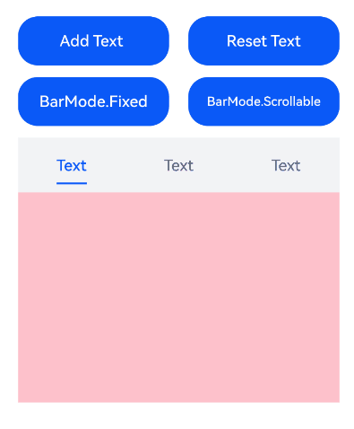

### Example 2: Setting the Layout Style for a Scrollable TabBar

This example implements the **ScrollableBarModeOptions** parameter of [barMode](#barmode10-1). This parameter is effective only in **Scrollable** mode.

```ts
// xxx.ets
@Entry
@Component
struct TabsExample6 {
  private controller: TabsController = new TabsController();
  @State scrollMargin: number = 0;
  @State layoutStyle: LayoutStyle = LayoutStyle.ALWAYS_CENTER;
  @State text: string = 'Text';

  build() {
    Column() {
      Row() {
        Button('scrollMargin+10 ' + this.scrollMargin)
          .width('47%')
          .height(50)
          .margin({ top: 5 })
          .onClick((event?: ClickEvent) => {
            this.scrollMargin += 10;
          })
          .margin({ right: '6%', bottom: '12vp' })
        Button('scrollMargin-10 ' + this.scrollMargin)
          .width('47%')
          .height(50)
          .margin({ top: 5 })
          .onClick((event?: ClickEvent) => {
            this.scrollMargin -= 10;
          })
          .margin({ bottom: '12vp' })
      }

      Row() {
        Button('Add Text')
          .width('47%')
          .height(50)
          .margin({ top: 5 })
          .onClick((event?: ClickEvent) => {
            this.text += 'Add Text';
          })
          .margin({ right: '6%', bottom: '12vp' })
        Button('Reset Text')
          .width('47%')
          .height(50)
          .margin({ top: 5 })
          .onClick((event?: ClickEvent) => {
            this.text = 'Text';
          })
          .margin({ bottom: '12vp' })
      }

      Row() {
        Button('layoutStyle.ALWAYS_CENTER')
          .width('100%')
          .height(50)
          .margin({ top: 5 })
          .fontSize(15)
          .onClick((event?: ClickEvent) => {
            this.layoutStyle = LayoutStyle.ALWAYS_CENTER;
          })
          .margin({ bottom: '12vp' })
      }

      Row() {
        Button('layoutStyle.ALWAYS_AVERAGE_SPLIT')
          .width('100%')
          .height(50)
          .margin({ top: 5 })
          .fontSize(15)
          .onClick((event?: ClickEvent) => {
            this.layoutStyle = LayoutStyle.ALWAYS_AVERAGE_SPLIT;
          })
          .margin({ bottom: '12vp' })
      }

      Row() {
        Button('layoutStyle.SPACE_BETWEEN_OR_CENTER')
          .width('100%')
          .height(50)
          .margin({ top: 5 })
          .fontSize(15)
          .onClick((event?: ClickEvent) => {
            this.layoutStyle = LayoutStyle.SPACE_BETWEEN_OR_CENTER;
          })
          .margin({ bottom: '12vp' })
      }

      Tabs({ barPosition: BarPosition.End, controller: this.controller }) {
        TabContent() {
          Column().width('100%').height('100%').backgroundColor(Color.Pink)
        }.tabBar(SubTabBarStyle.of(this.text))

        TabContent() {
          Column().width('100%').height('100%').backgroundColor(Color.Green)
        }.tabBar(SubTabBarStyle.of(this.text))

        TabContent() {
          Column().width('100%').height('100%').backgroundColor(Color.Blue)
        }.tabBar(SubTabBarStyle.of(this.text))
      }
      .animationDuration(300)
      .height('60%')
      .backgroundColor(0xf1f3f5)
      .barMode(BarMode.Scrollable, { margin: this.scrollMargin, nonScrollableLayoutStyle: this.layoutStyle })
    }
    .width('100%')
    .height(500)
    .margin({ top: 5 })
    .padding('24vp')
  }
}
```

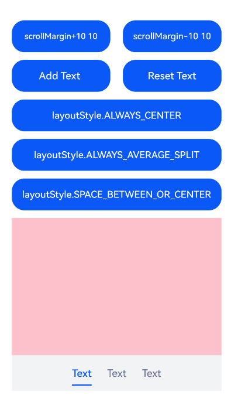

### Example 3: Implementing Custom Tab Switching Synchronization

This example demonstrates how to use [onAnimationStart](#onanimationstart11) and [onChange](#onchange) to implement synchronized switching between the tab bar and tab content.

```ts
// xxx.ets
@Entry
@Component
struct TabsExample {
  @State fontColor: string = '#182431';
  @State selectedFontColor: string = '#007DFF';
  @State currentIndex: number = 0;
  @State selectedIndex: number = 0;
  private controller: TabsController = new TabsController();

  @Builder tabBuilder(index: number, name: string) {
    Column() {
      Text(name)
        .fontColor(this.selectedIndex === index ? this.selectedFontColor : this.fontColor)
        .fontSize(16)
        .fontWeight(this.selectedIndex === index ? 500 : 400)
        .lineHeight(22)
        .margin({ top: 17, bottom: 7 })
      Divider()
        .strokeWidth(2)
        .color('#007DFF')
        .opacity(this.selectedIndex === index ? 1 : 0)
    }.width('100%')
  }

  build() {
    Column() {
      Tabs({ barPosition: BarPosition.Start, index: this.currentIndex, controller: this.controller }) {
        TabContent() {
          Column().width('100%').height('100%').backgroundColor('#00CB87')
        }.tabBar(this.tabBuilder(0, 'green'))

        TabContent() {
          Column().width('100%').height('100%').backgroundColor('#007DFF')
        }.tabBar(this.tabBuilder(1, 'blue'))

        TabContent() {
          Column().width('100%').height('100%').backgroundColor('#FFBF00')
        }.tabBar(this.tabBuilder(2, 'yellow'))

        TabContent() {
          Column().width('100%').height('100%').backgroundColor('#E67C92')
        }.tabBar(this.tabBuilder(3, 'pink'))
      }
      .vertical(false)
      .barMode(BarMode.Fixed)
      .barWidth(360)
      .barHeight(56)
      .animationDuration(400)
      .onChange((index: number) => {
        // currentIndex controls the displayed tab in TabContent.
        this.currentIndex = index;
        this.selectedIndex = index;
      })
      .onAnimationStart((index: number, targetIndex: number, event: TabsAnimationEvent) => {
        if (index === targetIndex) {
          return;
        }
        // Control the Text color switch in the custom TabBar through selectedIndex.
        this.selectedIndex = targetIndex;
      })
      .width(360)
      .height(296)
      .margin({ top: 52 })
      .backgroundColor('#F1F3F5')
    }.width('100%')
  }
}
```

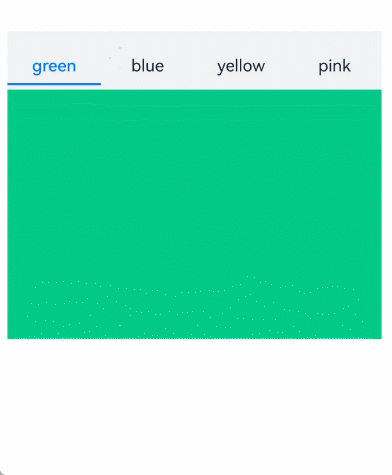

### Example 4: Setting the Basic Attributes of the Divider

This example uses [divider](#divider10) to present dividers in different styles.

```ts
// xxx.ets
@Entry
@Component
struct TabsDivider1 {
  private controller1: TabsController = new TabsController();
  @State dividerColor: string = 'red';
  @State strokeWidth: number = 2;
  @State startMargin: number = 0;
  @State endMargin: number = 0;
  @State nullFlag: boolean = false;

  build() {
    Column() {
      Tabs({ controller: this.controller1 }) {
        TabContent() {
          Column().width('100%').height('100%').backgroundColor(Color.Pink)
        }.tabBar('pink')

        TabContent() {
          Column().width('100%').height('100%').backgroundColor(Color.Yellow)
        }.tabBar('yellow')

        TabContent() {
          Column().width('100%').height('100%').backgroundColor(Color.Blue)
        }.tabBar('blue')

        TabContent() {
          Column().width('100%').height('100%').backgroundColor(Color.Green)
        }.tabBar('green')

        TabContent() {
          Column().width('100%').height('100%').backgroundColor(Color.Red)
        }.tabBar('red')
      }
      .vertical(true)
      .scrollable(true)
      .barMode(BarMode.Fixed)
      .barWidth(70)
      .barHeight(200)
      .animationDuration(400)
      .onChange((index: number) => {
        console.info(index.toString());
      })
      .height('200vp')
      .margin({ bottom: '12vp' })
      .divider(this.nullFlag ? null : {
        strokeWidth: this.strokeWidth,
        color: this.dividerColor,
        startMargin: this.startMargin,
        endMargin: this.endMargin
      })

      Button('Regular Divider').width('100%').margin({ bottom: '12vp' })
        .onClick(() => {
          this.nullFlag = false;
          this.strokeWidth = 2;
          this.dividerColor = 'red';
          this.startMargin = 0;
          this.endMargin = 0;
        })
      Button('Empty Divider').width('100%').margin({ bottom: '12vp' })
        .onClick(() => {
          this.nullFlag = true;
        })
      Button('Change to Blue').width('100%').margin({ bottom: '12vp'})
        .onClick(() => {
          this.dividerColor = 'blue';
        })
      Button('Increase Width').width('100%').margin({ bottom: '12vp' })
        .onClick(() => {
          this.strokeWidth += 2;
        })
      Button('Decrease Width').width('100%').margin({ bottom: '12vp'})
        .onClick(() => {
          if (this.strokeWidth > 2) {
            this.strokeWidth -= 2;
          }
        })
      Button('Increase Top Margin').width('100%').margin({ bottom: '12vp' })
        .onClick(() => {
          this.startMargin += 2;
        })
      Button('Decrease Top Margin').width('100%').margin({ bottom: '12vp' })
        .onClick(() => {
          if (this.startMargin > 2) {
            this.startMargin -= 2;
          }
        })
      Button('Increase Bottom Margin').width('100%').margin({ bottom: '12vp' })
        .onClick(() => {
          this.endMargin += 2;
        })
      Button('Decrease Bottom Margin').width('100%').margin({ bottom: '12vp' })
        .onClick(() => {
          if (this.endMargin > 2) {
            this.endMargin -= 2;
          }
        })
    }.padding({ top: '24vp', left: '24vp', right: '24vp' })
  }
}
```

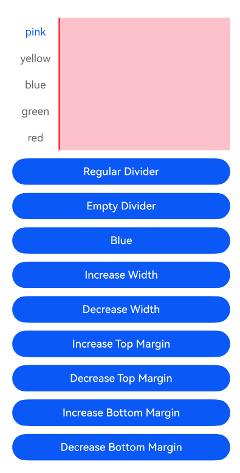

### Example 5: Setting Tab Bar Fading

This example uses [fadingEdge](#fadingedge10) to enable or disable the fading effect when switching tabs.

```ts
// xxx.ets
@Entry
@Component
struct TabsOpaque {
  private controller: TabsController = new TabsController();
  private controller1: TabsController = new TabsController();
  @State selfFadingFade: boolean = true;

  build() {
    Column() {
      Button('Set Tab to Fade').width('100%').margin({ bottom: '12vp' })
        .onClick((event?: ClickEvent) => {
          this.selfFadingFade = true;
        })
      Button('Set Tab Not to Fade').width('100%').margin({ bottom: '12vp' })
        .onClick((event?: ClickEvent) => {
          this.selfFadingFade = false;
        })
      Tabs({ barPosition: BarPosition.End, controller: this.controller }) {
        TabContent() {
          Column().width('100%').height('100%').backgroundColor(Color.Pink)
        }.tabBar('pink')

        TabContent() {
          Column().width('100%').height('100%').backgroundColor(Color.Yellow)
        }.tabBar('yellow')

        TabContent() {
          Column().width('100%').height('100%').backgroundColor(Color.Blue)
        }.tabBar('blue')

        TabContent() {
          Column().width('100%').height('100%').backgroundColor(Color.Green)
        }.tabBar('green')

        TabContent() {
          Column().width('100%').height('100%').backgroundColor(Color.Green)
        }.tabBar('green')

        TabContent() {
          Column().width('100%').height('100%').backgroundColor(Color.Green)
        }.tabBar('green')

        TabContent() {
          Column().width('100%').height('100%').backgroundColor(Color.Green)
        }.tabBar('green')

        TabContent() {
          Column().width('100%').height('100%').backgroundColor(Color.Green)
        }.tabBar('green')
      }
      .vertical(false)
      .scrollable(true)
      .barMode(BarMode.Scrollable)
      .barHeight(80)
      .animationDuration(400)
      .onChange((index: number) => {
        console.info(index.toString());
      })
      .fadingEdge(this.selfFadingFade)
      .height('30%')
      .width('100%')

      Tabs({ barPosition: BarPosition.Start, controller: this.controller1 }) {
        TabContent() {
          Column().width('100%').height('100%').backgroundColor(Color.Pink)
        }.tabBar('pink')

        TabContent() {
          Column().width('100%').height('100%').backgroundColor(Color.Yellow)
        }.tabBar('yellow')

        TabContent() {
          Column().width('100%').height('100%').backgroundColor(Color.Blue)
        }.tabBar('blue')

        TabContent() {
          Column().width('100%').height('100%').backgroundColor(Color.Green)
        }.tabBar('green')

        TabContent() {
          Column().width('100%').height('100%').backgroundColor(Color.Green)
        }.tabBar('green')

        TabContent() {
          Column().width('100%').height('100%').backgroundColor(Color.Green)
        }.tabBar('green')
      }
      .vertical(true)
      .scrollable(true)
      .barMode(BarMode.Scrollable)
      .barHeight(200)
      .barWidth(80)
      .animationDuration(400)
      .onChange((index: number) => {
        console.info(index.toString());
      })
      .fadingEdge(this.selfFadingFade)
      .height('30%')
      .width('100%')
    }
    .padding({ top: '24vp', left: '24vp', right: '24vp' })
  }
}
```

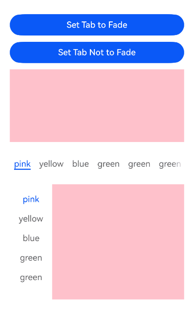

### Example 6: Implementing TabBar Overlay on TabContent

This example shows how to use [barOverlap](#baroverlap10) to specify whether the tab bar overlaps the **TabContent** component with a blurred background effect.

```ts
// xxx.ets
@Entry
@Component
struct barHeightTest {
  @State arr: number[] = [0, 1, 2, 3];
  @State barOverlap: boolean = true;

  build() {
    Column() {
      Text(`barOverlap ${this.barOverlap}`).fontSize(16)
      Button('Change barOverlap').width('100%').margin({ bottom: '12vp' })
        .onClick((event?: ClickEvent) => {
          if (this.barOverlap) {
            this.barOverlap = false;
          } else {
            this.barOverlap = true;
          }
        })

      Tabs({ barPosition: BarPosition.End }) {
        TabContent() {
          Column() {
            List({ space: 10 }) {
              ForEach(this.arr, (item: number) => {
                ListItem() {
                  Text('item' + item).width('80%').height(200).fontSize(16).textAlign(TextAlign.Center).backgroundColor('#fff8b81e')
                }
              }, (item: string) => item)
            }.width('100%').height('100%')
            .lanes(2).alignListItem(ListItemAlign.Center)
          }.width('100%').height('100%')
          .backgroundColor(Color.Pink)
        }
        .tabBar(new BottomTabBarStyle($r('sys.media.ohos_icon_mask_svg'), 'Test 0'))
      }
      .scrollable(false)
      .height('60%')
      .barOverlap(this.barOverlap)
    }
    .height(500)
    .padding({ top: '24vp', left: '24vp', right: '24vp' })
  }
}
```

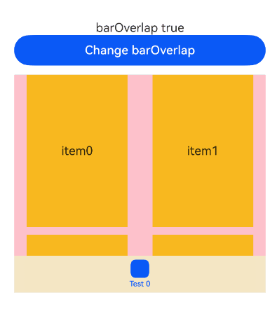

### Example 7: Setting the Visible Area for the Tab Bar in Responsive Grid Mode

This example uses [barGridAlign](#bargridalign10) to set the visible area of the tab bar in responsive grid mode.

```ts
// xxx.ets
@Entry
@Component
struct TabsExample5 {
  private controller: TabsController = new TabsController();
  @State gridMargin: number = 10;
  @State gridGutter: number = 10;
  @State sm: number = -2;
  @State clickedContent: string = '';

  build() {
    Column() {
      Row() {
        Button('gridMargin+10 ' + this.gridMargin)
          .width('47%')
          .height(50)
          .margin({ top: 5 })
          .onClick((event?: ClickEvent) => {
            this.gridMargin += 10;
          })
          .margin({ right: '6%', bottom: '12vp' })
        Button('gridMargin-10 ' + this.gridMargin)
          .width('47%')
          .height(50)
          .margin({ top: 5 })
          .onClick((event?: ClickEvent) => {
            this.gridMargin -= 10;
          })
          .margin({ bottom: '12vp' })
      }

      Row() {
        Button('gridGutter+10 ' + this.gridGutter)
          .width('47%')
          .height(50)
          .margin({ top: 5 })
          .onClick((event?: ClickEvent) => {
            this.gridGutter += 10;
          })
          .margin({ right: '6%', bottom: '12vp' })
        Button('gridGutter-10 ' + this.gridGutter)
          .width('47%')
          .height(50)
          .margin({ top: 5 })
          .onClick((event?: ClickEvent) => {
            this.gridGutter -= 10;
          })
          .margin({ bottom: '12vp' })
      }

      Row() {
        Button('sm+2 ' + this.sm)
          .width('47%')
          .height(50)
          .margin({ top: 5 })
          .onClick((event?: ClickEvent) => {
            this.sm += 2;
          })
          .margin({ right: '6%' })
        Button('sm-2 ' + this.sm).width('47%').height(50).margin({ top: 5 })
          .onClick((event?: ClickEvent) => {
            this.sm -= 2;
          })
      }

      Text('Tapped content: ' + this.clickedContent).width('100%').height(200).margin({ top: 5 })


      Tabs({ barPosition: BarPosition.End, controller: this.controller }) {
        TabContent() {
          Column().width('100%').height('100%').backgroundColor(Color.Pink)
        }.tabBar(BottomTabBarStyle.of($r('sys.media.ohos_app_icon'), '1'))

        TabContent() {
          Column().width('100%').height('100%').backgroundColor(Color.Green)
        }.tabBar(BottomTabBarStyle.of($r('sys.media.ohos_app_icon'), '2'))

        TabContent() {
          Column().width('100%').height('100%').backgroundColor(Color.Blue)
        }.tabBar(BottomTabBarStyle.of($r('sys.media.ohos_app_icon'), '3'))
      }
      .width('350vp')
      .animationDuration(300)
      .height('60%')
      .barGridAlign({ sm: this.sm, margin: this.gridMargin, gutter: this.gridGutter })
      .backgroundColor(0xf1f3f5)
      .onTabBarClick((index: number) => {
        this.clickedContent += 'now index ' + index + ' is clicked\n';
      })
    }
    .width('100%')
    .height(500)
    .margin({ top: 5 })
    .padding('10vp')
  }
}
```

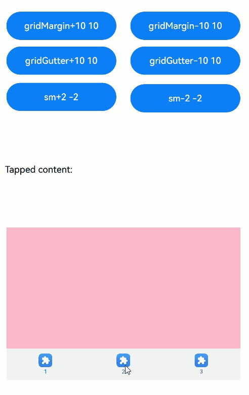

### Example 8: Implementing a Custom Tab Switching Animation

This example uses [customContentTransition](#customcontenttransition11) to implement a custom tab switching animation.

```ts
// xxx.ets
interface itemType {
  text: string,
  backgroundColor: Color
}

@Entry
@Component
struct TabsCustomAnimationExample {
  @State data: itemType[] = [
    {
      text: 'Red',
      backgroundColor: Color.Red
    },
    {
      text: 'Yellow',
      backgroundColor: Color.Yellow
    },
    {
      text: 'Blue',
      backgroundColor: Color.Blue
    }];
  @State opacityList: number[] = [];
  @State scaleList: number[] = [];

  private durationList: number[] = [];
  private timeoutList: number[] = [];
  private customContentTransition: (from: number, to: number) => TabContentAnimatedTransition = (from: number, to: number) => {
    let tabContentAnimatedTransition = {
      timeout: this.timeoutList[from],
      transition: (proxy: TabContentTransitionProxy) => {
        this.scaleList[from] = 1.0;
        this.scaleList[to] = 0.5;
        this.opacityList[from] = 1.0;
        this.opacityList[to] = 0.5;
        this.getUIContext()?.animateTo({
          duration: this.durationList[from],
          onFinish: () => {
            proxy.finishTransition();
          }
        }, () => {
          this.scaleList[from] = 0.5;
          this.scaleList[to] = 1.0;
          this.opacityList[from] = 0.5;
          this.opacityList[to] = 1.0;
        });
      }
    } as TabContentAnimatedTransition;
    return tabContentAnimatedTransition;
  };

  aboutToAppear(): void {
    let duration = 1000;
    let timeout = 1000;
    for (let i = 1; i <= this.data.length; i++) {
      this.opacityList.push(1.0);
      this.scaleList.push(1.0);
      this.durationList.push(duration * i);
      this.timeoutList.push(timeout * i);
    }
  }

  build() {
    Column() {
      Tabs() {
        ForEach(this.data, (item: itemType, index: number) => {
          TabContent() {}
          .tabBar(item.text)
          .backgroundColor(item.backgroundColor)
          // Customize the opacity and scale animation.
          .opacity(this.opacityList[index])
          .scale({ x: this.scaleList[index], y: this.scaleList[index] })
        })
      }
      .backgroundColor(0xf1f3f5)
      .width('100%')
      .height(500)
      .customContentTransition(this.customContentTransition)
    }
  }
}
```


### Example 9: Implementing Tab Switching Interception

This example uses [onContentWillChange](#oncontentwillchange12) to implement custom swipe-based tab switching interception.

```ts
// xxx.ets
@Entry
@Component
struct TabsExample {
  @State selectedIndex: number = 2;
  @State currentIndex: number = 2;
  private controller: TabsController = new TabsController();

  @Builder tabBuilder(title: string,targetIndex: number) {
    Column(){
      // Replace $r('app.media.star_fill') with the image resource file you use.
      // Replace $r('app.media.star') with the image resource file you use.
      Image(this.selectedIndex === targetIndex ? $r('app.media.star_fill') : $r('app.media.star'))
        .width(24)
        .height(24)
        .margin({ bottom: 4 })
        .objectFit(ImageFit.Contain)
      Text(title).fontColor(this.selectedIndex === targetIndex ? '#1698CE' : '#6B6B6B')
    }.width('100%')
    .height(50)
    .justifyContent(FlexAlign.Center)
  }
  
  build() {
    Column() {
      Tabs({ barPosition: BarPosition.End, index: this.currentIndex, controller: this.controller }) {
        TabContent() {
          Column(){
            Text('Content of the Home tab')
          }.width('100%').height('100%').backgroundColor('#00CB87').justifyContent(FlexAlign.Center)
        }.tabBar(this.tabBuilder('Home',0))

        TabContent() {
          Column(){
            Text('Content of the Discover tab')
          }.width('100%').height('100%').backgroundColor('#007DFF').justifyContent(FlexAlign.Center)
        }.tabBar(this.tabBuilder('Discover',1))

        TabContent() {
          Column(){
            Text('Content of the Recommended tab')
          }.width('100%').height('100%').backgroundColor('#FFBF00').justifyContent(FlexAlign.Center)
        }.tabBar(this.tabBuilder('Recommended',2))

        TabContent() {
          Column(){
            Text('Content of the Me tab')
          }.width('100%').height('100%').backgroundColor('#E67C92').justifyContent(FlexAlign.Center)
        }.tabBar(this.tabBuilder('Me',3))
      }
      .vertical(false)
      .barMode(BarMode.Fixed)
      .barWidth(360)
      .barHeight(60)
      .animationDuration(0)
      .onChange((index: number) => {
        this.currentIndex = index;
        this.selectedIndex = index;
      })
      .width(360)
      .height(600)
      .backgroundColor('#F1F3F5')
      .scrollable(true)
      .onContentWillChange((currentIndex, comingIndex) => {
        if (comingIndex == 2) {
          return false;
        }
        return true;
      })

      Button('Change Index').width('50%').margin({ top: 20 })
        .onClick(()=>{
          this.currentIndex = (this.currentIndex + 1) % 4;
        })

      Button('changeIndex').width('50%').margin({ top: 20 })
        .onClick(()=>{
          this.currentIndex = (this.currentIndex + 1) % 4;
          this.controller.changeIndex(this.currentIndex);
        })
    }.width('100%')
  }
}
```

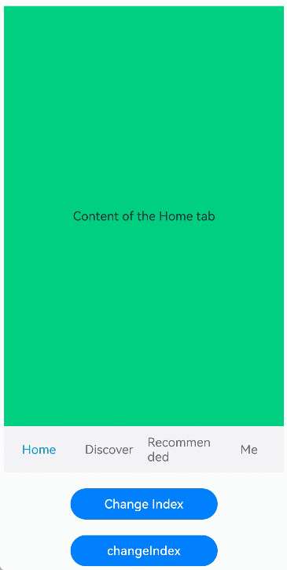

### Example 10: Customizing the Tab Switching Animation

This example uses [onChange](#onchange), [onAnimationStart](#onanimationstart11), [onAnimationEnd](#onanimationend11), and [onGestureSwipe](#ongestureswipe11) APIs to customize the tab bar switching animation.

<!--code_no_check-->

```ts
// EntryAbility.ets
import { Configuration, UIAbility } from '@kit.AbilityKit';
import { i18n } from '@kit.LocalizationKit';
import { CommonUtil } from '../common/CommonUtil';

export default class EntryAbility extends UIAbility {
  onConfigurationUpdate(newConfig: Configuration): void {
    // Listen for system configuration changes.
    if (newConfig.language) {
      CommonUtil.setIsRTL(i18n.isRTL(newConfig.language));
    }
  }
}
```

<!--code_no_check-->

```ts
// CommonUtil.ets
export class CommonUtil {
  private static isRTL: boolean = false;

  public static setIsRTL(isRTL: boolean): void {
    CommonUtil.isRTL = isRTL;
  }

  public static getIsRTL(): boolean {
    return CommonUtil.isRTL;
  }
}
```

<!--code_no_check-->

```ts
// xxx.ets
import { LengthMetrics } from '@kit.ArkUI';
import { CommonUtil } from '../common/CommonUtil';

@Entry
@Component
struct TabsExample {
  @State colorArray: [string, string][] =
    [['green', '#00CB87'], ['blue', '#007DFF'], ['yellow', '#FFBF00'], ['pink', '#E67C92']];
  @State currentIndex: number = 0;
  @State animationDuration: number = 300;
  @State indicatorLeftMargin: number = 0;
  @State indicatorWidth: number = 0;
  private tabsWidth: number = 0;
  private textInfos: [number, number][] = [];
  private isStartAnimateTo: boolean = false;

  aboutToAppear():void {
    for (let i = 0; i < this.colorArray.length; i++) {
      this.textInfos.push([0, 0]);
    }
  }

  @Builder
  tabBuilder(index: number, name: string) {
    Column() {
      Text(name)
        .fontSize(16)
        .fontColor(this.currentIndex === index ? '#007DFF' : '#182431')
        .fontWeight(this.currentIndex === index ? 500 : 400)
        .id(index.toString())
        .onAreaChange((oldValue: Area, newValue: Area) => {
          this.textInfos[index] = [newValue.globalPosition.x as number, newValue.width as number];
          if (!this.isStartAnimateTo && this.currentIndex === index && this.tabsWidth > 0) {
            this.setIndicatorAttr(this.textInfos[this.currentIndex][0], this.textInfos[this.currentIndex][1]);
          }
        })
    }.width('100%')
  }

  build() {
    Stack({ alignContent: Alignment.TopStart }) {
      Tabs({ barPosition: BarPosition.Start }) {
        ForEach(this.colorArray, (item: [string, string], index:number) => {
          TabContent() {
            Column().width('100%').height('100%').backgroundColor(item[1])
          }.tabBar(this.tabBuilder(index, item[0]))
        })
      }
      .onAreaChange((oldValue: Area, newValue: Area)=> {
        this.tabsWidth = newValue.width as number;
        if (!this.isStartAnimateTo) {
          this.setIndicatorAttr(this.textInfos[this.currentIndex][0], this.textInfos[this.currentIndex][1]);
        }
      })
      .barWidth('100%')
      .barHeight(56)
      .width('100%')
      .height(296)
      .backgroundColor('#F1F3F5')
      .animationDuration(this.animationDuration)
      .onChange((index: number) => {
        this.currentIndex = index; // Listen for index changes to switch between tabs.
      })
      .onAnimationStart((index: number, targetIndex: number, event: TabsAnimationEvent) => {
        // Triggered when the switching animation starts. The indicator slides along with the page, together with width gradients.
        this.currentIndex = targetIndex;
        this.startAnimateTo(this.animationDuration, this.textInfos[targetIndex][0], this.textInfos[targetIndex][1]);
      })
      .onAnimationEnd((index: number, event: TabsAnimationEvent) => {
        // Triggered when the switching animation ends. The indicator animation stops.
        let currentIndicatorInfo = this.getCurrentIndicatorInfo(index, event);
        this.startAnimateTo(0, currentIndicatorInfo.left, currentIndicatorInfo.width);
      })
      .onGestureSwipe((index: number, event: TabsAnimationEvent) => {
        // Triggered on a frame-by-frame basis during swipe gestures for tab switching.
        let currentIndicatorInfo = this.getCurrentIndicatorInfo(index, event);
        this.currentIndex = currentIndicatorInfo.index;
        this.setIndicatorAttr(currentIndicatorInfo.left, currentIndicatorInfo.width);
      })

      Column()
        .height(2)
        .width(this.indicatorWidth)
        .margin({ start: LengthMetrics.vp(this.indicatorLeftMargin), top: LengthMetrics.vp(48) })
        .backgroundColor('#007DFF')
    }.width('100%')
  }

  private getCurrentIndicatorInfo(index: number, event: TabsAnimationEvent): Record<string, number> {
    let nextIndex = index;
    if (index > 0 && (CommonUtil.getIsRTL() ? event.currentOffset < 0 : event.currentOffset > 0)) {
      nextIndex--;
    } else if (index < this.textInfos.length - 1 &&
        (CommonUtil.getIsRTL() ? event.currentOffset > 0 : event.currentOffset < 0)) {
      nextIndex++;
    }
    let indexInfo = this.textInfos[index];
    let nextIndexInfo = this.textInfos[nextIndex];
    let swipeRatio = Math.abs(event.currentOffset / this.tabsWidth);
    let currentIndex = swipeRatio > 0.5 ? nextIndex : index; // If the swipe is more than halfway, the tab bar switches to the next tab.
    let currentLeft = indexInfo[0] + (nextIndexInfo[0] - indexInfo[0]) * swipeRatio;
    let currentWidth = indexInfo[1] + (nextIndexInfo[1] - indexInfo[1]) * swipeRatio;
    return { 'index': currentIndex, 'left': currentLeft, 'width': currentWidth };
  }

  private startAnimateTo(duration: number, leftMargin: number, width: number) {
    this.isStartAnimateTo = true;
    this.getUIContext()?.animateTo({
      duration: duration, // Animation duration.
      curve: Curve.Linear, // Animation curve.
      iterations: 1, // Number of playback times.
      playMode: PlayMode.Normal, // Animation playback mode.
      onFinish: () => {
        this.isStartAnimateTo = false;
        console.info('play end');
      }
    }, () => {
      this.setIndicatorAttr(leftMargin, width);
    });
  }

  private setIndicatorAttr(leftMargin: number, width: number) {
    this.indicatorWidth = width;
    if (CommonUtil.getIsRTL()) {
      this.indicatorLeftMargin = this.tabsWidth - leftMargin - width;
    } else {
      this.indicatorLeftMargin = leftMargin;
    }
  }
}
```


### Example 11: Preloading Child Nodes

This example demonstrates how to use the [preloadItems](#preloaditems12) API to preload specified child nodes.

```ts
// xxx.ets
import { BusinessError } from '@kit.BasicServicesKit';

@Entry
@Component
struct TabsPreloadItems {
  @State currentIndex: number = 1;
  private tabsController: TabsController = new TabsController();

  build() {
    Column() {
      Tabs({ index: this.currentIndex, controller: this.tabsController }) {
        TabContent() {
          MyComponent({ color: '#00CB87' })
        }.tabBar(SubTabBarStyle.of('green'))

        TabContent() {
          MyComponent({ color: '#007DFF' })
        }.tabBar(SubTabBarStyle.of('blue'))

        TabContent() {
          MyComponent({ color: '#FFBF00' })
        }.tabBar(SubTabBarStyle.of('yellow'))

        TabContent() {
          MyComponent({ color: '#E67C92' })
        }.tabBar(SubTabBarStyle.of('pink'))
      }
      .width(360)
      .height(296)
      .backgroundColor('#F1F3F5')
      .onChange((index: number) => {
        this.currentIndex = index;
      })

      Button('preload items: [0, 2, 3]')
        .margin(5)
        .onClick(() => {
          // Preload child nodes 0, 2, and 3 to improve the performance when users swipe or click to switch to these nodes.
          this.tabsController.preloadItems([0, 2, 3])
            .then(() => {
              console.info('preloadItems success.');
            })
            .catch((error: BusinessError) => {
              console.error('preloadItems failed, error code: ' + error.code + ', error message: ' + error.message);
            })
        })
    }
  }
}

@Component
struct MyComponent {
  private color: string = '';

  aboutToAppear(): void {
    console.info('aboutToAppear backgroundColor:' + this.color);
  }

  aboutToDisappear(): void {
    console.info('aboutToDisappear backgroundColor:' + this.color);
  }

  build() {
    Column()
      .width('100%')
      .height('100%')
      .backgroundColor(this.color)
  }
}
```

### Example 12: Setting Tab Bar Translation and Opacity

This example demonstrates how to set the translation distance and opacity of the tab bar using the [setTabBarTranslate](#settabbartranslate13) and [setTabBarOpacity](#settabbaropacity13) APIs.

```ts
// xxx.ets
@Entry
@Component
struct TabsExample {
  private controller: TabsController = new TabsController();

  build() {
    Column() {
      Button('Set TabBar Translation Distance').margin({ top: 20 })
        .onClick(() => {
          this.controller.setTabBarTranslate({ x: -20, y: -20 });
        })

      Button('Set TabBar Opacity').margin({ top: 20 })
        .onClick(() => {
          this.controller.setTabBarOpacity(0.5);
        })

      Tabs({ barPosition: BarPosition.End, controller: this.controller }) {
        TabContent() {
          Column().width('100%').height('100%').backgroundColor('#00CB87')
        }.tabBar(BottomTabBarStyle.of($r('app.media.startIcon'), 'green'))

        TabContent() {
          Column().width('100%').height('100%').backgroundColor('#007DFF')
        }.tabBar(BottomTabBarStyle.of($r('app.media.startIcon'), 'blue'))

        TabContent() {
          Column().width('100%').height('100%').backgroundColor('#FFBF00')
        }.tabBar(BottomTabBarStyle.of($r('app.media.startIcon'), 'yellow'))

        TabContent() {
          Column().width('100%').height('100%').backgroundColor('#E67C92')
        }.tabBar(BottomTabBarStyle.of($r('app.media.startIcon'), 'pink'))
      }
      .width(360)
      .height(296)
      .margin({ top: 20 })
      .barBackgroundColor('#F1F3F5')
    }
    .width('100%')
  }
}
```

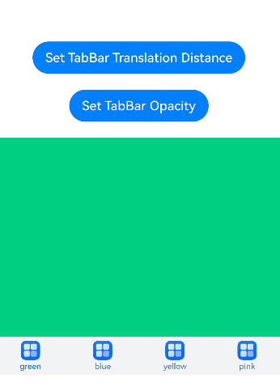

### Example 13: Implementing Lazy Loading and Resource Release of Pages

This example demonstrates how to use a custom [TabBar](ts-container-tabcontent.md#tabbar) with the [Swiper](ts-container-swiper.md) component and [LazyForEach](ts-rendering-control-lazyforeach.md) to implement lazy loading and resource release of pages.

```ts
// xxx.ets
class MyDataSource implements IDataSource {
  private list: number[] = [];

  constructor(list: number[]) {
    this.list = list;
  }

  totalCount(): number {
    return this.list.length;
  }

  getData(index: number): number {
    return this.list[index];
  }

  registerDataChangeListener(listener: DataChangeListener): void {
  }

  unregisterDataChangeListener() {
  }
}

@Entry
@Component
struct TabsSwiperExample {
  @State fontColor: string = '#182431';
  @State selectedFontColor: string = '#007DFF';
  @State currentIndex: number = 0;
  private list: number[] = [];
  private tabsController: TabsController = new TabsController();
  private swiperController: SwiperController = new SwiperController();
  private swiperData: MyDataSource = new MyDataSource([]);

  aboutToAppear(): void {
    for (let i = 0; i <= 9; i++) {
      this.list.push(i);
    }
    this.swiperData = new MyDataSource(this.list);
  }

  @Builder tabBuilder(index: number, name: string) {
    Column() {
      Text(name)
        .fontColor(this.currentIndex === index ? this.selectedFontColor : this.fontColor)
        .fontSize(16)
        .fontWeight(this.currentIndex === index ? 500 : 400)
        .lineHeight(22)
        .margin({ top: 17, bottom: 7 })
      Divider()
        .strokeWidth(2)
        .color('#007DFF')
        .opacity(this.currentIndex === index ? 1 : 0)
    }.width('20%')
  }

  build() {
    Column() {
      Tabs({ barPosition: BarPosition.Start, controller: this.tabsController }) {
        ForEach(this.list, (item: number) => {
          TabContent().tabBar(this.tabBuilder(item, 'Tab ' + this.list[item]))
        })
      }
      .onTabBarClick((index: number) => {
        this.currentIndex = index;
        this.swiperController.changeIndex(index, true);
      })
      .barMode(BarMode.Scrollable)
      .backgroundColor('#F1F3F5')
      .height(56)
      .width('100%')

      Swiper(this.swiperController) {
        LazyForEach(this.swiperData, (item: string) => {
          Text(item.toString())
            .onAppear(()=>{
              console.info('onAppear ' + item.toString());
            })
            .onDisAppear(()=>{
              console.info('onDisAppear ' + item.toString());
            })
            .width('100%')
            .height('100%')
            .backgroundColor(0xAFEEEE)
            .textAlign(TextAlign.Center)
            .fontSize(30)
        }, (item: string) => item)
      }
      .loop(false)
      .onChange((index: number) => {
        this.currentIndex = index;
      })
      .onAnimationStart((index: number, targetIndex: number, extraInfo: SwiperAnimationEvent) => {
        this.currentIndex = targetIndex;
        this.tabsController.changeIndex(targetIndex);
      })
    }
  }
}
```

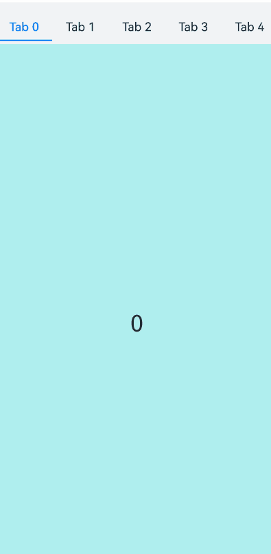

### Example 14: Implementing the Tab Switching Animation

This example demonstrates how to implement a tab switching animation by setting [animationMode](#animationmode12).

```ts
// xxx.ets
@Entry
@Component
struct TabsExample {
  @State currentIndex: number = 0;
  @State currentAnimationMode: AnimationMode = AnimationMode.CONTENT_FIRST;
  private controller: TabsController = new TabsController();
  private data: number[] = [];

  aboutToAppear(): void {
    for (let i = 0; i < 10; i++) {
      this.data.push(i);
    }
  }

  @Builder
  tabBuilder(title: string, targetIndex: number) {
    Column() {
      Text(title).fontColor(this.currentIndex === targetIndex ? '#FF0000' : '#6B6B6B')
    }.width('100%')
    .height(50)
    .justifyContent(FlexAlign.Center)
  }

  build() {
    Column() {
      Tabs({ barPosition: BarPosition.End, controller: this.controller, index: this.currentIndex }) {
        ForEach(this.data, (item: number) => {
          TabContent() {
            Column() {
              Text('' + item)
            }.width('100%').height('100%').backgroundColor('#00CB87').justifyContent(FlexAlign.Center)
          }.tabBar(this.tabBuilder('P' + item, item))
        }, (item: number) => item.toString())
      }
      .barWidth(360)
      .barHeight(60)
      .animationMode(this.currentAnimationMode)
      .animationDuration(4000)
      .onChange((index: number) => {
        this.currentIndex = index;
      })
      .width(360)
      .height(120)
      .backgroundColor('#F1F3F5')

      Text('AnimationMode:' + AnimationMode[this.currentAnimationMode])

      Button('AnimationMode').width('50%').margin({ top: 1 }).height(25)
        .onClick(() => {
          if (this.currentAnimationMode === AnimationMode.CONTENT_FIRST) {
            this.currentAnimationMode = AnimationMode.ACTION_FIRST;
          } else if (this.currentAnimationMode === AnimationMode.ACTION_FIRST) {
            this.currentAnimationMode = AnimationMode.NO_ANIMATION;
          } else if (this.currentAnimationMode === AnimationMode.NO_ANIMATION) {
            this.currentAnimationMode = AnimationMode.CONTENT_FIRST_WITH_JUMP;
          } else if (this.currentAnimationMode === AnimationMode.CONTENT_FIRST_WITH_JUMP) {
            this.currentAnimationMode = AnimationMode.ACTION_FIRST_WITH_JUMP;
          } else if (this.currentAnimationMode === AnimationMode.ACTION_FIRST_WITH_JUMP) {
            this.currentAnimationMode = AnimationMode.CONTENT_FIRST;
          }
        })
    }.width('100%')
  }
}
```

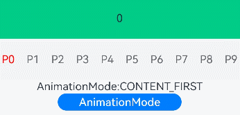

### Example 15: Enabling Tabs to Exceed the Tab Bar Area

This example shows how to enable tabs to exceed the tab bar area by setting the **clip** property of the **TabBar** using **barModifier** in [TabsOptions](#tabsoptions15).

Starting from API version 15, the **barModifier** API is added to **TabsOptions**.

```ts
// xxx.ets
import { CommonModifier } from '@kit.ArkUI';

@Entry
@Component
struct TabsBarModifierExample {
  @State selectedIndex: number = 2;
  @State currentIndex: number = 2;
  @State isClip: boolean = false;
  @State tabBarModifier: CommonModifier = new CommonModifier();
  private controller: TabsController = new TabsController();

  aboutToAppear(): void {
    this.tabBarModifier.clip(this.isClip);
  }

  @Builder
  tabBuilder(title: string, targetIndex: number) {
    Column() {
      Image($r('app.media.startIcon')).width(30).height(30)
      Text(title).fontColor(this.selectedIndex === targetIndex ? '#1698CE' : '#6B6B6B')
    }.width('100%')
    .height(50)
    .justifyContent(FlexAlign.Center)
    .offset({ y: this.selectedIndex === targetIndex ? -15 : 0 })
  }

  build() {
    Column() {
      Tabs({
        barPosition: BarPosition.End,
        index: this.currentIndex,
        controller: this.controller,
        barModifier: this.tabBarModifier
      }) {
        TabContent() {
          Column() {
            Text('Content of the Home tab')
          }.width('100%').height('100%').backgroundColor('#00CB87').justifyContent(FlexAlign.Center)
        }.tabBar(this.tabBuilder('Home', 0))

        TabContent() {
          Column() {
            Text('Content of the Discover tab')
          }.width('100%').height('100%').backgroundColor('#007DFF').justifyContent(FlexAlign.Center)
        }.tabBar(this.tabBuilder('Discover', 1))

        TabContent() {
          Column() {
            Text('Content of the Recommended tab')
          }.width('100%').height('100%').backgroundColor('#FFBF00').justifyContent(FlexAlign.Center)
        }.tabBar(this.tabBuilder('Recommended', 2))

        TabContent() {
          Column() {
            Text('Content of the Me tab')
          }.width('100%').height('100%').backgroundColor('#E67C92').justifyContent(FlexAlign.Center)
        }.tabBar(this.tabBuilder('Me',3))
      }
      .vertical(false)
      .barMode(BarMode.Fixed)
      .barWidth(340)
      .barHeight(60)
      .onChange((index: number) => {
        this.currentIndex = index;
        this.selectedIndex = index;
      })
      .width(340)
      .height(400)
      .backgroundColor('#F1F3F5')
      .scrollable(true)

      Button('isClip: ' + this.isClip)
        .margin({ top: 30 })
        .onClick(() => {
          this.isClip = !this.isClip;
          this.tabBarModifier.clip(this.isClip);
        })
    }.width('100%')
  }
}
```

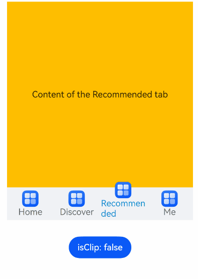

### Example 16: Aligning Tabs

This example demonstrates how to align tabs by setting the **align** property of the **TabBar** using **barModifier** in [TabsOptions](#tabsoptions15).

Starting from API version 15, the **barModifier** API is added to **TabsOptions**.

```ts
// xxx.ets
import { CommonModifier } from '@kit.ArkUI';

@Entry
@Component
struct TabsBarModifierExample {
  private controller: TabsController = new TabsController();
  @State text: string = 'Text';
  @State isVertical: boolean = false;
  @State tabBarModifier: CommonModifier = new CommonModifier();

  build() {
    Column() {
      Row() {
        Button('Alignment.Start ')
          .width('47%')
          .height(50)
          .margin({ top: 5 })
          .onClick((event?: ClickEvent) => {
            this.tabBarModifier.align(Alignment.Start);
          })
          .margin({ right: '6%', bottom: '12vp' })
        Button('Alignment.End')
          .width('47%')
          .height(50)
          .margin({ top: 5 })
          .onClick((event?: ClickEvent) => {
            this.tabBarModifier.align(Alignment.End);
          })
          .margin({ bottom: '12vp' })
      }

      Row() {
        Button('Alignment.Center')
          .width('47%')
          .height(50)
          .margin({ top: 5 })
          .onClick((event?: ClickEvent) => {
            this.tabBarModifier.align(Alignment.Center);
          })
          .margin({ right: '6%', bottom: '12vp' })
        Button('isVertical: ' + this.isVertical)
          .width('47%')
          .height(50)
          .margin({ top: 5 })
          .onClick((event?: ClickEvent) => {
            this.isVertical = !this.isVertical;
          })
          .margin({ bottom: '12vp' })
      }

      Row() {
        Button('Alignment.Top')
          .width('47%')
          .height(50)
          .margin({ top: 5 })
          .onClick((event?: ClickEvent) => {
            this.tabBarModifier.align(Alignment.Top);
          })
          .margin({ right: '6%', bottom: '12vp' })
        Button('Alignment.Bottom')
          .width('47%')
          .height(50)
          .margin({ top: 5 })
          .onClick((event?: ClickEvent) => {
            this.tabBarModifier.align(Alignment.Bottom);
          })
          .margin({ bottom: '12vp' })
      }

      Tabs({ barPosition: BarPosition.End, controller: this.controller, barModifier: this.tabBarModifier }) {
        TabContent() {
          Column().width('100%').height('100%').backgroundColor(Color.Pink)
        }.tabBar(SubTabBarStyle.of(this.text))

        TabContent() {
          Column().width('100%').height('100%').backgroundColor(Color.Green)
        }.tabBar(SubTabBarStyle.of(this.text))

        TabContent() {
          Column().width('100%').height('100%').backgroundColor(Color.Blue)
        }.tabBar(SubTabBarStyle.of(this.text))
      }
      .vertical(this.isVertical)
      .height('60%')
      .backgroundColor(0xf1f3f5)
      .barMode(BarMode.Scrollable)
    }
    .width('100%')
    .height(500)
    .margin({ top: 5 })
    .padding('24vp')
  }
}
```

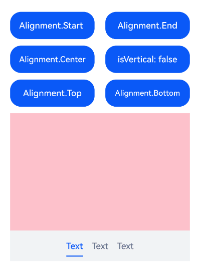

### Example 17: Synchronizing Tabs and TabBar Synchronously

This example shows how to implement synchronized switching between the **Tabs** and **TabBar** components using the [onSelected](#onselected18) callback.

The **onSelected** API is added since API version 18.

```ts
// xxx.ets
@Entry
@Component
struct TabsExample {
  @State fontColor: string = '#182431';
  @State selectedFontColor: string = '#007DFF';
  @State currentIndex: number = 0;
  @State selectedIndex: number = 0;
  private controller: TabsController = new TabsController();

  @Builder tabBuilder(index: number, name: string) {
    Column() {
      Text(name)
        .fontColor(this.selectedIndex === index ? this.selectedFontColor : this.fontColor)
        .fontSize(16)
        .fontWeight(this.selectedIndex === index ? 500 : 400)
        .lineHeight(22)
        .margin({ top: 17, bottom: 7 })
      Divider()
        .strokeWidth(2)
        .color('#007DFF')
        .opacity(this.selectedIndex === index ? 1 : 0)
    }.width('100%')
  }

  build() {
    Column() {
      Tabs({ barPosition: BarPosition.Start, index: this.currentIndex, controller: this.controller }) {
        TabContent() {
          Column().width('100%').height('100%').backgroundColor('#00CB87')
        }.tabBar(this.tabBuilder(0, 'green'))

        TabContent() {
          Column().width('100%').height('100%').backgroundColor('#007DFF')
        }.tabBar(this.tabBuilder(1, 'blue'))

        TabContent() {
          Column().width('100%').height('100%').backgroundColor('#FFBF00')
        }.tabBar(this.tabBuilder(2, 'yellow'))

        TabContent() {
          Column().width('100%').height('100%').backgroundColor('#E67C92')
        }.tabBar(this.tabBuilder(3, 'pink'))
      }
      .vertical(false)
      .barMode(BarMode.Fixed)
      .barWidth(360)
      .barHeight(56)
      .animationDuration(400)
      .animationMode(AnimationMode.CONTENT_FIRST)
      .onChange((index: number) => {
        console.info('onChange index:' + index);
        this.currentIndex = index;
      })
      .onSelected((index: number) => {
        console.info('onSelected index:' + index);
        this.selectedIndex = index;
      })
      .onUnselected((index: number) => {
        console.info('onUnselected index:' + index);
      })
      .width('100%')
      .height('100%')
      .backgroundColor('#F1F3F5')
    }.width('100%')
  }
}
```


### Example 18: Releasing the Tabs Child components

This example demonstrates how to release the **Tabs** child components by setting [cachedMaxCount](#cachedmaxcount19).

The **cachedMaxCount** API is added since API version 19.

```ts
@Entry
@Component
struct TabsExample {
  build() {
    Tabs() {
      TabContent() {
        MyComponent({ color: '#00CB87' })
      }.tabBar(SubTabBarStyle.of('green'))

      TabContent() {
        MyComponent({ color: '#007DFF' })
      }.tabBar(SubTabBarStyle.of('blue'))

      TabContent() {
        MyComponent({ color: '#FFBF00' })
      }.tabBar(SubTabBarStyle.of('yellow'))

      TabContent() {
        MyComponent({ color: '#E67C92' })
      }.tabBar(SubTabBarStyle.of('pink'))
    }
    .width(360)
    .height(296)
    .backgroundColor('#F1F3F5')
    .cachedMaxCount(1, TabsCacheMode.CACHE_BOTH_SIDE)
  }
}

@Component
struct MyComponent {
  private color: string = '';

  aboutToAppear(): void {
    console.info('aboutToAppear backgroundColor:' + this.color);
  }

  aboutToDisappear(): void {
    console.info('aboutToDisappear backgroundColor:' + this.color);
  }

  build() {
    Column()
      .width('100%')
      .height('100%')
      .backgroundColor(this.color)
  }
}
```

### Example 19: Setting the Tab Bar Background Blur Effect

This example sets the background blur style and effect of the tab bar through [barBackgroundBlurStyle](#barbackgroundblurstyle18) and [barBackgroundEffect](#barbackgroundeffect18), respectively.

The **barBackgroundBlurStyle** and **barBackgroundEffect** APIs are added since API version 18.

```ts
// xxx.ets
@Entry
@Component
struct TabsExample {
  build() {
    Column() {
      // Use barBackgroundBlurStyle with an enumerated value to set blur parameters.
      Stack() {
        Image($r('app.media.startIcon'))
        Tabs() {
          TabContent() {
            Column().width('100%').height('100%').backgroundColor('#00CB87')
          }.tabBar('green')

          TabContent() {
            Column().width('100%').height('100%').backgroundColor('#007DFF')
          }.tabBar('blue')

          TabContent() {
            Column().width('100%').height('100%').backgroundColor('#FFBF00')
          }.tabBar('yellow')

          TabContent() {
            Column().width('100%').height('100%').backgroundColor('#E67C92')
          }.tabBar('pink')
        }
        .barBackgroundBlurStyle(BlurStyle.COMPONENT_THICK,
          { colorMode: ThemeColorMode.LIGHT, adaptiveColor: AdaptiveColor.DEFAULT, scale: 1.0 })
      }
      .width(300)
      .height(300)
      .margin(10)

      // barBackgroundEffect can be used to customize the blur radius, brightness, and saturation of tabBar.
      Stack() {
        Image($r('app.media.startIcon'))
        Tabs() {
          TabContent() {
            Column().width('100%').height('100%').backgroundColor('#00CB87')
          }.tabBar('green')

          TabContent() {
            Column().width('100%').height('100%').backgroundColor('#007DFF')
          }.tabBar('blue')

          TabContent() {
            Column().width('100%').height('100%').backgroundColor('#FFBF00')
          }.tabBar('yellow')

          TabContent() {
            Column().width('100%').height('100%').backgroundColor('#E67C92')
          }.tabBar('pink')
        }
        .barBackgroundEffect({ radius: 20, brightness: 0.6, saturation: 15 })
      }
      .width(300)
      .height(300)
      .margin(10)
    }
  }
}
```
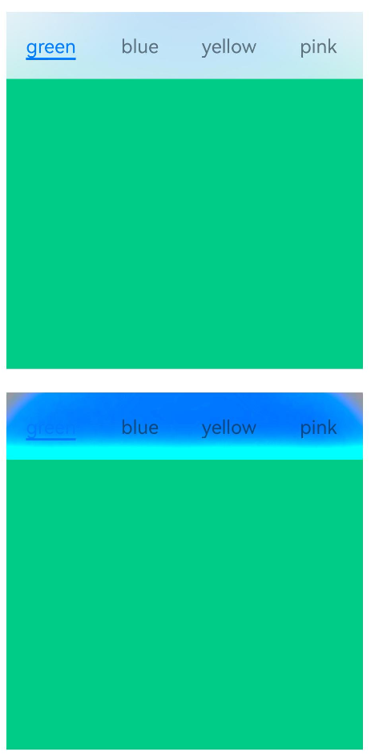

### Example 20: Setting the Edge Sliding Effect

This example uses [edgeEffect](#edgeeffect12) to implement different edge rebound effects.

```ts
// xxx.ets
@Entry
@Component
struct TabsExample {
  @State edgeEffect: EdgeEffect = EdgeEffect.Spring;

  build() {
    Column() {
      Tabs() {
        TabContent() {
          Column().width('100%').height('100%').backgroundColor('#00CB87')
        }.tabBar('green')

        TabContent() {
          Column().width('100%').height('100%').backgroundColor('#007DFF')
        }.tabBar('blue')

        TabContent() {
          Column().width('100%').height('100%').backgroundColor('#FFBF00')
        }.tabBar('yellow')

        TabContent() {
          Column().width('100%').height('100%').backgroundColor('#E67C92')
        }.tabBar('pink')
      }
      .width(360)
      .height(296)
      .margin({ top: 52 })
      .backgroundColor('#F1F3F5')
      .edgeEffect(this.edgeEffect)

      Button('EdgeEffect.Spring').width('50%').margin({ top: 20 })
        .onClick(() => {
          this.edgeEffect = EdgeEffect.Spring;
        })

      Button('EdgeEffect.Fade').width('50%').margin({ top: 20 })
        .onClick(() => {
          this.edgeEffect = EdgeEffect.Fade;
        })

      Button('EdgeEffect.None').width('50%').margin({ top: 20 })
        .onClick(() => {
          this.edgeEffect = EdgeEffect.None;
        })
    }.width('100%')
  }
}
```
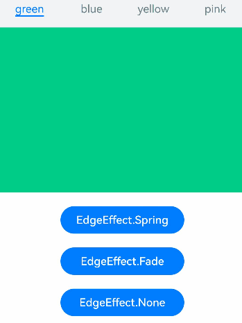

### Example 21: Setting the Tab Switching Animation Curve

This example illustrates how to set the tab switching animation curve using the [animationCurve](#animationcurve20) API, and how to combine it with **animationDuration** to set the animation duration.

The **animationCurve** API is added since API version 20.

```ts
import { curves } from '@kit.ArkUI';

interface TabsItemType {
  text: string,
  backgroundColor: ResourceColor
}

@Entry
@Component
struct TabsExample {
  private tabsController: TabsController = new TabsController();
  private curves: (Curve | ICurve) [] = [
    curves.interpolatingSpring(-1, 1, 328, 34),
    curves.springCurve(10, 1, 228, 30),
    curves.cubicBezierCurve(0.25, 0.1, 0.25, 1.0),
  ];
  private curveNames: string[] = [
    'interpolatingSpring(-1, 1, 328, 34)',
    'springCurve(10, 1, 228, 30)',
    'cubicBezierCurve(0.25, 0.1, 0.25, 1.0)'
  ];
  @State curveIndex: number = 0;
  private data: TabsItemType[] = [
    { text: '1', backgroundColor: '#004AAF' },
    { text: '2', backgroundColor: '#2787D9' },
    { text: '3', backgroundColor: '#D5D5D5' },
    { text: '4', backgroundColor: '#707070' },
    { text: '5', backgroundColor: '#F7F7F7' },
  ];
  @State duration: number = 0;

  build() {
    Column({ space: 2 }) {
      Tabs({ controller: this.tabsController }) {
        ForEach(this.data, (item: TabsItemType, index: number) => {
          TabContent() {
          }
          .tabBar(item.text)
          .backgroundColor(item.backgroundColor)
        })
      }
      .backgroundColor(0xf1f3f5)
      .width('100%')
      .height(500)
      .animationCurve(this.curves[this.curveIndex])
      .animationDuration(this.duration)

      Column({ space: 2 }) {
        Text('Curve:' + this.curveNames[this.curveIndex])
        Row({ space: 2 }) {
          // Switch the animation curve.
          Button('++').onClick(() => {
            this.curveIndex = (this.curveIndex + 1) % this.curves.length;
          })
          Button('reset').onClick(() => {
            this.curveIndex = 0;
          })
        }
      }
      .margin({ left: '10vp' })
      .width('100%')

      Row({ space: 2 }) {
        Text('Duration:' + this.duration)
        // Increase the animation duration.
        Button('+100').onClick(() => {
          this.duration = (this.duration + 100) % 10000;
        })
        Button('+1000').onClick(() => {
          this.duration = (this.duration + 1000) % 10000;
        })
        Button('reset').onClick(() => {
          this.duration = 0;
        })
      }
      .margin({ left: '10vp' })
      .width('100%')
    }
    .margin('10vp')
  }
}
```
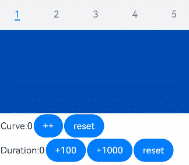

### Example 22: Listening for Swipe Events on the Tabs Page

This example demonstrates how to set the callback for a **Tabs** component is swiped using the [onContentDidScroll](#oncontentdidscroll23) API.

The **onContentDidScroll** API is supported since API version 23.

```ts
// xxx.ets
@Entry
@Component
struct TabsDidScrollExample {
  @State fontColor: string = '#182431';
  @State selectedFontColor: string = '#007DFF';
  @State currentIndex: number = 0;
  @State selectedIndex: number = 0;
  @State didScrollStr: string = '';
  private controller: TabsController = new TabsController();

  @Builder
  tabBuilder(index: number, name: string) {
    Column() {
      Text(name)
        .fontColor(this.selectedIndex === index ? this.selectedFontColor : this.fontColor)
        .fontSize(16)
        .fontWeight(this.selectedIndex === index ? 500 : 400)
        .lineHeight(22)
        .margin({ top: 17, bottom: 7 })
      Divider()
        .strokeWidth(2)
        .color('#007DFF')
        .opacity(this.selectedIndex === index ? 1 : 0)
    }.width('100%')
  }

  build() {
    Column() {
      Text ('Swipe page to trigger callback')
        .width("80%")
        .fontSize(20)
        .margin(5)
        .textAlign(TextAlign.Center)

      Text(this.didScrollStr)
        .width("80%")
        .fontSize(20)
        .margin(5)
        .textAlign(TextAlign.Center)

      Tabs({ barPosition: BarPosition.Start, index: this.currentIndex, controller: this.controller }) {
        TabContent() {
          Column().width('100%').height('100%').backgroundColor('#00CB87')
        }.tabBar(this.tabBuilder(0, 'green'))

        TabContent() {
          Column().width('100%').height('100%').backgroundColor('#007DFF')
        }.tabBar(this.tabBuilder(1, 'blue'))

        TabContent() {
          Column().width('100%').height('100%').backgroundColor('#FFBF00')
        }.tabBar(this.tabBuilder(2, 'yellow'))

        TabContent() {
          Column().width('100%').height('100%').backgroundColor('#E67C92')
        }.tabBar(this.tabBuilder(3, 'pink'))
      }
      .vertical(false)
      .barMode(BarMode.Fixed)
      .barWidth(360)
      .barHeight(56)
      .animationDuration(400)
      .onChange((index: number) => {
        // currentIndex controls the displayed tab in TabContent.
        this.currentIndex = index;
        this.selectedIndex = index;
      })
      .onAnimationStart((index: number, targetIndex: number, event: TabsAnimationEvent) => {
        if (index === targetIndex) {
          return;
        }
        // Control the color switch of Text in the custom TabBar through selectedIndex.
        this.selectedIndex = targetIndex;
      })
      .width(360)
      .height(296)
      .margin({ top: 15 })
      .backgroundColor('#F1F3F5')
      .onContentDidScroll((selectedIndex: number, index: number, position: number, mainAxisLength: number) => {
        // Listen for Tabs page slide events. In this callback, you can customize the navigation indicator animation.
        console.info("onContentDidScroll selectedIndex: " + selectedIndex + ", index: " + index + ", position: " +
          position + ", mainAxisLength: " + mainAxisLength);
        this.didScrollStr =
          "onContentDidScroll selectedIndex: " + selectedIndex + ", index: " + index + ", position: " +
            position + ", mainAxisLength: " + mainAxisLength
      })
    }.width('100%')
  }
}
```

<!--Del--> <!--DelEnd-->

### Example 23: Implementing Nested Scrolling of Tabs

This example shows how to use the [nestedScroll](#nestedscroll24) API to set the nested scrolling effect of **Tabs**.

The **nestedScroll** API is added since API version 24.

```ts
// xxx.ets
@Entry
@Component
struct TabsExample {
  @State text: string = 'Text';
  @State barMode: BarMode = BarMode.Fixed;
  build() {
    Column() {
      Row() {

        Tabs() {
          TabContent() {
            Tabs() {
              TabContent() {
                Column().width('100%').height('100%').backgroundColor(Color.Blue)
              }.tabBar(SubTabBarStyle.of('Subpage a'))

              TabContent() {
                Column().width('100%').height('100%').backgroundColor(Color.Green)
              }.tabBar(SubTabBarStyle.of('Subpage b'))

              TabContent() {
                Column().width('100%').height('100%').backgroundColor(Color.Pink)
              }.tabBar(SubTabBarStyle.of('Subpage c'))
            }
            .nestedScroll(TabsNestedScrollMode.SELF_FIRST)
          }.tabBar(SubTabBarStyle.of('Homepage 1'))


          TabContent() {
            Tabs() {
              TabContent() {
                Column().width('100%').height('100%').backgroundColor(Color.Blue)
              }.tabBar(SubTabBarStyle.of('Subpage d'))

              TabContent() {
                Column().width('100%').height('100%').backgroundColor(Color.Green)
              }.tabBar(SubTabBarStyle.of('Subpage e'))

              TabContent() {
                Column().width('100%').height('100%').backgroundColor(Color.Pink)
              }.tabBar(SubTabBarStyle.of('Subpage f'))
            }
            .nestedScroll(TabsNestedScrollMode.SELF_FIRST)
          }.tabBar(SubTabBarStyle.of('Homepage 2'))

        }
        .height('100%')
        .backgroundColor(0xf1f3f5)
        .barMode(this.barMode)
      }
      .width('100%')
      .height('100%')
      .padding('24vp')
    }
  }
}
```
<!--Del--> <!--DelEnd-->

### Example 24 Setting the TabBar Floating Style

This example shows how to set the floating style and immersive board material of the **TabBar** via the [barFloatingStyle](#barfloatingstyle) API.

The illustration for this example shows the strong effect on a high-computing-power device. The immersive light effect of the component is adaptively adjusted based on the device computing power and the immersive light effect set by the user in the system, so you do not need to perform additional adaptation.

Since API version 26.0.0, the **barFloatingStyle** API is added.

```ts
// xxx.ets
import { uiMaterial } from '@kit.ArkUI';
@Entry
@Component
struct TabsFloatingStyleExample {
  build() {
    Column() {
      Tabs({ barPosition: BarPosition.End }) {
        TabContent() {
          Column().width('100%').height('100%').backgroundColor(Color.Blue)
        }.tabBar('Blue')

        TabContent() {
          Column().width('100%').height('100%').backgroundColor(Color.Green)
        }.tabBar('Green')

        TabContent() {
          Column().width('100%').height('100%').backgroundColor(Color.Orange)
        }.tabBar('Orange')

        TabContent() {
          Column().width('100%').height('100%').backgroundColor(Color.Pink)
        }.tabBar('Pink')
      }
      .barFloatingStyle({
        adaptToHandedness: true, systemMaterial: new uiMaterial.ImmersiveMaterial(
          {
            style: uiMaterial.ImmersiveStyle.ULTRA_THIN,
            applyShadow: true,
            interactive: true,
            lightEffect: { color: Color.White }
          }
        )
      })
      .barOverlap(true)
      .height('100%')
    }
    .width('100%')
    .height('100%')
  }
}
```

The figure in this example shows the strong effect on a high-computing-power device:

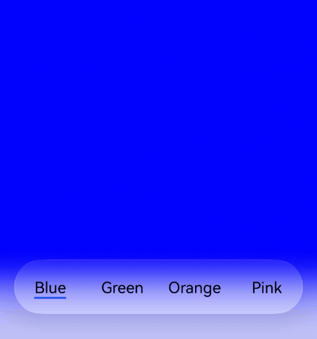

### Example 25: Setting the Side Tab Bar Style

This example shows how to set the display style of the Tab Bar via the [barStyle](#barstyle) API, including the fixed bottom Tab Bar style, the fixed Side Tab Bar style, and the adaptive Side Tab Bar style; how to set the display position of the Side Tab via the [sidebarPosition](#sidebarposition) API; how to set custom content in the header of the Side Tab Bar via the [sidebarHeader](#sidebarheader) API; how to enable the search function of the Side Tab Bar via the [sidebarSearchable](#sidebarsearchable) API; and how to register a listener for the display mode switch via the [onBarDisplayModeChange](#onbardisplaymodechange) API.

Since API version 26.0.1, the **barStyle**, **sidebarPosition**, **sidebarHeader**, **sidebarSearchable**, and **onBarDisplayModeChange** APIs are added.

```ts
// xxx.ets
import { ComponentContent } from '@kit.ArkUI';

@Builder
function TestHeaderBuilder() {
  Stack({alignContent: Alignment.Center}) {
    Stack({alignContent: Alignment.Center}) {
    }
    .width(64)
    .height(64)
    .backgroundColor('#ff2787d9')
  }
  .width('100%')
  .height(128)
  .border({width: 1, color: '#ffd9d9d9' })
}

@Entry
@Component
struct TabsSidebarExample {
  @State myBarStyle: TabBarStyle = TabBarStyle.BOTTOM;
  @State tabsWidth: number = 550;
  @State searchText: string = '';
  @State currentIndex: number = 0;

  build() {
    Column() {
      Column() {
        Row() {
          Text('barStyle: ').fontSize(25)
          Button('BOTTOM').onClick(() => {
            this.myBarStyle = TabBarStyle.BOTTOM;
          }).margin({right: 10}).fontSize(15).backgroundColor('#ff2787d9')
          Button('SIDEBAR').onClick(() => {
            this.myBarStyle = TabBarStyle.SIDEBAR;
          }).margin({right: 10}).fontSize(15).backgroundColor('#ff2787d9')
          Button('SIDEBAR_ADAPTABLE').onClick(() => {
            this.myBarStyle = TabBarStyle.SIDEBAR_ADAPTABLE;
          }).fontSize(15).backgroundColor('#ff2787d9')
        }.width('100%')
        .justifyContent(FlexAlign.Center)
        Row() {
          Text('Tabs width: ').fontSize(25)
          Button('550').onClick(() => {
            this.tabsWidth = 550;
          }).margin({right: 20}).backgroundColor('#ff2787d9')
          Button('700').onClick(() => {
            this.tabsWidth = 700;
          }).margin({right: 20}).backgroundColor('#ff2787d9')
          Button('850').onClick(() => {
            this.tabsWidth = 850;
          }).backgroundColor('#ff2787d9')
        }.width('100%').margin({top: 5})
        .justifyContent(FlexAlign.Center)
      }.width('100%')
      .height('18%')
      Tabs() {
        TabContent() {
          Stack({alignContent: Alignment.Center}) {
            Text('TabContent1').fontSize(25)
          }.width('100%').height('100%')
        }.tabBar({icon: $r('app.media.startIcon'), text: 'tab1'})
        TabContent() {
          Stack({alignContent: Alignment.Center}) {
            Text('TabContent2').fontSize(25)
          }.width('100%').height('100%')
        }.tabBar({icon: $r('app.media.startIcon'), text: 'tab2'})
        TabContent() {
          Stack({alignContent: Alignment.Center}) {
            Text('TabContent3').fontSize(25)
          }.width('100%').height('100%')
        }
        .tabBar({icon: $r('app.media.startIcon'), text: 'tab3'})
      }
      .height('65%')
      .width(this.tabsWidth)
      .vertical(false)
      .barPosition(BarPosition.End)
      .barBackgroundColor('#fff7f7f7')
      .border({width: 1, color: '#ffd9d9d9'})
      // Set the Tabs display style.
      .barStyle(this.myBarStyle)
      // Set the side tab bar to display on the initial side.
      .sidebarPosition(BarPosition.Start)
      // Set the header content of the side tab bar.
      .sidebarHeader(new ComponentContent(this.getUIContext(), wrapBuilder(TestHeaderBuilder)))
      // Set the search options of the side tab bar.
      .sidebarSearchable({
        placeholder: 'Search tabs',
        searchCallback: (text: string) => {
          this.searchText = text;
          console.info(`search text: ${text}`);
        }
      })
      // The display mode switch event can be listened for via the onBarDisplayModeChange API.
      .onBarDisplayModeChange((mode: TabBarDisplayMode) => {
        console.info(`testTag TabBarDisplayMode change to ${mode}`)
      })
    }
    .width('100%')
    .height(600)
  }
}
```

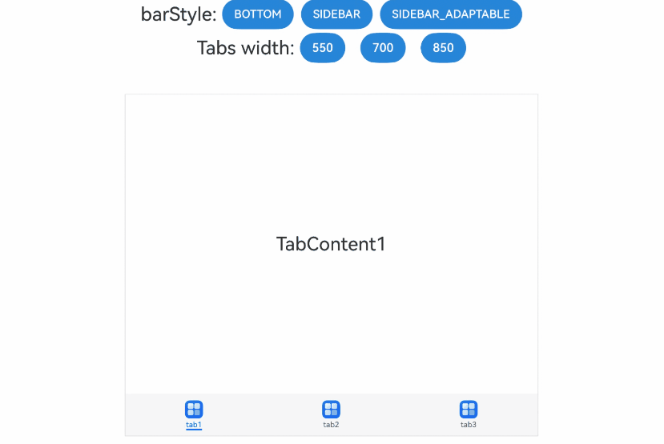

### Example 26: Setting the Sidebar Display Mode

This example shows how to set the sidebar display mode of Tabs through the [sidebarDisplayStyle](#sidebardisplaystyle) API, switching between the embedded mode (**EMBED**) and the displace mode (**DISPLACE**).

Since API version 26.0.1, the **sidebarDisplayStyle** API is added.

```ts
// xxx.ets
@Entry
@Component
struct TabsSideBarDemo {
  @State isDisplace: boolean = false;

  build() {
    Column() {
      // Switch sidebarDisplayStyle.
      Row({ space: 12 }) {
        Text('EMBED')
          .fontSize(14)
          .fontColor('#FFFFFF')
          .backgroundColor(!this.isDisplace ? '#409EFF' : '#C0C4CC')
          .padding({ top: 6, bottom: 6, left: 16, right: 16 })
          .borderRadius(20)
          .onClick(() => {
            this.isDisplace = false;
          })

        Text('DISPLACE')
          .fontSize(14)
          .fontColor('#FFFFFF')
          .backgroundColor(this.isDisplace ? '#67C23A' : '#C0C4CC')
          .padding({ top: 6, bottom: 6, left: 16, right: 16 })
          .borderRadius(20)
          .onClick(() => {
            this.isDisplace = true;
          })
      }
      .padding({ top: 8, bottom: 8 })

      Tabs() {
        TabContent() {
          Column() {
            Text('Home content')
              .fontSize(24)
              .fontColor('#409EFF')
          }
          .width('100%')
          .height('100%')
          .justifyContent(FlexAlign.Center)
          .backgroundColor('#EBF5FF')
        }
        .tabBar('Home')
      }
      .barStyle(TabBarStyle.SIDEBAR)
      .sidebarDisplayStyle(this.isDisplace ? TabsSidebarDisplayStyle.DISPLACE : TabsSidebarDisplayStyle.EMBED)
      .scrollable(true)
      .animationDuration(300)
      .width('100%')
      .layoutWeight(1)
    }
    .width('100%')
    .height('100%')
  }
}
```

<!--Del--> <!--DelEnd-->

### Example 27: Setting the Display Effect of Side Tab Bar Content

This example shows how to control the display effect of side tab bar content through the following APIs.
1. Set the width of the side tab bar through the [sidebarWidth](#sidebarwidth) API.
2. Set the background color of the side tab bar through the [sidebarBackgroundColor](#sidebarbackgroundcolor) API.
3. Set the background blur style of the side tab bar through the [sidebarBackgroundBlurStyle](#sidebarbackgroundblurstyle) API.
4. Set the icon color of the selected tab in the side tab bar through the [sidebarSelectedIconColor](#sidebarselectediconcolor) API.
5. Set the text color of the selected tab in the side tab bar through the [sidebarSelectedTextColor](#sidebarselectedtextcolor) API.
6. Set the icon color of the unselected tab in the side tab bar through the [sidebarUnselectedIconColor](#sidebarunselectediconcolor) API.
7. Set the text color of the unselected tab in the side tab bar through the [sidebarUnselectedTextColor](#sidebarunselectedtextcolor) API.
8. Set the board color of the selected tab in the side tab bar through the [sidebarSelectedBoardColor](#sidebarselectedboardcolor) API.

Since API version 26.0.1, the **sidebarWidth**, **sidebarBackgroundColor**, **sidebarBackgroundBlurStyle**, **sidebarSelectedTextColor**, **sidebarSelectedIconColor**, **sidebarUnselectedTextColor**, **sidebarUnselectedIconColor**, and **sidebarSelectedBoardColor** APIs are added.

```ts
// xxx.ets
@Entry
@Component
struct TabsSidebarContentStyleExample {
  private testArr: Array<number> = new Array();

  aboutToAppear(): void {
    for (let i = 0; i < 6; i++) {
      this.testArr.push(i);
    }
  }

  build() {
    Tabs() {
      ForEach(this.testArr, (data: number) => {
        TabContent() {
          Stack({alignContent: Alignment.Center}) {
            Text(`TabContent${data}`)
          }
          .width('100%')
          .height('100%')
        }
        // Replace $r('app.media.arrow') with the actual resource.
        .tabBar({icon: $r('app.media.arrow'), text: `TabContent${data}`})
      }, (data: number) => data.toString())
    }
    .height('400')
    .width('400')
    .backgroundColor('#fffffbf0')
    // Set Tabs to the side tab bar style.
    .barStyle(TabBarStyle.SIDEBAR)
    // Set the width of the side tab bar.
    .sidebarWidth('190')
    // Set the background color of the side tab bar.
    .sidebarBackgroundColor('#80f6fcf5')
    // Set the background blur style of the side tab bar.
    .sidebarBackgroundBlurStyle(BlurStyle.Thin)
    // Set the icon color of the selected tab in the side tab bar.
    .sidebarSelectedIconColor('#ffa10a21')
    // Set the text color of the selected tab in the side tab bar.
    .sidebarSelectedTextColor('#ffa10a21')
    // Set the icon color of the unselected tab in the side tab bar.
    .sidebarUnselectedIconColor('#ffffc000')
    // Set the text color of the unselected tab in the side tab bar.
    .sidebarUnselectedTextColor('#ffffc000')
    // Set the board color of the selected tab in the side tab bar.
    .sidebarSelectedBoardColor('#ffe3fff9')
  }
}
```

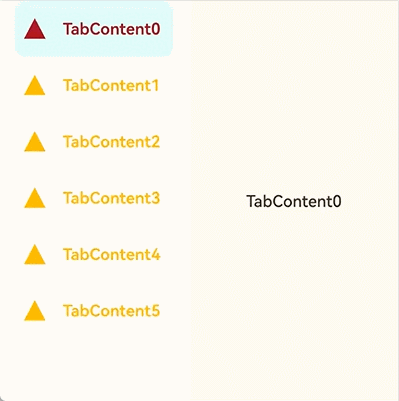

### Example 28: Setting the Divider in Side Tab Bar Mode to Support Dragging

This example shows how to use the following APIs to enable the divider in side tab bar mode to support dragging and specify the dragging range.
1. Use [sidebarDivider](#sidebardivider) to set the divider style of the side tab bar.
2. Use [minSidebarWidth](#minsidebarwidth) to set the minimum width of the side tab bar.
3. Use [maxSidebarWidth](#maxsidebarwidth) to set the maximum width of the side tab bar.
4. Use [minContentWidth](#mincontentwidth) to set the minimum width of the content area.

Since API version 26.0.1, the **sidebarDivider**, **minSidebarWidth**, **maxSidebarWidth**, and **minContentWidth** APIs are added.

```ts
// xxx.ets
@Entry
@Component
struct TabsSidebarDraggableExample {
  private testArr: Array<number> = new Array();

  aboutToAppear(): void {
    for (let i = 0; i < 3; i++) {
      this.testArr.push(i);
    }
  }

  build() {
    Tabs() {
      ForEach(this.testArr, (data: number) => {
        TabContent() {
          Stack({alignContent: Alignment.Center}) {
            Text(`TabContent${data}`)
          }
          .width('100%')
          .height('100%')
        }
        // Replace $r('app.media.arrow') with the actual resource.
        .tabBar({icon: $r('app.media.arrow'), text: `TabContent${data}`})
      }, (data: number) => data.toString())
    }
    .height('400')
    .width('800')
    .backgroundColor('#fffffbf0')
    // Set Tabs to the side tab bar style.
    .barStyle(TabBarStyle.SIDEBAR)
    // Set the divider style corresponding to the side tab bar.
    .sidebarDivider({
      strokeWidth: 1,
      color: '#ff707070',
      startMargin: 5,
      endMargin: 5
    })
    // Set the minimum width of the side tab bar.
    .minSidebarWidth('190')
    // Set the maximum width of the side tab bar.
    .maxSidebarWidth('40%')
    // Set the minimum width of the content area.
    .minContentWidth('360')
  }
}
```

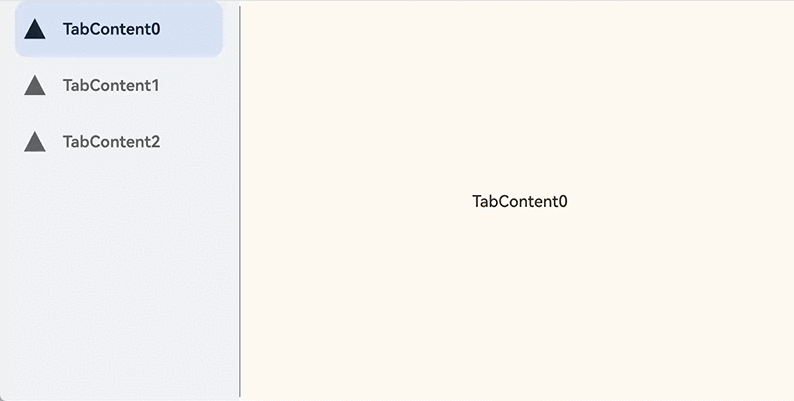

### Example 29: Customizing Display Mode Breakpoint

This example demonstrates how to implement a custom display mode breakpoint through the [barDisplayModeBreakpoint](#bardisplaymodebreakpoint) API.

Since API version 26.0.1, the **barDisplayModeBreakpoint** API is added.

```ts
// xxx.ets
@Entry
@Component
struct TabsSidebarBreakpointExample {
  private testArr: Array<number> = new Array();
  @State tabsWidth: number = 590;

  aboutToAppear(): void {
    for (let i = 0; i < 6; i++) {
      this.testArr.push(i);
    }
  }

  build() {
    Column() {
      Row() {
        Text('Tabs width: ').fontSize(25)
        Button('590').onClick(() => {
          this.tabsWidth = 590;
        }).fontSize(15).backgroundColor('#ff2787d9')
        Button('650').onClick(() => {
          this.tabsWidth = 650;
        }).fontSize(15).backgroundColor('#ff2787d9')
        Button('850').onClick(() => {
          this.tabsWidth = 850;
        }).fontSize(15).backgroundColor('#ff2787d9')
      }
      .width(400)
      .height(100)
      .justifyContent(FlexAlign.SpaceAround)
      Tabs() {
        ForEach(this.testArr, (data: number) => {
          TabContent() {
            Stack({alignContent: Alignment.Center}) {
              Text(`TabContent${data}`)
            }
            .width('100%')
            .height('100%')
          }
          // Replace $r('app.media.arrow') with the actual resource.
          .tabBar({icon: $r('app.media.arrow'), text: `TabContent${data}`})
        }, (data: number) => data.toString())
      }
      .height('400')
      .width(this.tabsWidth)
      .border({width: 1, color: '#ffd9d9d9'})
      .backgroundColor("#fffffbf0")
      // Set Tabs to the adaptive style.
      .barStyle(TabBarStyle.SIDEBAR_ADAPTABLE)
      // Set the custom display breakpoint.
      .barDisplayModeBreakpoint({
        // Set the display to TabBarDisplayMode.BOTTOM_TABBAR mode when the width is in the range [0, 600vp).
        sm: TabBarDisplayMode.BOTTOM_TABBAR,
        // Set the display to TabBarDisplayMode.BOTTOM_TABBAR mode when the width is in the range [600vp, 840vp).
        md: TabBarDisplayMode.BOTTOM_TABBAR,
        // Set the display to TabBarDisplayMode.SIDEBAR mode when the width is in the range [840vp, +∞).
        lg: TabBarDisplayMode.SIDEBAR
      })
    }
    .width('100%')
    .height('100%')
    .alignItems(HorizontalAlign.Center)
  }
}
```

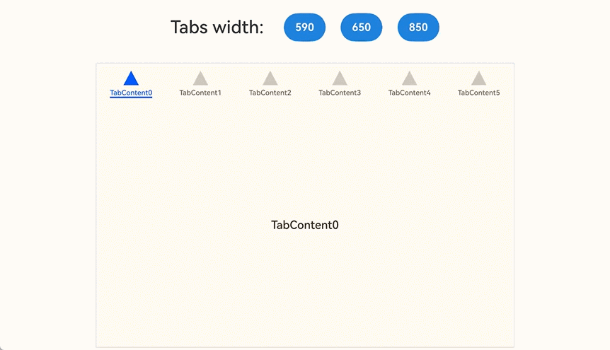
