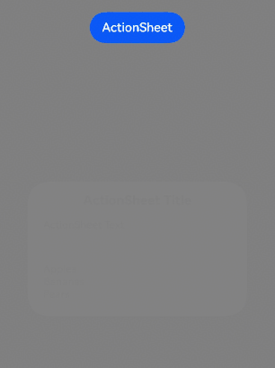

# Action Sheet (ActionSheet) (System API)
<!--Kit: ArkUI-->
<!--Subsystem: ArkUI-->
<!--Owner: @houguobiao-->
<!--Designer: @houguobiao-->
<!--Tester: @lxl007-->
<!--Adviser: @Brilliantry_Rui-->
<!-- md-trans-meta sourceCommit=8373999722a4e142b6e04cfa9e8267e53d682e28 translatedAt=2026-11-03T02:47:47.596Z pushedAt=2026-11-13T01:06:00.020Z nl=1 -->

Creates an action sheet.

> **NOTE**
>
> This API is supported since API version 8. Newly added content in later versions will be marked with a superscript to indicate the initial version.
>
> This module depends on the UI execution context and cannot be used in the [ambiguous UI context](../../../ui/arkts-global-interface.md#ambiguous-ui-context). For details, see [UIContext](../arkts-apis-uicontext-uicontext.md).
>
> This page covers only the system APIs of this module. For public APIs, see [Action Sheet (ActionSheet)](ts-methods-action-sheet.md).

## ActionSheetOptions

Defines the style of the action sheet.

**System capability:** SystemCapability.ArkUI.ArkUI.Full

| Name | Type | Read-Only | Optional | Description |
| ---------- | -------------------------- | ------- | ----------------------------- | ----------------------------- |
| distortionMode | [DistortionMode](./ts-appendix-enums-sys.md#distortionmode) | No | Yes | Distortion animation mode of the dialog box under system materials.<br/>**Default value:** **DistortionMode.DISTORTION_AUTO**<br/>**System API:** This is a system API.<br/>**Since:** 26.0.0<br/>**Model restriction:** This API can be used only in the stage model. |
| edgeLightMode | [EdgeLightMode](./ts-appendix-enums-sys.md#edgelightmode) | No | Yes | Edge light animation mode of the dialog box under system materials.<br/>**Default value:** **EdgeLightMode.EDGELIGHT_AUTO**<br/>**System API:** This is a system API.<br/>**Since:** 26.0.0<br/>**Model restriction:** This API can be used only in the stage model. |

## Examples

### Example 1: Setting Immersive Material, Distortion, and Edge Light for an Action Sheet

This example uses [showActionSheet](../arkts-apis-uicontext-uicontext.md#showactionsheet) to set the **systemMaterial** in [ActionSheetOptions](#actionsheetoptions), as well as the [distortionMode](#actionsheetoptions) and [edgeLightMode](#actionsheetoptions), both of which are set to AUTO mode (which takes effect adaptively based on the device computing capability tier and the immersive light-sensing configuration in system settings).

Since API version 26.0.0, [ActionSheetOptions](#actionsheetoptions) has added the **distortionMode** and **edgeLightMode** attributes.

```ts
import { uiMaterial } from '@kit.ArkUI';

@Entry
@Component
struct ActionSheetExample {
  build() {
    Stack({ alignContent: Alignment.Top }) {
      Column() {
        Button("ActionSheet")
          .margin(20)
          .onClick(() => {
            this.getUIContext().showActionSheet({
              title: 'ActionSheet Title',
              message: 'ActionSheet Text',
              sheets: [
                {
                  title: 'Apples',
                  action: () => {
                    console.info('apples');
                  }
                },
                {
                  title: 'Bananas',
                  action: () => {
                    console.info('bananas');
                  }
                },
                {
                  title: 'Pears',
                  action: () => {
                    console.info('pears');
                  }
                }
              ],
              alignment: DialogAlignment.Center,
              // Set the immersive material.
              systemMaterial: new uiMaterial.ImmersiveMaterial({ style: uiMaterial.ImmersiveStyle.ULTRA_THICK }),
              // Set the distortion to adaptive.
              distortionMode: DistortionMode.DISTORTION_AUTO,
              // Set the edge light to adaptive.
              edgeLightMode: EdgeLightMode.EDGELIGHT_AUTO,
            });
          })
      }
      .height('100%')
      .width('100%')
      .backgroundColor(Color.Gray)
    }
  }
}
```

The following figure shows the strong effect on a high-performance device with immersive material, distortion, and edge light enabled.


The following figure shows the strong effect on a high-performance device without immersive material, distortion, and edge light set.

