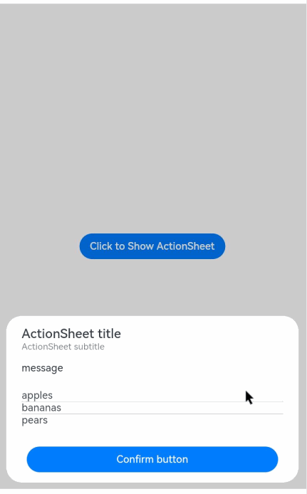
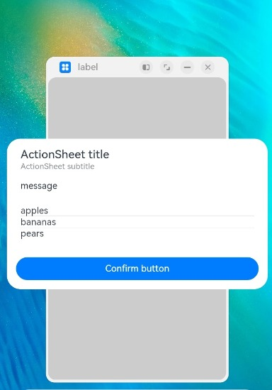
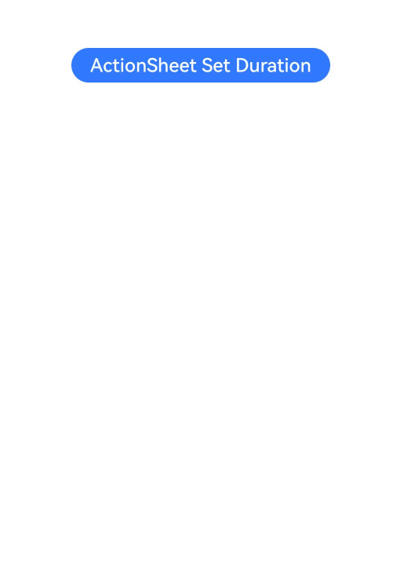
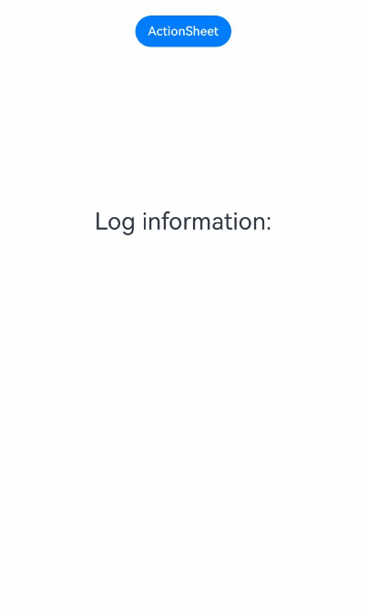
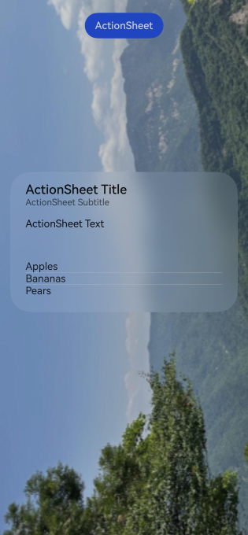
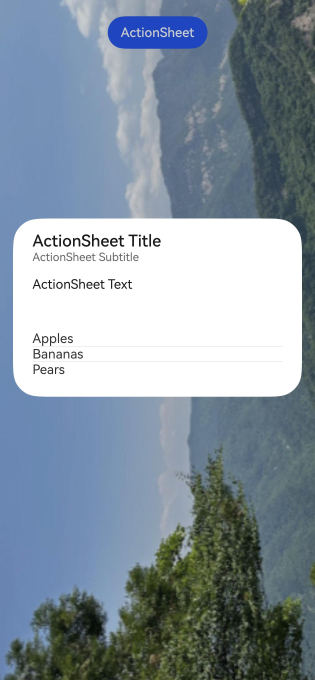

# Action Sheet (ActionSheet)
<!--Kit: ArkUI-->
<!--Subsystem: ArkUI-->
<!--Owner: @houguobiao-->
<!--Designer: @houguobiao-->
<!--Tester: @lxl007-->
<!--Adviser: @Brilliantry_Rui-->

A dialog box component used to display list selection items.

>  **NOTE**
>
>  The initial APIs of this module are supported since API version 8. Updates will be marked with a superscript to indicate their earliest API version.
>
> The functionality of this module depends on UI context. This means that the APIs of this module cannot be used where [the UI context is ambiguous](../../../ui/arkts-global-interface.md#ambiguous-ui-context). For details, see [UIContext](../arkts-apis-uicontext-uicontext.md).

## ActionSheetOptions

Provides **ActionSheet** configuration options.

**System capability**: SystemCapability.ArkUI.ArkUI.Full

<!--Table: 20%; 20%; 8%; 8%; 44%-->
| Name     | Type                   | Read-Only| Optional| Description                         |
| ---------- | -------------------------- | ------- | ----------------------------- | ----------------------------- |
| title      | string&nbsp;\|&nbsp;[Resource](ts-types.md#resource) | No   | No   |  Title of the dialog box.<br>If the text is too long to display, it is truncated with an ellipsis (...).<br>**Atomic service API**: This API can be used in atomic services since API version 11.|
| subtitle<sup>10+</sup> | [ResourceStr](ts-types.md#resourcestr) | No| Yes| Subtitle of the dialog box.<br>If the text is too long to display, it is truncated with an ellipsis (...).<br>**Atomic service API**: This API can be used in atomic services since API version 11.<br>**Model restriction**: This API can be used only in the stage model.|
| message    | string&nbsp;\|&nbsp;[Resource](ts-types.md#resource) | No   | No   | Content of the dialog box.<br>If the text is too long to display, a scrollbar is displayed.<br>**Atomic service API**: This API can be used in atomic services since API version 11. |
| autoCancel | boolean                           | No    | Yes   | Whether to close the dialog box when the overlay is clicked.<br>Default value: **true**<br>The value **true** means to close the dialog box when the overlay is clicked, and **false** means the opposite.<br>**Atomic service API**: This API can be used in atomic services since API version 11.|
| confirm    | [ActionSheetButtonOptions](#actionsheetbuttonoptions18) | No | Yes| Information about the confirm button.<br>**Atomic service API**: This API can be used in atomic services since API version 11.|
| cancel     | [VoidCallback](ts-types.md#voidcallback12) | No    | Yes   | Callback invoked when the dialog box is closed by tapping the mask layer.<br>**Atomic service API**: This API can be used in atomic services since API version 11. |
| alignment  | [DialogAlignment](ts-methods-alert-dialog-box.md#dialogalignment) | No    | Yes   |  Alignment mode of the dialog box in the vertical direction.<br>Default value: **DialogAlignment.Bottom**<br>**Atomic service API**: This API can be used in atomic services since API version 11.<br>**NOTE**<br>If **showInSubWindow** is set to **true** in **UIExtension**, the dialog box is aligned with the host window based on **UIExtension**.|
| offset     | [ActionSheetOffset](#actionsheetoffset18) | No     | Yes    | Offset of the dialog box relative to the alignment position.<br>Default value:<br>1. If **alignment** is set to **Top**, **TopStart**, or **TopEnd**, the default offset value is **{dx:&nbsp;0,dy:&nbsp;"40vp"}**.<br>2. If **alignment** is set to **Center**, **CenterStart**, **CenterEnd**, **Bottom**, **BottomStart**, **BottomEnd** or **Default**, the default value is **{dx:&nbsp;0,dy:&nbsp;"-40vp"}**.<br>**Atomic service API**: This API can be used in atomic services since API version 11.|
| sheets     | Array&lt;[SheetInfo](#sheetinfo)&gt; | No     | No     | Options in the dialog box. Each option supports the image, text, and callback.<br>**Atomic service API**: This API can be used in atomic services since API version 11.|
| maskRect<sup>10+</sup> | [Rectangle](ts-methods-alert-dialog-box.md#rectangle8) | No    | Yes  | Mask area of the dialog box. Events outside the mask area are transparently transmitted, and events within the mask area are not.<br>Default value: **{ x: 0, y: 0, width: '100%', height: '100%' }**<br>**NOTE**<br>**maskRect** does not take effect when **showInSubWindow** is set to **true**.<br>**Atomic service API**: This API can be used in atomic services since API version 11.<br>**Model restriction**: This API can be used only in the stage model.|
| showInSubWindow<sup>11+</sup> | boolean | No| Yes| Whether to show the dialog box in a subwindow when the dialog box needs to be displayed outside the main window. **true**: The dialog box is shown in a subwindow.<br>Default value: **false**, meaning the dialog box is displayed within the application, not in a separate subwindow.<br>**NOTE**<br>A dialog box whose **showInSubWindow** attribute is **true** cannot trigger the display of another dialog box whose **showInSubWindow** attribute is also **true**.<br>**Atomic service API**: This API can be used in atomic services since API version 12.<br>**Model restriction**: This API can be used only in the stage model.|
| isModal<sup>11+</sup> | boolean | No| Yes| Whether the dialog box is a modal. A modal dialog box has a mask applied, while a non-modal dialog box does not. **false**: The dialog box is not a modal.<br>Default value: **true**<br>**Atomic service API**: This API can be used in atomic services since API version 12.<br>**Model restriction**: This API can be used only in the stage model.|
| backgroundColor<sup>11+</sup> | [ResourceColor](ts-types.md#resourcecolor)  | No| Yes| Background color of the dialog box.<br>Default value: **Color.Transparent**<br>**NOTE**<br>The background color will be visually combined with the blur effect when both properties are set. If the resulting effect does not match your design requirements, you can disable the blur effect entirely by explicitly setting the **backgroundBlurStyle** property to **BlurStyle.NONE**. When **backgroundBlurStyle** is set to a value other than **NONE**, do not set **backgroundColor**. If you do, the color display may not produce the expected visual effect.<br>**Atomic service API**: This API can be used in atomic services since API version 12.<br>**Model restriction**: This API can be used only in the stage model.|
| backgroundBlurStyle<sup>11+</sup> | [BlurStyle](ts-universal-attributes-background.md#blurstyle9) | No| Yes| Background blur style of the dialog box.<br>Default value: **BlurStyle.COMPONENT_ULTRA_THICK**.<br>**NOTE**<br>Setting this parameter to **BlurStyle.NONE** disables the background blur. When **backgroundBlurStyle** is set to a value other than **NONE**, do not set **backgroundColor**. If you do, the color display may not produce the expected visual effect.<br>**Atomic service API**: This API can be used in atomic services since API version 12.<br>**Model restriction**: This API can be used only in the stage model.|
| backgroundBlurStyleOptions<sup>19+</sup> | [BackgroundBlurStyleOptions](ts-universal-attributes-background.md#backgroundblurstyleoptions10)| No| Yes| Options for customizing the background blur style. For details about the default value, see **BackgroundBlurStyleOptions**.<br>**Atomic service API**: This API can be used in atomic services since API version 19.<br>**Model restriction**: This API can be used only in the stage model.|
| backgroundEffect<sup>19+</sup> | [BackgroundEffectOptions](ts-universal-attributes-background.md#backgroundeffectoptions11) | No| Yes| Options for customizing the background effect. For details about the default value, see **BackgroundEffectOptions**.<br>**Atomic service API**: This API can be used in atomic services since API version 19.<br>**Model restriction**: This API can be used only in the stage model.|
| onWillDismiss<sup>12+</sup> | Callback<[DismissDialogAction](#dismissdialogaction12)> | No| Yes| Callback for interactive closure of the dialog box.<br>**NOTE**<br>1. If this callback is registered, the dialog box will not be dismissed immediately after the user touches the mask or the Back button, presses the Esc key, or swipes left or right on the screen. The **reason** parameter in the callback is used to determine whether the dialog box can be closed. To close the dialog box, call the **dismiss** method of [DismissDialogAction](#dismissdialogaction12) in the callback. The reason returned by the component does not support the value **CLOSE_BUTTON**.<br>2. In the **onWillDismiss** callback, another **onWillDismiss** callback is not allowed.<br>**Atomic service API**: This API can be used in atomic services since API version 12.<br>**Model restriction**: This API can be used only in the stage model.|
| cornerRadius<sup>12+</sup> | [Dimension](ts-types.md#dimension10)&nbsp;\|&nbsp;[BorderRadiuses](ts-types.md#borderradiuses9) &nbsp;\|&nbsp; [LocalizedBorderRadiuses](ts-types.md#localizedborderradiuses12) | No| Yes| Corner radius of the background.<br>You can set the radius for each of the four corners individually.<br>Default value: **{ topLeft: '32vp', topRight: '32vp', bottomLeft: '32vp', bottomRight: '32vp' }**<br> The corner radius is subject to the component size, with the maximum value being half of the component width or height. If the value is negative, the default value is used.<br> When set to a percentage, the value defines the radius as a percentage of the parent dialog box's width or height.<br>**NOTE**<br>When **cornerRadius** is of type LocalizedBorderRadiuses, the layout order can be dynamically adjusted based on the user's language settings.<br>**Atomic service API**: This API can be used in atomic services since API version 12.<br>**Model restriction**: This API can be used only in the stage model.|
| borderWidth<sup>12+</sup> | [Dimension](ts-types.md#dimension10)&nbsp;\|&nbsp;[EdgeWidths](ts-types.md#edgewidths9)&nbsp;\|&nbsp;[LocalizedEdgeWidths](ts-types.md#localizededgewidths12) | No| Yes| Border width of the dialog box.<br>You can set the width for all four sides or set separate widths for individual sides.<br>Default value: **0**<br> When set to a percentage, the value defines the border width as a percentage of the parent dialog box's width.<br>If the left and right borders are greater than its width, or the top and bottom borders are greater than its height, the dialog box may not display as expected.<br>**NOTE**<br>When **borderWidth** is of type LocalizedEdgeWidths, the layout order can be dynamically adjusted based on the user's language settings.<br>**Atomic service API**: This API can be used in atomic services since API version 12.<br>**Model restriction**: This API can be used only in the stage model.|
| borderColor<sup>12+</sup> | [ResourceColor](ts-types.md#resourcecolor)&nbsp;\|&nbsp;[EdgeColors](ts-types.md#edgecolors9)&nbsp;\|&nbsp;[LocalizedEdgeColors](ts-types.md#localizededgecolors12) | No| Yes| Border color of the dialog box.<br>Default value: **Color.Black**<br> **borderColor** must be used with **borderWidth** in pairs.<br>**NOTE**<br>When **borderColor** is of type LocalizedEdgeColors, the layout order can be dynamically adjusted based on the user's language settings.<br>**Atomic service API**: This API can be used in atomic services since API version 12.<br>**Model restriction**: This API can be used only in the stage model.|
| borderStyle<sup>12+</sup> | [BorderStyle](ts-appendix-enums.md#borderstyle)&nbsp;\|&nbsp;[EdgeStyles](ts-types.md#edgestyles9)  | No| Yes| Border style of the dialog box.<br>Default value: **BorderStyle.Solid**<br> **borderStyle** must be used with **borderWidth** in pairs.<br>**Atomic service API**: This API can be used in atomic services since API version 12.<br>**Model restriction**: This API can be used only in the stage model.|
| width<sup>12+</sup> | [Dimension](ts-types.md#dimension10)   | No| Yes| Width of the dialog box.<br>**NOTE**<br>- Default maximum width of the dialog box: 400 vp<br>- When this parameter is set to a percentage, the reference width of the dialog box is the width of the window where the dialog box is located. You can decrease or increase the width as needed.<br>**Atomic service API**: This API can be used in atomic services since API version 12.<br>**Model restriction**: This API can be used only in the stage model.|
| height<sup>12+</sup> | [Dimension](ts-types.md#dimension10)   | No| Yes| Height of the dialog box.<br>**NOTE**<br>- Default maximum height of the dialog box: 0.9 x (Window height – Safe area)<br>- When this parameter is set to a percentage, the reference height of the dialog box is the height of the window where the dialog box is located minus the safe area. You can decrease or increase the height as needed.<br>**Atomic service API**: This API can be used in atomic services since API version 12.<br>**Model restriction**: This API can be used only in the stage model.|
| shadow<sup>12+</sup> | [ShadowOptions](ts-universal-attributes-image-effect.md#shadowoptions)&nbsp;\|&nbsp;[ShadowStyle](ts-universal-attributes-image-effect.md#shadowstyle10)  | No| Yes| Shadow of the dialog box.<br> On a 2-in-1 device, the shadow of the focused dialog box is **ShadowStyle.OUTER_FLOATING_MD** and that of the unfocused dialog box is **ShadowStyle.OUTER_FLOATING_SM** by default. On other devices, the dialog box has no shadow by default.<br>**Atomic service API**: This API can be used in atomic services since API version 12.<br>**Model restriction**: This API can be used only in the stage model.|
| transition<sup>12+</sup> | [TransitionEffect](ts-transition-animation-component.md#transitioneffect10) | No| Yes| Transition effect for the entrance and exit of the dialog box.<br>**NOTE**<br>1. If this parameter is not set, the default effect is used.<br>2. Touching the Back button during the entrance animation pauses the entrance animation and starts the exit animation. The final effect is one obtained after the curves of the entrance and exit animations are combined.<br>3. Touching the Back button during the exit animation does not affect the animation playback. Touching the Back button again closes the application.<br>**Atomic service API**: This API can be used in atomic services since API version 12.<br>**Model restriction**: This API can be used only in the stage model.|
| enableHoverMode<sup>14+</sup>     | boolean | No  | Yes | Whether to respond when the device is in semi-folded mode. The value **true** means to respond when the device is in semi-folded mode.<br>Default value: **false**, meaning not to enable the hover mode.<br>**NOTE**<br>For a PC or 2-in-1 device, the dialog box is displayed on the upper half of the screen by default when **enableHoverMode** is set to **true**. You can set **hoverModeArea** to display the dialog box on the lower half of the screen. For other devices, the dialog box is displayed on the lower half of the screen by default when **enableHoverMode** is set to **true**. You can set **hoverModeArea** to display the dialog box on the upper half of the screen.<br>**Atomic service API**: This API can be used in atomic services since API version 14.<br>**Model restriction**: This API can be used only in the stage model.|
| hoverModeArea<sup>14+</sup>       | [HoverModeAreaType](ts-universal-attributes-sheet-transition.md#hovermodeareatype14) | No  | Yes | Display area of the dialog box in hover mode.<br>**NOTE**<br>This attribute must be used together with the **enableHoverMode** attribute.<br>Default value: **HoverModeAreaType.BOTTOM_SCREEN**<br>**Atomic service API**: This API can be used in atomic services since API version 14.<br>**Model restriction**: This API can be used only in the stage model.|
| onWillAppear<sup>19+</sup> | Callback&lt;void&gt; | No| Yes| Event callback when the dialog box is about to appear.<br>**NOTE**<br>1. The normal timing sequence is as follows: onWillAppear > onDidAppear > onWillDisappear > onDidDisappear.<br>2. You can set the callback event for changing the dialog box display effect in **onWillAppear**. The settings take effect next time the dialog box appears.<br>**Atomic service API**: This API can be used in atomic services since API version 19.<br>**Model restriction**: This API can be used only in the stage model.|
| onDidAppear<sup>19+</sup> | Callback&lt;void&gt; | No| Yes| Event callback after the dialog box appears.<br>**NOTE**<br>1. The normal timing sequence is as follows: onWillAppear > onDidAppear > onWillDisappear > onDidDisappear.<br>2. You can set the callback event for changing the dialog box display effect in **onDidAppear**. The settings take effect next time the dialog box appears.<br>3. When a dialog box is dismissed immediately after being shown, **onWillDisappear** may be triggered before **onDidAppear**.<br>4. If the dialog box is dismissed before its entrance animation is finished, the animation will be interrupted, and **onDidAppear** will not be triggered.<br>**Atomic service API**: This API can be used in atomic services since API version 19.<br>**Model restriction**: This API can be used only in the stage model.|
| onWillDisappear<sup>19+</sup> | Callback&lt;void&gt; | No| Yes| Event callback when the dialog box is about to disappear.<br>**NOTE**<br>1. The normal timing sequence is as follows: onWillAppear > onDidAppear > onWillDisappear > onDidDisappear.<br>2. When a dialog box is quickly displayed or closed, **onWillDisappear** may take effect before **onDidAppear**.<br>**Atomic service API**: This API can be used in atomic services since API version 19.<br>**Model restriction**: This API can be used only in the stage model.|
| onDidDisappear<sup>19+</sup> | Callback&lt;void&gt; | No| Yes| Event callback after the dialog box disappears.<br>**NOTE**<br>The normal timing sequence is as follows: onWillAppear > onDidAppear > onWillDisappear > onDidDisappear.<br>**Atomic service API**: This API can be used in atomic services since API version 19.<br>**Model restriction**: This API can be used only in the stage model.|
| levelMode<sup>15+</sup>       | [LevelMode](#levelmode15) | No  | Yes | Display level of the dialog box.<br>**NOTE**<br>- Default value: **LevelMode.OVERLAY**<br>- This parameter takes effect only when **showInSubWindow** is set to **false**.<br>- If this parameter is set to **LevelMode.EMBEDDED**, you can use **levelUniqueId** to set the level of the page-level dialog box and use **immersiveMode** to set the mask effect of the dialog box on the page.<br>**Atomic service API**: This API can be used in atomic services since API version 15.<br>**Model restriction**: This API can be used only in the stage model.|
| levelUniqueId<sup>15+</sup>       | number | No  | Yes | [getUniqueId](../js-apis-arkui-frameNode.md#getuniqueid12) of the node that the page-level prompt needs to display.<br>Value range: a number no less than 0<br>**NOTE**<br>- This parameter takes effect only when **levelMode** is set to **LevelMode.EMBEDDED**.<br>**Atomic service API**: This API can be used in atomic services since API version 15.<br>**Model restriction**: This API can be used only in the stage model.|
| immersiveMode<sup>15+</sup>       | [ImmersiveMode](#immersivemode15) | No  | Yes | Overlay effect for the page-level dialog box.<br>**NOTE**<br>- Default value: **ImmersiveMode.DEFAULT**<br>- This parameter takes effect only when **levelMode** is set to **LevelMode.EMBEDDED**.<br>**Atomic service API**: This API can be used in atomic services since API version 15.<br>**Model restriction**: This API can be used only in the stage model.|
| levelOrder<sup>18+</sup>       | [LevelOrder](../js-apis-promptAction.md#levelorder18) | No  | Yes | Display order of the dialog box.<br>**NOTE**<br>- Default value: **LevelOrder.clamp(0)**<br>- Dynamic updating is not supported.<br>**Atomic service API**: This API can be used in atomic services since API version 18.<br>**Model restriction**: This API can be used only in the stage model.|
| systemMaterial  | [SystemUiMaterial](ts-universal-attributes-image-effect.md#systemuimaterial) | No| Yes| System material of the dialog box.<br>**NOTE**<br>- Default value: [ImmersiveMaterial](../arkts-apis-uimaterial.md#immersivematerial) object whose **style** in [ImmersiveOptions](../arkts-apis-uimaterial.md#immersiveoptions) is **ImmersiveStyle.ULTRA_THICK** If this parameter is set to **undefined**, the default value is used.<br>- Different materials produce distinct effects. This API impacts the following attributes: [backgroundColor](ts-universal-attributes-background.md#backgroundcolor), backgroundBlurStyle](ts-universal-attributes-background.md#backgroundblurstyle9), [backgroundEffect](ts-universal-attributes-background.md#backgroundeffect11), [borderColor](ts-universal-attributes-border.md#bordercolor), [borderWidth](ts-universal-attributes-border.md#borderwidth), and [shadow](ts-universal-attributes-image-effect.md#shadow). When the system material is set, the aforementioned attributes do not take effect.<br>**Since**: 26.0.0<br>**Model restriction**: This API can be used only in the stage model.<br>**Atomic service API**: This API can be used in atomic services since API version 26.0.0.|

## SheetInfo

Defines the option content in the dialog box. You can configure the text, icon, and callback for each option.

**Atomic service API**: This API can be used in atomic services since API version 11.

**System capability**: SystemCapability.ArkUI.ArkUI.Full

| Name| Type                                                    | Read-Only| Optional| Description        |
| ------ | ------------------------------------------------------------ | ---- | ----------------- | ----------------- |
| title  | string&nbsp;\|&nbsp;[Resource](ts-types.md#resource) | No | No | Sheet text.<br>If the text is too long to display, a scrollbar is displayed.|
| icon   | string&nbsp;\|&nbsp;[Resource](ts-types.md#resource) | No  | Yes | Sheet icon. By default, no icon is displayed.<br>The string type can be used to load local images and, more frequently, online images. The value can be a relative path to a local image, for example, **Image("common/test.jpg")**.|
| action | [VoidCallback](ts-types.md#voidcallback12) | No | No | Callback when the sheet is selected.|

## LevelMode<sup>15+</sup>

type LevelMode = import('../api/@ohos.promptAction').LevelMode

Defines the display level mode for the dialog box.

**Atomic service API**: This API can be used in atomic services since API version 15.

**Model restriction**: This API can be used only in the stage model.

**System capability**: SystemCapability.ArkUI.ArkUI.Full

| Type                                                       | Description                |
| ----------------------------------------------------------- | -------------------- |
| import('../api/@ohos.promptAction').[LevelMode](../js-apis-promptAction.md#levelmode15) | Display level of the dialog box.|

## ImmersiveMode<sup>15+</sup>

type ImmersiveMode = import('../api/@ohos.promptAction').ImmersiveMode

Defines the overlay effect for the dialog box.

**Atomic service API**: This API can be used in atomic services since API version 15.

**Model restriction**: This API can be used only in the stage model.

**System capability**: SystemCapability.ArkUI.ArkUI.Full

| Type                                                        | Description                      |
| ------------------------------------------------------------ | -------------------------- |
| import('../api/@ohos.promptAction').[ImmersiveMode](../js-apis-promptAction.md#immersivemode15) | Overlay effect for the page-level dialog box.|

## DismissDialogAction<sup>12+</sup>

Defines the dialog box dismissal information.

**Atomic service API**: This API can be used in atomic services since API version 12.

**Model restriction**: This API can be used only in the stage model.

**System capability**: SystemCapability.ArkUI.ArkUI.Full

### Properties

| Name   | Type                                                        | Read-Only| Optional| Description                                                        |
| ------- | ------------------------------------------------------------ | ---- | ---- | ------------------------------------------------------------ |
| dismiss | Callback&lt;void&gt;                                         | No  | No  | Callback invoked when the dialog box is dismissed. This API is called only when the dialog box needs to be dismissed. If the dialog box does not need to be dismissed, it remains open.|
| reason  | [DismissReason](ts-universal-attributes-popup.md#dismissreason12) | No  | No  | Type of the operation that triggers the dialog box dismissal. You can determine the user's dismissal action based on **reason** and decide whether to call **dismiss** to close the dialog box.|

## ActionSheetButtonOptions<sup>18+</sup>

Provides button style configuration for the dialog box.

> **NOTE**
>
> To standardize anonymous object definitions, the element definitions here have been revised in API version 18. While historical version information is preserved for anonymous objects, there may be cases where the outer element's @since version number is higher than inner elements'. This does not affect interface usability.

**Atomic service API**: This API can be used in atomic services since API version 18.

**Model restriction**: This API can be used only in the stage model.

**System capability**: SystemCapability.ArkUI.ArkUI.Full

| Name        | Type   | Read-Only| Optional| Description|
| ------------ | ------- | ---- | ---- | ---- |
| enabled<sup>10+</sup> | boolean | No  | Yes | Whether to respond when the button is clicked. The value **true** means to respond when the button is clicked, and **false** means the opposite.<br>Default value: **true**<br>**Atomic service API**: This API can be used in atomic services since API version 11.|
| defaultFocus<sup>10+</sup> | boolean | No  | Yes | Whether the button is the default focus. The value **true** means that the button is the default focus, and **false** means the opposite. When the dialog box has focus and the **Tab** key is not pressed for sequential focus navigation, the button responds to the **Enter** key by default. Multiple dialog boxes can automatically gain focus and respond to user interactions in a sequential manner. The default response to the **Enter** key does not work when **defaultFocus** is set to **true**.<br>Default value: **false**<br>**Atomic service API**: This API can be used in atomic services since API version 11.|
| style<sup>10+</sup> | [DialogButtonStyle](ts-appendix-enums.md#dialogbuttonstyle10) | No | Yes| Button style.<br>Default value: **DialogButtonStyle.DEFAULT**<br>**Atomic service API**: This API can be used in atomic services since API version 11.|
| value<sup>8+</sup> |  string&nbsp;\|&nbsp;[Resource](ts-types.md#resource) |   No |   No | Button text.<br>If the text is too long to display, it is truncated with an ellipsis (...).<br>**Atomic service API**: This API can be used in atomic services since API version 11.|
| action<sup>8+</sup> | [VoidCallback](ts-types.md#voidcallback12)      |   No  |   No  | Callback invoked when the button is selected.<br>**Atomic service API**: This API can be used in atomic services since API version 11.|

## ActionSheetOffset<sup>18+</sup>

Offset of the dialog box relative to the alignment position.

**Atomic service API**: This API can be used in atomic services since API version 18.

**Model restriction**: This API can be used only in the stage model.

**System capability**: SystemCapability.ArkUI.ArkUI.Full

| Name| Type                                                        | Read-Only| Optional| Description                                                        |
| ---- | ------------------------------------------------------------ | ---- | ---- | ------------------------------------------------------------ |
| dx   | number&nbsp;\|&nbsp;string&nbsp;\|&nbsp;[Resource](ts-types.md#resource) | No  | No  | Offset of the action sheet along the x-axis relative to the alignment position.<br>You can specify the pixel unit, for example, **'10px'**, or set a percentage string, for example, **'100%'**.<br>**NOTE**<br>If the unit is not specified, the default unit vp is used, in which case **'10'** is equivalent to **'10vp'**.|
| dy   | number&nbsp;\|&nbsp;string&nbsp;\|&nbsp;[Resource](ts-types.md#resource) | No  | No  | Offset of the action sheet along the y-axis relative to the alignment position.<br>You can specify the pixel unit, for example, **'10px'**, or set a percentage string, for example, **'100%'**.<br>**NOTE**<br>If the unit is not specified, the default unit vp is used, in which case **'10'** is equivalent to **'10vp'**.|

## ActionSheet

### show<sup>(deprecated)</sup>

static show(value: ActionSheetOptions)

Shows an action sheet in the given settings.

> **NOTE**
> 
> This API is supported since API version 8 and deprecated since API version 18. You are advised to use [showActionSheet](../arkts-apis-uicontext-uicontext.md#showactionsheet) instead. **showActionSheet** can be called only after a [UIContext](../arkts-apis-uicontext-uicontext.md) instance is obtained.
>
> Since API version 10, you can use [showActionSheet](../arkts-apis-uicontext-uicontext.md#showactionsheet) in [UIContext](../arkts-apis-uicontext-uicontext.md) to specify the UI execution context.

**Atomic service API**: This API can be used in atomic services since API version 11.

**System capability**: SystemCapability.ArkUI.ArkUI.Full

**Parameters**

| Name| Type                                             | Mandatory| Description                    |
| ------ | ------------------------------------------------- | ---- | ------------------------ |
| value  | [ActionSheetOptions](#actionsheetoptions) | Yes  | Parameters of the action sheet.|

## Examples

> **NOTE**
> 
> Directly using **ActionSheet** can lead to instance ambiguity. To avoid this, obtain the [UIContext](../arkts-apis-uicontext-uicontext.md) object using the **getUIContext()** API and then use [showActionSheet](../arkts-apis-uicontext-uicontext.md#showactionsheet) to invoke the **ActionSheet.show()** method of the bound instance.

### Example 1: Displaying an Action Sheet

This example demonstrates how to display an action sheet when a button is touched.

```ts
// xxx.ets
@Entry
@Component
struct ActionSheetExample {
  build() {
    Flex({ direction: FlexDirection.Column, alignItems: ItemAlign.Center, justifyContent: FlexAlign.Center }) {
      Button('Click to Show ActionSheet')
        .onClick(() => {
          this.getUIContext().showActionSheet({
            title: 'ActionSheet title',
            subtitle: 'ActionSheet subtitle',
            message: 'message',
            autoCancel: true,
            confirm: {
              defaultFocus: true,
              value: 'Confirm button',
              action: () => {
                console.info('Get ActionSheet handled');
              }
            },
            cancel: () => {
              console.info('ActionSheet canceled');
            },
            onWillDismiss: (dismissDialogAction: DismissDialogAction) => {
              console.info(`reason= ${dismissDialogAction.reason}`);
              console.info('ActionSheet onWillDismiss');
              if (dismissDialogAction.reason === DismissReason.PRESS_BACK) {
                dismissDialogAction.dismiss();
              }
              if (dismissDialogAction.reason === DismissReason.TOUCH_OUTSIDE) {
                dismissDialogAction.dismiss();
              }
            },
            alignment: DialogAlignment.Bottom,
            offset: { dx: 0, dy: -10 },
            sheets: [
              {
                title: 'apples',
                action: () => {
                  console.info('apples');
                }
              },
              {
                title: 'bananas',
                action: () => {
                  console.info('bananas');
                }
              },
              {
                title: 'pears',
                action: () => {
                  console.info('pears');
                }
              }
            ]
          })
        })
    }.width('100%')
    .height('100%')
  }
}
```



### Example 2: Opening a Dialog Box Outside the Main Window

This example demonstrates how to configure a dialog box to display outside the main window on a 2-in-1 device by setting [showInSubWindow](#actionsheetoptions) to **true**.

```ts
// xxx.ets
@Entry
@Component
struct ActionSheetExample {
  build() {
    Flex({ direction: FlexDirection.Column, alignItems: ItemAlign.Center, justifyContent: FlexAlign.Center }) {
      Button('Click to Show ActionSheet')
        .onClick(() => {
          this.getUIContext().showActionSheet({
            title: 'ActionSheet title',
            subtitle: 'ActionSheet subtitle',
            message: 'message',
            autoCancel: true,
            showInSubWindow: true,
            isModal: true,
            confirm: {
              defaultFocus: true,
              value: 'Confirm button',
              action: () => {
                console.info('Get ActionSheet handled');
              }
            },
            cancel: () => {
              console.info('ActionSheet canceled');
            },
            onWillDismiss: (dismissDialogAction: DismissDialogAction) => {
              console.info(`reason= ${dismissDialogAction.reason}`);
              console.info('ActionSheet onWillDismiss');
              if (dismissDialogAction.reason === DismissReason.PRESS_BACK) {
                dismissDialogAction.dismiss();
              }
              if (dismissDialogAction.reason === DismissReason.TOUCH_OUTSIDE) {
                dismissDialogAction.dismiss();
              }
            },
            alignment: DialogAlignment.Center,
            offset: { dx: 0, dy: -10 },
            sheets: [
              {
                title: 'apples',
                action: () => {
                  console.info('apples');
                }
              },
              {
                title: 'bananas',
                action: () => {
                  console.info('bananas');
                }
              },
              {
                title: 'pears',
                action: () => {
                  console.info('pears');
                }
              }
            ]
          })
        })
    }.width('100%')
    .height('100%')
  }
}
```



### Example 3: Setting the Dialog Box Animation

This example illustrates how to use the [transition](#actionsheetoptions) API to create custom animation effects for the dialog box's appearance and disappearance.

```ts
// xxx.ets
@Entry
@Component
struct ActionSheetExample {
  build() {
    Column({ space: 5 }) {
      Button('ActionSheet Set Duration')
        .onClick(() => {
          this.getUIContext().showActionSheet({
            title: 'ActionSheet 1',
            message: 'Set Animation Duration open 3 second, close 100 ms',
            autoCancel: true,
            alignment: DialogAlignment.Top,
            transition: TransitionEffect.asymmetric(TransitionEffect.OPACITY
              .animation({ duration: 3000, curve: Curve.Sharp })
              .combine(TransitionEffect.scale({ x: 1.5, y: 1.5 }).animation({ duration: 3000, curve: Curve.Sharp })),
              TransitionEffect.OPACITY.animation({ duration: 100, curve: Curve.Smooth })
                .combine(TransitionEffect.scale({ x: 0.5, y: 0.5 }).animation({ duration: 100, curve: Curve.Smooth }))),
            offset: { dx: 0, dy: -20 },
            confirm: {
              value: 'button',
              action: () => {
                console.info('Button-clicking callback');
              }
            },
            cancel: () => {
              console.info('Closed callbacks');
            },
            sheets: [
              {
                title: 'apples',
                action: () => {
                  console.info('apples');
                }
              },
              {
                title: 'bananas',
                action: () => {
                  console.info('bananas');
                }
              },
              {
                title: 'pears',
                action: () => {
                  console.info('pears');
                }
              }
            ]
          })
        }).backgroundColor(0x317aff).height('88px')
    }.width('100%').margin({ top: 5 })
  }
}
```



### Example 4: Setting the Dialog Box Style

This example demonstrates how to set styles of a dialog box, including the width, height, background color, and shadow.

```ts
// xxx.ets
@Entry
@Component
struct ActionSheetExample {
  build() {
    Flex({ direction: FlexDirection.Column, alignItems: ItemAlign.Center }) {
      Button('Click to Show ActionSheet')
        .onClick(() => {
          this.getUIContext().showActionSheet({
            title: 'ActionSheet title',
            subtitle: 'ActionSheet subtitle',
            message: 'message',
            autoCancel: true,
            width: 300,
            height: 350,
            cornerRadius: 20,
            borderWidth: 1,
            borderStyle: BorderStyle.Solid, // Set the border style.
            borderColor: Color.Blue, // Set the border color.
            backgroundColor: Color.White,
            shadow: ({
              radius: 20,
              color: Color.Grey,
              offsetX: 50,
              offsetY: 0
            }),
            confirm: {
              defaultFocus: true,
              value: 'Confirm button',
              action: () => {
                console.info('Get ActionSheet handled');
              }
            },
            cancel: () => {
              console.info('ActionSheet canceled');
            },
            onWillDismiss: (dismissDialogAction: DismissDialogAction) => {
              console.info(`reason= ${dismissDialogAction.reason}`);
              console.info('ActionSheet onWillDismiss');
              if (dismissDialogAction.reason === DismissReason.PRESS_BACK) {
                dismissDialogAction.dismiss();
              }
              if (dismissDialogAction.reason === DismissReason.TOUCH_OUTSIDE) {
                dismissDialogAction.dismiss();
              }
            },
            alignment: DialogAlignment.Bottom,
            offset: { dx: 0, dy: -10 },
            sheets: [
              {
                title: 'apples',
                action: () => {
                  console.info('apples');
                }
              },
              {
                title: 'bananas',
                action: () => {
                  console.info('bananas');
                }
              },
              {
                title: 'pears',
                action: () => {
                  console.info('pears');
                }
              }
            ]
          })
        })
    }.width('100%')
  }
}
```


### Example 5: Configuring a Dialog Box in the Hover State

<!--RP1-->This example demonstrates how to set the layout area of a dialog box when the device is in semi-folded mode.<!--RP1End-->

```ts
// xxx.ets
@Entry
@Component
struct ActionSheetExample {
  build() {
    Flex({ direction: FlexDirection.Column, alignItems: ItemAlign.Center, justifyContent: FlexAlign.Center }) {
      Button('Click to Show ActionSheet')
        .onClick(() => {
          this.getUIContext().showActionSheet({
            title: 'ActionSheet title',
            subtitle: 'ActionSheet subtitle',
            message: 'message',
            autoCancel: true,
            confirm: {
              defaultFocus: true,
              value: 'Confirm button',
              action: () => {
                console.info('Get ActionSheet handled');
              }
            },
            cancel: () => {
              console.info('ActionSheet canceled');
            },
            onWillDismiss: (dismissDialogAction: DismissDialogAction) => {
              console.info(`reason= ${dismissDialogAction.reason}`);
              console.info('ActionSheet onWillDismiss');
              if (dismissDialogAction.reason === DismissReason.PRESS_BACK) {
                dismissDialogAction.dismiss();
              }
              if (dismissDialogAction.reason === DismissReason.TOUCH_OUTSIDE) {
                dismissDialogAction.dismiss();
              }
            },
            alignment: DialogAlignment.Bottom,
            offset: { dx: 0, dy: -10 },
            enableHoverMode: true,
            hoverModeArea: HoverModeAreaType.TOP_SCREEN,
            sheets: [
              {
                title: 'apples',
                action: () => {
                  console.info('apples');
                }
              },
              {
                title: 'bananas',
                action: () => {
                  console.info('bananas');
                }
              },
              {
                title: 'pears',
                action: () => {
                  console.info('pears');
                }
              }
            ]
          })
        })
    }.width('100%')
    .height('100%')
  }
}
```

<!--RP2--><!--RP2End-->

### Example 6: Using Dialog Box Lifecycle Callbacks

This example demonstrates how to configure the lifecycle callbacks for the dialog box.

The **onDidAppear**, **onDidDisappear**, **onWillAppear**, and **onWillDisappear** properties are supported in [ActionSheetOptions](#actionsheetoptions) since API version 19.

```ts
// xxx.ets
@Entry
@Component
struct Example1 {
  @State log: string = 'Log information:';

  build() {
    Column({ space: 5 }) {
      Button('ActionSheet')
        .onClick(() => {
          this.getUIContext().showActionSheet({
            title: 'ActionSheet',
            message: 'message',
            autoCancel: true,
            alignment: DialogAlignment.Bottom,
            offset: { dx: 0, dy: -20 },
            confirm: {
              value: 'button',
              action: () => {
                console.info('ActionSheet Button-clicking callback');
              }
            },
            cancel: () => {
              console.info('ActionSheet Closed callbacks');
            },
            sheets: [
              {
                title: 'apples',
                action: () => {
                  console.info('ActionSheet apples')
                }
              },
              {
                title: 'bananas',
                action: () => {
                  console.info('ActionSheet bananas')
                }
              },
              {
                title: 'pears',
                action: () => {
                  console.info('ActionSheet pears')
                }
              }
            ],
            onDidAppear: () => {
              this.log += '# onDidAppear';
              console.info('ActionSheet,is onDidAppear!');
            },
            onDidDisappear: () => {
              this.log += '# onDidDisappear';
              console.info('ActionSheet,is onDidDisappear!');
            },
            onWillAppear: () => {
              this.log = 'Log information:onWillAppear';
              console.info('ActionSheet,is onWillAppear!');
            },
            onWillDisappear: () => {
              this.log += '# onWillDisappear';
              console.info('ActionSheet,is onWillDisappear!');
            }
          })
        })
      Text(this.log).fontSize(30).margin({ top: 200 })
    }.width('100%').margin({ top: 5 })
  }
}
```



### Example 7: Customizing the Background Blur Effect

This example demonstrates how to customize the background blur effect by configuring [backgroundBlurStyleOptions](#actionsheetoptions).

The **backgroundBlurStyleOptions** property is supported in [ActionSheetOptions](#actionsheetoptions) since API version 19.

```ts
@Entry
@Component
struct ActionSheetExample {
  build() {
    Stack({ alignContent: Alignment.Top }) {
      Image($r('app.media.bg'))
      Column() {
        Button("ActionSheet")
          .margin(20)
          .onClick(() => {
            this.getUIContext().showActionSheet({
              title: 'ActionSheet Title',
              subtitle: 'ActionSheet Subtitle',
              message: 'ActionSheet Text',
              sheets: [
                {
                  title: 'Apples',
                  action: () => {
                    console.info('apples');
                  }
                },
                {
                  title: 'Bananas',
                  action: () => {
                    console.info('bananas');
                  }
                },
                {
                  title: 'Pears',
                  action: () => {
                    console.info('pears');
                  }
                }
              ],
              alignment: DialogAlignment.Center,
              backgroundColor: undefined,
              backgroundBlurStyle: BlurStyle.Thin,
              backgroundBlurStyleOptions: {
                colorMode: ThemeColorMode.LIGHT,
                adaptiveColor: AdaptiveColor.AVERAGE,
                scale: 1,
                blurOptions: { grayscale: [20, 20] },
              },
            });
          })
      }.width('100%')
    }
  }
}
```



### Example 8: Customizing the Background Effect

This example demonstrates how to customize the background effect by configuring [backgroundEffect](#actionsheetoptions).

The **backgroundEffect** property is supported in [ActionSheetOptions](#actionsheetoptions) since API version 19.

```ts
@Entry
@Component
struct ActionSheetExample {
  build() {
    Stack({ alignContent: Alignment.Top }) {
      Image($r('app.media.bg'))
      Column() {
        Button("ActionSheet")
          .margin(20)
          .onClick(() => {
            this.getUIContext().showActionSheet({
              title: 'ActionSheet Title',
              subtitle: 'ActionSheet Subtitle',
              message: 'ActionSheet Text',
              sheets: [
                {
                  title: 'Apples',
                  action: () => {
                    console.info('apples');
                  }
                },
                {
                  title: 'Bananas',
                  action: () => {
                    console.info('bananas');
                  }
                },
                {
                  title: 'Pears',
                  action: () => {
                    console.info('pears');
                  }
                }
              ],
              alignment: DialogAlignment.Center,
              backgroundColor: undefined,
              backgroundBlurStyle: BlurStyle.Thin,
              backgroundEffect: {
                radius: 60,
                saturation: 0,
                brightness: 1,
                color: Color.White,
                blurOptions: { grayscale: [20, 20] }
              },
            });
          })
      }.width('100%')
    }
  }
}
```


### Example 9: Setting the Immersive Light Effect for the Dialog Box

This example demonstrates how to set the system material of the component by using the **systemMaterial** attribute in [ActionSheetOptions](#actionsheetoptions) to implement the immersive light effect. After the system material is set, non-linear deformation and edge light flow occur during the pop-up of the **ActionSheet**.

The figures in this example show the strong immersive light effects on a high-computing device. The immersive light effect of the component automatically adapts to the device's computing power and the immersive light effect set by the user in the system. No additional adaptation is required.

Since API version 26.0.0, the **systemMaterial** attribute has been added to the [ActionSheetOptions](#actionsheetoptions) object.

```ts
import { uiMaterial } from '@kit.ArkUI';

@Entry
@Component
struct ActionSheetExample {
  build() {
    Stack({ alignContent: Alignment.Top }) {
      Column() {
        Button("ActionSheet")
          .margin(20)
          .onClick(() => {
            this.getUIContext().showActionSheet({
              title: 'ActionSheet Title',
              subtitle: 'ActionSheet Subtitle',
              message: 'ActionSheet Text',
              sheets: [
                {
                  title: 'Apples',
                  action: () => {
                    console.info('apples');
                  }
                },
                {
                  title: 'Bananas',
                  action: () => {
                    console.info('bananas');
                  }
                },
                {
                  title: 'Pears',
                  action: () => {
                    console.info('pears');
                  }
                }
              ],
              alignment: DialogAlignment.Center,
              systemMaterial: new uiMaterial.ImmersiveMaterial({ style: uiMaterial.ImmersiveStyle.ULTRA_THICK })
            });
          })
      }
      .height('100%')
      .width('100%')
      // Replace the resource file with the actual one.
      .backgroundImage($r("app.media.img"))
      .backgroundImageSize({ width: '100%', height: '100%' })
    }
  }
}
```
<!--Del--> <!--DelEnd-->

<!--Del--> <!--DelEnd-->

<!--Del--> <!--DelEnd-->

<!--Del--> <!--DelEnd-->
