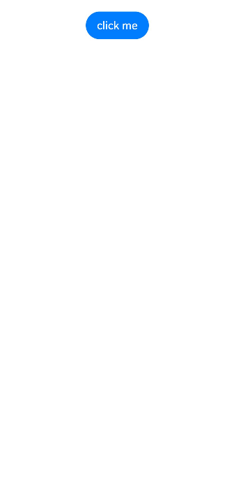
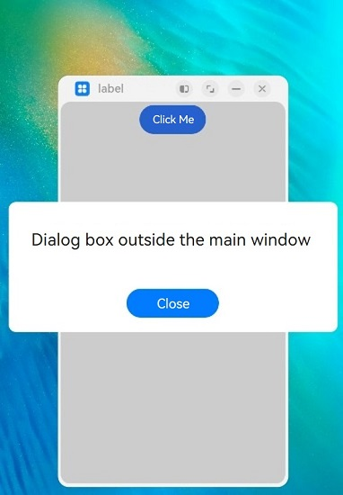
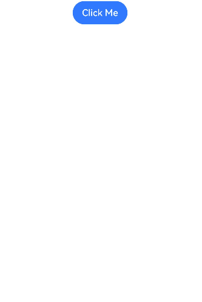
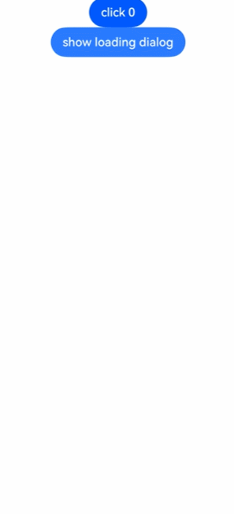
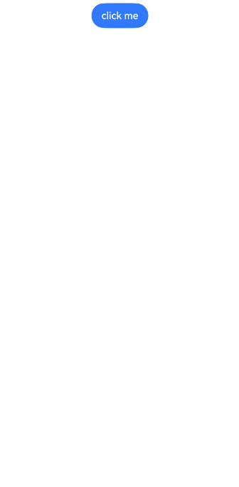
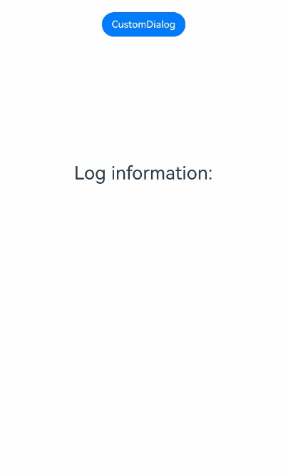
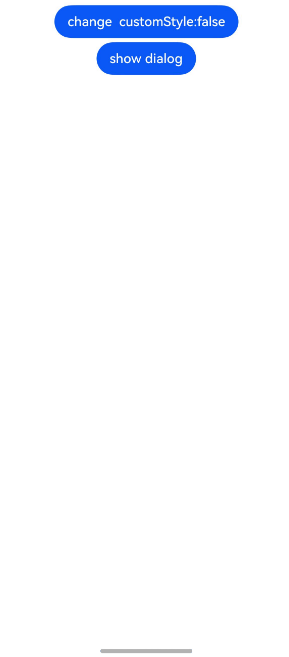
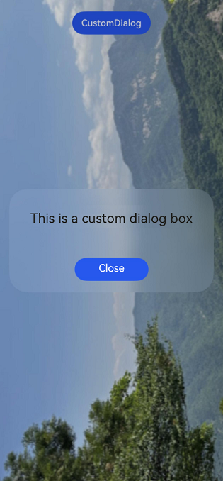
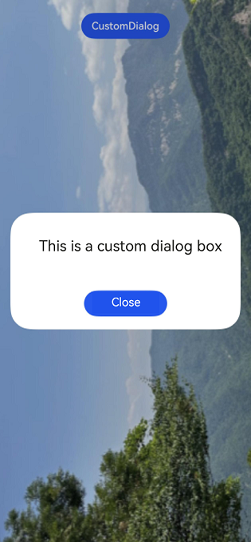
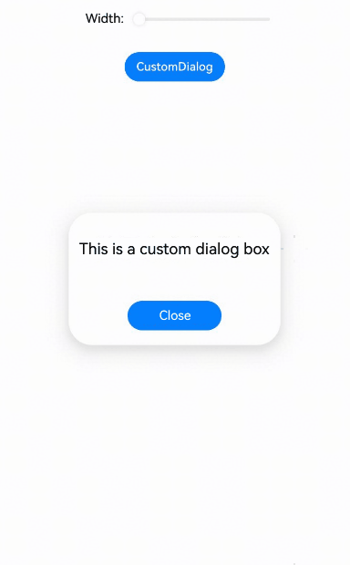

# Custom Dialog Box (CustomDialog)
<!--Kit: ArkUI-->
<!--Subsystem: ArkUI-->
<!--Owner: @houguobiao-->
<!--Designer: @houguobiao-->
<!--Tester: @lxl007-->
<!--Adviser: @Brilliantry_Rui-->
<!-- md-trans-meta sourceCommit=41ced39ef8dc45d6e20eb2df331d3c76fb446440 translatedAt=2026-10-13T06:30:37.061Z pushedAt=2026-10-14T07:26:55.490Z -->

A custom dialog box is implemented using the **CustomDialogController** class APIs. When using a dialog box component, prioritize custom dialog boxes for easier style and content customization.

> **NOTE**
>
> The initial APIs of this module are supported since API version 7. Updates will be marked with a superscript to indicate their earliest API version.

## CustomDialogController

Defines the controller of the custom dialog box.

**Atomic service API**: This API can be used in atomic services since API version 11.

**System capability**: SystemCapability.ArkUI.ArkUI.Full

### Objects to Import

```ts
dialogController : CustomDialogController | null = new CustomDialogController(CustomDialogControllerOptions)
```
> **NOTE** 
>
> - **CustomDialogController** takes effect only when it is used as a member variable of a **@CustomDialog** and **@Component struct** and is assigned a value when defined inside the **@Component struct**. For details, see the following examples.
>
> - If you attempt to pass multiple other controllers to a **CustomDialog** to open another or several other **CustomDialog**s within the **CustomDialog**, place the controller that points to itself after all other controllers. For details, see [Example 1: Opening Nested Dialog Boxes](#example-1-opening-nested-dialog-boxes).

### constructor

constructor(value: CustomDialogControllerOptions)

Constructor for a custom dialog box.

> **NOTE**
>
> None of the parameters of a custom dialog box support dynamic refresh. However, you can set **customStyle** to **true** and set attributes such as [backgroundColor](ts-universal-attributes-background.md#backgroundcolor), [backgroundBlurStyle](ts-universal-attributes-background.md#backgroundblurstyle9), and [size settings](ts-universal-attributes-size.md) on the custom component, and use state variables bound to the attributes to implement dynamic refresh.
>
> When **CustomDialogController** is used as a global variable to implement a global custom dialog box, if the controller is reassigned, the previous dialog box cannot be closed through it. It is recommended that you close the dialog box before reassigning the controller.
>
> When a custom dialog box is used to open another custom dialog box, it is not recommended to directly close the initiating dialog box.

**Atomic service API**: This API can be used in atomic services since API version 11.

**System capability**: SystemCapability.ArkUI.ArkUI.Full

**Parameters**

| Name| Type                                                        | Mandatory| Description                  |
| ------ | ------------------------------------------------------------ | ---- | ---------------------- |
| value  | [CustomDialogControllerOptions](#customdialogcontrolleroptions) | Yes  | Parameters of the custom dialog box.|

### open

open()

Displays the content of the custom dialog box. This API can be called multiple times. However, if the dialog box is in subwindow mode (**showInSubWindow** is set to **true**), it is not allowed to open another dialog box in subwindow mode.

> **NOTE**
>
> A **CustomDialog** in subwindow mode (**showInSubWindow** set to **true**) is not supported in input method windows. For details, see the constraints and limitations of the input method framework in [createPanel](../../apis-ime-kit/js-apis-inputmethodengine.md#createpanel10-1).

**Atomic service API**: This API can be used in atomic services since API version 11.

**System capability**: SystemCapability.ArkUI.ArkUI.Full


### close

close()

Closes the displayed custom dialog box. If the dialog box is already closed, this API does not take effect.

**Atomic service API**: This API can be used in atomic services since API version 11.

**System capability**: SystemCapability.ArkUI.ArkUI.Full

### getState<sup>20+</sup>

getState(): PromptActionCommonState

Obtains the state of the custom dialog box.

**Atomic service API**: This API can be used in atomic services since API version 20.

**Model restriction**: This API can be used only in the stage model.

**System capability**: SystemCapability.ArkUI.ArkUI.Full

**Return value**

| Type| Description|
| -------- | -------- |
| [PromptActionCommonState](#promptactioncommonstate20) | State of the custom dialog box.|

## PromptActionCommonState<sup>20+</sup>

type PromptActionCommonState = import('../api/@ohos.promptAction').promptAction.CommonState

Defines the state of the custom dialog box.

**Atomic service API**: This API can be used in atomic services since API version 20.

**Model restriction**: This API can be used only in the stage model.

**System capability**: SystemCapability.ArkUI.ArkUI.Full

| Type| Description|
| -------- | -------- |
| import('../api/@ohos.promptAction').[promptAction.CommonState](../js-apis-promptAction.md#commonstate20) | Corresponding dialog state. |

## CustomDialogControllerOptions

Defines the style of the custom dialog box.

**System capability**: SystemCapability.ArkUI.ArkUI.Full

<!--Table: 20%; 20%; 8%; 8%; 44%-->
| Name                          | Type                                    | Read-Only| Optional| Description                                    |
| ----------------------------- | ---------------------------------------- | ---- | ---------------------------------------- | ---------------------------------------- |
| builder                       | [CustomDialog](../../../ui/arkts-common-components-custom-dialog.md) | No   | No   | Builder for the custom dialog content.<br/>**Note:** <br/>If the **builder** uses a callback function as an input parameter, pay attention to the **this** binding issue, for example, **builder: CustomBuilder({ callback: ()=> {...}})**.<br/>To listen for data changes in the **builder**, use **@Link** or **@Consume**. Other approaches such as **@Prop** and **@ObjectLink** are not applicable to this scenario.<br/>**Atomic service API:** This API is supported in atomic services since API version 11. |
| cancel                        | ()&nbsp;=&gt;&nbsp;void                  | No    | Yes   | Callback invoked when the dialog is canceled by the Back key, the ESC key, or tapping the mask. No operation is performed if this parameter is not set.<br/>**Atomic service API:** This API is supported in atomic services since API version 11. |
| autoCancel                    | boolean                                  | No    | Yes   | Whether to allow canceling the dialog by tapping the mask. The value **true** means to close the dialog, and **false** means the opposite.<br>Default value: true<br/>**Atomic service API:** This API is supported in atomic services since API version 11. |
| alignment                     | [DialogAlignment](ts-methods-alert-dialog-box.md#dialogalignment) | No   | Yes  | Alignment mode of the dialog box in the vertical direction.<br>Default value: **DialogAlignment.Default**<br>**Atomic service API**: This API can be used in atomic services since API version 11.|
| offset                        | [Offset](ts-types.md#offset)             | No   | Yes  | Offset of the dialog box relative to the alignment position.<br>Default value: **{dx: 0, dy: 0}**<br>**Atomic service API**: This API can be used in atomic services since API version 11.|
| customStyle                   | boolean                                  | No    | Yes   | Whether the dialog container style is customized. The value **true** means the dialog container style can be customized, and **false** means the opposite.<br/>Default value: **false**<br/>When set to **false**:<br/>1. The default corner radius is 32 vp.<br/>2. When the dialog width and height are not set: the width of the dialog container adapts based on the grid system, and the height adapts to the custom content node.<br/>3. When the dialog width and height are set: the width of the dialog container does not exceed the maximum width under the default style (the custom node is set to 100% width), and the height of the dialog container does not exceed the maximum height under the default style (the custom node is set to 100% height).<br/>4. The dialog display area excludes the safe area. For example, on PCs/2-in-1 devices, the screen edges and the window title bar are avoided.<br/>When set to **true**:<br/>1. The corner radius is **0**, the dialog background color is transparent, and the immersive light effect of the dialog does not take effect.<br/>2. Setting the dialog width, height, border width, border style, border color, and shadow width is not supported.<br/>3. The dialog display area is the screen.<br/>**Atomic service API:** This API is supported in atomic services since API version 11.|
| gridCount<sup>8+</sup>        | number                                   | No   | Yes  | Number of [grid columns](../../../ui/arkts-layout-development-grid-layout.md) occupied by the dialog box.<br>The default value is subject to the window size, and the maximum value is the maximum number of columns supported by the system. If this parameter is set to an invalid value, the default value is used.<br>Value range: an integer no less than 0<br>**Atomic service API**: This API can be used in atomic services since API version 11.|
| maskColor<sup>10+</sup>       | [ResourceColor](ts-types.md#resourcecolor) | No    | Yes   | Custom mask color.<br>Default value: **0x33000000**<br/>**Model restriction:** This API can be used only in the stage model.<br/>**Atomic service API:** This API is supported in atomic services since API version 11.              |
| maskRect<sup>10+</sup>        | [Rectangle](ts-methods-alert-dialog-box.md#rectangle8) | No     | Yes    | Area of the dialog mask. Events within the mask area are not passed through, while events outside the mask area are passed through.<br/>Default value: **{ x: 0, y: 0, width: '100%', height: '100%' } **<br/>**Note:**<br/>When showInSubWindow is true, maskRect does not take effect.<br/>**Model restriction:** This API can be used only in the stage model.<br/>**Atomic service API:** This API is supported in atomic services since API version 11.|
| openAnimation<sup>10+</sup>   | [AnimateParam](ts-explicit-animation.md#animateparam) | No    | Yes   | Parameters for customizing the animation effect when the dialog is displayed. If not set, the system default display animation is used.<br>**Note:**<br>The default value of **tempo** is **1**. When a value less than or equal to 0 is set, the default value is used.<br/>The default value of **iterations** is **1**, which means the animation plays once by default. When set to other values, the default value is used.<br/>**playMode** controls the animation playback mode. The default value is **PlayMode.Normal**. When set to other values, the default value is used.<br/>**Model restriction:** This API can be used only in the stage model.<br/>**Atomic service API:** This API is supported in atomic services since API version 11. |
| closeAnimation<sup>10+</sup>  | [AnimateParam](ts-explicit-animation.md#animateparam) | No    | Yes   | Parameters for customizing the animation effect when the dialog is closed.<br>**Note:**<br>The default value of **tempo** is **1**. When a value less than or equal to 0 is set, the default value is used.<br/>The default value of **iterations** is **1**, which means the animation plays once by default. When set to other values, the default value is used.<br/>**playMode** controls the animation playback mode. The default value is **PlayMode.Normal**. When set to other values, the default value is used.<br/>During page transition, it is recommended to use the default closing animation.<br/>**Model restriction:** This API can be used only in the stage model.<br/>**Atomic service API:** This API is supported in atomic services since API version 11. |
| showInSubWindow<sup>10+</sup> | boolean                                  | No    | Yes   | Whether to display the dialog in a subwindow when it needs to be displayed outside the main window. The value **true** means to display the dialog in a subwindow.<br>Default value: **false**, which means the dialog is displayed within the application rather than in an independent subwindow.<br>**Note:** A dialog with **showInSubWindow** set to **true** cannot trigger the display of another dialog with **showInSubWindow** set to **true**. It is not recommended to use **CalendarPicker**, **CalendarPickerDialog**, **DatePickerDialog**, **TextPickerDialog**, **TimePickerDialog**, or **Toast** components in a dialog with **showInSubWindow** set to **true**, because the dialog affects the behavior of these components.<br/>**Model restriction:** This API can be used only in the stage model.<br/>**Atomic service API:** This API is supported in atomic services since API version 11. |
| displayModeInSubWindow | [DialogDisplayMode](./ts-appendix-enums.md#dialogdisplaymode) | No | Yes | Display mode of the dialog in the subwindow. For details about the value range and display effects, see  [DialogDisplayMode](./ts-appendix-enums.md#dialogdisplaymode). For example, **SCREEN_BASED** means the dialog is displayed centered on the screen, and **WINDOW_BASED** means the dialog is displayed centered in the application window.<br/>Default value: **DialogDisplayMode.SCREEN_BASED**<br/>**Note:**<br/>This takes effect only when **showInSubWindow** is set to **true**.<br/>**Since:** 26.0.0<br/>**Model restriction:** This API can be used only in the stage model.<br/>**Atomic service API:** This API is supported in atomic services since API version 26.0.0. |
| backgroundColor<sup>10+</sup> | [ResourceColor](ts-types.md#resourcecolor)      | No   | Yes  | Color of the dialog background.<br/>Default value: **Color.Transparent**<br />**Note:** If the background color of the content builder is also set, **backgroundColor** is overridden by the background color of the content builder.<br/>**backgroundColor** is superimposed with the blur attribute **backgroundBlurStyle** to produce an effect. If the result does not meet expectations, set **backgroundBlurStyle** to **BlurStyle.NONE** to cancel the blur.<br/>**Model restriction:** This API can be used only in the stage model.<br/>**Atomic service API:** This API is supported in atomic services since API version 11. |
| cornerRadius<sup>10+</sup>    | [Dimension](ts-types.md#dimension10)&nbsp;\|&nbsp;[BorderRadiuses](ts-types.md#borderradiuses9) | No   | Yes  | Corner radius of the background.<br />The radii of the four corners can be set separately.<br />Default value: **{ topLeft: '32vp', topRight: '32vp', bottomLeft: '32vp', bottomRight: '32vp' }**<br />**Note:** The default background corner radius of a custom dialog is 32 vp. To use the **cornerRadius** attribute, use it together with the [borderRadius](ts-universal-attributes-border.md#borderradius) attribute.<br/>**Model restriction:** This API can be used only in the stage model.<br/>**Atomic service API:** This API is supported in atomic services since API version 11. |
| isModal<sup>11+</sup> | boolean | No | Yes | Whether the dialog is a modal window. The value **true** means the dialog is a modal window with a mask, and interaction with other components around the dialog is not allowed, that is, events cannot be passed through the mask area. The value **false** means the dialog is a non-modal window without a mask, and interaction with other components around the dialog is allowed.<br/>Default value: **true**<br/>**Model restriction:** This API can be used only in the stage model.<br/>**Atomic service API:** This API is supported in atomic services since API version 12. |
| onWillDismiss<sup>12+</sup> | Callback<[DismissDialogAction](#dismissdialogaction12)> | No | Yes | Callback for interactive dismissal.<br/>**Note:**<br/>1. When the user performs interactive dismissal operations such as tapping the mask, swiping (left/right), tapping the Back button, or pressing the keyboard ESC key, if this callback is registered, the dialog is not dismissed immediately. In the callback, the reason can be used to obtain the operation type that blocks the dialog dismissal, so as to determine whether the dialog can be dismissed based on the reason. The reason returned by the current component does not support the **CLOSE_BUTTON** enum value.<br/>2. In the **onWillDismiss** callback, **onWillDismiss** interception cannot be performed again. <br/>**Model restriction:** This API can be used only in the stage model.<br/>**Atomic service API:** This API is supported in atomic services since API version 12.|
| borderWidth<sup>12+</sup> | [Dimension](ts-types.md#dimension10)&nbsp;\|&nbsp;[EdgeWidths](ts-types.md#edgewidths9)  | No | Yes | Border width of the dialog background.<br />The widths of the four borders can be set separately.<br />Default value: **0**.<br /> Percentage parameter method: Set the dialog border width as a percentage of the parent element dialog width.<br />When the left and right borders of the dialog are greater than the dialog width, or the top and bottom borders are greater than the dialog height, the display may not meet expectations.<br/>**Model restriction:** This API can be used only in the stage model.<br/>**Atomic service API:** This API is supported in atomic services since API version 12.|
| borderColor<sup>12+</sup> | [ResourceColor](ts-types.md#resourcecolor)&nbsp;\|&nbsp;[EdgeColors](ts-types.md#edgecolors9)  | No | Yes | Border color of the dialog background.<br/>Default value: **Color.Black**<br/>To use the **borderColor** attribute, use it together with the **borderWidth** attribute. When **borderWidth** is **0**, **borderColor** does not take effect. <br/>**Model restriction:** This API can be used only in the stage model.<br/>**Atomic service API:** This API is supported in atomic services since API version 12. |
| borderStyle<sup>12+</sup> | [BorderStyle](ts-appendix-enums.md#borderstyle)&nbsp;\|&nbsp;[EdgeStyles](ts-types.md#edgestyles9)  | No | Yes | Border style of the dialog background.<br/>Default value: **BorderStyle.Solid**<br/>To use the **borderStyle** attribute, use it together with the **borderWidth** attribute. When **borderWidth** is **0**, **borderStyle** does not take effect. <br/>**Model restriction:** This API can be used only in the stage model.<br/>**Atomic service API:** This API is supported in atomic services since API version 12. |
| width<sup>12+</sup> | [Dimension](ts-types.md#dimension10) | No   | Yes  | Width of the dialog background.<br />**Note:**<br>- Default maximum dialog width: 400 vp.<br />- Percentage parameter method: The width of the dialog is adjusted smaller or larger based on the width of the window where it is located.<br/>**Model restriction:** This API can be used only in the stage model.<br/>**Atomic service API:** This API is supported in atomic services since API version 12.|
| height<sup>12+</sup> | [Dimension](ts-types.md#dimension10)   | No | Yes | Height of the dialog background.<br />**Note:**<br />- Default maximum dialog height: 0.9 × (window height - safe area).<br />- Percentage parameter method: the height of the dialog is adjusted smaller or larger based on (window height - safe area).<br/>**Model restriction:** This API can be used only in the stage model.<br/>**Atomic service API:** This API is supported in atomic services since API version 12.|
| shadow<sup>12+</sup> | [ShadowOptions](ts-universal-attributes-image-effect.md#shadowoptions )&nbsp;\|&nbsp;[ShadowStyle](ts-universal-attributes-image-effect.md#shadowstyle10)   | No | Yes | Shadow of the dialog background. <br /> For a 2-in-1 device, in the default scenario the focused shadow value is **ShadowStyle.OUTER_FLOATING_MD**, and the unfocused shadow value is **ShadowStyle.OUTER_FLOATING_SM**. Other devices have no shadow by default.<br/>**Model restriction:** This API can be used only in the stage model.<br/>**Atomic service API:** This API is supported in atomic services since API version 12.|
| backgroundBlurStyle<sup>12+</sup> | [BlurStyle](ts-universal-attributes-background.md#blurstyle9)                 | No   | Yes  | Blur material of the dialog background.<br/>Default value: **BlurStyle.NONE** since API version 26.0.0, and **BlurStyle.COMPONENT_ULTRA_THICK** before API version 26.0.0.<br/>**Note:** <br/>Set this to **BlurStyle.NONE** to disable background blur. When **backgroundBlurStyle** is set to a value other than **NONE**, do not set **backgroundColor**; otherwise, the color display will not meet expectations.<br/>**Model restriction:** This API can be used only in the stage model.<br/>**Atomic service API:** This API is supported in atomic services since API version 12. |
| backgroundBlurStyleOptions<sup>19+</sup> | [BackgroundBlurStyleOptions](ts-universal-attributes-background.md#backgroundblurstyleoptions10) | No | Yes | Background blur effect. For the default value, see the **BackgroundBlurStyleOptions**  description.<br/>**Model restriction:** This API can be used only in the stage model.<br />**Atomic service API:** This API is supported in atomic services since API version 19. |
| backgroundEffect<sup>19+</sup> | [BackgroundEffectOptions](ts-universal-attributes-background.md#backgroundeffectoptions11) | No | Yes | Background effect parameters. For the default value, see the **BackgroundEffectOptions**  description.<br/>**Model restriction:** This API can be used only in the stage model.<br />**Atomic service API:** This API is supported in atomic services since API version 19. |
| keyboardAvoidMode<sup>12+</sup> | [KeyboardAvoidMode](ts-universal-attributes-popup.md#keyboardavoidmode12) | No | Yes | Whether the dialog automatically avoids the soft keyboard when it is pulled up.<br/>Default value: **KeyboardAvoidMode.DEFAULT**<br/>**Model restriction:** This API can be used only in the stage model.<br/>**Atomic service API:** This API is supported in atomic services since API version 12. |
| enableHoverMode<sup>14+</sup>     | boolean | No   | Yes  | Whether to respond to the hover state. The value **true** means to respond to the hover state, and **false** means not to respond to the hover state.<br />Default value: **false**, which means no response by default.<br />**Note:**<br />On PCs/2-in-1 devices, the dialog is displayed in the upper half of the screen by default. When **enableHoverMode** is set to **true**, the dialog can be displayed in the lower half of the screen by setting the **hoverModeArea** parameter. On other devices, when **enableHoverMode** is set to **true**, the dialog is displayed in the lower half of the screen by default, and can be displayed in the upper half of the screen by setting the **hoverModeArea** parameter.<br/>**Model restriction:** This API can be used only in the stage model.<br/>**Atomic service API:** This API is supported in atomic services since API version 14.|
| hoverModeArea<sup>14+</sup>       | [HoverModeAreaType](ts-universal-attributes-sheet-transition.md#hovermodeareatype14) | No   | Yes  | Default display area of the dialog in the hover state.<br />Default value: **HoverModeAreaType.BOTTOM_SCREEN**.<br/>**Model restriction:** This API can be used only in the stage model.<br/>**Atomic service API:** This API is supported in atomic services since API version 14.|
| onWillAppear<sup>19+</sup> | Callback&lt;void&gt; | No | Yes | Event callback before the dialog display animation.<br />**Note:**<br />1. The normal sequence is: **onWillAppear**>>**onDidAppear**>>**onWillDisappear**>>**onDidDisappear**.<br />2. A callback event that changes the dialog display effect set in **onWillAppear** takes effect on the second display. <br/>**Model restriction:** This API can be used only in the stage model.<br/>**Atomic service API:** This API is supported in atomic services since API version 19.|
| onDidAppear<sup>19+</sup> | Callback&lt;void&gt; | No | Yes | Event callback after the dialog is displayed.<br />**Note:**<br />1. The normal sequence is: **onWillAppear**>>**onDidAppear**>>**onWillDisappear**>>**onDidDisappear**.<br />2. A callback event that changes the dialog display effect set in **onDidAppear** takes effect on the second display.<br />3. When the dialog is quickly tapped to display and then closed, **onWillDisappear** takes effect before **onDidAppear**.<br/>4. If the dialog is completely closed before the entry animation is completed, the animation is interrupted and **onDidAppear** is not triggered.<br/>**Model restriction:** This API can be used only in the stage model.<br/>**Atomic service API:** This API is supported in atomic services since API version 19. |
| onWillDisappear<sup>19+</sup> | Callback&lt;void&gt; | No | Yes | Event callback before the dialog exit animation.<br />**Note:**<br />1. The normal sequence is: **onWillAppear**>>**onDidAppear**>>**onWillDisappear**>>**onDidDisappear**.<br/>**Model restriction:** This API can be used only in the stage model.<br /> **Atomic service API:** This API is supported in atomic services since API version 19.|
| onDidDisappear<sup>19+</sup> | Callback&lt;void&gt; | No | Yes | Event callback after the dialog disappears.<br />**Note:**<br />1. The normal sequence is: **onWillAppear**>>**onDidAppear**>>**onWillDisappear**>>**onDidDisappear**.<br/>**Model restriction:** This API can be used only in the stage model.<br/>**Atomic service API:** This API is supported in atomic services since API version 19. |
| keyboardAvoidDistance<sup>15+</sup>       | [LengthMetrics](../js-apis-arkui-graphics.md#lengthmetrics12) | No   | Yes  | Distance between the dialog and the keyboard after the dialog avoids the keyboard.<br />**Note:**<br />- Default value: **16vp**.<br />- Default unit: vp.<br />- This takes effect if and only if the **keyboardAvoidMode** attribute is set to **DEFAULT**.<br/>**Model restriction:** This API can be used only in the stage model.<br/>**Atomic service API:** This API is supported in atomic services since API version 15.|
| levelMode<sup>15+</sup>       | [LevelMode](../js-apis-promptAction.md#levelmode15) | No   | Yes  | Display level of the dialog.<br />**Note:**<br />- Default value: **LevelMode.OVERLAY**.<br />- This takes effect if and only if the **showInSubWindow** attribute is set to **false**.<br/>**Model restriction:** This API can be used only in the stage model.<br/>**Atomic service API:** This API is supported in atomic services since API version 15.|
| levelUniqueId<sup>15+</sup>       | number | No   | Yes  | Unique ID of the node under the level where the page-level dialog needs to be displayed. The Unique ID can be obtained through [getUniqueId](../js-apis-arkui-frameNode.md#getuniqueid12).<br/>Value range: a number greater than or equal to 0.<br />**Note:**<br />- This takes effect if and only if the **levelMode** attribute is set to **LevelMode.EMBEDDED**.<br/>**Model restriction:** This API can be used only in the stage model.<br/>**Atomic service API:** This API is supported in atomic services since API version 15.|
| immersiveMode<sup>15+</sup>       | [ImmersiveMode](../js-apis-promptAction.md#immersivemode15) | No   | Yes  | Mask effect of the in-page dialog.<br />**Note:**<br />- Default value: **ImmersiveMode.DEFAULT** <br />- This takes effect if and only if the **levelMode** attribute is set to **LevelMode.EMBEDDED**.<br/>**Model restriction:** This API can be used only in the stage model.<br/>**Atomic service API:** This API is supported in atomic services since API version 15.|
| levelOrder<sup>18+</sup>       | [LevelOrder](../js-apis-promptAction.md#levelorder18) | No   | Yes  | Display order of the dialog.<br />**Note:**<br />- Default value: **LevelOrder.clamp(0)** <br />- Dynamic refresh of the order is not supported.<br/>**Model restriction:** This API can be used only in the stage model.<br/>**Atomic service API:** This API is supported in atomic services since API version 18.|
| focusable<sup>19+</sup>       | boolean | No   | Yes  | Whether the dialog obtains focus. The value **true** means to obtain focus, and **false** means not to obtain focus.<br />Default value: **true** <br />**Note:**<br />Only a dialog displayed over the current window can obtain focus.<br/>**Model restriction:** This API can be used only in the stage model.<br/>**Atomic service API:** This API is supported in atomic services since API version 19.|
| systemMaterial  | [SystemUiMaterial](ts-universal-attributes-image-effect.md#systemuimaterial) | No | Yes | System material of the dialog.<br/>**Note:**<br/>- Default value: an [ImmersiveMaterial](../arkts-apis-uimaterial.md#immersivematerial) object whose [ImmersiveOptions](../arkts-apis-uimaterial.md#immersiveoptions) style is **ImmersiveStyle.ULTRA_THICK**. When set to **undefined**, the default value is used.<br/>- Different materials have different effects. This API affects [backgroundColor](ts-universal-attributes-background.md#backgroundcolor), [backgroundBlurStyle](ts-universal-attributes-background.md#backgroundblurstyle9), [backgroundEffect](ts-universal-attributes-background.md#backgroundeffect11), [borderColor](ts-universal-attributes-border.md#bordercolor), [borderWidth](ts-universal-attributes-border.md#borderwidth), and [shadow](ts-universal-attributes-image-effect.md#shadow). When using system material, the preceding APIs do not take effect.<br/>**Since:** 26.0.0<br/>**Model restriction:** This API can be used only in the stage model.<br/>**Atomic service API:** This API is supported in atomic services since API version 26.0.0.|

> **NOTE**
>
> - Pressing the Back or ESC key closes the dialog box.
> - If the dialog box reaches its maximum allowable height on the screen when avoiding the soft keyboard, it reduces its height to fit.
>   It should be noted that this height adjustment is applied to the outermost container. If a child component within this container has been assigned a larger fixed height, since the container does not clip its content by default, parts of the dialog box may still be displayed off-screen.
> - Use the custom dialog box to contain simple alert messages only. Do not use it as a page. When the dialog box avoids the soft keyboard, there is a 16 vp safe spacing between the two.
> - For optimal visual experience, dialog box display and closing include default animations, though the animation duration may vary by device.
>   Note: During animation playback, the page does not respond to touch, swipe, or click interactions. To disable default dialog box animations, set **duration** of both **openAnimation** and **closeAnimation** to **0**.
> - In ArkUI, dialog boxes do not close automatically when you switch pages unless you manually call **close**. To enable a dialog box to be dismissed during page navigation, consider using the [navigation subpage displayed in dialog mode](../../../ui/arkts-navigation-navdestination.md#page-display-mode) or [page-level dialog box](../../../ui/arkts-embedded-dialog.md).

## DismissDialogAction<sup>12+</sup>

Defines the information about the dialog box dismissal.

**Atomic service API**: This API can be used in atomic services since API version 12.

**Model restriction**: This API can be used only in the stage model.

**System capability**: SystemCapability.ArkUI.ArkUI.Full

### Properties

| Name   | Type                                                        | Read-Only| Optional| Description                                                        |
| ------- | ------------------------------------------------------------ | ---- | ---- | ------------------------------------------------------------ |
| dismiss | Callback&lt;void&gt;                                         | No   | No   | Callback invoked when the dialog is dismissed. You need to call it for exiting a dialog box. |
| reason  | [DismissReason](ts-universal-attributes-popup.md#dismissreason12) | No   | No   | Reason why the dialog cannot be dismissed. Determine whether the dialog needs to be dismissed for different operations as required. |

## Examples

### Example 1: Opening Nested Dialog Boxes

This example demonstrates how to open one or more custom dialog boxes within another custom dialog box.

```ts
// xxx.ets
@CustomDialog
struct CustomDialogExampleTwo {
  controllerTwo?: CustomDialogController;
  build() {
    Column() {
      Text('I'm the second dialog box')
        .fontSize(30)
        .height(100)
      Button('Close Second Dialog Box')
        .onClick(() => {
          if (this.controllerTwo != undefined) {
            this.controllerTwo.close();
          }
        })
        .margin(20)
    }
  }
}
@CustomDialog
@Component
struct CustomDialogExample {
  @Link textValue: string;
  @Link inputValue: string;
  dialogControllerTwo: CustomDialogController | null = new CustomDialogController({
    builder: CustomDialogExampleTwo(),
    alignment: DialogAlignment.Bottom,
    onWillDismiss:(dismissDialogAction: DismissDialogAction)=> {
      console.info(`reason= ${dismissDialogAction.reason}`);
      console.info('dialog onWillDismiss');
      if (dismissDialogAction.reason == DismissReason.PRESS_BACK) {
        dismissDialogAction.dismiss();
      }
      if (dismissDialogAction.reason == DismissReason.TOUCH_OUTSIDE) {
        dismissDialogAction.dismiss();
      }
    },
    offset: { dx: 0, dy: -25 } })
  controller?: CustomDialogController;
  // You can pass in multiple other controllers in the CustomDialog to open one or more other CustomDialogs in the CustomDialog. In this case, you must place the controller pointing to the self behind all controllers.
  cancel: () => void = () => {
  }
  confirm: () => void = () => {
  }

  build() {
    Column() {
      Text('Change text').fontSize(20).margin({ top: 10, bottom: 10 })
      TextInput({ placeholder: '', text: this.textValue }).height(60).width('90%')
        .onChange((value: string) => {
          this.textValue = value;
        })
      Text('Are you sure you want to change the text?').fontSize(16).margin({ bottom: 10 })
      Flex({ justifyContent: FlexAlign.SpaceAround }) {
        Button('No')
          .onClick(() => {
            if (this.controller != undefined) {
              this.controller.close();
              this.cancel();
            }
          }).backgroundColor(0xffffff).fontColor(Color.Black)
        Button('OK')
          .onClick(() => {
            if (this.controller != undefined) {
              this.inputValue = this.textValue;
              this.controller.close();
              this.confirm();
            }
          }).backgroundColor(0xffffff).fontColor(Color.Red)
      }.margin({ bottom: 10 })

      Button('Open Second Dialog Box')
        .onClick(() => {
          if (this.dialogControllerTwo != null) {
            this.dialogControllerTwo.open();
          }
        })
        .margin(20)
    }.borderRadius(10)
    // When using the border or cornerRadius attribute, use it together with the borderRadius attribute.
  }
}
@Entry
@Component
struct CustomDialogUser {
  @State textValue: string = ''
  @State inputValue: string = 'click me'
  dialogController: CustomDialogController | null = new CustomDialogController({
    builder: CustomDialogExample({
      cancel: ()=> { this.onCancel(); },
      confirm: ()=> { this.onAccept(); },
      textValue: this.textValue,
      inputValue: this.inputValue
    }),
    cancel: this.exitApp,
    autoCancel: true,
    onWillDismiss:(dismissDialogAction: DismissDialogAction)=> {
      console.info(`reason= ${dismissDialogAction.reason}`);
      console.info('dialog onWillDismiss');
      if (dismissDialogAction.reason == DismissReason.PRESS_BACK) {
        dismissDialogAction.dismiss();
      }
      if (dismissDialogAction.reason == DismissReason.TOUCH_OUTSIDE) {
        dismissDialogAction.dismiss();
      }
    },
    alignment: DialogAlignment.Bottom,
    offset: { dx: 0, dy: -20 },
    gridCount: 4,
    customStyle: false,
    cornerRadius: 10,
  })

  // Set dialogController to null when the custom component is about to be destroyed.
  aboutToDisappear() {
    this.dialogController = null; // Set dialogController to null.
  }

  onCancel() {
    console.info('Callback when the first button is clicked');
  }

  onAccept() {
    console.info('Callback when the second button is clicked');
  }

  exitApp() {
    console.info('Click the callback in the blank area');
  }
  build() {
    Column() {
      Button(this.inputValue)
        .onClick(() => {
          if (this.dialogController != null) {
            this.dialogController.open();
          }
        }).backgroundColor(0x317aff)
    }.width('100%').margin({ top: 5 })
  }
}
```



### Example 2: Opening a Dialog Box Outside the Main Window

This example demonstrates how to configure a dialog box to display outside the main window on a 2-in-1 device by setting [showInSubWindow](#customdialogcontrolleroptions) to **true**.

Since API version 26.0.0, the **displayModeInSubWindow** attribute is added to [CustomDialogControllerOptions](#customdialogcontrolleroptions).

```ts
// xxx.ets
@CustomDialog
struct CustomDialogExample {
  controller?: CustomDialogController;
  cancel: () => void = () => {
  }
  confirm: () => void = () => {
  }
  build() {
    Column() {
      Text('Dialog box outside the main window')
        .fontSize(30)
        .height(100)
      Button('Close')
        .onClick(() => {
          if (this.controller != undefined) {
            this.controller.close();
          }
        })
        .margin(20)
    }
  }
}
@Entry
@Component
struct CustomDialogUser {
  dialogController: CustomDialogController | null = new CustomDialogController({
    builder: CustomDialogExample({
      cancel: ()=> { this.onCancel(); },
      confirm: ()=> { this.onAccept(); }
    }),
    cancel: this.exitApp,
    autoCancel: true,
    onWillDismiss:(dismissDialogAction: DismissDialogAction)=> {
      console.info(`reason= ${dismissDialogAction.reason}`);
      console.info('dialog onWillDismiss');
      if (dismissDialogAction.reason == DismissReason.PRESS_BACK) {
        dismissDialogAction.dismiss();
      }
      if (dismissDialogAction.reason == DismissReason.TOUCH_OUTSIDE) {
        dismissDialogAction.dismiss();
      }
    },
    alignment: DialogAlignment.Center,
    offset: { dx: 0, dy: -20 },
    gridCount: 4,
    showInSubWindow: true,
    // Since API version 26.0.0, the displayModeInSubWindow attribute is added.
    displayModeInSubWindow: DialogDisplayMode.SCREEN_BASED,
    isModal: true,
    customStyle: false,
    cornerRadius: 10,
    focusable: true
  })
  // Set dialogController to null when the custom component is about to be destroyed.
  aboutToDisappear() {
    this.dialogController = null; // Set dialogController to null.
  }

  onCancel() {
    console.info('Callback when the first button is clicked');
  }

  onAccept() {
    console.info('Callback when the second button is clicked');
  }

  exitApp() {
    console.info('Click the callback in the blank area');
  }

  build() {
    Column() {
      Button('Click Me')
        .onClick(() => {
          if (this.dialogController != null) {
            this.dialogController.open();
          }
        }).backgroundColor(0x317aff)
    }.width('100%').margin({ top: 5 })
  }
}
```



### Example 3: Setting the Dialog Box Style
This example demonstrates the style of **CustomDialog**, including the width, height, background color, and shadow.
```ts
// xxx.ets
@CustomDialog
struct CustomDialogExample {
  controller?: CustomDialogController;
  cancel: () => void = () => {
  }
  confirm: () => void = () => {
  }
  build() {
    Column() {
      Text('This is a custom dialog box')
        .fontSize(30)
        .height(100)
      Button('Close')
        .onClick(() => {
          if (this.controller != undefined) {
            this.controller.close();
          }
        })
        .margin(20)
    }
  }
}
@Entry
@Component
struct CustomDialogUser {
  dialogController: CustomDialogController | null = new CustomDialogController({
    builder: CustomDialogExample({
      cancel: ()=> { this.onCancel(); },
      confirm: ()=> { this.onAccept(); }
    }),
    cancel: this.exitApp,
    autoCancel: true,
    onWillDismiss:(dismissDialogAction: DismissDialogAction)=> {
      console.info(`reason= ${dismissDialogAction.reason}`);
      console.info('dialog onWillDismiss');
      if (dismissDialogAction.reason == DismissReason.PRESS_BACK) {
        dismissDialogAction.dismiss();
      }
      if (dismissDialogAction.reason == DismissReason.TOUCH_OUTSIDE) {
        dismissDialogAction.dismiss();
      }
    },
    alignment: DialogAlignment.Center,
    offset: { dx: 0, dy: -20 },
    customStyle: false,
    cornerRadius: 20,
    width: 300,
    height: 200,
    borderWidth: 1,
    borderStyle: BorderStyle.Dashed,// borderStyle must be used with borderWidth in pairs.
    borderColor: Color.Blue,// borderColor must be used with borderWidth in pairs.
    backgroundColor: Color.White,
    shadow: ({ radius: 20, color: Color.Grey, offsetX: 50, offsetY: 0}),
  })
  // Set dialogController to null when the custom component is about to be destroyed.
  aboutToDisappear() {
    this.dialogController = null; // Set dialogController to null.
  }

  onCancel() {
    console.info('Callback when the first button is clicked');
  }

  onAccept() {
    console.info('Callback when the second button is clicked');
  }

  exitApp() {
    console.info('Click the callback in the blank area');
  }

  build() {
    Column() {
      Button('Click Me')
        .onClick(() => {
          if (this.dialogController != null) {
            this.dialogController.open();
          }
        }).backgroundColor(0x317aff)
    }.width('100%').margin({ top: 5 })
  }
}
```



### Example 4: Configuring a Dialog Box in the Hover State

<!--RP1-->This example demonstrates how to set the layout area of a dialog box when the device is in hover state.<!--RP1End-->

```ts
@CustomDialog
@Component
struct CustomDialogExample {
  @Link textValue: string;
  @Link inputValue: string;
  controller?: CustomDialogController;

  build() {
    Column() {
      Text('Change text').fontSize(20).margin({ top: 10, bottom: 10 })
      TextInput({ placeholder: '', text: this.textValue }).height(60).width('90%')
        .onChange((value: string) => {
          this.textValue = value;
        })
      Text('Are you sure you want to change the text?').fontSize(16).margin({ bottom: 10 })
      Flex({ justifyContent: FlexAlign.SpaceAround }) {
        Button('No')
          .onClick(() => {
            if (this.controller != undefined) {
              this.controller.close();
            }
          }).backgroundColor(0xffffff).fontColor(Color.Black)
        Button('OK')
          .onClick(() => {
            if (this.controller != undefined) {
              this.inputValue = this.textValue;
              this.controller.close();
            }
          }).backgroundColor(0xffffff).fontColor(Color.Red)
      }.margin({ bottom: 10 })
    }.borderRadius(10)
    // When using the border or cornerRadius attribute, use it together with the borderRadius attribute.
  }
}
@Entry
@Component
struct CustomDialogUser {
  @State textValue: string = '';
  @State inputValue: string = 'click me';
  dialogController: CustomDialogController | null = new CustomDialogController({
    builder: CustomDialogExample({
      textValue: this.textValue,
      inputValue: this.inputValue
    }),
    cancel: this.exitApp,
    autoCancel: true,
    onWillDismiss: (dismissDialogAction: DismissDialogAction)=> {
      console.info(`reason= ${dismissDialogAction.reason}`);
      console.info('dialog onWillDismiss');
      if (dismissDialogAction.reason == DismissReason.PRESS_BACK) {
        dismissDialogAction.dismiss();
      }
      if (dismissDialogAction.reason == DismissReason.TOUCH_OUTSIDE) {
        dismissDialogAction.dismiss();
      }
    },
    alignment: DialogAlignment.Bottom,
    offset: { dx: 0, dy: -20 },
    gridCount: 4,
    customStyle: false,
    cornerRadius: 10,
    enableHoverMode: true,
    hoverModeArea: HoverModeAreaType.TOP_SCREEN
  })

  // Set dialogController to null when the custom component is about to be destroyed.
  aboutToDisappear() {
    this.dialogController = null; // Set dialogController to null.
  }

  exitApp() {
    console.info('Click the callback in the blank area');
  }

  build() {
    Column() {
      Button(this.inputValue)
        .onClick(() => {
          if (this.dialogController != null) {
            this.dialogController.open();
          }
        }).backgroundColor(0x317aff)
    }.width('100%').margin({ top: 5 })
  }
}
```

<!--RP2--><!--RP2End-->

### Example 5: Obtaining the Dialog Box State

This example demonstrates how to call [getState](#getstate20) in [CustomDialogController](#customdialogcontroller) to obtain the current state of the dialog box.

The **getState** API is added to **CustomDialogController** since API version 20.

```ts
// xxx.ets
@CustomDialog
struct CustomDialogExample {
  controller?: CustomDialogController

  build() {
    Column() {
      Button("Check Status: Custom Component Controller")
        .onClick(() => {
          if (this.getDialogController() != undefined) {
            console.info('state:' + this.getDialogController().getState())
          } else {
            console.info('state: no exist')
          }
        }).margin(20)
      Button('Check Status: CustomDialogController')
        .onClick(() => {
          console.info('state:' + this.controller?.getState())
        }).margin(20)
      Button('Close')
        .onClick(() => {
          if (this.getDialogController() != undefined) {
            this.getDialogController().close()
          }
        }).margin(20)
      
    }
  }
}

@Entry
@Component
struct CustomDialogUser {
  @State bg: ResourceColor = Color.Green
  dialogController: CustomDialogController | null = new CustomDialogController({
    builder: CustomDialogExample({
    }),
    autoCancel: false
  })

  build() {
    Column() {
      Button('Click Me')
        .onClick(() => {
          if (this.dialogController != null) {
            this.dialogController.open()
          }
        }).backgroundColor(0x317aff)
    }.width('100%').margin({ top: 5 })
    .backgroundColor(this.bg)
  }
}
```

### Example 6: Using @Link and @Consume to Listen for Data Changes

This example uses @[Link](../../../ui/state-management/arkts-link.md) and @[Consume](../../../ui/state-management/arkts-provide-and-consume.md) to implement two-way data binding between the page and the dialog box.

```ts
@CustomDialog
@Component
struct CustomDialogExample {
  @Link textValue: string;
  @Consume inputValue: string;
  controller?: CustomDialogController;

  cancel: () => void = () => {
  }
  confirm: () => void = () => {
  }

  build() {
    Column() {
      Text('Change text').fontSize(20).margin({ top: 10, bottom: 10 })
      TextInput({ placeholder: '', text: this.textValue }).height(60).width('90%')
        .onChange((value: string) => {
          this.textValue = value;
        })
      Text('Are you sure you want to change the text?').fontSize(16).margin({ bottom: 10 })
      Flex({ justifyContent: FlexAlign.SpaceAround }) {
        Button('No')
          .onClick(() => {
            if (this.controller != undefined) {
              this.controller.close();
              this.cancel();
            }
          }).backgroundColor(0xffffff).fontColor(Color.Black)
        Button('OK')
          .onClick(() => {
            if (this.controller != undefined) {
              this.inputValue = this.textValue;
              this.controller.close();
              this.confirm();
            }
          }).backgroundColor(0xffffff).fontColor(Color.Red)
      }.margin({ bottom: 10 })
    }.borderRadius(10)
  }
}
@Entry
@Component
struct CustomDialogUser {
  @State textValue: string = ''
  @Provide inputValue: string = 'click me'
  dialogController: CustomDialogController | null = new CustomDialogController({
    builder: CustomDialogExample({
      cancel: ()=> { this.onCancel(); },
      confirm: ()=> { this.onAccept(); },
      textValue: this.textValue
    }),
    cancel: this.exitApp,
    autoCancel: true,
    onWillDismiss:(dismissDialogAction: DismissDialogAction)=> {
      if (dismissDialogAction.reason == DismissReason.PRESS_BACK) {
        dismissDialogAction.dismiss();
      }
      if (dismissDialogAction.reason == DismissReason.TOUCH_OUTSIDE) {
        dismissDialogAction.dismiss();
      }
    },
    alignment: DialogAlignment.Center,
    offset: { dx: 0, dy: -20 },
    gridCount: 4,
    customStyle: false,
    cornerRadius: 10,
  })

  // Set dialogController to null when the custom component is about to be destroyed.
  aboutToDisappear() {
    this.dialogController = null; // Set dialogController to null.
  }

  onCancel() {
    console.info('Callback when the first button is clicked');
  }

  onAccept() {
    console.info('Callback when the second button is clicked');
  }

  exitApp() {
    console.info('Click the callback in the blank area');
  }
  build() {
    Column() {
      Button(this.inputValue)
        .onClick(() => {
          if (this.dialogController != null) {
            this.dialogController.open();
          }
        }).backgroundColor(0x317aff)
    }.width('100%').margin({ top: 5 })
  }
}
```


### Example 7: Customizing a Loading Dialog Box

This example uses [maskColor](#customdialogcontrolleroptions), [maskRect](#customdialogcontrolleroptions), and [LoadingProgress](ts-basic-components-loadingprogress.md) to implement a loading dialog box and display the transparent transmission effect of events that are not in the **maskRect** area.

```ts
import { window } from '@kit.ArkUI';

@CustomDialog
@Component
struct LoadingDialogExample {
  controller?: CustomDialogController;
  cancel: () => void = () => {
  }
  confirm: () => void = () => {
  }

  build() {
    Column() {
      LoadingProgress().color(Color.Blue).layoutWeight(1)
    }.borderRadius(10).width(100).height(100)
  }
}

@Entry
@Component
struct CustomDialogUser {
  @State number: number = 0;
  dialogController: CustomDialogController | null = null;

  // Set dialogController to null when the custom component is about to be destroyed.
  aboutToDisappear() {
    this.dialogController = null; // Set dialogController to null.
  }

  onCancel() {
    console.info('Callback when the first button is clicked');
  }

  onAccept() {
    console.info('Callback when the second button is clicked');
  }

  exitApp() {
    console.info('Click the callback in the blank area');
  }

  build() {
    Column() {
      Button("click " + this.number).onClick(() => {
        this.number++;
      })
      Button("show loading dialog").onClick(() => {
        // Obtain a window object.
        let windowClass = window.getLastWindow(this.getUIContext().getHostContext());
        windowClass.then(window => {
          // Obtain the window information and set maskRect.
          let properties = window.getWindowProperties();
          let maskRect = {
            x: this.getUIContext().px2vp(properties.windowRect.left + 150),
            y: this.getUIContext().px2vp(properties.windowRect.top + 350),
            width: this.getUIContext().px2vp(properties.windowRect.width - 300),
            height: this.getUIContext().px2vp(properties.windowRect.height - 700)
          } as Rectangle
          if (this.dialogController == null) {
            this.dialogController = new CustomDialogController({
              builder: LoadingDialogExample({
                cancel: () => {
                  this.onCancel();
                },
                confirm: () => {
                  this.onAccept();
                },
              }),
              cancel: this.exitApp,
              maskRect: maskRect,
              autoCancel: false,
              maskColor: "#33AA0000",
              showInSubWindow: false,
              backgroundBlurStyle: BlurStyle.NONE,
              onWillDismiss: (dismissDialogAction: DismissDialogAction) => {
                if (dismissDialogAction.reason == DismissReason.PRESS_BACK) {
                  dismissDialogAction.dismiss();
                }
                if (dismissDialogAction.reason == DismissReason.TOUCH_OUTSIDE) {
                  dismissDialogAction.dismiss();
                }
              },
              alignment: DialogAlignment.Center,
              customStyle: false,
              cornerRadius: 10,
              openAnimation: { duration: 0, tempo: 0 },
              closeAnimation: { duration: 0, tempo: 0 }
            })
          }
          this.dialogController.close();
          this.dialogController.open();
        })
      }).backgroundColor(0x317aff)
    }.width('100%').margin({ top: 5 })
  }
}
```


### Example 8: Adjusting Spacing Between the Dialog Box and the Soft Keyboard Without keyboardAvoidDistance

This example listens for keyboard changes and adjusts the `bottom` attribute of the layout [margin](ts-universal-attributes-size.md#margin) to achieve the same effect as using [keyboardAvoidDistance](#customdialogcontrolleroptions) to adjust the spacing between the dialog box and the soft keyboard.

Since API version 15, the **keyboardAvoidDistance** attribute is added to **CustomDialogControllerOptions**.

```ts
import { window } from '@kit.ArkUI';

@CustomDialog
@Component
struct CustomDialogExample {
  @Link textValue: string;
  @Link inputValue: string;
  @Link isKeyboardShow: boolean
  @Link navigationBarHeight: number
  controller?: CustomDialogController;
  cancel: () => void = () => {
  }
  confirm: () => void = () => {
  }

  build() {
    Column() {
      Text('Change text').fontSize(20).margin({ top: 10, bottom: 10 })
      TextInput({ placeholder: '', text: this.textValue }).height(60).width('90%')
        .onChange((value: string) => {
          this.textValue = value;
        })
      Text('Are you sure you want to change the text?').fontSize(16).margin({ bottom: 10 })
      Flex({ justifyContent: FlexAlign.SpaceAround }) {
        Button('No')
          .onClick(() => {
            if (this.controller != undefined) {
              this.controller.close();
              this.cancel();
            }
          }).backgroundColor(0xffffff).fontColor(Color.Black)
        Button('OK')
          .onClick(() => {
            if (this.controller != undefined) {
              this.inputValue = this.textValue;
              this.controller.close();
              this.confirm();
            }
          }).backgroundColor(0xffffff).fontColor(Color.Red)
      }.margin({ bottom: 10 })
    }.borderRadius(10)
    .margin({
      // Adjust the spacing (spacing between the keyboard and the dialog box is 16 vp) by using the keyboard.
      bottom: this.isKeyboardShow ? -16 : this.navigationBarHeight
    }).backgroundColor(Color.White)
  }
}

@Entry
@Component
struct CustomDialogUser {
  @State textValue: string = ''
  @State inputValue: string = 'click me'
  @State isKeyboardShow: boolean = false
  @State navigationBarHeight: number = 0
  windowClass: window.Window | null = null
  dialogController: CustomDialogController | null = new CustomDialogController({
    builder: CustomDialogExample({
      cancel: () => {
        this.onCancel();
      },
      confirm: () => {
        this.onAccept();
      },
      textValue: this.textValue,
      inputValue: this.inputValue,
      isKeyboardShow: this.isKeyboardShow,
      navigationBarHeight: this.navigationBarHeight
    }),
    cancel: this.exitApp,
    autoCancel: true,
    onWillDismiss: (dismissDialogAction: DismissDialogAction) => {
      if (dismissDialogAction.reason == DismissReason.PRESS_BACK) {
        dismissDialogAction.dismiss();
      }
      if (dismissDialogAction.reason == DismissReason.TOUCH_OUTSIDE) {
        dismissDialogAction.dismiss();
      }
    },
    alignment: DialogAlignment.Bottom,
    customStyle: true,
    cornerRadius: 10,
  })

  aboutToAppear(): void {
    let windowClass = window.getLastWindow(this.getUIContext().getHostContext());
    windowClass.then(win => {
      this.windowClass = win;
      // Obtain the height of the bottom navigation bar.
      let navigationArea = this.windowClass?.getWindowAvoidArea(window.AvoidAreaType.TYPE_NAVIGATION_INDICATOR);
      this.navigationBarHeight = navigationArea.bottomRect.height;
      // Listen for changes in the window avoidance area (such as keyboard show/hide) and dynamically adjust the spacing between the dialog box and the keyboard.
      this.windowClass?.on('avoidAreaChange', (data) => {
        if (data.type == window.AvoidAreaType.TYPE_KEYBOARD) {
          this.isKeyboardShow = data.area.bottomRect.height > 0;
        }
      })
    });
  }

  // Set dialogController to null when the custom component is about to be destroyed.
  aboutToDisappear() {
    this.dialogController = null; // Set dialogController to null.
    // Unregister the listener for window avoidance area change events to avoid memory leaks.
    this.windowClass?.off('avoidAreaChange')
  }

  onCancel() {
    console.info('Callback when the first button is clicked');
  }

  onAccept() {
    console.info('Callback when the second button is clicked');
  }

  exitApp() {
    console.info('Click the callback in the blank area');
  }

  build() {
    Column() {
      Button(this.inputValue)
        .onClick(() => {
          if (this.dialogController != null) {
            this.dialogController.open();
          }
        }).backgroundColor(0x317aff)
    }.width('100%').margin({ top: 5 })
  }
}
```


### Example 9: Configuring the Lifecycle Callback for the Dialog Box

This example demonstrates how to configure the lifecycle callbacks for the dialog box.

Since API version 19, the **onDidAppear**, **onDidDisappear**, **onWillAppear**, and **onWillDisappear** attributes are added to [CustomDialogControllerOptions](#customdialogcontrolleroptions).

```ts
// xxx.ets
@CustomDialog
struct CustomDialogExample1 {
  controller?: CustomDialogController
  cancel: () => void = () => {
  }
  confirm: () => void = () => {
  }
  build() {
    Column() {
      Text('Allow access to camera?')
        .fontSize(30)
        .height(100)
      Button('Close')
        .onClick(() => {
          if (this.controller != undefined) {
            this.controller.close();
          }
        })
        .margin(20)
    }
  }
}

@Entry
@Component
struct Example3 {
  @State log: string = 'Log information:';
  dialogController: CustomDialogController | null = new CustomDialogController({
    builder: CustomDialogExample1({
      cancel: ()=> { this.onCancel(); },
      confirm: ()=> { this.onAccept(); }
    }),
    cancel: this.exitApp,
    autoCancel: true,
    alignment: DialogAlignment.Bottom,
    onWillDismiss:(dismissDialogAction: DismissDialogAction)=> {
      console.info(`reason= ${dismissDialogAction.reason}`);
      console.info('dialog onWillDismiss');
      if (dismissDialogAction.reason == DismissReason.PRESS_BACK) {
        dismissDialogAction.dismiss();
      }
      if (dismissDialogAction.reason == DismissReason.TOUCH_OUTSIDE) {
        dismissDialogAction.dismiss();
      }
    },
    onDidAppear: () => {
      this.log += '# onDidAppear';
      console.info('CustomDialog,is onDidAppear!');
    },
    onDidDisappear: () => {
      this.log += '# onDidDisappear';
      console.info('CustomDialog,is onDidDisappear!');
    },
    onWillAppear: () => {
      this.log = 'Log information:onWillAppear';
      console.info('CustomDialog,is onWillAppear!');
    },
    onWillDisappear: () => {
      this.log += '# onWillDisappear';
      console.info('CustomDialog,is onWillDisappear!');
    },
    offset: { dx: 0, dy: -20 },
    customStyle: false,
  })
  onCancel() {
    console.info('CustomDialog Callback when the first button is clicked');
  }

  onAccept() {
    console.info('CustomDialog Callback when the second button is clicked');
  }

  exitApp() {
    console.info('CustomDialog Click the callback in the blank area');
  }
  build() {
    Column({ space: 5 }) {
      Button('CustomDialog')
        .onClick(() => {
          this.dialogController?.open();
        })
      Text(this.log).fontSize(30).margin({ top: 200 })
    }.width('100%').margin({ top: 5 })
  }
}
```



### Example 10: Implementing Dialog Boxes with Different customStyle Values

This example shows the effect of the dialog box content and the safe area under different values of [customStyle](#customdialogcontrolleroptions) when the alignment is [DialogAlignment.Bottom](ts-methods-alert-dialog-box.md#dialogalignment).

```ts
@CustomDialog
@Component
struct CustomStyleDialogExample {
  controller?: CustomDialogController;
  cancel: () => void = () => {
  }
  confirm: () => void = () => {
  }

  build() {
    Column().borderRadius(10).width(110).height(110).backgroundColor("#2787d9")
  }
}

@Entry
@Component
struct CustomDialogUser {
  @State customStyle: boolean = false;
  dialogController: CustomDialogController | null = null;

  // Set dialogController to null when the custom component is about to be destroyed.
  aboutToDisappear() {
    this.dialogController = null; // Set dialogController to null.
  }

  onCancel() {
    console.info('Callback when the first button is clicked');
  }

  onAccept() {
    console.info('Callback when the second button is clicked');
  }

  exitApp() {
    console.info('Click the callback in the blank area');
  }

  build() {
    Column() {
      Button('change  customStyle:' + this.customStyle).onClick(() => {
        this.customStyle = !this.customStyle;
      })
      Button('show dialog').onClick(() => {
        if (this.dialogController != null) {
          this.dialogController.close();
        }
        this.dialogController = new CustomDialogController({
          builder: CustomStyleDialogExample({
            cancel: () => {
              this.onCancel();
            },
            confirm: () => {
              this.onAccept();
            },
          }),
          cancel: this.exitApp,
          autoCancel: true,
          showInSubWindow: false,
          onWillDismiss: (dismissDialogAction: DismissDialogAction) => {
            if (dismissDialogAction.reason == DismissReason.PRESS_BACK) {
              dismissDialogAction.dismiss();
            }
            if (dismissDialogAction.reason == DismissReason.TOUCH_OUTSIDE) {
              dismissDialogAction.dismiss();
            }
          },
          alignment: DialogAlignment.Bottom,
          customStyle: this.customStyle,
          cornerRadius: 10,
          openAnimation: { duration: 0, tempo: 0 },
          closeAnimation: { duration: 0, tempo: 0 }
        })
        this.dialogController.open();
      }).margin({ top: 5 })
    }.width('100%').margin({ top: 5 })
  }
}
```


### Example 11: Customizing the Background Blur Effect

This example demonstrates how to customize the background blur effect by configuring [backgroundBlurStyleOptions](#customdialogcontrolleroptions).

Since API version 19, the **backgroundBlurStyleOptions** attribute is added to [CustomDialogControllerOptions](#customdialogcontrolleroptions).

```ts
@CustomDialog
struct CustomDialogExample {
  controller?: CustomDialogController;

  build() {
    Column() {
      Text('This is a custom dialog box')
        .fontSize(30)
        .height(100)
      Button('Close')
        .onClick(() => {
          if (this.controller != undefined) {
            this.controller.close();
          }
        })
        .margin(20)
    }
  }
}

@Entry
@Component
struct CustomDialogUser {
  dialogController: CustomDialogController | null = new CustomDialogController({
    builder: CustomDialogExample(),
    backgroundColor: undefined,
    backgroundBlurStyle: BlurStyle.Thin,
    backgroundBlurStyleOptions: {
      colorMode: ThemeColorMode.LIGHT,
      adaptiveColor: AdaptiveColor.AVERAGE,
      scale: 1,
      blurOptions: { grayscale: [20, 20] },
    },
  })

  build() {
    Stack({ alignContent: Alignment.Top }) {
      // Replace $r('app.media.bg') with the image resource file you use.
      Image($r('app.media.bg'))
      Column() {
        Button('CustomDialog')
          .margin(20)
          .onClick(() => {
            if (this.dialogController != null) {
              this.dialogController.open();
            }
          })
      }.width('100%')
    }
  }
}
```



### Example 12: Customizing the Background Effect

This example demonstrates how to customize the background effect by configuring [backgroundEffect](#customdialogcontrolleroptions).

Since API version 19, the **backgroundEffect** attribute is added to [CustomDialogControllerOptions](#customdialogcontrolleroptions).

```ts
@CustomDialog
struct CustomDialogExample {
  controller?: CustomDialogController;

  build() {
    Column() {
      Text('This is a custom dialog box')
        .fontSize(30)
        .height(100)
      Button('Close')
        .onClick(() => {
          if (this.controller != undefined) {
            this.controller.close();
          }
        })
        .margin(20)
    }
  }
}

@Entry
@Component
struct CustomDialogUser {
  dialogController: CustomDialogController | null = new CustomDialogController({
    builder: CustomDialogExample(),
    backgroundColor: undefined,
    backgroundBlurStyle: BlurStyle.Thin,
    backgroundEffect: {
      radius: 60,
      saturation: 0,
      brightness: 1,
      color: Color.White,
      blurOptions: { grayscale: [20, 20] }
    },
  })

  build() {
    Stack({ alignContent: Alignment.Top }) {
      // Replace $r('app.media.bg') with the image resource file you use.
      Image($r('app.media.bg'))
      Column() {
        Button('CustomDialog')
          .margin(20)
          .onClick(() => {
            if (this.dialogController != null) {
              this.dialogController.open();
            }
          })
      }.width('100%')
    }
  }
}
```



### Example 13: Dynamically Updating the Custom Dialog Box Width

This example demonstrates how to dynamically update the custom dialog box width by synchronizing the custom component's width with a state variable.

```ts
@CustomDialog
struct CustomDialogExample {
  controller?: CustomDialogController;
  @Link currentWidth: number;

  build() {
    Column() {
      Text('This is a custom dialog box')
        .fontSize(30)
        .height(100)
      Button('Close')
        .onClick(() => {
          if (this.controller != undefined) {
            this.controller.close();
          }
        })
        .margin(20)
    }
    .borderRadius(32)
    .backgroundColor(Color.White)
    .shadow(ShadowStyle.OUTER_DEFAULT_SM)
    .width(this.currentWidth + "%")
  }
}

@Entry
@Component
struct CustomDialogUser {
  @State currentWidth: number = 0
  dialogController: CustomDialogController | null = new CustomDialogController({
    builder: CustomDialogExample({ currentWidth: this.currentWidth }),
    customStyle: true,
    isModal: false,
  })

  build() {
    Column() {

      Row() {
        Text("Width:")
          .height(50)
        Slider({ min: 60, max: 100, step: 5 })
          .showTips(true, this.currentWidth + '%')
          .onChange((value: number) => {
            this.currentWidth = value;
          }).width(200)
      }

      Button('CustomDialog')
        .margin(20)
        .onClick(() => {
          if (this.dialogController != null) {
            this.dialogController.open();
          }
        })
    }.width('100%')
  }
}
```



### Example 14: Setting the Immersive Light Effect of a Dialog

This example uses [systemMaterial](#customdialogcontrolleroptions) to set the system material of a component, implementing the immersive light effect. After the system material is applied, the **CustomDialog** exhibits nonlinear deformation and edge light flow during its display.

The illustration for this example shows the strong effect on a high-computing-power device. The immersive light effect of the component is adaptively adjusted based on the device computing power and the immersive light effect set by the user in the system, so you do not need to perform additional adaptation.

Since API version 26.0.0, the **systemMaterial** attribute is added in [CustomDialogControllerOptions](#customdialogcontrolleroptions).

```ts
import { uiMaterial } from '@kit.ArkUI';

@CustomDialog
struct CustomDialogExample {
  controller?: CustomDialogController;

  build() {
    Column() {
      Text('This is a custom dialog box')
        .fontSize(30)
        .height(100)
      Button('Tap to close the dialog box')
        .onClick(() => {
          if (this.controller != undefined) {
            this.controller.close();
          }
        })
        .margin(20)
    }
  }
}

@Entry
@Component
struct CustomDialogUser {
  dialogController: CustomDialogController | null = new CustomDialogController({
    builder: CustomDialogExample(),
    systemMaterial: new uiMaterial.ImmersiveMaterial({ style: uiMaterial.ImmersiveStyle.ULTRA_THICK })
  })

  build() {
    Stack({ alignContent: Alignment.Top }) {
      Column() {
        Button('CustomDialog')
          .margin(20)
          .onClick(() => {
            if (this.dialogController != null) {
              this.dialogController.open();
            }
          })
      }
      .height('100%')
      .width('100%')
      // Replace this with the actual resource file.
      .backgroundImage($r("app.media.img"))
      .backgroundImageSize({width: '100%', height: '100%'})
    }
  }
}
```
<!--Del--> <!--DelEnd-->

<!--Del--> <!--DelEnd-->

<!--Del--> <!--DelEnd-->

<!--Del--> <!--DelEnd-->
