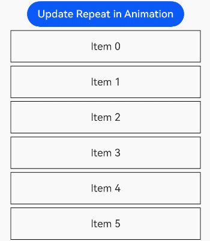

# Repeat
<!--Kit: ArkUI-->
<!--Subsystem: ArkUI-->
<!--Owner: @maorh-->
<!--Designer: @keerecles-->
<!--Tester: @khq-->
<!--Adviser: @zhang_yixin13-->
<!-- md-trans-meta sourceCommit=ee226a61937d72488771ef2e8f8022bbdda3a37a translatedAt=2026-10-30T09:02:17.797Z pushedAt=2026-10-30T09:32:33.721Z nl=1 -->

**Repeat** performs iterative rendering based on array data and is typically used together with scrollable components.

This document provides API parameter descriptions. For details about the component descriptions and usage guidelines, see [Repeat: Reusing Components for Repeated Content Rendering](../../../ui/rendering-control/arkts-new-rendering-control-repeat.md).

> **NOTE**
>
> - The initial APIs of this module are supported since API version 12. Newly added APIs will be marked with a superscript to indicate their earliest API version.
>
> - The APIs of this module can be used only in the stage model.

## APIs

### Repeat

Repeat\<T\>(arr: Array\<T\>)

**Widget capability**: This API can be used in ArkTS widgets since API version 12.

**Atomic service API**: This API can be used in atomic services since API version 12.

**System capability**: SystemCapability.ArkUI.ArkUI.Full

**Parameters**

| Name| Type      | Mandatory| Description     |
| ------ | ---------- | -------- | -------- |
| arr    | Array\<T\> | Yes| Data source, which is an array of the **Array\<T>** type. You can determine the data types.|

**Example**
```ts
// arr is an array of the Array<string> type, which is used as the data source for Repeat.
Repeat<string>(this.arr)
```

### Repeat

Repeat\<T\>(arr: RepeatArray\<T\>, options?: RepeatOptions)

> **NOTE**
>
> Data sources of the RepeatArray type are supported since API version 18.
>
> Since API version 26.1.0, **Repeat** supports passing in [RepeatOptions](#repeatoptions) to bind the controller [RepeatController](#repeatcontroller) and set the child component reuse strategy [allowReuseInAnimation](#repeatoptions) during the animation process.

**Widget capability**: This API can be used in ArkTS widgets since API version 18.

**Atomic service API**: This API can be used in atomic services since API version 18.

**System capability**: SystemCapability.ArkUI.ArkUI.Full

**Parameters**

| Name| Type      | Mandatory| Description     |
| ------ | ---------- | -------- | -------- |
| arr    | [RepeatArray\<T\>](#repeatarrayt18) | Yes| Data source, which is an array of the **RepeatArray\<T>** type. You can determine the data types.|
| options    | [RepeatOptions](#repeatoptions) | No | Configuration options for creating a **Repeat** component, used to bind a controller and set the child component node reuse strategy during the animation process. When not passed, the default configuration (without binding a controller) is used.<br>**Since:** 26.1.0<br>**Model restriction:** This API can only be used in the Stage model.<br>**Atomic service API:** Since API version 26.1.0, this interface supports use in atomic services. |

## Properties

In addition to the [drag-and-drop sorting](./ts-universal-attributes-drag-sorting.md) attribute, the following attributes are supported.

### each

each(itemGenerator: (repeatItem: RepeatItem\<T\>) => void)

Component generator. When the return value of [`.templateId()`](#templateid) does not match any [`.template()`](#template) type (that is, the current item does not match any template-defined style), `.each()` is used to process the data item. When the component generator of `.each()` is also empty, no child component is rendered.

> **NOTE**
>
> - The `each` attribute is mandatory; otherwise, a runtime error occurs.
> - The parameter of `itemGenerator` is `RepeatItem`, which combines `item` and `index`. Do not split the `RepeatItem` parameter.
>
> - This API cannot be called in [attributeModifier](ts-universal-attributes-attribute-modifier.md#attributemodifier).

**Widget capability**: This API can be used in ArkTS widgets since API version 12.

**Atomic service API**: This API can be used in atomic services since API version 12.

**System capability**: SystemCapability.ArkUI.ArkUI.Full

**Parameters**

| Name| Type  | Mandatory| Description|
| ------ | ---------- | -------- | -------- |
| itemGenerator  | (repeatItem: [RepeatItem\<T\>](#repeatitemt)) => void | Yes | Component generation function. **repeatItem**: state variable that combines item (data item in the arr array) and index (data item index). |

**Example**
```ts
// Create a Text component for each item in the arr array of the Array<string> type.
Repeat<string>(this.arr)
  .each((repeatItem: RepeatItem<string>) => { Text(repeatItem.item) })
```

### key

key(keyGenerator: (item: T, index: number) => string)

Key generator. The key is used to identify each data item. **Repeat** determines the changes (addition, deletion, and modification) of data items by comparing the new and old keys, so as to decide the reuse and update of components and achieve efficient rendering.

> **NOTE**
>
> This API cannot be called within [attributeModifier](ts-universal-attributes-attribute-modifier.md#attributemodifier).

**Widget capability**: This API can be used in ArkTS widgets since API version 12.

**Atomic service API**: This API can be used in atomic services since API version 12.

**System capability**: SystemCapability.ArkUI.ArkUI.Full

**Parameters**

| Name| Type  | Mandatory| Description |
| ------ | ---------- | -------- | -------- |
| keyGenerator  | (item: T, index: number) => string | Yes | Key generation function.<br>item: data item in the `arr` array. Optional. If omitted, this parameter is ignored by default. Do not use this parameter in the closure function implementation; otherwise, a compile error occurs.<br>index: index of the data item in the `arr` array. Optional. If omitted, this parameter is ignored by default. Do not use this parameter in the closure function implementation; otherwise, a compile error occurs. |

**Example**
```ts
// Create a Text component for each item in the arr array of the Array<string> type.
// Use the string value as its key.
Repeat<string>(this.arr)
  .each((repeatItem: RepeatItem<string>) => { Text(repeatItem.item) })
  .key((obj: string) => obj)
```

### virtualScroll

virtualScroll(virtualScrollOptions?: VirtualScrollOptions)

Enables virtual scrolling for `Repeat`. It is suitable for long list scenarios where the number of data items exceeds the visible area of the screen. When enabled, **Repeat** loads only the child components in the visible area and the preloaded area, instead of loading all data items, thereby improving the scrolling performance in large-data scenarios.

> **NOTE**
>
> This API cannot be called within [attributeModifier](ts-universal-attributes-attribute-modifier.md#attributemodifier).

**Atomic service API**: This API can be used in atomic services since API version 12.

**System capability**: SystemCapability.ArkUI.ArkUI.Full

**Parameters**

| Name| Type  | Mandatory| Description |
| ------ | ---------- | -------- | -------- |
| virtualScrollOptions  | [VirtualScrollOptions](#virtualscrolloptions)  | No | Virtual scrolling configuration options. Pass this parameter when custom virtual scrolling configuration is required (for example, setting the expected data items to load, reuse, memory optimization strategy, etc.); if not passed, the default value is undefined, and **Repeat** uses the default configuration (totalCount takes the data source length, reusable defaults to true, etc.). |

**Example**
```ts
// Create a Text component for each item in the arr array of the Array<string> type.
// Use Repeat in a List container component with virtual scrolling enabled.
List() {
  Repeat<string>(this.arr)
    .each((repeatItem: RepeatItem<string>) => { ListItem() { Text(repeatItem.item) }})
    .virtualScroll()
}
```

### template

template(type: string, itemBuilder: RepeatItemBuilder\<T\>, templateOptions?: TemplateOptions)

Renders the corresponding template child component based on the template type. It is suitable for scenarios where a list contains multiple types of data items and different styles and layouts need to be displayed by type.

When the return value of `.templateId()` does not match any `.template()` type (that is, the current item does not match any template-defined style), the component generator of [`.each()`](#each) is used to process the data item. When the component generator of `.each()` is also empty, no child component is rendered.

> **NOTE**
>
> This API cannot be called within [attributeModifier](ts-universal-attributes-attribute-modifier.md#attributemodifier).

**Atomic service API**: This API can be used in atomic services since API version 12.

**System capability**: SystemCapability.ArkUI.ArkUI.Full

**Parameters**

| Name| Type  | Mandatory| Description |
| ------ | ---------- | -------- | -------- |
| type | string | Yes | Identifier of the current template type. It must match the return value of **templateId()** to determine which template is used to render the data item. |
| itemBuilder  | [RepeatItemBuilder](#repeatitembuildert)\<T\> | Yes | Component generation function used to render the child component corresponding to the current template. repeatItem is a combined state variable that carries item (data item) and index. Do not split the `RepeatItem` parameter. |
| templateOptions | [TemplateOptions](#templateoptions) | No | Configuration options of the current template. Pass this parameter when you need to customize the template configuration (for example, set **cachedCount**, the maximum number of child component nodes that can be cached in the template cache pool). If this parameter is not passed, the default value is undefined, and **Repeat** uses the default template configuration. |

**Example**
```ts
// arr is an array of the Array<string> type.
// Use Repeat in a List container component with virtual scrolling enabled.
// Define a reusable template temp for generating Text components.
// All data items use the temp template.
List() {
  Repeat<string>(this.arr)
    .each((repeatItem: RepeatItem<string>) => {})
    .virtualScroll()
    .template('temp', (repeatItem: RepeatItem<string>) => { ListItem() { Text(repeatItem.item) }})
    .templateId((item: string, index: number) => { return 'temp' })
}
```

### templateId

templateId(typedFunc: TemplateTypedFunc\<T\>)

Assigns a template type for the current data item. It is suitable for scenarios where a list contains multiple types of data items and different rendering templates need to be specified for different types of data items. It must be used together with [`.template()`](#template). The return value of **templateId()** should match the type defined in **template()**. When the return value does not match any type defined in **template()**, the data item is processed by the component generator of [`.each()`](#each); if `.each()` is also empty, no child component is rendered.

> **NOTE**
>
> This API cannot be called within [attributeModifier](ts-universal-attributes-attribute-modifier.md#attributemodifier).

**Atomic service API**: This API can be used in atomic services since API version 12.

**System capability**: SystemCapability.ArkUI.ArkUI.Full

**Parameters**

| Name| Type  | Mandatory| Description |
| ------ | ---------- | -------- | -------- |
| typedFunc | [TemplateTypedFunc](#templatetypedfunct)\<T\> | Yes| Function that generates a template type for each data item.|

**Example**
```ts
// arr is an array of the Array<string> type.
// Use Repeat in a List container component with virtual scrolling enabled.
// Define a reusable template temp for generating Text components.
// Use the temp template for all data items.
List() {
  Repeat<string>(this.arr)
    .each((repeatItem: RepeatItem<string>) => {})
    .virtualScroll()
    .template('temp', (repeatItem: RepeatItem<string>) => { ListItem() { Text(repeatItem.item) }})
    .templateId((item: string, index: number) => { return 'temp' })
}
```

## RepeatArray\<T\><sup>18+</sup>

type RepeatArray\<T\> = Array\<T\> \| ReadonlyArray\<T\> \| Readonly\<Array\<T\>\>

Defines a union type for **Repeat** data source parameters.

**Widget capability**: This API can be used in ArkTS widgets since API version 18.

**Atomic service API**: This API can be used in atomic services since API version 18.

**System capability**: SystemCapability.ArkUI.ArkUI.Full

|  Type      | Description     |
| -------- | -------- |
| Array\<T\> | Regular array type.|
| ReadonlyArray\<T\> | Read-only array type, where the array object cannot be modified.|
| Readonly\<Array\<T\>> | Read-only array type, where the array object cannot be modified.|

## RepeatOptions

Configuration options for creating a **Repeat** component.

**Since:** 26.1.0

**Model restriction**: This API can be used only in the stage model.

**Atomic service API:** This API can be used in atomic services since API version 26.1.0.

**System capability**: SystemCapability.ArkUI.ArkUI.Full

| Name | Type | Read-Only | Optional | Description |
| --- | --- | --- | --- | --- |
| controller | [RepeatController](#repeatcontroller) | No | Yes | Controller bound to the **Repeat** component. After binding, when the cache needs to be cleared, call [clearCache](#clearcache) to clear the components in the cache pool of the **Repeat** component in lazy loading mode. This controller is bound only when **Repeat** is created and does not support dynamic modification.<br>Default value: **undefined**, which means no controller is bound. |
| allowReuseInAnimation | boolean | No | Yes | Whether to allow reuse of child components when **Repeat** is updated during the [animateTo](../arkts-apis-uicontext-uicontext.md#animateto) animation process. This takes effect only when the parent container component of Repeat is [List](./ts-container-list.md), [Grid](./ts-container-grid.md), or [WaterFlow](./ts-container-waterflow.md).<br>When **Repeat** is used together with animations, the reuse capability of Repeat conflicts with the animation, causing animation exceptions. In scenarios involving animations, set this parameter to false so that **Repeat** does not reuse child components when updated during the animation process, thereby supporting the animation.<br>**true**: the reuse capability remains enabled during the animation process.<br>**false**: the reuse capability is disabled during the animation process.<br>Default value: **false** when the parent container component of **Repeat** is **List**; **true** when the parent container component is **Grid** or **WaterFlow**. |

## RepeatController

Controller of the **Repeat** component. Bind the controller to the **Repeat** component through the controller field in [RepeatOptions](#repeatoptions). When the cache needs to be cleared, call [clearCache](#clearcache) to clear the components in the cache pool of the **Repeat** component in lazy loading mode.

> **NOTE**
>
> 1. The controller is bound only when **Repeat** is created and does not support dynamic modification.
> 2. A controller can control only one **Repeat** component. If the controller is bound to another **Repeat** component, the previous binding automatically becomes invalid, and the controller controls only the last bound component.

**Since:** 26.1.0

**Model restriction**: This API can be used only in the stage model.

**Atomic service API:** This API can be used in atomic services since API version 26.1.0.

**System capability**: SystemCapability.ArkUI.ArkUI.Full

### constructor

constructor()

Constructor of **RepeatController**.

**Since:** 26.1.0

**Model restriction**: This API can be used only in the stage model.

**Atomic service API:** This API can be used in atomic services since API version 26.1.0.

**System capability**: SystemCapability.ArkUI.ArkUI.Full

### clearCache

clearCache(): void

Clears the components in the cache pool of the **Repeat** component bound to this controller in lazy loading mode.

**Since:** 26.1.0

**Model restriction**: This API can be used only in the stage model.

**Atomic service API:** This API can be used in atomic services since API version 26.1.0.

**System capability**: SystemCapability.ArkUI.ArkUI.Full

## RepeatItem\<T\>

**Widget capability**: This API can be used in ArkTS widgets since API version 12.

**Atomic service API**: This API can be used in atomic services since API version 12.

**System capability**: SystemCapability.ArkUI.ArkUI.Full

| Name| Type  | Read-Only| Optional| Description                                        |
| ------ | ------ | ---- | ---- | -------------------------------------------- |
| item   | T      | No| No | Each data item in the **arr** array. **T** indicates the data type passed in.|
| index  | number | No| No | Index corresponding to the current data item.                      |

## VirtualScrollOptions

Configures the expected total number of data items to be loaded in lazy loading mode, the reuse capability, and the precise data lazy loading capability. Since API version 26.0.0, the memory optimization strategy can be configured.

### Properties

**Atomic service API**: This API can be used in atomic services since API version 12.

**System capability**: SystemCapability.ArkUI.ArkUI.Full

| Name    | Type  | Read-Only| Optional| Description                                                        |
| ---------- | ------ | ---- | ---- | ------------------------------------------------------------ |
| totalCount | number | No | Yes | Total number of expected data items to load, which can be different from the data source length (the length of the array actually passed to Repeat).<br>Value range: natural number.<br>At most one of totalCount and onTotalCount() can be set. If neither is set, the default value is used: the data source length. If both are set, totalCount is ignored.<br>If totalCount is omitted or out of the value range, totalCount takes the value of the data source length, and the list scrolls normally.<br>If totalCount = 0, no data is loaded.<br>If 0 < totalCount <= data source length, only the data in the range [0, totalCount - 1] is rendered in the UI.<br>If totalCount > data source length, **Repeat** renders the data in the range [0, totalCount - 1], and the scrollbar style of the container component changes based on the totalCount value. During scrolling of the container component, the application must ensure that subsequent data is requested when the list is about to scroll to the end of the data source. The developer needs to protect against error scenarios of data requests (such as network latency) until the data source is fully loaded; otherwise, abnormal scrolling effects may occur during list scrolling. It is recommended to use [onLazyLoading](#onlazyloading19) to implement data lazy loading.<br>In addition to the totalCount attribute, the developer can also set a custom method through [onTotalCount](#ontotalcount19) to calculate the expected total number of data items to load.<br>**Atomic service API:** Since API version 12, this API is supported in atomic services. |
| reusable<sup>18+</sup> | boolean | No | Yes | Whether to enable the reuse capability. When the child component of **Repeat** is a custom component decorated by [@ReusableV2](../../../ui/state-management/arkts-new-reusableV2.md), the reuse capability of **Repeat** itself takes precedence over that of @ReusableV2. If the developer wants to use the reuse capability of @ReusableV2, it is recommended to disable the reuse capability of **Repeat** itself.<br>**true**: enables reuse.<br>**false**: disables reuse.<br>Default value: **true**<br>**Atomic service API:** Since API version 18, this API is supported in atomic services. |
| memoryOptimizationStrategy | [RepeatMemOptStrategy](#repeatmemoptstrategy) | No | Yes | Memory optimization strategy of **Repeat**. This parameter is set when **Repeat** is created and does not support dynamic modification.<br>Default value: [DEFAULT](#repeatmemoptstrategy)<br>**Since:** 26.0.0<br>**Model restriction:** This API can be used only in the stage model.<br>**Atomic service API:** Since API version 26.0.0, this API is supported in atomic services.|

**Example**

```ts
// arr is an array of the Array<string> type. Use Repeat in a List container component with virtual scrolling enabled.
// Set the total number of data items to the length of the data source and enable component reuse.
List() {
  Repeat<string>(this.arr)
    .each((repeatItem: RepeatItem<string>) => { ListItem() { Text(repeatItem.item) }})
    .virtualScroll({ totalCount: this.arr.length, reusable: true })
}
```

### onTotalCount<sup>19+</sup>

onTotalCount?(): number

(Optional) Calculates the expected total number of data items to be loaded. You need to provide a calculation method, and its return value may not be equal to the data source length (length of the array passed to **Repeat**).

Both the return values of [totalCount](#virtualscrolloptions) and **onTotalCount()** indicate the expected total number of data items to be loaded. You can directly set the **totalCount** attribute to specify the expected total number of data items to be loaded, or use **onTotalCount()** to define a custom method for calculating the expected total number of data items to be loaded. At most one of **totalCount** and **onTotalCount()** can be set. If neither is set, the default value is used: the data source length. If both are set, **totalCount** is ignored.

The data loading rules for different return values of **onTotalCount()** are the same as those for **totalCount**. The details are as follows:

- If the return value of **onTotalCount()** is **0**, no data is loaded.
- If the return value of **onTotalCount()** is in the range (0, Data source length], only data in the index range [0, Return value – 1] is loaded.
- If the return value of **onTotalCount()** is greater than the data source length, the **Repeat** component expects to load data in the index range [0, Return value of onTotalCount() – 1]. The scrollbar style of the container component changes based on the return value of **onTotalCount()**. During the scrolling process of the container component, the application must ensure that subsequent data is requested when the list is about to scroll to the end of the data source. The developer needs to protect against error scenarios of data requests (such as network latency) until the data source is fully loaded. Otherwise, abnormal scrolling effects may occur during list scrolling. It is recommended to use [onLazyLoading](#onlazyloading19) to implement data lazy loading.
- If the return value of **onTotalCount()** is not a natural number, the data source length will be used as the return value.

**Atomic service API**: This API can be used in atomic services since API version 19.

**System capability**: SystemCapability.ArkUI.ArkUI.Full

**Return value**

|    Type  | Description|
| ------ | ---------- |
|  number |  Expected total number of data items to be loaded.<br>Value range: natural numbers|

### onLazyLoading<sup>19+</sup>

onLazyLoading?(index: number): void

(Optional) Lazily loads data at a specified index. You need to provide a data loading method.

The **onLazyLoading** method must be used in lazy loading scenarios. You can implement a custom method to write data to a specified index in the data source. The processing rules for **onLazyLoading** are as follows:

- Before reading the data corresponding to an index in the data source, the **Repeat** component checks whether data exists at the index.
- If no data exists but the **onLazyLoading** method is implemented, **Repeat** calls this method.
- In the **onLazyLoading** method, you need to write data to the index specified by **Repeat** in the following format: arr[index] =..., where **arr** indicates the array passed to **Repeat**. Array operations except **[]** are not allowed, and elements except the specified index cannot be written. Otherwise, the system throws an exception.
- After the **onLazyLoading** method is executed, if no data exists in the specified index, the components corresponding to the current index and subsequent indexes cannot be loaded.
- The precise lazy loading capability is an optional configuration item. If **onLazyLoading** is not specified and the return value of **totalCount** or **onTotalCount** is greater than the data source length, **Repeat** does not render the missing subsequent data when the list scrolls to the end of the data source.
- Avoid blocking time-consuming operations (such as synchronous network requests and complex computations) in the **onLazyLoading** method. If data loading may take a long time and affect scrolling smoothness, you are advised to first create a placeholder for the data in the **onLazyLoading** method, and then create an asynchronous task to load the data.

**Atomic service API**: This API can be used in atomic services since API version 19.

**System capability**: SystemCapability.ArkUI.ArkUI.Full

**Parameters**

| Name| Type  | Mandatory| Description|
| ------ | ---------- | -------- | -------- |
| index  | number | Yes| Index of the data item to be loaded.<br>Value range: natural numbers|

**Example**

```ts
// Assume that the total number of items is 100, and 3 items are needed for the initial screen rendering.
// The initial array provides the first 3 items (arr = ['No.0', 'No.1', 'No.2']), and lazy loading is enabled.
List() {
  Repeat<string>(this.arr)
    .each((repeatItem: RepeatItem<string>) => { ListItem() { Text(repeatItem.item) }})
    .virtualScroll({ 
      onTotalCount: () => { return 100; },
      onLazyLoading: (index: number) => { this.arr[index] = `No.${index}`; }
    })
}
```

## RepeatItemBuilder\<T\>

type RepeatItemBuilder\<T\> = (repeatItem: RepeatItem\<T\>) => void

**Atomic service API**: This API can be used in atomic services since API version 12.

**System capability**: SystemCapability.ArkUI.ArkUI.Full

**Parameters**

| Name    | Type         | Mandatory     | Description                                   |
| ---------- | ------------- | --------------------------------------- | --------------------------------------- |
| repeatItem | [RepeatItem](#repeatitemt)\<T\> | No | State variable that combines item and index.<br>When this parameter is omitted, it is ignored by default. Do not use this parameter in the closure function implementation; otherwise, a compile error occurs. |

## TemplateOptions

**Atomic service API**: This API can be used in atomic services since API version 12.

**System capability**: SystemCapability.ArkUI.ArkUI.Full

| Name     | Type  | Read-Only| Optional| Description                                                        |
| ----------- | ------ | ---- | ---- | ------------------------------------------------------------ |
| cachedCount | number | No | Yes | Maximum number of child component nodes that can be cached in the cache pool of the current template. The value range is [0, +∞), and the default value is the sum of the number of nodes in the display area and the preloaded area of the container component. When the sum of the number of nodes in the display area and the preloaded nodes of the container component increases (during the scrolling process, only child components of partial height are in the display area), **cachedCount** increases accordingly. Note that the **cachedCount** value does not decrease. When a value outside the value range, such as a negative number, is passed in, the default value is used. |

When **cachedCount** is set to the maximum number of nodes in the display area of the container component for the current template, **Repeat** achieves maximum reuse efficiency. If there are no nodes of the current template in the display area of the container component, the cache pool is not released, and the application memory increases. The developer needs to adjust it based on the application's requirements for memory usage and component reuse efficiency. It is recommended to set **cachedCount** to the number of nodes in the display area of the container component. Note that it is not recommended to set **cachedCount** to a value less than 2, because this causes frequent creation of new nodes in fast scrolling scenarios, resulting in performance degradation.

> **NOTE**
> 
> The `.cachedCount()` attribute of the scrollable container component and the `cachedCount` parameter of the `.template()` method of **Repeat** are both used to balance performance and memory, but they have different meanings.
> - `.cachedCount()` of the scrollable container component: indicates the size of the preloading area outside the display area of the container component. The child component nodes in this area are located on the component tree. The scrollable container component additionally renders the nodes in this preloading area to improve list scrolling performance.
> - `cachedCount` in `.template()`: indicates the cache pool size of each template of Repeat. When rendering a new child component, **Repeat** first checks whether there are available nodes in the cache pool of the corresponding template. If yes, it reuses them; otherwise, it creates new nodes.

**Example**
```ts
// arr is an array of the Array<string> type. Use Repeat in a List container component with virtual scrolling enabled.
// Define a reusable template temp for generating Text components. Use the temp template for all data items.
// Set the maximum cache count for the temp template to 2.
List() {
  Repeat<string>(this.arr)
    .each((repeatItem: RepeatItem<string>) => {})
    .virtualScroll()
    .template('temp', (repeatItem: RepeatItem<string>) => { ListItem() { Text(repeatItem.item) }}, { cachedCount: 2 })
    .templateId((item: string, index: number) => { return 'temp' })
}
```

## TemplateTypedFunc\<T\>

type TemplateTypedFunc\<T\> = (item: T, index: number) => string

**Model restriction**: This API can be used only in the stage model.

**Atomic service API**: This API can be used in atomic services since API version 12.

**System capability**: SystemCapability.ArkUI.ArkUI.Full

**Parameters**

| Name| Type  | Mandatory| Description                                        |
| ------ | ------ | ---- | -------------------------------------------- |
| item   | T      | No   | Each data item in arr. T is the data type passed in by the developer.<br>When omitted, this parameter is ignored by default. Do not use this parameter in the closure function implementation; otherwise, a compile error occurs. |
| index  | number | No   | Index corresponding to the current data item.<br>When omitted, this parameter is ignored by default. Do not use this parameter in the closure function implementation; otherwise, a compile error occurs.|

**Return value**

| Type   | Description                                         |
| ------ | -------------------------------------------- |
| string      | Template type generated by the current data item.|

## RepeatMemOptStrategy

Enumerates the memory optimization strategies of **Repeat**.

**Since**: 26.0.0

**Model restriction**: This API can be used only in the stage model.

**Atomic service API:** This API can be used in atomic services since API version 26.0.0.

**System capability**: SystemCapability.ArkUI.ArkUI.Full

| Name | Value | Description |
| --- | --- | --- |
| DEFAULT | 0 | No memory optimization strategy. |
| ENABLE_AUTO_CACHE_OPTIMIZATION | 1 << 0 | Automatic memory optimization strategy. When the memory usage of **Repeat** child nodes needs to be reduced, it is recommended to use this strategy to lower memory usage.<br>When the application goes to the background, when the component where **Repeat** resides is invisible (the [visibility](./ts-universal-attributes-visibility.md#visibility) attribute is set to a value other than [Visible](./ts-appendix-enums.md#visibility), or the component area is 0, regardless of occlusion), or when the device memory is low (the [MemoryLevel](../../apis-ability-kit/js-apis-app-ability-abilityConstant.md#memorylevel) reaches **MEMORY_LEVEL_LOW** or **MEMORY_LEVEL_CRITICAL**), all nodes in the [cache pool](../../../ui/rendering-control/arkts-new-rendering-control-repeat.md#node-update-and-reuse-mechanism) are released.<br>When the application returns to the foreground and the component where **Repeat** resides is displayed again, the nodes in the cache pool are restored.<br>When nodes are released and restored, the [custom component lifecycle](../../../ui/state-management/arkts-page-custom-components-lifecycle.md) is triggered. |

## Examples

### Example 1: Using the Automatic Memory Optimization Strategy

In the following example, the automatic memory optimization strategy is used through the **memoryOptimizationStrategy** attribute of [VirtualScrollOptions](#virtualscrolloptions). Click the Scroll button to make the list jump, and the old nodes enter the cache pool. When the application goes to the background, the cache is cleared. When the application returns to the foreground, the cache is restored.

Since API version 26.0.0, **VirtualScrollOptions** adds the **memoryOptimizationStrategy** attribute.

```ts
@ComponentV2
struct ChildComponent {
  aboutToAppear() {
    console.info('ChildComponent aboutToAppear');
  }
  aboutToDisappear() {
    console.info('ChildComponent aboutToDisappear');
  }
  build() {
    Text('ChildComponent')
  }
}

@Entry
@ComponentV2
struct MemoryOptimizeDemo {
  @Local data: Array<number> = [];
  private scroller: Scroller = new Scroller();
  aboutToAppear() {
    for (let i = 0; i < 100; i++) {
      this.data.push(i);
    }
  }
  build() {
    Column() {
      Button('Scroll').onClick(() => { // Click the button to trigger list scrolling, and the old components enter the cache pool.
        this.scroller.scrollToIndex(30);
      })
      List({ scroller: this.scroller }) {
        Repeat<number>(this.data)
          .each((repeatItem: RepeatItem<number>) => {
            ListItem() {
              ChildComponent()
            }
          })
          .virtualScroll({ memoryOptimizationStrategy: RepeatMemOptStrategy.ENABLE_AUTO_CACHE_OPTIMIZATION }) // Use the automatic memory optimization strategy.
      }
      .cachedCount(5)
    }
  }
}
```

### Example 2 Actively Clearing the Cache Pool

In the following example, the [RepeatController](#repeatcontroller) is bound through the **controller** attribute of [RepeatOptions](#repeatoptions). Click the **Scroll** button to make the list jump, and the old components enter the cache pool. Then click the **Clear** button to actively clear the components in the **Repeat** cache pool.

Since API version 26.1.0, the **Repeat** API adds the **options** parameter.

```ts
@ComponentV2
struct ChildComponent {
  aboutToAppear() {
    console.info('ChildComponent aboutToAppear');
  }
  aboutToDisappear() {
    console.info('ChildComponent aboutToDisappear');
  }
  build() {
    Text('ChildComponent')
  }
}

@Entry
@ComponentV2
struct ClearCacheDemo {
  @Local data: Array<number> = [];
  // Create the RepeatController object.
  private controller: RepeatController = new RepeatController();
  private scroller: Scroller = new Scroller();

  aboutToAppear(): void {
    for (let i = 0; i < 100; i++) {
      this.data.push(i);
    }
  }

  build() {
    Column() {
      List({ scroller: this.scroller }) {
        // Bind the controller through the controller field of RepeatOptions.
        Repeat<number>(this.data, { controller: this.controller })
          .each((repeatItem: RepeatItem<number>) => {
            ListItem() {
              ChildComponent()
            }
          })
          .virtualScroll()
      }
      .cachedCount(5)
      .height('80%')

      Button('Scroll')
        .onClick(() => {
          // Tap the button to trigger list jump, and the old components enter the cache pool.
          this.scroller.scrollToIndex(30);
        })

      Button('Clear')
        .onClick(() => {
          // Actively clear the components in the Repeat cache pool.
          this.controller.clearCache();
        })
    }
  }
}
```

### Example 3 Using Animation Capability

In the following example, the animation capability is adapted through the **allowReuseInAnimation** attribute of [RepeatOptions](#repeatoptions).

Since API version 26.1.0, the **Repeat** API adds the **options** parameter.

```ts
@Entry
@ComponentV2
struct RepeatAnimationDemo {
  @Local dataArray: string[] = [];
  private count: number = 0;

  aboutToAppear(): void {
    for (let i = 0; i < 20; i++) {
      this.dataArray.push(`Item ${i}`);
    }
  }

  build() {
    Column({ space: 5 }) {
      Row({ space: 5 }) {
        Button('Update Repeat in Animation')
          .onClick(() => { // Insert child components during the animation process.
            this.getUIContext()?.animateTo({ duration: 1000 }, () => {
              this.dataArray.splice(0, 0, `New item ${this.count++}`)
            })
          })
      }
      Row({ space: 5 }) {
        Grid() {
          Repeat(this.dataArray, { allowReuseInAnimation: false }) // Repeat does not reuse child components during the animation process, thereby adapting to the animation.
            .each((repeatItem) => {
              GridItem() {
                Text(repeatItem.item)
              }
              .width(150)
              .height(50)
              .border({ width: 1 })
              .transition(TransitionEffect.translate({ x: 300 })) // Set the transition effect when child components are inserted.
            })
            .key((item: string, index: number) => item)
            .virtualScroll()
        }
        .columnsTemplate('1fr')
        .columnsGap(5)
        .rowsGap(5)
        .width('80%')
      }
    }
    .width('100%')
  }
}
```

Running effect:

