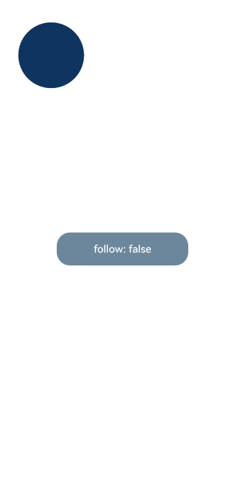

# Implicit Shared Element Transition (geometryTransition)
<!--Kit: ArkUI-->
<!--Subsystem: ArkUI-->
<!--Owner: @hehongyang3-->
<!--Designer: @chensiyi_CE-->
<!--Tester: @lxl007-->
<!--Adviser: @ge-yafang-->
<!-- md-trans-meta sourceCommit=bb94458a23032ca70482bfcecb10f129d7274145 translatedAt=2026-11-03T03:11:47.137Z pushedAt=2026-11-13T01:06:00.066Z nl=1 -->

Provides a smooth, seamless context transition during view switching. The generic transition mechanism provides transition effects such as opacity and scale. By arranging the frame and position of the bound in/coming and out/leaving components (in refers to the new view, and out refers to the old view), geometryTransition establishes a spatial relationship between the originally independent transition animations, guiding the visual focus from the old view position to the new view position. The in/coming and out/leaving components must be used together with transition to ensure that the leaving component is not immediately destroyed and to provide the transition effect. If transition is not used, the out/leaving component will be destroyed immediately upon leaving, and the shared element transition animation may not be displayed properly.

> **NOTE**
>
> The initial APIs of this module are supported since API version 7 and effective since API version 10. Updates will be marked with a superscript to indicate their earliest API version.
>
> [geometryTransition](ts-transition-animation-geometrytransition.md) must be used together with [animateTo](../arkts-apis-uicontext-uicontext.md#animateto) to produce the animation effect. The animation duration and curve follow the settings in [animateTo](../arkts-apis-uicontext-uicontext.md#animateto). The components participating in the transition must have [transition](ts-transition-animation-component.md#transition) set to ensure that they are not immediately destroyed when leaving, so that the shared element transition animation can play properly. The [animation](ts-animatorproperty.md) animation is not supported.

## geometryTransition

geometryTransition(id: string): T

In-Component Implicit Shared Element Transition. It must be used together with [animateTo](../arkts-apis-uicontext-uicontext.md#animateto) to produce the animation effect. The animation duration and curve follow the settings in [animateTo](../arkts-apis-uicontext-uicontext.md#animateto). The [animation](ts-animatorproperty.md) animation is not supported. geometryTransition synchronizes the rounded corners, but only at the location where geometryTransition is bound; it does not operate on the borderRadius of the child components inside the container.

**System capability**: SystemCapability.ArkUI.ArkUI.Full

**Atomic service API**: This API can be used in atomic services since API version 11.

**Parameters**

| Name | Type                | Mandatory| Description                                                    |
| ------- | ------------------------ | ---- | ------------------------------------------------------------ |
| id      | string                   | Yes   | Used to set the binding relationship. Setting the id to an empty string clears the binding relationship to avoid participating in the shared behavior. The id can be changed to re-establish the binding relationship. The same id can be bound to only two components, which serve as two different roles: in (new view) and out (old view). Multiple components cannot be bound to the same id. Components bound to the same id cannot be nested within each other. That is, a component bound to an id cannot contain another component bound to the same id; otherwise, the transition animation will be abnormal. It is recommended that you set the bound id to an empty string in the animation end callback ([onFinish](ts-explicit-animation.md#animateparam)) to prevent the shared element transition from being triggered unexpectedly in unintended scenarios (such as rapid consecutive taps on a page and state variable changes). Set the id back to the required value before the next transition is triggered. |

**Return value**

| Type| Description|
| -------- | -------- |
| T | Current component, used for chained calls. |

## geometryTransition<sup>11+</sup>

geometryTransition(id: string, options?: GeometryTransitionOptions): T

Implements an implicit shared element transition.

**Atomic service API**: This API can be used in atomic services since API version 12.

**Model restriction**: This API can be used only in the stage model.

**System capability**: SystemCapability.ArkUI.ArkUI.Full

**Parameters**

| Name | Type                | Mandatory| Description                                                    |
| ------- | ------------------------ | ---- | ------------------------------------------------------------ |
| id      | string                   | Yes   | Used to set the binding relationship. Setting id to an empty string clears the binding relationship to avoid participating in the shared behavior. The id can be changed to re-establish the binding relationship. The same id can be bound to only two components, which serve as two different roles: in (new view) and out (old view). Multiple components cannot be bound to the same id. Components bound to the same id cannot be nested within each other, that is, a component bound to an id cannot contain another component bound to the same id; otherwise, the transition animation will be abnormal.  It is recommended that the bound id be set to an empty string in the animation end callback ([onFinish](ts-explicit-animation.md#animateparam)) to prevent the shared element transition from being triggered unexpectedly in unintended scenarios (such as rapid consecutive taps on a page, state variable changes, etc.), and set id back to the required value before the next transition is triggered. |
| options | [GeometryTransitionOptions](#geometrytransitionoptions11) | No   | Parameters of the in-component implicit shared element transition animation. It must be used together with [animateTo](../arkts-apis-uicontext-uicontext.md#animateto) to produce an animation effect.<br>The default value is { follow: false }.                                    |

**Return value**

| Type| Description|
| -------- | -------- |
| T | Current component, used for chained calls. |

## GeometryTransitionOptions<sup>11+</sup>

**Atomic service API**: This API can be used in atomic services since API version 12.

**Model restriction**: This API can be used only in the stage model.

**System capability**: SystemCapability.ArkUI.ArkUI.Full

| Name| Type| Read-Only| Optional| Description                                                  |
| ------ | -------- | -------- | ---- | ------------------------------------------------------------ |
| follow | boolean  | No | Yes   | Used only in the if paradigm to mark whether a component that always remains in the component tree follows the shared element transition. The if paradigm is a declarative UI development pattern that uses an if conditional statement in the build() method to control the visibility of components. The value true means that the component follows the shared element transition, and false means that it does not follow the shared element transition.<br>Default value: false |

## Examples

### Example 1: Implementing Shared Element in the if-else Paradigm

This example mainly demonstrates the integration of the shared element effect in the if-else paradigm.

```ts
// xxx.ets
@Entry
@Component
struct Index {
  @State isShow: boolean = false;
  @State geometryId: string = 'picture';

  build() {
    Stack({ alignContent: Alignment.Center }) {
      if (this.isShow) {
        // Customize the image resource path as needed.
        Image($r('app.media.pic'))
          .autoResize(false)
          .clip(true)
          .width(300)
          .height(400)
          .offset({ y: 100 })
          .geometryTransition(this.geometryId)
          .transition(TransitionEffect.OPACITY)
          // In an interruption scenario, that is, when the page is tapped during an animation to trigger the next transition, ghosting occurs if no id is added.
          // After an id is added, the newly created image reuses the previous image node instead of creating a new node, so no ghosting occurs.
          // The rule for adding an id is to add it to the first node under if and else. If there are multiple parallel nodes, the id also needs to be added to them.
          .id('item1')
      } else {
        // geometryTransition is bound to a container. Therefore, a relative layout must be configured for the child components of the container.
        // The multiple levels of containers here are used to demonstrate passing of relative layout constraints.
        Column() {
          Column() {
            // Customize the image resource path as needed.
            Image($r('app.media.icon'))
              .width('100%').height('100%')
          }.width('100%').height('100%')
        }
        .width(80)
        .height(80)
        // geometryTransition synchronizes corner radius settings, but only for the bound component, which is the container in this example.
        // In other words, corner radius settings of the container are synchronized, and those of the child components are not.
        .borderRadius(20)
        .clip(true)
        .geometryTransition(this.geometryId)
        // transition ensures that the component is not destructed immediately when it exits. You can customize the transition effect.
        .transition(TransitionEffect.OPACITY)
        .id('item2')
      }
    }
    .onClick(() => {
      this.geometryId = 'picture';
      this.getUIContext().animateTo({ duration: 1000, onFinish: () => {
        this.geometryId = '';
      } }, () => {
        this.isShow = !this.isShow;
      });
    })
  }
}
```


### Example 2: Using follow in the if Paradigm to Implement a Follow Effect

This example mainly demonstrates how to use the follow parameter in the if paradigm to implement a follow effect for components that remain in the tree.

```ts
// xxx.ets
const FOLLOW_TRUE_ID: string = 'follow_true_id';
const FOLLOW_FALSE_ID: string = 'follow_false_id';

@Entry
@Component
struct Index {
  @State isFollow: boolean = false;
  @State isShow: boolean = false;
  @State geometryId: string = '';

  @Builder
  myBuilder() {
    Column() {
      Column()
        .backgroundColor('#ff663399')
        .size({ width: 100, height: 100 })
        .position({ x: 200, y: 500 })
        .borderRadius(25)
        .clip(true)
        .geometryTransition(this.geometryId)
        .transition(TransitionEffect.OPACITY)
    }
    .size({ width: '100%', height: '100%' })
    .backgroundColor("#33000000")
    .transition(TransitionEffect.OPACITY)
  }

  build() {
    Stack() {
      if (this.isFollow) {
        Column()
          .backgroundColor('#ff103460')
          .size({ width: 100, height: 100 })
          .position({ x: 30, y: 30 })
          .borderRadius(50)
          // When follow is true, the component is removed from the component tree to create a follow effect during the one-shot transition.
          .geometryTransition(FOLLOW_TRUE_ID, { follow: true })
          .transition(TransitionEffect.OPACITY)
      } else {
        Column()
          .backgroundColor('#ff103460')
          .size({ width: 100, height: 100 })
          .position({ x: 30, y: 30 })
          .borderRadius(50)
          // When follow is false, the component stays in place without following during the one-shot transition.
          .geometryTransition(FOLLOW_FALSE_ID, { follow: false })
          .transition(TransitionEffect.OPACITY)
      }

      Button('follow: ' + (this.isFollow ? 'true' : 'false'))
        .onClick(() => {
          this.isFollow = !this.isFollow;
          this.geometryId = this.isFollow ? FOLLOW_TRUE_ID : FOLLOW_FALSE_ID;
        })
        .size({ width: 200, height: 50 })
        .backgroundColor('#ff6b879b')
    }
    .size({ width: '100%', height: '100%' })
    .bindContentCover(this.isShow, this.myBuilder(), {
      // Set modalTransition to ModalTransition.NONE when implementing a one-shot animation on a modal page.
      modalTransition: ModalTransition.NONE,
      onWillDismiss: () => {
        // Create an animation environment through animateTo to implement the one-shot animation when closing the modal page by swiping.
        this.getUIContext().animateTo({ duration: 350 }, () => {
          this.isShow = !this.isShow;
        });
      }
    })
    .onClick(() => {
      // Tap to display the modal page.
      this.getUIContext().animateTo({ duration: 350 }, () => {
        this.isShow = !this.isShow;
      });
    })
  }
}
```

