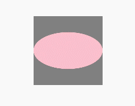

# Click Control
<!--Kit: ArkUI-->
<!--Subsystem: ArkUI-->
<!--Owner: @zhou-chaobo-->
<!--Designer: @piggyguy-->
<!--Tester: @songyanhong-->
<!--Adviser: @Brilliantry_Rui-->
<!--deprecated_code_no_check-->
<!-- md-trans-meta sourceCommit=3b17ae247298f1cf952b1cbdcb60f1ff0e80beac translatedAt=2026-11-03T03:16:13.623Z pushedAt=2026-11-13T01:06:00.077Z nl=1 -->

Sets whether the component can respond to finger interaction events such as click and touch events based on interaction requirements, meeting the control requirements for component interaction responses in different scenarios.

>  **NOTE**
>
>  The initial APIs of this module are supported since API version 7. Newly added APIs will be marked with a superscript to indicate their earliest API version.

## touchable<sup>(deprecated)</sup>

touchable(value: boolean): T

Sets the interaction response capability of the current component.

> **NOTE**
>
> This API is supported since API version 7 and deprecated since API version 9. You are advised to use [hitTestBehavior](ts-universal-attributes-hit-test-behavior.md#hittestbehavior) instead.

**System capability**: SystemCapability.ArkUI.ArkUI.Full

**Parameters**

| Name     | Type| Mandatory| Description                   |
| ----------- | -------- | ----- | ------------------------ |
| value   | boolean  |  Yes  |Whether the component can respond to finger interactions such as click and touch events.<br>**true** (default): The component can respond to finger interactions. **false**: The component cannot respond to finger interactions.|

**Return value**

| Type| Description|
| -------- | -------- |
| T | Current component.|

## Example

```ts
// xxx.ets
@Entry
@Component
struct TouchableExample {
  @State text1: string = '';
  @State text2: string = '';

  build() {
    Stack() {
      Rect()
        .fill(Color.Gray).width(150).height(150)
        .onClick(() => {
          console.info(this.text1 = 'Rect Clicked');
        })
        .overlay(this.text1, { align: Alignment.Bottom, offset: { x: 0, y: 20 } })
      Ellipse()
        .fill(Color.Pink).width(150).height(80)
        .touchable(false) // When the Ellipse area is touched, the message "Ellipse Clicked" is not displayed.
        .onClick(() => {
          console.info(this.text2 = 'Ellipse Clicked');
        })
        .overlay(this.text2, { align: Alignment.Bottom, offset: { x: 0, y: 20 } })
    }.margin(100);
  }
}
```


