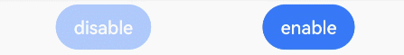

# Enable/Disable Control
<!--Kit: ArkUI-->
<!--Subsystem: ArkUI-->
<!--Owner: @zhou-chaobo-->
<!--Designer: @piggyguy-->
<!--Tester: @songyanhong-->
<!--Adviser: @Brilliantry_Rui-->
<!-- md-trans-meta sourceCommit=3b17ae247298f1cf952b1cbdcb60f1ff0e80beac translatedAt=2026-11-03T03:18:49.129Z pushedAt=2026-11-13T01:06:00.091Z nl=1 -->

The disable control is used to set whether a component is interactive. When a component is interactive, it can respond to [click events](ts-universal-events-click.md), [touch events](ts-universal-events-touch.md), [drag and drop events](ts-universal-events-drag-drop.md), [key events](ts-universal-events-key.md), [focus events](ts-universal-focus-event.md), [mouse events](ts-universal-mouse-key.md), [axis events](ts-universal-events-axis.md), [hover events](ts-universal-events-hover.md), [accessibility hover events](ts-universal-accessibility-hover-event.md), [gesture events](ts-gesture-settings.md), [focus axis events](ts-universal-events-focus-axis.md), and [crown events](ts-universal-events-crown.md). When a component is not interactive, it does not respond to the preceding operations. This is suitable for scenarios where user interaction needs to be temporarily blocked, for example, disabling a button during form submission to prevent duplicate submission, disabling an interaction area during data loading to prevent misoperation, and disabling the next step when conditions are not met. This effectively prevents misoperation.

>  **NOTE**
>
>  The initial APIs of this module are supported since API version 7. Updates will be marked with a superscript to indicate their earliest API version.
>
>  The disable control attribute takes effect only when the component is pressed. Changing the **enabled** attribute during interaction is ineffective.

## enabled

enabled(value: boolean): T

Sets whether the component responds to user interactions. If **enabled** is not set, the component responds to user interactions by default.

**Widget capability**: Since API version 9, this feature is supported in ArkTS widgets.

**Atomic service API**: This API can be used in atomic services since API version 11.

**System capability**: SystemCapability.ArkUI.ArkUI.Full

**Parameters**

| Name| Type   | Mandatory| Description                                                        |
| ------ | ------- | ---- | ------------------------------------------------------------ |
| value  | boolean | required   | true indicates that the component is interactive and responds to interaction operations.<br>false indicates that the component is not interactive and does not respond to interaction operations. |

**Return value**

| Type| Description|
| -------- | -------- |
| T | Current component, which supports chained calls. |

## Example

This example uses **enabled** to set whether a button is interactive.

```ts
// xxx.ets
@Entry
@Component
struct EnabledExample {
  build() {
    Flex({ justifyContent: FlexAlign.SpaceAround }) {
      // The button does not respond to clicks.
      Button('disable').enabled(false).backgroundColor(0x317aff).opacity(0.4)
      Button('enable').backgroundColor(0x317aff)
    }
    .width('100%')
    .padding({ top: 5 })
  }
}
```


