# Safe Area (System API)
<!--Kit: ArkUI-->
<!--Subsystem: ArkUI-->
<!--Owner: @camlostshi-->
<!--Designer: @fenglinbailu-->
<!--Tester: @liuli0427-->
<!--Adviser: @Brilliantry_Rui-->
<!-- md-trans-meta sourceCommit=4f0044ab21b23c749860cc48ba471e204d2de726 translatedAt=2026-11-20T08:45:30.088Z pushedAt=2026-11-23T07:42:14.915Z nl=1 -->

Places custom content on one or more edges of a component, and reserves a component-level safe area for the main content based on its actual occupied space. It is suitable for edge toolbars, operation areas, or placeholder content.

> **NOTE**
>
> - The APIs in this module are system APIs and are intended for system applications only. A system SDK with the corresponding declarations is required.
> - The APIs in this module can only be used in the Stage model.
> - This page contains only the system APIs of this module. For other public APIs, see [Safe Area](ts-universal-attributes-expand-safe-area.md).

**Since:** 26.1.0

## safeAreaInset

safeAreaInset(options?: SafeAreaInsetOptions): T

Places custom content on one or more edges of a component, and reserves a component-level safe area for the main content based on its actual occupied space.

It is suitable for edge toolbars, operation areas, or placeholder content. When called again, the four-edge configuration is replaced as a whole, and edges that are not provided do not retain their previous content. An edge that is not provided refers to an edge whose corresponding property is omitted from options this time.

For basic usage, see [Example 1](#example-1-creating-a-bottom-operation-area). For use with a scroll container, see [Example 4](#example-4-extending-scrollable-content-below-the-floating-operation-area). For the layout and overlap of multi-edge content, see [SafeAreaInsetOptions](#safeareainsetoptions).

Content is attached from the inner boundary of the host's normal padding. For the same physical edge of the same host, the effective safe area takes the larger value between the existing [safeAreaPadding](ts-universal-attributes-size.md#safeareapadding14) and the space occupied by the edge content, rather than adding the two together. The accumulation rules of the existing [safeAreaPadding](ts-universal-attributes-size.md#safeareapadding14) are followed across ancestors and the system safe area.

When the component uses an adaptive size, the effective component-level safe areas corresponding to top and bottom are counted into the height, and those corresponding to start and end are counted into the width. For the calculation of the adaptive height, see [Example 5](#example-5-adapting-the-height-based-on-the-main-content-and-edge-operation-area).

**Since:** 26.1.0

**Atomic service API:** This API can be used in atomic services since API version 26.1.0.

**System API**: This is a system API.

**Model restriction**: This API can be used only in the stage model.

**System capability**: SystemCapability.ArkUI.ArkUI.Full

**Parameters**

| Name | Type | Mandatory | Description |
| --- | --- | --- | --- |
| options | [SafeAreaInsetOptions](#safeareainsetoptions) | No | Complete configuration of the four edges. Default value: **undefined**, which resets the four edges. The four edges are also reset when null, a non-object, or an object without valid edges is passed in. When a single-edge structure or content is invalid, or the build result is empty, only that edge is cleared. When **spacing** is invalid, it falls back to 0 vp; when **alignment** is invalid, it falls back to **SafeAreaInsetAlignment.CENTER**. Neither of these clears the valid content of that edge. |

**Return value**

| Type | Description |
| --- | --- |
| T | Current component. |

## SafeAreaInsetOptions

Configures the complete edge content of the four edges of a component.

The content of each edge is measured and positioned independently and is not automatically avoided at the corners. When the content size or alignment position causes them to intersect, overlap occurs. Overlap can be avoided by adjusting the content size or alignment mode. See [Example 2](#example-2-configuring-multi-edge-content-and-switching-layout-direction).

**Since:** 26.1.0

**Atomic service API:** This API can be used in atomic services since API version 26.1.0.

**System API**: This is a system API.

**Model restriction**: This API can be used only in the stage model.

**System capability**: SystemCapability.ArkUI.ArkUI.Full

| Name | Type | Read-Only | Optional | Description |
| --- | --- | --- | --- | --- |
| top | [SafeAreaInsetEdgeConfig](#safeareainsetedgeconfig) | No | Yes | Content configuration attached to the physical top edge. Default value: **undefined**, which does not set the content of this edge. When this edge is omitted, or **undefined**, **null**, or an invalid edge configuration is passed in, the original content of this edge is cleared, which does not affect other valid edges. |
| end | [SafeAreaInsetEdgeConfig](#safeareainsetedgeconfig) | No | Yes | Content configuration attached to the logical end edge: the right edge in left-to-right layout and the left edge in right-to-left layout. Default value: **undefined**, which does not set the content of this edge. When this edge is omitted, or **undefined**, **null**, or an invalid edge configuration is passed in, the original content of this edge is cleared, which does not affect other valid edges. |
| bottom | [SafeAreaInsetEdgeConfig](#safeareainsetedgeconfig) | No | Yes | Content configuration attached to the physical bottom edge. Default value: **undefined**, which does not set the content of this edge. When this edge is omitted, or **undefined**, **null**, or an invalid edge configuration is passed in, the original content of this edge is cleared, which does not affect other valid edges. |
| start | [SafeAreaInsetEdgeConfig](#safeareainsetedgeconfig) | No | Yes | Content configuration attached to the logical start edge: the left edge in left-to-right layout and the right edge in right-to-left layout. Default value: **undefined**, which does not set the content of this edge. When this edge is omitted, or **undefined**, **null**, or an invalid edge configuration is passed in, the original content of this edge is cleared, which does not affect other valid edges. |

## SafeAreaInsetEdgeConfig

Configures a single edge content and its layout.

The edge content uses the area of the component on which **safeAreaInset** is set, after subtracting the **border** and normal **padding**, as the positioning reference. The main content is the original child component of this component. The space occupied by **top** and **bottom** is the measured height of the root component (including the top and bottom margins) plus **spacing**, and the space occupied by **start** and **end** is the measured width of the root component (including the left and right margins) plus **spacing**. **spacing** is counted into the occupied space after content measurement, only increasing the space reserved inward, without changing the measurement range or attachment position of the edge content. See [Example 1](#example-1-creating-a-bottom-operation-area).

**Since:** 26.1.0

**Atomic service API:** This API can be used in atomic services since API version 26.1.0.

**System API**: This is a system API.

**Model restriction**: This API can be used only in the stage model.

**System capability**: SystemCapability.ArkUI.ArkUI.Full

| Name | Type | Read-Only | Optional | Description |
| --- | --- | --- | --- | --- |
| content | [CustomBuilder](ts-types.md#custombuilder8) | No | No | Required builder function used to create the content of this edge. When the build result is empty, this edge is cleared, which does not affect other valid edges. The space reserved for this edge equals the measured size of the content in the direction perpendicular to the attached edge plus [spacing](#safeareainsetedgeconfig). The **builder** of each edge should generate one root component, which can be a normal component or a custom component. Multiple components should be composed into a single root by a container. The result of a multi-root build is not guaranteed. |
| spacing | [LengthMetrics](../js-apis-arkui-graphics.md#lengthmetrics12) | No | Yes | Spacing between the edge content and the main content, pointing toward the inside of the container. The supported units are vp, px, fp, and lpx, and the value must be a non-negative finite value. Percentage or resource values are not supported. Default value: **0vp**. When omitted or an invalid value is passed in, it falls back to **0vp**, without clearing the valid content. The spacing is counted into the occupied space after content measurement and does not deduct the measurement space of the content in advance. |
| alignment | [SafeAreaInsetAlignment](#safeareainsetalignment) | No | Yes | Alignment mode of the content along the attached edge. Default value: **SafeAreaInsetAlignment.CENTER**. When omitted or an invalid value is passed in, it falls back to **SafeAreaInsetAlignment.CENTER**, without clearing the valid content. |

## SafeAreaInsetAlignment

Defines the content alignment mode along the edge direction. The top and bottom edges are aligned along the horizontal direction, and the start and end edges are aligned along the vertical direction.

The "top and bottom edges" mentioned above refer to the content configured by top and bottom. The enum values **START** and **END** indicate the alignment position along the edge direction, which is different from the **start** and **end** edge configurations.

**Since:** 26.1.0

**Atomic service API:** This API can be used in atomic services since API version 26.1.0.

**System API**: This is a system API.

**Model restriction**: This API can be used only in the stage model.

**System capability**: SystemCapability.ArkUI.ArkUI.Full

| Name | Value | Description |
| --- | --- | --- |
| START | 0 | Aligns to the start point along the edge direction. The top and bottom edges are aligned to the left in left-to-right layout and to the right in right-to-left layout. The start and end edges are aligned to the top. |
| CENTER | 1 | Centered in the direction along the edge. |
| END | 2 | Aligns to the end point along the edge direction. The top and bottom edges are aligned to the right in left-to-right layout and to the left in right-to-left layout. The start and end edges are aligned to the bottom. |

## Examples

### Example 1: Creating a Bottom Operation Area

This example uses the [safeAreaInset](#safeareainset) API to create a bottom operation area with a single-root builder. The operation area is 40 vp high with **spacing** of 8 vp, and the larger value between it and the 60 vp of the bottom **safeAreaPadding** is taken, reserving a 60 vp component-level safe area for the main content. The 12 vp of normal padding is additionally retained. In this example, the inner **Column** and its **Text** are the main content, and the **Row** built by **BottomContent** is the edge content.

Since API version 26.1.0, the [safeAreaInset](#safeareainset) API is added.

```ts
import { LengthMetrics } from '@kit.ArkUI';

@Entry
@Component
struct SafeAreaInsetBottomExample {
  @State clicks: number = 0;

  @Builder
  BottomContent() {
    Row() {
      Button('Action')
        .onClick(() => {
          this.clicks++;
        })
    }
    .height(40)
  }

  build() {
    Column() {
      Column() {
        Text('Main content\nClicks: ' + this.clicks)
          .width('100%')
          .height('100%')
          .textAlign(TextAlign.Center)
          .backgroundColor('#D1C4E9')
      }
      .width(300)
      .height(240)
      .padding(12)
      // The bottom safe area takes max(60, 40 + 8), and the normal padding is additionally retained.
      .safeAreaPadding({ bottom: LengthMetrics.vp(60) })
      .backgroundColor('#F5F5F5')
      .safeAreaInset({
        bottom: {
          content: () => { this.BottomContent(); },
          spacing: LengthMetrics.vp(8)
        }
      })
    }
    .width('100%')
    .height('100%')
  }
}
```

Running effect: after tapping the **Action** button, the click count becomes 1.

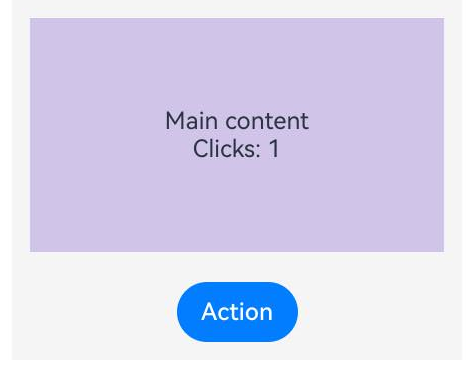

### Example 2: Configuring Multi-Edge Content and Switching Layout Direction

This example uses the [safeAreaInset](#safeareainset) API to configure the content of all four edges simultaneously. When the layout direction is switched, **start** and **end** swap their physical positions, while **top** and **bottom** remain on the top and bottom edges. The **START** alignment of the top edge and the **END** alignment of the bottom edge change with LTR/RTL, and the content of the start and end edges is centered along the vertical direction to avoid overlapping with the top and bottom content at the corners.

Since API version 26.1.0, the [safeAreaInset](#safeareainset) API is added.

```ts
@Entry
@Component
struct SafeAreaInsetDirectionExample {
  @State rtl: boolean = false;

  @Builder
  TopContent() {
    Text('Top')
      .width(80)
      .height(28)
      .backgroundColor('#E3F2FD')
  }

  @Builder
  EndContent() {
    Text('End')
      .fontSize(14)
      .width(32)
      .height(80)
      .backgroundColor('#FFF3E0')
  }

  @Builder
  BottomContent() {
    Text('Bottom')
      .width(80)
      .height(28)
      .backgroundColor('#E3F2FD')
  }

  @Builder
  StartContent() {
    Text('Start')
      .fontSize(14)
      .width(32)
      .height(80)
      .backgroundColor('#E8F5E9')
  }

  build() {
    Column({ space: 12 }) {
      Button('Toggle LTR/RTL')
        .onClick(() => {
          this.rtl = !this.rtl;
        })
      Stack() {
        Text('Main content')
          .width('100%')
          .height('100%')
          .textAlign(TextAlign.Center)
          .backgroundColor('#D1C4E9')
      }
      .width(300)
      .height(260)
      .padding(12)
      .backgroundColor('#F5F5F5')
      // start/end swap positions with the layout direction.
      .direction(this.rtl ? Direction.Rtl : Direction.Ltr)
      .safeAreaInset({
        top: { content: () => { this.TopContent(); }, alignment: SafeAreaInsetAlignment.START },
        end: { content: () => { this.EndContent(); }, alignment: SafeAreaInsetAlignment.CENTER },
        bottom: { content: () => { this.BottomContent(); }, alignment: SafeAreaInsetAlignment.END },
        start: { content: () => { this.StartContent(); }, alignment: SafeAreaInsetAlignment.CENTER }
      })
    }
    .width('100%')
    .height('100%')
  }
}
```

Running effect:

| LTR layout | RTL layout |
| --- | --- |
| 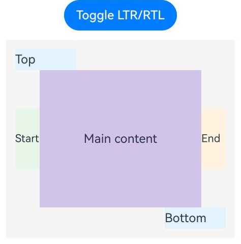 | 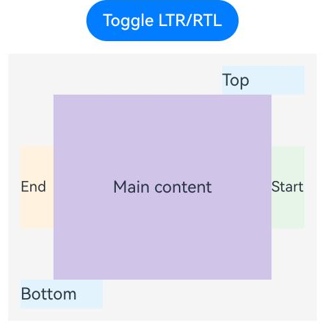 |

### Example 3: Updating, Clearing, and Resetting Edge Content

This example uses the [safeAreaInset](#safeareainset) API to switch the top builder to replace the content, sets **top** to **undefined** to clear the top, and continues to provide the bottom configuration to keep the bottom. If only **top** is provided this time, the original **bottom** is also cleared. When **undefined** is passed in, all edges are reset, and the content is restored when a complete configuration is provided again.

Since API version 26.1.0, the [safeAreaInset](#safeareainset) API is added.

```ts
import { LengthMetrics } from '@kit.ArkUI';

@Entry
@Component
struct SafeAreaInsetUpdateExample {
  @State insetEnabled: boolean = true;
  @State showTop: boolean = true;
  @State alternateTop: boolean = false;

  @Builder
  TopContent() {
    Text('Top toolbar')
      .height(28)
      .backgroundColor('#E3F2FD')
  }

  @Builder
  AlternateTopContent() {
    Text('Updated top toolbar')
      .height(48)
      .backgroundColor('#FFF3E0')
  }

  @Builder
  BottomContent() {
    Text('Bottom actions')
      .height(40)
      .backgroundColor('#E8F5E9')
  }

  build() {
    Column({ space: 12 }) {
      Button('Replace top')
        .onClick(() => {
          this.alternateTop = !this.alternateTop;
        })
      Button('Toggle top')
        .onClick(() => {
          this.showTop = !this.showTop;
        })
      Button('Reset / Restore')
        .onClick(() => {
          this.insetEnabled = !this.insetEnabled;
        })
      Stack() {
        Text('Main content')
          .width('100%')
          .height('100%')
          .textAlign(TextAlign.Center)
          .backgroundColor('#D1C4E9')
      }
      .width(300)
      .height(240)
      .padding(12)
      .backgroundColor('#F5F5F5')
      // Provide a complete configuration each time; undefined clears all edge content.
      .safeAreaInset(this.insetEnabled ? {
        top: this.showTop ? {
          content: this.alternateTop ? () => { this.AlternateTopContent(); } : () => { this.TopContent(); },
          spacing: LengthMetrics.vp(4)
        } : undefined,
        bottom: {
          content: () => { this.BottomContent(); },
          spacing: LengthMetrics.vp(8)
        }
      } : undefined)
    }
    .width('100%')
    .height('100%')
  }
}
```

Running effect:

| Initial State | Top Content Replace |
| --- | --- |
| 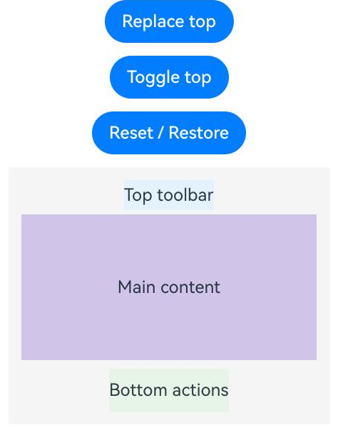 | 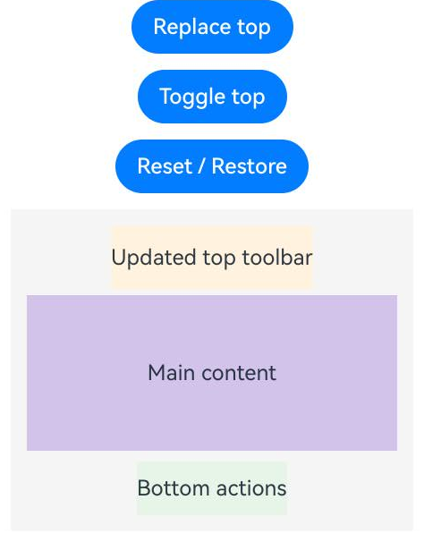 |

| Top Cleared, Bottom Retained | All Edges Reset |
| --- | --- |
| 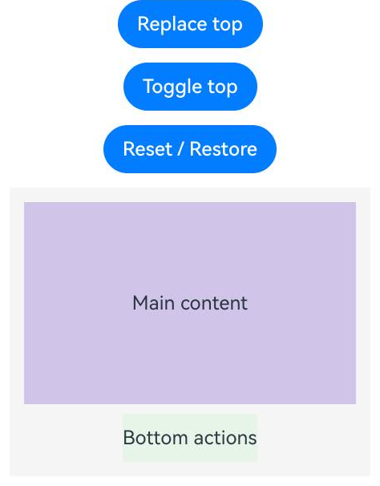 | 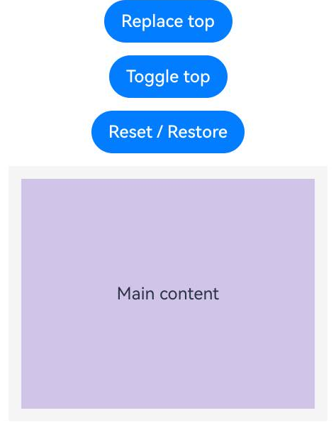 |

### Example 4: Extending Scrollable Content Below the Floating Operation Area

This example uses the [safeAreaInset](#safeareainset) API to create a fixed bottom operation area and switches the [clipContent](ts-container-scrollable-common.md#clipcontent14) of **Scroll**. **CONTENT_ONLY** clips the scrollable content within the main content area. **SAFE_AREA** allows the content to be drawn into the component-level safe area, passing below the semi-transparent operation area.

Since API version 26.1.0, the [safeAreaInset](#safeareainset) API is added.

```ts
import { LengthMetrics } from '@kit.ArkUI';

@Entry
@Component
struct SafeAreaInsetScrollExample {
  @State extendClip: boolean = false;
  private items: number[] = [1, 2, 3, 4, 5, 6, 7, 8, 9, 10, 11, 12];

  @Builder
  BottomContent() {
    Row() {
      Text('Floating actions')
        .fontColor('#FFFFFF')
    }
    .width('100%')
    .height(40)
    .justifyContent(FlexAlign.Center)
    // The semi-transparent background makes it easy to observe the scrollable content passing below the operation area; the edge content remains fixed.
    .backgroundColor('#990078D4')
  }

  build() {
    Column({ space: 12 }) {
      Button(this.extendClip ? 'SAFE_AREA' : 'CONTENT_ONLY')
        .onClick(() => {
          this.extendClip = !this.extendClip;
        })
      Stack() {
        Scroll() {
          Column({ space: 8 }) {
            ForEach(this.items, (item: number) => {
              Text('Item ' + item)
                .width('100%')
                .height(48)
                .backgroundColor('#D1C4E9')
            }, (item: number) => item.toString())
          }
          .width('100%')
        }
        .width(LayoutPolicy.matchParent)
        .height(LayoutPolicy.matchParent)
        .scrollBar(BarState.Off)
        // SAFE_AREA extends the clipping range to the safe area reserved by the outer component.
        .clipContent(this.extendClip ? ContentClipMode.SAFE_AREA : ContentClipMode.CONTENT_ONLY)
      }
      .width(300)
      .height(280)
      .padding(12)
      .backgroundColor('#F5F5F5')
      .safeAreaInset({
        bottom: {
          content: () => { this.BottomContent(); },
          spacing: LengthMetrics.vp(8)
        }
      })
    }
    .width('100%')
    .height('100%')
  }
}
```

Running effect: click the button to switch the clipping mode, and slide the list up and down to observe the content below the bottom operation area.

| CONTENT_ONLY | SAFE_AREA |
| --- | --- |
| 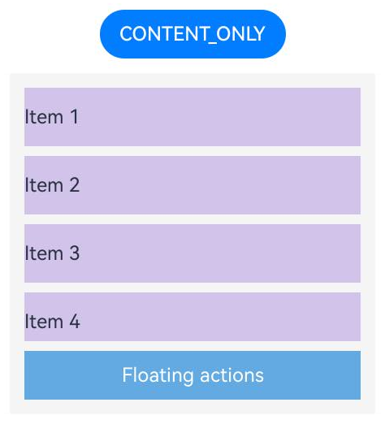 | 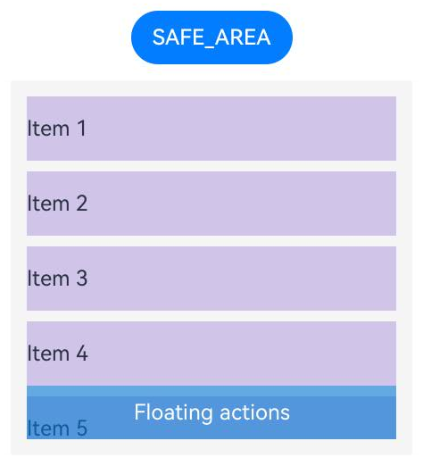 |

### Example 5: Adapting the Height Based on the Main Content and Edge Operation Area

This example uses the [safeAreaInset](#safeareainset) API to configure the bottom operation area and uses [LayoutPolicy.wrapContent](ts-universal-attributes-size.md#layoutpolicy15) to calculate the container height. The main content is 100 vp high, the top and bottom padding are 12 vp each, and the bottom occupies 48 vp. When the parent container has sufficient space, the bottom **safeAreaPadding** is 20 vp and the container is 172 vp high (100 + 24 + 48). After switching to 60 vp, the container is 184 vp high (100 + 24 + 60), and the main content height remains unchanged.

Since API version 26.1.0, the [safeAreaInset](#safeareainset) API is added.

```ts
import { LengthMetrics } from '@kit.ArkUI';

@Entry
@Component
struct SafeAreaInsetLayoutPolicyExample {
  @State useLargePadding: boolean = false;

  @Builder
  BottomContent() {
    Text('Bottom actions')
      .width(160)
      .height(40)
      .backgroundColor('#E8F5E9')
  }

  build() {
    Column({ space: 12 }) {
      Button('Toggle safeAreaPadding 20 / 60')
        .onClick(() => {
          this.useLargePadding = !this.useLargePadding;
        })
      Stack() {
        // The main content height is fixed to avoid an undetermined size when both the parent and child are adaptive.
        Text('Main content: 100vp')
          .width(240)
          .height(100)
          .textAlign(TextAlign.Center)
          .backgroundColor('#D1C4E9')
      }
      .width(300)
      .height(LayoutPolicy.wrapContent)
      .padding(12)
      .backgroundColor('#F5F5F5')
      // The same bottom edge takes the maximum value: max(20, 40 + 8) = 48; max(60, 40 + 8) = 60.
      .safeAreaPadding({ bottom: LengthMetrics.vp(this.useLargePadding ? 60 : 20) })
      .safeAreaInset({
        bottom: {
          content: () => { this.BottomContent(); },
          spacing: LengthMetrics.vp(8)
        }
      })
    }
    .width('100%')
    .height('100%')
  }
}
```

Running effect: click the button to switch the bottom **safeAreaPadding**, and observe the container height and the reserved space below the main content.

| safeAreaPadding is 20vp | safeAreaPadding is 60vp |
| --- | --- |
| 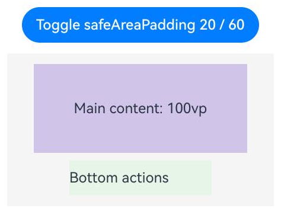 | 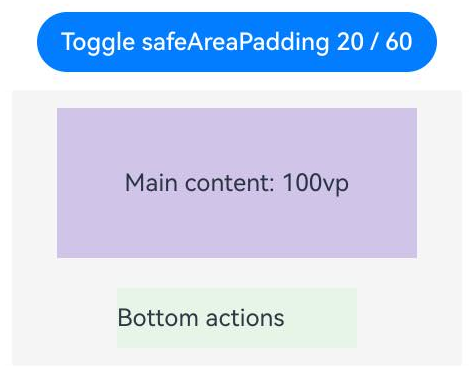 |
