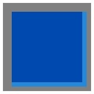
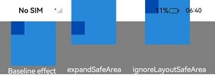

# Safe Area
<!--Kit: ArkUI-->
<!--Subsystem: ArkUI-->
<!--Owner: @camlostshi-->
<!--Designer: @fenglinbailu-->
<!--Tester: @liuli0427-->
<!--Adviser: @Brilliantry_Rui-->
<!-- md-trans-meta sourceCommit=8ae2afec8bc4ef553bd5b51266ec840edba9edf8 translatedAt=2026-10-10T01:49:37.833Z pushedAt=2026-10-10T07:53:51.933Z -->

A safe area refers to the display area of a page. By default, the UI developed by developers is laid out within the safe area and does not overlap with the avoidance areas (such as the status bar and navigation bar) set by the system. Attribute methods are provided to allow developers to set the drawing content of a component to break through the safe area restrictions:
- The [expandSafeArea](#expandsafearea) attribute allows a component to extend its drawing area beyond the safe area without changing its layout.
- The [setKeyboardAvoidMode](#setkeyboardavoidmode11) API is used to configure the avoidance mode of the page when the virtual keyboard is raised.
- The [ignoreLayoutSafeArea](#ignorelayoutsafearea20) attribute extends the safe area during component layout, and the layout position and size of the component may change.

When a page contains text such as a title bar that should not overlap with the avoidance area, it is recommended to set the **expandSafeArea** attribute on the component to achieve an immersive effect. Alternatively, the full-screen immersive effect can be achieved directly through the window API [setWindowLayoutFullScreen](../arkts-apis-window-Window.md#setwindowlayoutfullscreen9).

> **NOTE**
>
> - Supported since API version 10. New APIs in later versions are marked with a superscript to indicate their earliest API version.<br>
>
> - The APIs of this module can be used only in the stage model.
>
> - The camera cutout area is not an avoidance area, and the page does not avoid the cutout by default.<br>
>
> - Since API version 12, the following configuration can be added to the **module.json5** file so that the camera cutout area is treated as an avoidance area, enabling the page to avoid the cutout by default:<br>
  "metadata": [<br>
    &nbsp;&nbsp;{<br>
    &nbsp;&nbsp;&nbsp;&nbsp;"name": "avoid_cutout",<br>
    &nbsp;&nbsp;&nbsp;&nbsp;"value": "true",<br>
    &nbsp;&nbsp;}<br>
  ],<br>


## expandSafeArea

expandSafeArea(types?: Array&lt;SafeAreaType&gt;, edges?: Array&lt;SafeAreaEdge&gt;): T

Controls a component to extend its safe area to achieve an immersive effect.

> **NOTE**
>
> - When using **expandSafeArea** to expand the drawing of a component, it is recommended not to set fixed width and height values (except percentages). If fixed width and height values or 'auto' are set, the safe area can be extended only upward (**SafeAreaEdge.TOP**) and toward the start direction (**SafeAreaEdge.START**, which indicates the left side in LTR mode and the right side in RTL mode), and the component size remains unchanged after extension.
>
> - The safe area does not limit the layout and size of internal components, nor does it clip internal components.
>
> - When the parent container is a scrollable container, after the **expandSafeArea** attribute is set on a component, the component itself does not extend, but it can still trigger the update of the extension range of its child nodes on which **expandSafeArea** is set.
>
> - When **expandSafeArea()** is called without parameters, the default values are used. When **expandSafeArea([],[])** is called, the input parameters are empty arrays, in which case the **expandSafeArea** attribute does not take effect.
>   
> - The conditions for the **expandSafeArea** attribute to take effect on a component are as follows:  
>   1. When the type is **SafeAreaType.KEYBOARD**, it takes effect by default, meaning that the component does not avoid the keyboard.<br>
>   2. When other types are set, the component can extend under the safe area only when the component boundary coincides with the safe area. For example, if the height of the status bar at the top of the device is 100, the absolute position of the component on the screen must satisfy 0 <= y <= 100.
>   
> - When a component extends into an avoidance area, events in the avoidance area, such as click events, may be intercepted by the system and preferentially responded to by system components such as the status bar.
>  
> - It is not recommended to set the **expandSafeArea** attribute on components in a scrollable container. If it is set, the **expandSafeArea** attribute must be set on all direct nodes from the current node to the scrollable ancestor container according to the component nesting relationship. Otherwise, the **expandSafeArea** attribute may become invalid after scrolling. For the usage, see [Example 7](#example-7-expanding-the-safe-area-in-scrollable-containers).
> 
> - The **expandSafeArea** attribute takes effect only on the current component and is not passed to the parent or child components. Therefore, developers must configure this attribute separately for all related components.
> 
> - When both **expandSafeArea** and **position** are set, the **position** attribute takes effect first, and the **expandSafeArea** attribute takes effect later. For components on which drawing attributes such as **position** and **offset** are not set, if their boundaries do not overlap with the avoidance area, setting the **expandSafeArea** attribute does not take effect, such as dialog boxes and half-modal components.
> 
> - For scenarios where the **expandSafeArea** attribute cannot take effect, to place a component in the avoidance area, the coordinates of the component must be adjusted manually.

**Atomic service API**: This API can be used in atomic services since API version 11.

**System capability**: SystemCapability.ArkUI.ArkUI.Full

**Parameters**

| Name| Type                                              | Mandatory| Description                                                        |
| ------ | -------------------------------------------------- | ---- | ------------------------------------------------------------ |
| types  | Array <[SafeAreaType](#safeareatype)> | No   | Type of the expanded safe area. By default, **SafeAreaType.CUTOUT** is included. However, if the [Metadata](../../apis-ability-kit/js-apis-bundleManager-metadata.md) configuration item is not added, the page does not avoid the cutout, and the **CUTOUT** type does not take effect.<br>Default value: **[SafeAreaType.SYSTEM, SafeAreaType.CUTOUT, SafeAreaType.KEYBOARD]** <br>Invalid value: The default value is used. |
| edges  | Array<[SafeAreaEdge](#safeareaedge)> | No   | Edge of the expanded safe area. By default, the safe area is extended to all avoidance areas.<br>Default value: **[SafeAreaEdge.TOP, SafeAreaEdge.BOTTOM, SafeAreaEdge.START, SafeAreaEdge.END]**.<br>Invalid value: The default value is used. |

**Return value**

| Type| Description|
| --- | --- |
|  T | Current component.|

## SafeAreaType

Enumerates the types for expanding layout safe areas.

**Atomic service API**: This API can be used in atomic services since API version 11.

**System capability**: SystemCapability.ArkUI.ArkUI.Full

| Name   | Value  | Description                              |
| ------- | ---- | ---------------------------------- |
| SYSTEM   |0| Default non-safe area of the system, including the status bar and navigation bar.  |
| CUTOUT   | 1 | Non-safe area of the device, for example, the notch screen or punch-hole screen area. The **CUTOUT** type does not take effect when the **Metadata** configuration item is not added. |
| KEYBOARD |2 |Soft keyboard area.                              |

## SafeAreaEdge

Enumerates the edges for expanding the safe area.

**Atomic service API**: This API can be used in atomic services since API version 11.

**System capability**: SystemCapability.ArkUI.ArkUI.Full

| Name   | Value  | Description                              |
| ------- | ---- | ---------------------------------- |
| TOP    |0| Top edge.|
| BOTTOM |1| Bottom edge.|
| START  |2| Start edge.|
| END    |3| End edge.|

## setKeyboardAvoidMode<sup>11+</sup>

setKeyboardAvoidMode(value: KeyboardAvoidMode): void

Sets the avoidance mode of the page when the virtual keyboard is raised. Three modes are supported: **OFFSET** (raise), **RESIZE** (compress), and **NONE** (no avoidance).

**Atomic service API**: This API can be used in atomic services since API version 11.

**System capability**: SystemCapability.ArkUI.ArkUI.Full

**Parameters**

| Name| Type                                                | Mandatory| Description                                                        |
| ------ | ---------------------------------------------------- | ---- | ------------------------------------------------------------ |
| value  | [KeyboardAvoidMode](../arkts-apis-uicontext-e.md#keyboardavoidmode11) | Yes   | Avoidance mode of the page when the virtual keyboard is raised. Available values: **OFFSET** (raise), **RESIZE** (compress), **NONE** (no avoidance).<br>Default value: **KeyboardAvoidMode.OFFSET**, which means the default avoidance mode is **OFFSET** when the keyboard is raised.<br>When an invalid value is passed to **setKeyboardAvoidMode**, this attribute setting does not take effect. |

> **NOTE**
>
>  In **KeyboardAvoidMode.RESIZE** mode, the page is resized to prevent the virtual keyboard from obstructing the view. Components on the page whose width and height are set in percentages are resized along with the page, while components whose width and height are set directly are laid out according to the fixed sizes. When the **RESIZE** mode of **KeyboardAvoidMode** is set, **expandSafeArea([SafeAreaType.KEYBOARD],[SafeAreaEdge.BOTTOM])** does not take effect.
>
>  In **KeyboardAvoidMode.NONE** mode, the page is configured not to avoid the keyboard, and the page is covered by the raised keyboard.
>
>  **setKeyboardAvoidMode** takes effect on the page but not on dialog box components, such as **Dialog**, **Popup**, **Menu**, **BindSheet**, **BindContentCover**, **Toast**, and **OverlayManager**. For the avoidance mode of dialog box components, see [CustomDialogControllerOptions](./ts-methods-custom-dialog-box.md#customdialogcontrolleroptions).
>
>  In performance-sensitive or high-load scenarios, the animations of the keyboard and the application UI may not be fully synchronized, causing a gap between the keyboard and the application UI during the animation. In this case, [expandSafeArea](#expandsafearea) can be configured to make the application background fill the screen, avoiding undesirable visual effects.

## getKeyboardAvoidMode<sup>11+</sup>

getKeyboardAvoidMode(): KeyboardAvoidMode

Obtains the avoidance mode of the page when the virtual keyboard is raised.

**Atomic service API**: This API can be used in atomic services since API version 11.

**System capability**: SystemCapability.ArkUI.ArkUI.Full

**Return value** 

| Type                                                 | Description                               |
| ---------------------------------------------------- | ---------------------------------- |
| [KeyboardAvoidMode](../arkts-apis-uicontext-e.md#keyboardavoidmode11) | Avoidance mode of the page when the virtual keyboard is raised. |

## ignoreLayoutSafeArea<sup>20+</sup>

ignoreLayoutSafeArea(types?: Array&lt;LayoutSafeAreaType&gt;, edges?: Array&lt;LayoutSafeAreaEdge&gt;): T

Extends the safe area for component layout. The position and size of the component layout may change, which differs from the **expandSafeArea** mechanism (which only extends the drawing area without changing the layout).

**Atomic service API**: This API can be used in atomic services since API version 20.

**System capability**: SystemCapability.ArkUI.ArkUI.Full

**Parameters**

| Name| Type                                              | Mandatory| Description                                                        |
| ------ | -------------------------------------------------- | ---- | ------------------------------------------------------------ |
| types  | Array<[LayoutSafeAreaType](#layoutsafeareatype12)> | No   | Type of the extended layout safe area.<br>Default value: **[LayoutSafeAreaType.SYSTEM]**, which extends to the system safe area, for example, the status bar, navigation bar, cutout area, and component-level safe area ([safeAreaPadding](./ts-universal-attributes-size.md#safeareapadding14)).<br>Invalid value: The default value is used. |
| edges  | Array<[LayoutSafeAreaEdge](#layoutsafeareaedge12)> | No   | Edge of the extended layout safe area, with mirroring capability supported.<br>Default value: **[LayoutSafeAreaEdge.ALL]**, which extends all edges of the component.<br>Invalid value: The default value is used.|

**Return value**

| Type| Description|
| --- | --- |
|  T | Current component.|

>  **NOTE**
>
> For a component that ignores layout safe area edges: If its width or height is set to [LayoutPolicy.matchParent](ts-universal-attributes-size.md#layoutpolicy15), both its size and position will change; otherwise, only its position will change.
>
> Based on the **safeAreaPadding** accumulation feature, a component can expand its safe area edges to all detectable continuous safe areas.
>
> When child elements of scrollable components ignore layout safe area edges, the safe areas of the scrollable component itself and its parent components are not considered in the scrolling direction. Scrollable components include **List**, **ArcListItem**, **Grid**, **WaterFlow**, **Swiper**, and **Tabs**.
>
> When both the layout safe area ignore attribute (**.ignoreLayoutSafeArea**) and the rendering safe area ignore attribute (**.expandSafeArea**) are set: **.ignoreLayoutSafeArea** takes effect first, and **.expandSafeArea** takes effect on the basis of the former.

## LayoutSafeAreaType<sup>12+</sup>

Enumerates the types for expanding layout safe areas.

**Atomic service API**: This API can be used in atomic services since API version 12.

**System capability**: SystemCapability.ArkUI.ArkUI.Full

| Name   | Value  | Description                              |
| ------- | ---- | ---------------------------------- |
| SYSTEM   |  0 |The component's layout range can be expanded to include both component-level safe areas ([safeAreaPadding](./ts-universal-attributes-size.md#safeareapadding14)) and page-level safe areas (status bar, navigation bar, and cutout area).  |

## LayoutSafeAreaEdge<sup>12+</sup>

Enumerates the edges of the extended layout safe area.

**System capability**: SystemCapability.ArkUI.ArkUI.Full

| Name   | Value  | Description                              |
| ------- | ---- | ---------------------------------- |
| TOP    | 0 | Top edge.<br>**Atomic service API**: This API can be used in atomic services since API version 12.|
| BOTTOM | 1 | Bottom edge.<br>**Atomic service API**: This API can be used in atomic services since API version 12.|
| START<sup>20+</sup>      | 2 | Start edge. This represents the left edge in LTR mode and the right edge in RTL mode.<br>**Atomic service API**: This API can be used in atomic services since API version 20.|
| END<sup>20+</sup>        | 3 |End edge. This represents the right edge in LTR mode and the left edge in RTL mode.<br>**Atomic service API**: This API can be used in atomic services since API version 20.|
| VERTICAL<sup>20+</sup>   | 4 |Vertical edges.<br>**Atomic service API**: This API can be used in atomic services since API version 20.|
| HORIZONTAL<sup>20+</sup> | 5 |Horizontal edges.<br>**Atomic service API**: This API can be used in atomic services since API version 20.|
| ALL<sup>20+</sup>        | 6 | All edges.<br>**Atomic service API:** This API can be used in atomic services since API version 20. |

## Examples

### Example 1: Implementing an Immersive Effect

This example demonstrates how to use the **expandSafeArea** attribute to expand the safe area to the top and bottom to achieve an immersive effect.

```ts
// xxx.ets
@Entry
@Component
struct SafeAreaExample1 {
  build() {
    Row() {
      Column()
        .width('100%')
        .height('100%')
        // Replace $r('app.media.bg') with the image resource file you use.
        .backgroundImage($r('app.media.bg'))
        .backgroundImageSize(ImageSize.Cover)
        .expandSafeArea([SafeAreaType.SYSTEM], [SafeAreaEdge.TOP, SafeAreaEdge.BOTTOM])
    }.height('100%')
  }
}
```


### Example 2: Setting a Fixed Width or Height with expandSafeArea

This example demonstrates the effect of setting both a fixed width or height and the **expandSafeArea** attribute.

```ts
// xxx.ets
@Entry
@Component
struct SafeAreaExample2 {
  @State text: string = ''
  controller: TextInputController = new TextInputController()

  build() {
    Column() {
      TextInput({ text: this.text, placeholder: 'input your word...', controller: this.controller })
        .placeholderFont({ size: 14, weight: 400 })
        .width(320).height(40).offset({y: 120})
        .fontSize(14).fontColor(Color.Black)
        .backgroundColor(Color.White)
    }
    .height('780')
    .width('100%')
    .backgroundColor('rgb(179,217,235)')
    .expandSafeArea([SafeAreaType.SYSTEM], [SafeAreaEdge.TOP, SafeAreaEdge.BOTTOM])
  }
}
```

As shown in the figure below, the **Column** component expands to the top status bar ([SafeAreaEdge.TOP]) but does not expand to the bottom navigation bar ([SafeAreaEdge.BOTTOM]). The height of the component after expansion remains consistent with the set value.


### Example 3: Fixing the Background Image Position During Keyboard Avoidance

This example shows how to set the **expandSafeArea** attribute for the background image to keep it fixed when the keyboard is displayed and the layout is adjusted.

```ts
// xxx.ets
@Entry
@Component
struct SafeAreaExample3 {
  @State text: string = ''
  controller: TextInputController = new TextInputController()

  build() {
    Row() {
      Stack() {
        Column()
          .width('100%')
          .height('100%')
          // Replace $r('app.media.bg') with the image resource file you use.
          .backgroundImage($r('app.media.bg'))
          .backgroundImageSize(ImageSize.Cover)
          .expandSafeArea([SafeAreaType.KEYBOARD, SafeAreaType.SYSTEM])
        Column() {
          Button('Set caretPosition 1')
            .onClick(() => {
              this.controller.caretPosition(1)
            })
          TextInput({ text: this.text, placeholder: 'input your word...', controller: this.controller })
            .placeholderFont({ size: 14, weight: 400 })
            .width(320)
            .height(40)
            .offset({ y: 120 })
            .fontSize(14)
            .fontColor(Color.Black)
            .backgroundColor(Color.White)
        }.width('100%').alignItems(HorizontalAlign.Center)
      }
    }.height('100%')
  }
}
```

<!--Del--> <!--DelEnd-->

### Example 4: Setting the Keyboard Avoidance Mode to Resize

This example demonstrates how to use **setKeyboardAvoidMode** to set the keyboard avoidance mode to **RESIZE**, which resizes the page when the keyboard is displayed.

<!--code_no_check-->
```ts
// EntryAbility.ets
import { window, KeyboardAvoidMode } from '@kit.ArkUI';
export default class EntryAbility extends UIAbility{
  onWindowStageCreate(windowStage: window.WindowStage) {
    windowStage.loadContent('pages/Index', (err, data) => {
      // When the virtual keyboard is displayed, the page is resized to its original height minus the keyboard height.
      windowStage.getMainWindowSync().getUIContext().setKeyboardAvoidMode(KeyboardAvoidMode.RESIZE);
      if (err.code) {
        hilog.error(0x0000, 'testTag', 'Failed to load the content. Cause: %{public}s', JSON.stringify(err) ?? '');
        return;
      }
      hilog.info(0x0000, 'testTag', 'Succeeded in loading the content. Data: %{public}s', JSON.stringify(data) ?? '');
    });
  }
}
```

```ts
// xxx.ets
@Entry
@Component
struct KeyboardAvoidExample1 {
  build() {
    Column() {
      Row()
        .width('100%')
        .height('30%')
        .backgroundColor(Color.Gray)
      TextArea()
        .width('100%')
        .borderWidth(1)
      Text('I can see the bottom of the page')
        .width('100%')
        .textAlign(TextAlign.Center)
        .backgroundColor('rgb(179,217,235)')
        .layoutWeight(1)
    }
    .width('100%')
    .height('100%')
  }
}
```

<!--Del--> <!--DelEnd-->

### Example 5: Setting Keyboard Avoidance Mode to Offset

This example demonstrates how to use **setKeyboardAvoidMode** to set the keyboard avoidance mode to **OFFSET**, which raises the page when the keyboard is displayed. However, when the caret's distance from the bottom of the screen is greater than the keyboard's height, the page will not be raised, as demonstrated in this example.

<!--code_no_check-->
```ts
// EntryAbility.ets
import { window, KeyboardAvoidMode } from '@kit.ArkUI';
export default class EntryAbility extends UIAbility{
  onWindowStageCreate(windowStage: window.WindowStage) {
    windowStage.loadContent('pages/Index', (err, data) => {
      // When the virtual keyboard is displayed, the page is raised until the caret is displayed.
      windowStage.getMainWindowSync().getUIContext().setKeyboardAvoidMode(KeyboardAvoidMode.OFFSET);
      if (err.code) {
        hilog.error(0x0000, 'testTag', 'Failed to load the content. Cause: %{public}s', JSON.stringify(err) ?? '');
        return;
      }
      hilog.info(0x0000, 'testTag', 'Succeeded in loading the content. Data: %{public}s', JSON.stringify(data) ?? '');
    });
  }
}
```

```ts
// xxx.ets
@Entry
@Component
struct KeyboardAvoidExample2 {
  build() {
    Column() {
      Row()
        .width('100%')
        .height('30%')
        .backgroundColor(Color.Gray)
      TextArea()
        .width('100%')
        .borderWidth(1)
      Text('I can see the bottom of the page')
        .width('100%')
        .textAlign(TextAlign.Center)
        .backgroundColor('rgb(179,217,235)')
        .layoutWeight(1)
    }
    .width('100%')
    .height('100%')
  }
}
```

<!--Del--> <!--DelEnd-->

### Example 6: Switching Avoidance Modes

This example demonstrates how to switch between **OFFSET**, **RESIZE**, and **NONE** modes using **setKeyboardAvoidMode** to achieve three different keyboard avoidance effects.

```ts
import { hilog } from '@kit.PerformanceAnalysisKit';
import { KeyboardAvoidMode } from '@kit.ArkUI';

@Entry
@Component
struct KeyboardAvoidExample3 {
  build() {
    Column() {
      Row({space:15}) {
        Button('OFFSET')
          .onClick(() => {
            this.getUIContext().setKeyboardAvoidMode(KeyboardAvoidMode.OFFSET);
            hilog.info(0x0000, 'keyboardAvoidMode: %{public}s', JSON.stringify(this.getUIContext().getKeyboardAvoidMode()));
          })
          .layoutWeight(1)
        Button('RESIZE')
          .onClick(() => {
            this.getUIContext().setKeyboardAvoidMode(KeyboardAvoidMode.RESIZE);
            hilog.info(0x0000, 'keyboardAvoidMode: %{public}s', JSON.stringify(this.getUIContext().getKeyboardAvoidMode()));
          })
          .layoutWeight(1)
        Button('NONE')
          .onClick(() => {
            this.getUIContext().setKeyboardAvoidMode(KeyboardAvoidMode.NONE);
            hilog.info(0x0000, 'keyboardAvoidMode: %{public}s', JSON.stringify(this.getUIContext().getKeyboardAvoidMode()));
          })
          .layoutWeight(1)
      }
      .height('30%')
      .width('100%')
      .backgroundColor(Color.Gray)

      TextArea()
        .width('100%')
        .borderWidth(1)
      
      Text('I can see the bottom of the page')
        .width('100%')
        .textAlign(TextAlign.Center)
        .backgroundColor('rgb(179,217,235)')
        .layoutWeight(1)
      
      TextArea()
        .width('100%')
        .borderWidth(1)
    }
    .width('100%')
    .height('100%')
  }
}
```
<!--Del--> <!--DelEnd-->

### Example 7: Expanding the Safe Area in Scrollable Containers

This example demonstrates how to use the **expandSafeArea** attribute in a scrollable container to implement an immersive effect. The **Swiper** component in the **Scroll** container can extend into the status bar.

```ts
class SwiperDataSource implements IDataSource {
  private list: Array<Color> = []
  constructor(list: Array<Color>) {
    this.list = list
  }
  totalCount(): number {
    return this.list.length
  }
  getData(index: number): Color {
    return this.list[index]
  }
  registerDataChangeListener(listener: DataChangeListener): void {
  }
  unregisterDataChangeListener(listener: DataChangeListener): void {
  }
}
@Entry
@Component
struct ExpandSafeAreaTest {
  private swiperController: SwiperController = new SwiperController()
  private swiperData: SwiperDataSource = new SwiperDataSource([])
  private list: Array<Color> = [
    Color.Pink,
    Color.Blue,
    Color.Green
  ]
  aboutToAppear(): void {
    this.swiperData = new SwiperDataSource(this.list)
  }
  build() {
    Scroll() {
      Column() {
        Swiper(this.swiperController) {
          LazyForEach(this.swiperData, (item: Color, index: number) => {
            Column() {
              Text('banner' + index).fontSize(50).fontColor(Color.White)
            }
            .expandSafeArea([SafeAreaType.SYSTEM], [SafeAreaEdge.TOP, SafeAreaEdge.BOTTOM])
            .width('100%')
            .height(400)
            .backgroundColor(item)
          })
        }
        .loop(true)
        .expandSafeArea([SafeAreaType.SYSTEM], [SafeAreaEdge.TOP, SafeAreaEdge.BOTTOM])
        .clip(false)
        Column(){
          Text('Tab content').fontSize(50)
        }.width('100%').height(1000)
        .backgroundColor(Color.Grey)
      }.expandSafeArea([SafeAreaType.SYSTEM], [SafeAreaEdge.TOP, SafeAreaEdge.BOTTOM])
    }
    .clip(false)
    .edgeEffect(EdgeEffect.None)
    .width('100%').height('100%')
  }
}
```


### Example 8: Extending the Component Layout Area with ignoreLayoutSafeArea

This example shows how to use [ignoreLayoutSafeArea](#ignorelayoutsafearea20) to adjust the component position. The comparison with the default behavior (without this attribute) is as follows: After **ignoreLayoutSafeArea** is applied, the **Row** component is positioned in the upper left corner of the combined range consisting of the **Stack** content area, the **Stack** component-level safe area, and the system status bar. The component occupies the upper left portion of this expanded layout boundary.

```ts
import { LengthMetrics } from '@kit.ArkUI'

@Entry
@Component
struct IgnoreLayoutSafeAreaTest1 {
  build() {
    Column() {
      Stack() {
        Row()
          .backgroundColor('rgb(39, 135, 217)')
          .width(75)  // Fixed width
          .height(75) // Fixed height
          .ignoreLayoutSafeArea([LayoutSafeAreaType.SYSTEM], [LayoutSafeAreaEdge.START, LayoutSafeAreaEdge.TOP])  // Extend the layout area to the left and top edges, covering the system non-safe area (SYSTEM).
        
        Row()
          .backgroundColor('rgb(0, 74, 175)')
          .width(75)
          .height(75)

      }
      .width(200)
      .height(200)
      .backgroundColor(Color.Gray)
      .align(Alignment.TopStart) // Align child components with the upper left corner of the Stack container.
      .padding({
        left: 10  // Set a 10 vp normal left padding.
      })
      .safeAreaPadding(LengthMetrics.vp(10))  // Set a 10 vp safe area padding (that is, component-level safe area).
    }
    .width('100%')
  }
}
```
<!--Del--> <!--DelEnd-->

### Example 9: Extending the Component Layout Area with ignoreLayoutSafeArea and LayoutPolicy.matchParent

This example demonstrates how to use both [ignoreLayoutSafeArea](#ignorelayoutsafearea20) and [LayoutPolicy.matchParent](ts-universal-attributes-size.md#layoutpolicy15) to adjust the component's size and position simultaneously. After **ignoreLayoutSafeArea** is applied, the **Row** component takes the lower right portion of the combined range consisting of the **Stack** content area and the Stack component-level safe area, and expands to fill the available space.

```ts
import { LengthMetrics } from '@kit.ArkUI'

@Entry
@Component
struct IgnoreLayoutSafeAreaTest2 {
  build() {
    Column() {
      Stack() {
        Row()
          .backgroundColor('rgb(39, 135, 217)')
          .width(LayoutPolicy.matchParent)  // Adaptive width
          .height(LayoutPolicy.matchParent) // Adaptive height
          .ignoreLayoutSafeArea([LayoutSafeAreaType.SYSTEM], [LayoutSafeAreaEdge.END, LayoutSafeAreaEdge.BOTTOM])  // Extend the layout area to the right and bottom edges, covering the system non-safe area (SYSTEM).

        Row()
          .backgroundColor('rgb(0, 74, 175)')
          .width(LayoutPolicy.matchParent)
          .height(LayoutPolicy.matchParent)

      }
      .width(200)
      .height(200)
      .backgroundColor(Color.Gray)
      .align(Alignment.TopStart) // Align child components with the upper left corner of the Stack container.
      .padding(10) // Set a 10 vp normal padding.
      .safeAreaPadding(LengthMetrics.vp(10))  // Set a 10 vp safe area padding (that is, component-level safe area).
    }
    .width('100%')
  }
}
```


### Example 10: Understanding the Difference Between expandSafeArea and ignoreLayoutSafeArea

This example demonstrates the layout effects of a container with **expandSafeArea** and **ignoreLayoutSafeArea** set, respectively, and their impact on the layout of child components. In both cases, the container visibly extends. However, the child components of the container with **expandSafeArea** are not affected by the container's extension, while the child components of the container with **ignoreLayoutSafeArea** have their positions adjusted due to the container's extension.

```ts
@Entry
@Component
struct IgnoreLayoutSafeAreaTest3 {
  build() {
    Row(){
      Column(){
        Stack(){
          Stack(){

          }
          .width(30)
          .height(30)
          .backgroundColor('rgb(0, 74, 175)')
        }
        .width(100)
        .height(100)
        .backgroundColor('rgb(39, 135, 217)')
        .align(Alignment.TopStart)

        Text('Baseline effect').fontColor(Color.White)
      }

      Column(){
        Stack(){
          Stack(){

          }
          .width(30)
          .height(30)
          .backgroundColor('rgb(0, 74, 175)')
        }
        .width(100)
        .height(100)
        .backgroundColor('rgb(39, 135, 217)')
        .align(Alignment.TopStart)
        .expandSafeArea()  // Extend the drawing area: the container's drawing area shifts upward, but the child component's position relative to the screen remains unchanged.

        Text('expandSafeArea').fontColor(Color.White)
      }

      Column(){
        Stack(){
          Stack(){

          }
          .width(30)
          .height(30)
          .backgroundColor('rgb(0, 74, 175)')
        }
        .width(100)
        .height(100)
        .backgroundColor('rgb(39, 135, 217)')
        .align(Alignment.TopStart)
        .ignoreLayoutSafeArea()  // Extend the layout area: The container's layout area shifts upward, and the child component's position relative to the container remains unchanged.

        Text('ignoreLayoutSafeArea').fontColor(Color.White)
      }
    }
    .width('100%')
    .backgroundColor(Color.Gray)
    .justifyContent(FlexAlign.SpaceEvenly)
  }
}
```
