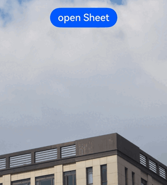
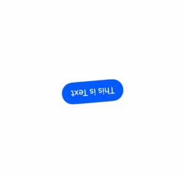
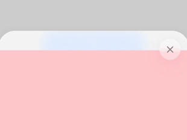
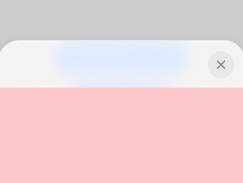
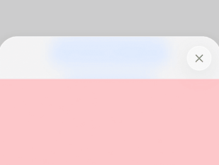

# Sheet Transition (System API)
<!--Kit: ArkUI-->
<!--Subsystem: ArkUI-->
<!--Owner: @hehongyang3-->
<!--Designer: @hehongyang3-->
<!--Tester: @lxl007-->
<!--Adviser: @Brilliantry_Rui-->
<!-- md-trans-meta sourceCommit=37a41c7e4764d3e7f831e1f47fc28c3acf56e6c1 translatedAt=2026-11-03T03:29:55.150Z pushedAt=2026-11-13T01:06:00.122Z nl=1 -->

You can bind a sheet to a component through the **bindSheet** attribute. When the component is inserted, you can determine the size of the sheet by setting a custom height or using the default built-in height.

>  **NOTE**
>
>  This feature is supported since API version 10. Updates will be marked with a superscript to indicate their earliest API version.
>
>  The APIs of this module can be used only in the stage model.
>
>  Route hopping is not supported.
>
>  This topic describes only the system APIs of the current module. For details about other public APIs, see [bindSheet](./ts-universal-attributes-sheet-transition.md#bindsheet).

## SheetOptions

Optional attributes of the sheet. Inherits from [BindOptions](./ts-universal-attributes-sheet-transition.md#bindoptions).

**System capability**: SystemCapability.ArkUI.ArkUI.Full

| Name              | Type                                       | Read-only | Optional | Description              |
| --------------- | ------------------------------- | --------- | ---- | --------------- |
| offset<sup>14+</sup>       | [Position](ts-types.md#position) | No | Yes    | Offset of the sheet. Only when the sheet is a bottom dialog box, the bottom spacing can be set. The **detents** attribute in [SheetOptions](ts-universal-attributes-sheet-transition.md#sheetoptions) of the sheet is not supported. When the y-axis is set to a positive value, it does not take effect and falls back to the default value **0vp**.<br> Default value: the x-axis coordinate is **0vp**, and the y-axis coordinate is **0vp**.<br>**System API:** This API is a system API.|
| edgeLightMode | [EdgeLightMode](ts-appendix-enums-sys.md#edgelightmode) | No | Yes | Edge light effect animation mode of the sheet. The edge light animation takes effect only when [SheetType](ts-universal-attributes-sheet-transition.md#sheettype11) is **BOTTOM**. When this attribute is not set, the edge light effect animation is disabled by default. For the edge light effect animation of the sheet, **EDGELIGHT_AUTO**: disabled on all computing devices; **EDGELIGHT_ENABLED**: enables the edge light effect animation; **EDGELIGHT_DISABLED**: disables the edge light effect animation.<br>Default value: **EdgeLightMode.EDGELIGHT_DISABLED**<br>**Since:** 26.0.0<br>**Model restriction:** This API is only available in the stage model.<br>**System API:** This API is a system API.|
| blurSnapshot | [BlurSnapshotOptions](#blursnapshotoptions) | No | Yes | Blur snapshot optimization option of the sheet, used to reduce the computational overhead of blur rendering. When a significant increase in power consumption is observed while using **blurStyle** or **systemMaterial** to set the blur or material effect, you can enable blur optimization. After it is enabled, if the sheet is configured with **blurStyle** or **systemMaterial**, its blur effect is rendered using snapshots to reduce computational overhead; if **blurStyle** or **systemMaterial** is not set, enabling **enableBlurSnapshot** does not produce a blur optimization effect. This attribute does not support dynamic switching between a value and undefined after the sheet is displayed. If you attempt to switch it after the popup is displayed, the setting does not take effect. The POPUP type of the sheet does not support blur optimization. If **enableBlurSnapshot** is set to true on the POPUP type, the setting does not take effect.<br>Default value: **undefined**, which disables blur optimization<br>**Since:** 26.0.0<br>**Model restriction:** This API is only available in the stage model.<br>**System API:** This API is a system API.|
| titleBarBackgroundBlur | [SheetTitleBarBackgroundBlurOptions](#sheettitlebarbackgroundbluroptions) | No | Yes | Title bar background blur effect, which supports custom blur parameters. It takes effect only when the title bar exists.<br>Default value: undefined, indicating that no title bar background blur effect is set.<br>**Note:**<br>The title bar background blur is not supported in the full-screen modal style (**CONTENT_COVER**), and this attribute setting is invalid.<br>**Since:** 26.0.1<br>**Model restriction:** This API can be used only in the stage model.<br>**System API:** This API is a system API.|
| closeButtonMaterial | [SystemUiMaterial](ts-universal-attributes-image-effect.md#systemuimaterial) | No | Yes | System material effect of the close button.<br>Default value: **undefined**, indicating that no system material is set.<br>Starting from API version 26.0.1, when this attribute is not set, using the [systemMaterial](ts-universal-attributes-sheet-transition.md#sheetoptions) API of the sheet to set the material gives the close button a built-in system material effect.<br>The material effect set through this API overrides the built-in material effect of the close button brought by the **systemMaterial** API of the sheet.<br>**Note:**<br>The close button system material is not supported in the full-screen modal style (**CONTENT_COVER**), and this attribute setting is invalid.<br>**Since:** 26.0.1<br>**Model restriction:** This API can be used only in the stage model.<br>**System API:** This API is a system API.|

## BlurSnapshotOptions

Defines the blur snapshot optimization options. After this object is set, blur optimization is enabled.

**System capability**: SystemCapability.ArkUI.ArkUI.Full

**Since**: 26.0.0

**Model restriction**: This API can be used only in the stage model.

**System API**: This is a system API.

| Name | Type | Read-only | Optional | Description |
| --- | --- | --- | --- | --- |
| enableFreeze | boolean | No | Yes | Whether to enable freeze optimization for the blur snapshot. When enabled, freeze optimization is applied during blur snapshot to reduce rendering overhead. When not set or set to false, freeze optimization is disabled and the conventional rendering method is used.<br>After the sheet is pulled up, this parameter value can be switched dynamically.<br>Default value: false<br>**Since:** 26.0.0<br>**Model restriction:** This API is only available in the stage model.<br>**System API:** This API is a system API.|

## SheetTitleBarBackgroundBlur

Enumerates the title bar background blur styles.

**Since:** 26.0.1

**System capability**: SystemCapability.ArkUI.ArkUI.Full

**Model restriction**: This API can be used only in the stage model.

**System API**: This is a system API.

| Name | Value | Description |
| ------- | ---- | -------- |
| NONE | 0 | No blur effect. |
| GRADIENT | 1 | Gradient blur that fades from the top of the title bar downward to transparent. |

## SheetTitleBarBackgroundBlurOptions

Defines the custom parameters of the title bar background blur effect layer. All sub-attributes are optional, and unset attributes use the system default values.

**Since:** 26.0.1

**System capability**: SystemCapability.ArkUI.ArkUI.Full

**Model restriction**: This API can be used only in the stage model.

**System API**: This is a system API.

| Name              | Type                                       | Read-Only   | Optional   | Description            |
| --------------- | ---------------------------------------- | ---- | ---- | ------------- |
| blurStyle | [SheetTitleBarBackgroundBlur](#sheettitlebarbackgroundblur) | No    | Yes    | Blur style of the blur effect layer. Set to **GRADIENT** to enable the gradient blur effect.<br>Default value: **SheetTitleBarBackgroundBlur.NONE**. |
| maskExtraHeight | [LengthMetrics](../js-apis-arkui-graphics.md#lengthmetrics12) | No    | Yes    | Extra height of the blur effect layer, which is the additional effect height based on the title bar height.<br>Default value: **32vp**.<br>When the value is **0vp**, the bottom edge of the blur effect layer is flush with the title bar.<br>**Since:** 26.1.0 |
| maskColor | [ResourceColor](ts-types.md#resourcecolor) | No    | Yes    | Gradient base color of the blur effect layer, used as the maximum color value at the top of the gradient. The system applies a built-in opacity curve to gradually fade it from top to bottom.<br>When not set: a semi-transparent white effect is used in light mode, and a semi-transparent black effect is used in dark mode.<br>**Since:** 26.1.0 |
| effectiveDistance | [LengthMetrics](../js-apis-arkui-graphics.md#lengthmetrics12) | No    | Yes    | Sliding distance required for the blur effect to transition from fully hidden to fully visible.<br>Value range: greater than or equal to 0. Values less than 0 are treated as 0.<br>Default value: **8vp**.<br>**Since:** 26.1.0 |

## Examples

### Example 1: Setting the Edge Light Effect Animation for a Sheet

The following example enables the Edge Light Effect animation by setting the **edgeLightMode** attribute, and uses the **systemMaterial** API in [SheetOptions](ts-universal-attributes-sheet-transition.md#sheetoptions) to implement a semi-transparent material effect.

Since API version 26.0.0, the **edgeLightMode** attribute is added to [SheetOptions](#sheetoptions).

```ts
// xxx.ets
import { uiMaterial } from '@kit.ArkUI';

@Entry
@Component
struct SheetMaterialExample {
  @State isShow: boolean = false;
  @State sheetHeight: number = 300;
  @State sheetMaterial: SystemUiMaterial | undefined = new uiMaterial.ImmersiveMaterial({
    style: uiMaterial.ImmersiveStyle.ULTRA_THIN,
  });

  @Builder
  sheetBuilder() {
    Column({ space: 10 }) {
      Text('Text')
        .fontSize(20)
        .margin(10)
    }
    .width('100%')
    .height('100%')
  }

  build() {
    Stack() {
      // Replace this with the actual resource file.
      Image($r('app.media.startIcon'))
      Column() {
        Button('open Sheet')
          .onClick(() => {
            this.isShow = true;
          })
          .fontSize(20)
          .margin(10)
          .bindSheet($$this.isShow, this.sheetBuilder(), {
            height: this.sheetHeight,
            backgroundColor: Color.Transparent,
            edgeLightMode: EdgeLightMode.EDGELIGHT_ENABLED,
            systemMaterial: this.sheetMaterial
          })
      }
      .justifyContent(FlexAlign.Center)
      .width('100%')
      .height('100%')
    }
  }
}
```



### Example 2: Setting the Blur Optimization for a Sheet

The following example enables blur optimization by setting the **blurSnapshot** attribute. When the **systemMaterial** API in [SheetOptions](ts-universal-attributes-sheet-transition.md#sheetoptions) is used to set a material effect, or the **blurStyle** API in [SheetOptions](ts-universal-attributes-sheet-transition.md#sheetoptions) is used to set blur, and a significant increase in power consumption is observed, you can try enabling blur optimization.

Since API version 26.0.0, [SheetOptions](#sheetoptions) adds the **blurSnapshot** attribute.

```ts
// xxx.ets
import { uiMaterial } from '@kit.ArkUI';

@Entry
@Component
struct SheetTransitionExample {
  @State isShow: boolean = false;
  @State rotateAngle: number = 0;
  @State sheetMaterial: SystemUiMaterial | undefined = new uiMaterial.ImmersiveMaterial({
    style: uiMaterial.ImmersiveStyle.ULTRA_THIN,
  });

  @Builder
  sheetBuilder() {
    Text('Context')
  }

  build() {
    Stack() {
      Button('This is Text')
        .margin(100)
        .rotate({
          x: 0,
          y: 0,
          z: 1,
          angle: this.rotateAngle
        })
        .onAppear(() => {
          this.getUIContext()?.animateTo({
            duration: 1200,
            curve: Curve.Friction,
            delay: 500,
            iterations: -1,
            expectedFrameRateRange: {
              min: 10,
              max: 120,
              expected: 60,
            }
          }, () => {
            this.rotateAngle = 360;
          })
        })
      Column() {
        Button('Open BindSheet')
          .onClick(() => {
            this.isShow = true;
          })
          .fontSize(20)
          .margin(10)
          .bindSheet($$this.isShow, this.sheetBuilder(), {
            height: 400,
            showClose: true,
            backgroundColor: Color.Transparent,
            // If a significant increase in power consumption is observed when setting blurStyle or systemMaterial, try enabling blur optimization.
            blurStyle: BlurStyle.Thin,
            // systemMaterial: this.sheetMaterial,
            blurSnapshot: { enableFreeze: true },
          })
      }
      .justifyContent(FlexAlign.Start)
      .width('100%')
      .height('100%')
    }
  }
}

```



### Example 3: Customizing the Close Button Material for a Sheet

This example customizes the material effect of the sheet close button through the **closeButtonMaterial** attribute, and compares three states: not set (using the built-in material of **systemMaterial**), material disabled, and custom material.

Since API version 26.0.1, the **closeButtonMaterial** attribute is added to [SheetOptions](#sheetoptions).

```ts
// xxx.ets
import { uiMaterial } from '@kit.ArkUI';

@Entry
@Component
struct SheetMaterialExample {
  @State isShow: boolean = false;
  @State myMaterial: SystemUiMaterial | undefined = undefined;
  @State myCloseIconMaterial: SystemUiMaterial | undefined = undefined;

  @Builder
  myBuilder() {
    Column({ space: 10 }) {
      Text('Content')
        .fontSize(30)
    }
    .width('100%')
    .justifyContent(FlexAlign.Center)
  }

  build() {
    Stack() {
      Column() {
        Button('Button with default material')
          .onClick(() => {
            this.myMaterial = new uiMaterial.ImmersiveMaterial({
              style: uiMaterial.ImmersiveStyle.ULTRA_THICK,
            });
            this.myCloseIconMaterial = undefined;
            this.isShow = true;
          })
          .fontSize(20)
          .margin(10)
          .bindSheet($$this.isShow, this.myBuilder(), {
            height: SheetSize.MEDIUM,
            systemMaterial: this.myMaterial,
            closeButtonMaterial: this.myCloseIconMaterial,
          })
        Button('Button with material disabled')
          .onClick(() => {
            this.myMaterial = new uiMaterial.ImmersiveMaterial({
              style: uiMaterial.ImmersiveStyle.ULTRA_THICK,
            });
            this.myCloseIconMaterial = uiMaterial.Material.empty;
            this.isShow = true;
          })
          .fontSize(20)
          .margin(10)
        Button('Button with custom material')
          .onClick(() => {
            this.myMaterial = new uiMaterial.ImmersiveMaterial({
              style: uiMaterial.ImmersiveStyle.ULTRA_THICK,
            });
            this.myCloseIconMaterial = new uiMaterial.ImmersiveMaterial({
              style: uiMaterial.ImmersiveStyle.ULTRA_THIN,
            });
            this.isShow = true;
          })
          .fontSize(20)
          .margin(10)
      }
      .justifyContent(FlexAlign.Center)
      .width('100%')
      .height('100%')
    }
  }
}
```

When **closeButtonMaterial** is not set, the close button uses the built-in material effect provided by **systemMaterial**.



When **closeButtonMaterial** is set to **uiMaterial.Material.empty**, the close button has no material effect.



When **closeButtonMaterial** is set to a custom material, the close button uses the custom material effect.




### Example 4: Setting the Title Bar Background Blur for a Sheet

This example customizes the sheet title bar background blur effect through the **titleBarBackgroundBlur** attribute. It also sets **titleBarHoverMode** to **STACK** stacking mode, so that the blur effect is visible when the title bar floats above the content area.

Since API version 26.0.1, [SheetOptions](#sheetoptions) supports the **titleBarBackgroundBlur** attribute.

```ts
// xxx.ets
import { LengthMetrics } from '@kit.ArkUI';

@Entry
@Component
struct SheetTitleBarBlurExample {
  @State isShow: boolean = false;

  @Builder
  myBuilder() {
    Column() {
      Column()
        .backgroundColor(Color.Pink)
        .height(200)
        .width('100%')
      Column()
        .backgroundColor(Color.Orange)
        .height(200)
        .width('100%')
      Column()
        .backgroundColor(Color.Pink)
        .height(200)
        .width('100%')
      Column()
        .backgroundColor(Color.Orange)
        .height(200)
        .width('100%')
      Column()
        .backgroundColor(Color.Pink)
        .height(200)
        .width('100%')
      Column()
        .backgroundColor(Color.Orange)
        .height(200)
        .width('100%')
    }
    .width('100%')
  }

  build() {
    Stack() {
      Column() {
        Button('Open sheet')
          .onClick(() => {
            this.isShow = true;
          })
          .fontSize(20)
          .margin(10)
          .bindSheet($$this.isShow, this.myBuilder(), {
            height: SheetSize.MEDIUM,
            title: { title: 'Title' },
            titleBarHoverMode: SheetTitleBarHoverMode.STACK,
            titleBarBackgroundBlur: {
              blurStyle: SheetTitleBarBackgroundBlur.GRADIENT,
              maskExtraHeight: LengthMetrics.vp(50),
              effectiveDistance: LengthMetrics.vp(50),
              maskColor: '#330000FF',
            },
          })
      }
      .justifyContent(FlexAlign.Center)
      .width('100%')
      .height('100%')
    }
  }
}
```

<!--Del--> <!--DelEnd-->
