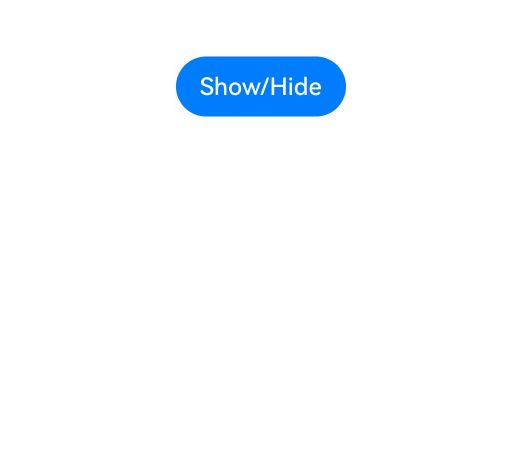

# Show/Hide Event
<!--Kit: ArkUI-->
<!--Subsystem: ArkUI-->
<!--Owner: @zhou-chaobo-->
<!--Designer: @piggyguy-->
<!--Tester: @songyanhong-->
<!--Adviser: @Brilliantry_Rui-->
<!-- md-trans-meta sourceCommit=3b17ae247298f1cf952b1cbdcb60f1ff0e80beac translatedAt=2026-11-03T03:56:41.296Z pushedAt=2026-11-13T01:06:00.169Z nl=1 -->

The show/hide event is triggered when a component is attached to or detached from the component tree. It can be used to listen for lifecycle changes during component attach and detach, and to execute related business processing at the corresponding time.

> **NOTE**
>
> The event is supported since API version 7. Updates will be marked with a superscript to indicate their earliest API version.

## onAttach<sup>12+</sup>

onAttach(callback: Callback\<void>): T

Triggered when this component is mounted to the component tree. Due to the following limitations, it is recommended that you use [onAppear](#onappear) instead of this callback.

> **NOTE**
>
> - This callback is triggered before the component layout and rendering process.
>
> - Modifying the component tree within the callback is prohibited, including initiating animations or altering the component structure through conditional statements like **if-else**.

**Atomic service API**: This API can be used in atomic services since API version 12.

**Model restriction**: This API can be used only in the stage model.

**System capability**: SystemCapability.ArkUI.ArkUI.Full

**Parameters**

| Name| Type | Mandatory| Description                      |
| ------ | ------ | ---- | -------------------------- |
| callback  | [Callback](./ts-types.md#callback12)\<void>   | Yes  | Callback function of the **onAttach** event, indicating that the component has been mounted to the component tree.|

**Return value**

| Type| Description|
| -------- | -------- |
| T | Current component, used for chained calls. |


## onDetach<sup>12+</sup>

onDetach(callback: Callback\<void>): T

This callback is triggered when the component is unmounted from the component tree. If you need to modify the component tree in the callback, use [onDisAppear](#ondisappear) instead of this API.

**Atomic service API**: This API can be used in atomic services since API version 12.

**Model restriction**: This API can be used only in the stage model.

**System capability**: SystemCapability.ArkUI.ArkUI.Full

**Parameters**

| Name| Type | Mandatory| Description                      |
| ------ | ------ | ---- | -------------------------- |
| callback  | [Callback](./ts-types.md#callback12)\<void> | Yes  | Callback function of the **onDetach** event, indicating that the component has been unmounted from the component tree.|

**Return value**

| Type| Description|
| -------- | -------- |
| T | Current component, used for chained calls. |

## onAppear

onAppear(event: () => void): T

Triggered when this component appears.

> **NOTE**
>
> This callback may be called after the component layout and rendering process.

**Widget capability**: Since API version 9, this feature is supported in ArkTS widgets.

**Atomic service API**: This API can be used in atomic services since API version 11.

**System capability**: SystemCapability.ArkUI.ArkUI.Full

**Parameters**

| Name| Type | Mandatory| Description                      |
| ------ | ------ | ---- | -------------------------- |
| event  | () => void| Yes  | Callback function of the **onAppear** event, which indicates that the component is displayed.|

**Return value**

| Type| Description|
| -------- | -------- |
| T | Current component, used for chained calls. |


## onDisAppear

onDisAppear(event: () => void): T

This callback is triggered when the component disappears.

**Widget capability**: Since API version 9, this feature is supported in ArkTS widgets.

**Atomic service API**: This API can be used in atomic services since API version 11.

**System capability**: SystemCapability.ArkUI.ArkUI.Full

**Parameters**

| Name| Type | Mandatory| Description                      |
| ------ | ------ | ---- | -------------------------- |
| event  | () => void| Yes   | Callback for the onDisAppear event, indicating that the component has disappeared.|

**Return value**

| Type| Description|
| -------- | -------- |
| T | Current component, used for chained calls. |


## Example

### Example 1 (onAttach and onDetach events)

This example demonstrates how to control the mounting and unmounting of a component using a button, triggering **onAttach** and **onDetach** events.

```ts
// xxx.ets
@Entry
@Component
struct AppearExample {
  @State isShow: boolean = true;
  @State changeAppear: string = 'Show/Hide';
  private myText: string = 'Text for onAppear';

  build() {
    Column() {
      Button(this.changeAppear)
        .onClick(() => {
          this.isShow = !this.isShow;
        }).margin(15)
      if (this.isShow) {
        Text(this.myText).fontSize(26).fontWeight(FontWeight.Bold)
          .onAttach(() => {
            this.getUIContext().getPromptAction().showToast({
              message: 'Text shown.',
              duration: 2000,
              bottom: 500
            })
          })
          .onDetach(() => {
            this.getUIContext().getPromptAction().showToast({
              message: 'Text hidden.',
              duration: 2000,
              bottom: 500
            })
          })
      }
    }.padding(30).width('100%')
  }
}
```



### Example 2 (onAppear and onDisAppear Events)

This example uses a button to control the display and disappearance of a component, triggering the onAppear and onDisAppear events.

```ts
// xxx.ets
@Entry
@Component
struct AppearDisappearExample {
  @State isShow: boolean = true;
  @State changeAppear: string = 'Tap to hide or show the component';
  private myText: string = 'Text for onDisAppear';

  build() {
    Column() {
      Button(this.changeAppear)
        .onClick(() => {
          this.isShow = !this.isShow;
        }).margin(15)
      if (this.isShow) {
        Text(this.myText).fontSize(26).fontWeight(FontWeight.Bold)
          .onAppear(() => {
            this.getUIContext().getPromptAction().showToast({
              message: 'The text is shown',
              duration: 2000,
              bottom: 500
            })
          })
          .onDisAppear(() => {
            this.getUIContext().getPromptAction().showToast({
              message: 'The text is hidden',
              duration: 2000,
              bottom: 500
            })
          })
      }
    }.padding(30).width('100%')
  }
}
```
