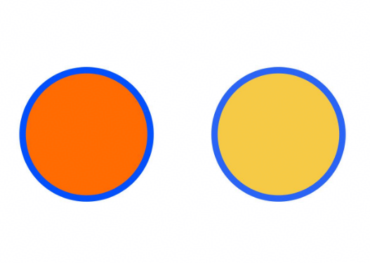
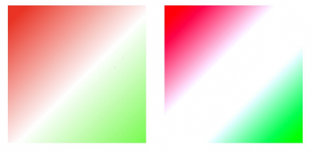

# Graphics (System API)
<!--Kit: ArkUI-->
<!--Subsystem: ArkUI-->
<!--Owner: @sun-xinyan-->
<!--Designer: @hehongyang3-->
<!--Tester: @lxl007-->
<!--Adviser: @Brilliantry_Rui-->
<!-- md-trans-meta sourceCommit=8ae2afec8bc4ef553bd5b51266ec840edba9edf8 translatedAt=2026-10-15T11:01:04.917Z pushedAt=2026-10-19T06:05:28.921Z -->

The **Graphics** module provides APIs for defining attributes of a custom node, which supports HDR color creation, color space management and query, and color component retrieval. It is applicable to scenarios requiring HDR color processing and custom node attribute configuration in the stage model.

> **NOTE**
>
> - The initial APIs of this module are supported since API version 12. Newly added APIs will be marked with a superscript to indicate their earliest API version.
>
> - The APIs of this module can be used only in the stage model.
>
> - This document describes only the system APIs of this module. For details about other public APIs, see [Graphics](./js-apis-arkui-graphics.md).

## ColorMetrics

Represents a color that supports HDR. It provides capabilities such as creating HDR colors through exposure coefficients, querying color spaces, and obtaining RGB color components. It is applicable to HDR color processing and color attribute configuration scenarios.

### createHDRColorWithLinearExposure

static createHDRColorWithLinearExposure(linearExposure: number, colorSpace: ColorSpace, red: number, green: number, blue: number, alpha?: number): ColorMetrics

Instantiates the HDR-supported **ColorMetrics** class using the [color space](./arkui-ts/ts-appendix-enums.md#colorspace20), linear exposure coefficient, and RGBA color. If adjustment by exposure coefficient is not needed, [createHDRColor](#createhdrcolor) can be used to directly set RGB component values greater than 1.0 to present HDR effects. This API is applicable to scenarios requiring balanced HDR brightness adjustment in linear proportion, such as HDR image preview and video player color adjustment.

**Since**: 26.0.0

**System capability**: SystemCapability.ArkUI.ArkUI.Full

**Model restriction**: This API can be used only in the stage model.

**System API**: This is a system API.

**Parameters**

| Parameter| Type         | Mandatory| Description        |
| ------ | ------------- | ---- | ------------ |
| linearExposure | number | Yes | Linear exposure coefficient. Value range: [1, +∞). The value **1.0** indicates the standard exposure coefficient, and a value greater than 1.0 indicates the exposure degree that increases linearly. Values less than 1.0 are automatically clamped to 1.0. |
| colorSpace   | [ColorSpace](./arkui-ts/ts-appendix-enums.md#colorspace20) | Yes   | Color space. To use **ColorSpace.DISPLAY_P3**, call [setWindowColorSpace](./arkts-apis-window-Window.md#setwindowcolorspace9-1) in the current window to set the current window to the wide color gamut mode. |
| red   | number | Yes   | Red component of the color, which is a floating-point number ranging from 0.0 to 1.0. Values out of range are automatically clamped to [0.0, 1.0]. |
| green | number | Yes   | Green component of the color, which is a floating-point number ranging from 0.0 to 1.0. Values out of range are automatically clamped to [0.0, 1.0]. |
| blue  | number | Yes   | Blue component of the color, which is a floating-point number ranging from 0.0 to 1.0. Values out of range are automatically clamped to [0.0, 1.0]. |
| alpha | number | No   | Alpha component of the color, which is a floating-point number ranging from 0.0 to 1.0. The default value is **1.0**, indicating opaque. Values out of range are automatically clamped to [0.0, 1.0]. |

**Return value**

| Type         | Description            |
| ------------- | ---------------- |
| [ColorMetrics](#colormetrics) | Instance of the HDR-supported **ColorMetrics** class, which is used to represent an HDR color and perform subsequent operations such as color space query, HDR state determination, and RGB component retrieval. |

### createHDRColorWithLogExposure

static createHDRColorWithLogExposure(exposure: number, colorSpace: ColorSpace, red: number, green: number, blue: number, alpha?: number): ColorMetrics

Instantiates the HDR-supported **ColorMetrics** class using the [color space](./arkui-ts/ts-appendix-enums.md#colorspace20), logarithmic exposure coefficient, and RGBA color. Compared with [createHDRColorWithLinearExposure](#createhdrcolorwithlinearexposure), both APIs create HDR colors through exposure coefficients. The difference is that this API uses a logarithmic exposure coefficient (indicating the exposure degree increases exponentially), while the latter uses a linear exposure coefficient (indicating the exposure degree increases linearly). You can choose either of them based on the desired exposure adjustment. If exposure coefficient adjustment is not needed, [createHDRColor](#createhdrcolor) can be used to directly set RGB component values greater than 1.0 to present HDR effects. This API is applicable to scenarios requiring HDR brightness adjustment in a logarithmic relation (closer to human eye perception), such as HDR photo editing and film and television post-production color grading.

**Since**: 26.0.0

**System capability**: SystemCapability.ArkUI.ArkUI.Full

**Model restriction**: This API can be used only in the stage model.

**System API**: This is a system API.

**Parameters**

| Parameter| Type         | Mandatory| Description        |
| ------ | ------------- | ---- | ------------ |
| exposure | number | Yes | Logarithmic exposure coefficient. Value range: [0, +∞). **0.0** indicates the standard exposure coefficient, and a value greater than 0.0 indicates the exposure degree that increases exponentially. Negative values are automatically clamped to 0.0. |
| colorSpace   | [ColorSpace](./arkui-ts/ts-appendix-enums.md#colorspace20) | Yes   | Color space. To use **ColorSpace.DISPLAY_P3**, call [setWindowColorSpace](./arkts-apis-window-Window.md#setwindowcolorspace9-1) in the current window to set the current window to the wide color gamut mode. |
| red   | number | Yes   | Red component of the color, which is a floating-point number ranging from 0.0 to 1.0. Values out of range are automatically clamped to [0.0, 1.0]. |
| green | number | Yes   | Green component of the color, which is a floating-point number ranging from 0.0 to 1.0. Values out of range are automatically clamped to [0.0, 1.0]. |
| blue  | number | Yes   | Blue component of the color, which is a floating-point number ranging from 0.0 to 1.0. Values out of range are automatically clamped to [0.0, 1.0]. |
| alpha | number | No   | Alpha component of the color, which is a floating-point number ranging from 0.0 to 1.0. The default value is **1.0**, indicating opaque. Values out of range are automatically clamped to [0.0, 1.0]. |

**Return value**

| Type         | Description            |
| ------------- | ---------------- |
| [ColorMetrics](#colormetrics) | Instance of the HDR-supported **ColorMetrics** class, which is used to represent HDR colors and perform subsequent operations such as color space query, HDR state determination, and RGB component retrieval. |

### createHDRColor

static createHDRColor(colorSpace: ColorSpace, red: number, green: number, blue: number, alpha?: number): ColorMetrics

Instantiates the HDR-supported **ColorMetrics** class using the [color space](./arkui-ts/ts-appendix-enums.md#colorspace20) and RGBA color. This API is applicable to scenarios where exposure coefficient adjustment is not needed and HDR color components are directly specified, such as HDR solid color background drawing and fixed HDR color configuration.

**Since**: 26.0.0

**System capability**: SystemCapability.ArkUI.ArkUI.Full

**Model restriction**: This API can be used only in the stage model.

**System API**: This is a system API.

**Parameters**

| Parameter| Type         | Mandatory| Description        |
| ------ | ------------- | ---- | ------------ |
| colorSpace   | [ColorSpace](./arkui-ts/ts-appendix-enums.md#colorspace20) | Yes   | Color space. To use **ColorSpace.DISPLAY_P3**, call [setWindowColorSpace](./arkts-apis-window-Window.md#setwindowcolorspace9-1) in the current window to set the current window to the wide color gamut mode. |
| red   | number | Yes   | Red component of the color. Value range: [0, +∞). A value greater than 1.0 enables the HDR feature. Negative numbers are automatically clamped to 0.0. |
| green | number | Yes   | Green component of the color. Value range: [0, +∞). A value greater than 1.0 enables the HDR feature. Negative numbers are automatically clamped to 0.0. |
| blue  | number | Yes   | Blue component of the color. Value range: [0, +∞). A value greater than 1.0 enables the HDR feature. Negative numbers are automatically clamped to 0.0. |
| alpha | number | No   | Alpha component of the color, which is a floating-point number ranging from 0.0 to 1.0. The default value is **1.0**, indicating opaque. Values out of range are automatically clamped to [0.0, 1.0]. |

**Return value**

| Type         | Description            |
| ------------- | ---------------- |
| [ColorMetrics](#colormetrics) | Instance of the HDR-supported **ColorMetrics**, which is used to represent HDR colors and perform operations such as color space query, HDR state determination, and RGB component retrieval.|

### getColorSpace

getColorSpace(): ColorSpace

Obtains the color space of the **ColorMetrics** object.

**Since**: 26.0.0

**System capability**: SystemCapability.ArkUI.ArkUI.Full

**Model restriction**: This API can be used only in the stage model.

**System API**: This is a system API.

**Return value**

| Type         | Description            |
| ------------- | ---------------- |
| [ColorSpace](./arkui-ts/ts-appendix-enums.md#colorspace20) | Color space configured for the current **ColorMetrics** object, which is used to determine the type of the color space used by the current color. |

### isHDR

isHDR(): boolean

Checks whether the HDR color is displayed for the **ColorMetrics** object.

**Since**: 26.0.0

**System capability**: SystemCapability.ArkUI.ArkUI.Full

**Model restriction**: This API can be used only in the stage model.

**System API**: This is a system API.

**Return value**

| Type         | Description            |
| ------------- | ---------------- |
| boolean | Whether the HDR color is displayed for the **ColorMetrics** object. If the color is created using the **createHDRColorWithXx** API, for example, [createHDRColorWithLinearExposure](#createhdrcolorwithlinearexposure), or any RGB component value is greater than 1.0, **true** is returned. Otherwise, **false** is returned, indicating that the HDR color is not displayed for the **ColorMetrics** object. |

### getRedValue

getRedValue(): number

Obtains the red component of the color in **ColorMetrics** and returns the red channel value as a floating-point number.

**Since**: 26.0.0

**System capability**: SystemCapability.ArkUI.ArkUI.Full

**Model restriction**: This API can be used only in the stage model.

**System API**: This is a system API.

**Return value**

| Type         | Description            |
| ------------- | ---------------- |
| number | Red component of the color.<br>Value range:<br>For SDR colors, the value range is [0.0, 1.0].<br>For HDR colors, the value can be greater than 1.0 to represent extended brightness.|

### getGreenValue

getGreenValue(): number

Obtains the green component of the color in **ColorMetrics** and returns the green channel value as a floating-point number.

**Since**: 26.0.0

**System capability**: SystemCapability.ArkUI.ArkUI.Full

**Model restriction**: This API can be used only in the stage model.

**System API**: This is a system API.

**Return value**

| Type         | Description            |
| ------------- | ---------------- |
| number | Green component of the color.<br>Value range:<br>For SDR colors, the value range is [0.0, 1.0].<br>For HDR colors, the value can be greater than 1.0 to represent extended brightness.|

### getBlueValue

getBlueValue(): number

Obtains the blue component of the color in **ColorMetrics** and returns the blue channel value as a floating-point number.

**Since**: 26.0.0

**System capability**: SystemCapability.ArkUI.ArkUI.Full

**Model restriction**: This API can be used only in the stage model.

**System API**: This is a system API.

**Return value**

| Type         | Description            |
| ------------- | ---------------- |
| number | Blue component of the color.<br>Value range:<br>For SDR colors, the value range is [0.0, 1.0].<br>For HDR colors, the value can be greater than 1.0 to represent extended brightness. |

## Example

### Example 1: Setting the HDR Fill and Border Color of the Circle Component Using ColorMetrics

This example shows how to use the [createHDRColor](#createhdrcolor) API of **ColorMetrics** to set an HDR color for the [Circle](arkui-ts/ts-drawing-components-circle.md) component, achieving a brightness effect beyond the normal display range. The [fill](arkui-ts/ts-drawing-components-circle.md#fill) API is used to set the color of the filled area, and the [stroke](arkui-ts/ts-drawing-components-circle.md#stroke) API is used to set the border color. In the following, the left side uses an HDR warm gold fill and an ice blue border (with a brightness multiplier greater than 1.0), while the right side uses a normal SDR color for comparison. On an HDR-supported screen, the left side is noticeably brighter and more vivid than the right side.

Since API version 26.0.0, the **fill** and **stroke** APIs that accept parameters of the **ColorMetrics** type are added for the **Circle** component , and the **createHDRColor** API is added for **ColorMetrics**.

```ts
// xxx.ets
import { ColorMetrics } from '@kit.ArkUI';

@Entry
@Component
struct CircleHDRDemo {
  build() {
    Column({ space: 30 }) {
      Row({ space: 60 }) {
        // HDR fill and border: the color component values can exceed 1.0, and the portion exceeding 1.0 is used to represent a highlight effect beyond the normal screen brightness range.
        Column({ space: 8 }) {
          Circle()
            .width(120).height(120).strokeWidth(6)
            .fill(ColorMetrics.createHDRColor(ColorSpace.BT2020, 2.5, 1.2, 0.0, 1)) // Bright warm gold
            .stroke(ColorMetrics.createHDRColor(ColorSpace.BT2020, 0.0, 0.8, 2.5, 1)) // Bright ice blue
          Text('HDR').fontColor(Color.White).fontSize(14)
        }

        // SDR fill and border: the color component values range from 0.0 to 1.0, which is the conventional standard dynamic range color display method.
        Column({ space: 8 }) {
          Circle()
            .width(120).height(120).strokeWidth(6)
            .fill('#ffc800') // Normal golden yellow
            .stroke('#0066ff') // Normal dark blue
          Text('SDR').fontColor(Color.White).fontSize(14)
        }
      }
    }
    .width('100%').height('100%')
    .justifyContent(FlexAlign.Center)
  }
}
```



### Example 2: Setting the HDR Fill and Border Color of the CanvasGradient Object Using ColorMetrics

This example demonstrates the brightness difference between SDR and HDR gradients. The [addColorStop](arkui-ts/ts-components-canvas-canvasgradient.md#addcolorstop20) API of the [CanvasGradient](arkui-ts/ts-components-canvas-canvasgradient.md) object supports HDR brightening through the [createHDRColor](#createhdrcolor) API of **ColorMetrics**. This API can construct an HDR color in the BT2020 color space, and the color component values can exceed 1.0. The portion exceeding 1.0 is used to represent a highlight effect that goes beyond the normal screen brightness range. In the following, the left side uses a red-to-white-to-green gradient in the sRGB color space, while the right side uses an HDR color in the BT2020 color space with the highlight white brightness multiplier reaching 1.5. On an HDR-supported screen, the highlight area on the right side is noticeably brighter than that on the left side.

> **NOTE**
>
> When using HDR colors, set the color space mode of the window where the **Canvas** component resides to the wide color gamut mode (**WIDE_GAMUT**) through [setWindowColorSpace](arkts-apis-window-Window.md#setwindowcolorspace9). Otherwise, the HDR brightening effect will not take effect.

Since API version 26.0.0, the **createHDRColor** API is added for **ColorMetrics**.

```ts
// xxx.ets
import { ColorMetrics } from '@kit.ArkUI';
import { BusinessError } from '@kit.BasicServicesKit';

@Entry
@Component
struct CanvasGradientDemo {
  private settings: RenderingContextSettings = new RenderingContextSettings(true);
  private context: CanvasRenderingContext2D = new CanvasRenderingContext2D(this.settings);

  build() {
    Column({ space: 30 }) {
      Canvas(this.context)
        .width(340)
        .height(240)
        .onReady(() => {
          // HDR gradients support brightness values exceeding 1.0. On HDR-supported devices, the highlight area on the right is brighter than that on the left.
          this.drawCanvas();
        })
    }
    .width('100%')
    .height('100%')
    .justifyContent(FlexAlign.Center)
  }

  private drawCanvas() {
    // Left: SDR gradient, red -> white -> green
    let gradSDR = this.context.createLinearGradient(20, 20, 160, 160)
    try {
      gradSDR.addColorStop(0.0, ColorMetrics.colorWithSpace(ColorSpace.SRGB, 1.0, 0.0, 0.0, 1.0)) // Red
      gradSDR.addColorStop(0.5, ColorMetrics.colorWithSpace(ColorSpace.SRGB, 1.0, 1.0, 1.0, 1.0)) // White
      gradSDR.addColorStop(1.0, ColorMetrics.colorWithSpace(ColorSpace.SRGB, 0.0, 1.0, 0.0, 1.0)) // Green
    } catch (error) {
      let e: BusinessError = error as BusinessError;
      console.error(`SDR Failed to addColorStop. Code: ${e.code}, message: ${e.message}`);
    }
    this.context.fillStyle = gradSDR
    this.context.fillRect(10, 10, 150, 150)

    this.context.fillStyle = '#FFFFFF'
    this.context.font = '16px sans-serif'
    this.context.textAlign = 'center'
    this.context.fillText("SDR", 85, 190)

    // Right: HDR gradient, red -> bright white (brightness 1.5) -> green
    let gradHDR = this.context.createLinearGradient(190, 20, 330, 160)
    try {
      gradHDR.addColorStop(0.0, ColorMetrics.createHDRColor(ColorSpace.BT2020, 1.0, 0.0, 0.0, 1.0)) // Red
      gradHDR.addColorStop(0.5, ColorMetrics.createHDRColor(ColorSpace.BT2020, 1.5, 1.5, 1.5, 1.0)) // Bright white
      gradHDR.addColorStop(1.0, ColorMetrics.createHDRColor(ColorSpace.BT2020, 0.0, 1.0, 0.0, 1.0)) // Green
    } catch (error) {
      let e: BusinessError = error as BusinessError;
      console.error(`HDR Failed to addColorStop. Code: ${e.code}, message: ${e.message}`);
    }
    this.context.fillStyle = gradHDR
    this.context.fillRect(180, 10, 150, 150)

    this.context.fillStyle = '#FFFFFF'
    this.context.fillText("HDR", 255, 190)
  }
}
```

