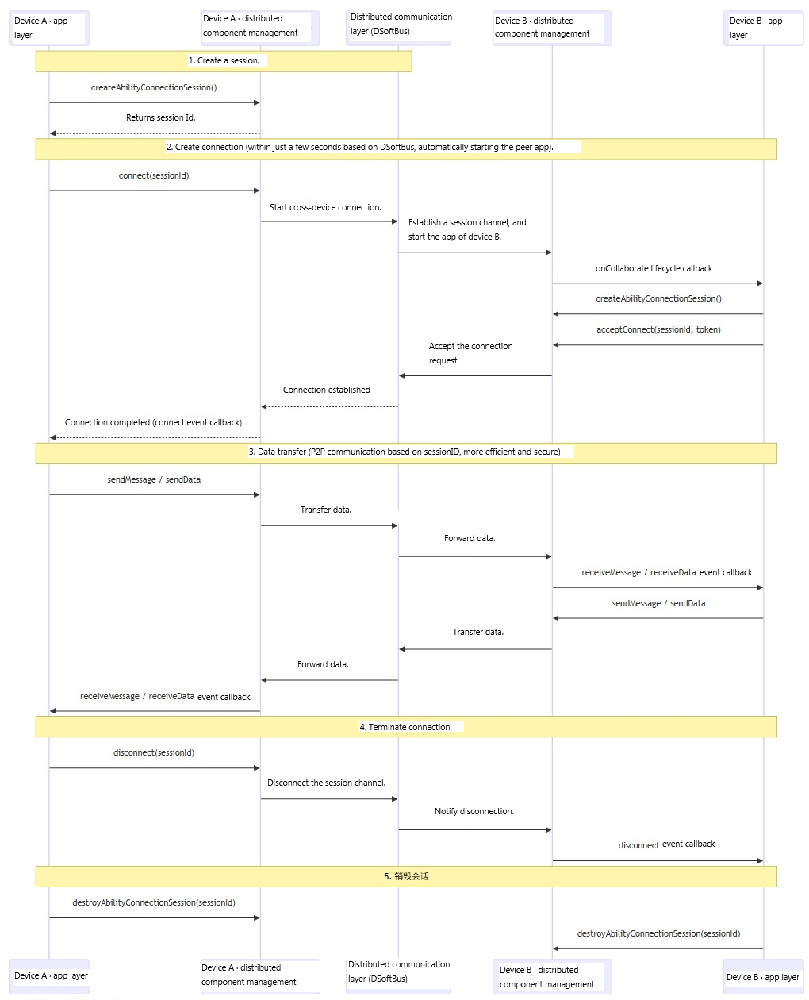

# @ohos.distributedsched.abilityConnectionManager (Cross-Device Connection Management)
<!--Kit: Distributed Service Kit-->
<!--Subsystem: DistributedSched-->
<!--Owner: @hobbycao-->
<!--Designer: @gsxiaowen-->
<!--Tester: @hanjiawei-->
<!--Adviser: @hu-zhiqiong-->
<!-- md-trans-meta sourceCommit=9595a2fa6148ab1fe62fdb3a91b42e555f349a5e translatedAt=2026-11-03T11:03:13.710Z pushedAt=2026-11-03T12:05:01.647Z nl=1 -->

The **abilityConnectionManager** module provides APIs for cross-device connection management. After successful networking between devices, a system application and a third-party application can start a [UIAbility](../apis-ability-kit/js-apis-app-ability-uiAbility.md) of the same application across these devices. Once the UIAbility is started and connected, data (Text Information) can be transmitted across the devices.

The logical layered architecture of multi-device collaboration is as follows:



The key principles of the logical layered architecture are described as follows:

1. **Application adaptation to the collaboration APIs**: An application adapts to the collaboration APIs through abilityConnectionManager, establishes a connection and a session within seconds based on the soft bus, and automatically starts the peer application upon connection.
2. **Data transmission based on session ID**: After the connection is established, the applications on both ends directly transmit data (sendMessage/sendData) through the soft bus channel based on sessionId, achieving more efficient and more secure point-to-point communication.
3. **Peer collaboration framework**: Device A and Device B run a symmetric collaboration framework layer that uniformly manages the entire session lifecycle (create → connect → transmit → disconnect → destroy). The paired invocation of APIs on both ends (connect and acceptConnect) ensures connection reliability.
4. **Event-driven communication**: The on/off registration mechanism is used to listen for connection status (connect/disconnect) and data reception (receiveMessage/receiveData) events, implementing asynchronous and decoupled collaborative communication.

> **NOTE**
>
> The initial APIs of this module are supported since API version 18. Newly added APIs will be marked with a superscript to indicate their earliest API version.
>
> The APIs of this module can be used only in the stage model.

## Modules to Import

```js
import { abilityConnectionManager } from '@kit.DistributedServiceKit';
```

## abilityConnectionManager.createAbilityConnectionSession

createAbilityConnectionSession(serviceName:&nbsp;string,&nbsp;context:&nbsp;Context,&nbsp;peerInfo:&nbsp;PeerInfo,&nbsp;connectOptions:&nbsp;ConnectOptions):&nbsp;number

Creates a collaborative session between applications. A collaborative session is used to manage the connection state of cross-device communication. You need to create a session on each of the two devices first, and then establish a connection through connect.

**Required permissions**: ohos.permission.INTERNET, ohos.permission.GET_NETWORK_INFO, ohos.permission.SET_NETWORK_INFO, and ohos.permission.DISTRIBUTED_DATASYNC

**Model restriction**: This API can be used only in the stage model.

**System capability**: SystemCapability.DistributedSched.AppCollaboration

**Device behavior differences:** When this API is called on wearable that does not support distributed services or on a device managed by an enterprise policy, error code 801 is returned.

**Parameters**

| Name      | Type                                     | Mandatory  | Description       |
| --------- | --------------------------------------- | ---- | --------- |
| serviceName  | string | Yes   | Service name for the application. The service name must be the same on the local end and peer end. The value contains a maximum of 256 characters.|
| context | [Context](../apis-ability-kit/js-apis-inner-application-context.md) | Yes| Application context.|
| peerInfo  | [PeerInfo](#peerinfo)               | Yes   | Collaboration information of the peer end.|
| connectOptions  | [ConnectOptions](#connectoptions)               | Yes   | Connection options for the application.|

**Return value**

| Type                 | Description              |
| ------------------- | ---------------- |
| number | ID of the successfully created collaborative session, used for subsequent API calls such as connect, acceptConnect, sendMessage, sendData, and disconnect. The value range is an integer greater than 100. |

**Error codes**

For details about the error codes, see [Universal Error Codes](../errorcode-universal.md).

| ID| Error Message|
| ------- | -------------------------------- |
| 201      | Permission verification failed. The application does not have the permission required to call the API.|
| 401      | Parameter error. Possible causes: 1. Mandatory parameters are left unspecified; 2. Incorrect parameter types. |
| 801      | Capability not supported. Possible causes: Failed to call the API due to limited device capabilities.|

**Example**

1. On device A, call **createAbilityConnectionSession()** to create a collaboration session and return the session ID.

   ```ts
   import { abilityConnectionManager, distributedDeviceManager } from '@kit.DistributedServiceKit';
   import { hilog } from '@kit.PerformanceAnalysisKit';
   
   let dmClass: distributedDeviceManager.DeviceManager;
   
   function initDmClass(): void {
     try {
       dmClass = distributedDeviceManager.createDeviceManager('com.example.remotephotodemo');
     } catch (err) {
       hilog.error(0x0000, 'testTag', 'createDeviceManager err: ' + JSON.stringify(err));
     }
   }
   
   function getRemoteDeviceId(): string | undefined {
     initDmClass();
     if (typeof dmClass === 'object' && dmClass !== null) {
       hilog.info(0x0000, 'testTag', 'getRemoteDeviceId begin');
       let list = dmClass.getAvailableDeviceListSync();
       if (typeof (list) === 'undefined' || typeof (list.length) === 'undefined') {
         hilog.info(0x0000, 'testTag', 'getRemoteDeviceId err: list is null');
         return;
       }
       if (list.length === 0) {
         hilog.info(0x0000, 'testTag', 'getRemoteDeviceId err: list is empty');
         return;
       }
       return list[0].networkId;
     } else {
       hilog.info(0x0000, 'testTag', 'getRemoteDeviceId err: dmClass is null');
       return;
     }
   }
   
   @Entry
   @Component
   struct Index {
     createSession(): void {
       // Define peer device information.
       const peerInfo: abilityConnectionManager.PeerInfo = {
         deviceId: getRemoteDeviceId()!,
         bundleName: 'com.example.remotephotodemo',
         moduleName: 'entry',
         abilityName: 'EntryAbility',
         serviceName: 'collabTest'
       };
        const myRecord: Record<string, string> = {
          'newKey1': 'value1',
        };
   
       // Define connection options.
       const connectOptions: abilityConnectionManager.ConnectOptions = {
         needSendData: true,
         startOptions: abilityConnectionManager.StartOptionParams.START_IN_FOREGROUND,
         parameters: myRecord
       };
       let context = this.getUIContext().getHostContext();
       try {
         let sessionId = abilityConnectionManager.createAbilityConnectionSession("collabTest", context, peerInfo, connectOptions);
         hilog.info(0x0000, 'testTag', 'createSession sessionId is', sessionId);
       } catch (error) {
         hilog.error(0x0000, 'testTag', error);
       }
     }
   
     build() {
     }
   }
   ```
   
2. On device B, **createAbilityConnectionSession** can be called in **onCollaborate**, which is triggered when the application is started.

   ```ts
   import { AbilityConstant, UIAbility, Want } from '@kit.AbilityKit';
   import { abilityConnectionManager } from '@kit.DistributedServiceKit';
   import { hilog } from '@kit.PerformanceAnalysisKit';
    
   export default class EntryAbility extends UIAbility {
     onCollaborate(wantParam: Record<string, Object>): AbilityConstant.CollaborateResult {
       hilog.info(0x0000, 'testTag', '%{public}s', 'on collaborate');
       let param = wantParam["ohos.extra.param.key.supportCollaborateIndex"] as Record<string, Object>
       this.onCollab(param);
       return 0;
     }
    
     onCollab(collabParam: Record<string, Object>) {
       const sessionId = this.createSessionFromWant(collabParam);
       if (sessionId == -1) {
         hilog.info(0x0000, 'testTag', 'Invalid session ID.');
         return;
       }
     }
    
     createSessionFromWant(collabParam: Record<string, Object>): number {
       let sessionId = -1;
       const peerInfo = collabParam["PeerInfo"] as abilityConnectionManager.PeerInfo;
       if (peerInfo == undefined) {
         return sessionId;
       }
    
       const options = collabParam["ConnectOption"] as abilityConnectionManager.ConnectOptions;
       try {
         sessionId = abilityConnectionManager.createAbilityConnectionSession("collabTest", this.context, peerInfo, options);
         AppStorage.setOrCreate('sessionId', sessionId);
         hilog.info(0x0000, 'testTag', 'createSession sessionId is ' + sessionId);
       } catch (error) {
         hilog.error(0x0000, 'testTag', error);
       }
       return sessionId;
     }
   }
   
   ```

## abilityConnectionManager.destroyAbilityConnectionSession

destroyAbilityConnectionSession(sessionId:&nbsp;number):&nbsp;void

Destroys the collaboration session between applications. It is used together with **createAbilityConnectionSession** to release session resources. This API must be called after a collaboration session is successfully created. Destroying a session releases related resources. It is recommended that you call **disconnect** to disconnect the connection before destroying the session. Failure to call this API causes resource leakage.

**Model restriction**: This API can be used only in the stage model.

**System capability**: SystemCapability.DistributedSched.AppCollaboration

**Device behavior differences:** When this API is called on wearable that does not support distributed services or on a device managed by an enterprise policy, error code 401 is returned.

**Parameters**

| Name      | Type                                      | Mandatory  | Description                             |
| --------- | ---------------------------------------- | ---- |---------------------------------|
| sessionId | number | Yes | ID of the collaborative session to be destroyed.<br />The value range is an integer not less than 100. Error code 401 is returned if a value less than 100 or a nonexistent collaborative session ID is passed. |

**Example**

  ```ts
  import { abilityConnectionManager } from '@kit.DistributedServiceKit';
  import { hilog } from '@kit.PerformanceAnalysisKit';

  hilog.info(0x0000, 'testTag', 'destroyAbilityConnectionSession called');
  let sessionId = 100;
  abilityConnectionManager.destroyAbilityConnectionSession(sessionId);
  ```

## abilityConnectionManager.getPeerInfoById

getPeerInfoById(sessionId:&nbsp;number):&nbsp;PeerInfo&nbsp;|&nbsp;undefined

Obtains the peer application information in the specified session. This API must be called after a collaboration session is successfully created.

**Model restriction**: This API can be used only in the stage model.

**System capability**: SystemCapability.DistributedSched.AppCollaboration

**Device behavior differences:** When this API is called on wearable that does not support distributed services or on a device managed by an enterprise policy, a null value is returned.

**Parameters**

| Name      | Type                                      | Mandatory  | Description      |
| --------- | ---------------------------------------- | ---- | -------- |
| sessionId | number  | Yes    | Collaborative session ID. Returned by the createAbilityConnectionSession API.   |

**Return value**

| Type                 | Description              |
| ------------------- | ---------------- |
| [PeerInfo](#peerinfo) \| undefined | Information about the collaborative application on the receiving end. undefined is returned if the sessionId is not found. |

**Error codes**

For details about the error codes, see [Universal Error Codes](../errorcode-universal.md).

| ID| Error Message|
| ------- | -------------------------------- |
| 401      | Parameter error. Possible causes: 1. Mandatory parameters are left unspecified. 2. Incorrect parameter types. |

**Example**

  ```ts
  import { abilityConnectionManager } from '@kit.DistributedServiceKit';
  import { hilog } from '@kit.PerformanceAnalysisKit';

  hilog.info(0x0000, 'testTag', 'getPeerInfoById called');
  // The sessionId must be created and obtained through the createAbilityConnectionSession API. This is only an example.
  let sessionId = 100;
  // Obtain the peer application information of the specified session.
  const peerInfo = abilityConnectionManager.getPeerInfoById(sessionId);
  ```

## abilityConnectionManager.connect

connect(sessionId:&nbsp;number):&nbsp;Promise&lt;ConnectResult&gt;

After a collaboration session is successfully created and the session ID is obtained, a UIAbility connection can be set up on device A. Before calling this API, you must create a collaboration session on both devices. The **connect** API establishes a connection through the underlying distributed communication service and must be used together with **acceptConnect** on device B to establish a successful connection. Calling **connect** starts the application on device B. The connection process triggers the 'connect' event to notify the status change. This API uses a promise to return the result asynchronously. If the connection fails, the **errorCode** field in the returned **ConnectResult** object contains the specific error information. For details about the error causes, see the **ConnectErrorCode** enum.

**Model restriction**: This API can be used only in the stage model.

**System capability**: SystemCapability.DistributedSched.AppCollaboration

**Device behavior differences:** When this API is called on wearable that does not support distributed services or on a device managed by an enterprise policy, error code 401 is returned.

**Parameters**

| Name      | Type                                     | Mandatory  | Description       |
| --------- | --------------------------------------- | ---- | --------- |
| sessionId | number | Yes | ID of the created collaborative session, returned by createAbilityConnectionSession. |

**Return value**

| Type                 | Description              |
| ------------------- | ---------------- |
| Promise&lt;ConnectResult&gt; | Promise object. On success, it resolves to return [ConnectResult](#connectresult) (containing the isConnected and errorCode fields); on failure, it rejects to return an error object. |

**Error codes**

For details about the error codes, see [Universal Error Codes](../errorcode-universal.md).

| ID| Error Message|
| ------- | -------------------------------- |
| 401      | Parameter error. Possible causes: 1. Mandatory parameters are left unspecified; 2. Incorrect parameter types. |

**Example**

After a collaboration session is successfully created and the session ID is obtained on device A, call **connect()** to set up a UIAbility connection and start the application on device B.

  ```ts
  import { abilityConnectionManager } from '@kit.DistributedServiceKit';
  import { hilog } from '@kit.PerformanceAnalysisKit';

  let sessionId = 100;
  abilityConnectionManager.connect(sessionId).then((ConnectResult) => {
    if (!ConnectResult.isConnected) {
      hilog.info(0x0000, 'testTag', 'connect failed');
      return;
    }
  }).catch(() => {
    hilog.error(0x0000, 'testTag', "connect failed");
  })
  ```

## abilityConnectionManager.acceptConnect

acceptConnect(sessionId:&nbsp;number,&nbsp;token:&nbsp;string):&nbsp;Promise&lt;void&gt;

After a collaboration session is successfully created and the session ID is obtained on device B, the application calls **acceptConnect()** to accept the connection. Before calling this API, you must create a collaboration session on both devices. This API must be used together with the **connect** method on device A: device A calls **connect** to start the application on device B, and device B calls **acceptConnect** after creating a session in the **onCollaborate** lifecycle. This API uses a promise to return the result asynchronously.

**Model restriction**: This API can be used only in the stage model.

**System capability**: SystemCapability.DistributedSched.AppCollaboration

**Device behavior difference:** If this API is called on wearable that does not support distributed services or on a device managed by enterprise policies, error code 401 is returned.

**Parameters**

| Name      | Type                                     | Mandatory  | Description   |
| --------- | --------------------------------------- | ---- | ----- |
| sessionId | number | Yes   | ID of the collaboration session.   |
| token | string | Yes | Token value passed in by the application on device A. This value is obtained through the 'ohos.dms.collabToken' key in the wantParam parameter (obtained from the wantParam parameter of the onCollaborate lifecycle method after the application is started). When device A calls the connect method, the system automatically generates collabToken and passes it to device B through the want parameter. Device B can obtain this token from the wantParam parameter in the onCollaborate lifecycle callback. |

**Return value**

| Type                 | Description              |
| ------------------- | ---------------- |
| Promise&lt;void&gt; | Promise that returns no value. |

**Error codes**

For details about the error codes, see [Universal Error Codes](../errorcode-universal.md).

| ID| Error Message|
| ------- | -------------------------------- |
| 401      | Parameter error. Possible causes: 1. Mandatory parameters are left unspecified; 2. Incorrect parameter types. |

**Example**

On device B, after **createAbilityConnectionSession** is called and the session ID is obtained, call **acceptConnect** to accept the connection.

  ```ts
  import { AbilityConstant, UIAbility, Want } from '@kit.AbilityKit';
  import { abilityConnectionManager } from '@kit.DistributedServiceKit';
  import { hilog } from '@kit.PerformanceAnalysisKit';

  export default class EntryAbility extends UIAbility {
    onCreate(want: Want, launchParam: AbilityConstant.LaunchParam): void {
      hilog.info(0x0000, 'testTag', '%{public}s', 'Ability onCreate');
    }

    onCollaborate(wantParam: Record<string, Object>): AbilityConstant.CollaborateResult {
      hilog.info(0x0000, 'testTag', '%{public}s', 'on collaborate');
      let param = wantParam["ohos.extra.param.key.supportCollaborateIndex"] as Record<string, Object>
      this.onCollab(param);
      return 0;
    }

    onCollab(collabParam: Record<string, Object>) {
      const sessionId = this.createSessionFromWant(collabParam);
      if (sessionId == -1) {
        hilog.info(0x0000, 'testTag', 'Invalid session ID.');
        return;
      }
      const collabToken = collabParam["ohos.dms.collabToken"] as string;
      abilityConnectionManager.acceptConnect(sessionId, collabToken).then(() => {
        hilog.info(0x0000, 'testTag', 'acceptConnect success');
      }).catch(() => {
        hilog.error(0x0000, 'testTag', 'failed'); 
      })
    }

    createSessionFromWant(collabParam: Record<string, Object>): number {
      let sessionId = -1;
      const peerInfo = collabParam["PeerInfo"] as abilityConnectionManager.PeerInfo;
      if (peerInfo == undefined) {
        return sessionId;
      }

      const options = collabParam["ConnectOption"] as abilityConnectionManager.ConnectOptions;
      try {
        sessionId = abilityConnectionManager.createAbilityConnectionSession("collabTest", this.context, peerInfo, options);
        AppStorage.setOrCreate('sessionId', sessionId);
        hilog.info(0x0000, 'testTag', 'createSession sessionId is ' + sessionId);
      } catch (error) {
        hilog.error(0x0000, 'testTag', error);
      }
      return sessionId;
    }
  }
  ```

## abilityConnectionManager.disconnect

disconnect(sessionId:&nbsp;number):&nbsp;void

After a collaborative session is created, the application connection succeeds, and the collaborative service is complete, either device at the two ends of the collaboration should disconnect the UIAbility connection to end the collaboration state. This API must be called after **connect()** establishes the connection.

**Model restriction**: This API can be used only in the stage model.

**System capability**: SystemCapability.DistributedSched.AppCollaboration

**Device behavior difference:** If this API is called on wearable that does not support distributed services or on a device managed by enterprise policies, error code 401 is returned.

**Parameters**

| Name      | Type                                   | Mandatory  | Description       |
| --------- | ------------------------------------- | ---- | --------- |
| sessionId | number | Yes   | ID of the collaboration session.    |

**Example**

  ```ts
  import { abilityConnectionManager } from '@kit.DistributedServiceKit';
  import { hilog } from '@kit.PerformanceAnalysisKit';

  hilog.info(0x0000, 'testTag', 'disconnectRemoteAbility begin');
  let sessionId = 100;
  abilityConnectionManager.disconnect(sessionId);
  ```

## abilityConnectionManager.reject

reject(token:&nbsp;string,&nbsp;reason:&nbsp;string):&nbsp;void;

Rejects a connection request in a cross-device collaboration session. After a connection request sent from the peer application is rejected, a rejection reason is returned.

**Model restriction**: This API can be used only in the stage model.

**System capability**: SystemCapability.DistributedSched.AppCollaboration

**Device behavior difference:** If this API is called on wearable that does not support distributed services or on a device managed by enterprise policies, error code 401 is returned.

**Parameters**

| Name      | Type                                     | Mandatory  | Description   |
| --------- | --------------------------------------- | ---- | ----- |
| token | string | Yes | Token used for collaboration service management. The value is obtained from the 'ohos.dms.collabToken' key in the wantParam parameter (obtained from the wantParam parameter of the onCollaborate lifecycle method after the application is started). |
| reason | string | Yes   | Reason why the connection is rejected.   |

**Error codes**

For details about the error codes, see [Universal Error Codes](../errorcode-universal.md).

| ID| Error Message|
| ------- | -------------------------------- |
| 401      | Parameter error. Possible causes: 1. Mandatory parameters are left unspecified; 2. Incorrect parameter types. |

**Example**

  ```ts
  import { AbilityConstant, UIAbility, Want } from '@kit.AbilityKit';
  import { abilityConnectionManager } from '@kit.DistributedServiceKit';
  import { hilog } from '@kit.PerformanceAnalysisKit';

  export default class EntryAbility extends UIAbility {
      onCollaborate(wantParam: Record<string, Object>): AbilityConstant.CollaborateResult {
        hilog.info(0x0000, 'testTag', '%{public}s', 'on collaborate');
        let collabParam = wantParam["ohos.extra.param.key.supportCollaborateIndex"] as Record<string, Object>;
        const collabToken = collabParam["ohos.dms.collabToken"] as string;
        const reason = 'test';
        hilog.info(0x0000, 'testTag', 'reject begin');
        abilityConnectionManager.reject(collabToken, reason);
        return AbilityConstant.CollaborateResult.REJECT;
      }
  }

  ```

## abilityConnectionManager.on('connect')

on(type:&nbsp;'connect',&nbsp;sessionId:&nbsp;number,&nbsp;callback:&nbsp;Callback&lt;EventCallbackInfo&gt;):&nbsp;void

Registers a listener for the connect event. This event is triggered after the **connect** API is called successfully. This API uses an asynchronous callback.

**Model restriction**: This API can be used only in the stage model.

**System capability**: SystemCapability.DistributedSched.AppCollaboration

**Device behavior difference:** If this API is called on wearable that does not support distributed services or on a device managed by enterprise policies, error code 401 is returned.

**Parameters**

| Name      | Type                                   | Mandatory  | Description   |
| --------- | ------------------------------------- | ---- | ----- |
| type | string  | Yes   |   Event type. This field has a fixed value of **connect**. This event is triggered when [abilityConnectionManager.connect](#abilityconnectionmanagerconnect) is called.  |
| sessionId | number  | Yes   | ID of the collaboration session.   |
| callback | Callback&lt;[EventCallbackInfo](#eventcallbackinfo)&gt; | Yes   | Registered callback function.   |

**Error codes**

For details about the error codes, see [Universal Error Codes](../errorcode-universal.md).

| ID| Error Message|
| ------- | -------------------------------- |
| 401      | Parameter error. Possible causes: 1. Mandatory parameters are left unspecified; 2. Incorrect parameter types. |

**Example**

  ```ts
  import { abilityConnectionManager } from '@kit.DistributedServiceKit';
  import { hilog } from '@kit.PerformanceAnalysisKit';

  // sessionId must be created and obtained through the createAbilityConnectionSession API. This is only an example.
  let sessionId = 100;
  abilityConnectionManager.on("connect", sessionId,(callbackInfo) => {
    hilog.info(0x0000, 'testTag', 'session connect, sessionId is', callbackInfo.sessionId);
  });

  ```

## abilityConnectionManager.off('connect')

off(type:&nbsp;'connect',&nbsp;sessionId:&nbsp;number,&nbsp;callback?:&nbsp;Callback&lt;EventCallbackInfo&gt;):&nbsp;void

Disables listening for **connect** events.

**Model restriction**: This API can be used only in the stage model.

**System capability**: SystemCapability.DistributedSched.AppCollaboration

**Device behavior difference:** If this API is called on wearable that does not support distributed services or on a device managed by enterprise policies, error code 401 is returned.

**Parameters**

| Name      | Type                                   | Mandatory  | Description   |
| --------- | ------------------------------------- | ---- | ----- |
| type | string  | Yes    |   Event callback type. The supported event is 'connect', which can be unsubscribed only after being registered through [abilityConnectionManager.on('connect')](#abilityconnectionmanageronconnect).    |
| sessionId | number  | Yes   | ID of the collaboration session.   |
| callback | Callback&lt;[EventCallbackInfo](#eventcallbackinfo)&gt; | No    | Callback for the 'connect' event. If this parameter is not passed, all callback listeners for this event are unsubscribed.    |

**Error codes**

For details about the error codes, see [Universal Error Codes](../errorcode-universal.md).

| ID| Error Message|
| ------- | -------------------------------- |
| 401      | Parameter error. Possible causes: 1. Mandatory parameters are left unspecified; 2. Incorrect parameter types. |

**Example**

  ```ts
  import { abilityConnectionManager } from '@kit.DistributedServiceKit';

  // sessionId must be created and obtained through the createAbilityConnectionSession API. This is only an example.
  let sessionId = 100;
  abilityConnectionManager.off("connect", sessionId);

  ```

## abilityConnectionManager.on('disconnect')

on(type:&nbsp;'disconnect',&nbsp;sessionId:&nbsp;number,&nbsp;callback:&nbsp;Callback&lt;EventCallbackInfo&gt;):&nbsp;void

Enables listening for **disconnect** events.

**Model restriction**: This API can be used only in the stage model.

**System capability**: SystemCapability.DistributedSched.AppCollaboration

**Device behavior difference:** If this API is called on wearable that does not support distributed services or on a device managed by enterprise policies, error code 401 is returned.

**Parameters**

| Name      | Type                                   | Mandatory  | Description   |
| --------- | ------------------------------------- | ---- | ----- |
| type | string  | Yes   |   Event type. This field has a fixed value of **disconnect**. This event is triggered when [abilityConnectionManager.disconnect](#abilityconnectionmanagerdisconnect) is called.  |
| sessionId | number  | Yes   | ID of the collaboration session.   |
| callback | Callback&lt;[EventCallbackInfo](#eventcallbackinfo)&gt; | Yes   | Registered callback function.   |

**Error codes**

For details about the error codes, see [Universal Error Codes](../errorcode-universal.md).

| ID| Error Message|
| ------- | -------------------------------- |
| 401      | Parameter error. Possible causes: 1. Mandatory parameters are left unspecified; 2. Incorrect parameter types. |

**Example**

  ```ts
  import { abilityConnectionManager } from '@kit.DistributedServiceKit';
  import { hilog } from '@kit.PerformanceAnalysisKit';

  // Obtain sessionId by calling createAbilityConnectionSession. This is only an example.
  let sessionId = 100;
  abilityConnectionManager.on("disconnect", sessionId,(callbackInfo) => {
    hilog.info(0x0000, 'testTag', 'session disconnect, sessionId is', callbackInfo.sessionId);
  });

  ```

## abilityConnectionManager.off('disconnect')

off(type:&nbsp;'disconnect',&nbsp;sessionId:&nbsp;number,&nbsp;callback?:&nbsp;Callback&lt;EventCallbackInfo&gt;):&nbsp;void

Disables listening for **disconnect** events.

**Model restriction**: This API can be used only in the stage model.

**System capability**: SystemCapability.DistributedSched.AppCollaboration

**Device behavior difference:** If this API is called on wearable that does not support distributed services or on a device managed by enterprise policies, error code 401 is returned.

**Parameters**

| Name      | Type                                   | Mandatory  | Description   |
| --------- | ------------------------------------- | ---- | ----- |
| type | string  | Yes    |   Event callback type. The supported event is 'disconnect', which can be unsubscribed only after being registered through [abilityConnectionManager.on('disconnect')](#abilityconnectionmanagerondisconnect).    |
| sessionId | number  | Yes   | ID of the collaboration session.   |
| callback | Callback&lt;[EventCallbackInfo](#eventcallbackinfo)&gt; | No    | Callback for the 'disconnect' event. If this parameter is not passed, all callback listeners of this event are unsubscribed.    |

**Error codes**

For details about the error codes, see [Universal Error Codes](../errorcode-universal.md).

| ID| Error Message|
| ------- | -------------------------------- |
| 401      | Parameter error. Possible causes: 1. Mandatory parameters are left unspecified; 2. Incorrect parameter types. |

**Example**

  ```ts
  import { abilityConnectionManager } from '@kit.DistributedServiceKit';
  import { hilog } from '@kit.PerformanceAnalysisKit';

  // Obtain the sessionId by calling createAbilityConnectionSession. This is only an example.
  let sessionId = 100;
  abilityConnectionManager.off("disconnect", sessionId);

  ```

## abilityConnectionManager.on('receiveMessage')

on(type:&nbsp;'receiveMessage',&nbsp;sessionId:&nbsp;number,&nbsp;callback:&nbsp;Callback&lt;EventCallbackInfo&gt;):&nbsp;void

Enables listening for **receiveMessage** events.

**Model restriction**: This API can be used only in the stage model.

**System capability**: SystemCapability.DistributedSched.AppCollaboration

**Device behavior difference:** If this API is called on wearable that does not support distributed services or on a device managed by enterprise policies, error code 401 is returned.

**Parameters**

| Name      | Type                                   | Mandatory  | Description   |
| --------- | ------------------------------------- | ---- | ----- |
| type | string  | Yes   |   Event type. This field has a fixed value of **receiveMessage**. This event is triggered when [abilityConnectionManager.sendMessage](#abilityconnectionmanagersendmessage) is called.  |
| sessionId | number  | Yes   | ID of the collaboration session.   |
| callback | Callback&lt;[EventCallbackInfo](#eventcallbackinfo)&gt; | Yes   | Registered callback function.   |

**Error codes**

For details about the error codes, see [Universal Error Codes](../errorcode-universal.md).

| ID| Error Message|
| ------- | -------------------------------- |
| 401      | Parameter error. Possible causes: 1. Mandatory parameters are left unspecified; 2. Incorrect parameter types. |

**Example**

  ```ts
  import { abilityConnectionManager } from '@kit.DistributedServiceKit';
  import { hilog } from '@kit.PerformanceAnalysisKit';

  // Obtain sessionId by calling createAbilityConnectionSession. This is only an example.
  let sessionId = 100;
  abilityConnectionManager.on("receiveMessage", sessionId,(callbackInfo) => {
    hilog.info(0x0000, 'testTag', 'receiveMessage, sessionId is', callbackInfo.sessionId);
  });

  ```

## abilityConnectionManager.off('receiveMessage')

off(type:&nbsp;'receiveMessage',&nbsp;sessionId:&nbsp;number,&nbsp;callback?:&nbsp;Callback&lt;EventCallbackInfo&gt;):&nbsp;void

Disables listening for **receiveMessage** events.

**Model restriction**: This API can be used only in the stage model.

**System capability**: SystemCapability.DistributedSched.AppCollaboration

**Device behavior difference:** If this API is called on wearable that does not support distributed services or on a device managed by enterprise policies, error code 401 is returned.

**Parameters**

| Name      | Type                                   | Mandatory  | Description   |
| --------- | ------------------------------------- | ---- | ----- |
| type | string  | Yes    | Event callback type. The supported event is 'receiveMessage', which can be canceled only after being registered through [abilityConnectionManager.on('receiveMessage')](#abilityconnectionmanageronreceivemessage).    |
| sessionId | number  | Yes   | ID of the collaboration session.   |
| callback | Callback&lt;[EventCallbackInfo](#eventcallbackinfo)&gt; | No    | Callback to be canceled. If this parameter is not passed, all callback listeners for the event are canceled.    |

**Error codes**

For details about the error codes, see [Universal Error Codes](../errorcode-universal.md).

| ID| Error Message|
| ------- | -------------------------------- |
| 401      | Parameter error. Possible causes: 1. Mandatory parameters are left unspecified; 2. Incorrect parameter types. |

**Example**

  ```ts
  import { abilityConnectionManager } from '@kit.DistributedServiceKit';
  import { hilog } from '@kit.PerformanceAnalysisKit';

  // Obtain sessionId by calling createAbilityConnectionSession. This is only an example.
  let sessionId = 100;
  abilityConnectionManager.off("receiveMessage", sessionId);

  ```

## abilityConnectionManager.on('receiveData')

on(type:&nbsp;'receiveData',&nbsp;sessionId:&nbsp;number,&nbsp;callback:&nbsp;Callback&lt;EventCallbackInfo&gt;):&nbsp;void

Enables listening for **receiveData** events.

**Model restriction**: This API can be used only in the stage model.

**System capability**: SystemCapability.DistributedSched.AppCollaboration

**Device behavior difference:** If this API is called on wearable that does not support distributed services or on a device managed by enterprise policies, error code 401 is returned.

**Parameters**

| Name      | Type                                   | Mandatory  | Description   |
| --------- | ------------------------------------- | ---- | ----- |
| type | string  | Yes   |   Event type. This field has a fixed value of **receiveData**. This event is triggered when [abilityConnectionManager.sendData](#abilityconnectionmanagersenddata) is called.  |
| sessionId | number  | Yes   | ID of the collaboration session.   |
| callback | Callback&lt;[EventCallbackInfo](#eventcallbackinfo)&gt; | Yes   | Registered callback function.   |

**Error codes**

For details about the error codes, see [Universal Error Codes](../errorcode-universal.md).

| ID| Error Message|
| ------- | -------------------------------- |
| 401      | Parameter error. Possible causes: 1. Mandatory parameters are left unspecified; 2. Incorrect parameter types. |

**Example**

  ```ts
  import { abilityConnectionManager } from '@kit.DistributedServiceKit';
  import { hilog } from '@kit.PerformanceAnalysisKit';

  // sessionId must be created and obtained through the createAbilityConnectionSession API. This is only an example.
  let sessionId = 100;
  abilityConnectionManager.on("receiveData", sessionId,(callbackInfo) => {
    hilog.info(0x0000, 'testTag', 'receiveData, sessionId is', callbackInfo.sessionId);
  });

  ```

## abilityConnectionManager.off('receiveData')

off(type:&nbsp;'receiveData',&nbsp;sessionId:&nbsp;number,&nbsp;callback?:&nbsp;Callback&lt;EventCallbackInfo&gt;):&nbsp;void

Disables listening for **receiveData** events.

**Model restriction**: This API can be used only in the stage model.

**System capability**: SystemCapability.DistributedSched.AppCollaboration

**Device behavior difference:** If this API is called on wearable that does not support distributed services or on a device managed by enterprise policies, error code 401 is returned.

**Parameters**

| Name      | Type                                   | Mandatory  | Description   |
| --------- | ------------------------------------- | ---- | ----- |
| type | string  | Yes    |   Event callback type. The supported event is 'receiveData', which must be registered through [abilityConnectionManager.on('receiveData')](#abilityconnectionmanageronreceivedata) before it can be unsubscribed.    |
| sessionId | number  | Yes   | ID of the collaboration session.   |
| callback | Callback&lt;[EventCallbackInfo](#eventcallbackinfo)&gt; | No    | Callback for the event to be unsubscribed. If this parameter is not passed, all callbacks for the event are unsubscribed.    |

**Error codes**

For details about the error codes, see [Universal Error Codes](../errorcode-universal.md).

| ID| Error Message|
| ------- | -------------------------------- |
| 401      | Parameter error. Possible causes: 1. Mandatory parameters are left unspecified; 2. Incorrect parameter types. |

**Example**

  ```ts
  import { abilityConnectionManager } from '@kit.DistributedServiceKit';
  import { hilog } from '@kit.PerformanceAnalysisKit';

  // sessionId must be created and obtained through the createAbilityConnectionSession API. This is only an example.
  let sessionId = 100;
  abilityConnectionManager.off("receiveData", sessionId);

  ```

## abilityConnectionManager.sendMessage

sendMessage(sessionId:&nbsp;number,&nbsp;msg:&nbsp;string):&nbsp;Promise&lt;void&gt;

After a collaborative session is created and the session ID is obtained, and after the connect API is called to establish a connection, device A or device B can send text information to the peer device. This API uses a promise to return the result asynchronously.

**Model restriction**: This API can be used only in the stage model.

**System capability**: SystemCapability.DistributedSched.AppCollaboration

**Device behavior difference:** If this API is called on wearable that does not support distributed services or on a device managed by enterprise policies, error code 401 is returned.

**Parameters**

| Name      | Type                                     | Mandatory  | Description   |
| --------- | --------------------------------------- | ---- | ----- |
| sessionId | number | Yes | Collaborative Session ID, returned by the createAbilityConnectionSession API. |
| msg | string | Yes | Text information content (maximum 1 KB). Error code 401 is returned when the length limit is exceeded. |

**Return value**

| Type                 | Description              |
| ------------------- | ---------------- |
| Promise&lt;void&gt; | Promise object that returns no value. It resolves when the message is sent successfully and rejects when the message fails to be sent. |

**Error codes**

For details about the error codes, see [Universal Error Codes](../errorcode-universal.md).

| ID| Error Message|
| ------- | -------------------------------- |
| 401      | Parameter error. Possible causes: 1. Mandatory parameters are left unspecified; 2. Incorrect parameter types. |

**Example**

  ```ts
  import { abilityConnectionManager } from '@kit.DistributedServiceKit'; 
  import { hilog } from '@kit.PerformanceAnalysisKit';

  let sessionId = 100;
  abilityConnectionManager.sendMessage(sessionId, "message send success").then(() => {
    hilog.info(0x0000, 'testTag', "sendMessage success");
  }).catch(() => {
    hilog.error(0x0000, 'testTag', "sendMessage failed");
  })
  ```

## abilityConnectionManager.sendData

sendData(sessionId:&nbsp;number,&nbsp;data:&nbsp;ArrayBuffer):&nbsp;Promise&lt;void&gt;

After a collaborative session is created and the session ID is obtained, and after the application is connected, device A or device B can send an [ArrayBuffer](../../arkts-utils/arraybuffer-object.md) byte stream to the peer device. This API uses a promise to return the result asynchronously.

**Model restriction**: This API can be used only in the stage model.

**System capability**: SystemCapability.DistributedSched.AppCollaboration

**Device behavior difference:** If this API is called on wearable that does not support distributed services or on a device managed by enterprise policies, error code 401 is returned.

**Parameters**

| Name      | Type                                     | Mandatory  | Description   |
| --------- | --------------------------------------- | ---- | ----- |
| sessionId | number | Yes   | ID of the collaboration session.|
| data | [ArrayBuffer](../../arkts-utils/arraybuffer-object.md) | Yes   | Byte stream information.|

**Return value**

| Type                 | Description              |
| ------------------- | ---------------- |
| Promise&lt;void&gt; | Promise that returns no value.|

**Error codes**

For details about the error codes, see [Universal Error Codes](../errorcode-universal.md).

| ID| Error Message|
| ------- | -------------------------------- |
| 401      | Parameter error. Possible causes: 1. Mandatory parameters are left unspecified; 2. Incorrect parameter types. |

**Example**

  ```ts
  import { abilityConnectionManager } from '@kit.DistributedServiceKit';
  import { hilog } from '@kit.PerformanceAnalysisKit';
  import { util } from '@kit.ArkTS';
 
  let textEncoder = util.TextEncoder.create("utf-8");
  const arrayBuffer  = textEncoder.encodeInto("data send success");

  let sessionId = 100;
  abilityConnectionManager.sendData(sessionId, arrayBuffer.buffer).then(() => {
    hilog.info(0x0000, 'testTag', "sendData success");
  }).catch(() => {
    hilog.error(0x0000, 'testTag', "sendData failed");
  })
  ```

## PeerInfo

Defines the application collaboration information.

**Device behavior difference:** If this API is called on wearable that does not support distributed services or on a device managed by enterprise policies, error code 401 is returned.

 **Model restriction**: This API can be used only in the stage model.

**System capability**: SystemCapability.DistributedSched.AppCollaboration

| Name                   | Type      |Read Only  | Optional  | Description                |
| ----------------- | ------ | ----  | ---- | ------------------ |
| deviceId          | string | No   | No    | Network ID of the peer device, used to identify the remote device to connect. It can be obtained through the distributed device management API getAvailableDeviceListSync.     |
| bundleName        | string | No   | No    | Bundle name of the peer application, used to uniquely identify the application to connect. It must be consistent with the bundleName of the peer application. |
| moduleName        | string | No   | No    | Module name of the peer application, used to identify the application module to connect. It is usually 'entry' or another custom module name. |
| abilityName       | string | No   | No     | Component name of the peer application, used to identify the UIAbility component to connect. It must be consistent with the abilityName of the peer application. |
| serviceName       | string | No   | Yes     | Service name set in the application settings. If this value is set, it must be consistent with the serviceName parameter of the createAbilityConnectionSession API. If this value is not set, the default service name is used. |

## ConnectOptions

Connection options for the application.

**Device behavior difference:** If this API is called on wearable that does not support distributed services or on a device managed by enterprise policies, error code 401 is returned.

**Model restriction**: This API can be used only in the stage model.

**System capability**: SystemCapability.DistributedSched.AppCollaboration

| Name         | Type   | Read Only  | Optional  | Description         |
| ----------- | ------- | ---- | ---- | ----------- |
| needSendData    | boolean  | No    | Yes   | Whether to transfer data. The value **true** means data needs to be transferred (the **sendMessage** and **sendData** methods can be called), and the value **false** means data does not need to be transferred. The default value is **false** if this parameter is not passed.     |
| startOptions | [StartOptionParams](#startoptionparams) | No    | Yes   | Application startup options. **START_IN_FOREGROUND** (value 0) means the peer application is started in the foreground, which is suitable for scenarios requiring user interaction. The system default startup configuration is used if this parameter is not passed. |
| parameters | Record&lt;string, string&gt;  | No    | Yes   | Additional information for configuring the connection. Pass this parameter when custom parameters, such as identity identifiers and service identifiers, need to be transferred to the peer device. No additional information is transferred if this parameter is not passed.    |

## ConnectResult

Defines the connection result.

**Device behavior differences:** This API returns error code 401 when called on wearable that does not support distributed services or on a device managed by enterprise policies.

 **Model restriction**: This API can be used only in the stage model.

**System capability**: SystemCapability.DistributedSched.AppCollaboration

| Name      | Type  | Read Only  | Optional  | Description     |
| -------- | ------ | ---- | ---- | ------- |
| isConnected | boolean | No | No | true indicates that the connection succeeds; false indicates that the connection fails. For the specific cause, see the errorCode or reason field. |
| errorCode | [ConnectErrorCode](#connecterrorcode) | No | Yes | Connection error code. Present when the connection fails, used to identify the specific error cause. Absent when the connection succeeds. |
| reason | string | No | Yes | Reason for rejecting the connection. Returned only when the connection is rejected. This value is the reason parameter passed in when the peer application calls the reject API, and is used to inform the local end of the specific reason for rejection. This field is absent when the connection succeeds or is not rejected. |

## EventCallbackInfo

Defines the event callback information.

**Device behavior differences:** This API returns error code 401 when called on wearable that does not support distributed services or on a device managed by enterprise policies.

 **Model restriction**: This API can be used only in the stage model.

**System capability**: SystemCapability.DistributedSched.AppCollaboration

| Name      | Type   | Read Only| Optional| Description         |
| -------- | ------ | ---- | ---- | ----------- |
| sessionId | number   | No  | No  |   Collaboration session ID.|
| reason | [DisconnectReason](#disconnectreason)     | No   | Yes   | Disconnect reason. Present when the disconnect event is triggered, used to identify the specific disconnect reason. Not present for other event types. |
| msg | string   | No   | Yes   | Received message. Present when the receiveMessage event is triggered, containing the received text message content. Not present for other event types. |
| data  | ArrayBuffer | No   | Yes   | Received byte stream. Present when the receiveData event is triggered, containing the received binary data. Not present for other event types. |

## CollaborateEventInfo

Collaboration event information.

**Device behavior differences:** This API returns error code 401 when called on wearable that does not support distributed services or on a device managed by enterprise policies.

 **Model restriction**: This API can be used only in the stage model.

**System capability**: SystemCapability.DistributedSched.AppCollaboration

| Name      | Type  | Read Only  | Optional  | Description     |
| -------- | ------ | ---- | ---- | ------- |
| eventType | [CollaborateEventType](#collaborateeventtype) | No | No | Type of the collaborative event (0 indicates SEND_FAILURE, and 1 indicates COLOR_SPACE_CONVERSION_FAILURE). |
| eventMsg | string | No | Yes | Message content of the collaborative event. It exists when eventType is SEND_FAILURE or COLOR_SPACE_CONVERSION_FAILURE, and contains detailed message information related to the event. |

## ConnectErrorCode

Enumerates connection error codes.

**Device behavior differences:** This API returns error code 401 when called on wearable that does not support distributed services or on a device managed by enterprise policies.

 **Model restriction**: This API can be used only in the stage model.

**System capability**: SystemCapability.DistributedSched.AppCollaboration

| Name|  Value| Description|
|-------|-------|-------|
| CONNECTED_SESSION_EXISTS | 0 |A session already exists between applications.|
| PEER_APP_REJECTED | 1 |The peer application rejects the collaboration request.|
| LOCAL_WIFI_NOT_OPEN | 2 |Wi-Fi is disabled at the local end.|
| PEER_WIFI_NOT_OPEN | 3 |Wi-Fi is disabled at the peer end.|
| PEER_ABILITY_NO_ONCOLLABORATE | 4 |The **onCollaborate** callback is not implemented.|
| SYSTEM_INTERNAL_ERROR | 5 |An internal system error occurs.|

## StartOptionParams

Enumerates application start options.

**Device behavior differences:** This API returns error code 401 when called on wearable that does not support distributed services or on a device managed by enterprise policies.

 **Model restriction**: This API can be used only in the stage model.

**System capability**: SystemCapability.DistributedSched.AppCollaboration

| Name|  Value| Description|
|-------|-------|-------|
| START_IN_FOREGROUND | 0 |Start of the peer application in the foreground.|

## CollaborateEventType

Enumerates collaboration event types.

**Device behavior differences:** This API returns error code 401 when called on wearable that does not support distributed services or on a device managed by enterprise policies.

 **Model restriction**: This API can be used only in the stage model.

**System capability**: SystemCapability.DistributedSched.AppCollaboration

| Name|  Value| Description|
|-------|-------|-------|
| SEND_FAILURE | 0 |Indicates a task sending failure. This event is generated when sending a collaboration task (such as a collaboration event) fails during cross-device collaboration. Common causes include network exceptions and the peer device being unreachable.|
| COLOR_SPACE_CONVERSION_FAILURE | 1 |Indicates a color space conversion failure. In cross-device image collaboration scenarios, this event is generated when converting image data from the source device color space to the target device color space format fails. Common causes include unsupported color formats or incorrect conversion parameters.|

## DisconnectReason

Enumerates the disconnection reasons.

**Device behavior differences:** This API returns error code 401 when called on wearable that does not support distributed services or on a device managed by enterprise policies.

 **Model restriction**: This API can be used only in the stage model.

**System capability**: SystemCapability.DistributedSched.AppCollaboration

| Name|  Value| Description|
|-------|-------|-------|
| PEER_APP_CLOSE_COLLABORATION | 0 |The peer application proactively disables collaboration.|
| PEER_APP_EXIT | 1 |The peer application exits.|
| NETWORK_DISCONNECTED | 2 |The network is disconnected.|

## CollaborationKeys

Enumerates application collaboration key values.

**Device behavior differences:** This API returns error code 401 when called on wearable that does not support distributed services or on a device managed by enterprise policies.

 **Model restriction**: This API can be used only in the stage model.

**System capability**: SystemCapability.DistributedSched.AppCollaboration

| Name               |                  Value            | Description                  |
| -------------------| ------------------------------- | ---------------------- |
| PEER_INFO           | ohos.collaboration.key.peerInfo | Key value of the peer device information.|
| CONNECT_OPTIONS     | ohos.collaboration.key.connectOptions | Key value of the connection option.  |
| COLLABORATE_TYPE    | ohos.collaboration.key.abilityCollaborateType | Key value of the collaboration type.  |

## CollaborationValues

**Device behavior differences:** This API returns error code 401 when called on wearable that does not support distributed services or on a device managed by enterprise policies.

 **Model restriction**: This API can be used only in the stage model.

Enumerates application collaboration values.

**System capability**: SystemCapability.DistributedSched.AppCollaboration

| Name                                     | Value      | Description                  |
| ----------------------------------------- | -------- | ---------------------- |
| ABILITY_COLLABORATION_TYPE_DEFAULT | ohos.collaboration.value.abilityCollab | Default collaboration.|
| ABILITY_COLLABORATION_TYPE_CONNECT_PROXY  | ohos.collaboration.value.connectProxy | Collaboration via connection proxy.  |